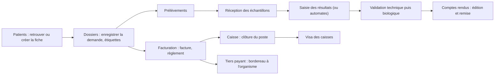
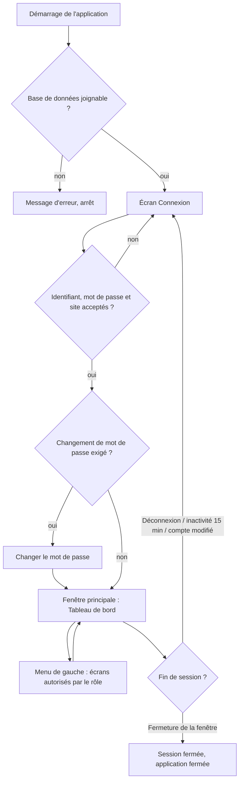
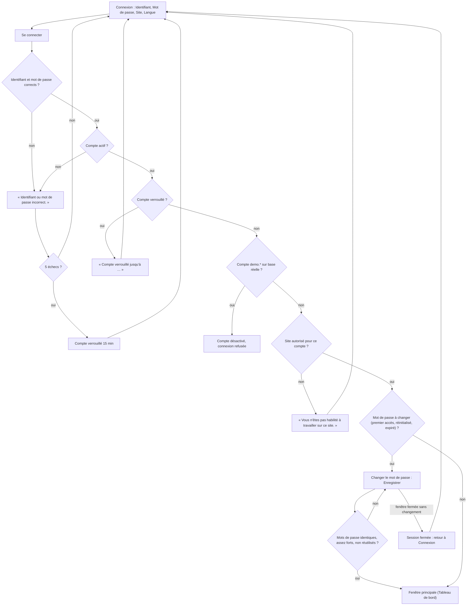
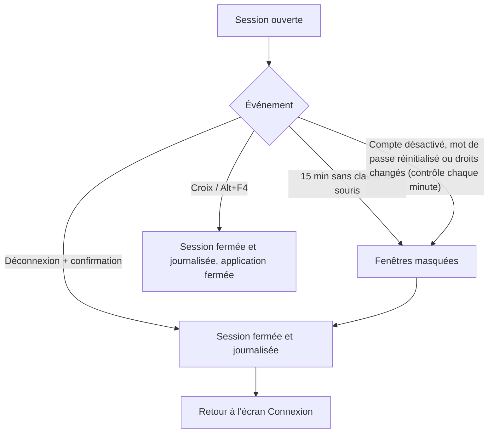
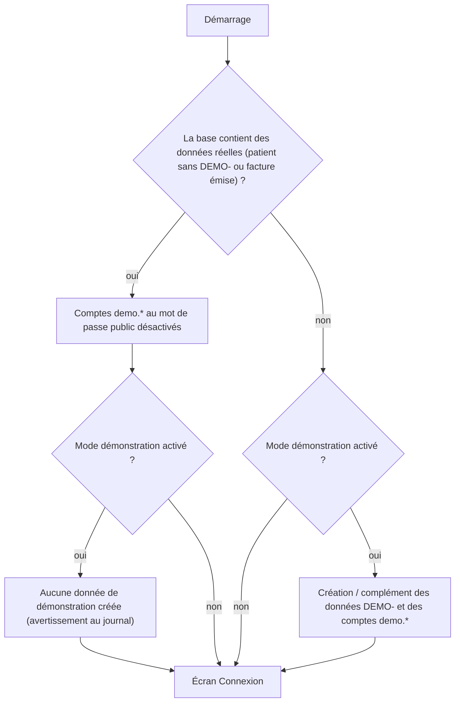
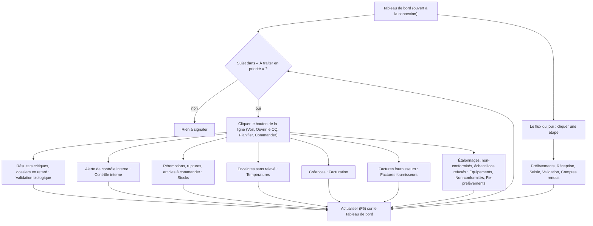

## Prise en main

### Présentation de l'application

**MarocLIS** est le système d'information du laboratoire (SIL, en anglais LIS) : le logiciel qui suit chaque patient et chaque échantillon d'un laboratoire d'analyses de biologie médicale marocain, depuis l'accueil jusqu'au compte rendu signé et à la facture. Il gère aussi ce qui entoure les analyses : contrôle qualité (norme ISO 15189), stocks de réactifs, équipements et automates, personnel, relations avec les prescripteurs, trésorerie et comptabilité. Il applique les règles marocaines : tiers payant AMO (CNSS, CNOPS) et mutuelles, lettre-clé B de la nomenclature, numérotation continue des factures, ICE et identifiant fiscal, protection des données personnelles (loi 08-09).

**Qui l'utilise** : tout le personnel du laboratoire, chacun avec son compte personnel et un ou plusieurs rôles. Les rôles livrés sont Administrateur, Biologiste responsable, Biologiste, Technicien de laboratoire, Préleveur, Secrétariat / accueil, Responsable qualité, Comptabilité et Prescripteur (médecin extérieur, en lecture seule sur ses patients). Le menu ne montre à chacun que les écrans de son rôle (voir **Rôles et droits (vue d'ensemble)** plus bas).

**Les modules** (dans l'ordre du menu de gauche) :

| Module (groupe du menu) | À quoi il sert | Chapitre |
|---|---|---|
| Tableau de bord, Statistiques, Pilotage | Le point du jour (flux des dossiers, alertes à traiter) ; les statistiques d'activité ; les indicateurs de pilotage du directeur. | 00 Prise en main (Tableau de bord) ; chapitre Statistiques et pilotage |
| ACCUEIL / ENREGISTREMENT | Fiche patient (identité, couvertures, consentements, alertes), enregistrement d'une demande d'analyses avec ses étiquettes, consultation et correction d'un dossier. | 01 Accueil / Enregistrement |
| LISTE DE TRAVAIL (pré-analytique) | Prélèvements, réception des échantillons, re-prélèvements, sérothèque, sous-traitance vers un autre laboratoire. | chapitre pré-analytique |
| LISTE DE TRAVAIL (analytique) | Saisie des résultats (à la main ou reçus des automates), validation technique puis biologique, comptes rendus et leur remise. | chapitre analytique et comptes rendus |
| FACTURATION | Factures et avoirs, acomptes, règlements, caisse de chaque opérateur, bordereaux de tiers payant. | 04 Facturation, caisse et tiers payant |
| QUALITÉ | Contrôle interne, non-conformités, évaluation externe, documents qualité. | chapitre Qualité |
| STOCKS | Stocks et lots de réactifs, commandes, devis et factures fournisseurs, consommation, inventaires, températures des enceintes, équipements et contrats des automates. | chapitre Stocks et équipements |
| PERSONNEL | Dossiers du personnel, habilitations, échéances, congés, gardes, paie, accidents du travail. | chapitre Personnel |
| RELATIONS | Statistiques par prescripteur, visites et conventions, rappels et enquêtes auprès des patients. | chapitre Relations |
| FINANCES | Export comptable, comptes et journaux, immobilisations, rapprochement bancaire, prévision de trésorerie, visa des caisses, coût de revient et marge. | chapitre Finances (et 04 pour le **Visa des caisses**) |
| ADMINISTRATION | Utilisateurs et rôles, journal d'audit, catalogue des analyses, automates, données de référence, paramètres (sites, imprimantes, format des factures…). | chapitre Administration |

**Le parcours d'un dossier patient**, d'un bout à l'autre :

1. L'accueil retrouve le patient (ou crée sa fiche), puis enregistre la demande : analyses, prescripteur, priorité. Le prix et la part de l'organisme sont calculés et figés ; les étiquettes des tubes s'impriment.
2. Le préleveur prélève, le laboratoire réceptionne les tubes (ou les refuse et demande un nouveau prélèvement).
3. Les résultats sont saisis ou arrivent des automates, validés techniquement puis biologiquement par un biologiste habilité.
4. Le compte rendu est édité, signé et remis au patient ou au prescripteur.
5. La facture est émise et réglée au comptoir ; la part de l'organisme part dans un bordereau de tiers payant. Chaque caissier clôture sa caisse, que le responsable vise.

**Langues** : l'application fonctionne en français, en arabe (écran de droite à gauche) et en anglais. La langue se choisit sur l'écran **Connexion** et dans le bandeau de la fenêtre principale ; chaque utilisateur a sa langue préférée sur sa fiche. Les comptes rendus peuvent être édités en français ou en arabe selon le patient.

**Aide** : sur n'importe quel écran ou fenêtre, la touche **F1** (ou le bouton **Aide (F1)** du bandeau) ouvre ce manuel à la page de l'écran affiché. **Maj+F1** ouvre la liste des raccourcis clavier.

### Présentation du module

**But** : ce chapitre explique comment ouvrir une session, se repérer dans la fenêtre principale, utiliser l'aide et les raccourcis, qui voit quoi selon son rôle, comment fonctionne le mode démonstration, et comment lire le **Tableau de bord**.

**Qui l'utilise** : tout le monde. Il n'y a pas de droit particulier pour se connecter ou ouvrir le **Tableau de bord** ; ce que chacun voit ensuite dépend de ses droits.

**Écrans et fenêtres** : **Connexion**, **Changer le mot de passe**, la fenêtre principale (bandeau, menu, barre d'état), la fenêtre **Aide**, la fenêtre **Raccourcis clavier**, le **Tableau de bord**.

**Liens avec les autres modules** : la fenêtre principale ouvre tous les autres écrans ; le **Tableau de bord** mène, d'un clic, aux écrans où se traite chaque alerte (Prélèvements, Réception, Saisie, Validation, Comptes rendus, Contrôle interne, Non-conformités, Stocks, Températures, Re-prélèvements, Facturation, Factures fournisseurs, Équipements, Catalogue).

Vue d'ensemble :

### Connexion

**À quoi sert cet écran** : ouvrir une session de travail sur un site du laboratoire, avec son identifiant personnel. C'est le premier écran au démarrage et après chaque déconnexion.

**Qui y a accès** : toute personne qui possède un compte actif, rattaché au site choisi. Les comptes sont créés par l'administrateur dans **Administration › Utilisateurs**.

**L'écran** (fenêtre « Connexion »)

- À gauche, une bande de couleur : le logo du site choisi (ou celui de MarocLIS), « MarocLIS », le sous-titre « Système de gestion de laboratoire d'analyses de biologie médicale », puis « Poste : NOM-DU-POSTE » et « Version … ».
- À droite, le titre « Connexion » et « Identifiez-vous pour ouvrir votre session. », puis les champs.

**Fonctionnalités**

- **Identifiant** : votre nom de connexion.
- **Mot de passe** : masqué. Le bouton **Afficher** le montre en clair, **Masquer** le cache de nouveau.
- Avertissement « ! Attention : le verrouillage des majuscules est activé. » : apparaît sous le mot de passe quand la touche Verr. Maj. est active.
- **Site** : liste des sites actifs du laboratoire, sous la forme « CODE — Nom du site » (les laboratoires partenaires n'y figurent pas). Le logo change avec le site.
- **Langue** : Français, العربية, English. Le changement s'applique tout de suite à l'écran de connexion.
- **Se souvenir de l'identifiant** : l'identifiant sera pré-rempli la prochaine fois sur ce poste (le mot de passe n'est jamais retenu).
- **Se connecter** (ou touche **Entrée**) : vérifie l'identifiant, le mot de passe et le droit de travailler sur le site.
- Ligne rouge sous le bouton : affiche la raison d'un refus.
- « Mot de passe oublié ? Contactez l'administrateur du LIS. » : rappel ; seul l'administrateur peut réinitialiser un mot de passe.
- Fenêtre **Changer le mot de passe** (ouverte automatiquement quand le changement est exigé) : **Mot de passe actuel** (déjà rempli et grisé), **Nouveau mot de passe**, **Confirmer le mot de passe**, la règle à respecter, **Enregistrer**. Pas de bouton **Annuler** et la fenêtre ne peut pas être fermée par la croix.

**Scénarios**

1. *Se connecter normalement*
   1. Choisir la **Langue** si besoin.
   2. Saisir l'**Identifiant** puis le **Mot de passe** (cliquer **Afficher** pour vérifier ce qui a été tapé).
   3. Choisir le **Site** où vous travaillez aujourd'hui.
   4. Cocher **Se souvenir de l'identifiant** si le poste est le vôtre.
   5. Cliquer **Se connecter** ou appuyer sur Entrée.
   6. La fenêtre principale s'ouvre sur le **Tableau de bord**, dans **votre** langue préférée (celle de votre fiche utilisateur), même si une autre langue était choisie sur l'écran de connexion.

2. *Première connexion (compte « admin » livré avec l'application) ou mot de passe réinitialisé par l'administrateur*
   1. Se connecter avec le mot de passe provisoire.
   2. Le message « Votre mot de passe doit être modifié avant de continuer. » s'affiche (titre « Changement de mot de passe requis »). Cliquer OK.
   3. La fenêtre **Changer le mot de passe** s'ouvre. Le champ **Mot de passe actuel** est déjà rempli et grisé.
   4. Saisir le **Nouveau mot de passe** puis **Confirmer le mot de passe**. La règle est rappelée dans la fenêtre : « Le mot de passe doit comporter au moins 10 caractères et mêler lettres, chiffres et caractères spéciaux. » (10 = réglage livré).
   5. Cliquer **Enregistrer**. Le message « Enregistré. » confirme ; la session s'ouvre.
   6. Si la fenêtre se ferme sans changement, la session est aussitôt fermée et l'écran **Connexion** affiche « Votre mot de passe doit être modifié avant de continuer. » : recommencez.

3. *Mot de passe expiré* : même déroulement que le scénario 2. Le mot de passe expire après 180 jours (réglage livré).

4. *Changer de site* : il n'existe pas de bouton pour changer de site dans la fenêtre principale. Cliquer **Déconnexion**, puis se reconnecter en choisissant l'autre **Site**.

5. *Se déconnecter*
   1. Cliquer **Déconnexion** en bas du menu de gauche, puis confirmer.
   2. L'application se ferme et se rouvre sur l'écran **Connexion**. Fermer la fenêtre principale (croix, Alt+F4) ferme aussi la session et l'inscrit au journal de sécurité.

**Règles et contrôles**

- « Identifiant ou mot de passe incorrect. » : nom inconnu ou mauvais mot de passe. Le même message s'affiche pour un **compte désactivé** (volontairement, pour ne pas révéler quels comptes existent).
- Après 5 essais faux (réglage livré), le compte est bloqué 15 minutes : « Compte verrouillé jusqu'à HH:MM après plusieurs tentatives infructueuses. ». Ce message n'apparaît que si le mot de passe saisi est le bon ; sinon on voit le message d'identifiant incorrect.
- « Vous n'êtes pas habilité à travailler sur ce site. » : le compte n'a pas accès au site choisi.
- Nouveau mot de passe : il doit respecter la règle de longueur et de mélange, être identique dans les deux champs et ne pas faire partie des 5 derniers utilisés (réglage livré).
- **Verrouillage automatique** : après 15 minutes sans clavier ni souris (réglage livré), toutes les fenêtres sont masquées, la session est fermée et le message « Votre session a expiré. Reconnectez-vous. » s'affiche. Ce qui n'était pas enregistré est perdu.
- **Compte modifié pendant la session** : toutes les minutes, l'application vérifie le compte. S'il a été désactivé, si son mot de passe a été réinitialisé ou si ses droits ont changé, la session est fermée (voir **Messages d'erreur communs**).
- Il n'y a **pas** de bouton pour changer volontairement son mot de passe une fois connecté : demandez à l'administrateur de le réinitialiser, vous choisirez le nouveau à la connexion suivante.

**Flux** : Connexion → (changement de mot de passe obligatoire si demandé) → fenêtre principale ouverte sur le **Tableau de bord**.

### Fenêtre principale

**À quoi sert cet écran** : c'est le cadre commun à tous les écrans. Il montre qui est connecté et où, donne accès aux écrans autorisés par le menu de gauche, à l'aide, à l'impression de la liste affichée et aux raccourcis clavier.

**Qui y a accès** : toute personne connectée. Le menu ne montre que les écrans autorisés par votre rôle.

**L'écran**

- **Bandeau du haut** (de gauche à droite) : « MarocLIS », puis le chemin de l'écran ouvert (« Groupe › Nom de l'écran », par exemple « Facturation › Caisse » ; le nom seul pour un écran hors groupe), votre nom avec en dessous « Site : CODE · Poste : NOM-DU-POSTE », la date et l'heure (mises à jour toutes les 30 secondes), les boutons **Aide (F1)** et **Imprimer (Ctrl+P)**, et la liste des langues.
- **Menu de gauche** : en haut, sans titre de groupe, **Tableau de bord**, **Statistiques**, **Pilotage** ; puis les groupes en majuscules : ACCUEIL / ENREGISTREMENT, LISTE DE TRAVAIL, FACTURATION, QUALITÉ, STOCKS, PERSONNEL, RELATIONS, FINANCES, ADMINISTRATION. Tout en bas : **Raccourcis clavier (Maj+F1)** et **Déconnexion**. L'écran ouvert est marqué d'un trait de couleur à gauche de son nom.
- **Barre d'état** (tout en bas, en couleur) : à gauche « ● Connecté en tant que Votre nom   Site : CODE » ; à droite le rappel des raccourcis « Ctrl+F Rechercher · Ctrl+S Enregistrer · Ctrl+P Imprimer · F5 Actualiser · F1 Aide » (avec vos propres touches si vous les avez changées).

**Fonctionnalités**

- Nom d'un écran dans le menu : ouvre l'écran. Le raccourci clavier de l'écran est écrit à droite de son nom (ou dans l'info-bulle si le nom est long). Un écran sans droit n'apparaît pas ; un groupe n'apparaît que si vous pouvez ouvrir au moins un de ses écrans.
- Titre d'un groupe du menu : replie ou déplie le groupe (info-bulle « Replier ce groupe » / « Déplier ce groupe ») ; le choix est retenu pour vous sur ce poste.
- **Aide (F1)** : ouvre la fenêtre **Aide** à la page de l'écran affiché (voir plus bas).
- **Imprimer (Ctrl+P)** : produit un PDF de la plus grande liste visible de l'écran, telle qu'affichée, avec en-tête (site, votre nom, date et heure, nombre de lignes).
- Liste des langues : Français, العربية ou English ; tout l'écran est retraduit sur-le-champ.
- **Raccourcis clavier (Maj+F1)** : ouvre la fenêtre **Raccourcis clavier**.
- **Déconnexion** : ferme la session après confirmation et revient à l'écran **Connexion**.
- Fenêtre **Aide** : titre « Aide — nom de l'écran », boutons **Précédent**, **Suivant**, **Sommaire**, **Imprimer**. Échap ou la croix la masque (elle se rouvre au même endroit). Un lien vers un site web s'ouvre dans le navigateur.
- Fenêtre **Raccourcis clavier** : liste **Action** / **Raccourci**, bouton **Rétablir les raccourcis par défaut**, **Enregistrer**, **Annuler**.

**Scénarios**

1. *Ouvrir un écran* : cliquer son nom dans le menu, ou utiliser son raccourci. Si l'écran que vous quittez contient des saisies non enregistrées (par exemple des résultats tapés), il peut refuser de se fermer : vous restez dessus.
2. *Replier / déplier un groupe du menu* : cliquer le titre du groupe (petit triangle à gauche). Un écran ouvert par raccourci dans un groupe replié déplie ce groupe.
3. *Obtenir de l'aide sur l'écran affiché*
   1. Appuyer sur **F1** (ou cliquer **Aide (F1)**). F1 fonctionne aussi dans une fenêtre de saisie ouverte par un écran.
   2. La fenêtre **Aide** s'ouvre sur la section du manuel qui décrit l'écran.
   3. **Sommaire** affiche la table des chapitres ; **Précédent** / **Suivant** naviguent dans les pages déjà vues ; **Imprimer** imprime la page.
   4. Appuyer sur Échap pour revenir au travail.
4. *Changer la langue* : choisir Français, العربية ou English dans la liste en haut à droite. En arabe, la fenêtre passe de droite à gauche ; les identifiants, mots de passe et codes restent écrits de gauche à droite. Ce choix vaut pour la session en cours ; à la connexion suivante, la langue de votre fiche utilisateur s'applique de nouveau (c'est l'administrateur qui modifie la langue préférée).
5. *Imprimer la liste affichée*
   1. Ouvrir l'écran voulu, filtrer la liste.
   2. Cliquer **Imprimer** ou appuyer sur **Ctrl+P**.
   3. Un PDF s'ouvre avec la liste (colonnes visibles et ordre affiché ; certaines colonnes masquées à l'écran, comme le sexe ou l'âge sur **Patients**, sont imprimées). L'imprimer depuis le lecteur PDF.
6. *Utiliser les raccourcis clavier*

   | Touche | Action |
   |---|---|
   | F1 | Aide de l'écran affiché |
   | Maj+F1 | Raccourcis clavier (cette liste) |
   | Ctrl+S | Clique le bouton **Enregistrer** de l'écran, s'il existe et est actif |
   | Ctrl+F | Place le curseur dans la zone de recherche de l'écran |
   | Ctrl+P | Imprimer la liste de l'écran |
   | F5 | Actualiser l'écran |
   | Ctrl+1 | Patients |
   | Ctrl+2 | Dossiers |
   | Ctrl+3 | Consultation d'un dossier |
   | Ctrl+4 | Prélèvements |
   | Ctrl+5 | Réception des échantillons |
   | Ctrl+6 | Saisie des résultats |
   | Ctrl+7 | Validation biologique |
   | Ctrl+8 | Comptes rendus |
   | Ctrl+9 | Facturation |
   | Ctrl+0 | Caisse |

   Un raccourci d'écran ne fonctionne que si vous avez le droit d'ouvrir cet écran. Dans chaque fenêtre, Alt + la lettre soulignée active le bouton ou le champ. Certains écrans ont leurs propres touches (par exemple F12, F8 et Échap sur **Dossiers**) : elles sont indiquées sur les boutons.
7. *Personnaliser ses raccourcis*
   1. Cliquer **Raccourcis clavier (Maj+F1)** ou appuyer sur Maj+F1. La fenêtre liste chaque **Action** et son **Raccourci** ; les autres écrans autorisés y figurent sans raccourci (« Ouvrir : Nom de l'écran »).
   2. Sélectionner une ligne puis appuyer sur la combinaison voulue (Ctrl ou Alt + une touche, ou une touche F1 à F12). Suppr retire le raccourci.
   3. Si la combinaison était déjà prise, elle est déplacée et un message l'indique.
   4. **Rétablir les raccourcis par défaut** remet la liste d'origine.
   5. Cliquer **Enregistrer** (ou **Annuler**). Les raccourcis sont propres à votre compte, sur ce poste ; la barre d'état et les boutons affichent alors vos touches.

**Règles et contrôles**

- Masquer un écran du menu n'est pas la seule protection : même atteint autrement, une opération sans droit est refusée.
- Au démarrage, si la base de données est injoignable, un message d'erreur s'affiche avant l'écran de connexion. Si une police des comptes rendus manque (police arabe surtout), un avertissement s'affiche au démarrage : prévenir l'informatique avant de diffuser des comptes rendus en arabe.
- La confirmation de déconnexion n'affiche que le mot « Déconnexion » : répondre Oui pour fermer la session.

**Flux** : la fenêtre principale est le point de départ de tous les circuits. L'ordre des raccourcis Ctrl+1 à Ctrl+0 suit le parcours d'un dossier : patient → dossier → prélèvement → réception → saisie → validation → compte rendu → facturation → caisse.

```mermaid
flowchart LR
    P["Patients (Ctrl+1)"] --> D["Dossiers (Ctrl+2)"] --> CD["Consultation d'un dossier (Ctrl+3)"]
    CD --> PR["Prélèvements (Ctrl+4)"] --> RE["Réception des échantillons (Ctrl+5)"]
    RE --> SA["Saisie des résultats (Ctrl+6)"] --> VA["Validation biologique (Ctrl+7)"]
    VA --> CR["Comptes rendus (Ctrl+8)"] --> FA["Facturation (Ctrl+9)"] --> CA["Caisse (Ctrl+0)"]
```

Fin de session :

### Rôles et droits (vue d'ensemble)

**À quoi sert cette section** : dire, pour chaque rôle livré, quels écrans il voit. Chaque utilisateur reçoit un ou plusieurs rôles ; un rôle est un ensemble de droits. L'administrateur peut modifier les rôles ou en créer d'autres dans **Administration › Utilisateurs**, onglet **Rôles et droits**. Les droits que l'administrateur a retirés à un rôle livré ne sont pas remis lors d'une mise à jour.

| Rôle livré | Pour qui | Écrans visibles dans le menu |
|---|---|---|
| Administrateur | Informatique / gérant | Tous les écrans, y compris **Paramètres**. N'a pas de qualification de biologiste : il ne peut pas valider biologiquement un résultat. |
| Biologiste responsable | Directeur du laboratoire | Presque tout : Tableau de bord, Statistiques, Pilotage, accueil, technique (y compris Sous-traitance), validation, comptes rendus, Facturation, Tiers payant, qualité, stocks (sauf Demandes de devis et Évaluation fournisseurs), équipements, tout le personnel y compris Paie, RELATIONS (les trois écrans), FINANCES (tous), Utilisateurs, Journal d'audit, Catalogue, Automates, Données de référence. Pas **Caisse** (n'encaisse pas), pas **Paramètres**. |
| Biologiste | Biologiste médical | Tableau de bord, Statistiques, Patients, Dossiers, Consultation d'un dossier, Réception des échantillons, Re-prélèvements, Sérothèque, Sous-traitance, Saisie des résultats, Validation biologique, Comptes rendus, Contrôle interne, Non-conformités, Évaluation externe, Documents qualité, Stocks, Bons de commande, Consommation, Températures, Équipements, Congés et absences, Accidents du travail, Catalogue des analyses, Automates. Peut aussi retirer une validation, réimprimer un compte rendu validé et rejouer les messages d'un automate. |
| Technicien de laboratoire | Paillasse | Tableau de bord, Patients, Consultation d'un dossier, Prélèvements, Réception des échantillons, Re-prélèvements, Sérothèque, Sous-traitance, Saisie des résultats, Comptes rendus, Contrôle interne, Non-conformités, Évaluation externe, Documents qualité, Stocks, Bons de commande, Consommation, Inventaires, Températures, Équipements, Congés et absences, Catalogue des analyses, Automates. Saisit et valide techniquement, **ne valide jamais biologiquement**. Peut rejouer les messages d'un automate. |
| Préleveur | Infirmier, préleveur | Tableau de bord, Patients (peut créer un patient), Consultation d'un dossier, Prélèvements, Congés et absences, Catalogue des analyses. L'écran **Sous-traitance** demande désormais un droit propre que ce rôle n'a pas. |
| Secrétariat / accueil | Accueil, secrétaires | Tableau de bord, Patients, Dossiers, Consultation d'un dossier, Re-prélèvements, Comptes rendus (remise, envoi et réimpression d'un compte rendu validé, jamais un résultat non validé), Facturation, Caisse, Tiers payant, Congés et absences, Catalogue des analyses. |
| Responsable qualité | Qualité | Tableau de bord, Statistiques, Patients, Consultation d'un dossier, Comptes rendus, tout le groupe QUALITÉ, Stocks, Bons de commande, Consommation, Inventaires, Températures, Équipements, Contrats automates, Dossiers du personnel, Habilitations, Échéances RH, Congés et absences, Planning des gardes, Accidents du travail, Immobilisations (lecture), Utilisateurs (lecture), Journal d'audit, Catalogue, Automates, Données de référence. |
| Comptabilité | Comptable, facturation | Tableau de bord, Statistiques, Patients, Consultation d'un dossier, Facturation, Caisse, Tiers payant, Stocks, Bons de commande, Demandes de devis, Factures fournisseurs, Évaluation fournisseurs, Consommation, Contrats automates, Congés et absences, Statistiques prescripteurs, Visites et conventions (lecture seule), tout le groupe FINANCES sauf Coût de revient et marge, Données de référence. Aucun accès aux résultats. |
| Prescripteur | Médecin extérieur | Tableau de bord, Patients, Consultation d'un dossier, Comptes rendus — en lecture, limité à **ses propres** patients, réimpression du compte rendu déjà validé uniquement. |

À retenir :

- Une personne peut cumuler plusieurs rôles (par exemple secrétaire + comptabilité) : elle voit l'union des écrans.
- À l'intérieur d'un écran, certains boutons ne sont actifs qu'avec un droit précis (par exemple **Compte rendu (PDF)** sur **Consultation d'un dossier**). Chaque chapitre le précise.
- Le droit de **déclarer une non-conformité** est donné au Biologiste responsable, au Biologiste, au Technicien et au Responsable qualité.
- La validation biologique exige à la fois le droit et une qualification de biologiste (médecin ou pharmacien biologiste) en cours de validité sur la fiche utilisateur.
- Les comptes « admin » (premier administrateur) et « interface » (compte de service des automates, qui ne peut pas se connecter) sont créés automatiquement à la première installation.

### Mode démonstration

**À quoi sert cette section** : une base remplie d'une journée de laboratoire fictive, pour la formation ou la présentation.

**Qui y a accès** : il est activé par l'informatique, sur un poste ou une base de formation uniquement (réglage « SeedDemoDataOnFirstRun »). Il est désactivé dans la version livrée.

**Fonctionnalités**

- Données d'exemple : des patients dont le numéro de dossier commence par **DEMO-**, des dossiers portant dans leur note interne « JEU DE DÉMONSTRATION — NE PAS UTILISER EN PRODUCTION » (visible sur les listes de travail, jamais imprimée), des fournisseurs, articles, automates, lots de contrôle et une mutuelle aux codes **DEMO-**, des noms suivis de « (démo) ».
- Des comptes de démonstration, un par métier :

  | Identifiant | Rôle(s) |
  |---|---|
  | demo.biologiste | Biologiste responsable |
  | demo.technicien | Technicien de laboratoire |
  | demo.secretaire | Secrétariat / accueil + Comptabilité |
  | demo.qualite | Responsable qualité |

  Leurs mots de passe sont publics (fournis par l'informatique pour la formation).

**Scénario** : *Se former sur la base de démonstration* — se connecter avec un compte demo.*, parcourir les écrans : chaque écran contient des exemples réalistes (dossiers à tous les stades, contrôles qualité avec graphique, factures, etc.).

**Règles et contrôles**

- **Jamais sur la base réelle du laboratoire.** Si la base contient déjà un vrai patient (sans DEMO-) ou une vraie facture émise, aucune donnée de démonstration n'est créée.
- Dès que des données réelles apparaissent, chaque compte demo.* qui a encore son mot de passe public est désactivé (au démarrage et à sa prochaine tentative de connexion), avec le message « Ce compte de démonstration a été désactivé : la base contient désormais des données réelles et son mot de passe est publié. Utilisez un compte nominatif. »
- Les factures de démonstration prennent des numéros dans la vraie série de facturation : c'est une raison de plus pour ne jamais activer ce mode en production.

**Flux** : la base de démonstration suit le même parcours que la vraie (tous les dossiers ont été créés par les mêmes fonctions que celles des écrans).

### Tableau de bord

**À quoi sert cet écran** : c'est l'écran d'accueil, ouvert à chaque connexion. Il montre où en sont les dossiers du jour, ce qui demande une action en priorité, et ce qui est en ordre. Chaque chiffre mène, d'un clic, à l'écran où l'on traite le sujet.

**Qui y a accès** : tout le monde. Chaque chiffre n'est montré qu'à ceux qui ont le droit correspondant (par exemple la caissière ne voit pas les résultats critiques, le technicien ne voit pas les créances), et un clic n'ouvre un écran que si votre rôle peut l'ouvrir.

**L'écran** (de haut en bas)

- **Bandeau orange** (seulement si le catalogue n'est pas prêt) : « N paramètre(s) attendent la validation de leurs valeurs usuelles » ou « N tarif(s) provisoire(s) à confirmer », avec jusqu'à trois codes concernés (« … et N autres » s'il y en a plus).
- « Bonjour, Votre nom », la date du jour suivie de « · actualisé à HH:MM:SS », et le bouton **Actualiser** (F5).
- Carte **Le flux du jour** : cinq étapes dans l'ordre du parcours d'un dossier, chacune avec son nombre et un lien vers son écran : **À prélever** (Prélèvements ›), **À réceptionner** (Réception ›), **À saisir** (Saisie ›), **À valider** (Validation ›, mise en valeur), **Comptes rendus à émettre** (Comptes rendus ›). À côté : « N dossier(s) enregistré(s) aujourd'hui · N compte(s) rendu(s) émis aujourd'hui ».
- Carte **À traiter en priorité** (« N sujet(s) ») : une ligne par alerte non nulle, avec une pastille (**Urgent**, **À planifier**, **À traiter** ou **À suivre**), le nombre, le libellé et un bouton d'action. « Aucun sujet en attente. » s'il n'y a rien.
- Carte **Rien à signaler** : les contrôles qui sont à zéro aujourd'hui, cochés ✓ (« Ces contrôles sont à zéro aujourd'hui. » ; « Aucun contrôle n'est à zéro aujourd'hui. » s'il n'y en a aucun).

**Fonctionnalités**

- **Revoir les valeurs usuelles** / **Ouvrir le catalogue** (bouton du bandeau orange) : ouvre le **Catalogue des analyses** pour finaliser les valeurs usuelles ou confirmer les tarifs (droit de consulter le catalogue).
- **Actualiser** (ou F5) : recalcule tous les chiffres ; l'heure du calcul s'affiche après la date.
- Étapes de **Le flux du jour** : un clic sur l'étape ouvre l'écran correspondant (**Prélèvements**, **Réception des échantillons**, **Saisie des résultats**, **Validation biologique**, **Comptes rendus**), si votre rôle y a accès.
- Bouton d'une ligne de **À traiter en priorité** (**Voir**, **Ouvrir le CQ**, **Planifier**, **Commander**) : ouvre l'écran où se traite l'alerte. Le bouton n'apparaît pas si votre rôle ne peut pas ouvrir cet écran.

| Ligne de « À traiter en priorité » | Ce qu'elle compte (site en cours) | Pastille si > 0 | Bouton → écran | Droit pour la voir |
|---|---|---|---|---|
| Résultats critiques non communiqués | Résultats critiques sans appel au prescripteur confirmé | Urgent | Voir → Validation biologique | Résultats (consultation) |
| Dossiers en retard sur le délai de rendu | Dossiers dont l'heure de rendu promise est passée, ni rendus ni annulés | Urgent | Voir → Validation biologique | Dossiers (consultation) |
| Alerte de contrôle interne · résultats bloqués | Contrôles rejetés non encore revus | Urgent | Ouvrir le CQ → Contrôle interne | Qualité (consultation) |
| Étalonnages dépassés | Automates en service dont l'étalonnage est dépassé | Urgent | Planifier → Équipements | Équipements (consultation) |
| Lots périmés ou à moins de 7 jours | Lots de réactifs avec stock, périmés ou proches | Urgent | Voir → Stocks | Stocks (consultation) |
| Ruptures prévues avant livraison | Articles qui seront épuisés avant l'arrivée d'une commande passée aujourd'hui | Urgent | Voir → Stocks | Stocks (consultation) |
| Factures fournisseurs en retard de paiement | Factures fournisseurs échues non payées | Urgent | Voir → Factures fournisseurs | Saisie des factures fournisseurs |
| Factures fournisseurs à payer sous 7 jours | Factures fournisseurs à échéance dans la semaine | À planifier | Voir → Factures fournisseurs | Saisie des factures fournisseurs |
| Non-conformités ouvertes | Ouvertes, en cours ou en attente de vérification | À traiter | Voir → Non-conformités | Qualité (consultation) |
| Articles à commander | Articles au seuil de commande ou en dessous (lots utilisables seulement) | À traiter | Commander → Stocks | Stocks (consultation) |
| Réactifs en péremption proche | Lots avec stock qui périment dans le délai d'alerte (30 jours par défaut) | À traiter | Voir → Stocks | Stocks (consultation) |
| Enceintes sans relevé de température aujourd'hui | Réfrigérateurs / congélateurs actifs sans relevé du jour | À traiter | Voir → Températures | Relevé des températures |
| Échantillons refusés aujourd'hui | Échantillons refusés depuis minuit | À suivre | Voir → Re-prélèvements | Échantillons (consultation) |
| Créances échues à relancer | Factures patients émises ou partiellement payées, échues | À suivre | Voir → Facturation | Facturation (consultation) |

Les lignes sont triées par pastille (Urgent, À planifier, À traiter, À suivre), puis par nombre décroissant. Une ligne à zéro passe dans **Rien à signaler**.

| Étape de « Le flux du jour » | Ce qu'elle compte (site en cours) | Droit pour la voir |
|---|---|---|
| À prélever | Échantillons en attente de prélèvement | Échantillons (consultation) |
| À réceptionner | Tubes prélevés ou en transit, pas encore réceptionnés | Échantillons (consultation) |
| À saisir | Dossiers qui ont encore une valeur à saisir à la paillasse | Résultats (consultation) |
| À valider | Résultats validés techniquement, en attente de validation biologique | Résultats (consultation) |
| Comptes rendus à émettre | Dossiers non annulés qui ont des résultats validés biologiquement pas encore portés sur un compte rendu | Comptes rendus (consultation) |

**Scénarios**

1. *Faire le point en début de journée* : le **Tableau de bord** s'ouvre seul à la connexion. Lisez d'abord **À traiter en priorité**, en commençant par les pastilles **Urgent** : cliquez **Voir** sur « Résultats critiques non communiqués » pour appeler les prescripteurs depuis **Validation biologique**, **Ouvrir le CQ** pour revoir les contrôles rejetés, etc.
2. *Suivre le flux* : regardez **Le flux du jour** ; cliquez l'étape qui s'accumule (par exemple **À valider**) pour ouvrir son écran.
3. *Mettre à jour les chiffres* : cliquez **Actualiser** ou appuyez sur **F5**. L'heure du calcul s'affiche à côté de la date.
4. *Finaliser le catalogue* : si le bandeau orange est affiché, cliquez **Revoir les valeurs usuelles** (ou **Ouvrir le catalogue**) et faites valider les valeurs usuelles par le biologiste ou confirmer les tarifs provisoires.

**Règles et contrôles**

- Les chiffres concernent le **site sur lequel vous êtes connecté** (sauf « Articles à commander », compté sur tout le stock).
- Le bandeau orange signale un catalogue pas prêt pour la production (tarifs provisoires, valeurs usuelles non validées par le biologiste) : à régler avant d'émettre de vraies factures et comptes rendus.
- En cas d'erreur de calcul, la date est suivie en rouge de « Une erreur inattendue est survenue. L'incident a été journalisé. »
- **Imprimer** (Ctrl+P) ne fonctionne pas sur cet écran : il n'a pas de liste.

**Flux** : Tableau de bord → clic sur une étape ou sur le bouton d'une alerte → écran où se traite le sujet → F5 sur le Tableau de bord.

### Messages d'erreur communs

Ces messages peuvent apparaître sur n'importe quel écran. Ils sont donnés ici une fois pour toutes ; les messages propres à un écran sont dans la section « Messages d'erreur et d'avertissement » de son chapitre.

| Situation | Message affiché (texte exact) | Cause | Que faire | Appeler l'administrateur ? |
|---|---|---|---|---|
| Serveur de base de données injoignable au démarrage | « L'application n'a pas pu démarrer. » suivi du détail technique et de « Consultez logs/maroclis-*.log. » ; ou « Échec de l'initialisation de la base de données : … » | Le serveur est éteint, le réseau est coupé ou le poste n'est pas autorisé. | Vérifier le câble ou le Wi-Fi, attendre une minute et relancer l'application. | Oui si le message revient : donner l'heure et le texte exact. |
| Base de données non conforme | « La base de données existe mais ne correspond pas au schéma attendu. » | La base n'a pas été mise à jour avec la version installée sur le poste. | Ne pas insister. | Oui, toujours. |
| Connexion perdue pendant le travail | « Une erreur inattendue est survenue. L'incident a été journalisé. » (la coupure réseau n'a pas de message propre) | Le réseau ou le serveur a coupé pendant un enregistrement ou un chargement. | Vérifier le réseau, puis **Actualiser** (F5) : ce qui n'a pas été confirmé par « Enregistré. » ou un message de succès n'est pas enregistré ; recommencer la saisie. | Oui si plusieurs postes sont touchés ou si cela se répète. |
| Erreur inattendue | « Une erreur inattendue est survenue. L'incident a été journalisé. » | Un incident non prévu ; il est noté dans le journal technique du poste. | Noter ce que vous faisiez, actualiser l'écran (F5) et réessayer une fois. | Oui si l'erreur se reproduit, avec l'heure et l'écran. |
| Droit manquant | « Vous n'avez pas le droit d'effectuer cette opération. » | Votre rôle n'a pas le droit demandé (le bouton est en général grisé, mais l'opération est aussi refusée si elle est atteinte autrement). | Demander à une personne qui a ce droit. | Oui si votre rôle devrait avoir ce droit : seul l'administrateur modifie les rôles. |
| Session expirée | « Votre session a expiré. Reconnectez-vous. » | 15 minutes sans clavier ni souris (réglage livré). | Se reconnecter ; refaire la saisie non enregistrée. | Non. |
| Compte modifié pendant la session | « Votre compte a été modifié (désactivation, mot de passe réinitialisé ou droits changés). La session est fermée ; reconnectez-vous. » | L'administrateur a changé votre compte. | Se reconnecter (avec le nouveau mot de passe si on vous l'a donné). | Oui si vous ne savez pas pourquoi. |
| Identifiant ou mot de passe faux | « Identifiant ou mot de passe incorrect. » | Faute de frappe, majuscules activées, ou compte désactivé. | Vérifier Verr. Maj. et retaper ; cliquer **Afficher** pour relire le mot de passe. | Oui après deux ou trois essais : le compte se verrouille au 5e. |
| Compte verrouillé | « Compte verrouillé jusqu'à HH:MM après plusieurs tentatives infructueuses. » | 5 mots de passe faux de suite. | Attendre l'heure indiquée (15 minutes). | Oui si c'est urgent ou si quelqu'un d'autre a essayé votre compte. |
| Site non autorisé | « Vous n'êtes pas habilité à travailler sur ce site. » | Votre compte n'a pas ce site. | Choisir votre site habituel. | Oui pour ajouter le site à votre fiche. |
| Mot de passe à changer | « Votre mot de passe doit être modifié avant de continuer. » | Premier accès, mot de passe réinitialisé ou expiré (180 jours). | Choisir un nouveau mot de passe dans la fenêtre qui s'ouvre. | Non. |
| Nouveau mot de passe refusé | « Le mot de passe doit comporter au moins 10 caractères et mêler lettres, chiffres et caractères spéciaux. » ; « Les deux mots de passe saisis ne correspondent pas. » ; « Ce mot de passe a déjà été utilisé récemment. » | Règle non respectée, faute de frappe, ou un des 5 derniers mots de passe. | Choisir un autre mot de passe et le taper deux fois à l'identique. | Non. |
| Compte de démonstration | « Ce compte de démonstration a été désactivé : la base contient désormais des données réelles et son mot de passe est publié. Utilisez un compte nominatif. » | Un compte demo.* sur la base réelle. | Utiliser votre compte personnel. | Oui si vous n'en avez pas. |
| Modification simultanée | « Cet enregistrement a été modifié par un autre poste depuis son ouverture. Rechargez-le puis reprenez votre saisie. » | Un collègue a enregistré la même fiche entre-temps. | Actualiser (F5) ou rouvrir la fiche, vérifier ce qui a changé, refaire votre modification. | Non. |
| Nombre illisible ou trop grand | « « … » n'est pas une valeur numérique valide. » | Lettres, unité tapée avec le nombre (« 10 % »), notation « 1e5 » ou nombre trop grand (plus de 12 chiffres avant la virgule) dans une case de nombre. | Taper le nombre seul, avec une virgule ou un point pour les décimales (« 1 250,50 » est accepté). | Non. |
| Champ obligatoire | Messages du type « Le nom du patient est obligatoire. », « Indiquez le motif… », « … doit être motivé(e). » | Un champ nécessaire est vide. | Remplir le champ nommé dans le message. | Non. |
| Motif obligatoire | « Indiquez le motif de cette opération. Il sera conservé dans le journal d'audit. » (titre « Motif obligatoire ») | Une opération sensible (annulation, remboursement, réimpression…) a été validée avec un motif vide ou trop court. | Écrire un motif clair (le nombre minimum de caractères dépend de l'opération). | Non. |
| Texte trop long | Messages du type « Texte trop long (… caractères au plus). » | Le texte dépasse la longueur prévue. | Raccourcir le texte. | Non. |
| Rien de sélectionné | « Aucun élément sélectionné. » | Un bouton a été cliqué sans ligne choisie. | Sélectionner (ou cocher) une ligne puis recommencer. | Non. |
| Liste à imprimer vide | « Cet écran n'affiche aucune liste à imprimer. » | Ctrl+P sur un écran sans liste ou avec une liste vide. | Afficher une liste avant d'imprimer. | Non. |
| Document vide ou non écrit | « Le document est vide : rien à ouvrir. » ; « Impossible d'écrire le document sur ce poste. » | Rien à imprimer, ou le disque du poste est plein ou protégé. | Vérifier qu'il y a des données ; libérer de la place. | Oui pour le second message. |
| Pas de lecteur PDF | « Aucune application n'est associée à ce type de fichier sur ce poste (lecteur PDF, tableur…). Le document est ici : … » | Aucun lecteur PDF ou tableur installé. | Ouvrir le fichier à l'emplacement indiqué avec un autre programme. | Oui pour installer un lecteur PDF. |
| Imprimante d'étiquettes | « Aucune imprimante d'étiquettes configurée. » ; « Windows ne reconnaît pas l'imprimante « … » : choisissez-la dans Paramètres › Imprimantes, ou choisissez « Aucune » pour produire un PDF. » ; « L'impression des étiquettes a échoué. Vérifiez le papier et la file d'impression. » ; « Aucune étiquette à imprimer. » | Imprimante non réglée, débranchée, à court de papier ou bloquée. | Vérifier le papier et le câble ; réimprimer depuis **Consultation d'un dossier**. | Oui pour régler l'imprimante dans **Paramètres**. |
| Police manquante (au démarrage) | « Police(s) de compte rendu absente(s) : … » | Une police des comptes rendus n'est pas installée sur le poste. | Continuer à travailler ; ne pas éditer de compte rendu en arabe depuis ce poste. | Oui, pour installer la police. |
| Numérotation fermée ou absente | « La numérotation « … » est clôturée : aucun document ne peut plus y être rattaché. » ; « Aucune numérotation n'est configurée pour « … ». » | Exercice clôturé, ou série de numéros non créée pour ce site. | Ne pas réessayer. | Oui, toujours. |
| Aide absente | « L'aide n'est pas installée sur ce poste : le dossier Help est introuvable à côté du programme. » | L'installation du poste est incomplète. | Utiliser le manuel sur un autre poste. | Oui. |
| Raccourci refusé | « Utilisez Ctrl ou Alt avec une touche, ou une touche F1 à F12. » ; « … était le raccourci de « … », qui n'en a plus. » ; « Les raccourcis n'ont pas pu être enregistrés. » | Lettre seule choisie ; touche déjà prise (simple information) ; problème d'écriture sur le poste. | Choisir une autre combinaison ; pour le dernier message, réessayer. | Oui si l'enregistrement échoue encore. |

### Messages d'erreur et d'avertissement

Messages propres aux écrans de ce chapitre (en plus des **Messages d'erreur communs** ci-dessus).

#### Connexion et Changer le mot de passe

| Message (texte exact) | Quand il apparaît | Que faire |
|---|---|---|
| « Identifiant ou mot de passe incorrect. » | Nom inconnu, mot de passe faux ou compte désactivé. | Retaper ; après plusieurs échecs, appeler l'administrateur. |
| « Compte verrouillé jusqu'à … après plusieurs tentatives infructueuses. » | 5 échecs de suite ; « … » est l'heure de fin du blocage. | Attendre l'heure indiquée. |
| « Vous n'êtes pas habilité à travailler sur ce site. » | Le site choisi n'est pas sur votre fiche. | Choisir un autre site ou faire ajouter celui-ci. |
| « Ce compte de démonstration a été désactivé : la base contient désormais des données réelles et son mot de passe est publié. Utilisez un compte nominatif. » | Compte demo.* sur une base réelle. | Utiliser votre compte. |
| « ! Attention : le verrouillage des majuscules est activé. » | Verr. Maj. active pendant la saisie du mot de passe. | Désactiver Verr. Maj. |
| « Votre mot de passe doit être modifié avant de continuer. » (titre « Changement de mot de passe requis ») | Premier accès, réinitialisation, expiration ; ou fenêtre de changement fermée sans enregistrer. | Changer le mot de passe. |
| « Le mot de passe doit comporter au moins … caractères et mêler lettres, chiffres et caractères spéciaux. » | Nouveau mot de passe trop simple (« … » = longueur minimale, 10 par défaut). | Allonger et mêler les caractères. |
| « Les deux mots de passe saisis ne correspondent pas. » | Les deux champs diffèrent. | Retaper les deux champs. |
| « Ce mot de passe a déjà été utilisé récemment. » | Un des 5 derniers mots de passe. | En choisir un autre. |
| « Enregistré. » | Le nouveau mot de passe est accepté. | Continuer. |

#### Fenêtre principale

| Message (texte exact) | Quand il apparaît | Que faire |
|---|---|---|
| « Votre session a expiré. Reconnectez-vous. » | 15 minutes d'inactivité. | Se reconnecter. |
| « Votre compte a été modifié (désactivation, mot de passe réinitialisé ou droits changés). La session est fermée ; reconnectez-vous. » | Changement du compte par l'administrateur. | Se reconnecter. |
| « Déconnexion » (question Oui / Non) | Clic sur **Déconnexion**. | Oui pour fermer la session. |
| « Cet écran n'affiche aucune liste à imprimer. » | Ctrl+P ou **Imprimer** sans liste affichée. | Afficher une liste. |
| « L'aide n'est pas installée sur ce poste : le dossier Help est introuvable à côté du programme. » | F1 ou **Aide (F1)** sur un poste mal installé. | Prévenir l'administrateur. |
| « Utilisez Ctrl ou Alt avec une touche, ou une touche F1 à F12. » | Fenêtre **Raccourcis clavier** : touche seule. | Ajouter Ctrl ou Alt. |
| « … était le raccourci de « … », qui n'en a plus. » | La combinaison choisie servait à une autre action. | Information : donner un autre raccourci à l'autre action si besoin. |
| « Les raccourcis n'ont pas pu être enregistrés. » | Écriture impossible sur le poste. | Réessayer, puis prévenir l'administrateur. |
| « Police(s) de compte rendu absente(s) : … » (deux variantes : police arabe ou police latine) | Au démarrage, police non installée. | Prévenir l'administrateur avant d'éditer des comptes rendus. |

#### Tableau de bord

| Message (texte exact) | Quand il apparaît | Que faire |
|---|---|---|
| « … paramètre(s) attendent la validation de leurs valeurs usuelles » / « … tarif(s) provisoire(s) à confirmer » | Catalogue pas encore finalisé. | Cliquer **Revoir les valeurs usuelles** ou **Ouvrir le catalogue** (biologiste ou administrateur). |
| « Une erreur inattendue est survenue. L'incident a été journalisé. » (en rouge après la date) | Le calcul des chiffres a échoué. | Cliquer **Actualiser** ; prévenir l'administrateur si cela persiste. |
| « Aucun sujet en attente. » | Toutes les alertes sont à zéro. | Rien à faire. |
