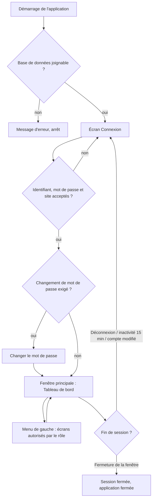
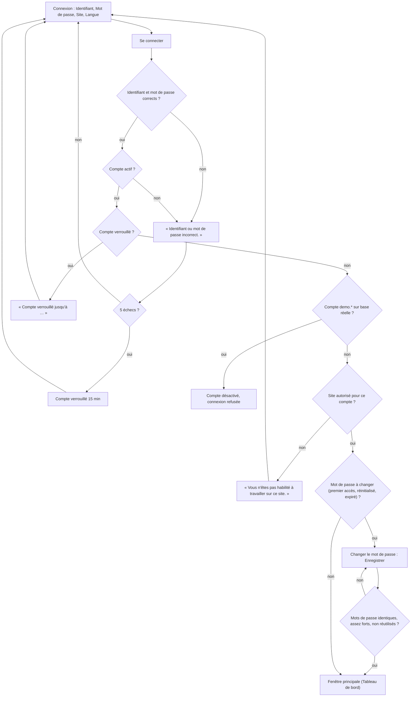
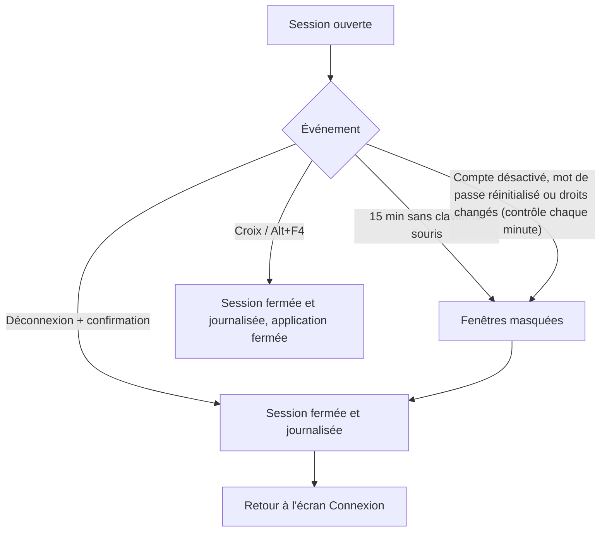
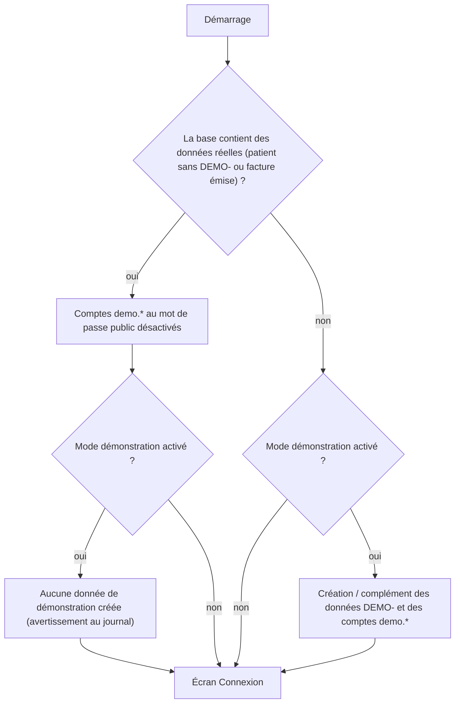
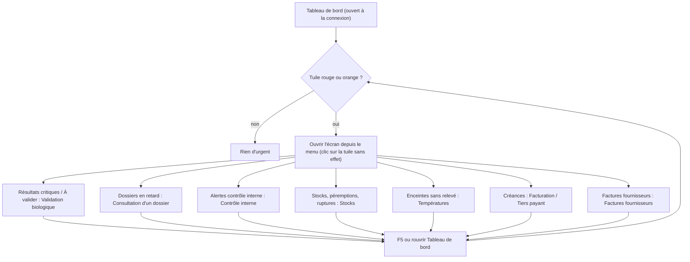

## Prise en main

Ce chapitre explique comment ouvrir une session, se repérer dans la fenêtre principale, qui voit quoi selon son rôle, comment fonctionne le mode démonstration, et comment lire le **Tableau de bord**.

Vue d'ensemble :

### Connexion

Ouvrir une session de travail sur un site du laboratoire, avec son identifiant personnel.

**Qui y a accès** : toute personne qui possède un compte actif, rattaché au site choisi. Les comptes sont créés par l'administrateur dans **Administration › Utilisateurs**.

**L'écran** (fenêtre « Connexion »)

- Logo du site choisi (ou le logo MarocLIS si le site n'en a pas), avec le sous-titre « Système de gestion de laboratoire d'analyses de biologie médicale ».
- **Identifiant** et **Mot de passe**.
- **Site** : liste des sites actifs, sous la forme « CODE — Nom du site ».
- **Langue** : Français, العربية, English. Le changement s'applique tout de suite, avant même la connexion.
- Case **Se souvenir de l'identifiant**.
- Bouton **Se connecter** (la touche Entrée fait de même).
- Une ligne rouge sous le bouton affiche les messages (erreur, majuscules activées).

**Scénarios**

1. *Se connecter normalement*
   1. Choisir la **Langue** si besoin.
   2. Saisir l'**Identifiant** puis le **Mot de passe**.
   3. Choisir le **Site** où vous travaillez aujourd'hui.
   4. Cocher **Se souvenir de l'identifiant** si le poste est le vôtre (l'identifiant sera pré-rempli la prochaine fois sur ce poste ; le mot de passe n'est jamais retenu).
   5. Cliquer **Se connecter** ou appuyer sur Entrée.
   6. La fenêtre principale s'ouvre sur le **Tableau de bord**, dans **votre** langue préférée (celle de votre fiche utilisateur), même si une autre langue était choisie sur l'écran de connexion.

2. *Première connexion (compte « admin » livré avec l'application) ou mot de passe réinitialisé par l'administrateur*
   1. Se connecter avec le mot de passe provisoire.
   2. Le message « Votre mot de passe doit être modifié avant de continuer. » s'affiche (titre « Changement de mot de passe requis »). Cliquer OK.
   3. La fenêtre **Changer le mot de passe** s'ouvre. Le champ **Mot de passe actuel** est déjà rempli et grisé.
   4. Saisir le **Nouveau mot de passe** puis le **Confirmer le mot de passe**. La règle est rappelée dans la fenêtre : au moins 10 caractères (réglage livré), avec lettres, chiffres et caractères spéciaux.
   5. Cliquer **Enregistrer**. Le message « Enregistré. » confirme ; la session s'ouvre.
   6. Cette fenêtre ne peut pas être fermée sans changer le mot de passe (pas de bouton **Annuler**, la croix est refusée). Si elle se ferme quand même, la session est fermée et il faut recommencer.

3. *Mot de passe expiré* : même déroulement que le scénario 2. Le mot de passe expire après 180 jours (réglage livré).

4. *Changer de site* : il n'existe pas de bouton pour changer de site dans la fenêtre principale. Cliquer **Déconnexion**, puis se reconnecter en choisissant l'autre **Site**.

5. *Se déconnecter*
   1. Cliquer **Déconnexion** en bas du menu de gauche, puis confirmer.
   2. L'application se ferme et se rouvre sur l'écran **Connexion**. Fermer la fenêtre principale (croix, Alt+F4) ferme aussi la session et l'inscrit au journal de sécurité.

**Règles et contrôles**

- « Identifiant ou mot de passe incorrect. » : nom inconnu ou mauvais mot de passe. Le même message s'affiche pour un **compte désactivé** (volontairement, pour ne pas révéler quels comptes existent).
- « Compte verrouillé jusqu'à HH:MM après plusieurs tentatives infructueuses. » : après 5 essais faux (réglage livré), le compte est bloqué 15 minutes. Ce message n'apparaît que si le mot de passe saisi est le bon ; sinon on voit le message d'identifiant incorrect.
- « Vous n'êtes pas habilité à travailler sur ce site. » : le compte n'a pas accès au site choisi. Demander à l'administrateur d'ajouter le site sur la fiche utilisateur.
- « Attention : le verrouillage des majuscules est activé. » s'affiche dès que vous tapez le mot de passe avec la touche Verr. Maj.
- Nouveau mot de passe : « Les deux mots de passe saisis ne correspondent pas. », « Ce mot de passe a déjà été utilisé récemment. » (les 5 derniers sont refusés, réglage livré).
- **Verrouillage automatique** : après 15 minutes sans clavier ni souris (réglage livré), toutes les fenêtres sont masquées, la session est fermée, puis le message « Votre session a expiré. Reconnectez-vous. » s'affiche. Ce qui n'était pas enregistré est perdu.
- **Compte modifié pendant la session** : toutes les minutes, l'application vérifie le compte. S'il a été désactivé, si son mot de passe a été réinitialisé ou si ses droits ont changé, la session est fermée avec le message « Votre compte a été modifié (désactivation, mot de passe réinitialisé ou droits changés). La session est fermée ; reconnectez-vous. »
- Il n'y a **pas** de bouton pour changer volontairement son mot de passe une fois connecté (à signaler à l'administrateur, qui peut le réinitialiser).

**Flux** : Connexion → (changement de mot de passe obligatoire si demandé) → fenêtre principale ouverte sur le **Tableau de bord**.

### Fenêtre principale

Le cadre commun à tous les écrans : bandeau du haut, menu de gauche, zone de travail.

**Qui y a accès** : toute personne connectée. Le menu ne montre que les écrans autorisés par votre rôle.

**L'écran**

- **Bandeau du haut** (de gauche à droite) : « MarocLIS », le nom de l'écran ouvert, votre nom avec en dessous « Site : CODE · Poste : NOM-DU-POSTE », la date et l'heure (mises à jour toutes les 30 secondes), le bouton **Imprimer (Ctrl+P)** et la liste des langues.
- **Menu de gauche** : en haut, sans titre de groupe, **Tableau de bord**, **Statistiques**, **Pilotage** ; puis les groupes en majuscules : ACCUEIL / ENREGISTREMENT, LISTE DE TRAVAIL, FACTURATION, QUALITÉ, STOCKS, PERSONNEL, RELATIONS, FINANCES, ADMINISTRATION. Tout en bas : **Raccourcis clavier (F1)** et **Déconnexion**.
- Un écran sans droit n'apparaît pas du tout (il n'est pas grisé). Un groupe n'apparaît que si vous pouvez ouvrir au moins un de ses écrans.
- L'écran en cours est surligné dans le menu. Le raccourci clavier d'un écran est écrit à droite de son nom (ou dans l'info-bulle si le nom est long).

**Scénarios**

1. *Ouvrir un écran* : cliquer son nom dans le menu, ou utiliser son raccourci. Si l'écran que vous quittez contient des saisies non enregistrées (par exemple des résultats tapés), il peut refuser de se fermer : vous restez dessus.
2. *Replier / déplier un groupe du menu* : cliquer le titre du groupe (petit triangle à gauche ; info-bulle « Replier ce groupe » / « Déplier ce groupe »). Le choix est retenu pour vous sur ce poste. Un écran ouvert par raccourci dans un groupe replié déplie ce groupe.
3. *Changer la langue* : choisir Français, العربية ou English dans la liste en haut à droite. Tout l'écran est retraduit. En arabe, la fenêtre passe de droite à gauche ; les identifiants, mots de passe et codes restent écrits de gauche à droite. Ce choix vaut pour la session en cours ; à la connexion suivante, la langue de votre fiche utilisateur s'applique de nouveau (à vérifier si vous souhaitez la changer durablement : c'est l'administrateur qui modifie la langue préférée).
4. *Imprimer la liste affichée*
   1. Ouvrir l'écran voulu, filtrer la liste.
   2. Cliquer **Imprimer** ou appuyer sur **Ctrl+P**.
   3. Un PDF s'ouvre avec la plus grande liste visible de l'écran, telle qu'affichée (colonnes visibles, ordre affiché), avec en-tête : site, votre nom, date et heure, nombre de lignes. L'imprimer depuis le lecteur PDF.
   4. Si l'écran n'a pas de liste ou si elle est vide : « Cet écran n'affiche aucune liste à imprimer. »
5. *Utiliser les raccourcis clavier*

   | Touche | Action |
   |---|---|
   | F1 | Raccourcis clavier (cette liste) |
   | Ctrl+S | Clique le bouton **Enregistrer** de l'écran, s'il existe et est actif |
   | Ctrl+F | Place le curseur dans la première zone de saisie de l'écran (sa recherche) |
   | Ctrl+P | Imprimer la liste de l'écran |
   | F5 | Actualiser l'écran |
   | Ctrl+1 | Patients |
   | Ctrl+2 | Dossiers |
   | Ctrl+3 | Consultation d'un dossier |
   | Ctrl+4 | Prélèvements |
   | Ctrl+5 | Réception des échantillons |
   | Ctrl+6 | Saisie des résultats |
   | Ctrl+7 | Validation biologique |
   | Ctrl+8 | Comptes rendus |
   | Ctrl+9 | Facturation |
   | Ctrl+0 | Caisse |

   Un raccourci d'écran ne fonctionne que si vous avez le droit d'ouvrir cet écran. Dans chaque fenêtre, Alt + la lettre soulignée active le bouton ou le champ.
6. *Personnaliser ses raccourcis*
   1. Cliquer **Raccourcis clavier** (ou F1). La fenêtre liste chaque **Action** et son **Raccourci** ; les autres écrans autorisés y figurent sans raccourci (« Ouvrir : Nom de l'écran »).
   2. Sélectionner une ligne puis appuyer sur la combinaison voulue (Ctrl ou Alt + une touche, ou une touche F1 à F12). Suppr retire le raccourci.
   3. Si la combinaison était déjà prise, elle est déplacée et un message l'indique (« Ctrl+… était le raccourci de « … », qui n'en a plus. »).
   4. **Rétablir les raccourcis par défaut** remet la liste d'origine.
   5. Cliquer **Enregistrer** (ou **Annuler**). Les raccourcis sont propres à votre compte, sur ce poste.

**Règles et contrôles**

- « Utilisez Ctrl ou Alt avec une touche, ou une touche F1 à F12. » : une lettre seule ne peut pas servir de raccourci.
- « Les raccourcis n'ont pas pu être enregistrés. » : problème d'écriture sur le poste ; prévenir l'informatique.
- Masquer un écran du menu n'est pas la seule protection : même atteint autrement, une opération sans droit est refusée.
- Au démarrage, si la base de données est injoignable, un message d'erreur s'affiche avant l'écran de connexion. Si une police des comptes rendus manque (police arabe surtout), un avertissement s'affiche au démarrage : prévenir l'informatique avant de diffuser des comptes rendus en arabe.

**Flux** : la fenêtre principale est le point de départ de tous les circuits. L'ordre des raccourcis Ctrl+1 à Ctrl+0 suit le parcours d'un dossier : patient → dossier → prélèvement → réception → saisie → validation → compte rendu → facturation → caisse.

```mermaid
flowchart LR
    P["Patients (Ctrl+1)"] --> D["Dossiers (Ctrl+2)"] --> CD["Consultation d'un dossier (Ctrl+3)"]
    CD --> PR["Prélèvements (Ctrl+4)"] --> RE["Réception des échantillons (Ctrl+5)"]
    RE --> SA["Saisie des résultats (Ctrl+6)"] --> VA["Validation biologique (Ctrl+7)"]
    VA --> CR["Comptes rendus (Ctrl+8)"] --> FA["Facturation (Ctrl+9)"] --> CA["Caisse (Ctrl+0)"]
```

Fin de session :

### Rôles et droits (vue d'ensemble)

Chaque utilisateur reçoit un ou plusieurs rôles ; un rôle est un ensemble de droits. Les rôles livrés sont décrits ci-dessous. L'administrateur peut les modifier ou en créer d'autres dans **Administration › Utilisateurs**, onglet **Rôles et droits**. Les droits que l'administrateur a retirés à un rôle livré ne sont pas remis lors d'une mise à jour.

| Rôle livré | Pour qui | Écrans visibles dans le menu |
|---|---|---|
| Administrateur | Informatique / gérant | Tous les écrans, y compris **Paramètres**. N'a pas de qualification de biologiste : il ne peut pas valider biologiquement un résultat. |
| Biologiste responsable | Directeur du laboratoire | Presque tout : Tableau de bord, Statistiques, Pilotage, accueil, technique, validation, comptes rendus, Facturation, Tiers payant, qualité, stocks (sauf Demandes de devis et Évaluation fournisseurs), équipements, tout le personnel y compris Paie, RELATIONS (les trois écrans), FINANCES (tous), Utilisateurs, Journal d'audit, Catalogue, Automates, Données de référence. Pas **Caisse** (n'encaisse pas), pas **Paramètres**. |
| Biologiste | Biologiste médical | Tableau de bord, Statistiques, Patients, Dossiers, Consultation d'un dossier, Réception des échantillons, Re-prélèvements, Sérothèque, Saisie des résultats, Validation biologique, Comptes rendus, Contrôle interne, Non-conformités, Évaluation externe, Documents qualité, Stocks, Bons de commande, Consommation, Températures, Équipements, Congés et absences, Accidents du travail, Catalogue des analyses, Automates. |
| Technicien de laboratoire | Paillasse | Tableau de bord, Patients, Consultation d'un dossier, Prélèvements, Réception des échantillons, Re-prélèvements, Sérothèque, Sous-traitance, Saisie des résultats, Comptes rendus, Contrôle interne, Non-conformités, Évaluation externe, Documents qualité, Stocks, Bons de commande, Consommation, Inventaires, Températures, Équipements, Congés et absences, Catalogue des analyses, Automates. Saisit et valide techniquement, **ne valide jamais biologiquement**. |
| Préleveur | Infirmier, préleveur | Tableau de bord, Patients (peut créer un patient), Consultation d'un dossier, Prélèvements, Sous-traitance, Congés et absences, Catalogue des analyses. |
| Secrétariat / accueil | Accueil, secrétaires | Tableau de bord, Patients, Dossiers, Consultation d'un dossier, Re-prélèvements, Comptes rendus (remise et envoi, jamais un résultat non validé), Facturation, Caisse, Tiers payant, Congés et absences, Catalogue des analyses. |
| Responsable qualité | Qualité | Tableau de bord, Statistiques, Patients, Consultation d'un dossier, Comptes rendus, tout le groupe QUALITÉ, Stocks, Bons de commande, Consommation, Inventaires, Températures, Équipements, Contrats automates, Dossiers du personnel, Habilitations, Échéances RH, Congés et absences, Planning des gardes, Accidents du travail, Immobilisations (lecture), Utilisateurs (lecture), Journal d'audit, Catalogue, Automates, Données de référence. |
| Comptabilité | Comptable, facturation | Tableau de bord, Statistiques, Patients, Consultation d'un dossier, Facturation, Caisse, Tiers payant, Stocks, Bons de commande, Demandes de devis, Factures fournisseurs, Évaluation fournisseurs, Consommation, Contrats automates, Congés et absences, Statistiques prescripteurs, Visites et conventions (lecture seule), tout le groupe FINANCES sauf Coût de revient et marge, Données de référence. Aucun accès aux résultats. |
| Prescripteur | Médecin extérieur | Tableau de bord, Patients, Consultation d'un dossier, Comptes rendus — en lecture, limité à **ses propres** patients, réimpression du compte rendu déjà validé uniquement. |

À retenir :

- Une personne peut cumuler plusieurs rôles (par exemple secrétaire + comptabilité) : elle voit l'union des écrans.
- À l'intérieur d'un écran, certains boutons n'apparaissent ou ne sont actifs qu'avec un droit précis (par exemple **Nouvelle visite** dans Visites et conventions). Chaque chapitre le précise.
- La validation biologique exige à la fois le droit et une qualification de biologiste (médecin ou pharmacien biologiste) en cours de validité sur la fiche utilisateur.
- Les comptes « admin » (premier administrateur) et « interface » (compte de service des automates, qui ne peut pas se connecter) sont créés automatiquement à la première installation.

### Mode démonstration

Une base remplie d'une journée de laboratoire fictive, pour la formation ou la présentation.

**Qui y a accès** : il est activé par l'informatique, sur un poste ou une base de formation uniquement (réglage « SeedDemoDataOnFirstRun »). Il est désactivé dans la version livrée.

**Ce que l'on voit**

- Des patients dont le numéro de dossier commence par **DEMO-**, des dossiers portant dans leur note interne « JEU DE DÉMONSTRATION — NE PAS UTILISER EN PRODUCTION » (visible sur les listes de travail, jamais imprimée), des fournisseurs, articles, automates, lots de contrôle et une mutuelle aux codes **DEMO-**, des noms suivis de « (démo) ».
- Des comptes de démonstration, un par métier :

  | Identifiant | Rôle(s) |
  |---|---|
  | demo.biologiste | Biologiste responsable |
  | demo.technicien | Technicien de laboratoire |
  | demo.secretaire | Secrétariat / accueil + Comptabilité |
  | demo.qualite | Responsable qualité |

  Leurs mots de passe sont publics (fournis par l'informatique pour la formation).

**Scénario** : *Se former sur la base de démonstration* — se connecter avec un compte demo.*, parcourir les écrans : chaque écran contient des exemples réalistes (dossiers à tous les stades, contrôles qualité avec graphique, factures, etc.).

**Règles et contrôles**

- **Jamais sur la base réelle du laboratoire.** Si la base contient déjà un vrai patient (sans DEMO-) ou une vraie facture émise, aucune donnée de démonstration n'est créée.
- Dès que des données réelles apparaissent, chaque compte demo.* qui a encore son mot de passe public est désactivé (au démarrage et à sa prochaine tentative de connexion), avec le message « Ce compte de démonstration a été désactivé : la base contient désormais des données réelles et son mot de passe est publié. Utilisez un compte nominatif. »
- Les factures de démonstration prennent des numéros dans la vraie série de facturation : c'est une raison de plus pour ne jamais activer ce mode en production.

**Flux** : la base de démonstration suit le même parcours que la vraie (tous les dossiers ont été créés par les mêmes fonctions que celles des écrans).

### Tableau de bord

L'écran d'accueil : ce qui demande une action aujourd'hui, du plus urgent au moins urgent.

**Qui y a accès** : tout le monde. Chaque tuile n'est montrée qu'à ceux qui ont le droit correspondant (par exemple la caissière ne voit pas les résultats critiques, le technicien ne voit pas les créances).

**L'écran**

- En haut, « Connecté en tant que : Votre nom ».
- Bandeau orange (si besoin) « configuration à compléter » : il liste jusqu'à trois éléments du catalogue non finalisés, sous la forme « Valeurs usuelles à valider : CODE » ou « Tarif provisoire (lettre-clé non confirmée) : CODE », puis « (+N) » s'il y en a d'autres. Il disparaît quand le catalogue est complété.
- **À traiter en priorité** puis **Activité du jour** : des tuiles avec un nombre et un libellé. Rouge = urgent, orange = à surveiller, neutre = rien à faire ou simple compteur. Les tuiles sont triées par gravité puis par nombre.
- En bas : « Actualiser — HH:MM:SS » (heure du calcul).

| Tuile | Ce qu'elle compte (site en cours) | Couleur si > 0 | Droit pour la voir |
|---|---|---|---|
| Résultats critiques non communiqués | Résultats critiques sans appel au prescripteur confirmé (acquitté et relu) | Rouge | Résultats (consultation) |
| Dossiers en retard | Dossiers dont l'heure de rendu promise est passée, ni rendus ni annulés | Rouge | Dossiers (consultation) |
| Alertes contrôle interne | Contrôles rejetés non encore revus | Rouge | Qualité (consultation) |
| Prochain étalonnage | Automates en service dont l'étalonnage est **dépassé** | Rouge | Équipements (consultation) |
| Lots périmés ou à moins de 7 jours | Lots de réactifs avec stock, périmés ou proches (seuil critique) | Rouge | Stocks (consultation) |
| Ruptures prévues avant livraison | Articles qui seront épuisés avant l'arrivée d'une commande passée aujourd'hui | Rouge | Stocks (consultation) |
| Factures fournisseurs en retard de paiement | Factures fournisseurs échues non payées | Rouge | Saisie des factures fournisseurs |
| Non-conformités ouvertes | Ouvertes, en cours ou en attente de vérification | Orange | Qualité (consultation) |
| Articles à commander | Articles au seuil de commande ou en dessous (lots utilisables seulement) | Orange | Stocks (consultation) |
| Péremption proche | Lots avec stock qui périment dans le délai d'alerte (30 jours par défaut) | Orange | Stocks (consultation) |
| Enceintes sans relevé de température aujourd'hui | Réfrigérateurs / congélateurs actifs sans relevé du jour | Orange | Relevé des températures |
| Échantillons refusés aujourd'hui | Échantillons refusés depuis minuit | Orange | Échantillons (consultation) |
| Créances | Factures patients émises ou partiellement payées, échues | Orange | Facturation (consultation) |
| Factures fournisseurs à payer sous 7 jours | Factures fournisseurs à échéance dans la semaine | Orange | Saisie des factures fournisseurs |
| Dossiers du jour | Dossiers enregistrés aujourd'hui, hors annulés | Neutre | Dossiers (consultation) |
| À prélever | Échantillons en attente de prélèvement | Orange | Échantillons (consultation) |
| À valider | Résultats validés techniquement, en attente de validation biologique | Orange | Résultats (consultation) |
| Comptes rendus | Comptes rendus diffusés aujourd'hui | Neutre | Comptes rendus (consultation) |

Les quatre dernières lignes (Dossiers du jour, À prélever, À valider, Comptes rendus) forment le bloc **Activité du jour** ; les autres sont sous **À traiter en priorité**.

**Scénarios**

1. *Faire le point en début de journée* : ouvrir **Tableau de bord** (il s'ouvre seul à la connexion). Traiter d'abord les tuiles rouges : appeler les résultats critiques (écran **Validation biologique**), relancer les dossiers en retard, revoir les contrôles rejetés (**Contrôle interne**).
2. *Mettre à jour les chiffres* : appuyer sur **F5** ou rouvrir l'écran depuis le menu. Il n'y a pas de bouton « Actualiser » sur l'écran ; l'heure du dernier calcul est affichée en bas.
3. *Aller traiter une alerte* : ouvrir l'écran concerné **depuis le menu** (voir colonne ci-dessus). Le curseur prend la forme d'une main sur certaines tuiles non nulles, mais **cliquer une tuile n'ouvre rien** (à corriger).

**Règles et contrôles**

- Les chiffres concernent le **site sur lequel vous êtes connecté**.
- Le bandeau « configuration à compléter » signale un catalogue pas prêt pour la production (tarifs provisoires, valeurs usuelles non validées par le biologiste) : à régler avant d'émettre de vraies factures et comptes rendus.
- En cas d'erreur de calcul, la ligne du bas affiche « Une erreur inattendue est survenue. L'incident a été journalisé. »
- **Imprimer** (Ctrl+P) ne fonctionne pas sur cet écran : il n'a pas de liste.

**Flux** : Tableau de bord → écran du menu correspondant à l'alerte (Validation biologique, Dossiers, Contrôle interne, Stocks, Températures, Factures fournisseurs, Facturation…).

