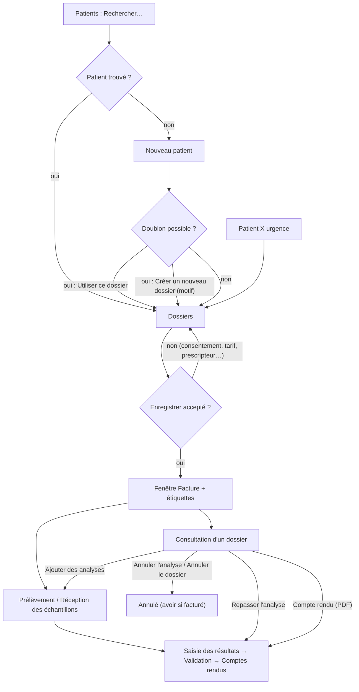
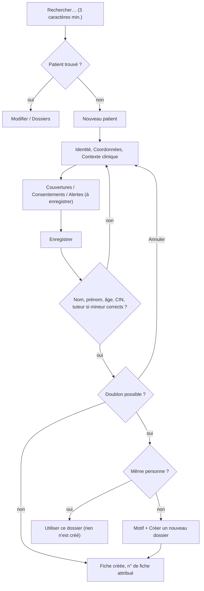
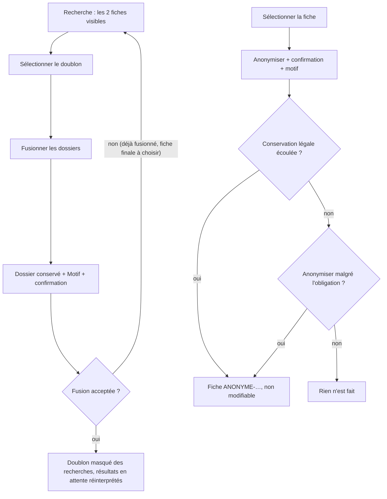
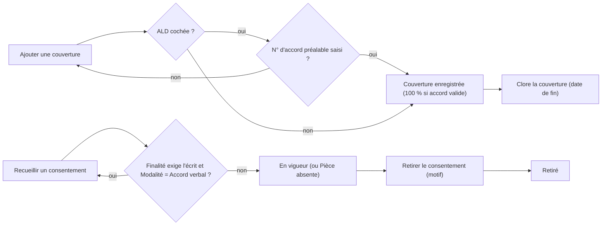
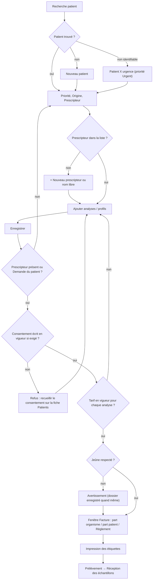
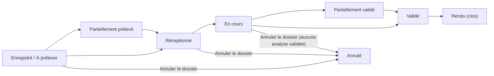
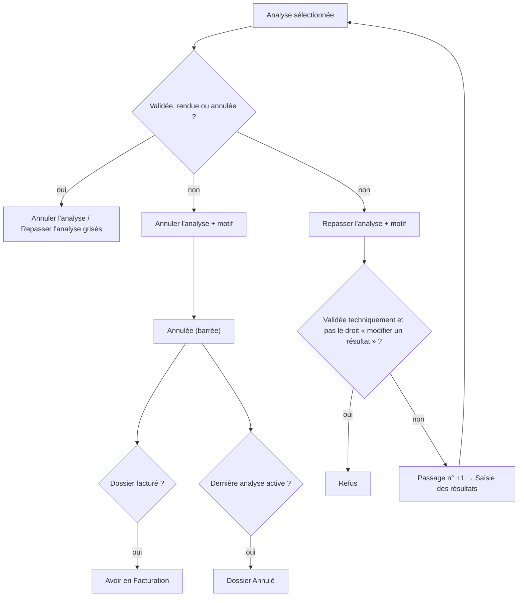
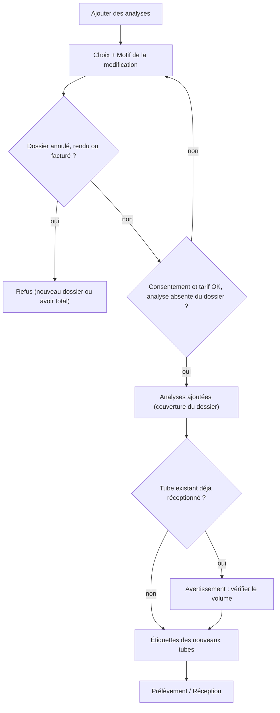

## Accueil / Enregistrement

Ce groupe du menu réunit les trois écrans de l'accueil : la fiche des patients, l'enregistrement d'un nouveau dossier (la demande d'analyses) et la consultation d'un dossier déjà enregistré. Tout le reste du travail du laboratoire (prélèvement, réception des tubes, saisie, validation, facturation) part de ce qui est saisi ici.

Vue d'ensemble du groupe :

Raccourcis clavier valables dans tout le groupe (réglables dans **Raccourcis clavier**, touche **F1**) :

| Touche | Effet |
|---|---|
| **Ctrl+1** | ouvre l'écran **Patients** |
| **Ctrl+2** | ouvre l'écran **Dossiers** (enregistrement) |
| **Ctrl+3** | ouvre l'écran **Consultation d'un dossier** |
| **Ctrl+S** | appuie sur le bouton **Enregistrer** de l'écran, s'il est actif |
| **Ctrl+F** | place le curseur dans la première zone de recherche de l'écran |
| **Ctrl+P** | imprime la liste affichée |
| **F5** | actualise l'écran |

---

### Patients

Rechercher un patient, créer ou corriger sa fiche, gérer ses couvertures (AMO, mutuelle…), ses consentements et ses alertes, fusionner deux fiches en double et anonymiser une fiche.

**Qui y a accès**

- Ouvrir l'écran : droit « consulter les patients ». Par défaut : tous les rôles (Administrateur, Biologiste responsable, Biologiste, Technicien, Préleveur, Secrétariat / accueil, Responsable qualité, Comptabilité, Prescripteur).
- **Nouveau patient** : droit « créer un patient » — Administrateur, Biologiste responsable, Secrétariat / accueil, Préleveur. (Le rôle Biologiste ne l'a pas.)
- Modifier une fiche, ajouter une couverture, un consentement ou une alerte : droit « modifier un patient » — Administrateur, Biologiste responsable, Biologiste, Secrétariat / accueil. Les autres utilisateurs peuvent ouvrir la fiche par **Modifier**, mais en lecture seule (bouton **Enregistrer** grisé).
- **Fusionner les dossiers** : Administrateur et Biologiste responsable uniquement.
- **Anonymiser** : Administrateur uniquement.

**L'écran**

- En haut : une seule zone de recherche (**Rechercher…**), le nombre de résultats (« 50 / 312 » par exemple), puis les boutons **Nouveau patient**, **Modifier**, **Fusionner les dossiers**, **Anonymiser**.
- Au milieu : la liste des patients, colonnes **N° de dossier**, **Patient**, **Sexe**, **Âge**, **Date de naissance**, **CIN**, **Téléphone mobile**, **Organisme payeur** (couverture principale en cours), **Dossiers** (nombre de dossiers non annulés), **Date** (dernier dossier). Une ligne en rouge signale un patient qui a une alerte critique en cours.
- En bas : **Antécédents d'analyses** du patient sélectionné (30 derniers dossiers) : **N° de dossier**, **Enregistré le**, **Statut**, **Priorité**, **Analyses**, **Prescripteur**.

La recherche se lance seule, environ 0,3 seconde après la dernière frappe. Elle cherche à la fois dans le nom et le prénom, le numéro de fiche, la CIN et, à partir de 4 chiffres, le numéro de mobile. Il faut au moins 3 caractères ; avec 1 ou 2 caractères la liste reste vide. Une zone vide affiche les premiers patients par ordre alphabétique. Seuls les 50 premiers résultats sont affichés : s'il y en a plus, affinez la recherche (il n'y a pas de page suivante).

**Scénarios**

1. **Retrouver un patient**
   1. Tapez dans **Rechercher…** le nom, le prénom, la CIN, le numéro de fiche ou le mobile (au moins 3 caractères).
   2. Sélectionnez la ligne : ses antécédents d'analyses s'affichent en bas.
   3. Pour ouvrir un ancien dossier, double-cliquez sur la ligne dans **Antécédents d'analyses** : l'écran **Consultation d'un dossier** s'ouvre sur ce dossier (il faut le droit « consulter les dossiers »).

2. **Créer la fiche d'un nouveau patient**
   1. Recherchez d'abord le patient (scénario 1) : ne créez la fiche que si la recherche ne donne rien.
   2. Cliquez **Nouveau patient**. La fenêtre de fiche s'ouvre sur l'onglet **Identité**.
   3. Saisissez **Nom**, **Prénom** (obligatoires), **Sexe**, et soit la **Date de naissance** (case cochée), soit, en décochant la case, l'**Âge déclaré**. L'âge calculé s'affiche à côté pour contrôle.
   4. Complétez si possible les noms en arabe, **Lieu de naissance**, **CIN**, **Passeport**, **Nationalité** (MA par défaut).
   5. Si le patient a moins de 18 ans, un encadré apparaît : saisissez le **Tuteur légal** (obligatoire), sa **CIN du tuteur** et le **Lien de parenté**.
   6. Onglet **Coordonnées** : **Adresse**, **Ville**, **Région**, **Code postal**, **Téléphone mobile**, **Autre téléphone**, **Courriel**, **Langue du compte rendu**. Le mobile est réécrit au format +212… en quittant le champ : c'est le format qu'exige l'envoi de SMS. Cochez « Le patient refuse toute utilisation de ses données au-delà des soins » si le patient s'y oppose (loi 08-09).
   7. Onglet **Contexte clinique** : **Grossesse en cours** (femme uniquement) et **Date des dernières règles**, **Poids (kg)**, **Taille (cm)** (la surface corporelle s'affiche), **Groupe sanguin**, **Traitement en cours**, **Allergies connues**.
   8. Si besoin, ajoutez dès maintenant une couverture, un consentement ou une alerte (scénarios 4, 6, 8) : ils apparaissent avec la mention « à enregistrer » et seront créés avec la fiche.
   9. Cliquez **Enregistrer** (ou **Entrée**). Le numéro de fiche est attribué automatiquement. La liste se recharge et sélectionne le nouveau patient.

3. **Répondre à l'alerte « Doublon possible »**
   - Dès que vous quittez les champs Nom, Prénom, CIN ou Date de naissance, un message orange peut s'afficher en bas de la fiche : « Dossier(s) possiblement en double… ». Vérifiez avec le patient.
   - Au moment d'**Enregistrer**, si des fiches proches existent, la fenêtre **Doublon possible** liste les fiches trouvées et la raison de la ressemblance (colonne **Correspondance** : CIN, date de naissance ou nom).
     - Si c'est la même personne : sélectionnez la fiche et cliquez **Utiliser ce dossier**. Rien n'est créé ; c'est cette fiche existante qui est retenue.
     - Si c'est une autre personne : remplissez **Motif : pourquoi s'agit-il d'une autre personne ?** (10 caractères au moins), cliquez **Créer un nouveau dossier** et confirmez. Le motif est gardé au journal d'audit.
     - **Annuler** revient à la fiche sans rien créer.

4. **Ajouter une couverture (AMO, mutuelle, assurance, convention)**
   1. Ouvrez la fiche (**Modifier**, ou pendant la création) et allez dans l'onglet **Couvertures**.
   2. Cliquez **Ajouter une couverture**.
   3. Choisissez l'**Organisme payeur** : sous la liste s'affichent son taux de remboursement, s'il facture sur la TNR ou sur le tarif du laboratoire, et si l'ordonnance est obligatoire.
   4. Saisissez le **N° d'immatriculation** (obligatoire), la **Qualité du bénéficiaire** (Assuré lui-même, Conjoint, Enfant, Ascendant, Autre ayant droit). Pour un ayant droit, renseignez **Assuré principal** et **CIN de l'assuré principal**.
   5. Facultatif : **Employeur**, **Taux dérogatoire (%)** (seulement si la convention du patient diffère du taux de l'organisme), **Valide du** et, en cochant, **Valide au**.
   6. Laissez cochée **Couverture principale** si c'est celle qui doit servir aux prochains dossiers (cocher une nouvelle couverture principale retire ce statut aux autres). Laissez **Tiers payant** coché si le laboratoire facture directement l'organisme.
   7. Pour une ALD, cochez **Affection de longue durée (ALD)** et saisissez le **N° d'accord préalable** (obligatoire) et **Accord valable jusqu'au**.
   8. Cliquez **Enregistrer**. La couverture apparaît dans la liste (en gras si principale, en gris si elle n'est plus valide aujourd'hui).

5. **Clore une couverture** (fin de droits, changement de mutuelle)
   1. Onglet **Couvertures**, sélectionnez une couverture sans date de fin.
   2. Cliquez **Clore la couverture**, saisissez la date de fin au format jj/mm/aaaa et validez.
   La couverture n'est jamais supprimée : les factures déjà émises restent explicables.

6. **Recueillir un consentement**
   1. Onglet **Consentements**, cliquez **Recueillir un consentement**.
   2. Choisissez la **Finalité** (Analyses prescrites et traitement du dossier, Analyse génétique, Sérologie VIH, Dépistage prénatal, Conservation de l'échantillon, Utilisation à des fins de recherche, Transmission électronique du compte rendu, Communication à un tiers, Sous-traitance de l'analyse, Messages de suivi).
   3. Choisissez la **Modalité** (Formulaire signé, Signature électronique, Accord verbal, Portail en ligne) et **Présenté en** (langue).
   4. Renseignez **Signé par**, **CIN du signataire**, **Qualité du signataire** (pré-rempli « Tuteur légal » pour un mineur), **Version du formulaire**, éventuellement **Expire le** et **Observations**.
   5. Cliquez **Enregistrer**.

7. **Retirer un consentement**
   1. Onglet **Consentements**, sélectionnez un consentement en vigueur, cliquez **Retirer le consentement**.
   2. Saisissez le motif du retrait et validez. La ligne passe en gris avec l'état « Retiré ».

8. **Ajouter une alerte sur la fiche** (accès veineux difficile, risque infectieux, impayé…)
   1. Onglet **Alertes**, cliquez **Ajouter une alerte**.
   2. Choisissez la **Gravité** (Information, Avertissement, Critique), saisissez le **Message (français)** (obligatoire) et si possible le **Message (arabe)**.
   3. Cochez **Expire le** et donnez une date si l'alerte n'est vraie qu'un temps (une alerte sans date est permanente).
   4. Cliquez **Ajouter**. Pour une alerte **Critique**, confirmez.

9. **Corriger l'identité d'un patient** (faute de frappe, date de naissance, sexe)
   1. Sélectionnez le patient, cliquez **Modifier**, corrigez, cliquez **Enregistrer**.
   2. Si le sexe, l'âge, la grossesse, le poids ou la taille changent, les résultats non encore validés sont réinterprétés automatiquement. Les résultats déjà validés ne changent pas : le journal d'audit indique combien sont à revoir par le biologiste (et à corriger par un compte rendu rectifié si nécessaire).

10. **Compléter l'identité d'un patient « X urgence »**
    1. Recherchez « X-URG » ou le numéro de fiche provisoire.
    2. Cliquez **Modifier**, remplacez le nom « X-URG » et le prénom provisoire par la vraie identité, complétez la fiche, **Enregistrer**. Le journal d'audit note que l'identité provisoire a été complétée ; les résultats déjà rendus sous « X-URG » sont désormais au nom du patient.

11. **Fusionner deux fiches en double**
    1. Recherchez de façon à faire apparaître **les deux** fiches dans la liste (le bouton n'est actif que s'il y a au moins deux résultats).
    2. Sélectionnez la fiche **à faire disparaître** (le doublon), cliquez **Fusionner les dossiers**.
    3. Dans la fenêtre, vérifiez le **Dossier à fusionner**, choisissez le **Dossier conservé**, saisissez le **Motif** (5 caractères au moins), cliquez **Fusionner les dossiers** et confirmez.
    4. Le doublon disparaît des recherches ; ses dossiers d'analyses sont rattachés à la fiche conservée pour l'historique et les contrôles d'antériorité.

12. **Anonymiser une fiche** (demande d'effacement, loi 08-09)
    1. Sélectionnez la fiche, cliquez **Anonymiser**, confirmez.
    2. Saisissez le motif (demande du patient, décision CNDP…, 10 caractères au moins).
    3. Si la durée légale de conservation n'est pas écoulée, un message donne la date de fin et demande « Anonymiser malgré l'obligation de conservation encore en cours ? ». Répondez Non sauf décision écrite contraire.
    4. La fiche devient « ANONYME-… » ; l'historique des analyses et la facturation sont conservés, la fiche n'est plus modifiable.

**Règles et contrôles**

- Nom, prénom, et date de naissance **ou** âge déclaré sont obligatoires.
- CIN : 1 ou 2 lettres suivies de 5 ou 6 chiffres, sinon « Le numéro de CIN est invalide ».
- La date de naissance ne peut pas être dans le futur. Une grossesse n'est possible que pour le sexe féminin.
- Patient mineur : « Pour un patient mineur, l'identité du tuteur légal est obligatoire. »
- Le numéro de fiche est attribué par une suite sans trou ; il n'est jamais modifié.
- Couverture : n° d'immatriculation obligatoire ; assuré principal obligatoire pour un ayant droit ; taux dérogatoire entre 0 et 100 % ; date de fin pas avant la date de début ; une couverture dont la date de début est dans le futur est refusée (« Cette couverture n'est pas encore entrée en vigueur ») ; ALD sans n° d'accord préalable refusée. Une ALD avec accord valide est remboursée à 100 %.
- Le taux s'applique au tarif de référence, non au prix facturé : le dépassement reste à la charge du patient.
- Analyse génétique, sérologie VIH, dépistage prénatal, conservation de l'échantillon et recherche exigent un consentement **écrit** : un « Accord verbal » est refusé (« Un consentement écrit est exigé pour… »). Un consentement écrit sans pièce jointe s'affiche « Pièce absente » (en orange).
- Les couvertures, consentements et alertes ne se suppriment pas : on les clôt, on les retire ou on les laisse expirer.
- Fusion : impossible d'une fiche dans elle-même ; refusée si le doublon est déjà fusionné, ou si la fiche conservée a elle-même été fusionnée (« choisissez le dossier final »). La fusion ne se défait pas depuis l'application.
- Anonymisation : refusée tant que court l'obligation de conservation (10 ans après le dernier dossier, durée réglable), sauf confirmation explicite ; refusée si déjà anonymisée.
- Toute recherche et toute ouverture de fiche sont tracées (loi 08-09).

**Flux**

Patient trouvé ou créé → **Dossiers** (enregistrement de la demande). On revient ici pour corriger l'identité, ajouter une couverture ou un consentement manquant avant d'enregistrer une analyse qui l'exige.

Création d'une fiche :

Fusion et anonymisation :

Couverture et consentement :

---

### Dossiers

Enregistrer une nouvelle demande d'analyses (un « dossier ») pour un patient : choix du patient, du prescripteur, des analyses, calcul du montant, impression immédiate des étiquettes des tubes.

**Qui y a accès**

- L'écran et le bouton **Enregistrer** : droit « créer un dossier » — Administrateur, Biologiste responsable, Biologiste, Secrétariat / accueil.
- Priorité **Urgent** ou **Urgence vitale** : droit « dossier urgent » — Administrateur, Biologiste responsable, Secrétariat / accueil. **Le rôle Biologiste ne l'a pas** : un dossier urgent saisi par un biologiste est refusé.
- **Nouveau patient** et **Patient X urgence** : droit « créer un patient » (pas le rôle Biologiste).
- **+** (nouveau prescripteur) : droit « créer un dossier » ou « gérer le catalogue ».

**L'écran**

- Bandeau **patient** : zone de recherche, liste déroulante des patients trouvés (« N° — Nom, âge [organisme] »), boutons **Nouveau patient** et **Patient X urgence** (en rouge). Sous la liste, un résumé : nom, sexe, âge, CIN, organisme payeur ou « Paiement direct ».
- Bandeau **contexte** : **Priorité** (Routine, Urgent, Urgence vitale), **Origine** (Patient au comptoir, Prélèvement à domicile, Clinique / hôpital, Centre de prélèvement, Sous-traitance reçue, Médecine du travail, Demande du patient), **Prescripteur** (liste ou saisie libre) avec le bouton **+** (« Nouveau prescripteur »), **Renseignements cliniques**, cases **Patient à jeun** (cochée par défaut) et **Paiement direct**.
- À gauche, le catalogue **Analyses / Profils** : **Code**, **Désignation**, **Secteur**, **Prix**, **Délai de rendu**, **Observations** (nombre d'analyses d'un profil, jeûne, « Consentement requis avant enregistrement », « Sous-traitée »). Les profils sont en gras.
- À droite, **Analyses demandées** : **Code**, **Désignation**, **Prix**, **Observations**.
- En bas : le total indicatif (**Montant brut**, nombre d'**Analyses**, **Jeûne requis**, mention de consentement), un message d'état, et les boutons **Effacer** et **Enregistrer**.

**Scénarios**

1. **Enregistrer un dossier pour un patient connu**
   1. Dans la zone de recherche patient, tapez nom, CIN, n° de fiche ou mobile (3 caractères au moins). Le premier patient trouvé est sélectionné ; changez-le dans la liste déroulante si besoin. Vérifiez le résumé (si le patient a une alerte critique, un message s'affiche et le résumé passe en rouge : ouvrez la fiche pour lire l'alerte).
   2. Choisissez la **Priorité** et l'**Origine**.
   3. Choisissez le **Prescripteur** dans la liste (tapez les premières lettres) ou tapez son nom librement s'il n'est pas dans l'annuaire.
   4. Saisissez les **Renseignements cliniques** si l'ordonnance en donne. Décochez **Patient à jeun** si le patient n'est pas à jeun.
   5. Ajoutez les analyses (scénario 4).
   6. Cochez **Paiement direct** si le patient ne veut pas utiliser sa couverture pour ce dossier.
   7. Cliquez **Enregistrer** (ou **Ctrl+S**).
   8. Une fenêtre **Facture** affiche le récapitulatif : **N° de dossier**, **Montant brut**, éventuellement **Remise**, **Total à payer**, **Part organisme** et **Part patient** (si une couverture s'applique), **Dépassement du tarif de référence** s'il y en a, et **Règlement** = ce que le patient paie au comptoir aujourd'hui.
   9. Les étiquettes des tubes s'impriment aussitôt (ou s'ouvrent à l'écran si aucune imprimante d'étiquettes n'est réglée).
   10. Le message en bas indique le n° de dossier et le nombre d'échantillons ; l'écran se vide pour le patient suivant.

2. **Enregistrer un dossier pour un nouveau patient** (sans quitter l'écran)
   1. Cliquez **Nouveau patient**, remplissez la fiche (voir écran **Patients**, scénarios 2 à 4), **Enregistrer**.
   2. Le patient est sélectionné automatiquement (y compris si, dans la fenêtre « Doublon possible », vous avez choisi **Utiliser ce dossier**). Continuez au point 2 du scénario 1.

3. **Patient non identifiable (urgence)**
   1. Cliquez **Patient X urgence**.
   2. Choisissez le **Sexe** et l'**Âge estimé (ans)**, cliquez **Ouvrir le dossier provisoire**.
   3. Une fiche « X-URG » est créée et sélectionnée, la priorité passe à **Urgent**. Continuez l'enregistrement normalement.
   4. Plus tard, complétez l'identité depuis l'écran **Patients** (scénario 10).

4. **Choisir les analyses**
   - Tapez un code ou un nom dans la zone **Analyses / Profils** puis **Entrée** : l'analyse dont le code est exactement celui tapé est ajoutée (sinon le premier code qui commence ainsi, sinon le premier nom trouvé), et la zone se vide pour la suivante.
   - Ou bien **flèche bas** pour descendre dans la liste, puis **Entrée** sur la ligne voulue ; ou double-clic sur la ligne.
   - Pour retirer une analyse demandée : double-clic sur sa ligne dans **Analyses demandées**, ou sélection puis touche **Suppr**.
   - Préférez le profil à ses analyses séparées. Si vous ajoutez un profil qui contient une analyse déjà choisie seule, celle-ci est retirée (message « déjà compris dans le profil… ») ; si vous ajoutez seule une analyse déjà comprise dans un profil choisi, elle est refusée. Deux profils qui partagent une analyse ne la comptent qu'une fois (« analyse(s) déjà comptée(s) »).

5. **Créer un prescripteur pendant l'enregistrement**
   1. Tapez le nom du médecin dans **Prescripteur**, puis cliquez **+**.
   2. La fenêtre **Nouveau prescripteur** reprend le nom tapé. Complétez **Nom** (obligatoire), **Prénom**, nom arabe, type de prescripteur (liste sous l'étiquette « Désignation » : Médecin généraliste, Médecin spécialiste, Chirurgien-dentiste, Sage-femme, Établissement de santé, Laboratoire correspondant, Médecin du travail, Demande directe du patient), **Spécialité**, **Établissement**, **N° Ordre des médecins / pharmaciens**, **INPE**, **ICE**, téléphones, **Fax**, **Courriel**, **Ville**, **Adresse**, **Téléphone résultats critiques**, mode de **Remise** des comptes rendus, **Envoyer les comptes rendus partiels**, **Remise**, **Observations**, **Actif**.
   3. Cliquez **Enregistrer**. Le prescripteur est créé et sélectionné. En cas de refus, la fenêtre reste ouverte avec ce qui a été tapé.
   - Un avertissement rouge rappelle que, sans INPE, une facture en tiers payant ne peut pas être transmise.

6. **Dossier reçu d'un autre laboratoire (« Sous-traitance reçue »)**
   1. Créez ou retrouvez le patient. Pour que le laboratoire adresseur soit facturé, la fiche doit porter une couverture sur l'organisme « Laboratoire adresseur » (ou celui que vous avez créé pour ce correspondant) — **à vérifier** selon votre paramétrage.
   2. Origine : **Sous-traitance reçue**. Prescripteur : choisissez le laboratoire correspondant dans l'annuaire (type « Laboratoire correspondant ») ou créez-le par **+**.
   3. Ajoutez les analyses et **Enregistrer**.
   - Il n'y a pas, sur cet écran, de champ pour la référence du dossier chez le laboratoire adresseur ; notez-la dans **Renseignements cliniques** si besoin (**à vérifier** : pas d'autre emplacement prévu ici).

7. **Demande directe du patient** (sans ordonnance)
   - Origine : **Demande du patient**. C'est la seule origine où le prescripteur n'est pas obligatoire.

8. **Abandonner une saisie en cours**
   - Cliquez **Effacer** : le patient, les analyses et le contexte sont vidés. Rien n'est enregistré.

**Règles et contrôles**

- **Enregistrer** reste grisé tant qu'aucun patient n'est choisi ou qu'aucune analyse n'est demandée.
- Prescripteur obligatoire sauf origine « Demande du patient » : « Le prescripteur est obligatoire, sauf pour une demande directe du patient. »
- Consentements : une analyse génétique, une sérologie VIH ou un dépistage prénatal est **refusé** sans consentement en vigueur sur la fiche (« Le consentement spécifique requis pour … n'a pas été recueilli »), ou si ce consentement n'est que verbal. Recueillez-le d'abord sur la fiche patient.
- Jeûne : si **Patient à jeun** est décoché et qu'une analyse demande un jeûne, le dossier est enregistré mais un avertissement s'affiche (« le résultat devra être interprété avec réserve »).
- Une analyse sans tarif en vigueur (ni pour l'organisme, ni dans la liste du laboratoire) est refusée : il faut lui ajouter un tarif dans le Catalogue des analyses.
- Une analyse désactivée dans le catalogue est refusée.
- Couverture utilisée : la couverture **principale valide aujourd'hui** de la fiche. Un seul organisme par dossier ; une couverture complémentaire (mutuelle en plus de l'AMO) n'est pas utilisée pour répartir la part patient à cet endroit (**à vérifier** au chapitre Facturation). Avec **Paiement direct**, ou sans couverture valide, tout est à la charge du patient. Si l'accord de tiers payant de l'organisme est expiré, le patient avance la somme.
- Le prix affiché dans le catalogue et le total du bas sont **indicatifs** (liste de prix du laboratoire). Le montant exact, avec la part organisme et la part patient, est celui de la fenêtre **Facture** après enregistrement : la répartition y est figée pour la suite.
- La remise ne se saisit pas ici : elle se donne au moment de la facturation (droit « appliquer une remise », rôle Comptabilité par défaut).
- Le n° de dossier vient d'une suite annuelle sans trou ; un enregistrement qui échoue ne consomme pas de numéro.
- Chaque enregistrement relance le délai légal de conservation de la fiche patient (10 ans par défaut).
- La date d'échéance du rendu est calculée dès l'enregistrement à partir du délai de rendu des analyses (plus court si urgent).

**Flux**

Enregistrement → étiquettes collées → **Prélèvement** puis **Réception des échantillons** → saisie → validation → compte rendu. L'encaissement se fait en **Caisse** / **Facturation**. Toute modification ultérieure du dossier se fait dans **Consultation d'un dossier**.

---

### Consultation d'un dossier

Afficher un dossier enregistré dans son ensemble (analyses, tubes, montants) et faire les corrections encore possibles : ajouter des analyses, annuler une analyse ou tout le dossier, repasser une analyse, corriger l'en-tête, réimprimer les étiquettes, ouvrir le compte rendu PDF.

**Qui y a accès**

- L'écran : droit « consulter les dossiers » — tous les rôles par défaut. Un compte Prescripteur ne voit que les dossiers de ce prescripteur.
- **Ajouter des analyses**, **Modifier l'en-tête** : droit « modifier un dossier » — Administrateur, Biologiste responsable, Biologiste, Secrétariat / accueil.
- **Annuler l'analyse**, **Annuler le dossier** : droit « annuler un dossier » — Administrateur, Biologiste responsable, Secrétariat / accueil (pas le Biologiste).
- **Repasser l'analyse** : droit « saisir des résultats » — Administrateur, Biologiste responsable, Biologiste, Technicien. Si l'analyse est déjà validée techniquement, il faut aussi le droit « modifier un résultat » (Biologistes, Administrateur).
- **Imprimer les étiquettes** : droit « réimprimer une étiquette » — Administrateur, Biologiste responsable, Technicien, Préleveur, Secrétariat / accueil.
- **Compte rendu (PDF)** : droit « réimprimer un compte rendu validé » — Administrateur, Biologiste responsable, Prescripteur. **Ni le Secrétariat ni le Biologiste ne l'ont par défaut.**

**L'écran**

- À gauche : la liste des dossiers récents du site (les 200 plus récents), colonnes **N° de dossier**, **Patient**, **Enregistré le**, **Statut**, **Priorité**, **Analyses**. Les dossiers annulés restent visibles, en gris. Au-dessus : la zone de recherche (« N° de dossier, code-barres, nom du patient, CIN ou n° de fiche ») et **Actualiser**.
- À droite, l'en-tête du dossier : numéro, statut, patient (âge, sexe, n° de fiche, téléphone), prescripteur (INPE), date de l'ordonnance, date d'enregistrement et opérateur, origine, priorité ; organisme payeur et taux (ou « Sans prise en charge — à la charge du patient »), n° d'accord préalable ; renseignements cliniques, code diagnostic, service / chambre, « patient non à jeun », note interne ; en rouge la date et le motif d'annulation, sinon le n° de **Facture**.
- Tableau des analyses : **Analyse**, **Désignation**, **Secteur**, **Statut**, **Résultats** (saisis / attendus), **Code-barres**, **Montant net**, **Part patient**, **Commentaire** (motif d'annulation, « Passage n° … — motif », « Validé par … », « Sous-traitée »). Une analyse annulée est barrée ; repassée, en orange ; en retard, dans la couleur du retard ; validée, en vert.
- Tableau des tubes : **Tube n°**, **Code-barres**, **Nature du prélèvement**, **Type de tube**, **Statut**, **Prélevé le**, **Réceptionné le**, **Lieu de conservation**. Tube refusé ou éliminé en rouge ; tube à prélever en orange.
- En bas : le résumé (nombre d'analyses, montant, part patient) et les boutons **Ajouter des analyses**, **Annuler l'analyse**, **Repasser l'analyse**, **Modifier l'en-tête**, **Annuler le dossier**, **Imprimer les étiquettes**, **Compte rendu (PDF)**.

Statuts d'un dossier :

| Statut | Signification |
|---|---|
| Enregistré / À prélever | demande saisie, tubes pas encore prélevés |
| Partiellement prélevé | une partie des tubes prélevée |
| Réceptionné | tubes arrivés au laboratoire |
| En cours | analyses en cours |
| Partiellement validé | une partie des analyses validée par le biologiste |
| Validé | toutes les analyses validées |
| Rendu | compte rendu diffusé : dossier clos |
| Annulé | dossier annulé (motif affiché) |

Statuts d'une analyse : En attente de prélèvement, Prélevé, Réceptionné, En cours d'analyse, Résultat saisi, Validé techniquement, Validé biologiquement, Rendu, Annulée.

**Scénarios**

1. **Retrouver un dossier**
   - À l'ouverture, l'écran affiche le dossier le plus récent.
   - Tapez dans la zone de recherche un nom, une CIN, un n° de fiche ou une partie de numéro : la liste se filtre. Cliquez la ligne voulue (ou **flèche bas** puis flèches).
   - Scannez ou tapez un n° de dossier ou le code-barres d'un tube puis **Entrée** : le dossier s'ouvre directement. Si rien ne correspond exactement, **Entrée** ouvre le premier dossier de la liste filtrée ; s'il n'y en a aucun : « Aucun dossier ne correspond à … ».
   - Depuis l'écran **Patients**, un double-clic sur un antécédent ouvre aussi le dossier ici.

2. **Ajouter des analyses à un dossier** (le médecin téléphone pour ajouter une TSH)
   1. Ouvrez le dossier, cliquez **Ajouter des analyses**.
   2. Dans la fenêtre, cherchez par code, nom ou synonyme, **Entrée** ; double-cliquez pour mettre l'analyse dans **Analyses à ajouter** (**Retirer** pour l'enlever). Les analyses déjà au dossier sont signalées « déjà au dossier ».
   3. Saisissez le **Motif de la modification** (obligatoire), cliquez **Ajouter des analyses**.
   4. Les étiquettes des nouveaux tubes s'impriment. Si l'analyse a été ajoutée sur un tube déjà réceptionné, un avertissement demande de vérifier qu'il reste du volume.
   5. Le message indique le nombre d'analyses ajoutées et leur montant.

3. **Annuler une analyse**
   1. Sélectionnez l'analyse dans le tableau, cliquez **Annuler l'analyse**.
   2. Saisissez le motif (5 caractères au moins), validez.
   3. L'analyse apparaît barrée avec son motif. Si le dossier était déjà facturé, le message rappelle que la régularisation passe par un avoir (en Facturation). Si c'était la dernière analyse du dossier, le dossier devient annulé.

4. **Repasser une analyse** (valeur douteuse, dilution, contrôle rejeté)
   1. Sélectionnez l'analyse, cliquez **Repasser l'analyse**.
   2. Saisissez le motif de la reprise, validez.
   3. L'analyse retourne au poste technique (« passage n° 2 »…) sur le même tube ; elle n'est pas facturée une seconde fois. Les anciennes valeurs restent visibles jusqu'à la nouvelle saisie mais perdent leur validation technique.

5. **Corriger l'en-tête du dossier**
   1. Cliquez **Modifier l'en-tête**.
   2. Corrigez au besoin : **Prescripteur** (seulement s'il avait été saisi en texte libre), **Date de l'ordonnance**, **Priorité**, **Langue du compte rendu**, **Renseignements cliniques**, **Code diagnostic (CIM-10)**, **Service / unité**, **Chambre / lit**, **Note interne**.
   3. Saisissez le **Motif de la modification** (obligatoire), cliquez **Enregistrer**.
   - L'organisme payeur est rappelé en haut mais ne se modifie pas ici (il faut un avoir puis une nouvelle facture).

6. **Annuler tout le dossier** (patient parti avant le prélèvement, doublon de saisie)
   1. Cliquez **Annuler le dossier**. Le message indique le nombre d'analyses et de tubes ; confirmez.
   2. Saisissez le motif, validez.
   3. Le dossier passe « Annulé », ses tubes encore présents sont éliminés (sauf un tube déjà en analyse, laissé tel quel). S'il était facturé : « Dossier annulé. La facture … reste due : émettez un avoir. »

7. **Réimprimer les étiquettes**
   1. Cliquez **Imprimer les étiquettes**.
   2. Saisissez le motif (étiquette abîmée, illisible, tube supplémentaire…). Toutes les étiquettes du dossier sont réimprimées ; la réimpression est tracée.

8. **Ouvrir le compte rendu**
   - Cliquez **Compte rendu (PDF)** : la dernière version diffusée s'ouvre, telle qu'elle a été archivée. S'il n'y en a pas : « Aucun compte rendu n'a encore été diffusé pour ce dossier. »

9. **Rafraîchir** : **Actualiser** ou **F5** recharge la liste et le dossier affiché.

**Règles et contrôles**

- Tous les boutons sont grisés sur un dossier annulé (sauf **Compte rendu (PDF)**).
- Toute modification d'un dossier enregistré demande un motif, conservé au journal d'audit (exigence ISO 15189).
- Ajout d'analyses refusé : sur un dossier annulé ; sur un dossier « Rendu » (« Ce dossier est clos ») ; sur un dossier **déjà facturé** (enregistrez un nouveau dossier, ou émettez d'abord un avoir total) ; pour une analyse déjà présente. Les mêmes contrôles de consentement, de tarif et de jeûne qu'à l'enregistrement s'appliquent. Le prix est calculé avec la couverture du dossier d'origine, pas avec la couverture actuelle du patient.
- Annulation d'une analyse impossible une fois validée biologiquement ou rendue : « Une analyse validée biologiquement ne peut être annulée ; émettez un compte rendu rectifié. »
- Annulation du dossier impossible dès qu'une analyse est validée ou rendue : « Le dossier comporte des analyses validées et ne peut plus être annulé. »
- Repasser : impossible pour une analyse validée, rendue ou annulée. Si un résultat est déjà validé biologiquement, il faut d'abord retirer la validation (droit « dévalider »). Si l'analyse est validée techniquement, il faut le droit « modifier un résultat ».
- Passer la priorité en Urgent par **Modifier l'en-tête** demande le droit « dossier urgent ».
- Un dossier facturé puis annulé (en tout ou en partie) se régularise par un avoir : la facture émise n'est jamais modifiée.
- L'ouverture d'un dossier est tracée (loi 08-09) ; un dossier n'est visible que sur le site qui l'a enregistré.

**Flux**

Ce dossier suit la chaîne : prélèvement → réception → saisie → validation → **Comptes rendus**. Les ajouts créent de nouveaux tubes à prélever ; une reprise renvoie l'analyse en **Saisie des résultats** ; une annulation sur dossier facturé se termine en **Facturation** par un avoir.

Statuts du dossier :

Actions sur une analyse :

Ajout d'analyses :

