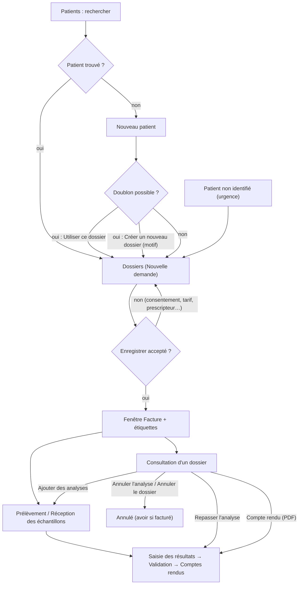
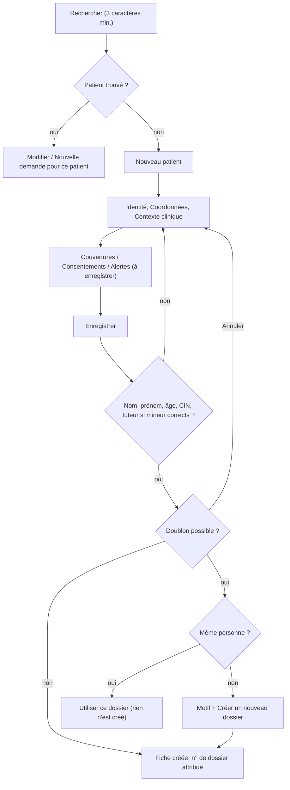
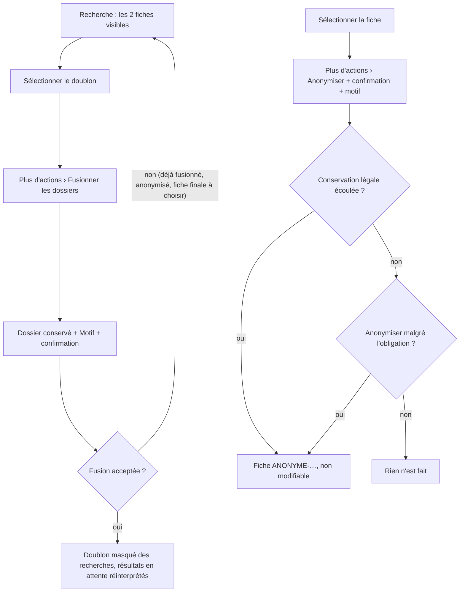
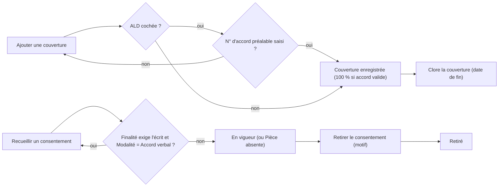
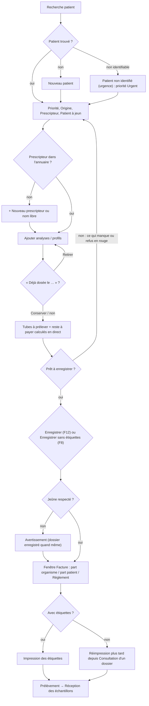
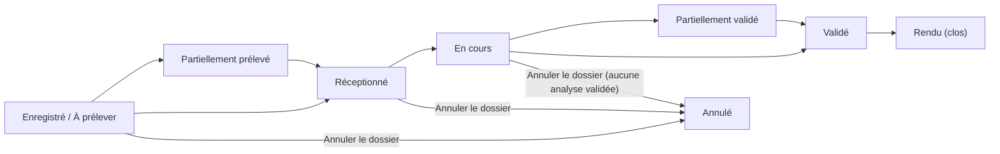
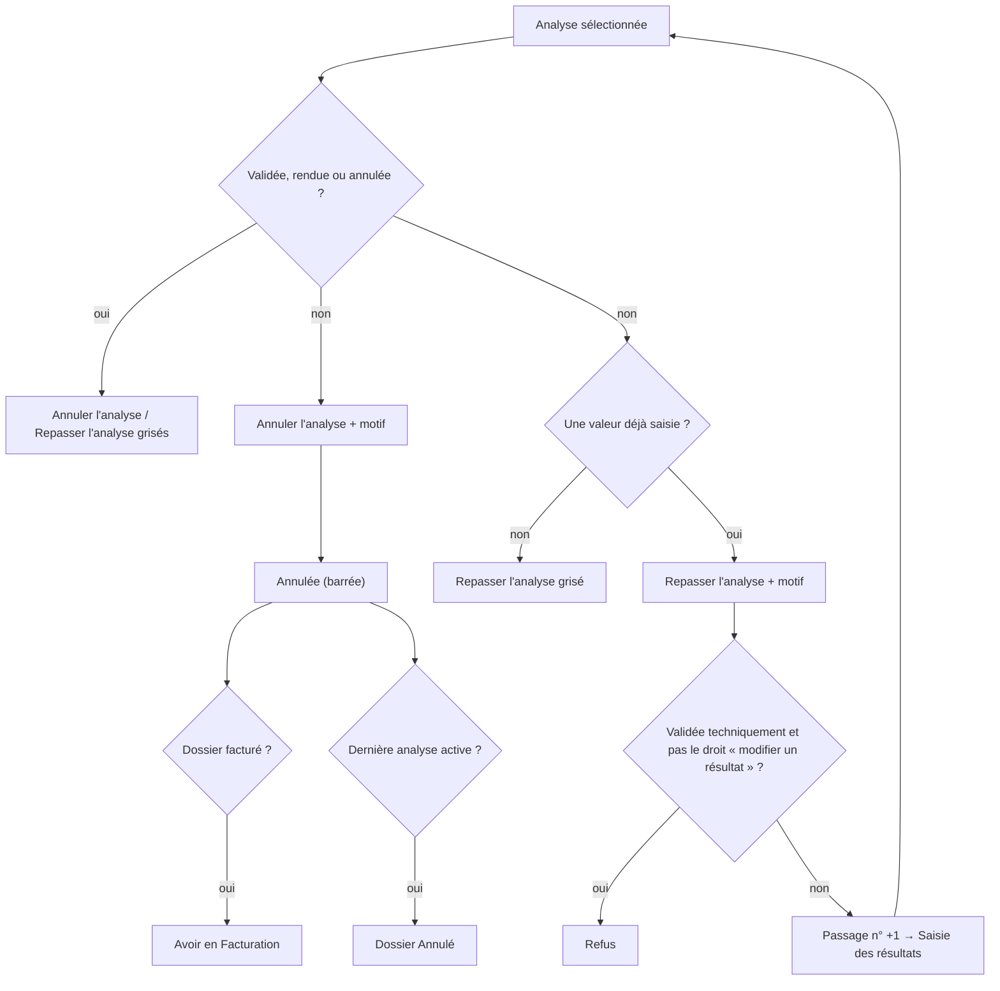

## Accueil / Enregistrement

### Présentation du module

**But** : ce groupe du menu réunit les trois écrans de l'accueil : la fiche des patients, l'enregistrement d'une nouvelle demande d'analyses (le « dossier ») et la consultation d'un dossier déjà enregistré. Tout le reste du travail du laboratoire (prélèvement, réception des tubes, saisie, validation, compte rendu, facturation) part de ce qui est saisi ici : une erreur d'identité ou d'analyse à l'accueil se retrouve sur le compte rendu et sur la facture.

**Qui l'utilise** :

| Rôle (par défaut) | Ce qu'il fait ici |
|---|---|
| Secrétariat / accueil | Tout le travail du comptoir : rechercher et créer les patients, enregistrer les demandes, corriger un dossier, annuler, réimprimer les étiquettes, ouvrir le compte rendu archivé. |
| Biologiste responsable, Administrateur | Comme l'accueil, plus la fusion de fiches en double (et l'anonymisation pour l'Administrateur). |
| Biologiste | Enregistre et corrige des dossiers, repasse une analyse ; ne crée pas de patient et ne saisit pas de dossier urgent. |
| Technicien | Consulte les patients et les dossiers, repasse une analyse, réimprime les étiquettes. |
| Préleveur | Consulte et crée des patients, consulte les dossiers, réimprime les étiquettes. |
| Responsable qualité, Comptabilité, Prescripteur | Consultation (le Prescripteur ne voit que ses patients). |

**Écrans** : **Patients** (Ctrl+1), **Dossiers** (Ctrl+2, l'écran s'intitule « Nouvelle demande »), **Consultation d'un dossier** (Ctrl+3), et les fenêtres de la fiche patient, du prescripteur, de l'ajout d'analyses et de la correction de l'en-tête.

**Liens avec les autres modules** : un dossier enregistré crée les tubes à prélever (**Prélèvements**, **Réception des échantillons**), les analyses à saisir et valider, et les montants que reprend la **Facturation**. Les couvertures de la fiche patient décident de la part de l'organisme (tiers payant). Le catalogue des analyses, les tarifs et l'annuaire des prescripteurs viennent de l'**Administration**.

Vue d'ensemble du groupe :

Raccourcis clavier valables dans tout le groupe (réglables dans **Raccourcis clavier**, touche **Maj+F1**) :

| Touche | Effet |
|---|---|
| **Ctrl+1** | ouvre l'écran **Patients** |
| **Ctrl+2** | ouvre l'écran **Dossiers** (enregistrement) |
| **Ctrl+3** | ouvre l'écran **Consultation d'un dossier** |
| **Ctrl+S** | appuie sur le bouton **Enregistrer** de l'écran, s'il est actif |
| **Ctrl+F** | place le curseur dans la zone de recherche de l'écran |
| **Ctrl+P** | imprime la liste affichée |
| **F5** | actualise l'écran |
| **F1** | ouvre l'aide de l'écran |

---

### Patients

**À quoi sert cet écran** : retrouver un patient, voir sa fiche et ses demandes passées, créer ou corriger sa fiche (identité, coordonnées, contexte clinique, couvertures, consentements, alertes), lancer une nouvelle demande pour lui, fusionner deux fiches en double et anonymiser une fiche.

**Qui y a accès**

- Ouvrir l'écran : droit « consulter les patients ». Par défaut : tous les rôles.
- **Nouveau patient** : droit « créer un patient » — Administrateur, Biologiste responsable, Secrétariat / accueil, Préleveur. (Le rôle Biologiste ne l'a pas.)
- Modifier une fiche, ajouter une couverture, un consentement ou une alerte : droit « modifier un patient » — Administrateur, Biologiste responsable, Biologiste, Secrétariat / accueil. Les autres utilisateurs peuvent ouvrir la fiche par **Modifier**, mais en lecture seule (bouton **Enregistrer** grisé).
- **Nouvelle demande pour ce patient** : droit « créer un dossier ».
- **Fusionner les dossiers** : Administrateur et Biologiste responsable uniquement.
- **Anonymiser** : Administrateur uniquement.

**L'écran**

- En haut : le titre « Patients » avec le nombre de fiches (« 312 patients »), puis les boutons **Modifier** (Entrée), **Plus d'actions** et **Nouveau patient** (Ctrl+N).
- Sous le titre : la zone de recherche « Nom, n° de dossier, CIN ou téléphone (Ctrl+F) », les filtres **Tous · N**, **Identité à compléter · N**, **Vus aujourd'hui · N** et la liste **Tous les payeurs**.
- Au milieu : la liste des patients, colonnes **Patient** (nom, puis « Masculin · 67 ans · né le … », ou la pastille « ! Identité à compléter » avec ce qui manque), **N° de dossier**, **CIN**, **Téléphone**, **Payeur** (couverture principale en cours, « Aucun » sinon), **Demandes** (nombre de dossiers non annulés), **Dernière visite**. Une ligne en rouge signale une alerte critique en cours. En bas : « X sur Y affichés · affinez la recherche pour voir la suite » quand la liste est coupée.
- À droite : la carte du patient sélectionné (initiales, nom, âge, sexe, pastilles « ! Identité à compléter — … » ou « ! Alerte critique », **N° de dossier**, **CIN**, **Téléphone**, **Payeur**), les boutons **Nouvelle demande pour ce patient** et **Modifier**, puis la liste **Demandes** : une carte par dossier (n°, date, statut, priorité si elle n'est pas routine, « N analyse(s) · prescripteur »), les 30 plus récents. « Sélectionnez un patient dans la liste. » s'affiche quand rien n'est choisi.

**Fonctionnalités**

- Zone de recherche : cherche dans le nom et le prénom, le numéro de dossier patient, la CIN et, à partir de 4 chiffres, le téléphone. Elle se lance seule 0,3 seconde après la dernière frappe ; il faut au moins 3 caractères (une zone vide affiche les premiers patients par ordre alphabétique). 50 résultats au plus, sans page suivante.
- **Tous · N** : toutes les fiches qui répondent à la recherche.
- **Identité à compléter · N** : fiches provisoires (« X-URG »), ou sans sexe, ou sans date de naissance ; la pastille dit ce qui manque (« identité provisoire (urgence) », « sexe inconnu », « date de naissance inconnue », « sexe et date de naissance inconnus »).
- **Vus aujourd'hui · N** : patients qui ont eu une demande aujourd'hui.
- **Tous les payeurs** : limite la liste aux patients d'un organisme payeur.
- **Modifier** (Entrée, ou double-clic sur la ligne) : ouvre la fiche du patient sélectionné.
- **Nouveau patient** (Ctrl+N) : ouvre une fiche vide (droit « créer un patient »).
- **Plus d'actions › Fusionner les dossiers** : rattache une fiche en double à la fiche conservée (au moins deux résultats affichés ; droit fusion).
- **Plus d'actions › Anonymiser** : efface les identifiants directs d'une fiche à la demande du patient (droit anonymisation).
- **Nouvelle demande pour ce patient** : ouvre **Dossiers** avec ce patient déjà choisi.
- Carte d'une demande (clic, ou Entrée / Espace) : ouvre ce dossier dans **Consultation d'un dossier** (droit « consulter les dossiers »).
- Sur une fiche anonymisée, **Fusionner les dossiers**, **Anonymiser** et **Nouvelle demande pour ce patient** sont grisés.

Fenêtre de la fiche patient (« Nouveau patient » / « Modifier le dossier ») :

- Onglets **Identité**, **Coordonnées**, **Contexte clinique**, **Couvertures**, **Consentements**, **Alertes** ; boutons **Enregistrer** (Entrée) et **Annuler**. Pour une nouvelle fiche, un rappel en haut : « Recherchez d'abord le patient : un second dossier pour la même personne scinde son historique. »
- **Ajouter une couverture** / **Clore la couverture** (onglet **Couvertures**) ; **Recueillir un consentement** / **Retirer le consentement** (onglet **Consentements**) ; **Ajouter une alerte** (onglet **Alertes**).
- Fenêtre **Doublon possible** : **Utiliser ce dossier**, **Créer un nouveau dossier** (avec **Motif : pourquoi s'agit-il d'une autre personne ?**), **Annuler**.

**Scénarios**

1. **Retrouver un patient**
   1. Tapez dans la zone de recherche le nom, le prénom, la CIN, le numéro de dossier ou le téléphone (au moins 3 caractères).
   2. Sélectionnez la ligne : la carte du patient et ses **Demandes** s'affichent à droite.
   3. Pour ouvrir un ancien dossier, cliquez sa carte dans **Demandes** : l'écran **Consultation d'un dossier** s'ouvre sur ce dossier.
   4. Pour enregistrer une nouvelle demande, cliquez **Nouvelle demande pour ce patient**.

2. **Créer la fiche d'un nouveau patient**
   1. Recherchez d'abord le patient (scénario 1) : ne créez la fiche que si la recherche ne donne rien.
   2. Cliquez **Nouveau patient** (Ctrl+N). La fenêtre de fiche s'ouvre sur l'onglet **Identité**.
   3. Saisissez **Nom**, **Prénom** (obligatoires), **Sexe**, et soit la **Date de naissance** (case cochée), soit, en décochant la case, l'**Âge déclaré**. L'âge calculé s'affiche à côté pour contrôle.
   4. Complétez si possible les noms en arabe, **Lieu de naissance**, **CIN**, **Passeport**, **Nationalité** (MA par défaut).
   5. Si le patient a moins de 18 ans, un encadré apparaît : saisissez le **Tuteur légal** (obligatoire), la **CIN du tuteur** et le **Lien de parenté**.
   6. Onglet **Coordonnées** : **Adresse**, **Ville**, **Région**, **Code postal**, **Téléphone mobile**, **Autre téléphone**, **Courriel**, **Langue du compte rendu**. Le mobile est réécrit au format +212… en quittant le champ : c'est le format qu'exige l'envoi de SMS. Cochez « Le patient refuse toute utilisation de ses données au-delà des soins » si le patient s'y oppose (loi 08-09).
   7. Onglet **Contexte clinique** : **Grossesse en cours** (femme uniquement) et **Date des dernières règles**, **Poids (kg)**, **Taille (cm)** (la surface corporelle s'affiche), **Groupe sanguin**, **Traitement en cours**, **Allergies connues**.
   8. Si besoin, ajoutez dès maintenant une couverture, un consentement ou une alerte (scénarios 4, 6, 8) : ils apparaissent avec la mention « à enregistrer » et seront créés avec la fiche.
   9. Cliquez **Enregistrer** (ou **Entrée**). Le numéro de dossier patient est attribué automatiquement. La liste se recharge et sélectionne le nouveau patient ; « Enregistré. » s'affiche.

3. **Répondre à l'alerte « Doublon possible »**
   - Dès que vous quittez les champs Nom, Prénom, CIN ou Date de naissance, un message orange peut s'afficher en bas de la fiche : « Dossier(s) possiblement en double… ». Vérifiez avec le patient.
   - Au moment d'**Enregistrer**, si des fiches proches existent, la fenêtre **Doublon possible** liste les fiches trouvées et la raison de la ressemblance (colonne **Correspondance** : CIN, date de naissance ou nom).
     - Si c'est la même personne : sélectionnez la fiche et cliquez **Utiliser ce dossier**. Rien n'est créé ; c'est cette fiche existante qui est retenue.
     - Si c'est une autre personne : remplissez **Motif : pourquoi s'agit-il d'une autre personne ?** (10 caractères au moins), cliquez **Créer un nouveau dossier** et confirmez. Le motif est gardé au journal d'audit.
     - **Annuler** revient à la fiche sans rien créer.

4. **Ajouter une couverture (AMO, mutuelle, assurance, convention)**
   1. Ouvrez la fiche (**Modifier**, ou pendant la création) et allez dans l'onglet **Couvertures**.
   2. Cliquez **Ajouter une couverture**.
   3. Choisissez l'**Organisme payeur** : sous la liste s'affichent son taux de remboursement, s'il facture sur la TNR ou sur le tarif du laboratoire, et si l'ordonnance est obligatoire.
   4. Saisissez le **N° d'immatriculation** (obligatoire), la **Qualité du bénéficiaire** (Assuré lui-même, Conjoint, Enfant, Ascendant, Autre ayant droit). Pour un ayant droit, renseignez **Assuré principal** et **CIN de l'assuré principal**.
   5. Facultatif : **Employeur**, **Taux dérogatoire (%)** (seulement si la convention du patient diffère du taux de l'organisme), **Valide du** et, en cochant, **Valide au**. Un taux tapé comme une fraction (par exemple « 0,8 ») fait demander « « 0,8 » sera enregistré comme un taux de remboursement de 0,8 %. Confirmer ce taux ? » : répondez Non et tapez « 80 ».
   6. Laissez cochée **Couverture principale** si c'est celle qui doit servir aux prochains dossiers (cocher une nouvelle couverture principale retire ce statut aux autres). Laissez **Tiers payant** coché si le laboratoire facture directement l'organisme.
   7. Pour une ALD, cochez **Affection de longue durée (ALD)** et saisissez le **N° d'accord préalable** (obligatoire) et **Accord valable jusqu'au**.
   8. Cliquez **Enregistrer**. La couverture apparaît dans la liste (colonnes **Organisme payeur**, **N° d'immatriculation**, **Qualité**, **Assuré principal**, **Taux**, **Affection de longue durée (ALD)**, **Validité**), en gras si principale, en gris si elle n'est plus valide aujourd'hui.

5. **Clore une couverture** (fin de droits, changement de mutuelle)
   1. Onglet **Couvertures**, sélectionnez une couverture sans date de fin.
   2. Cliquez **Clore la couverture**, saisissez la date de fin au format jj/mm/aaaa et validez.
   La couverture n'est jamais supprimée : les factures déjà émises restent explicables.

6. **Recueillir un consentement**
   1. Onglet **Consentements**, cliquez **Recueillir un consentement**.
   2. Choisissez la **Finalité** (Analyses prescrites et traitement du dossier, Analyse génétique, Sérologie VIH, Dépistage prénatal, Conservation de l'échantillon, Utilisation à des fins de recherche, Transmission électronique du compte rendu, Communication à un tiers, Sous-traitance de l'analyse, Messages de suivi).
   3. Choisissez la **Modalité** (Formulaire signé, Signature électronique, Accord verbal, Portail en ligne) et **Présenté en** (langue).
   4. Renseignez **Signé par**, **CIN du signataire**, **Qualité du signataire** (pré-rempli « Tuteur légal » pour un mineur), **Version du formulaire**, éventuellement **Expire le** et **Observations**.
   5. Cliquez **Enregistrer**.

7. **Retirer un consentement**
   1. Onglet **Consentements**, sélectionnez un consentement en vigueur, cliquez **Retirer le consentement**.
   2. Saisissez le motif du retrait et validez. La ligne passe en gris avec l'état « Retiré ».

8. **Ajouter une alerte sur la fiche** (accès veineux difficile, risque infectieux, impayé…)
   1. Onglet **Alertes**, cliquez **Ajouter une alerte**.
   2. Choisissez la **Gravité** (Information, Avertissement, Critique), saisissez le **Message (français)** (obligatoire) et si possible le **Message (arabe)**.
   3. Cochez **Expire le** et donnez une date si l'alerte n'est vraie qu'un temps (une alerte sans date est « permanente »).
   4. Cliquez **Ajouter**. Pour une alerte **Critique**, confirmez. Une alerte critique colore la ligne du patient en rouge et affiche un avertissement quand on le choisit dans **Dossiers** ; elle ne bloque pas l'enregistrement, contrairement à ce que dit le texte d'aide de la fenêtre.

9. **Corriger l'identité d'un patient** (faute de frappe, date de naissance, sexe)
   1. Sélectionnez le patient, cliquez **Modifier**, corrigez, cliquez **Enregistrer**.
   2. Si le sexe, l'âge, la grossesse, le poids ou la taille changent, les résultats non encore validés sont réinterprétés automatiquement. Les résultats déjà validés ne changent pas : le journal d'audit indique combien sont à revoir par le biologiste (et à corriger par un compte rendu rectifié si nécessaire).

10. **Compléter l'identité d'un patient « X urgence »**
    1. Cliquez le filtre **Identité à compléter**, ou recherchez « X-URG » ou le numéro de dossier provisoire.
    2. Cliquez **Modifier**, remplacez le nom « X-URG » et le prénom provisoire par la vraie identité, complétez la fiche, **Enregistrer**. Le journal d'audit note que l'identité provisoire a été complétée ; les résultats déjà rendus sous « X-URG » sont désormais au nom du patient.

11. **Fusionner deux fiches en double**
    1. Recherchez de façon à faire apparaître **les deux** fiches dans la liste (le bouton n'est actif que s'il y a au moins deux résultats).
    2. Sélectionnez la fiche **à faire disparaître** (le doublon), cliquez **Plus d'actions › Fusionner les dossiers**.
    3. Dans la fenêtre, vérifiez le **Dossier à fusionner**, choisissez le **Dossier conservé**, saisissez le **Motif** (5 caractères au moins), cliquez **Fusionner les dossiers** et confirmez.
    4. « Dossiers fusionnés. » s'affiche. Le doublon disparaît des recherches ; ses dossiers d'analyses sont rattachés à la fiche conservée (historique, antériorités, et facturation : les dossiers non facturés du doublon se facturent au nom du patient conservé).

12. **Anonymiser une fiche** (demande d'effacement, loi 08-09)
    1. Sélectionnez la fiche, cliquez **Plus d'actions › Anonymiser**, confirmez.
    2. Saisissez le motif (demande du patient, décision CNDP…, 10 caractères au moins).
    3. Si la durée légale de conservation n'est pas écoulée, un message donne la date de fin et demande « Anonymiser malgré l'obligation de conservation encore en cours ? ». Répondez Non sauf décision écrite contraire.
    4. « Dossier anonymisé » s'affiche. La fiche devient « ANONYME-… » ; l'historique des analyses et la facturation sont conservés, la fiche n'est plus modifiable.

**Règles et contrôles**

- Nom, prénom, et date de naissance **ou** âge déclaré sont obligatoires.
- CIN : 1 ou 2 lettres suivies de 5 ou 6 chiffres.
- La date de naissance ne peut pas être dans le futur. Une grossesse n'est possible que pour le sexe féminin.
- Patient mineur : l'identité du tuteur légal est obligatoire.
- Poids et taille : un nombre lisible, jusqu'à 500 kg et 300 cm.
- Le numéro de dossier patient est attribué par une suite sans trou ; il n'est jamais modifié.
- Couverture : n° d'immatriculation obligatoire ; assuré principal obligatoire pour un ayant droit ; taux dérogatoire entre 0 et 100 % ; date de fin pas avant la date de début ; une couverture dont la date de début est dans le futur est refusée ; ALD sans n° d'accord préalable refusée. Une ALD avec accord valide est remboursée à 100 %.
- Le taux s'applique au tarif de référence, non au prix facturé : le dépassement reste à la charge du patient.
- Analyse génétique, sérologie VIH, dépistage prénatal, conservation de l'échantillon et recherche exigent un consentement **écrit** : un « Accord verbal » est refusé. Un consentement écrit sans pièce jointe s'affiche « Pièce absente » (en orange) ; l'écran ne permet pas encore de joindre la pièce.
- Les couvertures, consentements et alertes ne se suppriment pas et ne se modifient pas : on les clôt, on les retire ou on les laisse expirer.
- Fusion : impossible d'une fiche dans elle-même ; refusée si le doublon est déjà fusionné, si la fiche conservée a elle-même été fusionnée, ou si l'une des fiches est anonymisée. La fusion ne se défait pas depuis l'application.
- Anonymisation : refusée tant que court l'obligation de conservation (10 ans après le dernier dossier, durée réglable), sauf confirmation explicite ; refusée si déjà anonymisée.
- Toute recherche et toute ouverture de fiche sont tracées (loi 08-09).

**Flux**

Patient trouvé ou créé → **Dossiers** (enregistrement de la demande, par **Nouvelle demande pour ce patient**). On revient ici pour corriger l'identité, ajouter une couverture ou un consentement manquant avant d'enregistrer une analyse qui l'exige.

Création d'une fiche :

Fusion et anonymisation :

Couverture et consentement :

---

### Dossiers

**À quoi sert cet écran** : enregistrer une nouvelle demande d'analyses (un « dossier ») pour un patient. L'écran s'intitule « Nouvelle demande » (« Le n° de dossier est attribué à l'enregistrement. »). On y choisit le patient, le contexte (priorité, origine, prescripteur, jeûne), les analyses ; l'écran montre en direct les tubes à prélever et ce que le patient aura à payer, puis enregistre le dossier et imprime les étiquettes.

**Qui y a accès**

- L'écran, **Enregistrer** et **Enregistrer sans étiquettes** : droit « créer un dossier » — Administrateur, Biologiste responsable, Biologiste, Secrétariat / accueil.
- Priorité **Urgent** ou **Urgence vitale** : droit « dossier urgent » — Administrateur, Biologiste responsable, Secrétariat / accueil. **Le rôle Biologiste ne l'a pas** : un dossier urgent saisi par un biologiste est refusé à l'enregistrement (la liste n'est pas filtrée).
- **Nouveau patient** et **Patient non identifié (urgence)** : droit « créer un patient » (pas le rôle Biologiste).
- **+** (nouveau prescripteur) : droit « créer un dossier » ou « gérer le catalogue ».

**L'écran**

- **Carte Patient** : zone « Rechercher un patient : nom, n° de dossier, CIN, téléphone (Ctrl+F) » avec la liste des patients proposés, boutons **Nouveau patient** et **Patient non identifié (urgence)**. Une fois le patient choisi, un bandeau le résume (initiales, nom, sexe, âge, date de naissance, « Dossier N · CIN · Tél. · Payeur … » ou « Paiement direct »), avec le lien « N demande(s) antérieure(s) · dernière le … Voir » (ou « Première demande au laboratoire ») et le bouton **Changer de patient**.
- **Carte Demande** : **Priorité** (Routine, Urgent, Urgence vitale), **Origine** (Patient au comptoir, Prélèvement à domicile, Clinique / hôpital, Centre de prélèvement, Sous-traitance reçue, Médecine du travail, Demande du patient), **Prescripteur** (marqué « * » quand il est obligatoire) avec le bouton **+** (« Nouveau prescripteur »), **Patient à jeun** (trois boutons **Oui**, **Non**, **Non renseigné** ; Oui par défaut), **Renseignements cliniques** (« Ex. : suivi diabète, traitement en cours, grossesse… »), case **Paiement direct (sans tiers payant)**.
- **Carte Ajouter des analyses** : « Tapez un code ou un nom, puis Entrée », la rangée **Profils fréquents** (les profils les plus demandés), la rangée **Catalogue** (filtres **Tous**, **Profils** et un filtre par secteur), la zone « Code, nom ou synonyme de l'analyse » et la liste du catalogue : **Code**, **Désignation** (avec « Profil · N » pour un profil), **Secteur**, **Tube**, **Délai**, **Prix (DH)**, et en bout de ligne **+**, « ✓ Ajoutée » ou « ✓ Dans un profil ».
- **Carte Analyses demandées** (avec le nombre d'analyses) : bouton **Tout retirer**, liste **Analyse**, **Tube** (« Plusieurs » pour un profil), **Prix (DH)**, **✕** ; sous la liste, les avertissements « ! Déjà dosée le … » avec **Conserver** / **Retirer**.
- **Tubes à prélever** : un repère par tube (« nom volume ×n ») et « N tube(s) · M étiquette(s) ».
- **Montant** : « Montant brut (N analyses) », « Part organisme · nom de l'organisme » (en moins), « Reste à payer par le patient ».
- **Barre du bas** : la ligne d'état (« À compléter : … », un refus en rouge, ou « Prêt à enregistrer · tous les champs obligatoires sont remplis »), puis **Annuler la saisie** (Échap), **Enregistrer sans étiquettes** (F8) et **Enregistrer** (F12).

**Fonctionnalités**

- Recherche patient : à partir de 3 caractères, une liste de patients s'ouvre sous la zone ; Flèche bas la parcourt (ou liste tous les résultats), Entrée choisit.
- **Nouveau patient** : ouvre la fiche patient ; une fois enregistrée (ou une fiche existante choisie par **Utiliser ce dossier**), le patient est sélectionné ici.
- **Patient non identifié (urgence)** : fenêtre **Patient X urgence** (**Sexe**, **Âge estimé (ans)**, **Ouvrir le dossier provisoire**) ; crée une fiche « X-URG » et passe la priorité à **Urgent**.
- Lien **Voir** (demandes antérieures) : ouvre la dernière demande du patient dans **Consultation d'un dossier** (en demandant confirmation si une saisie est en cours).
- **Changer de patient** : retire le patient choisi pour en chercher un autre.
- **Priorité**, **Origine**, **Prescripteur** : contexte du dossier. Le prescripteur se choisit dans l'annuaire (tapez les premières lettres) ou se tape librement ; il est obligatoire sauf pour l'origine « Demande du patient ».
- **+** (Nouveau prescripteur) : ouvre la fenêtre **Nouveau prescripteur** préremplie avec le nom tapé.
- **Patient à jeun** **Oui** / **Non** / **Non renseigné** : sert au contrôle du jeûne des analyses qui l'exigent.
- **Paiement direct (sans tiers payant)** : tout le dossier est à la charge du patient, même s'il a une couverture.
- Zone de saisie des analyses + **Entrée** : ajoute la meilleure correspondance (code exact, sinon début de code, sinon nom). **F4** ramène le curseur dans cette zone.
- **Profils fréquents** : un clic ajoute le profil.
- Filtres **Catalogue** (**Tous**, **Profils**, secteurs) : limitent la liste du catalogue.
- Liste du catalogue : double-clic, Entrée ou **+** ajoute l'analyse ou le profil ; l'info-bulle indique « Déjà dans la demande », « comprise dans … » ou « Entrée ↵ pour ajouter ».
- **✕**, double-clic ou **Suppr** sur une analyse demandée : la retire. **Tout retirer** : vide la liste après confirmation.
- Avertissement de répétition « ! Déjà dosée le … (dossier …). » : l'analyse a été faite chez ce patient dans les 30 derniers jours ; **Conserver** la garde, **Retirer** l'enlève.
- **Annuler la saisie** (Échap) : vide l'écran après confirmation.
- **Enregistrer** (F12 ou Ctrl+S) : enregistre le dossier et imprime les étiquettes.
- **Enregistrer sans étiquettes** (F8) : enregistre sans imprimer (les étiquettes se réimpriment depuis **Consultation d'un dossier**).
- Fenêtre **Facture** (après l'enregistrement) : **N° de dossier**, **Montant brut**, **Remise**, **Total à payer**, **Part organisme**, **Part patient**, **Dépassement du tarif de référence**, **Règlement** (ce que le patient paie au comptoir).
- Fenêtre **Nouveau prescripteur** : voir scénario 5.

**Scénarios**

1. **Enregistrer un dossier pour un patient connu**
   1. Dans la recherche patient, tapez nom, CIN, n° de dossier ou téléphone (3 caractères au moins), puis choisissez le patient dans la liste. (Depuis l'écran **Patients**, **Nouvelle demande pour ce patient** arrive ici avec le patient déjà choisi.)
   2. Vérifiez le bandeau du patient. Si le patient a une alerte critique, une fenêtre s'affiche : ouvrez la fiche pour la lire. Le lien des demandes antérieures dit quand il est venu pour la dernière fois.
   3. Choisissez la **Priorité** et l'**Origine**.
   4. Choisissez le **Prescripteur** dans l'annuaire (tapez les premières lettres) ou tapez son nom librement s'il n'y est pas.
   5. Indiquez **Patient à jeun** (**Oui**, **Non** ou **Non renseigné**) et les **Renseignements cliniques** si l'ordonnance en donne.
   6. Ajoutez les analyses (scénario 4).
   7. Cochez **Paiement direct (sans tiers payant)** si le patient ne veut pas utiliser sa couverture pour ce dossier.
   8. Vérifiez **Tubes à prélever** et le **Reste à payer par le patient**. La barre du bas doit dire « Prêt à enregistrer… » (elle rappelle aussi « Jeûne requis N h » et « Consentement requis avant enregistrement » si besoin).
   9. Cliquez **Enregistrer** (F12 ou Ctrl+S).
   10. Si un avertissement s'affiche (jeûne non respecté par exemple), lisez-le : le dossier est enregistré quand même.
   11. La fenêtre **Facture** affiche le récapitulatif : **N° de dossier**, **Montant brut**, éventuellement **Remise**, **Total à payer**, **Part organisme** et **Part patient** (si une couverture s'applique), **Dépassement du tarif de référence** s'il y en a, et **Règlement**.
   12. Les étiquettes des tubes s'impriment aussitôt (ou s'ouvrent à l'écran si aucune imprimante d'étiquettes n'est réglée). La barre du bas indique « N° de dossier … — N échantillons » ; l'écran se vide pour le patient suivant.

2. **Enregistrer un dossier pour un nouveau patient** (sans quitter l'écran)
   1. Cliquez **Nouveau patient**, remplissez la fiche (voir écran **Patients**, scénarios 2 à 4), **Enregistrer**.
   2. Le patient est sélectionné automatiquement (y compris si, dans la fenêtre « Doublon possible », vous avez choisi **Utiliser ce dossier**). Continuez au point 3 du scénario 1.

3. **Patient non identifiable (urgence)**
   1. Cliquez **Patient non identifié (urgence)**.
   2. Dans la fenêtre **Patient X urgence**, choisissez le **Sexe** et l'**Âge estimé (ans)**, cliquez **Ouvrir le dossier provisoire**.
   3. Une fiche « X-URG » est créée et sélectionnée, la priorité passe à **Urgent**. Continuez l'enregistrement normalement.
   4. Plus tard, complétez l'identité depuis l'écran **Patients** (filtre **Identité à compléter**, scénario 10).

4. **Choisir les analyses**
   - Tapez un code ou un nom dans la zone de saisie puis **Entrée** : l'analyse dont le code est exactement celui tapé est ajoutée (sinon le premier code qui commence ainsi, sinon le premier nom trouvé), et la zone se vide pour la suivante.
   - Ou bien cliquez un des **Profils fréquents**, ou filtrez le **Catalogue**, puis double-clic, Entrée ou **+** sur la ligne voulue.
   - Pour retirer une analyse demandée : **✕** sur sa ligne, double-clic, ou sélection puis touche **Suppr**. **Tout retirer** vide la demande (confirmation « Retirer les N analyses de la demande ? »).
   - Préférez le profil à ses analyses séparées. Si vous ajoutez un profil qui contient une analyse déjà choisie seule, celle-ci est retirée (message « … : déjà compris dans le profil « … », retiré de la liste pour ne pas être compté deux fois. ») ; si vous ajoutez seule une analyse déjà comprise dans un profil choisi, elle n'est pas ajoutée. Deux profils qui partagent une analyse ne la comptent qu'une fois (« N analyse(s) déjà comptée(s) »).
   - Si « ! Déjà dosée le … » apparaît, demandez si la répétition est voulue : **Conserver** ou **Retirer**.

5. **Créer un prescripteur pendant l'enregistrement**
   1. Tapez le nom du médecin dans **Prescripteur**, puis cliquez **+**.
   2. La fenêtre **Nouveau prescripteur** reprend le nom tapé. Complétez **Nom** (obligatoire), **Prénom**, nom arabe, type de prescripteur (liste sous l'étiquette « Désignation » : Médecin généraliste, Médecin spécialiste, Chirurgien-dentiste, Sage-femme, Établissement de santé, Laboratoire correspondant, Médecin du travail, Demande directe du patient), **Spécialité**, **Établissement**, **N° Ordre des médecins / pharmaciens**, **INPE**, **ICE**, téléphones, **Fax**, **Courriel**, **Ville**, **Adresse**, **Téléphone résultats critiques**, mode de **Remise** des comptes rendus, **Envoyer les comptes rendus partiels**, **Remise**, **Observations**, **Actif**.
   3. Cliquez **Enregistrer**. Le prescripteur est créé et sélectionné. En cas de refus, la fenêtre reste ouverte avec ce qui a été tapé.
   - Un avertissement rouge rappelle que, sans INPE, une facture en tiers payant ne peut pas être transmise.

6. **Dossier reçu d'un autre laboratoire (« Sous-traitance reçue »)**
   1. Créez ou retrouvez le patient. Pour que le laboratoire adresseur soit facturé, la fiche doit porter une couverture sur l'organisme qui le représente (par exemple « Laboratoire adresseur »).
   2. Origine : **Sous-traitance reçue**. Prescripteur : choisissez le laboratoire correspondant dans l'annuaire (type « Laboratoire correspondant ») ou créez-le par **+**.
   3. Ajoutez les analyses et **Enregistrer**.
   - Il n'y a pas, sur cet écran, de champ pour la référence du dossier chez le laboratoire adresseur ; notez-la dans **Renseignements cliniques** si besoin.

7. **Demande directe du patient** (sans ordonnance)
   - Origine : **Demande du patient**. C'est la seule origine où le prescripteur n'est pas obligatoire.

8. **Enregistrer sans imprimer les étiquettes** (imprimante occupée, tubes déjà étiquetés)
   - Cliquez **Enregistrer sans étiquettes** (F8). La barre du bas ajoute « étiquettes non imprimées (réimpression depuis la consultation du dossier) ». Réimprimez-les plus tard par **Imprimer les étiquettes** dans **Consultation d'un dossier**.

9. **Abandonner une saisie en cours**
   - Cliquez **Annuler la saisie** (ou Échap) et confirmez « Abandonner la saisie en cours ? Le patient, les analyses et les renseignements saisis seront effacés. ». Rien n'est enregistré.

**Règles et contrôles**

- **Enregistrer** et **Enregistrer sans étiquettes** restent grisés tant qu'aucun patient n'est choisi ou qu'aucune analyse n'est demandée. La barre du bas dit ce qui manque (« À compléter : le patient, au moins une analyse, le prescripteur »).
- Le montant affiché (montant brut, part organisme, reste à payer) est calculé en direct avec le même calcul que l'enregistrement, en tenant compte de la couverture principale du patient et de **Paiement direct**. Si ce calcul trouve un problème qui ferait refuser l'enregistrement (consentement manquant, analyse sans tarif…), il est écrit en rouge dans la barre du bas avant même de cliquer.
- Prescripteur obligatoire sauf origine « Demande du patient ».
- Consentements : une analyse génétique, une sérologie VIH ou un dépistage prénatal est **refusé** sans consentement en vigueur sur la fiche, ou si ce consentement n'est que verbal. Recueillez-le d'abord sur la fiche patient.
- Jeûne : si **Patient à jeun** est sur **Non** et qu'une analyse demande un jeûne, le dossier est enregistré mais un avertissement s'affiche (« le résultat devra être interprété avec réserve »). Le nombre d'heures de jeûne se saisit au **Prélèvement**.
- Une analyse sans tarif en vigueur (ni pour l'organisme, ni dans la liste du laboratoire) est refusée : il faut lui ajouter un tarif dans le **Catalogue des analyses**. Une analyse désactivée est refusée.
- Un patient fusionné ou anonymisé ne peut pas recevoir de nouveau dossier.
- Couverture utilisée : la couverture **principale valide aujourd'hui** de la fiche (on ne peut pas en choisir une autre ici). Un seul organisme par dossier : une mutuelle complémentaire n'est pas utilisée pour répartir la part patient. Avec **Paiement direct**, ou sans couverture valide, tout est à la charge du patient. Si l'accord de tiers payant de l'organisme est expiré, le patient avance la somme.
- La remise ne se saisit pas ici : elle se donne au moment de la facturation (droit « appliquer une remise », rôle Comptabilité par défaut).
- Le n° de dossier vient d'une suite annuelle sans trou ; un enregistrement qui échoue ne consomme pas de numéro.
- Chaque enregistrement relance le délai légal de conservation de la fiche patient (10 ans par défaut).
- La date d'échéance du rendu est calculée dès l'enregistrement à partir du délai de rendu des analyses (plus court si urgent).

**Flux**

Enregistrement → étiquettes collées → **Prélèvements** puis **Réception des échantillons** → saisie → validation → compte rendu. L'encaissement se fait en **Facturation** / **Caisse**. Toute modification ultérieure du dossier se fait dans **Consultation d'un dossier**.

---

### Consultation d'un dossier

**À quoi sert cet écran** : afficher un dossier enregistré dans son ensemble (analyses, tubes, facturation, historique) et faire les corrections encore possibles : ajouter des analyses, annuler une analyse ou tout le dossier, repasser une analyse, corriger l'en-tête, réimprimer les étiquettes, ouvrir le compte rendu PDF.

**Qui y a accès**

- L'écran : droit « consulter les dossiers » — tous les rôles par défaut. Un compte Prescripteur ne voit que les dossiers de ce prescripteur.
- **Ajouter des analyses**, **Modifier l'en-tête** : droit « modifier un dossier » — Administrateur, Biologiste responsable, Biologiste, Secrétariat / accueil.
- **Annuler l'analyse**, **Annuler le dossier** : droit « annuler un dossier » — Administrateur, Biologiste responsable, Secrétariat / accueil (pas le Biologiste).
- **Repasser l'analyse** : droit « saisir des résultats » — Administrateur, Biologiste responsable, Biologiste, Technicien. Si l'analyse est déjà validée techniquement, il faut aussi le droit « modifier un résultat » (Biologistes, Administrateur).
- **Imprimer les étiquettes** : droit « réimprimer une étiquette » — Administrateur, Biologiste responsable, Technicien, Préleveur, Secrétariat / accueil.
- **Compte rendu (PDF)** : droit « réimprimer un compte rendu validé » — Administrateur, Biologiste responsable, Biologiste, Secrétariat / accueil, Prescripteur.
- Onglet **Facturation** : les règlements ne s'affichent qu'avec le droit « consulter la facturation ».

**L'écran**

- À gauche : la zone de recherche « N° de dossier, code-barres, nom du patient, CIN ou n° de fiche », les filtres **7 derniers jours**, **En cours**, **Urgents**, le bouton **Actualiser**, puis la liste des dossiers du site (n°, patient, date d'enregistrement, statut, priorité, nombre d'analyses). Au-dessus de la liste : « N dossier(s) » ou « Les 200 dossiers les plus récents — affinez la recherche pour les autres ». Les dossiers annulés restent visibles, en gris.
- À droite, l'en-tête du dossier : le **numéro de dossier** en grand (double-clic pour le copier), le statut, « Enregistré le … à … par … » (ou en rouge « Dossier annulé le … — motif »), le patient (âge, sexe, n° de dossier patient, téléphone), **Prescripteur** (« non renseigné » s'il manque), **Ordonnance du**, **Payeur** et taux (ou « Sans prise en charge — à la charge du patient »), n° d'accord préalable, **Renseignements cliniques**, « patient non à jeun », le n° de **Facture**, « Compte rendu diffusé — version N ». Une frise de progression indique « x sur y tubes », « x sur y paramètres », « x sur y analyses ».
- Onglets :
  - **Analyses · N** : **Analyse**, **Statut**, **Résultats** (saisis / attendus), **Tube** (code-barres), **Montant**, **Part patient**, et le commentaire (motif d'annulation, « Passage n° … — motif », « Validé par … », « Sous-traitée »). Une analyse annulée est barrée ; repassée, en orange ; en retard, dans la couleur du retard ; validée, en vert.
  - **Tubes · N** : **Tube n°**, **Code-barres**, **Nature du prélèvement**, **Type de tube**, **Statut**, **Prélevé le**, **Réceptionné le**, **Lieu de conservation**. Tube refusé ou éliminé en rouge ; tube à prélever en orange.
  - **Facturation** : le résumé « N analyse(s) · total … · patient … · organisme … », le n° de facture (ou « Non facturé »), la liste des **Règlements** (**Date**, **Mode de règlement**, **Montant**, statut, **Reçu par**, **Référence**) et le bouton **Ouvrir la facturation**.
  - **Historique** : les opérations motivées sur ce dossier (**Date**, **Utilisateur**, **Opération** avec le motif) : ajouts, annulations, reprises, corrections d'en-tête, réimpressions.
- En bas, la barre d'actions : **Ajouter des analyses**, **Imprimer les étiquettes** (F8), **Compte rendu (PDF)**, **Modifier l'en-tête**, **Plus d'actions**.

Statuts d'un dossier :

| Statut | Signification |
|---|---|
| Enregistré / À prélever | demande saisie, tubes pas encore prélevés |
| Partiellement prélevé | une partie des tubes prélevée |
| Réceptionné | tubes arrivés au laboratoire |
| En cours | analyses en cours |
| Partiellement validé | une partie des analyses validée par le biologiste |
| Validé | toutes les analyses validées |
| Rendu | compte rendu diffusé : dossier clos |
| Annulé | dossier annulé (motif affiché) |

Statuts d'une analyse : En attente de prélèvement, Prélevé, Réceptionné, En cours d'analyse, Résultat saisi, Validé techniquement, Validé biologiquement, Rendu, Annulée.

**Fonctionnalités**

- Zone de recherche : filtre la liste (nom, CIN, n° de fiche, partie de numéro) ; un n° de dossier ou un code-barres de tube scanné puis **Entrée** ouvre directement le dossier.
- **7 derniers jours**, **En cours**, **Urgents** : filtres de la liste, cumulables (un clic active, un second clic retire).
- **Actualiser** (F5) : recharge la liste et le dossier affiché.
- Clic sur un dossier de la liste : l'affiche à droite.
- Double-clic sur le numéro de dossier de l'en-tête : le copie dans le presse-papiers (info-bulle « Double-clic pour copier le numéro de dossier. » ; message « Numéro de dossier … copié. »), pour le coller dans un courriel, un appel ou un autre écran.
- **Ajouter des analyses** : fenêtre de choix d'analyses avec motif ; grisé sur un dossier annulé, facturé ou rendu.
- **Imprimer les étiquettes** (F8) : réimprime toutes les étiquettes du dossier, avec un motif.
- **Compte rendu (PDF)** : ouvre la dernière version diffusée du compte rendu, telle qu'archivée.
- **Modifier l'en-tête** : corrige le prescripteur libre, la date de l'ordonnance, la priorité, la langue du compte rendu, les renseignements, le code diagnostic, le service, la chambre, la note interne, avec un motif.
- **Plus d'actions › Annuler l'analyse** : annule l'analyse sélectionnée, avec motif.
- **Plus d'actions › Repasser l'analyse** : renvoie l'analyse sélectionnée au poste technique, avec motif.
- **Plus d'actions › Annuler le dossier** : annule tout le dossier, avec confirmation et motif.
- **Plus d'actions** contient aussi **Modifier l'en-tête** et **Compte rendu (PDF)** quand la fenêtre est trop étroite pour les afficher dans la barre.
- Clic droit sur une analyse : menu **Annuler l'analyse** / **Repasser l'analyse** pour cette analyse.
- **Ouvrir la facturation** (onglet **Facturation**) : ouvre l'écran **Facturation** pour émettre la facture ou encaisser ; le dossier n'y est pas présélectionné, cherchez-le par son numéro.

**Scénarios**

1. **Retrouver un dossier**
   - À l'ouverture, l'écran affiche le dossier le plus récent.
   - Tapez dans la zone de recherche un nom, une CIN, un n° de fiche ou une partie de numéro : la liste se filtre. Cliquez la ligne voulue (ou **flèche bas** puis flèches). Les filtres **7 derniers jours**, **En cours**, **Urgents** resserrent la liste.
   - Scannez ou tapez un n° de dossier ou le code-barres d'un tube puis **Entrée** : le dossier s'ouvre directement. Si rien ne correspond exactement, **Entrée** ouvre le premier dossier de la liste filtrée ; s'il n'y en a aucun : « Aucun dossier ne correspond à « … ». ».
   - Depuis l'écran **Patients**, un clic sur une demande ouvre aussi le dossier ici ; depuis **Dossiers**, le lien **Voir** ouvre la dernière demande du patient.

2. **Copier le numéro de dossier** : double-cliquez le numéro en grand dans l'en-tête ; collez-le (Ctrl+V) où il faut.

3. **Ajouter des analyses à un dossier** (le médecin téléphone pour ajouter une TSH)
   1. Ouvrez le dossier, cliquez **Ajouter des analyses**.
   2. Dans la fenêtre, cherchez par code, nom ou synonyme, **Entrée** ; double-cliquez pour mettre l'analyse dans **Analyses à ajouter** (**Retirer** pour l'enlever). Les analyses déjà au dossier sont signalées « déjà au dossier ».
   3. Saisissez le **Motif de la modification** (obligatoire), cliquez **Ajouter des analyses**.
   4. Les étiquettes des nouveaux tubes s'impriment. Si l'analyse a été ajoutée sur un tube déjà réceptionné, un avertissement demande de vérifier qu'il reste du volume.
   5. Le message indique le nombre d'analyses ajoutées et leur montant.

4. **Annuler une analyse**
   1. Sélectionnez l'analyse dans l'onglet **Analyses**, cliquez **Plus d'actions › Annuler l'analyse** (ou clic droit sur l'analyse).
   2. Saisissez le motif (5 caractères au moins), validez.
   3. L'analyse apparaît barrée avec son motif. Si le dossier était déjà facturé, le message rappelle que la régularisation passe par un avoir (en Facturation). Si c'était la dernière analyse du dossier, le dossier devient annulé.

5. **Repasser une analyse** (valeur douteuse, dilution, contrôle rejeté)
   1. Sélectionnez l'analyse, cliquez **Plus d'actions › Repasser l'analyse** (ou clic droit). Le choix est grisé tant qu'aucune valeur n'a été saisie.
   2. Saisissez le motif de la reprise, validez.
   3. L'analyse retourne au poste technique (« … renvoyée au poste technique — passage n° 2 ») sur le même tube ; elle n'est pas facturée une seconde fois. Les anciennes valeurs restent visibles jusqu'à la nouvelle saisie mais perdent leur validation technique.

6. **Corriger l'en-tête du dossier**
   1. Cliquez **Modifier l'en-tête**.
   2. Corrigez au besoin : **Prescripteur** (seulement s'il avait été saisi en texte libre), **Date de l'ordonnance**, **Priorité**, **Langue du compte rendu**, **Renseignements cliniques**, **Code diagnostic (CIM-10)**, **Service / unité**, **Chambre / lit**, **Note interne**.
   3. Saisissez le **Motif de la modification** (obligatoire), cliquez **Enregistrer** (ou **Entrée**).
   - L'organisme payeur est rappelé en haut mais ne se modifie pas ici (« la couverture ne se modifie pas après l'enregistrement (avoir puis nouvelle facture) »).

7. **Annuler tout le dossier** (patient parti avant le prélèvement, doublon de saisie)
   1. Cliquez **Plus d'actions › Annuler le dossier**. Le message indique le nombre d'analyses et de tubes ; confirmez.
   2. Saisissez le motif, validez.
   3. Le dossier passe « Annulé », ses tubes encore présents sont éliminés (sauf un tube déjà en analyse, laissé tel quel). S'il était facturé : « Dossier annulé. La facture … reste due : émettez un avoir. »

8. **Réimprimer les étiquettes**
   1. Cliquez **Imprimer les étiquettes** (ou F8).
   2. Saisissez le motif (étiquette abîmée, illisible, tube supplémentaire…). Toutes les étiquettes du dossier sont réimprimées ; la réimpression est tracée.

9. **Ouvrir le compte rendu**
   - Cliquez **Compte rendu (PDF)** : la dernière version diffusée s'ouvre, telle qu'elle a été archivée. S'il n'y en a pas : « Aucun compte rendu n'a encore été diffusé pour ce dossier. »

10. **Voir ce que le patient a payé**
    1. Onglet **Facturation** : lisez le n° de facture et la liste des règlements.
    2. Pour facturer ou encaisser, cliquez **Ouvrir la facturation**.

11. **Retrouver qui a modifié le dossier** : onglet **Historique** (date, utilisateur, opération et motif). Le détail complet reste dans **Journal d'audit**.

**Règles et contrôles**

- Sur un dossier annulé, seuls **Compte rendu (PDF)** et la consultation restent possibles.
- Toute modification d'un dossier enregistré demande un motif, conservé au journal d'audit (exigence ISO 15189) et visible dans l'onglet **Historique**.
- Ajout d'analyses impossible (bouton grisé ou refus) : sur un dossier annulé ; sur un dossier « Rendu » ; sur un dossier **déjà facturé** (enregistrez un nouveau dossier, ou émettez d'abord un avoir total) ; pour une analyse déjà présente. Les mêmes contrôles de consentement, de tarif et de jeûne qu'à l'enregistrement s'appliquent. Le prix est calculé avec la couverture du dossier d'origine, pas avec la couverture actuelle du patient.
- Annulation d'une analyse impossible une fois validée biologiquement, rendue, ou portée en partie sur un compte rendu émis.
- Annulation du dossier impossible dès qu'une analyse est validée ou rendue.
- Repasser : impossible pour une analyse validée, rendue ou annulée, ou tant qu'elle n'a aucune valeur saisie. Si un résultat est déjà validé biologiquement, il faut d'abord retirer la validation (droit « dévalider »). Si l'analyse est validée techniquement, il faut le droit « modifier un résultat ».
- La date de l'ordonnance ne peut pas être postérieure à l'enregistrement. Passer la priorité en Urgent par **Modifier l'en-tête** demande le droit « dossier urgent ».
- Un dossier facturé puis annulé (en tout ou en partie) se régularise par un avoir : la facture émise n'est jamais modifiée.
- L'ouverture d'un dossier est tracée (loi 08-09) ; un dossier n'est visible que sur le site qui l'a enregistré.

**Flux**

Ce dossier suit la chaîne : prélèvement → réception → saisie → validation → **Comptes rendus**. Les ajouts créent de nouveaux tubes à prélever ; une reprise renvoie l'analyse en **Saisie des résultats** ; une annulation sur dossier facturé se termine en **Facturation** par un avoir.

Statuts du dossier :

Actions sur une analyse :

Ajout d'analyses :

---

### Messages d'erreur et d'avertissement

Messages propres aux écrans de ce chapitre. Les messages communs à toute l'application (droit manquant, modification simultanée, erreur inattendue, nombre illisible, imprimante d'étiquettes…) sont expliqués dans **Prise en main › Messages d'erreur communs**.

#### Patients (liste, fusion, anonymisation)

| Message (texte exact) | Quand il apparaît | Que faire |
|---|---|---|
| « Sélectionnez un patient dans la liste. » | Aucune ligne choisie. | Cliquer un patient. |
| « Aucune demande pour ce patient. » | Le patient n'a pas encore de dossier. | Information. |
| « Enregistré. » | Fiche créée ou modifiée. | Continuer. |
| « Une fusion exige deux dossiers : affinez la recherche pour faire apparaître le dossier à conserver. » | **Fusionner les dossiers** alors qu'une seule fiche utilisable est affichée. | Chercher de façon à voir les deux fiches. |
| « Le dossier … sera redirigé vers … . Les recherches suivront le renvoi. » | Fenêtre de fusion : rappel du sens. | Vérifier le sens avant de valider. |
| « Confirmez-vous la fusion du dossier … dans … ? L'opération est journalisée et ne se défait pas depuis l'application. » | Validation de la fusion. | Oui si les deux fiches sont bien la même personne. |
| « Une fusion de dossiers doit être motivée. » | Motif de fusion vide. | Saisir le motif (5 caractères au moins). |
| « Un dossier ne peut pas être fusionné avec lui-même. » | Même fiche des deux côtés. | Choisir une autre fiche conservée. |
| « Ce dossier a déjà été fusionné dans un autre. » | Le doublon est déjà fusionné. | Rien à faire. |
| « Le dossier à conserver a lui-même été fusionné : choisissez le dossier final. » | La fiche conservée est elle-même un doublon. | Choisir la fiche finale. |
| « Dossiers fusionnés. » | Fusion réussie. | Continuer. |
| « Anonymiser le dossier de … (…) ? Les identifiants directs seront effacés ; l'historique clinique et la facturation sont conservés. » | **Anonymiser**. | Oui seulement sur demande écrite du patient ou décision CNDP. |
| « Motif de l'anonymisation du dossier … (demande du patient, décision CNDP…) : » | Après confirmation. | Saisir le motif (10 caractères au moins). |
| « L'anonymisation doit être motivée : elle répond à une demande du patient et doit pouvoir être justifiée à la CNDP. » | Motif vide. | Saisir le motif. |
| « L'obligation de conservation court jusqu'au … : elle prime sur la demande de suppression. » suivi de « Anonymiser malgré l'obligation de conservation encore en cours ? » | La durée légale n'est pas écoulée. | Répondre Non sauf décision écrite. |
| « Ce dossier est déjà anonymisé. » | Fiche déjà anonyme. | Rien à faire. |
| « Dossier anonymisé » | Anonymisation réussie. | Continuer. |
| « Ce dossier est anonymisé : il constitue la trace d'une suppression et n'est plus modifiable. » | Modification, fusion ou nouvelle demande sur une fiche anonymisée. | Ne pas modifier cette fiche. |
| « Patient introuvable. » | La fiche a été supprimée ou fusionnée entre-temps. | Actualiser (F5) et rechercher de nouveau. |

#### Patients (fiche patient : identité, coordonnées, contexte clinique)

| Message (texte exact) | Quand il apparaît | Que faire |
|---|---|---|
| « Recherchez d'abord le patient : un second dossier pour la même personne scinde son historique. » | En haut d'une nouvelle fiche. | Rappel : vérifier que le patient n'existe pas. |
| « Le nom du patient est obligatoire. » / « Le prénom du patient est obligatoire. » | Champ vide. | Remplir. |
| « Renseignez la date de naissance ou, à défaut, l'âge déclaré. » | Ni date ni âge. | Saisir l'un des deux. |
| « La date de naissance ne peut pas être postérieure à aujourd'hui. » | Date future. | Corriger la date. |
| « Le numéro de CIN est invalide (1 ou 2 lettres suivies de 5 ou 6 chiffres). » | CIN mal tapée. | Corriger (par exemple « AB123456 »). |
| « Pour un patient mineur, l'identité du tuteur légal est obligatoire. » | Patient de moins de 18 ans sans tuteur. | Remplir **Tuteur légal**. |
| « Une grossesse ne peut être renseignée que pour un patient de sexe féminin. » | Grossesse cochée avec un autre sexe. | Corriger le sexe ou décocher. |
| « « … » n'est pas une valeur numérique valide. » | Poids ou taille illisible. | Taper un nombre seul. |
| « Poids ou taille invraisemblable : le poids va jusqu'à 500 kg et la taille jusqu'à 300 cm. » | Valeur hors limites (souvent une confusion d'unité). | Vérifier l'unité (kg, cm). |
| « Le numéro est enregistré au format international (+212…) : c'est ce format que la passerelle SMS exige pour notifier le patient. » | Après la saisie du mobile. | Information. |
| « Dossier(s) possiblement en double : … trouvé(s) — … . Vérifiez avant d'enregistrer : deux dossiers pour une même personne scindent son historique. » | Fiches proches trouvées pendant la saisie. | Vérifier avec le patient. |
| Fenêtre **Doublon possible** : « … dossier(s) pourraient correspondre à ce patient. Vérifiez avant de créer une nouvelle fiche. » | À l'enregistrement, fiches proches. | **Utiliser ce dossier** si c'est la même personne. |
| « Créer un second dossier malgré … correspondance(s) ? Le motif saisi sera conservé au journal d'audit. » | **Créer un nouveau dossier**. | Oui seulement si c'est une autre personne. |
| « Indiquez le motif de cette opération. Il sera conservé dans le journal d'audit. » (titre « Motif obligatoire ») | Motif d'une autre personne trop court. | Saisir 10 caractères au moins. |
| « Une erreur inattendue est survenue. L'incident a été journalisé. » | Enregistrement de la fiche impossible. | Réessayer ; voir **Messages d'erreur communs**. |

#### Patients (couvertures, consentements, alertes)

| Message (texte exact) | Quand il apparaît | Que faire |
|---|---|---|
| « Aucun organisme payeur n'est configuré : la couverture ne peut pas être rattachée. » | **Ajouter une couverture** sans organisme dans les données de référence. | Faire créer l'organisme par l'administrateur. |
| « Le numéro d'immatriculation est obligatoire. » | Champ vide. | Saisir le n° d'immatriculation. |
| « L'identité de l'assuré principal est obligatoire pour un ayant droit. » | Conjoint, enfant… sans assuré principal. | Remplir **Assuré principal**. |
| « Un numéro d'accord préalable est obligatoire pour une prise en charge ALD. » | ALD cochée sans accord. | Saisir le n° d'accord. |
| « Le taux de remboursement doit être compris entre 0 et 100 %. » | Taux dérogatoire hors limites. | Corriger le taux. |
| « « … » sera enregistré comme un taux de remboursement de … % . Confirmer ce taux ? » | Taux tapé comme une fraction (« 0,8 »). | Non, puis taper le pourcentage (« 80 »). |
| « La date de fin de validité précède la date de début. » | Dates inversées. | Corriger les dates. |
| « Cette couverture n'est pas encore entrée en vigueur. » | Date de début dans le futur. | Attendre ou corriger la date. |
| « Un régime AMO se règle obligatoirement sur le tarif national de référence. » ; « Le paiement direct ne peut pas faire l'objet d'une convention de tiers payant. » ; « Le paiement direct ne donne lieu à aucun remboursement : le taux doit être nul. » | Paramétrage incohérent de l'organisme choisi. | Prévenir l'administrateur (données de référence). |
| « Date de fin de la couverture … (jj/mm/aaaa) : » | **Clore la couverture**. | Saisir la date. |
| « « … » n'est pas une date lisible : saisissez-la sous la forme jj/mm/aaaa. » | Date de fin mal tapée. | Retaper, par exemple 31/12/2026. |
| « Couverture introuvable. » / « Consentement introuvable. » | Ligne supprimée entre-temps (autre poste). | Rouvrir la fiche. |
| « Cette finalité exige un consentement écrit : un accord verbal ne suffit pas. » | Choix de la finalité. | Choisir une modalité écrite. |
| « Un consentement écrit est exigé pour … ; un accord verbal ne suffit pas. » | Enregistrement avec **Accord verbal**. | Faire signer le formulaire. |
| « Patient mineur : le consentement est donné par le tuteur légal. » | Consentement d'un mineur. | Faire signer le tuteur. |
| « Motif du retrait du consentement « … » : » | **Retirer le consentement**. | Saisir le motif. |
| « Le retrait d'un consentement doit être motivé. » | Motif vide. | Saisir le motif. |
| « Le texte de l'alerte est obligatoire. » | **Message (français)** vide. | Saisir le texte. |
| « Créer une alerte critique ? Elle interrompra l'enregistrement de chaque dossier de ce patient jusqu'à son acquittement. Une alerte qui interrompt tout le monde finit par être ignorée. » | Ajout d'une alerte **Critique**. | Oui si l'alerte est vraiment critique. En pratique, l'enregistrement affiche un avertissement mais n'est pas bloqué. |

#### Dossiers

| Message (texte exact) | Quand il apparaît | Que faire |
|---|---|---|
| « À compléter : le patient, au moins une analyse, le prescripteur » (selon ce qui manque) | Barre du bas tant que la demande est incomplète. | Compléter ce qui est nommé. |
| « Prêt à enregistrer · tous les champs obligatoires sont remplis » (+ « Jeûne requis N h », « Consentement requis avant enregistrement ») | Demande complète. | Vérifier les rappels, puis **Enregistrer**. |
| Fenêtre titrée « Patient » avec « Alertes » | Le patient choisi a une alerte critique. | Ouvrir la fiche (**Patients › Modifier**, onglet **Alertes**) pour lire l'alerte. |
| « ! Déjà dosée le … (dossier …). » / « ! … déjà dosée le … (dossier …). » | L'analyse (ou une analyse du profil) a été faite il y a moins de 30 jours. | Demander si la répétition est voulue : **Conserver** ou **Retirer**. |
| « … est déjà comprise dans le profil « … » : elle n'est pas ajoutée une seconde fois. » | Ajout seul d'une analyse déjà dans un profil choisi. | Rien à faire. |
| « … : déjà compris dans le profil « … », retiré de la liste pour ne pas être compté deux fois. » | Ajout d'un profil qui contient une analyse déjà choisie. | Rien à faire. |
| « Cette analyse figure déjà dans le dossier. » | Analyse ajoutée deux fois. | Rien à faire. |
| « Retirer les … analyses de la demande ? » | **Tout retirer**. | Oui pour vider la liste. |
| « Abandonner la saisie en cours ? Le patient, les analyses et les renseignements saisis seront effacés. » | **Annuler la saisie**, Échap, ou lien **Voir** pendant une saisie. | Oui pour tout effacer. |
| « Le prescripteur est obligatoire, sauf pour une demande directe du patient. » | Enregistrement sans prescripteur. | Choisir ou taper le prescripteur, ou l'origine « Demande du patient ». |
| « Le dossier doit comporter au moins une analyse. » | Aucune analyse. | Ajouter une analyse. |
| « Le consentement spécifique requis pour … n'a pas été recueilli. » | Analyse génétique, VIH, prénatal… sans consentement (aussi en rouge dans la barre avant l'enregistrement). | Recueillir le consentement sur la fiche patient. |
| « Un consentement écrit est exigé pour … ; un accord verbal ne suffit pas. » | Le consentement n'est que verbal. | Faire signer un formulaire. |
| « L'analyse … n'a pas de tarif en vigueur aujourd'hui, ni pour ce tiers payant ni dans la liste de prix du laboratoire. Ajoutez-lui un tarif dans le Catalogue des analyses, onglet Tarifs. » | Analyse sans prix. | Prévenir l'administrateur ou retirer l'analyse. |
| « L'analyse … n'est plus active et ne peut être demandée. » | Analyse désactivée au catalogue. | Choisir l'analyse qui la remplace. |
| « Analyse introuvable (…). » / « Profil introuvable (…). » | Catalogue modifié entre-temps. | Actualiser (F5) et rechoisir. |
| « Le jeûne requis pour … (… h) n'est pas respecté : le résultat devra être interprété avec réserve. » | **Patient à jeun** sur **Non** pour une analyse à jeun. Le dossier est enregistré. | Proposer de revenir à jeun, ou noter la réserve. |
| « Ce dossier a déjà été fusionné dans un autre. » / « Ce dossier est anonymisé : … n'est plus modifiable. » | Patient fusionné ou anonymisé choisi. | Choisir la fiche conservée. |
| « Patient introuvable. » | Fiche disparue entre-temps. | Rechercher de nouveau. |
| « Vous n'avez pas le droit d'effectuer cette opération. » | Priorité Urgent / Urgence vitale sans le droit « dossier urgent » (rôle Biologiste). | Choisir Routine ou faire enregistrer par l'accueil. |
| « La remise doit être comprise entre 0 et 100 %. » ; « Toute remise doit être motivée. » | Remise du dossier mal renseignée. | Corriger (la remise se donne normalement à la facturation). |
| Fenêtre **Facture** (N° de dossier, Montant brut…) | Enregistrement réussi. | Encaisser le **Règlement** indiqué. |
| « N° de dossier … — … échantillons » (+ « — étiquettes non imprimées (réimpression depuis la consultation du dossier) ») | Enregistrement réussi. | Coller les étiquettes ; sinon les réimprimer plus tard. |
| « Imprimer les étiquettes — … » | L'impression des étiquettes a échoué après l'enregistrement (le dossier est bien enregistré). | Voir **Messages d'erreur communs › Imprimante d'étiquettes**, puis réimprimer depuis **Consultation d'un dossier**. |
| Fenêtre **Nouveau prescripteur** : « Le nom du prescripteur est obligatoire. » ; « La dénomination de l'établissement est obligatoire. » ; « L'INPE du prescripteur est invalide. » ; « L'ICE du prescripteur est invalide. » ; « La remise doit être comprise entre 0 et 100 %. » ; « Une adresse de courriel est nécessaire pour ce mode de transmission. » ; « Un numéro de mobile est nécessaire pour ce mode de transmission. » | Champ manquant ou invalide. | Corriger le champ ; la fenêtre reste ouverte. |
| Fenêtre **Patient X urgence** : « L'âge estimé doit être compris entre 0 et 130 ans. » | Âge impossible. | Corriger l'âge estimé. |

#### Consultation d'un dossier

| Message (texte exact) | Quand il apparaît | Que faire |
|---|---|---|
| « Aucun dossier ne correspond à « … ». » | Recherche sans résultat. | Vérifier le numéro ou le nom. |
| « Les … dossiers les plus récents — affinez la recherche pour les autres » | Plus de 200 dossiers. | Préciser la recherche. |
| « Numéro de dossier … copié. » | Double-clic sur le numéro. | Coller où il faut. |
| « Dossier introuvable. » | Dossier d'un autre site ou supprimé. | Vérifier le site de connexion. |
| « Ce dossier est annulé : il ne peut plus être modifié. » | Modification d'un dossier annulé. | Enregistrer un nouveau dossier. |
| « Ce dossier est clos : aucune analyse ne peut plus y être ajoutée. » | Ajout sur un dossier rendu. | Enregistrer un nouveau dossier. |
| « Le dossier … est déjà facturé : une analyse ajoutée n'y serait jamais facturée. Enregistrez-la dans un nouveau dossier, ou émettez d'abord un avoir total sur la facture pour refacturer le dossier complet. » | Ajout sur un dossier facturé. | Nouveau dossier, ou avoir puis ajout. |
| « Toute modification d'un dossier enregistré doit être motivée. » | Motif de la modification vide. | Saisir le motif. |
| « Cette analyse figure déjà dans le dossier. » | Analyse déjà présente. | Rien à faire. |
| « Analyse ajoutée sur le tube …, déjà réceptionné : vérifiez qu'il reste du volume, sinon demandez un nouveau prélèvement. » | Ajout sur un tube déjà au laboratoire. | Vérifier le volume du tube. |
| « … analyse(s) ajoutée(s) — … » | Ajout réussi (nombre et montant). | Coller les nouvelles étiquettes. |
| « Motif de l'annulation de l'analyse … — … » | **Annuler l'analyse**. | Saisir le motif (5 caractères au moins). |
| « Une annulation doit être motivée. » | Motif vide. | Saisir le motif. |
| « Une analyse validée biologiquement ne peut être annulée ; émettez un compte rendu rectifié. » | Annulation d'une analyse validée. | Voir le biologiste (compte rendu rectifié). |
| « Une partie des résultats de cette analyse figure déjà sur un compte rendu émis : elle ne peut plus être annulée ; émettez un compte rendu rectifié. » | Analyse en partie déjà rendue. | Compte rendu rectifié. |
| « … annulée. Le dossier étant facturé, la régularisation passe par un avoir. » | Annulation sur dossier facturé. | Faire émettre un avoir en **Facturation**. |
| « Analyse introuvable dans ce dossier. » | Analyse retirée entre-temps. | Actualiser. |
| « Motif de la reprise de … (passage n° …) : valeur douteuse, dilution, série de contrôle rejetée… » | **Repasser l'analyse**. | Saisir le motif. |
| « Indiquez le motif de la reprise. » | Motif vide. | Saisir le motif. |
| « … n'a encore aucune valeur saisie : l'analyse ne peut être repassée qu'après un premier passage. » | Reprise sans valeur. | Attendre la première saisie. |
| « Reprise impossible depuis le statut « … ». » | Analyse validée, rendue, annulée ou tube pas encore au poste. | Vérifier le statut de l'analyse. |
| « Cette analyse comporte des résultats déjà validés biologiquement : la validation doit d'abord être retirée (droit « dévalider ») avant de reprendre l'analyse. » | Reprise d'une analyse validée biologiquement. | Demander au biologiste de retirer la validation. |
| « … : ce résultat est déjà validé techniquement, le modifier demande le droit « modifier un résultat ». » | Reprise sans ce droit. | Demander à un biologiste. |
| « … renvoyée au poste technique — passage n° … » | Reprise enregistrée. | Prévenir la paillasse si urgent. |
| « Annuler le dossier … (… analyse(s), … tube(s)) ? Les tubes encore présents seront éliminés. » | **Annuler le dossier**. | Oui si le dossier doit vraiment disparaître. |
| « Motif de l'annulation du dossier … » | Après confirmation. | Saisir le motif. |
| « Le dossier comporte des analyses validées et ne peut plus être annulé. » | Analyse déjà validée. | Annuler analyse par analyse ce qui peut l'être. |
| « Dossier annulé. La facture … reste due : émettez un avoir. » | Annulation d'un dossier facturé. | Faire émettre l'avoir en **Facturation**. |
| « Le prescripteur est obligatoire, sauf pour une demande directe du patient. » | **Modifier l'en-tête** : prescripteur effacé. | Remettre un prescripteur. |
| « La date de l'ordonnance ne peut pas être postérieure à l'enregistrement. » | **Modifier l'en-tête** : date future. | Corriger la date. |
| « Enregistré. » | En-tête corrigé. | Continuer. |
| « Motif de la réimpression de l'étiquette (étiquette abîmée, illisible, tube supplémentaire…) » | **Imprimer les étiquettes**. | Saisir le motif. |
| « La réimpression d'une étiquette doit être motivée. » | Motif vide. | Saisir le motif. |
| « Aucun compte rendu n'a encore été diffusé pour ce dossier. » | **Compte rendu (PDF)** avant toute diffusion. | Attendre la validation et la diffusion. |
| « Les règlements sont visibles avec le droit de consulter la facturation. » | Onglet **Facturation** sans ce droit. | Demander à l'accueil ou à la comptabilité. |
| « Le dossier n'est pas encore facturé : il n'a pas de règlement. La facture s'émet depuis l'écran Facturation. » | Onglet **Facturation** d'un dossier non facturé. | **Ouvrir la facturation**. |
| « Aucun règlement enregistré sur la facture de ce dossier. » | Facture émise, rien payé. | Encaisser en **Facturation**. |
| « Aucune opération motivée n'est enregistrée pour ce dossier. » | Onglet **Historique** vide. | Information. |
