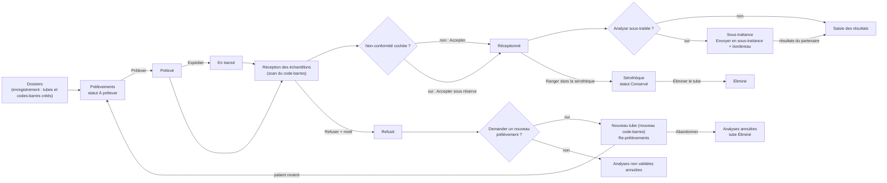
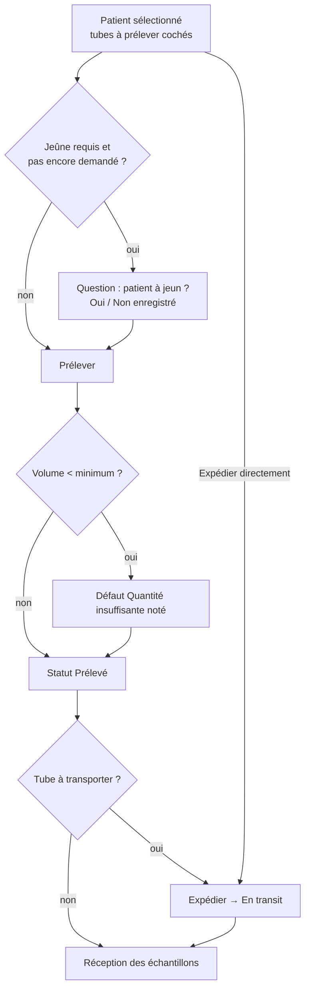
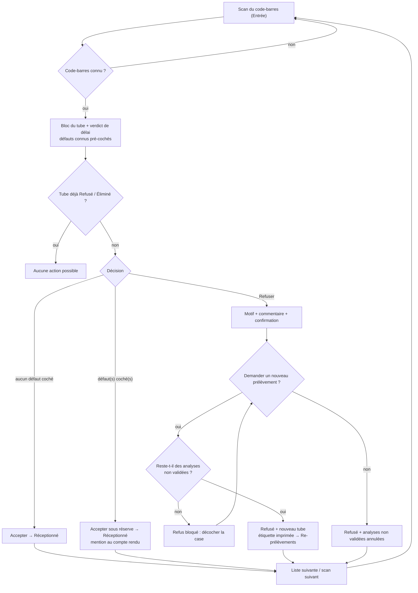
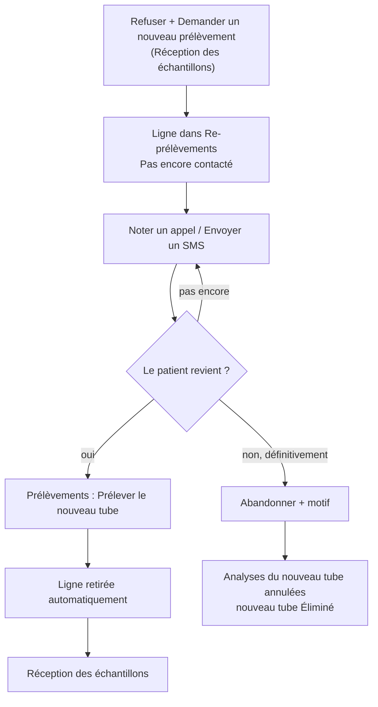
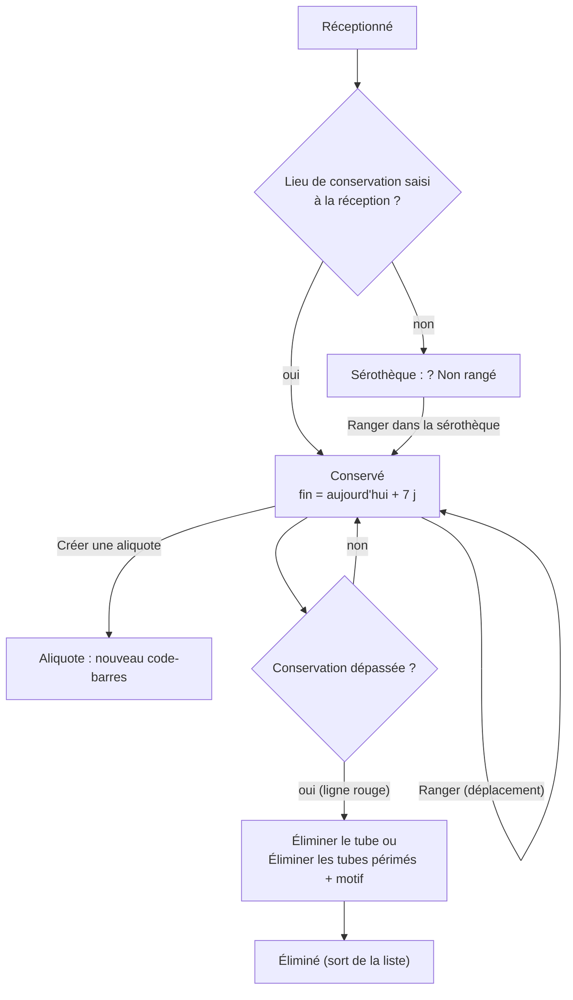
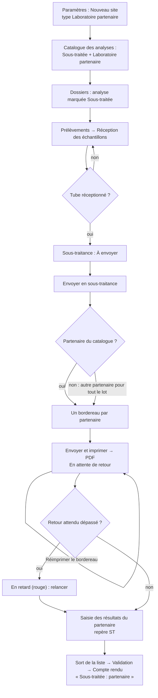
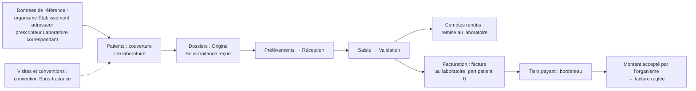

## Pré-analytique : prélèvement, réception, re-prélèvement, sérothèque, sous-traitance

Ce chapitre suit le tube, du prélèvement jusqu'à son élimination : prélever et expédier, accepter ou refuser le tube à la réception, rappeler le patient quand un tube est refusé, ranger et éliminer les tubes dans la sérothèque, envoyer à un laboratoire partenaire les analyses que le laboratoire ne fait pas lui-même.

Écrans concernés (groupe **Liste de travail** du menu) :

| Menu | Raccourci par défaut |
|---|---|
| **Prélèvements** | Ctrl+4 |
| **Réception des échantillons** | Ctrl+5 |
| **Re-prélèvements** | aucun (on peut en définir un) |
| **Sérothèque** | aucun |
| **Sous-traitance** | aucun |

Raccourcis valables partout : **F5** actualise l'écran, **Ctrl+F** place le curseur dans la zone de recherche, **F1** affiche la liste des raccourcis.

### Vue d'ensemble du circuit du tube

**Statuts d'un tube**

| Statut affiché | Signification |
|---|---|
| À prélever | Le tube existe (étiquette imprimée à l'enregistrement du dossier) mais rien n'est prélevé. |
| Prélevé | Le prélèvement est enregistré (heure, préleveur, volume). |
| En transit | Le tube est parti vers le laboratoire (expédié depuis un centre ou une tournée). |
| Réceptionné | Le tube a été accepté à la réception, avec ou sans réserve. |
| En analyse | Le tube est sur le plateau technique. |
| Conservé | Le tube est rangé dans la sérothèque. |
| Refusé | Le tube a été refusé, avec un motif. |
| Éliminé | Le tube a été jeté ; plus aucune analyse ne peut être refaite dessus. |

---

### Prélèvements

Liste de travail du préleveur : un patient à la fois, ses tubes dans l'ordre de prélèvement, avec les consignes de jeûne et les alertes affichées avant le geste.

**Qui y a accès**

| Action | Droit nécessaire | Rôles par défaut |
|---|---|---|
| Ouvrir l'écran, **Prélever** | Prélever | Administrateur, Biologiste responsable, Technicien de laboratoire, Préleveur |
| **Expédier** | Expédier les échantillons | Administrateur, Biologiste responsable, Technicien de laboratoire, Préleveur |
| **Imprimer les étiquettes** | Réimprimer une étiquette | Administrateur, Biologiste responsable, Technicien de laboratoire, Préleveur, Secrétariat / accueil |

Le rôle **Biologiste** n'a pas le droit de prélever : l'écran n'apparaît pas dans son menu. Le Secrétariat peut réimprimer des étiquettes, mais depuis l'écran **Consultation d'un dossier** (bouton **Imprimer les étiquettes**), car il n'a pas accès à cet écran.

**L'écran**

- À gauche, la liste **Prélèvements** : une ligne par dossier (pas par tube), colonnes **N° de dossier**, **Patient**, **Âge**, **Priorité**, **Tubes**, **Statut**, **Arrivée** (heure d'enregistrement). Les urgences sont en tête et en gras ; une ligne sur fond rouge signale un patient avec une alerte.
  - **Statut** affiche « *n* à prélever » (orange) ou « Prélevé · à expédier » (vert).
  - Case **Urgent** : n'affiche que les dossiers urgents.
- À droite, le bandeau du patient sélectionné : nom, sexe, âge, date de naissance, n° de dossier ; une bande **Jeûne requis** (avec « Patient à jeun ✓ », « Jeûne non respecté » ou « à confirmer auprès du patient ») ; une bande rouge ⚠ avec les alertes du patient (risque infectieux, prélèvement difficile, impayé…).
- En dessous, les tubes du patient, triés dans l'ordre de prélèvement : case à cocher, **#** (rang), pastille de la couleur du bouchon, **Type de tube**, **Nature du prélèvement** (avec « à l'abri de la lumière » ou « transport sous glace » en orange si besoin), **Code-barres**, **Statut** (« À prélever » ou « Prélevé HH:mm »), **Volume (mL)** (modifiable), **Analyses**. Une bulle d'aide sur le type de tube donne les consignes de prélèvement et le volume minimum.
- En bas : **Prélever**, **Expédier**, **Imprimer les étiquettes**, **Actualiser**, et une ligne d'état.

Ne figurent dans la liste que les dossiers de votre site, non annulés et pas encore rendus, et les tubes « À prélever » ou « Prélevé » non encore expédiés.

**Scénarios**

1. **Prélever un patient**
   1. Cliquez sur le patient dans la liste de gauche. Ses tubes s'affichent ; ceux qui restent à prélever sont déjà cochés.
   2. Lisez la bande **Jeûne requis** et la bande d'alertes.
   3. Prélevez dans l'ordre de la colonne **#**, en contrôlant la couleur du bouchon.
   4. Si vous connaissez le volume réellement prélevé, tapez-le dans **Volume (mL)** (virgule ou point acceptés).
   5. Décochez un tube que vous n'avez pas pu prélever.
   6. Cliquez sur **Prélever**.
   7. Si une analyse exige le jeûne et que la question n'a pas encore été posée, la fenêtre « Le patient déclare-t-il être à jeun depuis au moins *n* heures ? » s'ouvre : répondez **Oui** ou **Non**. La réponse est enregistrée sur le dossier et servira au biologiste.
   8. La ligne d'état affiche « *n* prélevé » ; les tubes passent en vert.
2. **Prélever puis expédier en une fois** (centre de prélèvement, domicile) : cochez les tubes et cliquez sur **Expédier**. Les tubes cochés non encore prélevés sont d'abord enregistrés comme prélevés, puis tous passent « En transit ».
3. **Prélever une série de patients et expédier plus tard** : prélevez chaque patient avec **Prélever**. Les patients restent dans la liste avec « Prélevé · à expédier ». Au départ du coursier, sélectionnez chaque patient (ses tubes prélevés sont alors tous cochés) et cliquez sur **Expédier**.
4. **Réimprimer les étiquettes d'un patient**
   1. Sélectionnez le patient, cliquez sur **Imprimer les étiquettes**.
   2. Saisissez le motif (« étiquette abîmée, illisible, tube supplémentaire… ») : il est obligatoire et enregistré dans l'historique de chaque tube.
   3. Toutes les étiquettes du dossier sont réimprimées. Sans imprimante d'étiquettes sur le poste, un PDF s'ouvre (« vérifiez l'échelle avant d'imprimer »).
5. **Prélever le nouveau tube d'un re-prélèvement** : le tube de remplacement apparaît ici comme n'importe quel tube « À prélever », avec son nouveau code-barres. Le prélever le fait sortir de la liste **Re-prélèvements**.

**Règles et contrôles**

- « Aucun élément sélectionné. » : aucun tube n'est coché.
- « Les tubes cochés sont déjà prélevés : utilisez « Expédier ». » : **Prélever** ne sert qu'aux tubes encore à prélever.
- « Prélèvement impossible depuis le statut « … » » : le tube a déjà été réceptionné, refusé ou éliminé.
- « L'échantillon doit être prélevé avant d'être expédié. » : un tube ne s'expédie qu'au statut Prélevé.
- Si le volume saisi est inférieur au minimum du tube, le défaut « Quantité insuffisante » est noté sur le tube ; il sera coché d'office à la réception.
- L'expédition n'est pas obligatoire : un tube prélevé au laboratoire peut être réceptionné directement.
- La réimpression d'étiquettes exige un motif (« La réimpression d'une étiquette doit être motivée. ») : deux tubes portant le même code-barres sont un risque d'erreur d'identité.
- L'écran ne permet pas de saisir le nombre de tentatives, le site anatomique, un commentaire de prélèvement ni le lieu de prélèvement, ni de rattacher l'expédition à une tournée (voir la fiche de vérification).

**Flux** : Dossiers (étiquettes) → **Prélèvements** (Prélever, éventuellement Expédier) → **Réception des échantillons**.

---

### Réception des échantillons

Poste où l'on décide si un tube est apte à être analysé : on scanne, on regarde ce que l'application a calculé (délai, défauts déjà notés), on coche ce qu'on constate, puis on accepte, on accepte sous réserve ou on refuse.

**Qui y a accès**

| Action | Droit nécessaire | Rôles par défaut |
|---|---|---|
| Ouvrir l'écran, scanner, **Accepter**, **Accepter sous réserve** | Réceptionner | Administrateur, Biologiste responsable, Biologiste, Technicien de laboratoire |
| **Refuser** | Refuser un échantillon | Administrateur, Biologiste responsable, Biologiste, Technicien de laboratoire |

**L'écran**

- En haut, la zone **Scannez le code-barres du tube**. Elle garde toujours le curseur : on peut scanner tube après tube sans toucher la souris.
- Le bloc du tube scanné : patient (nom, sexe, date de naissance) ; n° de dossier, priorité en majuscules si urgent, codes des analyses ; code-barres, nature, type de tube, volume ; et une ligne de verdict :
  - en rouge « ⚠ Délai d'acheminement dépassé — 5h10 > 4 h » si le délai depuis le prélèvement dépasse la stabilité la plus courte des analyses du tube ;
  - en vert « Délai de transport : 1h20 / 4 h » sinon ;
  - en orange « Cet échantillon n'a pas été prélevé. » si le tube n'a jamais été prélevé.
- Le cadre **Non-conformités constatées** : une case par défaut possible — Hémolysé, Coagulé, Quantité insuffisante, Lactescent, Ictérique, Tube inadapté, Défaut d'étiquetage, Rupture de la chaîne du froid, Délai d'acheminement dépassé, Contenant détérioré, Souillé, Jeûne non respecté. Les défauts déjà connus sont cochés d'office (délai dépassé, volume insuffisant noté au prélèvement, défauts signalés en amont).
- À droite : **Température (°C)** et **Chaîne du froid respectée** (seulement si une analyse du tube exige la chaîne du froid), et **Lieu de conservation** (facultatif).
- Les boutons **Accepter**, **Accepter sous réserve**, **Refuser**, la liste des motifs de refus et la case **Demander un nouveau prélèvement** (cochée par défaut).
- En bas, la liste **En attente de réception — *n*** : tubes prélevés ou en transit de votre site, pas encore reçus. Colonnes **Code-barres**, **N° de dossier**, **Patient**, **Nature du prélèvement**, **Priorité**, **Prélevé le**, **Délai de transport**, **Statut**. Rouge = délai dépassé ; orange = non-conformité déjà notée ; couleur de priorité pour les urgences. Un double-clic sur une ligne équivaut à scanner ce tube.

**Scénarios**

1. **Accepter un tube conforme**
   1. Scannez le tube (le lecteur envoie **Entrée**), ou tapez le code-barres puis **Entrée**, ou double-cliquez la ligne dans la liste.
   2. Vérifiez l'identité affichée contre l'étiquette et la demande.
   3. Si les champs sont visibles, saisissez la **Température (°C)** et laissez ou décochez **Chaîne du froid respectée**.
   4. Facultatif : saisissez le **Lieu de conservation** (le tube est alors directement rangé, voir **Sérothèque**).
   5. Cliquez sur **Accepter**. La ligne d'état affiche « *code-barres* — Réceptionné » ; le bloc se vide et le curseur revient dans la zone de scan.
2. **Accepter un tube non conforme mais exploitable (sous réserve)**
   1. Scannez le tube et cochez chaque défaut constaté (par exemple **Hémolysé**).
   2. Le bouton **Accepter** se grise ; **Accepter sous réserve** passe en gras orange.
   3. Cliquez sur **Accepter sous réserve**. Les défauts sont enregistrés sur le tube ; le compte rendu portera la mention « Résultat obtenu sur échantillon accepté sous réserve » suivie du code-barres et des défauts.
3. **Refuser un tube**
   1. Scannez le tube, cochez au besoin les défauts constatés.
   2. Choisissez le motif dans la liste : Discordance d'identité, Étiquette absente ou illisible, Quantité insuffisante, Échantillon hémolysé, Échantillon coagulé, Tube inadapté à l'analyse, Délai d'acheminement excessif, Rupture de la chaîne du froid, Contenant cassé ou fuite, Prélèvement souillé, Ordonnance manquante, Consentement manquant, Jeûne non respecté, Demande en doublon, Refus du patient, Autre motif. **Attention : le premier motif de la liste (« Discordance d'identité ») est présélectionné.**
   3. Laissez **Demander un nouveau prélèvement** coché si le patient doit revenir ; décochez-le pour refuser le tube seul.
   4. Cliquez sur **Refuser**. Une fenêtre demande un **Commentaire** (facultatif, mais utile), puis une confirmation « Confirmez-vous le refus du tube … pour le motif « … » ? ».
   5. Avec nouveau prélèvement : un nouveau tube est créé avec un **nouveau code-barres**, les analyses non encore validées du tube refusé passent sur ce nouveau tube (même prix : le patient ne paie pas deux fois), et son étiquette s'imprime aussitôt. La ligne d'état affiche « Refusé · Nouveau tube généré ». Le patient apparaît dans **Re-prélèvements**.
   6. Sans nouveau prélèvement : les analyses non encore validées du tube sont annulées avec le motif du refus ; les analyses déjà validées restent.
4. **Refuser un tube déjà sur le plateau** (caillot découvert après centrifugation) : scannez-le. **Accepter** et **Accepter sous réserve** sont grisés, mais **Refuser** reste possible. Suivez le scénario 3.
5. **Retrouver un tube qui n'est jamais arrivé** : consultez la liste **En attente de réception** ; un tube prélevé en centre et jamais reçu y reste visible.
6. **Scanner un tube pendant qu'une décision s'enregistre** : le tube est mis en attente (« Tube … lu : il s'affichera dès que la décision en cours sera enregistrée. ») puis affiché.
7. **Déclarer une non-conformité au registre qualité** (par exemple des refus répétés venant d'un même centre) : cela ne se fait pas depuis cet écran. Ouvrez **Non-conformités** (droit réservé par défaut à l'Administrateur, au Biologiste responsable, au Biologiste et au Responsable qualité), **Ouvrir une non-conformité**, catégorie « Pré-analytique ». La fiche ne peut pas être rattachée au tube ni au dossier : notez le code-barres et le n° de dossier dans la description.

**Règles et contrôles**

- La recherche du code-barres est exacte (majuscules comprises), jamais approximative : « Aucun échantillon ne porte le code-barres « … ». » Corrigez la lecture, ne devinez pas.
- Accepter un tube avec un défaut coché sans passer par **Accepter sous réserve** est refusé : « Des non-conformités ont été constatées (…) : acceptez sous réserve ou refusez l'échantillon. »
- « Réception impossible depuis le statut « … » » : le tube est déjà reçu, en analyse, conservé, refusé ou éliminé. Un tube ne se reçoit qu'une fois.
- « Cet échantillon n'a pas été prélevé. » : le prélèvement doit d'abord être enregistré dans **Prélèvements**.
- « Le tube … est déjà refusé. Son remplacement, s'il a été demandé, existe déjà. » : un tube ne se refuse qu'une fois.
- « Le tube … n'a plus d'analyse en attente : toutes sont validées. (…) Décochez « Demander un nouveau prélèvement » pour refuser le tube seul. »
- Un tube refusé ou éliminé ne permet plus aucune action à la réception.
- Le motif de refus vient d'une liste fermée : le taux de refus par motif est un indicateur qualité obligatoire (ISO 15189). Le tableau de bord compte les échantillons refusés du jour.
- La réception fixe l'heure de rendu promise de chaque analyse (délai du catalogue à partir de l'heure de réception).
- Chaque consultation d'un tube scanné est tracée (loi 09-08).

**Flux** : **Prélèvements** → **Réception des échantillons** → **Saisie des résultats** (ou **Sous-traitance** pour une analyse sous-traitée) ; refus avec nouveau prélèvement → **Re-prélèvements** → **Prélèvements**.

---

### Re-prélèvements

Liste des patients à faire revenir après un tube refusé : chaque nouveau tube pas encore prélevé, avec le téléphone du patient et les appels déjà passés.

**Qui y a accès**

L'écran apparaît pour qui a le droit de modifier un dossier **ou** de refuser un échantillon : Administrateur, Biologiste responsable, Biologiste, Technicien de laboratoire, Secrétariat / accueil.

| Action | Droit nécessaire | Rôles par défaut |
|---|---|---|
| **Noter un appel**, **Envoyer un SMS** | Modifier un dossier | Administrateur, Biologiste responsable, Biologiste, Secrétariat / accueil |
| **Abandonner** | Annuler un dossier | Administrateur, Biologiste responsable, Secrétariat / accueil |

Le Technicien voit la liste mais ses boutons sont grisés ; le Biologiste ne peut pas abandonner.

**L'écran**

- Titre « Patients à rappeler pour un nouveau prélèvement — *n* (dont *m* pas encore contactés) ».
- Zone de recherche (dossier, patient, téléphone, code-barres du nouveau tube ; validez par **Entrée**) et **Actualiser**.
- Colonnes **Refusé le**, **N° de dossier**, **Patient**, **Téléphone**, **Analyses**, **Motif du refus** (avec le commentaire), **Nouveau tube** (code-barres), **Dernier contact** (date, résultat, nombre d'appels « ×3 ») ou « Pas encore contacté ».
- En rouge : les dossiers urgents et ceux refusés depuis plus de 24 h sans aucun contact. En gris : déjà contactés.
- En bas : **Noter un appel**, **Envoyer un SMS**, **Abandonner**.

**Scénarios**

1. **Appeler un patient et noter le résultat**
   1. Sélectionnez la ligne, appelez le numéro affiché.
   2. Cliquez sur **Noter un appel** et tapez le résultat (« joint, passe demain matin », « pas de réponse »…). Le texte est obligatoire.
   3. La colonne **Dernier contact** est mise à jour.
2. **Envoyer un SMS de rappel**
   1. Sélectionnez la ligne, cliquez sur **Envoyer un SMS**.
   2. Le numéro du patient est proposé ; corrigez-le si besoin et validez.
   3. Le message envoyé contient seulement : « *Nom du laboratoire* : merci de repasser au laboratoire pour un nouveau prélèvement (dossier *n°*). Tél. *du site* ». Ni l'analyse ni le motif du refus.
   4. Le bouton est grisé si aucun fournisseur SMS n'est configuré.
3. **Le patient revient** : rien à faire ici. Prélevez le nouveau tube dans **Prélèvements** ; la ligne disparaît d'elle-même.
4. **Le patient ne reviendra pas**
   1. Sélectionnez la ligne, cliquez sur **Abandonner**.
   2. Lisez l'avertissement (« Les analyses en attente du nouveau tube (…) seront annulées. ») et saisissez le motif (obligatoire).
   3. Les analyses du nouveau tube sont annulées avec ce motif et le nouveau tube passe « Éliminé ». Le reste du dossier continue jusqu'au compte rendu.

**Règles et contrôles**

- « Sélectionnez un patient dans la liste. » : aucune ligne sélectionnée.
- « Indiquez le résultat de l'appel. » : texte d'appel vide.
- « Le tube … a déjà été prélevé ou retiré : la liste a été mise à jour. » : quelqu'un a prélevé ou abandonné ce tube entre-temps.
- « Le fournisseur SMS n'est pas configuré. »
- « Une annulation doit être motivée. » : motif d'abandon vide.
- Seul le canal « Appel » est proposé par **Noter un appel** ; une venue sur place ne peut pas être notée comme telle (notez-la en texte).

**Flux** : **Réception des échantillons** (refus + nouveau prélèvement) → **Re-prélèvements** (appel, SMS) → **Prélèvements** (nouveau tube) → **Réception des échantillons** ; ou → **Abandonner**.

---

### Sérothèque

Registre de tous les tubes reçus et pas encore éliminés : où ils sont rangés, jusqu'à quand les garder, et l'élimination des tubes périmés.

**Qui y a accès**

| Action | Droit nécessaire | Rôles par défaut |
|---|---|---|
| Ouvrir l'écran, **Ranger dans la sérothèque**, **Créer une aliquote** | Réceptionner | Administrateur, Biologiste responsable, Biologiste, Technicien de laboratoire |
| **Éliminer le tube**, **Éliminer les tubes périmés** | Refuser un échantillon | mêmes rôles |

**L'écran**

- Titre « Sérothèque — *n* · *x* conservation dépassée · *y* non rangé ».
- Zone de recherche (validez par **Entrée**), case **Uniquement les tubes dont la durée de conservation est dépassée**, **Actualiser**.
- Colonnes **Code-barres**, **N° de dossier**, **Patient**, **Nature du prélèvement**, **Réceptionné le**, **Lieu de conservation** (lieu / position, ou « Non rangé »), **Conserver jusqu'au**, **Jours** (restants ; négatif = dépassé), **Volume (mL)**, **Aliquotes**, et une colonne de repères : **?** non rangé, **!** non-conformité notée, **R** accepté sous réserve.
- Couleurs : rouge = conservation dépassée ; orange sur fond = reçu mais jamais rangé ; texte orange = 7 jours ou moins restants.
- Tri : par date de fin de conservation, les tubes sans date à la fin.
- En bas : **Ranger dans la sérothèque**, **Créer une aliquote**, **Éliminer le tube**, **Éliminer les tubes périmés**.

**Scénarios**

1. **Ranger un tube (ou le déplacer)**
   1. Sélectionnez le tube, cliquez sur **Ranger dans la sérothèque**.
   2. Saisissez **Lieu de conservation** (obligatoire, par exemple « Frigo 2 ») et **Position (portoir / case)**.
   3. Cochez **Conserver jusqu'au** et choisissez la date ; laissez la case décochée pour une conservation sans terme fixé.
   4. **Enregistrer** (ou **Entrée**) ; **Annuler** (ou **Échap**) pour sortir.
   5. Le tube passe « Conservé ».
2. **Ranger dès la réception** : saisissez le **Lieu de conservation** sur l'écran de réception avant d'accepter. La date de fin de conservation est alors fixée automatiquement à aujourd'hui + 7 jours (durée réglable par l'administrateur).
3. **Créer une aliquote**
   1. Sélectionnez le tube (impossible sur un tube refusé), cliquez sur **Créer une aliquote**.
   2. Saisissez **Volume (mL)**, **Destination de l'aliquote** (envoi en sous-traitance, conservation…), et le **Lieu de conservation** (par défaut celui du tube).
   3. **Enregistrer**. Un message donne le nouveau code-barres : « Aliquote créée. Étiquetez le tube avec le code-barres … ». L'étiquette n'est pas imprimée automatiquement : écrivez ou imprimez ce code vous-même.
4. **Éliminer un tube**
   1. Sélectionnez le tube, cliquez sur **Éliminer le tube**.
   2. Confirmez « Éliminer le tube … ? Aucune analyse ne pourra plus être répétée sur cet échantillon. »
   3. Saisissez le motif (obligatoire). Le tube disparaît de la liste.
5. **Purger les tubes périmés**
   1. Cliquez sur **Éliminer les tubes périmés** (actif seulement s'il y a des tubes en rouge).
   2. Confirmez « Éliminer les *n* tubes dont la durée de conservation est dépassée ? », saisissez un motif unique, consigné pour chaque tube.
   3. Résultat : « *n* tubes éliminés. » ou « *n* tubes éliminés. Échecs : … ».
6. **Retrouver un tube pour une analyse complémentaire** : tapez le code-barres, le n° de dossier ou l'emplacement, puis **Entrée**.

**Règles et contrôles**

- « L'emplacement de rangement est obligatoire. »
- « L'élimination d'un échantillon doit être motivée : elle met fin à toute possibilité de reprise. »
- « Aliquotage impossible depuis le statut « … » » : tube refusé ou éliminé.
- L'application **ne vérifie pas** que les analyses du tube sont terminées avant de l'éliminer : contrôlez-le vous-même.
- La purge porte sur les tubes **affichés** (recherche en cours comprise), et la liste est limitée à 1 000 tubes.
- La recherche ne trouve pas un patient par son nom (seulement code-barres, n° de dossier, emplacement), bien que la zone l'annonce.
- Chaque ouverture de la liste est tracée comme une consultation de données personnelles (loi 09-08).

**Flux** : **Réception des échantillons** (accepté) → **Sérothèque** (rangé, éventuellement aliquoté) → élimination à échéance.

---

### Sous-traitance

Suivi des analyses que le laboratoire envoie à un laboratoire partenaire : ce qui attend de partir, ce qui est parti (avec son bordereau), et ce qui tarde à revenir.

**Qui y a accès**

| Action | Droit nécessaire | Rôles par défaut |
|---|---|---|
| Ouvrir l'écran, **Envoyer en sous-traitance**, **Référence du partenaire** | Expédier les échantillons | Administrateur, Biologiste responsable, Technicien de laboratoire, Préleveur |
| **Réimprimer le bordereau** | (aucun droit particulier une fois l'écran ouvert) | mêmes rôles |
| Déclarer un laboratoire partenaire (**Paramètres**) | Gérer les sites | Administrateur |
| Marquer une analyse sous-traitée (**Catalogue des analyses**) | Gérer le catalogue | Administrateur, Biologiste responsable |

Le rôle **Biologiste** n'a pas cet écran dans son menu.

#### Mise en place (une fois)

1. **Déclarer le laboratoire partenaire** (Administrateur)
   - Dans **Paramètres**, onglet **Site**, cliquez **Nouveau site** à côté de la liste des sites.
   - Saisissez le **Code** (majuscules, chiffres, - et _), le nom en français (obligatoire) et en arabe, et gardez le type « Laboratoire partenaire (sous-traitance) », proposé par défaut. Validez.
   - Le nouveau site est sélectionné : complétez sa fiche (adresse, téléphone, e-mail) puis **Enregistrer**.
   - Un partenaire n'est jamais proposé comme site de travail à la connexion ni dans les accès des utilisateurs. Un site déjà utilisé (utilisateurs, documents numérotés) ne peut pas être transformé en partenaire.
   - Seuls les sites actifs de ce type sont proposés comme partenaires.
2. **Marquer l'analyse comme sous-traitée** (Administrateur, Biologiste responsable)
   1. **Catalogue des analyses**, sélectionnez l'analyse, **Modifier l'analyse**.
   2. Cochez **Sous-traitée**, choisissez le **Laboratoire partenaire**.
   3. Réglez **Délai routine (h)** en comptant le transport et le délai du partenaire : c'est lui qui fixe la date **Retour attendu** et donc le passage « En retard ».
   4. **Enregistrer**.
   - Messages : « Désignez le laboratoire sous-traitant. » (case cochée sans partenaire) ; « Aucun laboratoire partenaire n'est configuré : déclarez-le dans les paramètres avant de sous-traiter une analyse. »
   - Le marquage s'applique aux **nouveaux dossiers** : il est copié sur l'analyse au moment de l'enregistrement du dossier. Les dossiers déjà enregistrés gardent ce qu'ils avaient. L'analyse porte alors la mention « Sous-traitée » dans **Dossiers** et **Consultation d'un dossier**.

#### L'écran

- Titre « Sous-traitance — *n* à envoyer · *m* en attente de retour · *k* en retard ».
- Zone de recherche (dossier, patient, code-barres, bordereau, référence du partenaire ; **Entrée**), liste de filtre **Tout afficher** / **À envoyer** / **En attente de retour** / **En retard**, **Actualiser**.
- Colonnes : case à cocher, **Statut** (À envoyer, En attente de retour, En retard), **N° de dossier**, **Patient**, **Analyse**, **Code-barres**, **Laboratoire partenaire** (ou « Aucun laboratoire désigné »), **Bordereau** (numéro et date d'envoi), **Réf. partenaire**, **Retour attendu**.
- Ordre : d'abord les analyses à envoyer (urgences en tête, plus ancienne réception d'abord), puis celles envoyées (plus ancien envoi d'abord). Lignes en retard en rouge.
- Une analyse n'apparaît « À envoyer » qu'une fois son tube **réceptionné**. Elle quitte la liste dès qu'un résultat est saisi.
- En bas : **Envoyer en sous-traitance**, **Réimprimer le bordereau**, **Référence du partenaire**.

#### Scénarios

1. **Envoyer des analyses et imprimer le bordereau**
   1. Filtrez sur **À envoyer** si besoin, cochez les analyses à faire partir (sans case cochée, la ligne sélectionnée est prise).
   2. Cliquez sur **Envoyer en sous-traitance**. La fenêtre récapitule « *n* analyse(s) de *m* dossier(s) à envoyer » avec, pour chacune, le partenaire prévu.
   3. Dans **Laboratoire partenaire**, laissez « Laboratoire prévu au catalogue pour chaque analyse », ou choisissez un autre partenaire pour **tout** le lot (jour où le partenaire habituel ne peut pas recevoir).
   4. Cliquez sur **Envoyer et imprimer** (ou **Annuler**).
   5. Un bordereau est numéroté **par partenaire** (format par défaut `ST/2026/00001`, série continue par site et par année). Chaque bordereau s'ouvre en PDF : n° de dossier, patient, sexe et date de naissance, code-barres, analyse, tube, date de prélèvement, priorité, et deux zones de signature (« Remis au coursier » / « Reçu par le laboratoire partenaire »).
   6. Les lignes passent « En attente de retour » ; l'historique du tube note le bordereau et le partenaire.
2. **Réimprimer un bordereau** : cochez une ou plusieurs analyses déjà envoyées, cliquez sur **Réimprimer le bordereau**. Chaque bordereau concerné s'ouvre une fois.
3. **Noter la référence donnée par le partenaire**
   1. Cochez ou sélectionnez une analyse « En attente de retour ».
   2. **Référence du partenaire**, saisissez le numéro (60 caractères au plus). Un champ vidé efface la référence.
   3. La référence apparaît dans **Réf. partenaire** et se retrouve par la recherche.
4. **Relancer les retards** : filtre **En retard** ; appelez le partenaire en citant la **Réf. partenaire** ou le n° de bordereau.
5. **Enregistrer le retour des résultats**
   1. Il n'y a pas de bouton « retour » ici. Ouvrez **Saisie des résultats**, le dossier, et saisissez les valeurs du compte rendu du partenaire comme d'habitude.
   2. Chaque résultat saisi est marqué « ST » (sous-traité) dans la colonne des repères ; aucun lot de réactif du laboratoire ne lui est attribué.
   3. L'analyse quitte la liste **Sous-traitance**.
   4. Validation biologique normale ; le compte rendu porte, pour l'analyse, « Sous-traitée : *nom du partenaire* ».

#### Règles et contrôles

- « Cochez au moins une analyse à envoyer. » : rien de sélectionné au statut « À envoyer ».
- « Aucun laboratoire partenaire n'est configuré : … » : aucun site « Laboratoire partenaire (sous-traitance) » actif : créez-le avec **Nouveau site**.
- « Aucun laboratoire partenaire n'est désigné pour une des analyses : choisissez-en un dans la fenêtre d'envoi. »
- « Une analyse du dossier … n'est pas sous-traitée. » / « … est annulée. » / « … est déjà partie en sous-traitance. » / « Le tube du dossier … n'est pas encore réceptionné. »
- Un envoi est tout ou rien : si une seule analyse est refusée, aucun bordereau n'est créé et aucun numéro n'est consommé.
- Seules les analyses de votre site peuvent être envoyées depuis votre poste.
- « Sélectionnez une analyse déjà envoyée. » : réimpression ou référence demandée sur une ligne non envoyée.
- « La référence ne doit pas dépasser 60 caractères. »
- **Retour attendu** = heure de réception du tube + **Délai routine (h)** du catalogue (ou délai urgent pour un dossier urgent) ; il n'est pas recalculé à l'envoi.
- Si un résultat est saisi avant l'envoi, l'analyse quitte quand même la liste (elle est considérée comme revenue).
- Si le tube est refusé avec nouveau prélèvement, le nouveau tube garde le caractère « sous-traitée » et le partenaire.

#### Flux

**Catalogue des analyses** (Sous-traitée + partenaire) → **Dossiers** → **Prélèvements** → **Réception des échantillons** → **Sous-traitance** (envoi + bordereau, référence) → **Saisie des résultats** (retour) → **Validation** → **Comptes rendus**.

#### Quand nous sommes le laboratoire sous-traitant

Le cas inverse : un autre laboratoire nous confie ses tubes. Il n'y a pas d'écran dédié : le circuit passe par les écrans ordinaires. Il a été testé de bout en bout : le patient ne paie rien, le laboratoire adresseur reçoit le compte rendu, la facture et le bordereau, et son règlement solde la facture.

**Mise en place, une fois par laboratoire adresseur**

1. **Données de référence** › onglet **Organismes payeurs** › **Nouvel organisme payeur** :
   - **Type d'organisme** = « Établissement adresseur », **Taux de remboursement (%)** = 100 ;
   - **Tarification sur la TNR** décoché, **Convention de tiers payant** coché, **Délai de règlement (jours)** ;
   - **Ordonnance obligatoire** décoché : sinon chaque envoi au tiers payant reste bloqué en attendant un INPE de prescripteur. Attention, l'organisme livré « LABO_TIERS » a cette case cochée ;
   - adresse, ICE et **Compte comptable**.
2. **Données de référence** › onglet **Prescripteurs** › **Nouveau prescripteur** (ou le **+** de l'écran Dossiers) : type « Laboratoire correspondant », nom court, **Établissement** = nom complet du laboratoire, e-mail et **Remise** = Courriel. Le compte rendu et la facture portent le nom du laboratoire, pas « Dr ».
3. **Visites et conventions** › **Nouvelle convention** : **Type de partenaire** « Laboratoire », **Type de convention** « Sous-traitance », remise et délai convenus. Cette fiche sert de référence : la remise n'est pas appliquée automatiquement.

**Pour chaque patient envoyé**

1. **Patients** › **Modifier** › **Couvertures** › **Ajouter une couverture** : **Organisme payeur** = le laboratoire, **N° d'immatriculation** (obligatoire ; on y note souvent le numéro du dossier chez le laboratoire adresseur), **Couverture principale** et **Tiers payant** cochés.
2. **Dossiers** : choisissez le patient, **Origine** = « Sous-traitance reçue », **Prescripteur** = le laboratoire, ajoutez les analyses, laissez **Paiement direct** décoché, **Enregistrer**. Le montant à encaisser au comptoir est 0.
3. **Prélèvements** › **Prélever** (obligatoire avant la réception ; l'heure enregistrée est celle du clic), puis **Réception des échantillons** › **Accepter**.
4. **Saisie des résultats**, **Validation biologique**, comme pour tout dossier.
5. **Comptes rendus** › **Enregistrer une remise** : mode Courriel, et passez **Qualité du destinataire** sur « Prescripteur » (proposé « Patient » par défaut).
6. **Facturation** › **Émettre la facture** : facture adressée au laboratoire, part patient 0. Une remise en DH peut être saisie ici.
7. **Tiers payant** › **Cocher tout ce qui est transmissible** › **Transmettre au tiers payant**.
8. À réception du virement : **Facturation** › **Montant accepté par l'organisme**, avec la référence du virement. La facture passe à « Réglée ».

**Limites actuelles**

- La remise de la convention n'est appliquée nulle part : saisissez-la à la facture.
- L'organisme payeur vient toujours de la couverture principale du patient : pensez à clôturer cette couverture si le patient revient plus tard à titre personnel.
- Pas de champ pour le numéro de dossier du laboratoire adresseur, ni pour l'heure ou le lieu réels du prélèvement.
- Une facture par patient ; le bordereau du tiers payant les regroupe mais ne s'imprime pas encore.

