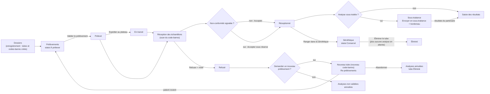
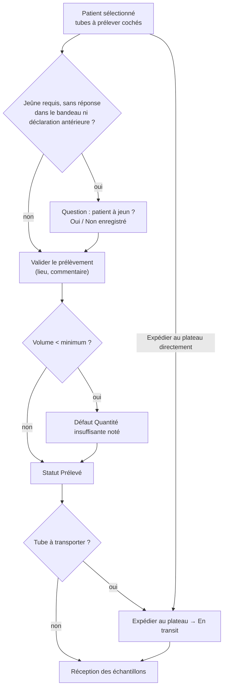
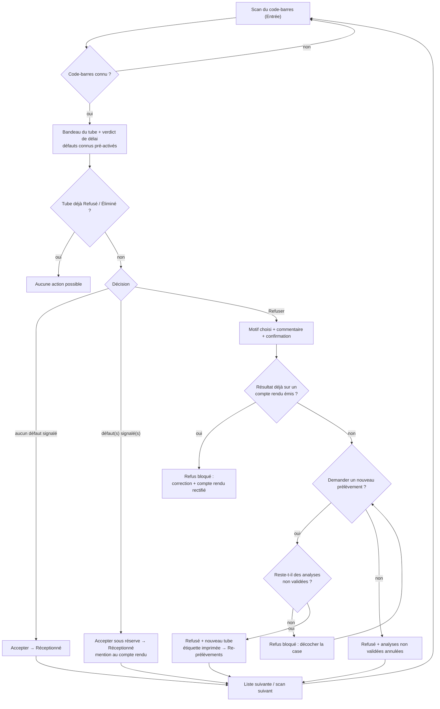
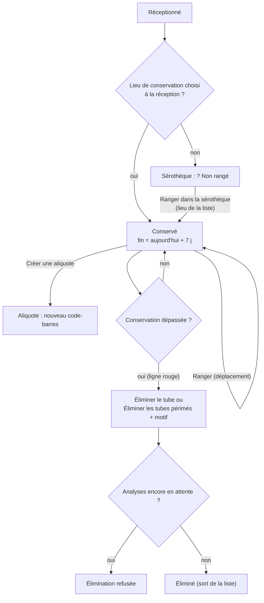
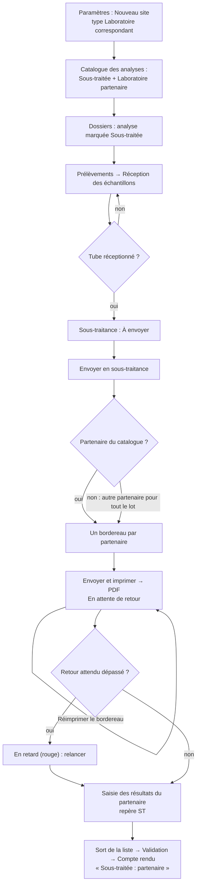
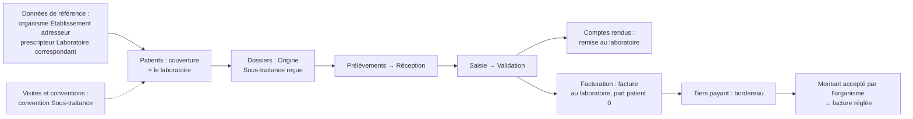

## Pré-analytique : prélèvement, réception, re-prélèvement, sérothèque, sous-traitance

Ce chapitre suit le tube, du prélèvement jusqu'à son élimination : prélever et expédier, accepter ou refuser le tube à la réception, rappeler le patient quand un tube est refusé, ranger et éliminer les tubes dans la sérothèque, envoyer à un laboratoire partenaire les analyses que le laboratoire ne fait pas lui-même.

### Présentation du module

**But du module.** La phase pré-analytique couvre tout ce qui arrive au tube avant la mesure. C'est là que se produisent la plupart des erreurs d'un laboratoire : mauvais tube, mauvais patient, délai trop long, chaîne du froid rompue, jeûne non respecté. Le module trace chaque étape (qui, quand, où, dans quel état) et bloque les gestes dangereux : un tube non conforme ne peut pas être accepté sans réserve, un tube dont des analyses attendent encore ne peut pas être éliminé, un tube dont un résultat est déjà sur un compte rendu ne peut pas être refusé.

**Qui l'utilise.**

| Rôle par défaut | Ce qu'il fait dans ce module |
|---|---|
| Préleveur | Prélève, imprime les étiquettes, expédie au plateau (écran **Prélèvements** seulement). |
| Technicien de laboratoire | Prélève, expédie, réceptionne, accepte ou refuse les tubes, range et élimine les tubes de la sérothèque, envoie en sous-traitance. Voit la liste des re-prélèvements sans pouvoir agir. |
| Biologiste | Réceptionne, refuse, gère la sérothèque, envoie en sous-traitance, note les appels de re-prélèvement. Il ne prélève pas. |
| Biologiste responsable, Administrateur | Tout le module. |
| Secrétariat / accueil | Appelle les patients à rappeler, envoie les SMS, abandonne un re-prélèvement. Réimprime les étiquettes depuis **Consultation d'un dossier**. |

Droits utilisés (identifiants affichés dans **Utilisateurs et rôles**) : « Prélever » (`samples.collect`), « Expédier les échantillons » (`samples.dispatch`), « Réimprimer une étiquette » (`samples.reprint_label`), « Réceptionner » (`samples.receive`), « Refuser un échantillon » (`samples.reject`), « Sous-traiter » (`samples.subcontract`, nouveau droit propre à la sous-traitance), « Modifier un dossier » (`orders.edit`) et « Annuler un dossier » (`orders.cancel`). Un menu n'apparaît que si l'on a le droit qui l'ouvre ; un bouton dont on n'a pas le droit est grisé.

**Écrans du module** (groupe **Liste de travail** du menu) :

| Menu | Droit qui ouvre l'écran | Raccourci par défaut |
|---|---|---|
| **Prélèvements** | Prélever | Ctrl+4 |
| **Réception des échantillons** | Réceptionner | Ctrl+5 |
| **Re-prélèvements** | Modifier un dossier **ou** Refuser un échantillon | aucun (on peut en définir un) |
| **Sérothèque** | Réceptionner | aucun |
| **Sous-traitance** | Sous-traiter | aucun |

La liste des lieux de stockage, utilisée par la réception et la sérothèque, se règle dans **Paramètres**, onglet **Lieux de stockage** (voir la section **Sérothèque**).

**Liens avec les autres modules.**

- **Dossiers** (accueil) crée les tubes et leurs codes-barres et imprime les premières étiquettes.
- **Catalogue des analyses** fixe le tube, le volume minimum, le jeûne, la stabilité (délai d'acheminement), la chaîne du froid et le caractère « Sous-traitée ».
- **Saisie des résultats** n'accepte une valeur qu'une fois le tube réceptionné.
- **Comptes rendus** imprime les réserves de la réception (« accepté sous réserve ») et la mention « Sous-traitée ».
- **Non-conformités** (qualité) reçoit les déclarations faites à la main à partir des refus.
- **Tableau de bord** compte les échantillons refusés du jour.

Raccourcis valables partout : **F5** actualise l'écran, **Ctrl+F** place le curseur dans la zone de recherche, **Ctrl+P** imprime la liste de l'écran, **F1** ouvre l'aide de l'écran, **Maj+F1** affiche la liste des raccourcis.

### Vue d'ensemble du circuit du tube

**Statuts d'un tube**

| Statut affiché | Signification |
|---|---|
| À prélever | Le tube existe (étiquette imprimée à l'enregistrement du dossier) mais rien n'est prélevé. |
| Prélevé | Le prélèvement est enregistré (heure, préleveur, volume, lieu). |
| En transit | Le tube est parti vers le plateau technique (expédié depuis un centre, un domicile ou une tournée). |
| Réceptionné | Le tube a été accepté à la réception, avec ou sans réserve. |
| En analyse | Le tube est sur le plateau technique. |
| Conservé | Le tube est rangé dans la sérothèque. |
| Refusé | Le tube a été refusé, avec un motif. |
| Éliminé | Le tube a été jeté ; plus aucune analyse ne peut être refaite dessus. |

---

### Prélèvements

#### À quoi sert cet écran

C'est la liste de travail du préleveur. On choisit un patient à gauche ; à droite on voit ses alertes, la consigne de jeûne et ses tubes dans l'ordre de prélèvement, avec la couleur du bouchon. On coche chaque tube prélevé (à la souris ou en scannant son étiquette), on note le lieu et un commentaire, puis on valide. Les tubes peuvent ensuite être expédiés au plateau technique.

#### Fonctionnalités

- **Liste « À prélever »** (à gauche) : un dossier par ligne, avec le compteur « *n* patient(s) · *m* tube(s) ». Chaque ligne montre le nom (⚠ si le patient a une alerte, couleur de priorité si urgent), une pastille « *n* à prélever » ou « Prélevé · à expédier », puis le n° de dossier, l'âge, le nombre de tubes, « Arrivée HH:mm » et, s'il y a lieu, « À jeun *n* h » ou la priorité. Fond rouge : patient avec alerte ; fond vert : tout est prélevé. Seuls figurent les dossiers de votre site, non annulés, et les tubes « À prélever » ou « Prélevé » pas encore expédiés.
- **Actualiser** (bouton icône, bulle « Actualiser (F5) ») : recharge la liste.
- Puces de filtre **Tous · n**, **Urgents · n**, **À jeun requis · n** : n'affichent que les dossiers correspondants.
- **Carte du patient** : initiales, nom, « sexe · âge · né(e) le · demande N° · PRIORITÉ ».
- **Voir le dossier** : ouvre **Consultation d'un dossier** pour ce patient (droit de consulter les dossiers).
- **Bandeau d'alerte** rouge ⚠ : alertes du patient (risque infectieux, prélèvement difficile, impayé…).
- **Bandeau de jeûne** « Jeûne requis : *n* h pour *analyses*. *verdict* » avec trois boutons **Oui**, **Non**, **Ne sait pas**. Le verdict affiché est « Patient à jeun ✓ », « Jeûne non respecté », « Ne sait pas » ou « Le patient est-il à jeun ? ». « Ne sait pas » n'enregistre rien.
- **Tubes à prélever** : la pastille « *n* sur *m* prélevé(s) » suit l'avancement.
- Zone **Scannez le tube pour le cocher** : scannez l'étiquette (ou tapez le code-barres puis **Entrée**) ; le tube est coché (« Tube … coché. »). Si le tube appartient à un autre patient de la liste, ce patient s'ouvre.
- **Grille des tubes** : **#** (ordre de prélèvement), dessin du tube à la couleur du bouchon, **Type de tube** (nature, « à l'abri de la lumière » ou « transport sous glace », codes des analyses ; la bulle d'aide donne les consignes, le volume minimum « Volume (mL) ≥ … » et les analyses), **Code-barres**, **Heure**, **Volume (mL)** (prérempli avec le volume nominal du tube, modifiable), case à cocher, **Statut** (« À prélever » ou « ✓ Prélevé »).
- **Prélevé par** et **Heure** : affichés, non modifiables (utilisateur connecté, heure actuelle).
- **Lieu de prélèvement** : Laboratoire (salle de prélèvement), Centre de prélèvement, Domicile du patient, Service hospitalier, Lieu de travail, Apporté par le patient. Prérempli avec le lieu déjà connu du dossier ; enregistré avec le prélèvement quand vous le choisissez.
- **Commentaire** (« Ex. : prélèvement difficile, garrot prolongé… », 500 caractères) : enregistré avec le prélèvement.
- **Imprimer les étiquettes** (F8) : réimprime toutes les étiquettes du dossier, avec un motif obligatoire (droit « Réimprimer une étiquette »).
- Texte « *n* tubes restent à cocher » dans la barre du bas.
- **Expédier au plateau** : passe les tubes cochés « En transit » ; les tubes cochés pas encore prélevés sont d'abord enregistrés comme prélevés (droit « Expédier les échantillons »).
- **Valider le prélèvement** (F12) : enregistre comme prélevés les tubes cochés qui étaient « À prélever » (droit « Prélever » ; actif seulement s'il reste un tube à prélever).
- Ligne d'état en bas : résultat de la dernière action.

**Qui y a accès**

| Action | Droit nécessaire | Rôles par défaut |
|---|---|---|
| Ouvrir l'écran, **Valider le prélèvement** | Prélever | Administrateur, Biologiste responsable, Technicien de laboratoire, Préleveur |
| **Expédier au plateau** | Expédier les échantillons | Administrateur, Biologiste responsable, Technicien de laboratoire, Préleveur |
| **Imprimer les étiquettes** | Réimprimer une étiquette | Administrateur, Biologiste responsable, Technicien de laboratoire, Préleveur, Secrétariat / accueil |

Le rôle **Biologiste** n'a pas le droit de prélever : l'écran n'apparaît pas dans son menu. Le Secrétariat peut réimprimer des étiquettes, mais depuis l'écran **Consultation d'un dossier** (bouton **Imprimer les étiquettes**), car il n'a pas accès à cet écran.

**Scénarios**

1. **Prélever un patient**
   1. Cliquez sur le patient dans la liste **À prélever**. Ses tubes s'affichent ; ceux qui restent à prélever sont déjà cochés.
   2. Lisez le bandeau d'alerte et le bandeau **Jeûne requis**. Si le jeûne est demandé, posez la question au patient et cliquez sur **Oui**, **Non** ou **Ne sait pas**.
   3. Prélevez dans l'ordre de la colonne **#**, en contrôlant la couleur du bouchon.
   4. Au besoin, corrigez **Volume (mL)** avec le volume réellement prélevé (virgule ou point acceptés).
   5. Décochez un tube que vous n'avez pas pu prélever. Vous pouvez aussi scanner chaque tube prélevé dans **Scannez le tube pour le cocher**.
   6. Choisissez au besoin le **Lieu de prélèvement** et tapez un **Commentaire**.
   7. Cliquez sur **Valider le prélèvement** (ou **F12**).
   8. Si une analyse exige le jeûne, que vous n'avez pas répondu dans le bandeau et que le patient n'a jamais déclaré son jeûne, la fenêtre « Le patient déclare-t-il être à jeun depuis au moins *n* heures ? » s'ouvre : répondez **Oui** ou **Non**. La réponse est enregistrée sur le dossier et servira au biologiste.
   9. La ligne d'état affiche « *n* prélevé » ; les tubes passent « ✓ Prélevé ».
2. **Prélever puis expédier en une fois** (centre de prélèvement, domicile) : cochez les tubes et cliquez sur **Expédier au plateau**. Les tubes cochés non encore prélevés sont d'abord enregistrés comme prélevés, puis tous passent « En transit » (« *n* en transit »).
3. **Prélever une série de patients et expédier plus tard** : validez chaque patient avec **Valider le prélèvement**. Les patients restent dans la liste avec « Prélevé · à expédier ». Au départ du coursier, sélectionnez chaque patient (ses tubes prélevés sont alors cochés) et cliquez sur **Expédier au plateau**.
4. **Réimprimer les étiquettes d'un patient**
   1. Sélectionnez le patient, cliquez sur **Imprimer les étiquettes** (ou **F8**).
   2. Saisissez le motif dans la fenêtre « Motif de la réimpression de l'étiquette (étiquette abîmée, illisible, tube supplémentaire…) » : il est obligatoire et enregistré dans l'historique de chaque tube.
   3. Toutes les étiquettes du dossier sont réimprimées (« *n* étiquette(s) imprimée(s). »). Sans imprimante d'étiquettes sur le poste, un PDF s'ouvre (vérifiez l'échelle avant d'imprimer).
5. **Prélever le nouveau tube d'un re-prélèvement** : le tube de remplacement apparaît ici comme n'importe quel tube « À prélever », avec son nouveau code-barres. Le prélever le fait sortir de la liste **Re-prélèvements**.

**Règles et contrôles**

- **Valider le prélèvement** ne sert qu'aux tubes encore à prélever ; pour des tubes déjà prélevés, utilisez **Expédier au plateau**.
- Un tube ne s'expédie qu'au statut Prélevé.
- Le volume doit être un nombre positif inférieur à 1 000 000 mL, ou rester vide. S'il est inférieur au minimum du tube, le défaut « Quantité insuffisante » est noté sur le tube ; il sera signalé d'office à la réception.
- L'expédition n'est pas obligatoire : un tube prélevé au laboratoire peut être réceptionné directement.
- La réimpression d'étiquettes exige un motif : deux tubes portant le même code-barres sont un risque d'erreur d'identité.
- L'écran ne permet pas de saisir le nombre de tentatives ni le site anatomique, ni de rattacher l'expédition à une tournée (voir la fiche de vérification).

**Flux** : Dossiers (étiquettes) → **Prélèvements** (Valider le prélèvement, éventuellement Expédier au plateau) → **Réception des échantillons**.

---

### Réception des échantillons

#### À quoi sert cet écran

C'est le poste où l'on décide si un tube est apte à être analysé. On scanne le tube ; l'écran montre le patient, le tube, le délai écoulé depuis le prélèvement et les défauts déjà connus. On signale ce qu'on constate, puis on accepte, on accepte sous réserve ou on refuse. La carte de scan est en haut de l'écran ; la liste des tubes **En attente de réception** est juste en dessous et reste visible dès l'ouverture : on voit d'un coup d'œil ce qui doit encore arriver.

#### Fonctionnalités

- Zone **Scanner le tube** / **Scannez le code-barres du tube** : garde le curseur ; le lecteur envoie **Entrée** et le tube s'affiche. L'aide « Douchette prête · le tube suivant peut être scanné après la décision » rappelle qu'on enchaîne les tubes sans souris. Un tube scanné pendant l'enregistrement d'une décision est mis en attente puis affiché.
- **Bandeau du tube** : pastille de la couleur du bouchon, nom du patient, n° de dossier, pastille de priorité, sexe et date de naissance ; ligne du tube (nature · contenant · code-barres · volume en mL · « prélevé le … à … » · « *n* tubes dans cette demande ») ; codes des analyses.
- **Délai de transport** (à droite du bandeau) : temps écoulé et stabilité la plus courte des analyses, par exemple « 1h20 / 4 h ». Ligne de verdict en rouge « ⚠ Délai d'acheminement dépassé — 5h10 > 4 h » (le défaut « Délai d'acheminement dépassé » est alors signalé d'office), ou en orange « Cet échantillon n'a pas été prélevé. ».
- **Non-conformités constatées · cliquer pour signaler** : un bouton à bascule par défaut — Hémolysé, Coagulé, Quantité insuffisante, Lactescent, Ictérique, Tube inadapté, Défaut d'étiquetage, Rupture de la chaîne du froid, Délai d'acheminement dépassé, Contenant détérioré, Souillé, Jeûne non respecté. Les défauts déjà connus sont activés d'office (délai dépassé, volume prélevé inférieur au minimum, défauts signalés en amont).
- **Température (°C)** et **Chaîne du froid respectée** : visibles seulement si une analyse du tube exige la chaîne du froid. La température doit être comprise entre -200 et 100 °C.
- **Lieu de conservation** : liste fermée des lieux de stockage actifs du site (réglée dans **Paramètres › Lieux de stockage**), première ligne « — Non précisé — ». Un lieu choisi range le tube dès l'acceptation (voir **Sérothèque**).
- **Accepter** (indication **Entrée**) : accepte un tube sans défaut ; actif seulement si aucun défaut n'est signalé. **Entrée** dans une zone de scan vide accepte le tube conforme affiché.
- **Accepter sous réserve** : accepte un tube avec défaut(s) ; actif (en gras orange) seulement si au moins un défaut est signalé.
- **Motif du refus** : liste fermée, **sans présélection** (Discordance d'identité, Étiquette absente ou illisible, Quantité insuffisante, Échantillon hémolysé, Échantillon coagulé, Tube inadapté à l'analyse, Délai d'acheminement excessif, Rupture de la chaîne du froid, Contenant cassé ou fuite, Prélèvement souillé, Ordonnance manquante, Consentement manquant, Jeûne non respecté, Demande en doublon, Refus du patient, Autre motif).
- **Demander un nouveau prélèvement** (coché par défaut) : à un refus, crée un tube de remplacement et met le patient dans **Re-prélèvements**.
- **Refuser** : refuse le tube après un commentaire facultatif (500 caractères) et une confirmation (droit « Refuser un échantillon »).
- **En attente de réception** : compteur « *n* tubes », puces **Tous · n**, **Urgents · n**, **Délai long · n** (délai d'acheminement dépassé). Colonnes **Code-barres**, **N° de dossier**, **Patient**, **Nature du prélèvement** (avec la pastille du bouchon), **Priorité**, **Prélevé le**, **Délai de transport** (pastille rouge si dépassé), **Statut** (« Scanné », « Délai d'acheminement dépassé », « Non-conformités constatées » ou statut du tube). On y voit les tubes prélevés ou en transit de votre site, pas encore reçus.
- **Double-clic** sur une ligne de la liste : équivaut à scanner ce tube.

**Qui y a accès**

| Action | Droit nécessaire | Rôles par défaut |
|---|---|---|
| Ouvrir l'écran, scanner, **Accepter**, **Accepter sous réserve** | Réceptionner | Administrateur, Biologiste responsable, Biologiste, Technicien de laboratoire |
| **Refuser** | Refuser un échantillon | Administrateur, Biologiste responsable, Biologiste, Technicien de laboratoire |

**Scénarios**

1. **Accepter un tube conforme**
   1. Scannez le tube, ou tapez le code-barres puis **Entrée**, ou double-cliquez la ligne dans **En attente de réception**.
   2. Vérifiez l'identité affichée contre l'étiquette et la demande.
   3. Si les champs sont visibles, saisissez la **Température (°C)** et laissez ou décochez **Chaîne du froid respectée**.
   4. Facultatif : choisissez le **Lieu de conservation** (le tube est alors directement rangé).
   5. Cliquez sur **Accepter** (ou **Entrée**). La ligne d'état affiche « *code-barres* — Réceptionné » ; le bandeau se vide et le curseur revient dans la zone de scan.
2. **Accepter un tube non conforme mais exploitable (sous réserve)**
   1. Scannez le tube et cliquez sur chaque défaut constaté (par exemple **Hémolysé**).
   2. Le bouton **Accepter** se grise ; **Accepter sous réserve** passe en gras orange.
   3. Cliquez sur **Accepter sous réserve**. Les défauts sont enregistrés sur le tube ; le compte rendu portera la mention « Résultat obtenu sur échantillon accepté sous réserve » suivie du code-barres et des défauts, écrits dans la langue du compte rendu.
3. **Refuser un tube**
   1. Scannez le tube, signalez au besoin les défauts constatés.
   2. Choisissez le **Motif du refus** dans la liste. Aucun motif n'est choisi d'avance : il faut en choisir un.
   3. Laissez **Demander un nouveau prélèvement** coché si le patient doit revenir ; décochez-le pour refuser le tube seul.
   4. Cliquez sur **Refuser**. Une fenêtre demande un **Commentaire** (facultatif, mais utile), puis une confirmation « Confirmez-vous le refus du tube … pour le motif « … » ? ».
   5. Avec nouveau prélèvement : un nouveau tube est créé avec un **nouveau code-barres**, les analyses non encore validées du tube refusé passent sur ce nouveau tube (même prix : le patient ne paie pas deux fois), et son étiquette s'imprime aussitôt. La ligne d'état affiche « … — Refusé · Nouveau tube généré ». Le patient apparaît dans **Re-prélèvements**.
   6. Sans nouveau prélèvement : les analyses non encore validées du tube sont annulées avec le motif du refus ; les analyses déjà validées restent.
4. **Refuser un tube déjà sur le plateau** (caillot découvert après centrifugation) : scannez-le. **Accepter** et **Accepter sous réserve** sont grisés, mais **Refuser** reste possible. Suivez le scénario 3. Le refus est impossible si un résultat de ce tube figure déjà sur un compte rendu émis : le résultat se corrige alors dans **Saisie des résultats** et sort sur un compte rendu rectifié.
5. **Retrouver un tube qui n'est jamais arrivé** : consultez **En attente de réception** (puce **Délai long** pour les tubes en retard) ; un tube prélevé en centre et jamais reçu y reste visible.
6. **Scanner un tube pendant qu'une décision s'enregistre** : le tube est mis en attente (« Tube … lu : il s'affichera dès que la décision en cours sera enregistrée. ») puis affiché.
7. **Déclarer une non-conformité au registre qualité** (par exemple des refus répétés venant d'un même centre) : cela ne se fait pas depuis cet écran. Ouvrez **Non-conformités**, **Ouvrir une non-conformité**, catégorie « Pré-analytique ». La fiche ne peut pas être rattachée au tube ni au dossier : notez le code-barres et le n° de dossier dans la description.

**Règles et contrôles**

- La recherche du code-barres est exacte (majuscules comprises), jamais approximative. Corrigez la lecture, ne devinez pas.
- Accepter un tube avec un défaut signalé sans passer par **Accepter sous réserve** est refusé.
- Un tube ne se reçoit qu'une fois. Un tube réceptionné, en analyse ou conservé peut encore être refusé ; un tube refusé ou éliminé ne permet plus aucune action.
- Le prélèvement doit d'abord être enregistré dans **Prélèvements**.
- Un tube ne se refuse qu'une fois, et pas si un de ses résultats est déjà sur un compte rendu émis.
- Le **Lieu de conservation** doit être un lieu actif de la liste du site.
- Le motif de refus vient d'une liste fermée : le taux de refus par motif est un indicateur qualité obligatoire (ISO 15189). Le tableau de bord compte les échantillons refusés du jour.
- La réception fixe l'heure de rendu promise de chaque analyse (délai du catalogue à partir de l'heure de réception).
- Chaque consultation d'un tube scanné est tracée (loi 09-08).

**Flux** : **Prélèvements** → **Réception des échantillons** → **Saisie des résultats** (ou **Sous-traitance** pour une analyse sous-traitée) ; refus avec nouveau prélèvement → **Re-prélèvements** → **Prélèvements**.

---

### Re-prélèvements

#### À quoi sert cet écran

C'est la liste des patients à faire revenir après un tube refusé : un nouveau tube pas encore prélevé par ligne, avec le téléphone du patient et les appels déjà passés. On y note les appels, on envoie un SMS de rappel, ou on abandonne quand le patient ne reviendra pas.

#### Fonctionnalités

- En-tête **Re-prélèvements** avec le compteur « *n* à rappeler · *m* pas encore contacté(s) ».
- **Actualiser** (F5) : recharge la liste.
- **Noter un appel** (bouton principal, grisé sans ligne choisie) : enregistre le résultat d'un appel téléphonique (droit « Modifier un dossier »).
- Zone de recherche « Dossier, patient, téléphone, code-barres… » : filtre la liste (validez par **Entrée**).
- Puces **Tous · n**, **Pas encore contacté · n**, **À rappeler en priorité · n** (dossiers urgents, ou refusés depuis plus de 24 h sans aucun contact).
- Liste : **Refusé le**, **N° de dossier**, **Patient**, **Analyses**, **Motif du refus** (avec le commentaire), **Dernier contact** (date, résultat, nombre d'appels « ×3 »). Les colonnes **Téléphone** et **Nouveau tube** sont masquées à l'écran mais imprimées avec **Ctrl+P**.
- Carte du patient (à droite) : nom, téléphone ou « Pas de numéro de téléphone », pastilles de priorité, « ! Pas contacté depuis 24 h », « ○ Pas encore contacté » ou « ✓ Contacté ×*n* », et les faits **N° de dossier**, **Refusé le**, **Analyses**, **Motif du refus**, **Nouveau tube**, **Dernier contact**.
- **Envoyer un SMS** (dans la carte) : envoie un SMS de rappel au numéro proposé, modifiable (droit « Modifier un dossier » ; grisé si aucun fournisseur SMS n'est configuré).
- **Abandonner** (dans la carte) : annule les analyses du nouveau tube, avec un motif (droit « Annuler un dossier »).

**Qui y a accès**

L'écran apparaît pour qui a le droit de modifier un dossier **ou** de refuser un échantillon : Administrateur, Biologiste responsable, Biologiste, Technicien de laboratoire, Secrétariat / accueil.

| Action | Droit nécessaire | Rôles par défaut |
|---|---|---|
| **Noter un appel**, **Envoyer un SMS** | Modifier un dossier | Administrateur, Biologiste responsable, Biologiste, Secrétariat / accueil |
| **Abandonner** | Annuler un dossier | Administrateur, Biologiste responsable, Secrétariat / accueil |

Le Technicien voit la liste mais ses boutons sont grisés ; le Biologiste ne peut pas abandonner.

**Scénarios**

1. **Appeler un patient et noter le résultat**
   1. Sélectionnez la ligne, appelez le numéro affiché dans la carte.
   2. Cliquez sur **Noter un appel**. La fenêtre « Appel à … (…). Résultat de l'appel (par exemple « joint, passe demain matin » ou « pas de réponse ») : » s'ouvre ; tapez le résultat (obligatoire).
   3. « Appel noté pour le dossier … » ; la colonne **Dernier contact** est mise à jour.
2. **Envoyer un SMS de rappel**
   1. Sélectionnez la ligne, cliquez sur **Envoyer un SMS**.
   2. La fenêtre « SMS de rappel à … Le message donne seulement le nom du laboratoire et le n° de dossier. Numéro : » propose le numéro du patient ; corrigez-le si besoin et validez.
   3. Le message envoyé contient seulement : « *Nom du laboratoire* : merci de repasser au laboratoire pour un nouveau prélèvement (dossier *n°*). Tél. *du site* ». Ni l'analyse ni le motif du refus.
   4. « SMS de rappel envoyé au … ».
3. **Le patient revient** : rien à faire ici. Prélevez le nouveau tube dans **Prélèvements** ; la ligne disparaît d'elle-même.
4. **Le patient ne reviendra pas**
   1. Sélectionnez la ligne, cliquez sur **Abandonner**.
   2. Lisez l'avertissement (« Le patient du dossier … ne reviendra pas. Les analyses en attente du nouveau tube (…) seront annulées. ») et saisissez le motif (obligatoire).
   3. Les analyses du nouveau tube sont annulées avec ce motif et le nouveau tube passe « Éliminé » (« Re-prélèvement abandonné pour le dossier … »). Le reste du dossier continue jusqu'au compte rendu.

**Règles et contrôles**

- Le résultat de l'appel et le motif d'abandon sont obligatoires.
- Si quelqu'un a prélevé ou abandonné le tube entre-temps, l'action est refusée et la liste est mise à jour.
- Seul le canal « Appel » est proposé par **Noter un appel** ; une venue sur place ne peut pas être notée comme telle (notez-la en texte).

**Flux** : **Réception des échantillons** (refus + nouveau prélèvement) → **Re-prélèvements** (appel, SMS) → **Prélèvements** (nouveau tube) → **Réception des échantillons** ; ou → **Abandonner**.

---

### Sérothèque

#### À quoi sert cet écran

C'est le registre de tous les tubes reçus et pas encore éliminés : où ils sont rangés, jusqu'à quand les garder, et lesquels peuvent être jetés. On y range ou déplace un tube, on crée une aliquote, on élimine un tube ou tous les tubes dont la conservation est dépassée. On y retrouve aussi un tube pour une analyse complémentaire.

#### Fonctionnalités

- En-tête **Sérothèque** avec le compteur « *n* · *x* conservation dépassée · *y* non rangé ».
- **Actualiser** (F5) : recharge la liste.
- **Plus d'actions** › **Éliminer les tubes périmés** : élimine en une fois tous les tubes affichés dont la conservation est dépassée, avec un motif unique (droit « Refuser un échantillon » ; actif seulement s'il y a des tubes périmés).
- **Ranger dans la sérothèque** (bouton principal) : range ou déplace le tube sélectionné (droit « Réceptionner »).
- Zone de recherche « Code-barres, dossier, patient ou emplacement » (validez par **Entrée**) : cherche dans la base, y compris par nom de patient. La liste est limitée à 1 000 tubes.
- Puces **Tous**, **Conservation dépassée · n** (recharge la liste depuis la base), **Non rangé · n**.
- Liste : **Code-barres**, **N° de dossier**, **Patient**, **Lieu de conservation** (lieu / position, ou « Non rangé »), **Conserver jusqu'au**, **Jours** (restants ; négatif = dépassé), et une colonne de repères : **?** non rangé, **!** non-conformité notée, **R** accepté sous réserve. Les colonnes **Nature du prélèvement**, **Réceptionné le**, **Volume (mL)** et **Aliquotes** sont masquées à l'écran mais imprimées avec **Ctrl+P**.
- Couleurs : rouge = conservation dépassée ; orange sur fond = reçu mais jamais rangé ; texte orange = 7 jours ou moins restants. Tri par date de fin de conservation, les tubes sans date à la fin.
- Carte du tube (à droite) : code-barres, patient et nature, pastilles « ! Conservation dépassée », « ? Non rangé », « ! Défaut signalé », « R Accepté sous réserve », et les faits du tube.
- **Créer une aliquote** (dans la carte) : crée une fraction avec son propre code-barres (droit « Réceptionner » ; impossible sur un tube refusé).
- **Éliminer le tube** (dans la carte) : élimine le tube sélectionné, avec confirmation et motif (droit « Refuser un échantillon »).
- Fenêtre **Ranger dans la sérothèque — *code*** : **Lieu de conservation** (liste fermée des lieux actifs, « — Choisir un lieu — »), **Position (portoir / case)**, case **Conserver jusqu'au** avec une date ; **Enregistrer** / **Annuler**.
- Fenêtre **Créer une aliquote** : **Volume (mL)**, **Destination de l'aliquote**, **Lieu de conservation** (« — Non précisé — » = lieu du tube d'origine) ; **Enregistrer** / **Annuler**.

**Qui y a accès**

| Action | Droit nécessaire | Rôles par défaut |
|---|---|---|
| Ouvrir l'écran, **Ranger dans la sérothèque**, **Créer une aliquote** | Réceptionner | Administrateur, Biologiste responsable, Biologiste, Technicien de laboratoire |
| **Éliminer le tube**, **Éliminer les tubes périmés** | Refuser un échantillon | mêmes rôles |
| Gérer la liste des lieux de stockage (**Paramètres**) | Gérer les paramètres | Administrateur |

#### Préparer la liste des lieux de stockage (Paramètres)

Les lieux de conservation (réfrigérateurs, congélateurs, paillasses…) forment une liste fermée par site. La réception et la sérothèque ne proposent que les lieux actifs de cette liste : on ne tape plus un lieu à la main.

1. Ouvrez **Paramètres**, onglet **Lieux de stockage** (visible seulement avec le droit de gérer les paramètres).
2. La liste montre **Lieu de stockage**, **Statut** (Actif / Désactivé) et **Tubes rangés** (nombre de tubes qui y sont).
3. **Ajouter** : tapez le nom dans la fenêtre « Nom du nouveau lieu de stockage (réfrigérateur, congélateur, paillasse…) : ».
4. **Renommer** : « Nouveau nom du lieu « … ». Les tubes déjà rangés gardent l'ancien nom. »
5. **Désactiver** (ou **Réactiver**) : « Désactiver « … » ? Il ne sera plus proposé à la réception ni à la sérothèque. Les *n* tube(s) qui y sont rangés gardent ce lieu. »

- Note de l'écran : « Seuls les lieux actifs sont proposés à la réception et à la sérothèque. Renommer ou désactiver un lieu ne modifie pas les tubes déjà rangés : ils gardent le nom enregistré. »
- Deux lieux du même site ne peuvent pas porter le même nom, même si l'un est désactivé.
- À la mise à jour de l'application, la liste a été créée à partir des lieux déjà saisis sur les tubes.

**Scénarios**

1. **Ranger un tube (ou le déplacer)**
   1. Sélectionnez le tube, cliquez sur **Ranger dans la sérothèque**.
   2. Choisissez le **Lieu de conservation** dans la liste (obligatoire) et tapez la **Position (portoir / case)**.
   3. Cochez **Conserver jusqu'au** et choisissez la date (aujourd'hui ou plus tard). La fenêtre rappelle : « Passée cette date, le tube apparaît comme éliminable. Laissez la case décochée pour une conservation sans terme fixé. »
   4. **Enregistrer** (ou **Entrée**) ; **Annuler** (ou **Échap**) pour sortir.
   5. Le tube passe « Conservé ».
2. **Ranger dès la réception** : choisissez le **Lieu de conservation** sur l'écran de réception avant d'accepter. La date de fin de conservation est alors fixée automatiquement à aujourd'hui + 7 jours (durée réglable par l'administrateur).
3. **Créer une aliquote**
   1. Sélectionnez le tube (impossible sur un tube refusé ou éliminé), cliquez sur **Créer une aliquote**.
   2. Lisez la note : « L'aliquote reçoit son propre code-barres : la traçabilité suit la fraction, qui ne finit pas au même endroit que le tube d'origine. »
   3. Saisissez **Volume (mL)** (facultatif, pas plus que ce que contient encore le tube), **Destination de l'aliquote** (envoi en sous-traitance, conservation…) et le **Lieu de conservation**.
   4. **Enregistrer**. Un message donne le nouveau code-barres : « Aliquote créée. Étiquetez le tube avec le code-barres … ». L'étiquette n'est pas imprimée automatiquement : écrivez ou imprimez ce code vous-même.
4. **Éliminer un tube**
   1. Sélectionnez le tube, cliquez sur **Éliminer le tube**.
   2. Confirmez « Éliminer le tube … (…) ? Aucune analyse ne pourra plus être répétée sur cet échantillon. »
   3. Saisissez le motif dans « Motif de l'élimination du tube … » (obligatoire). La ligne d'état affiche « … — Éliminé » et le tube disparaît de la liste.
   - Si des analyses du tube attendent encore un résultat, l'élimination est refusée. Un tube inutilisable se refuse à la réception (avec nouveau prélèvement).
5. **Purger les tubes périmés**
   1. Cliquez sur **Plus d'actions** › **Éliminer les tubes périmés** (actif seulement s'il y a des tubes en rouge).
   2. Confirmez « Éliminer les *n* tubes dont la durée de conservation est dépassée ? », saisissez un motif unique (« Motif de l'élimination de ces *n* tubes. Il sera consigné pour chacun d'eux. »).
   3. Résultat : « *n* tubes éliminés. » ou « *n* tubes éliminés. Échecs : … » (par exemple un tube qui a encore une analyse en attente).
6. **Retrouver un tube pour une analyse complémentaire** : tapez le code-barres, le n° de dossier, le nom du patient ou l'emplacement, puis **Entrée**.

**Règles et contrôles**

- Le lieu de rangement est obligatoire et doit être un lieu actif de la liste du site. S'il n'y a aucun lieu, faites-les créer dans **Paramètres › Lieux de stockage**.
- La date « Conserver jusqu'au » ne peut pas être déjà passée (sauf si c'est la date que le tube portait déjà).
- L'élimination doit être motivée et n'est possible que si plus aucune analyse du tube n'attend de résultat.
- La purge porte sur les tubes **affichés** (recherche en cours comprise), et la liste est limitée à 1 000 tubes.
- Le code-barres d'une aliquote suit la série de codes-barres de l'installation.
- Chaque ouverture de la liste est tracée comme une consultation de données personnelles (loi 09-08).

**Flux** : **Réception des échantillons** (accepté) → **Sérothèque** (rangé, éventuellement aliquoté) → élimination à échéance.

---

### Sous-traitance

#### À quoi sert cet écran

C'est le suivi des analyses que le laboratoire envoie à un laboratoire partenaire : ce qui attend de partir, ce qui est parti (avec son bordereau et la référence donnée par le partenaire), et ce qui tarde à revenir.

#### Fonctionnalités

- En-tête **Sous-traitance** avec le compteur « *n* à envoyer · *m* en attente de retour · *k* en retard ».
- **Actualiser** (F5) : recharge la liste.
- **Plus d'actions** › **Référence du partenaire** : note le numéro donné par le partenaire à une analyse envoyée (60 caractères ; un champ vidé efface la référence). Actif seulement sur une analyse « En attente de retour » ; droit « Sous-traiter ».
- **Réimprimer le bordereau** : rouvre le PDF du bordereau des analyses cochées déjà envoyées (actif seulement si elles ont un bordereau).
- **Envoyer en sous-traitance** (bouton principal) : ouvre la fenêtre d'envoi pour les analyses cochées « À envoyer » (droit « Sous-traiter »).
- Zone de recherche « Dossier, patient, code-barres, bordereau… » : filtre la liste, référence du partenaire comprise (validez par **Entrée**).
- Puces **Tout afficher · n**, **À envoyer · n**, **En attente de retour · n**, **En retard · n**.
- Liste : case à cocher, **Statut** (pastille → À envoyer, ◐ En attente de retour, ! En retard), **N° de dossier**, **Patient**, **Analyse**, **Code-barres**, **Laboratoire partenaire** (ou « Aucun laboratoire désigné »), **Bordereau** (numéro et date d'envoi), **Réf. partenaire**, **Retour attendu**. Sans case cochée, la ligne sélectionnée est prise.
- Fenêtre d'envoi : « *n* analyse(s) de *m* dossier(s) à envoyer : » avec le partenaire prévu pour chacune, liste **Laboratoire partenaire** (« Laboratoire prévu au catalogue pour chaque analyse » ou un autre partenaire pour tout le lot), **Envoyer et imprimer** / **Annuler**.

**Qui y a accès**

| Action | Droit nécessaire | Rôles par défaut |
|---|---|---|
| Ouvrir l'écran, **Envoyer en sous-traitance**, **Référence du partenaire**, **Réimprimer le bordereau** | Sous-traiter | Administrateur, Biologiste responsable, Biologiste, Technicien de laboratoire |
| Déclarer un laboratoire partenaire (**Paramètres**) | Gérer les sites | Administrateur |
| Marquer une analyse sous-traitée (**Catalogue des analyses**) | Gérer le catalogue | Administrateur, Biologiste responsable |

Le rôle **Préleveur** n'a plus cet écran (il n'a pas le droit « Sous-traiter ») ; le **Biologiste** l'a désormais.

#### Mise en place (une fois)

1. **Déclarer le laboratoire partenaire** (Administrateur)
   - Dans **Paramètres**, onglet **Site**, cliquez **Nouveau site** à côté de la liste des sites.
   - Saisissez le **Code** (majuscules, chiffres, - et _), la **Désignation (français)** (obligatoire) et la **Désignation (arabe)**, et gardez le **Type de site** « Laboratoire correspondant », proposé par défaut. Validez.
   - « Site … créé : complétez sa fiche ci-dessous puis enregistrez. » : complétez l'adresse, le téléphone et l'e-mail puis **Enregistrer**.
   - Un partenaire n'est jamais proposé comme site de travail à la connexion ni dans les accès des utilisateurs. Un site déjà utilisé (utilisateurs, documents numérotés) ne peut pas être transformé en partenaire.
   - Seuls les sites actifs de ce type sont proposés comme partenaires.
2. **Marquer l'analyse comme sous-traitée** (Administrateur, Biologiste responsable)
   1. **Catalogue des analyses**, sélectionnez l'analyse, **Modifier l'analyse**.
   2. Cochez **Sous-traitée**, choisissez le **Laboratoire partenaire**.
   3. Réglez **Délai routine (h)** en comptant le transport et le délai du partenaire : c'est lui qui fixe la date **Retour attendu** et donc le passage « En retard ».
   4. **Enregistrer**.
   - Messages : « Désignez le laboratoire sous-traitant. » (case cochée sans partenaire) ; « Aucun laboratoire partenaire n'est configuré : déclarez-le dans les paramètres avant de sous-traiter une analyse. »
   - Le marquage s'applique aux **nouveaux dossiers** : il est copié sur l'analyse au moment de l'enregistrement du dossier. Les dossiers déjà enregistrés gardent ce qu'ils avaient. L'analyse porte alors la mention « Sous-traitée » dans **Dossiers** et **Consultation d'un dossier**.

#### Scénarios

1. **Envoyer des analyses et imprimer le bordereau**
   1. Cliquez sur la puce **À envoyer** si besoin, cochez les analyses à faire partir.
   2. Cliquez sur **Envoyer en sous-traitance**. La fenêtre récapitule « *n* analyse(s) de *m* dossier(s) à envoyer » avec, pour chacune, le partenaire prévu.
   3. Dans **Laboratoire partenaire**, laissez « Laboratoire prévu au catalogue pour chaque analyse », ou choisissez un autre partenaire pour **tout** le lot (jour où le partenaire habituel ne peut pas recevoir).
   4. Cliquez sur **Envoyer et imprimer** (ou **Annuler**).
   5. Un bordereau est numéroté **par partenaire** (format par défaut `ST/2026/00001`, série continue par site et par année). Chaque bordereau s'ouvre en PDF : n° de dossier, patient, sexe et date de naissance, code-barres, analyse, tube, date de prélèvement, priorité, et deux zones de signature (« Remis au coursier (nom, signature) : » / « Reçu par le laboratoire partenaire (date, signature) : »).
   6. « Envoyé — bordereau(x) … » ; les lignes passent « En attente de retour » ; l'historique du tube note le bordereau et le partenaire.
2. **Réimprimer un bordereau** : cochez une ou plusieurs analyses déjà envoyées, cliquez sur **Réimprimer le bordereau**. Chaque bordereau concerné s'ouvre une fois.
3. **Noter la référence donnée par le partenaire**
   1. Cochez ou sélectionnez une analyse « En attente de retour ».
   2. **Plus d'actions** › **Référence du partenaire** ; la fenêtre « Numéro donné par … au dossier … : » s'ouvre. Saisissez le numéro (60 caractères au plus). Un champ vidé efface la référence.
   3. « Enregistré. » ; la référence apparaît dans **Réf. partenaire** et se retrouve par la recherche.
4. **Relancer les retards** : puce **En retard** ; appelez le partenaire en citant la **Réf. partenaire** ou le n° de bordereau.
5. **Enregistrer le retour des résultats**
   1. Il n'y a pas de bouton « retour » ici. Ouvrez **Saisie des résultats**, le dossier, et saisissez les valeurs du compte rendu du partenaire comme d'habitude.
   2. Chaque résultat saisi est marqué « ST » (sous-traité) ; aucun lot de réactif du laboratoire ne lui est attribué.
   3. L'analyse quitte la liste **Sous-traitance**.
   4. Validation biologique normale ; le compte rendu porte, pour l'analyse, « Sous-traitée : *nom du partenaire* ».

#### Règles et contrôles

- Un envoi est tout ou rien : si une seule analyse est refusée, aucun bordereau n'est créé et aucun numéro n'est consommé.
- Chaque analyse envoyée doit être sous-traitée, non annulée, pas encore partie, avec un tube réceptionné et un partenaire désigné.
- Seules les analyses de votre site peuvent être envoyées depuis votre poste.
- Une analyse n'apparaît « À envoyer » qu'une fois son tube **réceptionné**. Elle quitte la liste dès qu'un résultat est saisi (même avant l'envoi : elle est alors considérée comme revenue).
- **Retour attendu** = heure de réception du tube + **Délai routine (h)** du catalogue (ou délai urgent pour un dossier urgent) ; il n'est pas recalculé à l'envoi.
- Si le tube est refusé avec nouveau prélèvement, le nouveau tube garde le caractère « sous-traitée » et le partenaire.
- Ordre de la liste : d'abord les analyses à envoyer (urgences en tête, plus ancienne réception d'abord), puis celles envoyées (plus ancien envoi d'abord). Lignes en retard en rouge.

#### Flux

**Catalogue des analyses** (Sous-traitée + partenaire) → **Dossiers** → **Prélèvements** → **Réception des échantillons** → **Sous-traitance** (envoi + bordereau, référence) → **Saisie des résultats** (retour) → **Validation** → **Comptes rendus**.

#### Quand nous sommes le laboratoire sous-traitant

Le cas inverse : un autre laboratoire nous confie ses tubes. Il n'y a pas d'écran dédié : le circuit passe par les écrans ordinaires. Il a été testé de bout en bout : le patient ne paie rien, le laboratoire adresseur reçoit le compte rendu, la facture et le bordereau, et son règlement solde la facture.

**Mise en place, une fois par laboratoire adresseur**

1. **Données de référence** › onglet **Organismes payeurs** › **Nouvel organisme payeur** :
   - **Type d'organisme** = « Établissement adresseur », **Taux de remboursement (%)** = 100 ;
   - **Tarification sur la TNR** décoché, **Convention de tiers payant** coché, **Délai de règlement (jours)** ;
   - **Ordonnance obligatoire** décoché : sinon chaque envoi au tiers payant reste bloqué en attendant un INPE de prescripteur. Attention, l'organisme livré « LABO_TIERS » a cette case cochée ;
   - adresse, ICE et **Compte comptable**.
2. **Données de référence** › onglet **Prescripteurs** › **Nouveau prescripteur** (ou le **+** de l'écran Dossiers) : type « Laboratoire correspondant », nom court, **Établissement** = nom complet du laboratoire, e-mail et **Remise** = Courriel. Le compte rendu et la facture portent le nom du laboratoire, pas « Dr ».
3. **Visites et conventions** › **Nouvelle convention** : **Type de partenaire** « Laboratoire », **Type de convention** « Sous-traitance », remise et délai convenus. Cette fiche sert de référence : la remise n'est pas appliquée automatiquement.

**Pour chaque patient envoyé**

1. **Patients** › **Modifier** › **Couvertures** › **Ajouter une couverture** : **Organisme payeur** = le laboratoire, **N° d'immatriculation** (obligatoire ; on y note souvent le numéro du dossier chez le laboratoire adresseur), **Couverture principale** et **Tiers payant** cochés.
2. **Dossiers** : choisissez le patient, **Origine** = « Sous-traitance reçue », **Prescripteur** = le laboratoire, ajoutez les analyses, laissez **Paiement direct** décoché, **Enregistrer**. Le montant à encaisser au comptoir est 0.
3. **Prélèvements** › **Valider le prélèvement**, avec au besoin **Lieu de prélèvement** = « Apporté par le patient » (obligatoire avant la réception ; l'heure enregistrée est celle du clic), puis **Réception des échantillons** › **Accepter**.
4. **Saisie des résultats**, **Validation biologique**, comme pour tout dossier.
5. **Comptes rendus** › **Enregistrer une remise** : mode Courriel, et choisissez **Qualité du destinataire** « Prescripteur ».
6. **Facturation** › **Émettre la facture** : facture adressée au laboratoire, part patient 0. Une remise en DH peut être saisie ici.
7. **Tiers payant** › **Cocher tout ce qui est transmissible** › **Transmettre au tiers payant**.
8. À réception du virement : **Facturation** › **Montant accepté par l'organisme**, avec la référence du virement. La facture passe à « Réglée ».

**Limites actuelles**

- La remise de la convention n'est appliquée nulle part : saisissez-la à la facture.
- L'organisme payeur vient toujours de la couverture principale du patient : pensez à clôturer cette couverture si le patient revient plus tard à titre personnel.
- Pas de champ pour le numéro de dossier du laboratoire adresseur, ni pour l'heure réelle du prélèvement.
- Une facture par patient ; le bordereau du tiers payant les regroupe mais ne s'imprime pas encore.

---

### Messages d'erreur et d'avertissement

Les textes sont ceux affichés par l'application. « … » remplace une valeur insérée (code-barres, n° de dossier, nombre, statut). Un message de refus ne modifie rien : corrigez puis recommencez. Les messages communs à tous les écrans (droits, session, connexion) sont décrits dans le chapitre de prise en main.

#### Prélèvements

| Message | Quand il apparaît | Que faire |
|---|---|---|
| « Aucun élément sélectionné. » | Aucun tube n'est coché au clic sur **Valider le prélèvement** ou **Expédier au plateau**. | Cochez les tubes, ou scannez-les. |
| « Les tubes cochés sont déjà prélevés : utilisez « Expédier au plateau ». » | **Valider le prélèvement** alors que tous les tubes cochés sont déjà prélevés. | Cliquez sur **Expédier au plateau**. |
| « Aucun tube de la liste ne porte le code-barres « … ». » | Le code scanné n'est ni un tube du patient ni un tube d'un autre patient de la liste. | Vérifiez l'étiquette ; le tube n'est peut-être pas de votre site ou déjà expédié. |
| « Volume prélevé invalide pour le tube … : saisissez un nombre positif, en mL (moins de 1 000 000), ou laissez la case vide. » | Volume illisible, nul, négatif ou trop grand. | Corrigez **Volume (mL)** (par exemple 5 ou 4,5) ou videz la case. |
| « Le patient déclare-t-il être à jeun depuis au moins … heures ? » | Jeûne requis, pas de réponse dans le bandeau ni de déclaration antérieure. | Demandez au patient et répondez **Oui** ou **Non**. |
| « Prélèvement impossible depuis le statut « … ». » | Le tube a déjà été réceptionné, refusé ou éliminé entre-temps. | Actualisez (F5) ; le tube n'est plus à prélever. |
| « L'échantillon doit être prélevé avant d'être expédié. » | Expédition d'un tube qui n'est pas au statut Prélevé. | Validez d'abord le prélèvement. |
| « Échantillon introuvable (…). » | Le tube n'existe plus ou n'est plus visible sur votre site. | Actualisez la liste. |
| « La réimpression d'une étiquette doit être motivée. » | Motif de réimpression vide. | Saisissez le motif (étiquette abîmée, tube supplémentaire…). |
| « … étiquette(s) en PDF : aucune imprimante d'étiquettes n'est configurée sur ce poste. Vérifiez l'échelle avant d'imprimer. » | Pas d'imprimante d'étiquettes déclarée pour le poste. | Imprimez le PDF à l'échelle 100 %, ou faites configurer l'imprimante. |

#### Réception des échantillons

| Message | Quand il apparaît | Que faire |
|---|---|---|
| « Aucun échantillon ne porte le code-barres « … ». » | Code-barres inconnu (lecture erronée, tube d'un autre site). | Relisez le tube ; ne tapez pas un code approchant. |
| « Cet échantillon n'a pas été prélevé. » | Tube encore « À prélever ». | Enregistrez le prélèvement dans **Prélèvements**, puis rescannez. |
| « Des non-conformités ont été constatées (…) : acceptez sous réserve ou refusez l'échantillon. » | Acceptation simple d'un tube portant un défaut. | Cliquez sur **Accepter sous réserve** ou **Refuser**. |
| « Réception impossible depuis le statut « … ». » | Tube déjà réceptionné, en analyse, conservé, refusé ou éliminé. | Un tube ne se reçoit qu'une fois ; vérifiez qu'il ne s'agit pas d'un doublon. |
| « Température invraisemblable : vérifiez la saisie. » | Température illisible ou hors de -200 à 100 °C. | Corrigez **Température (°C)**. |
| « « … » n'est pas un lieu de stockage actif de la liste du site : choisissez un lieu de la liste, ou faites-le créer dans Paramètres › Lieux de stockage. » | Le lieu a été désactivé entre-temps. | Choisissez un autre lieu ou demandez à l'administrateur. |
| « Choisissez le motif du refus dans la liste avant de refuser le tube. » | **Refuser** sans motif choisi. | Choisissez le **Motif du refus**. |
| « Confirmez-vous le refus du tube … pour le motif « … » ? » | Dernière étape du refus. | **Oui** pour refuser, **Non** pour revenir. |
| « Refus impossible depuis le statut « … ». » | Tube déjà refusé ou éliminé, ou jamais prélevé. | Actualisez ; aucune action n'est possible sur ce tube. |
| « Le tube … est déjà refusé. Son remplacement, s'il a été demandé, existe déjà. » | Second refus du même tube. | Cherchez le nouveau tube dans **Re-prélèvements**. |
| « Le tube … n'a plus d'analyse en attente : toutes sont validées. Un nouveau prélèvement n'aurait rien à analyser. Décochez « Demander un nouveau prélèvement » pour refuser le tube seul. » | Refus avec nouveau prélèvement alors que tout est validé. | Décochez la case et refusez à nouveau. |
| « Le tube … porte une analyse dont des résultats figurent déjà sur un compte rendu émis : il ne peut pas être refusé. Corrigez le résultat et émettez un compte rendu rectifié. » | Refus d'un tube dont un résultat a déjà été imprimé. | Prévenez le biologiste : correction dans **Saisie des résultats** puis rectification dans **Comptes rendus**. |
| « Tube … lu : il s'affichera dès que la décision en cours sera enregistrée. » | Scan pendant l'enregistrement d'une décision. | Rien : le tube s'affiche juste après. |
| « Imprimer les étiquettes — … » | L'étiquette du tube de remplacement n'a pas pu s'imprimer. | Réimprimez-la depuis **Prélèvements** ou **Consultation d'un dossier**. |

#### Re-prélèvements

| Message | Quand il apparaît | Que faire |
|---|---|---|
| « Sélectionnez un patient dans la liste. » | Bouton cliqué sans ligne choisie. | Cliquez sur une ligne. |
| « Indiquez le résultat de l'appel. » | Texte d'appel vide. | Tapez ce qui a été dit (« pas de réponse »…). |
| « Le tube … a déjà été prélevé ou retiré : la liste a été mise à jour. » | Quelqu'un a prélevé ou abandonné ce tube entre-temps. | Rien : la ligne a disparu. |
| « Le fournisseur SMS n'est pas configuré. » | Envoi de SMS sans fournisseur. | Appelez le patient ; demandez à l'administrateur de configurer les SMS. |
| « Une annulation doit être motivée. » | Motif d'abandon vide. | Saisissez le motif. |
| « Dossier introuvable. » / « Échantillon introuvable (…). » | Dossier ou tube supprimé entre-temps. | Actualisez la liste. |

#### Sérothèque et lieux de stockage

| Message | Quand il apparaît | Que faire |
|---|---|---|
| « Aucun lieu de stockage n'est défini pour ce site : créez-les dans Paramètres › Lieux de stockage. » | Rangement sans aucun lieu actif sur le site. | Faites créer les lieux par l'administrateur. |
| « L'emplacement de rangement est obligatoire. » | **Enregistrer** sans lieu choisi. | Choisissez le **Lieu de conservation**. |
| « « … » n'est pas un lieu de stockage actif de la liste du site : … » | Lieu désactivé entre-temps. | Choisissez un lieu actif. |
| « La date « Conserver jusqu'au » est déjà passée : choisissez aujourd'hui ou une date à venir. » | Date de fin de conservation dans le passé. | Choisissez une date à partir d'aujourd'hui, ou décochez la case. |
| « Volume de l'aliquote invalide : saisissez un nombre positif, en mL, ou laissez le champ vide. » | Volume d'aliquote illisible, nul ou négatif. | Corrigez ou videz le champ. |
| « Le volume de l'aliquote dépasse ce que contient encore le tube (… mL). » | Volume demandé supérieur au reste du tube. | Indiquez un volume plus petit. |
| « Aliquotage impossible depuis le statut « … ». » | Tube refusé ou éliminé. | Aucune aliquote possible. |
| « Éliminer le tube … (…) ? Aucune analyse ne pourra plus être répétée sur cet échantillon. » | Confirmation avant élimination. | **Oui** pour continuer. |
| « L'élimination d'un échantillon doit être motivée : elle met fin à toute possibilité de reprise. » | Motif d'élimination vide. | Saisissez le motif. |
| « Le tube … porte encore des analyses en attente de résultat : il ne peut pas être éliminé. S'il est inutilisable, refusez-le à la réception pour demander un nouveau prélèvement. » | Élimination d'un tube dont des analyses ne sont pas terminées. | Attendez les résultats, ou refusez le tube à la réception. |
| « Cet échantillon a déjà été éliminé. » | Élimination d'un tube déjà éliminé (autre poste). | Actualisez. |
| « … tubes éliminés. Échecs : … » | Purge dont certains tubes ont été refusés. | Lisez la raison de chaque échec (souvent une analyse en attente). |
| « Le nom du lieu de stockage est obligatoire. » | Ajout ou renommage avec un nom vide. | Tapez un nom. |
| « Le nom du lieu de stockage ne doit pas dépasser … caractères. » | Nom trop long. | Raccourcissez le nom. |
| « Un lieu de stockage « … » existe déjà sur ce site (actif ou désactivé). » | Nom déjà pris, même par un lieu désactivé. | Choisissez un autre nom ou réactivez l'ancien lieu. |
| « Le lieu de stockage « … » est déjà actif. » / « Le lieu de stockage « … » est déjà désactivé. » | Changement d'état déjà fait sur un autre poste. | Actualisez. |
| « Lieu de stockage introuvable. » | Lieu supprimé entre-temps. | Actualisez. |

#### Sous-traitance

| Message | Quand il apparaît | Que faire |
|---|---|---|
| « Cochez au moins une analyse à envoyer. » | Aucune analyse « À envoyer » cochée. | Cochez les analyses. |
| « Aucun laboratoire partenaire n'est configuré : déclarez-le dans les paramètres avant de sous-traiter une analyse. » | Aucun site « Laboratoire correspondant » actif. | Faites créer le partenaire (**Paramètres › Site › Nouveau site**). |
| « Aucun laboratoire partenaire n'est désigné pour une des analyses : choisissez-en un dans la fenêtre d'envoi. » | Une analyse n'a pas de partenaire au catalogue. | Choisissez un partenaire dans la fenêtre d'envoi. |
| « Une analyse du dossier … n'est pas sous-traitée. » | L'analyse n'est plus marquée sous-traitée. | Actualisez ; vérifiez le dossier. |
| « Une analyse du dossier … est annulée. » | Analyse annulée entre-temps. | Décochez-la. |
| « Une analyse du dossier … est déjà partie en sous-traitance. » | Envoi en double (autre poste). | Actualisez ; utilisez **Réimprimer le bordereau**. |
| « Le tube du dossier … n'est pas encore réceptionné. » | Tube pas encore accepté. | Réceptionnez d'abord le tube. |
| « Sélectionnez une analyse déjà envoyée. » | Réimpression ou référence demandée sur une ligne pas encore envoyée. | Choisissez une ligne « En attente de retour ». |
| « La référence ne doit pas dépasser 60 caractères. » | Référence trop longue. | Raccourcissez-la. |
| « Bordereau … introuvable. » | Bordereau supprimé ou d'un autre site. | Actualisez ; prévenez l'administrateur si cela persiste. |
| « Désignez le laboratoire sous-traitant. » | Catalogue : **Sous-traitée** coché sans partenaire. | Choisissez le **Laboratoire partenaire**. |
