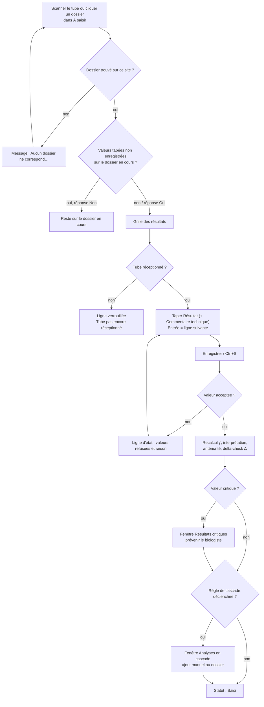
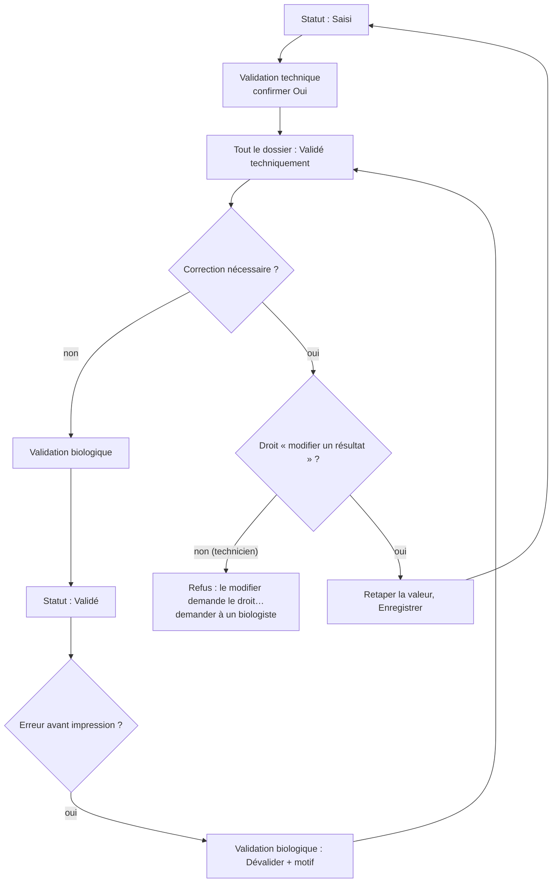
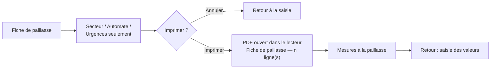
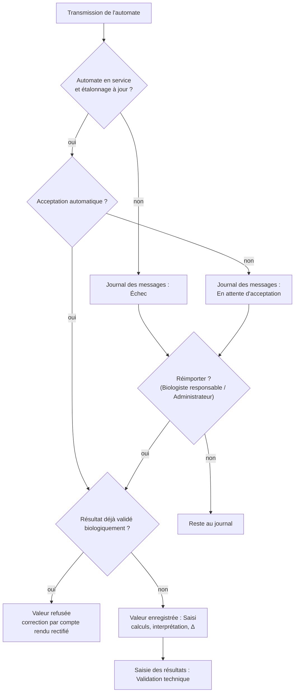
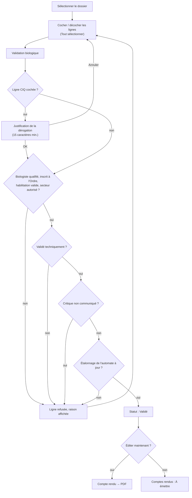
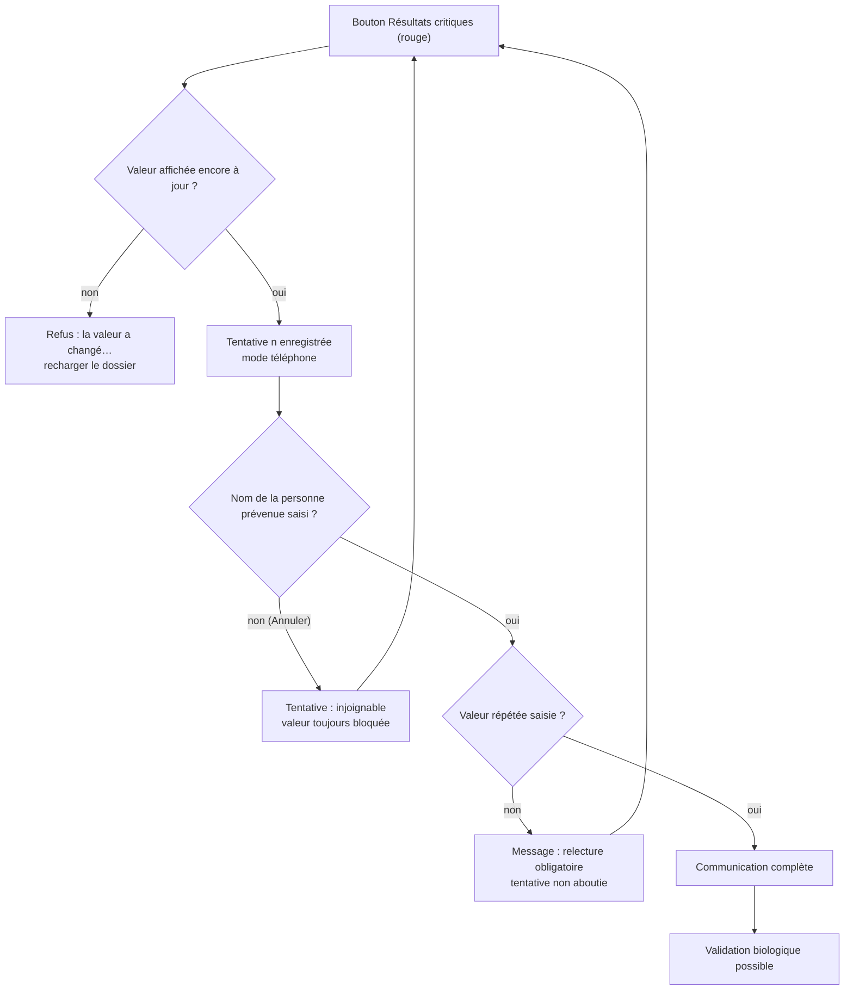
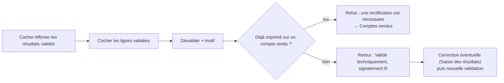
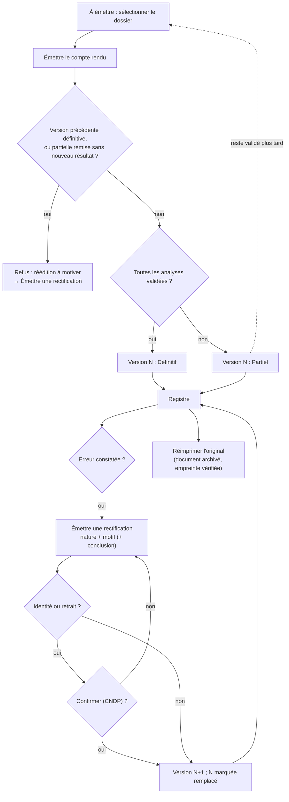
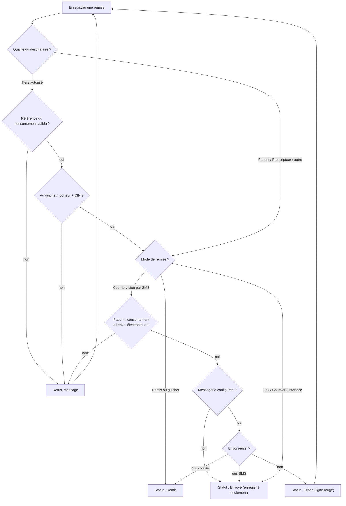

## Phase analytique et comptes rendus

Ce chapitre couvre le travail de la paillasse jusqu'à la remise du compte rendu : saisie des résultats (manuelle ou par les automates), validation technique, validation biologique avec la communication des résultats critiques, puis émission, réimpression, remise et rectification des comptes rendus.

Le circuit normal d'un résultat est le suivant :

| Étape | Qui | Écran | Statut du résultat |
|---|---|---|---|
| Le tube est réceptionné | Technicien, secrétariat | Réception des échantillons | En attente de saisie |
| La valeur est saisie ou arrive de l'automate | Technicien (ou automate) | Saisie des résultats / Automates | Saisi |
| Le technicien contrôle la vraisemblance | Technicien | Saisie des résultats, bouton **Validation technique** | Validé techniquement |
| Le biologiste libère le résultat | Biologiste | Validation biologique | Validé |
| Le compte rendu est édité | Biologiste ou secrétariat | Validation biologique ou Comptes rendus | Rendu (imprimé) |
| Le compte rendu est remis | Secrétariat | Comptes rendus, **Enregistrer une remise** | — |

Vue d'ensemble :

```mermaid
flowchart LR
    REC["Réception des échantillons<br/>tube réceptionné"] --> SRC{"Origine de la valeur ?"}
    SRC -- "paillasse" --> SAI["Saisie des résultats<br/>Enregistrer"]
    SRC -- "automate" --> AUTO{"Acceptation automatique ?"}
    AUTO -- "oui" --> SAISI["Statut : Saisi"]
    AUTO -- "non" --> RET["Automates — Journal des messages<br/>En attente d'acceptation"]
    RET -- "Réimporter" --> SAISI
    SAI --> SAISI
    SAISI --> VT["Saisie des résultats<br/>Validation technique"]
    VT --> VTD["Statut : Validé techniquement"]
    VTD --> VB["Validation biologique"]
    VB --> CRIT{"Résultat critique<br/>non communiqué ?"}
    CRIT -- "oui" --> APPEL["Bouton Résultats critiques<br/>nom + relecture"]
    APPEL --> VB
    CRIT -- "non" --> VAL["Statut : Validé"]
    VAL --> DEV{"Erreur avant impression ?"}
    DEV -- "oui : Dévalider" --> VTD
    DEV -- "non" --> CR["Compte rendu<br/>(Validation biologique ou Comptes rendus)"]
    CR --> RENDU["Statut : Rendu — version N"]
    RENDU --> REM["Comptes rendus<br/>Enregistrer une remise"]
    RENDU -- "Émettre une rectification" --> RECT["Version N+1, N remplacée"]
    RECT --> REM
    VB -. "Repasser l'analyse<br/>(Consultation d'un dossier)" .-> SAI
```

Raccourcis valables dans tous les écrans de ce chapitre (réglables dans la liste des raccourcis, F1) : **Ctrl+6** ouvre Saisie des résultats, **Ctrl+7** Validation biologique, **Ctrl+8** Comptes rendus ; **F5** actualise l'écran ; **Ctrl+F** place le curseur dans la première zone de recherche de l'écran ; **Ctrl+P** imprime la liste principale de l'écran ; **Ctrl+S** appuie sur le bouton **Enregistrer** de l'écran quand il en a un.

---

### Saisie des résultats

Écran de la paillasse : on y ouvre un dossier (par scan du tube ou par la liste), on tape les valeurs, on enregistre, puis on valide techniquement. On y imprime aussi la fiche de paillasse.

**Qui y a accès**

- Le menu apparaît pour toute personne qui a le droit de saisir des résultats : Technicien de laboratoire, Biologiste, Biologiste responsable, Administrateur.
- **Enregistrer** et **Fiche de paillasse** : même droit (saisir des résultats). Grisés sinon.
- **Validation technique** : droit de valider techniquement (Technicien, Biologiste, Biologiste responsable, Administrateur).
- Modifier une valeur déjà validée techniquement : droit « modifier un résultat », que seuls le Biologiste, le Biologiste responsable et l'Administrateur possèdent. Le technicien ne l'a pas par défaut.
- **Antériorités** : droit de consulter les résultats.

**L'écran**

- À gauche, la liste **À saisir (n)** : un dossier par ligne avec **N° de dossier**, **Patient**, **Analyses** (nombre d'analyses en attente), **Reçu** (date et heure de réception), **Secteurs**. Les urgences sont en rouge et en gras et passent en tête. Bouton **Actualiser** au-dessus.
- En haut à droite, la zone de scan **N° de dossier / Code-barres**, le bouton **Ouvrir** et, à l'extrémité, le bouton **Fiche de paillasse**.
- Sous la zone de scan, un bandeau patient : nom, sexe, âge, date de naissance, mention « Grossesse en cours » le cas échéant ; à droite le n° de dossier, la priorité en majuscules (URGENT, URGENCE VITALE) et l'**Échéance**.
- La grille des résultats, colonnes **Paramètre**, **Résultat**, **Signalements**, **Unité**, **Valeurs usuelles**, **Antériorité** (dernière valeur validée du patient et sa date), **Commentaire technique**.
  - Les titres de rubrique sont en gras italique sur fond gris.
  - Les paramètres calculés portent le signe « ƒ » et ont une case grise : on ne les tape pas.
  - Une valeur anormale est colorée avec un symbole : ↓ bas, ↑ élevé, ↓↓ critique bas, ↑↑ critique élevé, * anormal (réponse codée).
  - Autres signalements possibles : CIQ (contrôle interne hors limites), Δ (écart au delta-check), ! (échantillon non conforme), × (dilué), R (résultat rectifié), ST (sous-traité), ≷ (hors domaine de mesure). Quand un de ces signalements est présent, il remplace la flèche dans la colonne ; la couleur reste.
  - En passant la souris sur la colonne **Signalements**, on lit l'« Alarme automate » transmise par l'analyseur ; sur le **Paramètre**, les « Non-conformités constatées » du tube.
- En bas : **Enregistrer**, **Validation technique**, **Antériorités** et une ligne d'état (messages en couleur).

**Scénarios**

1. **Ouvrir un dossier en scannant un tube**
   1. Le curseur est déjà dans la zone **N° de dossier / Code-barres**.
   2. Scannez l'étiquette du tube, ou tapez le n° de dossier, puis **Entrée** (ou cliquez **Ouvrir**).
   3. Le dossier s'ouvre et le curseur se place sur la première case **Résultat** vide.
   - Le n° doit être exact (majuscules comprises). S'il ne correspond à rien sur votre site : « Aucun dossier ne correspond à « … » sur ce site. »

2. **Ouvrir un dossier depuis la liste À saisir**
   1. Cliquez sur la ligne (ou déplacez-vous avec les flèches). Le dossier s'ouvre à droite.
   2. À l'arrivée sur l'écran, le premier dossier de la liste (urgent d'abord) est ouvert automatiquement.
   3. Si des valeurs tapées n'ont pas été enregistrées, l'application demande : « Des modifications n'ont pas été enregistrées. Voulez-vous continuer ? ». Répondez **Non** pour rester sur le dossier en cours.

3. **Saisir les valeurs d'un dossier**
   1. Tapez la valeur dans **Résultat**, puis **Entrée** : le curseur descend à la ligne suivante modifiable (les lignes calculées et les rubriques sont sautées). Après la dernière ligne, le curseur va sur **Enregistrer**.
   2. Formats acceptés :
      - nombre : virgule ou point (« 5,2 » ou « 5.2 ») ;
      - valeur censurée : « <5 », « >1000 », « <=5 », « ≥ 5 »… ;
      - titre : « 1/320 », « 1:320 » ou « 320 » ;
      - réponse codée (positif/négatif, croix…) : tapez le **code** de la réponse tel qu'il est défini au catalogue (majuscules indifférentes) ; aucune liste déroulante n'est proposée (à vérifier avec le catalogue) ;
      - texte libre pour les paramètres de type texte.
   3. Tapez si besoin un **Commentaire technique**. Attention : un commentaire technique saisi ici est **imprimé sur le compte rendu**.
   4. Cliquez **Enregistrer** (ou **Ctrl+S**).
   5. L'écran se recharge : paramètres calculés recalculés, interprétation, antériorité, delta-check et signalements mis à jour. La ligne d'état indique « n · Enregistré. », ou la liste des valeurs refusées et pourquoi.

4. **Corriger une valeur avant validation technique**
   - Retapez la valeur et **Enregistrer**. Tant que la valeur n'est pas validée techniquement, la correction fait partie de la saisie.

5. **Corriger une valeur déjà validée techniquement**
   - Possible seulement avec le droit « modifier un résultat » (biologistes). Sinon : « … : ce résultat est déjà validé techniquement, le modifier demande le droit « modifier un résultat ». »
   - La valeur corrigée repasse au statut Saisi : il faut refaire la **Validation technique**.

6. **Corriger une valeur validée biologiquement mais pas encore imprimée**
   1. Le biologiste la dévalide dans Validation biologique (bouton **Dévalider**, motif obligatoire).
   2. La valeur revient validée techniquement ; un biologiste la corrige ici, puis **Validation technique**, puis nouvelle validation biologique.
   - Dans la grille, une valeur validée refuse le curseur : « Ce résultat est validé : toute modification doit passer par une rectification motivée. »

7. **Faire la validation technique d'un dossier**
   1. Le dossier ouvert, cliquez **Validation technique** (actif dès qu'au moins une valeur est au statut Saisi).
   2. Confirmez (**Oui** ; le bouton par défaut est **Non**).
   3. Toutes les valeurs saisies du dossier, tous secteurs confondus, passent validées techniquement. Une analyse dont toutes les lignes sont validées techniquement (ou « Non fait ») passe à l'étape suivante et apparaît dans Validation biologique.
   - On ne peut pas valider techniquement une seule ligne : c'est tout le dossier.

8. **Consulter les antériorités d'un paramètre**
   1. Placez-vous sur la ligne d'un paramètre numérique.
   2. Cliquez **Antériorités**, ou double-cliquez dans la case **Antériorité**.
   3. La fenêtre « Antériorités — paramètre (unité) » montre la courbe des 30 dernières valeurs validées du patient avec les valeurs usuelles, et en dessous un tableau **Date**, **Valeur**, **N° de dossier** (le plus récent en premier). Les valeurs hors valeurs usuelles sont en couleur.
   4. La valeur en cours (tapée, même non enregistrée) apparaît comme « Valeur en cours, non validée ».
   5. **Fermer** (ou Échap).
   - Sans historique : « Aucune antériorité ». Le bouton est grisé sur une réponse codée, un texte ou une rubrique. Les dossiers fusionnés du même patient sont inclus.

9. **Imprimer la fiche de paillasse**
   1. Cliquez **Fiche de paillasse**.
   2. Choisissez le **Secteur** (« Tous les secteurs » par défaut ; chaque secteur indique « n en attente »).
   3. Choisissez l'**Automate** (« Tous les automates », ou un automate du secteur ou non rattaché à un secteur).
   4. Cochez **Urgences seulement** si besoin.
   5. Cliquez **Imprimer** : la fiche s'ouvre en PDF dans votre lecteur habituel, d'où vous l'imprimez. La ligne d'état indique « Fiche de paillasse — n ligne(s) ».
   - La fiche liste les analyses dont le tube est reçu et dont le résultat n'est pas encore saisi, urgences en tête puis par ordre de réception, avec n° de dossier, code-barres du tube, patient, non-conformités du tube et les paramètres à mesurer (jamais les calculés). Elle porte l'heure d'impression et le nom de l'imprimeur ; si la liste est trop longue, la fiche indique qu'elle est tronquée. Le dernier secteur choisi est reproposé la fois suivante.

10. **Réagir à un résultat critique à l'enregistrement**
    - Si une valeur enregistrée est critique, une fenêtre « Résultats critiques » s'ouvre : « Résultats critiques non communiqués », la liste des paramètres et valeurs, et le rappel « Un résultat critique doit être communiqué au prescripteur avant sa validation. »
    - Prévenez le biologiste : l'appel au prescripteur et sa trace se font dans **Validation biologique**, bouton **Résultats critiques**. Il n'y a pas de bouton d'appel dans cet écran.

11. **Réagir à une analyse en cascade proposée**
    - Si une règle de cascade se déclenche (par exemple une TSH anormale qui appelle une T4), une fenêtre « Analyses en cascade » liste les analyses proposées.
    - L'application **n'ajoute pas** l'analyse au dossier, même quand la règle est réglée en « ajout automatique ». Il faut l'ajouter vous-même au dossier, depuis l'écran du dossier (à vérifier selon le chapitre Accueil).

**Règles et contrôles**

- Une ligne dont le tube n'est pas encore réceptionné est verrouillée : « Tube pas encore réceptionné pour : … Ces lignes sont verrouillées jusqu'à la réception. » Réceptionnez d'abord le tube.
- Une analyse annulée n'apparaît plus ; si on tente d'y saisir : « … : cette analyse est annulée, aucun résultat ne peut y être saisi. »
- Un paramètre calculé ne se tape pas : « Le paramètre … est calculé : sa valeur ne se saisit pas. » Il est recalculé à chaque enregistrement. Si la formule ne s'applique pas (ex. LDL de Friedewald avec triglycérides trop élevés), la ligne passe « Non fait » avec le commentaire « Non calculable avec ces valeurs : dosage direct requis ».
- Valeur non numérique : « « … » n'est pas une valeur numérique valide. » Valeur hors limites techniques : « La valeur … est techniquement impossible pour ce paramètre. » Réponse codée inconnue : « « … » ne fait pas partie des réponses autorisées pour ce paramètre. » Titre : « Le titre doit être un entier positif. »
- Une valeur hors du domaine de mesure de la technique est enregistrée automatiquement en valeur censurée (« < limite basse » ou « > limite haute ») avec le signalement ≷.
- Effacer une case et enregistrer ne supprime pas la valeur : les cases vides sont ignorées. Il n'est pas possible de marquer une analyse « Non fait » depuis cet écran.
- Seules les lignes modifiées sont envoyées ; si rien n'a changé : « Aucun élément sélectionné. »
- Delta-check : si la valeur s'écarte de la précédente au-delà du pourcentage réglé au catalogue (et dans la fenêtre de jours réglée), le signalement Δ est posé.
- Un tube accepté avec une non-conformité (hémolyse…) fait porter le signalement « ! » à tous ses résultats ; il sera signalé au compte rendu.
- Chaque ouverture de dossier est tracée dans le journal des accès (loi 09-08).
- Le lot de réactif en service est rattaché automatiquement à chaque nouvelle valeur quand le stock l'identifie sans ambiguïté.

**Flux**

Réception des échantillons → **Saisie des résultats** (ou arrivée par l'automate) → **Validation technique** → Validation biologique. Une analyse à refaire se renvoie à la paillasse depuis « Consultation d'un dossier », bouton « Repasser l'analyse ».

Saisie et enregistrement :

Validation technique et corrections :

Fiche de paillasse :

---

### Résultats reçus des automates (écran Automates)

Les automates connectés envoient leurs valeurs directement dans les dossiers. Ce paragraphe ne décrit que ce qui concerne les résultats ; le réglage des interfaces relève du chapitre Administration.

**Qui y a accès**

- Écran **Automates** : droit de consulter les automates (Technicien, Biologiste, Biologiste responsable, Responsable qualité, Administrateur).
- **Réimporter** une transmission : droit « rejouer les messages », détenu par défaut par le Biologiste responsable et l'Administrateur seulement.

**Ce qui se passe à l'arrivée d'une transmission**

- Si l'interface est en **acceptation automatique** : les valeurs sont enregistrées dans le dossier au statut Saisi, avec le même traitement qu'une saisie manuelle (calculs, interprétation, antériorité, delta-check, non-conformité du tube). Les alarmes de l'automate sont conservées si l'interface le prévoit et s'affichent dans « Alarme automate ».
- Si l'acceptation automatique est désactivée (réglage par défaut) : rien n'est enregistré ; la transmission reste dans le **Journal des messages** au statut « En attente d'acceptation » avec la mention « Transmission retenue : l'acceptation automatique est désactivée sur cette interface. »
- Dans tous les cas les valeurs arrivent en statut Saisi : le technicien doit faire la **Validation technique** dans Saisie des résultats.

**Scénarios**

1. **Accepter une transmission retenue ou en échec**
   1. Ouvrez **Automates**, sélectionnez l'interface, puis la ligne dans **Journal des messages**.
   2. Au besoin, **Voir la trame brute** pour contrôler le contenu.
   3. Cliquez **Réimporter** et confirmez : « Réimporter cette transmission ? Les valeurs de l'automate seront enregistrées au dossier du patient. »
   4. Un message indique le nombre de valeurs enregistrées, ou « Réimportation effectuée, aucune valeur enregistrée : lisez les anomalies de la ligne. »
   - Seules les transmissions en échec, partielles ou retenues peuvent être réimportées.

**Règles et contrôles**

- Une valeur déjà validée biologiquement n'est jamais remplacée par l'automate : « Résultat déjà validé biologiquement : la correction passe par un compte rendu rectifié. »
- Un automate hors service, réformé ou dont l'étalonnage est échu ne produit pas de résultats ; à la validation biologique, une valeur produite par un automate dont l'étalonnage est échu est bloquée.
- Une valeur critique arrivée par l'automate ne déclenche **aucune fenêtre d'alerte** : elle apparaît en rouge dans Validation biologique et dans « Résultats critiques non communiqués » du Tableau de bord. Les analyses en cascade ne sont pas évaluées pour ces valeurs.

**Flux**

Automate → (Réimporter si retenue) → Saisie des résultats, **Validation technique** → Validation biologique.

---

### Validation biologique

Écran du biologiste : il liste les dossiers dont des résultats validés techniquement attendent la validation biologique, permet de libérer les résultats, de tracer l'appel des résultats critiques, de dévalider et d'éditer le compte rendu.

**Qui y a accès**

- Le menu apparaît avec le droit de validation biologique : Biologiste, Biologiste responsable, Administrateur.
- La validation elle-même exige en plus, au moment du clic, une qualification de biologiste (médecin ou pharmacien biologiste) inscrite à l'Ordre et non expirée, et le secteur dans le périmètre de l'utilisateur. L'Administrateur voit l'écran mais sa validation est refusée s'il n'a pas cette qualification.
- **Résultats critiques** : droit de saisir la communication d'un critique (Biologiste, Biologiste responsable, Administrateur).
- **Compte rendu** : droit d'éditer les comptes rendus.
- **Dévalider** : droit de dévalider, que seuls le Biologiste responsable et l'Administrateur ont par défaut (le Biologiste ne l'a pas).

**L'écran**

- En haut, **En attente de validation biologique** avec les cases **Urgent** (seulement les urgences) et **Afficher les résultats validés** (fait revenir les dossiers validés mais pas encore imprimés, pour pouvoir les dévalider), et le bouton **Actualiser**.
- Liste des dossiers : **N° de dossier**, **Patient**, **Âge**, **Priorité**, **En attente de validation biologique** (nombre), **Anormal**, **Critique élevé** (nombre de critiques), **Signalements**, **Enregistré le**.
  - Ordre : d'abord les dossiers avec un critique non communiqué (ligne rouge sur fond rouge), puis les urgences, puis les plus anciens.
  - **Signalements** : « !n » (n critiques non communiqués), « CIQ », « Δ », « éch. » (échantillon non conforme), « En retard » (échéance dépassée). Un dossier en retard ou avec un CIQ hors limites est en orange.
  - Un biologiste au périmètre restreint ne voit que ses secteurs.
- En bas, les **Résultats** du dossier sélectionné (titre : n° de dossier, patient, âge, sexe) : case à cocher, **Paramètre**, **Résultat**, **Signalements**, **Unité**, **Valeurs usuelles**, **Antériorité**, **Alarme automate**.
  - Les résultats validés techniquement sont pré-cochés.
  - Les résultats seulement saisis sont affichés mais ne peuvent pas être cochés.
  - Avec **Afficher les résultats validés**, les résultats déjà validés apparaissent en italique gris, non cochés.
- Boutons : **Tout sélectionner**, **Validation biologique**, **Résultats critiques** (rouge et gras quand un critique attend son appel), **Compte rendu**, **Dévalider**, **Antériorités**, et une ligne d'état.

**Scénarios**

1. **Valider un dossier entier**
   1. Sélectionnez le dossier dans la liste.
   2. Vérifiez les valeurs, les signalements et les alarmes automate. Les lignes à libérer sont déjà cochées.
   3. Cliquez **Validation biologique**.
   4. La ligne d'état indique « n validé par » ; la liste se recharge. Le dossier disparaît quand plus rien n'attend.
   - Les résultats refusés sont listés dans une fenêtre, chacun avec sa raison ; les autres sont validés quand même.

2. **Valider une partie d'un dossier**
   1. Décochez les lignes à retenir (ou **Tout sélectionner** pour tout cocher / tout décocher).
   2. **Validation biologique**. Les lignes décochées restent en attente.

3. **Valider un résultat couvert par un contrôle interne hors limites**
   1. Cochez la ligne (signalement CIQ) et cliquez **Validation biologique**.
   2. Une fenêtre « Dérogation contrôle interne » rappelle le blocage et la liste des paramètres concernés, et demande la **Justification de la dérogation** (15 caractères minimum).
   3. Saisissez la justification et validez. Elle est inscrite sur le point de contrôle concerné.
   - Annuler la fenêtre annule toute la validation.

4. **Communiquer un résultat critique (appel avec relecture)**
   1. Sélectionnez le dossier (ligne rouge). Cliquez **Résultats critiques**.
   2. Pour chaque valeur critique non encore communiquée, une fenêtre affiche « paramètre : valeur » et demande l'identité de la personne prévenue. Tapez son nom, puis OK.
   3. Une seconde fenêtre demande : « Faites répéter la valeur par votre interlocuteur et saisissez ce qu'il a répété. » Tapez la valeur répétée, puis OK.
   4. La communication est enregistrée (date, heure, auteur, destinataire, valeur répétée). Le dossier se recharge ; la valeur peut maintenant être validée.
   - Si vous annulez la première fenêtre, l'appel est enregistré comme « interlocuteur injoignable » et la valeur reste bloquée ; recommencez plus tard (chaque tentative est numérotée).
   - Si vous laissez la relecture vide : « La communication n'est complète que si l'interlocuteur a répété la valeur transmise. » et la tentative est enregistrée comme non aboutie.
   - Le mode est toujours « téléphone » ; ni le numéro appelé, ni la fonction de la personne, ni le prescripteur ne sont demandés.

5. **Consulter les antériorités**
   - Ligne sélectionnée, **Antériorités** ou double-clic dans la case **Antériorité** : même fenêtre que dans Saisie des résultats (voir plus haut).

6. **Éditer le compte rendu depuis cet écran**
   1. Le dossier sélectionné, cliquez **Compte rendu** ; confirmez « Compte rendu — n° de dossier ».
   2. Le PDF s'ouvre dans votre lecteur ; la ligne d'état indique « Compte rendu vN — Enregistré. ».
   - Le compte rendu porte tous les résultats validés du dossier. S'il reste des analyses non validées, il est **partiel** (mention sur le document). Langue : celle choisie à l'enregistrement du dossier. Pas de conclusion possible ici (voir Comptes rendus, rectification).

7. **Dévalider un résultat (avant impression)**
   1. Cochez **Afficher les résultats validés** ; sélectionnez le dossier.
   2. Cochez la ou les lignes validées à retirer.
   3. Cliquez **Dévalider**. Saisissez le motif (15 caractères minimum) dans la fenêtre « Motif de la dévalidation de n résultat(s)… ».
   4. La ligne d'état indique « n × dévalidé(s) ». La valeur est conservée, revient au statut validé techniquement, porte le signalement R (rectifié), et une trace de rectification est inscrite.

**Règles et contrôles**

- Les trois verrous ne se contournent pas :
  - Qualification : « Seul un médecin ou un pharmacien biologiste peut procéder à la validation biologique. », « Le biologiste doit être inscrit à l'Ordre pour valider un résultat. », « L'habilitation du biologiste a expiré le … », « Le secteur … n'entre pas dans le périmètre de validation de cet utilisateur. »
  - Contrôle interne : « Le contrôle interne couvrant ce résultat est hors limites : une dérogation motivée est requise. »
  - Critique : « Un résultat critique doit être communiqué au prescripteur avant sa validation. » Une communication ne couvre que la valeur affichée au moment de l'appel ; si la valeur a changé depuis (nouveau passage sur l'automate) : « … : la valeur a changé depuis l'affichage de l'écran… Rechargez le dossier et communiquez la valeur actuelle. »
- Validation technique obligatoire d'abord : « La validation technique doit précéder la validation biologique. »
- Automate dont l'étalonnage est échu : la valeur est bloquée (« L'étalonnage de cet automate est échu depuis le … »).
- Une analyse n'est validée que si tous ses paramètres le sont ; sinon ses lignes sont retenues ensemble.
- Dévalidation impossible une fois le compte rendu imprimé : « Le compte rendu a déjà été diffusé : une rectification est nécessaire. » Motif obligatoire.
- Le refus d'un résultat (case décochée) ne fait rien d'autre que le laisser en attente : pour le refaire, utilisez « Repasser l'analyse » dans Consultation d'un dossier.
- Il n'y a pas de filtre par secteur sur cet écran, ni de zone de commentaire du biologiste par résultat.

**Flux**

Saisie des résultats (validation technique) → **Validation biologique** → **Compte rendu** ici ou dans Comptes rendus → remise. Les dossiers validés en partie dont le reste est encore à la paillasse s'éditent depuis Comptes rendus (liste « À émettre »).

Validation d'un dossier :

Communication d'un résultat critique :

Dévalidation :

---

### Comptes rendus

Registre des comptes rendus édités : on y émet les comptes rendus en attente, on réimprime l'original, on enregistre chaque remise (guichet, courriel, SMS, fax, coursier…) et on émet les rectifications.

**Qui y a accès**

- Menu : droit de consulter les comptes rendus (tous les rôles sauf Préleveur et Comptabilité : Secrétariat / accueil, Technicien, Biologiste, Biologiste responsable, Responsable qualité, Prescripteur, Administrateur).
- **Émettre le compte rendu** : droit d'éditer (Secrétariat / accueil, Biologiste, Biologiste responsable, Administrateur). Un compte prescripteur ne peut jamais émettre.
- **Réimprimer l'original** : droit de réimpression (Biologiste responsable, Prescripteur, Administrateur). Le Biologiste et le Secrétariat ne l'ont pas par défaut.
- **Enregistrer une remise** : droit d'éditer ou d'envoyer (Secrétariat / accueil, Biologiste, Biologiste responsable, Administrateur).
- **Émettre une rectification** : droit de rectifier (Biologiste, Biologiste responsable, Administrateur).

**L'écran**

- En haut : titre « Registre des comptes rendus — total · n en attente de remise · n critique non remis » (en rouge s'il y a un critique non remis), zone de recherche (« N° de dossier, nom du patient ou n° de dossier patient », **Entrée** pour chercher), case **Uniquement les comptes rendus non remis**, période (**7 / 30 / 90 / 365 derniers jours**, 30 par défaut), **Actualiser**.
- Bloc **À émettre — n dossier(s) avec des résultats validés sur aucun compte rendu** (visible seulement s'il y en a) : **N° de dossier**, **Patient**, **Priorité**, **Résultats validés**, **Analyses en attente**, **Dernière validation**, **Nature** (« Partiel » ou « Définitif », suivi de « · vN » si une version existe déjà).
- Registre : **N° de dossier**, **Patient**, **Version**, **Nature**, **Édité le**, **Signataire**, **Prescripteur**, **Remise** (date de la dernière remise et leur nombre, sinon le mode souhaité par le prescripteur, sinon « — »), **Statut** (« remplacé », nature de rectification, « Critique », « sous réserve », « Sous-traitée », « hors accréditation »).
  - En tête : les définitifs non remis contenant un critique (fond rouge), puis les définitifs non remis (orange), puis le reste par date. Les versions remplacées sont grisées ; les rectifications en couleur d'accent.
- En bas : **Remises enregistrées** de la version sélectionnée : **Date et heure**, **Mode de remise**, **Qualité du destinataire**, **Destinataire**, **Porteur** (avec CIN), **Statut** (En attente, Envoyé, Remis, Échec, Annulé), **Remis par**.
- Boutons : **Émettre le compte rendu**, **Réimprimer l'original**, **Enregistrer une remise**, **Émettre une rectification**, et une ligne d'état.

**Scénarios**

1. **Émettre un compte rendu en attente (partiel ou définitif)**
   1. Dans **À émettre**, sélectionnez le dossier.
   2. Cliquez **Émettre le compte rendu** (ou double-clic sur la ligne) ; confirmez.
   3. Le PDF s'ouvre ; « Compte rendu … vN émis ». Le dossier passe dans le registre.
   - Un compte rendu partiel porte la mention correspondante ; il sera remplacé par le définitif quand le reste sera validé, sans qu'il s'agisse d'une rectification.

2. **Réimprimer un compte rendu**
   1. Sélectionnez la version dans le registre (une version remplacée peut aussi être réimprimée : c'est ce que détient le clinicien).
   2. **Réimprimer l'original** (ou double-clic).
   3. Le document archivé, identique à l'original, s'ouvre ; « Réimpression de … vN — l'accès est journalisé. »
   - Ne réémettez pas pour réimprimer : réémettre un définitif est refusé (voir Règles).

3. **Remettre un compte rendu au guichet au patient**
   1. Sélectionnez la version, **Enregistrer une remise**.
   2. **Mode de remise** : proposé selon la préférence du prescripteur (par défaut « Remis au guichet »). **Qualité du destinataire** : « Patient » ; le **Destinataire** est prérempli avec son nom.
   3. **Enregistrer**. La remise est « Remis » immédiatement ; « Remise enregistrée — … ».

4. **Remettre à un porteur ou à un tiers**
   1. **Qualité du destinataire** : « Tiers autorisé ».
   2. Saisissez la **Référence du consentement** (consentement écrit du patient enregistré au dossier), le **Porteur** et la **CIN du porteur** (obligatoires au guichet).
   3. **Enregistrer**.
   - Sans référence valide : « La remise à un tiers exige le consentement du patient à la communication. » Sans porteur : « Indiquez le nom et la CIN du porteur… »
   - La référence attendue est l'identifiant interne du consentement (longue suite de chiffres et lettres) : à vérifier où le trouver.

5. **Envoyer par courriel ou par SMS**
   1. **Mode de remise** « Courriel » ou « Lien par SMS ». L'**Adresse / numéro** se remplit avec le courriel ou le mobile connu du patient (ou le courriel du prescripteur si le destinataire est « Prescripteur »).
   2. Lisez la note : si la messagerie est configurée, l'envoi est réel (PDF joint au courriel ; le SMS dit seulement que le compte rendu est prêt, sans résultat). Sinon la remise est seulement enregistrée et vous envoyez par vos propres moyens.
   3. **Enregistrer**. Messages : « … : compte rendu envoyé par e-mail à … », « … : SMS envoyé au … », ou en cas d'échec « L'envoi à … a échoué : … La tentative est enregistrée… » (ligne en rouge dans les remises).
   - Pour le patient, son consentement à l'envoi électronique est exigé : « Le patient n'a pas donné son consentement à l'envoi électronique de ses résultats. Enregistrez-le dans sa fiche (Consentements)… »

6. **Envoyer par fax, coursier ou interface**
   - Fax : numéro obligatoire ; coursier : indiquez le porteur. Ces remises sont enregistrées, l'envoi lui-même se fait hors de l'application.

7. **Émettre une rectification**
   1. Sélectionnez la version en cours (non remplacée), **Émettre une rectification**.
   2. La fenêtre rappelle « rectifie la version N — la nouvelle version portera le n° N+1 » et si la version a déjà été remise (en rouge, avec la date).
   3. Choisissez la **Nature de la rectification** : « Correction de résultat », « Ajout d'analyse », « Révision du commentaire », « Correction d'identité », « Retrait du compte rendu ».
   4. Choisissez la **Langue du compte rendu**.
   5. Saisissez le **Motif (français)** (obligatoire, imprimé sur le compte rendu) et éventuellement le **Motif (arabe)**.
   6. Facultatif : **Conclusion (français)** / **Conclusion (arabe)**, commentaire du biologiste imprimé en fin de compte rendu.
   7. **Enregistrer**. Pour « Correction d'identité » et « Retrait du compte rendu », une confirmation rappelle l'obligation d'informer la CNDP si le précédent est parti à une autre personne.
   8. Le PDF s'ouvre ; « Compte rendu rectifié vN émis — … ». L'ancienne version reste au registre, marquée « remplacé ».

**Règles et contrôles**

- Un compte rendu n'est jamais modifié : chaque émission crée une nouvelle version numérotée ; le PDF est archivé avec une empreinte, et la réimpression vérifie cette empreinte (« Le document archivé ne correspond plus à son empreinte… »).
- Réémettre un compte rendu **définitif**, ou un partiel déjà remis sans nouveau résultat, est refusé : « Un compte rendu a déjà été remis : toute réédition doit être motivée comme rectification. » Passez par **Émettre une rectification**.
- Seuls les résultats validés biologiquement sont imprimés ; « Non fait » n'est imprimé qu'une fois l'analyse validée. Sans résultat : « Aucun résultat à porter sur le compte rendu. »
- Signataire : le biologiste qui a validé en dernier, avec son n° d'inscription à l'Ordre ; sans ce numéro : « Le numéro d'inscription à l'Ordre du biologiste est obligatoire sur le compte rendu. »
- Le site doit être en règle (autorisation, biologiste responsable) pour éditer.
- Compte rendu en arabe sans la police arabe installée sur le poste : édition refusée (« La police arabe … n'est pas installée sur ce poste… »).
- Motif de rectification obligatoire : « Un compte rendu rectifié doit indiquer le motif de la rectification. »
- Nom du destinataire toujours obligatoire ; adresse ou numéro obligatoire pour courriel, SMS et fax.
- Une valeur déjà imprimée ne peut être modifiée par aucun écran (la dévalidation est refusée après impression, l'automate ne la remplace pas) : une « Correction de résultat » réimprime les valeurs telles qu'elles sont enregistrées (à vérifier avec l'éditeur, voir la fiche de vérification).
- Consultation du registre, réimpression et remises sont tracées dans le journal des accès.

**Flux**

Validation biologique → **Comptes rendus** (émission, puis remise) → archivage. Le Tableau de bord signale les résultats critiques non communiqués ; le registre signale les définitifs critiques non remis.

Émission et rectification :

Remise :

