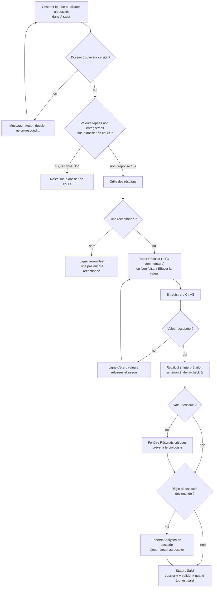
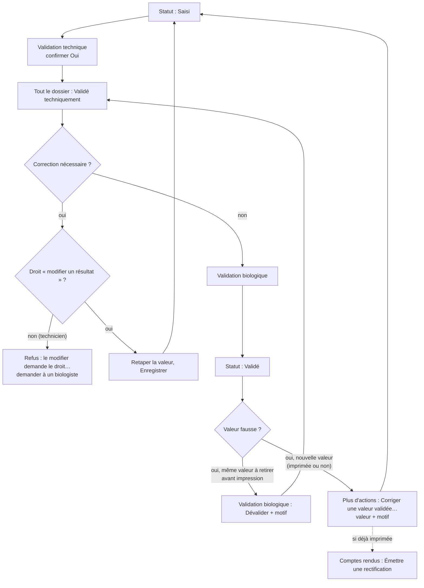
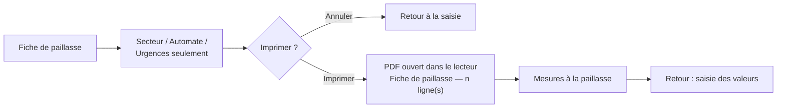
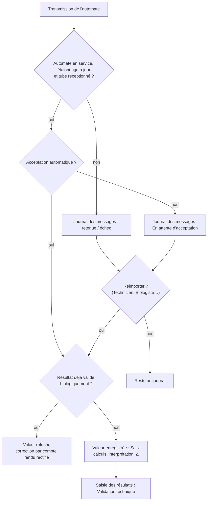
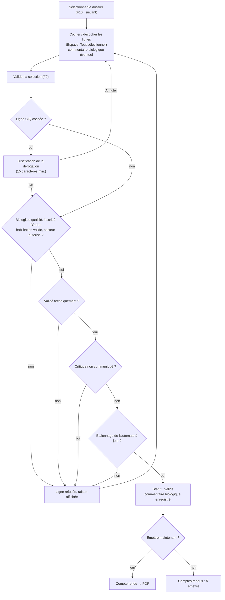
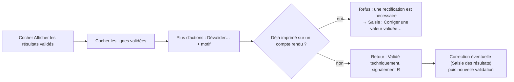
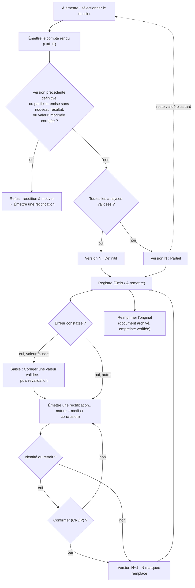
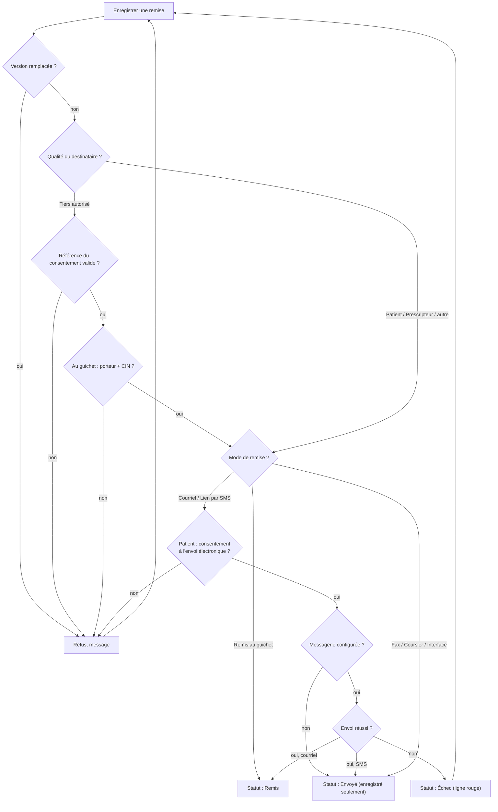

## Phase analytique et comptes rendus

Ce chapitre couvre le travail de la paillasse jusqu'à la remise du compte rendu : saisie des résultats (manuelle ou par les automates), validation technique, validation biologique avec la communication des résultats critiques, puis émission, réimpression, remise et rectification des comptes rendus.

### Présentation du module

**But du module.** C'est le cœur du laboratoire : produire un résultat juste, le faire contrôler deux fois (validation technique par la paillasse, validation biologique par un biologiste habilité), prévenir le prescripteur d'une valeur critique, puis remettre au bon destinataire un compte rendu signé qui ne pourra plus jamais être modifié en silence. Chaque correction laisse une trace : l'ancienne valeur est gardée, le motif est demandé, et un compte rendu déjà remis ne se corrige que par une rectification numérotée.

**Qui l'utilise.**

| Rôle par défaut | Ce qu'il fait dans ce module |
|---|---|
| Technicien de laboratoire | Saisit les valeurs, marque « Non fait », valide techniquement, imprime la fiche de paillasse, réimporte les transmissions des automates retenues ou en échec. Ne modifie pas une valeur déjà validée techniquement. |
| Biologiste | Tout ce que fait le technicien, plus : modifie une valeur validée techniquement, corrige une valeur validée, valide biologiquement, communique les critiques, dévalide, écrit un commentaire biologique, émet et rectifie les comptes rendus, les réimprime et enregistre les remises. |
| Biologiste responsable, Administrateur | Tout le module, plus le réglage des interfaces des automates. |
| Secrétariat / accueil | Émet, réimprime et remet les comptes rendus (guichet, courriel, SMS…). |
| Responsable qualité | Consulte les résultats, les comptes rendus et les automates. |
| Prescripteur | Consulte et réimprime les comptes rendus de ses patients. |

Droits utilisés (identifiants affichés dans **Utilisateurs et rôles**) : saisir (`results.enter`), modifier un résultat validé techniquement (`results.modify`), valider techniquement (`results.validate_technical`), valider biologiquement (`results.validate_biological`), dévalider (`results.unvalidate`), saisir la communication d'un critique (`results.enter_critical`), consulter (`results.view`), éditer (`reports.print`), envoyer (`reports.send`), rectifier (`reports.amend`), réimprimer l'original (`reports.reprint_validated`), consulter les comptes rendus (`reports.view`), consulter les automates (`instruments.view`), rejouer les messages (`instruments.replay`), configurer et démarrer les interfaces. La validation biologique exige en plus une qualification de médecin ou pharmacien biologiste, inscrit à l'Ordre, habilité pour le secteur.

**Écrans du module** (groupe **Liste de travail** du menu, sauf **Automates**) :

| Menu | Droit qui ouvre l'écran | Raccourci par défaut |
|---|---|---|
| **Saisie des résultats** | Saisir des résultats | Ctrl+6 |
| **Validation biologique** | Valider biologiquement | Ctrl+7 |
| **Comptes rendus** | Consulter les comptes rendus | Ctrl+8 |
| **Automates** (résultats reçus) | Consulter les automates | aucun |

**Liens avec les autres modules.**

- **Réception des échantillons** déverrouille les lignes de saisie d'un tube.
- **Sous-traitance** : les résultats du partenaire se saisissent ici (repère « ST »).
- **Contrôle qualité** (CIQ) bloque la validation d'un résultat couvert par un contrôle hors limites ; **Équipements** bloque un automate dont l'étalonnage est échu.
- **Consultation d'un dossier** permet de « Repasser l'analyse » à la paillasse.
- **Patients** (Consentements) conditionne l'envoi électronique et la remise à un tiers.
- **Tableau de bord** compte les résultats critiques non communiqués.

Le circuit normal d'un résultat est le suivant :

| Étape | Qui | Écran | Statut du résultat |
|---|---|---|---|
| Le tube est réceptionné | Technicien de laboratoire | Réception des échantillons | En attente de saisie |
| La valeur est saisie ou arrive de l'automate | Technicien de laboratoire (ou automate) | Saisie des résultats / Automates | Saisi |
| Le technicien contrôle la vraisemblance | Technicien de laboratoire | Saisie des résultats, bouton **Validation technique** | Validé techniquement |
| Le biologiste libère le résultat | Biologiste | Validation biologique | Validé |
| Le compte rendu est émis | Biologiste ou secrétariat | Validation biologique ou Comptes rendus | Rendu (imprimé) |
| Le compte rendu est remis | Secrétariat / accueil | Comptes rendus, **Enregistrer une remise** | — |

Vue d'ensemble :

```mermaid
flowchart LR
    REC["Réception des échantillons<br/>tube réceptionné"] --> SRC{"Origine de la valeur ?"}
    SRC -- "paillasse" --> SAI["Saisie des résultats<br/>Enregistrer"]
    SRC -- "automate" --> AUTO{"Acceptation automatique ?"}
    AUTO -- "oui" --> SAISI["Statut : Saisi"]
    AUTO -- "non" --> RET["Automates — Journal des messages<br/>En attente d'acceptation"]
    RET -- "Réimporter" --> SAISI
    SAI --> SAISI
    SAISI --> VT["Saisie des résultats<br/>Validation technique"]
    VT --> VTD["Statut : Validé techniquement"]
    VTD --> VB["Validation biologique"]
    VB --> CRIT{"Résultat critique<br/>non communiqué ?"}
    CRIT -- "oui" --> APPEL["Bouton Résultats critiques<br/>nom + relecture"]
    APPEL --> VB
    CRIT -- "non" --> VAL["Statut : Validé"]
    VAL --> DEV{"Erreur avant impression ?"}
    DEV -- "oui : Dévalider" --> VTD
    DEV -- "non" --> CR["Compte rendu<br/>(Validation biologique ou Comptes rendus)"]
    CR --> RENDU["Statut : Rendu — version N"]
    RENDU --> REM["Comptes rendus<br/>Enregistrer une remise"]
    RENDU -- "valeur fausse : Corriger une valeur validée<br/>(Saisie des résultats)" --> SAISI
    RENDU -- "Émettre une rectification" --> RECT["Version N+1, N remplacée"]
    RECT --> REM
    VB -. "Repasser l'analyse<br/>(Consultation d'un dossier)" .-> SAI
```

Raccourcis valables dans tous les écrans de ce chapitre : **Ctrl+6** ouvre Saisie des résultats, **Ctrl+7** Validation biologique, **Ctrl+8** Comptes rendus ; **F5** actualise l'écran ; **Ctrl+F** place le curseur dans la première zone de recherche de l'écran ; **Ctrl+P** imprime la liste principale de l'écran ; **Ctrl+S** appuie sur le bouton **Enregistrer** de l'écran quand il en a un ; **F1** ouvre l'aide de l'écran ; **Maj+F1** affiche la liste des raccourcis (réglables).

---

### Saisie des résultats

#### À quoi sert cet écran

C'est l'écran de la paillasse. On y ouvre un dossier (par scan du tube ou depuis la liste), on tape les valeurs, on enregistre, puis on valide techniquement. On y marque une analyse « Non fait », on efface une valeur tapée par erreur, on ajoute un commentaire technique, on consulte les antériorités et on imprime la fiche de paillasse. Un biologiste y corrige aussi une valeur déjà validée.

#### Fonctionnalités

- **Liste « À saisir · n »** (à gauche) : un dossier par ligne avec le NOM (rouge si urgent), une pastille, « n° · *n* analyses » et l'échéance (rouge si dépassée). Bulle : priorité, « Reçu … », « Échéance … », « Secteurs : … ». La pastille indique « *saisis* / *total* », « Retard », ou **« À valider »** quand toutes les valeurs sont saisies : le dossier reste dans la liste jusqu'à sa validation technique, pour qu'on ne l'oublie pas.
- **Actualiser** (bouton icône au-dessus de la liste) : recharge la liste.
- Zone **N° de dossier ou code-barres** : la frappe filtre la liste ; **Entrée** ou **Ouvrir** ouvre le dossier (n° exact ou code-barres d'un tube).
- Puces de secteur : **Tous** et une puce par secteur, pour ne voir que les dossiers d'une discipline.
- **Fiche de paillasse** (pied de la liste) : imprime la liste des mesures à faire (fenêtre **Secteur**, **Automate**, **Urgences seulement**, **Imprimer**).
- **Carte du patient** : nom, sexe · âge · « né(e) le » · « Grossesse en cours », pastilles de priorité, « Échéance · … » ou « Échéance dépassée · … », et « *n* sur *m* saisi(s) ».
- **Grille des résultats** : **Paramètre** (✎ s'il y a un commentaire ; ƒ pour un paramètre calculé), **Résultat** (case de saisie), **Indic.** (« ▲ Haut », « ▼ Bas », « ▲▲ Critique », « ▼▼ Critique », « ◆ Anormal », suivis des autres signalements), **Unité**, **Valeurs usuelles**, **Antériorité** (dernière valeur validée et sa date), **Origine** (nom de l'automate, ou « Manuel »). Lignes de rubrique « CODE · SECTEUR ». La colonne **Commentaire technique** est masquée à l'écran mais imprimée avec **Ctrl+P**.
- Bulles d'aide : sur **Indic.**, l'« Alarme automate » transmise par l'analyseur ; sur **Paramètre**, les « Non-conformités constatées » du tube et le commentaire technique.
- Bandeau des touches : **Entrée** ligne suivante, **Maj+Entrée** ligne précédente, **F3** commentaire technique, **Double-clic** antériorité : courbe.
- **Plus d'actions** :
  - **Non fait…** : marque la ligne non réalisée avec un motif (3 caractères au moins, 500 au plus) imprimé sur le compte rendu à la place du résultat (droit de saisir ; ligne pas encore validée).
  - **Effacer la valeur** : retire une valeur (ou un « Non fait ») tapée par erreur ; la ligne redevient à saisir (droit de saisir, après confirmation).
  - **Corriger une valeur validée…** : corrige une valeur déjà validée biologiquement, imprimée ou non, avec la nouvelle valeur et un motif de 15 caractères au moins. Réservé à qui a à la fois le droit de dévalider et celui de modifier un résultat, avec la qualification de biologiste pour le secteur ; si la valeur a déjà été imprimée, il faut aussi le droit de rectifier les comptes rendus.
  - **Commentaire technique…** (ou **F3**) : commentaire de la ligne (2000 caractères), enregistré avec les valeurs et imprimé sur le compte rendu ; vide = retiré.
- **Antériorités** : courbe et tableau des valeurs validées du paramètre (droit de consulter les résultats).
- Texte « *n* valeurs restent à saisir » ou « Tout est saisi ». Quand la barre est trop étroite pour lui (fenêtre réduite, libellés arabes), il passe sur sa propre ligne au-dessus des boutons, pour rester lisible.
- **Validation technique** : valide techniquement toutes les valeurs saisies du dossier (droit de valider techniquement ; actif dès qu'une valeur est au statut Saisi, grisé de nouveau quand tout est validé). Les valeurs déjà validées techniquement gardent le nom et l'heure du premier contrôle.
- **Enregistrer** (Ctrl+S) : enregistre les valeurs tapées (droit de saisir).
- Fenêtres automatiques après enregistrement : « Résultats critiques » (valeur critique) et « Analyses en cascade » (règle de cascade déclenchée).

**Qui y a accès**

- Le menu apparaît pour toute personne qui a le droit de saisir des résultats : Technicien de laboratoire, Biologiste, Biologiste responsable, Administrateur.
- **Enregistrer**, **Non fait…**, **Effacer la valeur**, **Fiche de paillasse** : même droit (saisir des résultats).
- **Validation technique** : droit de valider techniquement (Technicien de laboratoire, Biologiste, Biologiste responsable, Administrateur).
- Modifier une valeur déjà validée techniquement : droit « modifier un résultat » (Biologiste, Biologiste responsable, Administrateur). Le technicien ne l'a pas par défaut.
- **Corriger une valeur validée…** : droits « dévalider » et « modifier un résultat » (Biologiste, Biologiste responsable, Administrateur), plus « rectifier » si la valeur est déjà imprimée, plus la qualification de biologiste pour le secteur.
- **Antériorités** : droit de consulter les résultats.

**Scénarios**

1. **Ouvrir un dossier en scannant un tube**
   1. Le curseur est déjà dans la zone **N° de dossier ou code-barres**.
   2. Scannez l'étiquette du tube, ou tapez le n° de dossier, puis **Entrée** (ou cliquez **Ouvrir**).
   3. Le dossier s'ouvre et le curseur se place sur la première case **Résultat** vide.
   - Le n° doit être exact (majuscules comprises). S'il ne correspond à rien sur votre site : « Aucun dossier ne correspond à « … » sur ce site. »

2. **Ouvrir un dossier depuis la liste À saisir**
   1. Cliquez sur la ligne (ou déplacez-vous avec les flèches). Le dossier s'ouvre à droite. Une puce de secteur réduit la liste à une discipline.
   2. À l'arrivée sur l'écran, le premier dossier de la liste (urgent d'abord) est ouvert automatiquement.
   3. Si des valeurs tapées n'ont pas été enregistrées, l'application demande : « Des modifications n'ont pas été enregistrées. Voulez-vous continuer ? ». Répondez **Non** pour rester sur le dossier en cours. La même question est posée en quittant l'écran.

3. **Saisir les valeurs d'un dossier**
   1. Tapez la valeur dans **Résultat**, puis **Entrée** : le curseur descend à la ligne suivante modifiable (les lignes calculées et les rubriques sont sautées). **Maj+Entrée** remonte. Après la dernière ligne, le curseur va sur **Enregistrer**.
   2. Formats acceptés :
      - nombre : virgule ou point (« 5,2 » ou « 5.2 ») ;
      - valeur censurée : « <5 », « >1000 », « <=5 », « ≥ 5 »… ;
      - titre : « 1/320 », « 1:320 » ou « 320 » ;
      - réponse codée (positif/négatif, croix…) : tapez le **code** de la réponse tel qu'il est défini au catalogue (majuscules indifférentes) ; aucune liste déroulante n'est proposée ;
      - texte libre pour les paramètres de type texte.
   3. Au besoin, ajoutez un commentaire technique : **F3** ou **Plus d'actions** › **Commentaire technique…**. Attention : il est **imprimé sur le compte rendu**.
   4. Cliquez **Enregistrer** (ou **Ctrl+S**).
   5. L'écran se recharge : paramètres calculés recalculés, interprétation, antériorité, delta-check et signalements mis à jour. La ligne d'état indique « *n* · Enregistré. », ou la liste des valeurs refusées et pourquoi.
   6. Quand toutes les valeurs sont saisies, la pastille du dossier passe à « À valider » : il reste dans la liste jusqu'à la validation technique.

4. **Marquer une analyse « Non fait »**
   1. Placez-vous sur la ligne, **Plus d'actions** › **Non fait…**.
   2. Répondez à « Pourquoi « … » n'a-t-il pas été réalisé ? Le motif est imprimé sur le compte rendu à la place du résultat. » (3 caractères au moins).
   3. La ligne est enregistrée « Non fait » (les autres valeurs tapées sont enregistrées avec elle) et suit la validation comme une valeur.

5. **Effacer une valeur tapée par erreur**
   1. Placez-vous sur la ligne, **Plus d'actions** › **Effacer la valeur**.
   2. Confirmez « Effacer la valeur « … » de « … » ? La ligne redevient à saisir. ».
   - Vider la case puis **Enregistrer** ne retire rien : une case vide est ignorée. Utilisez **Effacer la valeur**.

6. **Corriger une valeur avant validation technique** : retapez la valeur et **Enregistrer**. Tant que la valeur n'est pas validée techniquement, la correction fait partie de la saisie.

7. **Corriger une valeur déjà validée techniquement (pas encore validée biologiquement)**
   - Possible seulement avec le droit « modifier un résultat » (biologistes). Sinon : « … : ce résultat est déjà validé techniquement, le modifier demande le droit « modifier un résultat ». »
   - La valeur corrigée repasse au statut Saisi : il faut refaire la **Validation technique**.

8. **Corriger une valeur validée biologiquement, imprimée ou non** (biologiste)
   1. Ouvrez le dossier, placez-vous sur la ligne validée (le curseur n'entre pas dans la case : « Ce résultat est validé : toute modification doit passer par une rectification motivée. »).
   2. **Plus d'actions** › **Corriger une valeur validée…**.
   3. Tapez la nouvelle valeur dans « Valeur corrigée pour « … » (valeur validée : … …) : ».
   4. Saisissez le motif (« Motif de la correction de « … ». Il est conservé avec l'ancienne valeur dans l'historique du résultat. », 15 caractères au moins).
   5. Un message confirme : « « … » est corrigé. L'ancienne valeur est conservée dans l'historique du résultat. La nouvelle valeur doit être validée techniquement puis biologiquement ; si l'ancienne avait été imprimée, le compte rendu suivant devra être émis comme rectification (Comptes rendus › Émettre une rectification). » La ligne d'état indique « « … » corrigé — à revalider ».
   6. Faites la **Validation technique**, puis la validation biologique. Les paramètres calculés qui utilisaient la valeur (par exemple un LDL calculé après correction du cholestérol) sont rouverts et recalculés. Une valeur corrigée critique repasse par l'appel au prescripteur.
   7. Si l'ancienne valeur était imprimée : **Comptes rendus** › **Plus d'actions** › **Émettre une rectification…** (nature « Correction de résultat »). Le compte rendu rectifié nomme les paramètres corrigés.
   - Pour seulement retirer une validation sans changer la valeur, utilisez **Dévalider** dans **Validation biologique** (avant impression).

9. **Faire la validation technique d'un dossier**
   1. Le dossier ouvert, cliquez **Validation technique** (actif dès qu'au moins une valeur est au statut Saisi).
   2. Confirmez (**Oui** ; le bouton par défaut est **Non**).
   3. « Opération effectuée. » : toutes les valeurs saisies du dossier, tous secteurs confondus, passent validées techniquement. Une analyse dont toutes les lignes sont validées techniquement (ou « Non fait ») passe à l'étape suivante et apparaît dans **Validation biologique**. Le dossier quitte la liste **À saisir** quand plus rien n'attend, et le bouton **Validation technique** redevient gris.
   - On ne peut pas valider techniquement une seule ligne : c'est tout le dossier.
   - Une valeur arrivée tard (par exemple d'un second automate) se valide de la même façon : seule la nouvelle valeur reçoit votre nom et l'heure ; celles qu'un collègue avait déjà validées gardent son nom et son heure de contrôle.

10. **Consulter les antériorités d'un paramètre**
    1. Placez-vous sur la ligne d'un paramètre numérique.
    2. Cliquez **Antériorités**, ou double-cliquez dans la case **Antériorité**.
    3. La fenêtre « Antériorités — paramètre (unité) » montre « *n* valeur(s) validée(s) · valeurs usuelles … », la courbe des 30 dernières valeurs validées du patient avec les valeurs usuelles, et en dessous un tableau **Date**, **Valeur**, **N° de dossier** (le plus récent en premier). Les valeurs hors valeurs usuelles sont en couleur.
    4. La valeur en cours (tapée, même non enregistrée) apparaît comme « Valeur en cours, non validée ».
    5. **Fermer** (ou Échap).
    - Sans historique : « Aucune antériorité ». Le bouton est grisé sur une réponse codée, un texte ou une rubrique. Les dossiers fusionnés du même patient sont inclus.

11. **Imprimer la fiche de paillasse**
    1. Cliquez **Fiche de paillasse**.
    2. Choisissez le **Secteur** (« Tous les secteurs » par défaut ; chaque secteur indique « *n* en attente »).
    3. Choisissez l'**Automate** (« Tous les automates », ou un automate du secteur ou non rattaché à un secteur).
    4. Cochez **Urgences seulement** si besoin.
    5. Cliquez **Imprimer** : la fiche s'ouvre en PDF dans votre lecteur habituel, d'où vous l'imprimez. La ligne d'état indique « Fiche de paillasse — *n* ligne(s) ».
    - « La fiche liste les analyses dont le tube est reçu et dont le résultat n'est pas encore saisi, urgences en tête puis par ordre de réception. » Elle donne le n° de dossier, le code-barres du tube, le patient, les non-conformités du tube et les paramètres à mesurer (jamais les calculés). Elle porte l'heure d'impression et le nom de l'imprimeur ; si la liste est trop longue, la fiche indique qu'elle est tronquée. Le dernier secteur choisi est reproposé la fois suivante.

12. **Réagir à un résultat critique à l'enregistrement**
    - Si une valeur enregistrée est critique, une fenêtre « Résultats critiques » s'ouvre : « Résultats critiques non communiqués », la liste des paramètres et valeurs, et le rappel « Un résultat critique doit être communiqué au prescripteur avant sa validation. »
    - Prévenez le biologiste : l'appel au prescripteur et sa trace se font dans **Validation biologique**, bouton **Résultats critiques…**. Il n'y a pas de bouton d'appel dans cet écran.

13. **Réagir à une analyse en cascade proposée**
    - Si une règle de cascade se déclenche (par exemple une TSH anormale qui appelle une T4), une fenêtre « Analyses en cascade » liste les analyses proposées.
    - L'application **n'ajoute pas** l'analyse au dossier, même quand la règle est réglée en « ajout automatique ». Ajoutez-la vous-même au dossier, depuis l'écran du dossier.

**Règles et contrôles**

- Une ligne dont le tube n'est pas encore réceptionné est verrouillée : « Tube pas encore réceptionné pour : … Ces lignes sont verrouillées jusqu'à la réception. » Réceptionnez d'abord le tube.
- Une analyse annulée ne reçoit plus de résultat.
- Un paramètre calculé ne se tape pas ; il est recalculé à chaque enregistrement. Si la formule ne s'applique pas (ex. LDL de Friedewald avec triglycérides trop élevés), la ligne passe « Non fait » avec le commentaire « Non calculable avec ces valeurs : dosage direct requis ».
- Une valeur hors du domaine de mesure de la technique est enregistrée automatiquement en valeur censurée (« < limite basse » ou « > limite haute ») avec le signalement ≷.
- Autres signalements possibles dans **Indic.** : CIQ (contrôle interne hors limites), Δ (écart au delta-check), ! (échantillon non conforme), × (dilué), R (résultat rectifié), ST (sous-traité), ≷ (hors domaine de mesure). Ils s'affichent à côté de la flèche d'interprétation, qui reste visible.
- Seules les lignes modifiées sont envoyées ; si rien n'a changé : « Aucun élément sélectionné. »
- Delta-check : si la valeur s'écarte de la précédente au-delà du pourcentage réglé au catalogue (et dans la fenêtre de jours réglée), le signalement Δ est posé.
- Un tube accepté avec une non-conformité (hémolyse…) fait porter le signalement « ! » à tous ses résultats ; il sera signalé au compte rendu.
- Une valeur corrigée après validation garde l'ancienne valeur, son auteur et le motif dans l'historique du résultat ; la nouvelle valeur refait tout le circuit de validation.
- Chaque ouverture de dossier est tracée dans le journal des accès (loi 09-08).
- Le lot de réactif en service est rattaché automatiquement à chaque nouvelle valeur quand le stock l'identifie sans ambiguïté.

**Flux**

Réception des échantillons → **Saisie des résultats** (ou arrivée par l'automate) → **Validation technique** → Validation biologique. Une analyse à refaire se renvoie à la paillasse depuis « Consultation d'un dossier », bouton « Repasser l'analyse ».

Saisie et enregistrement :

Validation technique et corrections :

Fiche de paillasse :

---

### Résultats reçus des automates (écran Automates)

#### À quoi sert cet écran

Les automates connectés envoient leurs valeurs directement dans les dossiers. L'écran **Automates** montre chaque liaison, sa table de correspondance et le **Journal des messages** : on y voit ce qui est arrivé, ce qui a été retenu ou refusé et pourquoi, et on y réimporte une transmission retenue. On peut aussi tester une trame sans rien enregistrer. Ce paragraphe décrit ce qui concerne les résultats ; le réglage complet des interfaces, la fenêtre **Tester une trame** et l'interface COBAS INTEGRA 400 plus sont décrits dans le chapitre Administration (section **Automates**).

#### Fonctionnalités

- Cartes **Automates**, **Correspondances** et **Journal des messages** de l'interface sélectionnée.
- **Nouvelle interface**, **Modifier l'interface**, **Table de correspondance** : réglage de la liaison et des codes (droit de configurer les automates ; voir le chapitre Administration).
- **Tester une trame…** : ouvre la fenêtre de test (droits de configurer les automates et de consulter les résultats).
- **Activer la liaison** / **Désactiver la liaison** : démarre ou coupe la liaison, avec un motif (droit de démarrer / arrêter).
- **Voir la trame brute** : affiche le texte reçu de la ligne du journal (droit de consulter les résultats).
- **Réimporter** : rejoue une transmission en échec, partielle ou retenue (droit « rejouer les messages »).
- **Purger le journal** : supprime les trames plus anciennes que la durée de conservation, avec un motif (droit de maintenance ; voir le chapitre Administration).
- **Actualiser** : recharge l'écran.

**Qui y a accès**

- Écran **Automates** : droit de consulter les automates (Technicien de laboratoire, Biologiste, Biologiste responsable, Responsable qualité, Administrateur).
- **Réimporter** une transmission : droit « rejouer les messages », détenu par défaut par le Technicien de laboratoire, le Biologiste, le Biologiste responsable et l'Administrateur. La paillasse peut donc accepter elle-même les résultats retenus.
- **Tester une trame…** : droit de configurer les automates (Biologiste responsable, Administrateur).

**Ce qui se passe à l'arrivée d'une transmission**

- Si l'interface est en **acceptation automatique** : les valeurs sont enregistrées dans le dossier au statut Saisi, avec le même traitement qu'une saisie manuelle (calculs, interprétation, antériorité, delta-check, non-conformité du tube). Les alarmes de l'automate sont conservées si l'interface le prévoit et s'affichent dans « Alarme automate ». La colonne **Origine** de la saisie montre le nom de l'automate.
- Si l'acceptation automatique est désactivée (réglage par défaut) : rien n'est enregistré ; la transmission reste dans le **Journal des messages** au statut « En attente d'acceptation » avec la mention « Transmission retenue : l'acceptation automatique est désactivée sur cette interface. »
- Si le tube n'est pas encore réceptionné, si l'automate est hors service, en maintenance, en qualification ou si son étalonnage est échu, la transmission est retenue au journal avec la raison ; elle se réimporte une fois le problème réglé.
- Dans tous les cas les valeurs arrivent en statut Saisi : le technicien doit faire la **Validation technique** dans Saisie des résultats.

#### Interface COBAS INTEGRA 400 plus

Le Roche COBAS INTEGRA 400 plus a son propre protocole : c'est le LIS qui l'interroge (résultats, tubes sans demande) et lui envoie la liste de travail. Dans sa table de correspondance, le **code automate** est le **numéro de test** de l'application Roche : « 031 », « 31 » ou « 0-031 » désignent le même test, et le résultat qui revient en « 031 » retrouve sa ligne quelle que soit l'écriture choisie. Le préréglage, la table des numéros de test de la base de démonstration, les refus à l'enregistrement de la table et le bouton **Exemple de trame** sont décrits au chapitre Administration, section **Automates**, « Interface COBAS INTEGRA 400 plus ».

**Fenêtre « Tester une trame »** : collez une trame (ou chargez la dernière reçue, ou **Exemple de trame** pour un INTEGRA), puis **Analyser la trame** : la grille dit, pour chaque résultat, le tube, le dossier et le patient, le paramètre trouvé et **Ce que ferait le LIS**. Rien n'est enregistré. Procédure complète : chapitre Administration, section **Automates**, scénario « Tester une trame ».

**Scénarios**

1. **Accepter une transmission retenue ou en échec**
   1. Ouvrez **Automates**, sélectionnez l'interface, puis la ligne dans **Journal des messages**.
   2. Au besoin, **Voir la trame brute** pour contrôler le contenu.
   3. Cliquez **Réimporter** et confirmez : « Réimporter cette transmission ? Les valeurs de l'automate seront enregistrées au dossier du patient. »
   4. Un message indique « Réimportation effectuée : *n* valeur(s) enregistrée(s). », ou « Réimportation effectuée, aucune valeur enregistrée : lisez les anomalies de la ligne. »
   - Seules les transmissions reçues en échec, partielles ou retenues peuvent être réimportées.
2. **Vérifier une nouvelle liaison INTEGRA avant de l'activer** : voir le chapitre Administration, section **Automates**, « Mettre en service un INTEGRA ».

**Règles et contrôles**

- Une valeur déjà validée biologiquement n'est jamais remplacée par l'automate : « Résultat déjà validé biologiquement : la correction passe par un compte rendu rectifié. »
- Un automate hors service, réformé ou dont l'étalonnage est échu ne produit pas de résultats ; à la validation biologique, une valeur produite par un automate dont l'étalonnage est échu est bloquée.
- Une valeur critique arrivée par l'automate ne déclenche **aucune fenêtre d'alerte** : elle apparaît en rouge dans Validation biologique et dans « Résultats critiques non communiqués » du Tableau de bord. Les analyses en cascade ne sont pas évaluées pour ces valeurs.

**Flux**

Automate → (Réimporter si retenue) → Saisie des résultats, **Validation technique** → Validation biologique.

---

### Validation biologique

#### À quoi sert cet écran

C'est l'écran du biologiste. Il liste les dossiers dont des résultats validés techniquement attendent la validation biologique, montre pour chacun le contexte utile (anomalies, retard, critiques, contrôle qualité, renseignements cliniques), et permet de libérer les résultats, de tracer l'appel des résultats critiques, d'ajouter un commentaire biologique, de dévalider et d'émettre le compte rendu.

#### Fonctionnalités

- Titre **À valider** ; puces **Tous · n**, **Urgents · n**, **Avec anomalies · n**, **Bloqués par le CQ · n** ; case **Afficher les résultats validés** (fait revenir les dossiers validés mais pas encore imprimés, pour pouvoir les dévalider).
- **Liste des dossiers** : **Dossier**, **Patient**, **Priorité**, **À valider** (nombre), **Anormaux**, **Signalements**, **Enregistré le**. Pastilles de signalement : « *n* critique(s) à communiquer », « *n* critique(s) », « Bloqué par le CQ », « En retard », « Δ delta-check », « Échantillon non conforme ». Ordre : d'abord les dossiers avec un critique non communiqué, puis les urgences, puis les plus anciens. Un biologiste au périmètre restreint ne voit que ses secteurs. Double-clic sur un dossier : place le curseur dans ses résultats.
- **Grille des résultats** du dossier sélectionné : case à cocher, **Paramètre**, **Résultat**, **Indic.**, **Unité**, **Valeurs usuelles**, **Antériorité**, **Alarme automate** ; compteur « *n* sur *m* sélectionné(s) ». Les résultats validés techniquement sont pré-cochés ; les résultats seulement saisis sont affichés mais ne se cochent pas ; avec **Afficher les résultats validés**, les résultats déjà validés apparaissent en gris, non cochés.
- **Carte « Contexte »** : « *n* résultat(s) anormal(aux) à examiner » ou « Aucun résultat anormal » ; « Dossier urgent en retard », « Dossier en retard », « Dossier urgent » ou « Dans les délais » ; « *n* résultat(s) critique(s) à communiquer avant validation », « Résultats critiques communiqués » ou « Aucun résultat critique » ; « Contrôle qualité hors limites : dérogation justifiée exigée » ou « Contrôles qualité conformes » ; « Écart au delta-check » ; « Échantillon non conforme » ; **Renseignements cliniques** (« Non renseigné » si vide) ; lien **Voir le dossier complet ›** (ouvre **Consultation d'un dossier**, droit de consulter les dossiers).
- **Commentaire biologique · *paramètre*** (dans la carte) : commentaire du biologiste sur la ligne sélectionnée, « Imprimé sous la valeur sur le compte rendu ». Disponible seulement sur une ligne validée techniquement ; il est enregistré au moment où la ligne est validée.
- **Plus d'actions** : **Tout sélectionner** (coche ou décoche toutes les lignes), **Dévalider…** (retire la validation des lignes cochées déjà validées ; droit de dévalider), **Actualiser**.
- **Antériorités** : même fenêtre que dans Saisie des résultats (droit de consulter les résultats ; aussi par double-clic dans la case **Antériorité**).
- **Résultats critiques…** : trace l'appel d'un critique avec relecture (droit de saisir la communication d'un critique ; en rouge et gras quand un critique attend).
- **Compte rendu** : émet et signe le compte rendu du dossier (droit d'éditer ; grisé tant qu'aucune valeur validée n'attend d'être imprimée).
- Compteur « *n* dossier(s) · *m* résultat(s) en attente ».
- **Valider la sélection (*n*)** (F9) : valide biologiquement les lignes cochées ; la ligne d'état dit ensuite « *n* résultat(s) validé(s) ». Grisé quand aucun dossier n'est ouvert.
- Touches : **Espace** coche / décoche, **F9** valide la sélection, **F10** dossier suivant.

**Qui y a accès**

- Le menu apparaît avec le droit de validation biologique : Biologiste, Biologiste responsable, Administrateur.
- La validation elle-même exige en plus, au moment du clic, une qualification de biologiste (médecin ou pharmacien biologiste) inscrite à l'Ordre et non expirée, et le secteur dans le périmètre de l'utilisateur. L'Administrateur voit l'écran mais sa validation est refusée s'il n'a pas cette qualification.
- **Résultats critiques…** : droit de saisir la communication d'un critique (Biologiste, Biologiste responsable, Administrateur).
- **Compte rendu** : droit d'éditer les comptes rendus.
- **Dévalider…** : droit de dévalider (Biologiste, Biologiste responsable, Administrateur).

**Scénarios**

1. **Valider un dossier entier**
   1. Sélectionnez le dossier dans la liste (ou **F10** pour passer au suivant).
   2. Lisez la carte **Contexte**, vérifiez les valeurs, les signalements et les alarmes automate. Les lignes à libérer sont déjà cochées.
   3. Cliquez **Valider la sélection** (ou **F9**).
   4. La ligne d'état indique le nombre de résultats validés (« 1 résultat validé », « 3 résultats validés », ou « 0 résultat validé » si tout a été refusé) ; la liste se recharge. Le dossier disparaît quand plus rien n'attend. Quand le dernier dossier est validé, la liste est vide et **Valider la sélection** reste grisé.
   - Les résultats refusés sont listés dans une fenêtre, chacun avec sa raison ; les autres sont validés quand même.

2. **Valider une partie d'un dossier**
   1. Décochez les lignes à retenir (**Espace** sur la ligne, ou **Plus d'actions** › **Tout sélectionner** pour tout cocher / tout décocher).
   2. **Valider la sélection**. Les lignes décochées restent en attente.

3. **Ajouter un commentaire biologique**
   1. Sélectionnez une ligne validée techniquement ; la zone **Commentaire biologique · *paramètre*** s'active dans la carte **Contexte**.
   2. Tapez le commentaire ; il sera imprimé sous la valeur.
   3. Validez la ligne : le commentaire est enregistré avec la validation.
   - En quittant l'écran avec des commentaires non enregistrés : « *n* commentaire(s) biologique(s) saisi(s) ne sont pas encore enregistrés : ils le sont à la validation de leur ligne. Quitter l'écran et les abandonner ? ».

4. **Valider un résultat couvert par un contrôle interne hors limites**
   1. Cochez la ligne (signalement CIQ, puce **Bloqués par le CQ**) et cliquez **Valider la sélection**.
   2. Une fenêtre « Dérogation contrôle interne » rappelle le blocage et la liste des paramètres concernés, et demande la **Justification de la dérogation** (15 caractères minimum).
   3. Saisissez la justification et validez. Elle est inscrite sur le point de contrôle concerné.
   - Annuler la fenêtre annule toute la validation.

5. **Communiquer un résultat critique (appel avec relecture)**
   1. Sélectionnez le dossier (pastille « critique(s) à communiquer »). Cliquez **Résultats critiques…**.
   2. Pour chaque valeur critique non encore communiquée, une fenêtre affiche « paramètre : valeur » et « Indiquez l'identité de la personne prévenue. ». Tapez son nom (200 caractères au plus), puis OK.
   3. Une seconde fenêtre demande : « Faites répéter la valeur par votre interlocuteur et saisissez ce qu'il a répété. » Tapez la valeur répétée (100 caractères au plus), puis OK.
   4. La communication est enregistrée (date, heure, auteur, destinataire, valeur répétée). Le dossier se recharge ; la valeur peut maintenant être validée.
   - Si vous annulez la première fenêtre, l'appel est enregistré comme « interlocuteur injoignable » et la valeur reste bloquée ; recommencez plus tard (chaque tentative est numérotée).
   - Si vous laissez la relecture vide : « La communication n'est complète que si l'interlocuteur a répété la valeur transmise. » et la tentative est enregistrée comme non aboutie.
   - Le mode est toujours « téléphone » ; ni le numéro appelé, ni la fonction de la personne, ni le prescripteur ne sont demandés.

6. **Consulter les antériorités** : ligne sélectionnée, **Antériorités** ou double-clic dans la case **Antériorité**.

7. **Émettre le compte rendu depuis cet écran**
   1. Le dossier sélectionné, cliquez **Compte rendu** ; confirmez « Émettre et signer le compte rendu du dossier … ? » (fenêtre « Émettre le compte rendu »).
   2. Le PDF s'ouvre dans votre lecteur ; la ligne d'état indique « Compte rendu v*N* — Enregistré. ».
   - Le compte rendu porte tous les résultats validés du dossier. S'il reste des analyses non validées, il est **partiel** (mention sur le document). Langue : celle choisie à l'enregistrement du dossier. Pas de conclusion possible ici (voir Comptes rendus, rectification).

8. **Dévalider un résultat (avant impression)**
   1. Cochez **Afficher les résultats validés** ; sélectionnez le dossier.
   2. Cochez la ou les lignes validées à retirer.
   3. **Plus d'actions** › **Dévalider…**. Saisissez le motif (15 caractères minimum) dans la fenêtre « Motif de la dévalidation de *n* résultat(s). La valeur est conservée : c'est la diffusion qui est retirée, et une rectification est inscrite au dossier. ».
   4. La ligne d'état indique « *n* × dévalidé(s) ». La valeur est conservée, revient au statut validé techniquement, porte le signalement R (rectifié), et une trace de rectification est inscrite.
   - Pour changer la valeur, utilisez plutôt **Corriger une valeur validée…** dans Saisie des résultats ; c'est aussi la seule voie une fois la valeur imprimée.

**Règles et contrôles**

- Les verrous ne se contournent pas :
  - Qualification : médecin ou pharmacien biologiste, inscrit à l'Ordre, habilitation non expirée, secteur dans son périmètre.
  - Contrôle interne hors limites : dérogation motivée obligatoire.
  - Critique : communication au prescripteur avant validation. Une communication ne couvre que la valeur affichée au moment de l'appel ; si la valeur a changé depuis (nouveau passage sur l'automate, correction), il faut recharger et communiquer la valeur actuelle.
- La validation technique doit précéder la validation biologique.
- Automate dont l'étalonnage est échu : la valeur est bloquée.
- Une analyse n'est validée que si tous ses paramètres le sont ; sinon ses lignes sont retenues ensemble.
- Dévalidation impossible une fois le compte rendu imprimé ; motif obligatoire.
- Le refus d'un résultat (case décochée) ne fait rien d'autre que le laisser en attente : pour le refaire, utilisez « Repasser l'analyse » dans Consultation d'un dossier.
- Il n'y a pas de filtre par secteur sur cet écran (seul le périmètre de l'utilisateur filtre).

**Flux**

Saisie des résultats (validation technique) → **Validation biologique** → **Compte rendu** ici ou dans Comptes rendus → remise. Les dossiers validés en partie dont le reste est encore à la paillasse s'émettent depuis Comptes rendus (onglet « À émettre »).

Validation d'un dossier :

Communication d'un résultat critique :

Dévalidation :

---

### Comptes rendus

#### À quoi sert cet écran

C'est le registre des comptes rendus. On y émet les comptes rendus en attente, on réimprime l'original archivé, on enregistre chaque remise (guichet, courriel, SMS, fax, coursier…) et on émet les rectifications. Trois onglets séparent ce qui reste à émettre, ce qui a été émis et ce qui reste à remettre ; un aperçu de la première page aide à reconnaître le document.

#### Fonctionnalités

- En-tête **Comptes rendus** et onglets avec compteurs : **À émettre** (dossiers avec des résultats validés sur aucun compte rendu), **Émis** (onglet ouvert par défaut ; toutes les versions), **À remettre** (uniquement les comptes rendus non remis ; pastille rouge s'il y a un critique non remis).
- Zone de recherche « N° de dossier, nom du patient ou n° de dossier patient » (validez par **Entrée**) et période « *n* derniers jours » (7, 30, 90 ou 365 ; 30 par défaut).
- Compteur « *n* version(s) émise(s) · *m* en attente de remise · *k* critique non remis » (en rouge s'il y a un critique non remis).
- Onglet **À émettre** : **Dossier**, **Patient**, **Priorité**, **Résultats validés**, **En attente**, **Dernière validation**, **Nature** (« Partiel » ou « Définitif », suivi de « · v*N* » si une version existe déjà). Note : « Un compte rendu partiel peut être émis quand des analyses restent en attente ; il sera complété par une nouvelle version. » Double-clic = **Émettre le compte rendu**.
- Onglets **Émis** / **À remettre** : **Dossier**, **Patient**, **Version**, **Nature**, **Édité le**, **Remise** (date de la dernière remise et leur nombre, sinon le mode souhaité par le prescripteur, sinon « — »), **Statut** (« remplacé », nature de rectification, « Critique », « sous réserve », « Sous-traitée », « hors accréditation »), **Prescripteur**. En tête : les définitifs non remis contenant un critique (fond rouge), puis les définitifs non remis (orange), puis le reste par date. Les versions remplacées sont grisées. Double-clic = **Réimprimer l'original**.
- **Remises enregistrées — …** (sous le registre) : remises de la version sélectionnée, **Date et heure**, **Mode de remise**, **Qualité du destinataire**, **Destinataire**, **Porteur** (avec CIN), **Statut** (En attente, Envoyé, Remis, Échec, Annulé), **Remis par**.
- **Carte « Aperçu · N° »** : croquis de la première page, lien **Ouvrir en PDF** (même effet que **Réimprimer l'original**), **Signataire** (le biologiste désigné à l'émission), **Prescripteur**, **Versions** (« v*N* · nature », nature de rectification, « remplacé », nombre de pages ; pour un dossier à émettre « Aucune émise » ou « *n* émise(s) — celle-ci sera la v*N* »), **Remise**.
- **Plus d'actions** : **Émettre une rectification…** (droit de rectifier ; pas sur une version remplacée), **Actualiser**.
- **Réimprimer l'original** : rouvre le PDF archivé de la version (droit de réimprimer l'original ; seulement si le PDF est conservé).
- **Enregistrer une remise** : enregistre (et envoie, si la messagerie est configurée) une remise de la version sélectionnée (droit d'éditer ou d'envoyer ; pas sur une version remplacée).
- Indication « Les remises et rectifications s'activent après émission ».
- **Émettre le compte rendu** (Ctrl+E) : émet et signe le compte rendu du dossier sélectionné dans **À émettre** (droit d'éditer).
- Fenêtre de remise : **Mode de remise** (Remis au guichet, Courriel, Lien par SMS, Fax, Coursier, Interface d'intégration, Téléchargement depuis le portail), **Qualité du destinataire** (Patient, Prescripteur, Tiers autorisé, Établissement adresseur, Organisme payeur, Archive interne), **Destinataire** (prérempli selon la qualité choisie), **Adresse / numéro**, **Porteur**, **CIN du porteur**, **Référence du consentement**, et une note propre au mode choisi.
- Fenêtre de rectification : **Nature de la rectification** (Correction de résultat, Correction d'identité, Ajout d'analyse, Révision du commentaire, Retrait du compte rendu), **Langue du compte rendu**, **Motif (français)**, **Motif (arabe)**, **Conclusion (français)**, **Conclusion (arabe)**.

**Qui y a accès**

- Menu : droit de consulter les comptes rendus (Secrétariat / accueil, Technicien de laboratoire, Biologiste, Biologiste responsable, Responsable qualité, Prescripteur, Administrateur).
- **Émettre le compte rendu** : droit d'éditer (Secrétariat / accueil, Biologiste, Biologiste responsable, Administrateur). Un compte prescripteur ne peut jamais émettre.
- **Réimprimer l'original** : droit de réimpression (Secrétariat / accueil, Biologiste, Biologiste responsable, Prescripteur, Administrateur).
- **Enregistrer une remise** : droit d'éditer ou d'envoyer (Secrétariat / accueil, Biologiste, Biologiste responsable, Administrateur).
- **Émettre une rectification…** : droit de rectifier (Biologiste, Biologiste responsable, Administrateur).

**Scénarios**

1. **Émettre un compte rendu en attente (partiel ou définitif)**
   1. Onglet **À émettre**, sélectionnez le dossier. L'aperçu indique combien de versions existent et le numéro de la prochaine.
   2. Cliquez **Émettre le compte rendu** (ou **Ctrl+E**, ou double-clic sur la ligne) ; confirmez « Émettre et signer le compte rendu du dossier … ? ».
   3. Le PDF s'ouvre ; « Compte rendu … v*N* émis ». Le dossier passe dans le registre.
   - Un compte rendu partiel porte la mention correspondante ; il sera remplacé par le définitif quand le reste sera validé, sans qu'il s'agisse d'une rectification.

2. **Réimprimer un compte rendu**
   1. Onglet **Émis**, sélectionnez la version (une version remplacée peut aussi être réimprimée : c'est ce que détient le clinicien).
   2. **Réimprimer l'original** (ou double-clic, ou **Ouvrir en PDF** dans l'aperçu).
   3. Le document archivé, identique à l'original, s'ouvre ; « Réimpression de … v*N* — l'accès est journalisé. »
   - Ne réémettez pas pour réimprimer : réémettre un définitif est refusé (voir Règles).

3. **Remettre un compte rendu au guichet au patient**
   1. Onglet **À remettre** (ou **Émis**), sélectionnez la version, **Enregistrer une remise**.
   2. **Mode de remise** : proposé selon la préférence du prescripteur (par défaut « Remis au guichet »). **Qualité du destinataire** : « Patient » ; le **Destinataire** est prérempli avec son nom.
   3. **Enregistrer**. La remise est « Remis » immédiatement ; « Remise enregistrée — … v*N* ».

4. **Remettre à un porteur ou à un tiers**
   1. **Qualité du destinataire** : « Tiers autorisé ».
   2. Saisissez la **Référence du consentement** (consentement « communication à un tiers » du patient, en vigueur), le **Porteur** et la **CIN du porteur** (obligatoires au guichet).
   3. **Enregistrer**.
   - La référence attendue est l'identifiant interne du consentement (longue suite de chiffres et lettres) : il faut la recopier depuis la fiche du patient (Consentements).

5. **Envoyer par courriel ou par SMS**
   1. **Mode de remise** « Courriel » ou « Lien par SMS ». L'**Adresse / numéro** se remplit avec le courriel ou le mobile connu du patient (ou le courriel du prescripteur si le destinataire est « Prescripteur »).
   2. Lisez la note : si la messagerie est configurée, l'envoi est réel (PDF joint au courriel ; le SMS dit seulement que le compte rendu est prêt, sans résultat). Sinon la remise est seulement enregistrée et vous envoyez par vos propres moyens.
   3. **Enregistrer**. Messages : « … : compte rendu envoyé par e-mail à … », « … : SMS envoyé au … », ou en cas d'échec « L'envoi à … a échoué : … » puis « … : échec de l'envoi, voir le détail des remises. » (ligne en rouge dans les remises). Recommencez avec **Enregistrer une remise**.
   - Pour le patient, son consentement à l'envoi électronique est exigé.

6. **Envoyer par fax, coursier ou interface**
   - Fax : numéro obligatoire ; coursier : indiquez le porteur. Ces remises sont enregistrées, l'envoi lui-même se fait hors de l'application.

7. **Émettre une rectification**
   1. Sélectionnez la version en cours (non remplacée), **Plus d'actions** › **Émettre une rectification…**.
   2. La fenêtre rappelle « rectifie la version N — la nouvelle version portera le n° N+1 » et si la version a déjà été remise (en rouge, avec la date).
   3. Choisissez la **Nature de la rectification** : « Correction de résultat », « Correction d'identité », « Ajout d'analyse », « Révision du commentaire », « Retrait du compte rendu ».
   4. Choisissez la **Langue du compte rendu**.
   5. Saisissez le **Motif (français)** (obligatoire, imprimé sur le compte rendu) et éventuellement le **Motif (arabe)**.
   6. Facultatif : **Conclusion (français)** / **Conclusion (arabe)**, commentaire du biologiste imprimé en fin de compte rendu.
   7. **Enregistrer**. Pour « Correction d'identité » et « Retrait du compte rendu », une confirmation rappelle l'obligation d'informer la CNDP si le précédent est parti à une autre personne.
   8. Le PDF s'ouvre ; « Compte rendu rectifié v*N* émis — … ». L'ancienne version reste au registre, marquée « remplacé », et ne peut plus être remise.
   - Pour une **Correction de résultat**, corrigez d'abord la valeur (**Saisie des résultats** › **Plus d'actions** › **Corriger une valeur validée…**), faites-la revalider, puis émettez la rectification : le compte rendu rectifié porte la nouvelle valeur et nomme les paramètres corrigés.

**Règles et contrôles**

- Un compte rendu n'est jamais modifié : chaque émission crée une nouvelle version numérotée ; le PDF est archivé avec une empreinte, et la réimpression vérifie cette empreinte.
- Réémettre un compte rendu **définitif**, ou un partiel déjà remis sans nouveau résultat, est refusé : passez par **Émettre une rectification…**. Après la correction d'une valeur déjà imprimée, l'émission suivante doit être une rectification.
- Seuls les résultats validés biologiquement sont imprimés ; « Non fait » n'est imprimé qu'une fois l'analyse validée.
- Signataire : le biologiste qui a validé en dernier, avec son n° d'inscription à l'Ordre.
- Le site doit être en règle (autorisation, biologiste responsable) pour émettre.
- Compte rendu en arabe sans la police arabe installée sur le poste : émission refusée.
- Motif de rectification obligatoire.
- Nom du destinataire toujours obligatoire ; adresse ou numéro obligatoire pour courriel, SMS et fax.
- Une version remplacée ne peut plus être remise ni rectifiée ; elle peut être réimprimée.
- Consultation du registre, réimpression et remises sont tracées dans le journal des accès.

**Flux**

Validation biologique → **Comptes rendus** (émission, puis remise) → archivage. Le Tableau de bord signale les résultats critiques non communiqués ; l'onglet **À remettre** signale les définitifs critiques non remis.

Émission et rectification :

Remise :

---

### Messages d'erreur et d'avertissement

Les textes sont ceux affichés par l'application. « … » remplace une valeur insérée (paramètre, n° de dossier, valeur, date). Un message de refus ne modifie rien : corrigez puis recommencez. Quand plusieurs valeurs sont refusées en même temps, la ligne d'état ou la fenêtre les liste toutes. Les messages communs à tous les écrans (droits, session, connexion) sont décrits dans le chapitre de prise en main.

#### Saisie des résultats

| Message | Quand il apparaît | Que faire |
|---|---|---|
| « Aucun dossier ne correspond à « … » sur ce site. » | N° de dossier ou code-barres inconnu sur votre site. | Vérifiez la saisie ou le tube ; le dossier est peut-être d'un autre site. |
| « Le numéro de dossier est obligatoire. » | **Ouvrir** avec une zone vide. | Scannez ou tapez le n°. |
| « Dossier introuvable. » / « Patient introuvable. » | Dossier ou patient supprimé ou fusionné entre-temps. | Actualisez la liste. |
| « Des modifications n'ont pas été enregistrées. Voulez-vous continuer ? » | Changement de dossier ou sortie de l'écran avec des valeurs tapées. | **Non** pour revenir et enregistrer ; **Oui** pour les abandonner. |
| « Tube pas encore réceptionné pour : … Ces lignes sont verrouillées jusqu'à la réception. » | Ouverture d'un dossier dont un tube n'est pas reçu. | Réceptionnez le tube, puis rouvrez le dossier. |
| « … : le tube n'est pas encore réceptionné. Réceptionnez-le avant de saisir le résultat. » | Clic ou saisie dans une ligne verrouillée. | Idem. |
| « Ce résultat est validé : toute modification doit passer par une rectification motivée. » | Clic dans la case d'une valeur validée. | Biologiste : **Plus d'actions** › **Corriger une valeur validée…**. |
| « Aucun élément sélectionné. » | **Enregistrer** sans aucune ligne modifiée. | Rien à enregistrer. |
| « « … » n'est pas une valeur numérique valide. » | Texte dans un paramètre numérique. | Tapez un nombre (virgule ou point). |
| « Opérateur « … » non reconnu ; utilisez <, >, ≤ ou ≥. » / « Opérateur de censure invalide. » | Valeur censurée mal écrite. | Écrivez par exemple « <5 » ou « >1000 ». |
| « La valeur … est techniquement impossible pour ce paramètre. » | Valeur hors des limites physiques réglées au catalogue. | Vérifiez la frappe ou l'unité. |
| « « … » ne fait pas partie des réponses autorisées pour ce paramètre. » | Code de réponse inconnu. | Tapez un code défini au catalogue. |
| « Le titre doit être un entier positif. » | Titre mal écrit (« 1/0 », « 1/-2 »…). | Écrivez « 1/320 », « 1:320 » ou « 320 ». |
| « Le texte du résultat est obligatoire. » / « Le texte du résultat dépasse … caractères. » | Paramètre texte vide ou trop long. | Saisissez ou raccourcissez le texte. |
| « Le paramètre … est calculé : sa valeur ne se saisit pas. » | Tentative de saisie ou de correction d'un paramètre ƒ. | Corrigez les valeurs qui servent au calcul. |
| « … : cette analyse est annulée, aucun résultat ne peut y être saisi. » | Saisie sur une analyse annulée entre-temps. | Actualisez le dossier. |
| « … : ce résultat est déjà validé techniquement, le modifier demande le droit « modifier un résultat ». » | Technicien de laboratoire qui retape une valeur validée techniquement. | Demandez à un biologiste. |
| « Ce résultat est déjà validé. » | Action sur une valeur déjà validée (autre poste). | Actualisez. |
| « Paramètre introuvable (…). » / « Résultat introuvable (…). » | Paramètre retiré du catalogue ou ligne supprimée. | Actualisez ; prévenez l'administrateur si cela persiste. |
| « Pourquoi « … » n'a-t-il pas été réalisé ? Le motif est imprimé sur le compte rendu à la place du résultat. » | **Non fait…**. | Saisissez le motif (3 caractères au moins). |
| « Indiquez pourquoi l'analyse n'a pas été réalisée. » | Motif de « Non fait » vide. | Saisissez le motif. |
| « Effacer la valeur « … » de « … » ? La ligne redevient à saisir. » | **Effacer la valeur**. | **Oui** pour effacer. |
| « Valeur corrigée pour « … » (valeur validée : … …) : » puis « Motif de la correction de « … ». Il est conservé avec l'ancienne valeur dans l'historique du résultat. » | **Corriger une valeur validée…**. | Tapez la nouvelle valeur puis un motif de 15 caractères au moins. |
| « Indiquez la valeur corrigée. » | Nouvelle valeur vide. | Tapez la valeur. |
| « La rectification d'un résultat doit être motivée. » | Motif de correction vide. | Saisissez le motif. |
| « … n'est pas encore validé : corrigez la valeur directement dans la saisie. » | Correction demandée sur une valeur non validée biologiquement. | Retapez la valeur dans la grille. |
| « La valeur indiquée pour … est celle déjà validée : pour seulement retirer la validation, utilisez « Dévalider ». » | Nouvelle valeur identique à l'ancienne. | Changez la valeur, ou dévalidez dans **Validation biologique**. |
| « Seul un médecin ou un pharmacien biologiste peut procéder à la validation biologique. » (et les autres messages de qualification, voir Validation biologique) | Correction d'une valeur validée par une personne non habilitée. | Demandez à un biologiste habilité pour le secteur. |
| « Vous n'avez pas le droit d'effectuer cette opération. » | Correction d'une valeur déjà imprimée sans le droit de rectifier les comptes rendus. | Demandez à un biologiste qui a ce droit. |
| « « … » est corrigé. L'ancienne valeur est conservée … (Comptes rendus › Émettre une rectification). » | Correction enregistrée. | Faites la validation technique puis biologique ; émettez une rectification si la valeur était imprimée. |
| « Résultats critiques non communiqués … Un résultat critique doit être communiqué au prescripteur avant sa validation. » | Enregistrement d'une valeur critique. | Prévenez le biologiste (bouton **Résultats critiques…** de Validation biologique). |
| « Analyses en cascade … » | Règle de cascade déclenchée. | Ajoutez l'analyse au dossier si elle est justifiée. |
| « Validation technique » (confirmation) | Clic sur **Validation technique**. | **Oui** pour valider tout le dossier (les valeurs déjà validées gardent leur premier contrôle). |
| « Aucun résultat à valider. » | Validation technique sans valeur saisie. | Saisissez d'abord les valeurs. |
| « Aucune analyse en attente de saisie pour cette sélection. » | Fiche de paillasse sans ligne pour le secteur, l'automate ou les urgences choisis. | Changez la sélection. |
| « Le secteur choisi est introuvable. » / « L'automate choisi est introuvable sur ce site. » / « Site introuvable. » | Fiche de paillasse avec un secteur ou un automate supprimé. | Fermez et rouvrez la fenêtre. |

#### Automates (résultats reçus)

| Message | Quand il apparaît | Que faire |
|---|---|---|
| « Cette ligne ne peut pas être réimportée : seules les transmissions en échec, partielles ou retenues le peuvent. » | **Réimporter** sur une transmission déjà traitée. | Rien à faire ; choisissez une autre ligne. |
| « Réimporter cette transmission ? Les valeurs de l'automate seront enregistrées au dossier du patient. » | Confirmation de **Réimporter**. | **Oui** après avoir vérifié la trame. |
| « Réimportation effectuée : … valeur(s) enregistrée(s). » | Réimport réussi. | Faites la validation technique. |
| « Réimportation effectuée, aucune valeur enregistrée : lisez les anomalies de la ligne. » | Réimport sans valeur acceptée. | Lisez la raison de chaque résultat dans le journal. |
| « Seule une trame reçue se réimporte : une trame émise est notre propre liste de travail. » | Réimport d'une trame envoyée à l'automate. | Choisissez une trame reçue. |
| « Une transmission dans l'état … ne se réimporte pas. » | État non réimportable. | Rien à faire. |
| « La trame enregistrée est vide : il n'y a rien à réimporter. » | Trame vide au journal ou dans la fenêtre de test. | Collez une trame ou chargez la dernière reçue. |
| « La trame reste illisible (…) : la réimportation ne corrige pas une transmission corrompue. » | Trame abîmée. | Faites renvoyer les résultats par l'automate. |
| « Le protocole … n'a pas d'analyseur de trames dans cette version. » | Protocole non pris en charge. | Prévenez l'administrateur. |
| « Message introuvable au journal. » | Ligne purgée entre-temps. | Actualisez. |
| « Transmission retenue : l'acceptation automatique est désactivée sur cette interface. » | Arrivée d'une transmission sans acceptation automatique. | Vérifiez puis **Réimporter**. |
| « Tube … pas encore réceptionné : le résultat attend dans le journal. Rejouez-le après la réception. » | Résultat d'un tube non reçu. | Réceptionnez le tube puis **Réimporter**. |
| « … a un étalonnage dépassé : résultats retenus. Enregistrez l'étalonnage, puis réimportez. » | Étalonnage échu. | Faites enregistrer l'étalonnage (Équipements), puis réimportez. |
| « … est hors service : résultats retenus. Remettez l'équipement en service, puis réimportez. » (même message pour « en maintenance ») | Automate hors service ou en maintenance. | Remettez l'équipement en service, puis réimportez. |
| « … est en qualification : résultats retenus jusqu'à sa mise en service. » / « … est déclaré « secours » : résultats retenus. Passez-le en service pour les accepter. » | Automate pas encore en service ou de secours. | Passez-le en service si c'est voulu. |
| « … est réformé : ses résultats ne sont pas acceptés. » / « … a une date de réforme dépassée : ses résultats ne sont pas acceptés. » | Automate réformé. | Les résultats ne peuvent pas être importés ; saisissez-les si l'analyse est refaite ailleurs. |
| « La transmission ne porte aucun identifiant d'échantillon. » / « Code-barres inconnu : aucun tube enregistré ne correspond. » / « Code-barres ambigu : plusieurs tubes correspondent, aucun résultat n'a été attribué. » | Tube absent ou illisible dans la trame. | Vérifiez l'étiquette sur l'automate ; saisissez au besoin à la main. |
| « Tube refusé ou éliminé : le résultat n'est pas rendable. » / « Aucun dossier rattaché à ce tube. » / « Dossier annulé : les résultats ne sont pas enregistrés. » | Tube ou dossier non utilisable. | Rien à importer. |
| « Code automate inconnu de la table de correspondance : la valeur n'a pas été enregistrée. » | Code absent de la table. Pour un INTEGRA, le numéro de test est reconnu quelle que soit son écriture dans la table (« 0-031 », « 31 ») : le message signale donc un numéro vraiment absent. | Faites compléter la **Table de correspondance**, puis réimportez. |
| « L'automate a rendu une analyse non demandée sur ce tube. » | Résultat sans demande. | Ajoutez l'analyse au dossier si elle est prescrite. |
| « Le paramètre associé à ce code n'existe plus au catalogue. » | Paramètre retiré. | Faites corriger la table. |
| « Résultat déjà validé biologiquement : la correction passe par un compte rendu rectifié. » / « L'automate transmet une correction d'un résultat déjà validé : elle exige un compte rendu rectifié. » | Nouvelle valeur pour un résultat validé. | Biologiste : **Corriger une valeur validée…** si la nouvelle valeur est la bonne. |
| « L'automate signale l'analyse comme non réalisée. » / « Valeur vide transmise pour ce paramètre. » / « Valeur non numérique transmise pour un paramètre numérique. » / « Ce type de résultat ne se transmet pas depuis un automate. » | Valeur inexploitable. | Refaites la mesure ou saisissez à la main. |
| « Résultat de contrôle reçu alors que le routage vers le CIQ est désactivé : il n'a pas été enregistré. » / « Résultat de contrôle sans numéro de lot : … » / « Aucune cible de contrôle définie pour ce paramètre sur cet automate : … » | Résultat de contrôle qualité non rattachable. | Voir le chapitre Qualité et équipements (Contrôle interne). |
| « L'import de cette transmission n'a pas abouti (erreur ou arrêt du poste pendant le traitement) ; elle peut être rejouée. » | Arrêt pendant le traitement. | **Réimporter**. |
| « Trame COBAS INTEGRA illisible : aucun en-tête de bloc (code automate, identifiant, code de bloc). » | Trame INTEGRA mal formée. | Vérifiez le câble et les réglages série ; faites renvoyer. |
| « Somme de contrôle du bloc COBAS INTEGRA incorrecte (…) : la trame a pu être altérée. » | Bloc INTEGRA abîmé en transmission. | Faites renvoyer les résultats ; vérifiez le câble. |
| « L'automate COBAS INTEGRA a signalé une erreur (bloc 99, code …). » | Erreur renvoyée par l'INTEGRA. | Lisez le code dans le manuel de l'automate. |
| « Bloc COBAS INTEGRA … ignoré : ce type de bloc n'est pas traité. » / « Résultat d'étalonnage COBAS INTEGRA lu mais non importé. » | Bloc non utilisé par le LIS. | Rien à faire (information). |
| « Bloc de résultats COBAS INTEGRA sans résultat. » / « Ligne de résultat COBAS INTEGRA sans numéro de test : « … ». » | Bloc ou ligne de résultat incomplet. | Faites renvoyer ; vérifiez la définition du test sur l'automate. |
| « Aucune trame de résultats reçue sur cette liaison. » | **Charger la dernière trame reçue** sans réception antérieure. | Collez une trame ou utilisez **Exemple de trame** (INTEGRA). |

#### Validation biologique

| Message | Quand il apparaît | Que faire |
|---|---|---|
| « Aucun élément sélectionné. » | **Valider la sélection** ou **Dévalider…** sans ligne cochée utilisable. | Cochez les lignes (validées techniquement pour valider, déjà validées pour dévalider). |
| « … résultat validé » / « … résultats validés » (ligne d'état ; en rouge si des lignes ont été refusées) | Après **Valider la sélection** : nombre de lignes réellement validées (« 0 résultat validé » si toutes ont été refusées). | Si le nombre est inférieur aux lignes cochées, lisez la fenêtre des refus et traitez chaque raison. |
| « Seul un médecin ou un pharmacien biologiste peut procéder à la validation biologique. » | Utilisateur sans qualification de biologiste. | Faites valider par un biologiste. |
| « Le biologiste doit être inscrit à l'Ordre pour valider un résultat. » | N° d'Ordre absent de la fiche utilisateur. | Faites compléter la fiche (administrateur). |
| « L'habilitation du biologiste a expiré le … » | Habilitation échue. | Faites renouveler l'habilitation (administrateur). |
| « Le secteur … n'entre pas dans le périmètre de validation de cet utilisateur. » | Secteur hors périmètre. | Faites valider par un biologiste du secteur. |
| « Cet utilisateur est désactivé. » / « Votre session a expiré. Reconnectez-vous. » | Compte désactivé ou session close. | Reconnectez-vous ; appelez l'administrateur. |
| « La validation technique doit précéder la validation biologique. » | Ligne seulement saisie. | Faites la validation technique dans Saisie des résultats. |
| « Un résultat critique doit être communiqué au prescripteur avant sa validation. » | Critique non communiqué. | **Résultats critiques…**. |
| « Le contrôle interne couvrant ce résultat est hors limites : une dérogation motivée est requise. » (fenêtre « Dérogation contrôle interne ») | Ligne couverte par un CIQ hors limites. | Saisissez la **Justification de la dérogation** (15 caractères au moins) ou ne validez pas. |
| « L'étalonnage de cet automate est échu depuis le … : aucun résultat patient ne peut être produit. » | Valeur produite sur un automate à l'étalonnage échu. | Faites enregistrer l'étalonnage, repassez l'analyse. |
| « Aucun résultat à valider. » / « Ce résultat est déjà validé. » | Rien à valider, ou validé sur un autre poste. | Actualisez. |
| « Indiquez l'identité de la personne prévenue. » | Appel d'un critique. | Tapez le nom de la personne jointe (ou **Annuler** si injoignable). |
| « Faites répéter la valeur par votre interlocuteur et saisissez ce qu'il a répété. » | Relecture d'un critique. | Tapez la valeur répétée. |
| « La communication n'est complète que si l'interlocuteur a répété la valeur transmise. » | Relecture vide. | Rappelez et faites répéter la valeur. |
| « … : la valeur a changé depuis l'affichage de l'écran (nouveau passage sur l'automate ou correction). Rechargez le dossier et communiquez la valeur actuelle. » | Valeur modifiée entre l'affichage et l'appel. | Actualisez puis recommencez l'appel. |
| « Fiche de communication introuvable. » | Fiche d'appel supprimée ou close ailleurs. | Actualisez. |
| « Motif de la dévalidation de … résultat(s). … » | **Dévalider…**. | Saisissez un motif de 15 caractères au moins. |
| « La dévalidation doit être motivée. » | Motif vide. | Saisissez le motif. |
| « Le compte rendu a déjà été diffusé : une rectification est nécessaire. » | Dévalidation d'un résultat déjà imprimé. | Saisie des résultats › **Corriger une valeur validée…**, puis rectification. |
| « Cette analyse n'est pas validée. » | Dévalidation d'une ligne non validée. | Actualisez. |
| « Émettre et signer le compte rendu du dossier … ? » | Bouton **Compte rendu**. | **Oui** pour émettre. |
| « … commentaire(s) biologique(s) saisi(s) ne sont pas encore enregistrés : ils le sont à la validation de leur ligne. Quitter l'écran et les abandonner ? » | Sortie de l'écran avec des commentaires non validés. | **Non** pour rester et valider les lignes. |
| Messages de l'émission du compte rendu | Bouton **Compte rendu**. | Voir le tableau Comptes rendus. |

#### Comptes rendus

| Message | Quand il apparaît | Que faire |
|---|---|---|
| « Émettre et signer le compte rendu du dossier … ? » | **Émettre le compte rendu**. | **Oui** pour émettre. |
| « Aucun résultat validé : le compte rendu ne peut être édité. » / « Aucun résultat à porter sur le compte rendu. » | Rien de validé à imprimer. | Faites valider les résultats. |
| « Un compte rendu a déjà été remis : toute réédition doit être motivée comme rectification. » | Réémission d'un définitif ou d'un partiel remis sans nouveau résultat, ou après correction d'une valeur imprimée. | **Plus d'actions** › **Émettre une rectification…**. |
| « Le compte rendu doit identifier le biologiste qui l'a validé. » / « Le numéro d'inscription à l'Ordre du biologiste est obligatoire sur le compte rendu. » | Signataire absent ou sans n° d'Ordre. | Faites compléter la fiche du biologiste (administrateur). |
| « Site du dossier introuvable. » | Site du dossier supprimé ou non en règle. | Prévenez l'administrateur. |
| « La police arabe « … » n'est pas installée sur ce poste. … l'édition est refusée. Installez la police, ou éditez le compte rendu en français. » | Compte rendu arabe sur un poste sans la police. | Installez la police ou émettez en français. |
| « Compte rendu introuvable. » / « Dossier introuvable. » / « Patient introuvable. » | Élément supprimé entre-temps. | Actualisez. |
| « Le document archivé ne correspond plus à son empreinte : l'intégrité de l'archive est compromise. » | Réimpression d'un PDF modifié sur le disque. | Ne remettez pas ce document ; prévenez l'administrateur et le responsable qualité. |
| « Le PDF de ce compte rendu n'est pas conservé : réémettez-le avant de l'envoyer. » | Envoi d'une version sans PDF archivé. | Émettez une nouvelle version (rectification si nécessaire). |
| « Réimpression de … v… — l'accès est journalisé. » | Réimpression réussie. | Information. |
| « Le nom du destinataire est obligatoire : une remise sans destinataire nommé n'est pas une trace. » | Remise sans **Destinataire**. | Tapez le nom. |
| « Le mode de remise choisi exige une adresse ou un numéro. » | Courriel, SMS ou fax sans **Adresse / numéro**. | Saisissez l'adresse ou le numéro. |
| « La remise à un tiers exige le consentement du patient à la communication. » | « Tiers autorisé » sans **Référence du consentement**. | Recopiez la référence du consentement depuis la fiche du patient. |
| « La référence saisie n'est pas un consentement en vigueur de ce patient à la communication à un tiers : vérifiez-la dans son dossier (Consentements). » | Référence erronée, expirée ou d'un autre type. | Vérifiez la référence ; faites enregistrer le consentement. |
| « Indiquez le nom et la CIN du porteur : la remise à un tiers doit dire qui a emporté le document. » | Remise au guichet à un tiers sans porteur. | Saisissez **Porteur** et **CIN du porteur**. |
| « Le patient n'a pas donné son consentement à l'envoi électronique de ses résultats. Enregistrez-le dans sa fiche (Consentements) avant d'envoyer par e-mail ou SMS. » | Courriel ou SMS au patient sans consentement. | Faites enregistrer le consentement, ou remettez au guichet. |
| « La version v… de ce compte rendu a été remplacée par une version plus récente : elle ne peut plus être remise. Remettez la version en vigueur. » | Remise d'une version remplacée. | Sélectionnez la dernière version. |
| « L'envoi à … a échoué : … » puis « … : échec de l'envoi, voir le détail des remises. » | Courriel ou SMS refusé par le serveur. | Vérifiez l'adresse ou le numéro et recommencez. |
| « Remise enregistrée — … v… » / « … : compte rendu envoyé par e-mail à … » / « … : SMS envoyé au … » | Remise réussie. | Information. |
| « Un compte rendu rectifié doit indiquer le motif de la rectification. » | Rectification sans **Motif (français)**. | Saisissez le motif. |
| « Confirmez-vous cette rectification ? Si le compte rendu précédent a été remis à une autre personne que le patient, la CNDP doit en être informée. » | Rectification « Correction d'identité » ou « Retrait du compte rendu ». | **Oui** ; informez la CNDP si besoin. |
| « Une rectification doit référencer la version qu'elle remplace. » | Rectification sur une version déjà remplacée (autre poste). | Actualisez et rectifiez la dernière version. |
| « Compte rendu rectifié v… émis — … » | Rectification réussie. | Remettez la nouvelle version. |
| « Vous n'avez pas le droit d'effectuer cette opération. » | Action sans le droit nécessaire. | Demandez à une personne habilitée. |
