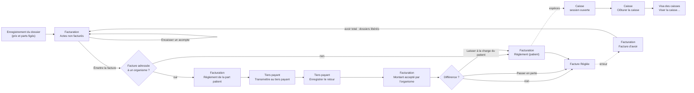
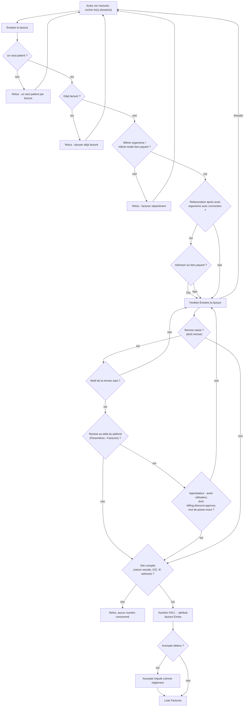
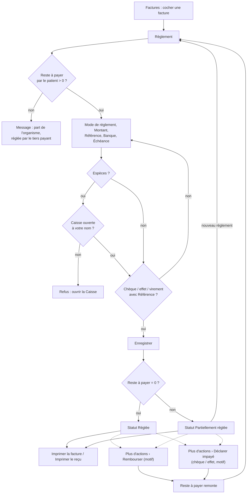
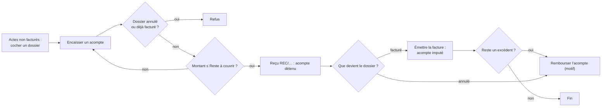
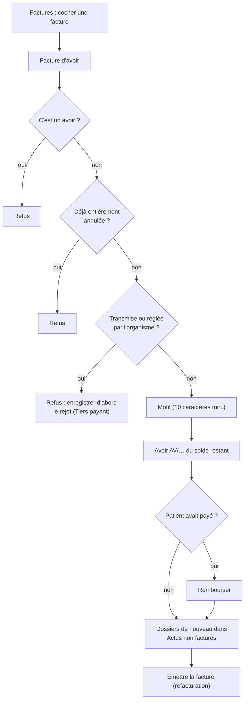
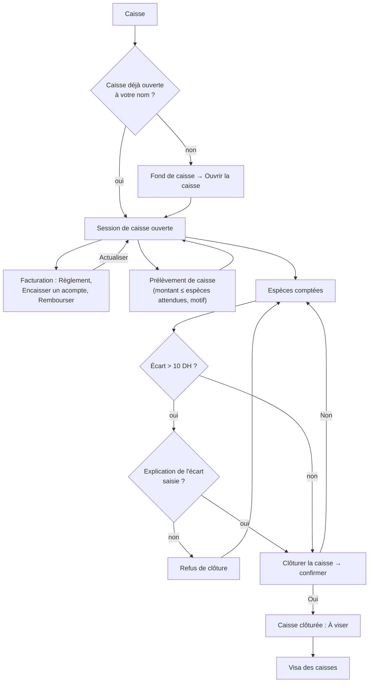
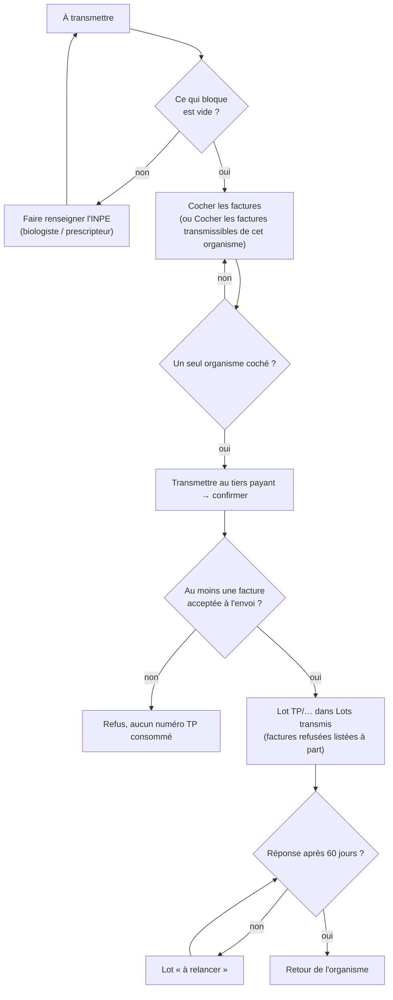
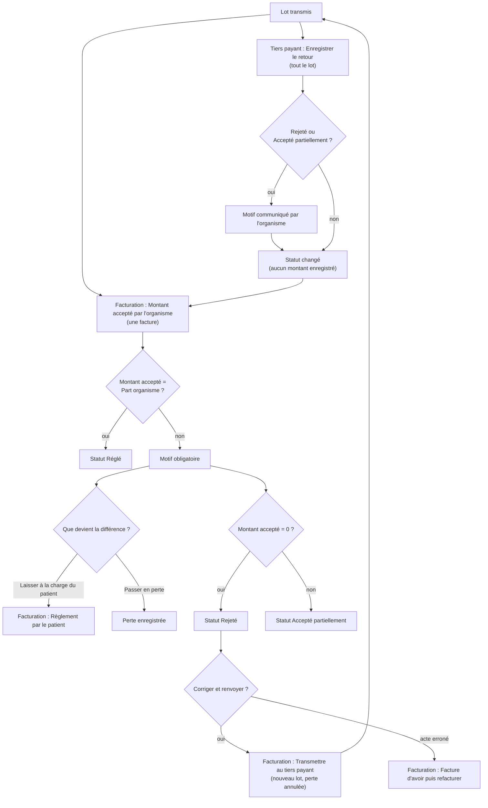
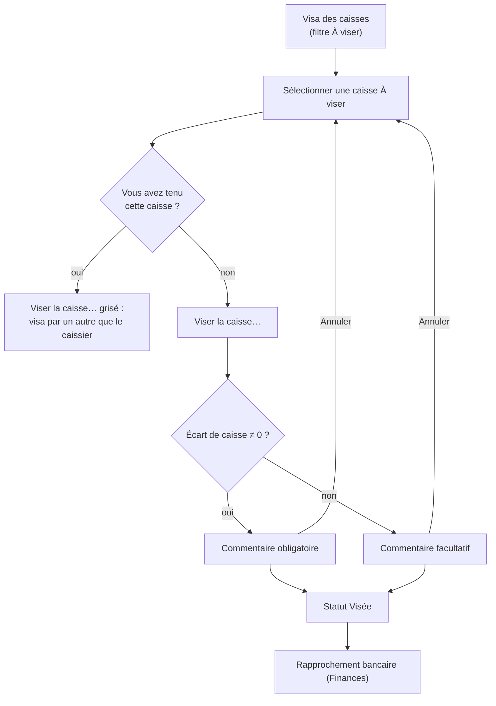

## Facturation, caisse et tiers payant

### Présentation du module

**But** : ce chapitre couvre l'argent du laboratoire : la facture et l'avoir, les acomptes, l'encaissement au comptoir, la caisse de chaque opérateur, les bordereaux envoyés aux organismes (CNSS, CNOPS, mutuelles…) et le visa des caisses par le responsable.

**Qui l'utilise** :

| Rôle (par défaut) | Ce qu'il fait ici |
|---|---|
| Secrétariat / accueil | Émet les factures, encaisse règlements et acomptes, tient et clôture **sa propre** caisse avec son comptage. Ne déclare pas d'impayé. |
| Comptabilité | Tout ce que fait l'accueil, plus remises, avoirs, remboursements, déclaration des chèques et effets impayés, tiers payant (bordereaux, retours, montants acceptés) et visa des caisses ; approuve la remise d'un collègue au-delà du plafond. |
| Administrateur | Tout, y compris le format d'impression des factures et le plafond des remises (**Paramètres › Factures**). |
| Biologiste responsable | Consulte **Facturation** et **Tiers payant**, vise les caisses, approuve une remise au-delà du plafond ; n'encaisse pas. |

**Écrans**, dans le menu :

| Menu | Groupe du menu | Raccourci par défaut |
|---|---|---|
| **Facturation** | Facturation | Ctrl+9 |
| **Caisse** | Facturation | Ctrl+0 |
| **Tiers payant** | Facturation | aucun (on peut en définir un) |
| **Visa des caisses** | Finances | aucun (on peut en définir un) |

et l'onglet **Factures** de **Administration › Paramètres** (format d'impression des factures).

**Liens avec les autres modules** : les prix et la répartition organisme / patient viennent de l'enregistrement du dossier (**Dossiers**) ; un dossier annulé dans **Consultation d'un dossier** se régularise ici par un avoir ; les règlements en espèces alimentent la **Caisse** ; les caisses visées et les virements des organismes servent au **Rapprochement bancaire** et à l'**Export comptable** (groupe **Finances**) ; les créances échues apparaissent sur le **Tableau de bord**.

Vue d'ensemble du parcours de l'argent :

Raccourcis valables sur tous ces écrans : **F5** actualise l'écran, **Ctrl+F** place le curseur dans la zone de recherche, **Ctrl+P** imprime la liste affichée, **F1** ouvre l'aide de l'écran, **Maj+F1** la liste des raccourcis. Les raccourcis se modifient dans la fenêtre **Raccourcis clavier**.

### Avant de commencer : trois règles qui expliquent tout le reste

**1. La numérotation des factures est continue, sans trou.**
La loi fiscale marocaine exige que les factures portent des numéros qui se suivent, sans saut et sans retour en arrière. Dans l'application :

- Un numéro a cette forme : `FAC/CODE-SITE/ANNÉE/000001`. Exemple : `FAC/CASA/2026/000318`.
- Chaque site a sa propre série, et chaque série repart à 000001 au 1er janvier.
- Le numéro n'est donné qu'au moment exact où vous cliquez sur **Émettre la facture**, et dans la même opération que l'enregistrement de la facture. Il n'existe pas de « brouillon » numéroté.
- Si l'émission échoue (site mal renseigné, dossier déjà facturé, coupure réseau…), rien n'est enregistré et le numéro n'est pas consommé : la facture suivante reprend ce même numéro. Il ne peut donc pas y avoir de trou.
- Deux postes qui émettent en même temps ne peuvent pas obtenir le même numéro : le second attend que le premier ait fini.
- Les autres documents ont leur propre série, elle aussi continue :
  - avoirs : `AV/CODE-SITE/ANNÉE/000001` ;
  - acomptes (reçus) : `REC/CODE-SITE/ANNÉE/000001` ;
  - bordereaux de tiers payant : `TP/CODE-SITE/ANNÉE/00001`.
- Quand un exercice est clôturé, sa série est fermée : plus aucun document ne peut y être numéroté (message « La numérotation « … » est clôturée : aucun document ne peut plus y être rattaché. »).
- Le code du site ne peut plus être changé dès qu'un document a été numéroté avec lui.

**2. Une facture émise ne se modifie pas et ne se supprime pas.**
Pour corriger une facture, on émet une **facture d'avoir** qui l'annule (voir plus bas). Il n'existe aucun bouton « modifier » ou « supprimer » une facture, et c'est voulu.

**3. Le site doit être complet pour facturer.**
Avant d'attribuer un numéro, l'application vérifie la raison sociale, l'ICE (15 chiffres), l'identifiant fiscal, l'adresse et la ville du site. S'il manque l'un d'eux, l'émission est refusée (« L'ICE doit comporter 15 chiffres. », « L'adresse et la ville du site sont obligatoires sur une facture. »…). Ces données se corrigent dans l'administration des sites, pas ici.

### Part patient, part organisme, lettre-clé B

- Le prix de chaque analyse est fixé **à l'enregistrement du dossier**, avec la répartition entre l'organisme et le patient. La facture reprend ces prix « gelés » : une révision de tarif ultérieure ne change pas ce que le patient a payé ou doit.
- Pour un organisme qui rembourse sur le tarif national de référence, la base de remboursement d'un acte est : **coefficient B de l'acte × valeur de la lettre B** (à la date de l'acte). L'organisme paie son taux (par exemple 70 %) de cette base, jamais plus que le prix de l'acte. Si le laboratoire facture au-dessus du tarif de référence, l'excédent est entièrement à la charge du patient.
- Pour un organisme qui rembourse sur le prix du laboratoire, sa part est son taux appliqué au prix facturé (remise déduite).
- **Part organisme** + **Part patient** = **Total à payer**.
- Si le dossier a été enregistré **sans tiers payant** (case **Paiement direct** cochée, ou convention expirée), la facture est adressée au patient pour la totalité : c'est le patient qui se fait rembourser avec sa feuille de soins.
- Si le dossier a été enregistré **avec tiers payant** et que l'organisme a une convention en cours, la facture est adressée à l'organisme ; le patient ne paie au comptoir que sa part, et la part de l'organisme est réclamée par bordereau (écran **Tiers payant**).
- Les actes de biologie sont exonérés de TVA ; la TVA reste à 0.
- La facture peut s'imprimer sous deux formats (voir **Format d'impression des factures** dans **Facturation**) : le **format existant** (montant, part organisme, part patient par ligne) et le **format cotation B** (code de l'acte, cotation en B, montant en DH). Les deux portent l'ICE du laboratoire et du destinataire et, selon le réglage, le montant total en toutes lettres. Le format ne change jamais un montant.

---

### Facturation

**À quoi sert cet écran** : c'est l'écran de travail du comptoir et de la comptabilité. En haut, ce qui a été fait et pas encore facturé (avec les acomptes) ; en bas, les factures et avoirs émis, ce qui reste à payer, les règlements, les avoirs, le tiers payant et l'impression.

**Qui y a accès**

| Action | Droit nécessaire | Rôles par défaut qui l'ont |
|---|---|---|
| Voir l'écran, imprimer factures et reçus | Consulter la facturation | Administrateur, Biologiste responsable, Secrétariat / accueil, Comptabilité |
| **Émettre la facture** | Émettre une facture | Administrateur, Secrétariat / accueil, Comptabilité |
| Accorder une **Remise** à l'émission | Appliquer une remise | Administrateur, Comptabilité |
| Approuver une remise **au-delà du plafond** (identifiant et mot de passe saisis dans la fenêtre d'un autre utilisateur) | `billing.discount.approve` (approuver une remise au-delà du plafond) | Administrateur, Biologiste responsable, Comptabilité |
| **Règlement**, **Encaisser un acompte** | Encaisser un règlement | Administrateur, Secrétariat / accueil, Comptabilité |
| **Déclarer impayé** | Déclarer un impayé (billing.payment.bounce) | Administrateur, Comptabilité |
| **Facture d'avoir**, **Rembourser**, **Rembourser l'acompte** | Émettre un avoir | Administrateur, Comptabilité |
| **Transmettre au tiers payant**, **Enregistrer le retour**, **Montant accepté par l'organisme** | Export comptable / tiers payant | Administrateur, Comptabilité |

Les boutons pour lesquels vous n'avez pas le droit restent visibles mais grisés. Pour le Secrétariat / accueil, **Plus d'actions › Déclarer impayé** est grisé ; au survol, une bulle l'explique : « Réservé à la comptabilité : déclarer un chèque ou un effet impayé demande le droit billing.payment.bounce (Comptabilité, Administrateur). » Le Biologiste responsable voit l'écran en lecture seule. Biologiste, Technicien de laboratoire, Préleveur, Responsable qualité et Prescripteur n'ont pas accès.

**L'écran**

- **En-tête** : « Facturation », « N à facturer · M factures » et le bouton **Actualiser**.
- **En haut : carte « Actes non facturés »** (« N · total ») — un dossier par ligne, avec une case à cocher. Colonnes : **N° de dossier**, **Patient**, **Enregistré le**, **Organisme payeur** (ou « Paiement direct »), **Analyses** (nombre), **Total**, **Part organisme**, **Part patient**, **Acompte** (acomptes encore détenus). Seuls les 500 dossiers les plus récents sont affichés ; le titre ajoute « — seuls les 500 dossiers les plus récents sont affichés » quand la limite est atteinte. Boutons : **Encaisser un acompte**, **Rembourser l'acompte**, **Émettre la facture**.
  - Un dossier **annulé** apparaît barré et grisé : il n'est là que parce qu'il détient encore un acompte à rembourser.
  - Un dossier **déjà facturé** qui garde un reste d'acompte apparaît grisé avec la mention « Facturé (FAC/…) — acompte à rembourser ».
  - Les dossiers d'une fiche patient fusionnée apparaissent au nom du patient conservé et se facturent à son nom.
- **En bas : « Factures »** — factures et avoirs émis, les plus récents d'abord. Au-dessus : la zone de recherche « N° de facture, nom, n° de dossier (Ctrl+F) » (puis Entrée) et les filtres **Toutes · N**, **Émise · N**, **Partiellement réglée · N**, **Réglée · N**, **Créance abandonnée · N** (le nombre tient compte de la recherche).
  - Colonnes : case à cocher, **N°**, **Type** (Facture ou Facture d'avoir), **Date**, **Facturé à**, **Total**, **Réglé**, **Reste à payer**, **En retard** (« N j »), **Statut** (pastille).
  - Couleurs : orange = en retard ; rouge = plus de 60 jours de retard ; gris = réglée ; italique = avoir.
  - Une facture dont une partie a été passée en perte affiche une bulle d'aide sur la colonne **Réglé** (« Hors montant payé : … passés en perte »).
  - Sous la liste : « X / Y » factures affichées et la somme du **Reste à payer** ; la barre d'actions **Plus d'actions**, **Facture d'avoir**, **Imprimer la facture**, **Imprimer le reçu** et, à droite, le bouton principal **Règlement**.

Statuts d'une facture :

| Statut | Signification |
|---|---|
| Émise | Numérotée, rien n'a encore été payé. |
| Partiellement réglée | Une partie a été payée. |
| Réglée | Plus rien à payer (paiements et/ou avoirs). Un avoir est toujours « Réglée ». |
| Créance abandonnée | Prévu dans les filtres ; aucune action de l'écran ne met une facture dans ce statut. |

L'échéance d'une facture patient est le jour même ; celle d'une facture organisme est la date d'émission plus le délai de paiement de l'organisme. Le compteur **En retard** part de cette échéance.

**Fonctionnalités**

- **Actualiser** (F5) : recharge les deux listes. Le dossier sélectionné dans **Actes non facturés** reste sélectionné après le rechargement (comme après un acompte ou une facture), au lieu de revenir à la première ligne.
- **Encaisser un acompte** : encaisse une avance sur **un** dossier coché, avant la facture (droit « encaisser un règlement »).
- **Rembourser l'acompte** : rembourse tous les acomptes encore détenus sur **un** dossier coché, avec motif (droit « émettre un avoir »).
- **Émettre la facture** : ouvre la fenêtre d'émission pour les dossiers cochés (même patient, même organisme) ; attribue le numéro (droit « émettre une facture »).
- Zone de recherche des factures + Entrée : par n° de facture, nom du destinataire ou n° de dossier.
- Filtres **Toutes**, **Émise**, **Partiellement réglée**, **Réglée**, **Créance abandonnée** : limitent la liste au statut choisi.
- **Règlement** : encaisse un règlement (total ou partiel) sur **une** facture cochée (droit « encaisser un règlement »).
- **Facture d'avoir** : annule par avoir tout ce qui reste à créditer sur **une** facture, avec motif (droit « émettre un avoir »).
- **Imprimer la facture** : PDF de la facture cochée (ou de la ligne sélectionnée si rien n'est coché), dans le format par défaut réglé dans **Paramètres › Factures** ; un avoir s'imprime toujours au format existant.
- **Imprimer le reçu** : PDF du reçu de règlement de la facture.
- **Plus d'actions › Rembourser** : rembourse un règlement du patient sur la facture cochée, avec motif (droit « émettre un avoir »).
- **Plus d'actions › Déclarer impayé** : déclare un chèque ou un effet rejeté par la banque, avec motif (droit « déclarer un impayé » : Comptabilité, Administrateur).
- **Plus d'actions › Transmettre au tiers payant** : met les factures cochées dans un bordereau, après confirmation (droit tiers payant).
- **Plus d'actions › Enregistrer le retour** : enregistre la réponse de l'organisme sur les factures cochées déjà transmises (droit tiers payant).
- **Plus d'actions › Montant accepté par l'organisme** : saisit ce que l'organisme paie sur **une** facture transmise (droit tiers payant).
- **Plus d'actions › Imprimer la facture — format existant** : imprime cette fois au format existant, quel que soit le réglage.
- **Plus d'actions › Imprimer la facture — format cotation B** : imprime cette fois au format cotation B (grisé pour un avoir).
- Fenêtre **Émettre la facture** : patient, organisme, liste des dossiers, **Montant brut**, **Remise (DH ou %)** et **Motif de la remise** (avec le droit remise), **Montant net** à côté de la remise, boutons **Émettre la facture** / **Annuler**. Au-delà du plafond, la fenêtre s'agrandit d'une partie d'approbation : **Identifiant de l'approbateur** et **Mot de passe** (masqué).
- Fenêtre **Règlement** : **Reste à payer** (ou **Reste à payer par le patient**), **Mode de règlement**, **Montant**, et selon le mode **Référence**, **Banque**, **Échéance** ; **Enregistrer** / **Annuler**.
- Fenêtre de choix d'un règlement (pour **Rembourser** et **Déclarer impayé**) : **Date**, **Mode de règlement**, **Montant**, **Référence**, **Banque**, **Créé par** (toutes les colonnes visibles sans défilement).
- Fenêtre **Enregistrer le retour** : **Retour de l'organisme** (Accepté, Accepté partiellement, Rejeté, Retransmis) et **Motif communiqué par l'organisme**.
- Fenêtre **Montant accepté par l'organisme** : **Part organisme** (ou **Reste dû par l'organisme** après un avoir partiel), **Montant accepté**, **Référence du virement ou bordereau**, choix **Laisser à la charge du patient (reste sur la facture)** / **Passer en perte**, **Motif communiqué par l'organisme**.

**Scénarios**

*1. Facturer un dossier (patient sans tiers payant ou avec tiers payant)*
1. Dans **Actes non facturés**, cochez le dossier.
2. Cliquez sur **Émettre la facture**.
3. La fenêtre affiche le patient, l'organisme (ou « Sans prise en charge — à la charge du patient »), la liste des dossiers et le **Montant brut**.
4. Vérifiez puis cliquez sur **Émettre la facture** dans la fenêtre. Le numéro est attribué à ce moment.
5. Le dossier disparaît du haut ; la facture apparaît en bas. Si un acompte était détenu sur le dossier, il est automatiquement imputé sur la facture comme règlement (jusqu'à la part que doit le patient).

*2. Regrouper plusieurs dossiers sur une seule facture*
1. Cochez plusieurs dossiers **du même patient** et **du même organisme** (ou tous sans tiers payant).
2. **Émettre la facture**, puis confirmez dans la fenêtre.
- Refusé si les dossiers sont de patients différents ou d'organismes / modes de prise en charge différents (voir les messages en fin de chapitre).

*3. Accorder une remise (Comptabilité, Administrateur)*
1. Cochez le ou les dossiers, cliquez sur **Émettre la facture**.
2. Dans la fenêtre, tapez dans **Remise (DH ou %)** soit un montant en dirhams (« 50 », « 74,70 »), soit un pourcentage du montant brut (« 10 % », « 10% » ; en arabe « 10٪ »). Pour un pourcentage, la ligne à côté affiche ce qu'il représente en dirhams et le net : « Remise 74,70 DH · Net 672,30 DH ». La facture enregistre le montant en dirhams, arrondi au centime.
3. Saisissez le **Motif de la remise** (obligatoire).
4. Cliquez sur **Émettre la facture**.
- La remise est répartie sur les lignes au prorata et reste écrite sur la facture avec son motif. Elle ne peut pas dépasser le montant brut. Les champs de remise n'apparaissent pas pour le Secrétariat / accueil.

*3 bis. Remise au-delà du plafond : approbation sur place*

Le plafond est réglé dans **Paramètres › Factures › Plafond des remises** : un pourcentage maximal du montant brut (10 % par défaut) et, si on le souhaite, un montant maximal en DH. Le plafond appliqué est **le plus bas des deux** (par exemple 10 % d'une facture de 747,00 DH = 74,70 DH ; avec un maximum de 50 DH, le plafond est 50,00 DH).
1. Saisissez la remise comme ci-dessus. Si elle dépasse le plafond, la ligne du net passe en orange : « Au-delà du plafond (10 % = 74,70 DH) : approbation requise » (ou « Au-delà du plafond (50,00 DH) : approbation requise » quand c'est le montant maximal qui s'applique).
2. La fenêtre s'agrandit : « Remise au-delà du plafond : un autre utilisateur ayant le droit de l'approuver saisit ici son identifiant et son mot de passe. » Faites venir un responsable (par défaut : Administrateur, Biologiste responsable, Comptabilité).
3. Il tape son **Identifiant de l'approbateur** et son **Mot de passe** (masqué), puis vous cliquez sur **Émettre la facture**.
4. Si l'approbation est refusée (mot de passe faux, droit manquant, votre propre identifiant), le message s'affiche puis la fenêtre revient avec la remise et le motif conservés ; seul le mot de passe est à retaper.
- L'approbateur n'est pas connecté : la session reste la vôtre. Un mot de passe faux compte comme un échec de connexion de l'approbateur (verrouillage après le même nombre d'échecs qu'à l'écran de connexion).
- Le journal d'audit de la facture indique la remise, le plafond en vigueur, qui l'a approuvée et quand (« … remise de 150,00 DH au-delà du plafond de 74,70 DH (10 % du brut) approuvée par … le … »). Le motif imprimé sur la facture reste celui que vous avez saisi.
- Le contrôle est fait aussi par l'application au moment d'émettre : une remise au-delà du plafond sans approbation valable est refusée, quel que soit le poste.

*4. Encaisser un règlement complet au comptoir*
1. En bas, cochez **une seule** facture.
2. Cliquez sur **Règlement**.
3. La fenêtre affiche le **Reste à payer** (ou le **Reste à payer par le patient** si une part organisme est réclamée au tiers payant). Le **Montant** est pré-rempli avec ce reste.
4. Choisissez le **Mode de règlement** : Espèces, Carte bancaire, Chèque, Virement, Effet / traite, Paiement mobile.
5. Remplissez les champs qui apparaissent :
   - Chèque, Effet / traite : **Référence** (obligatoire), **Banque**, **Échéance** ;
   - Virement : **Référence** (obligatoire), **Banque** ;
   - Carte bancaire : **Référence** (facultative, numéro d'autorisation) ;
   - Espèces, Paiement mobile : aucun champ de plus.
6. Cliquez sur **Enregistrer**. Le statut passe à « Réglée ». Le reçu imprimé ensuite est bien celui de cette facture.
- Le montant accepte les espaces et la virgule (« 1 250,00 »).
- En espèces, une caisse doit être ouverte à votre nom (écran **Caisse**).
- Au-delà de 20 000 DH en espèces, un avertissement rouge s'affiche (risque de sanction fiscale). Ce n'est qu'un avertissement : l'enregistrement reste possible.
- Une facture déjà soldée affiche « FAC/… — Réglée » au lieu d'ouvrir la fenêtre.

*5. Encaisser un règlement partiel*
1. Même procédure que ci-dessus, mais remplacez le **Montant** pré-rempli par le montant réellement reçu.
2. **Enregistrer**. La facture passe à « Partiellement réglée » et le **Reste à payer** diminue.
3. Recommencez autant de fois que nécessaire, avec le même mode ou un autre (par exemple une partie en espèces, le reste par chèque).

*6. Patient dont la part organisme est en tiers payant*
- Le bouton **Règlement** ne propose que la part du patient. Si le patient a déjà tout payé de sa part, un message indique que le reste est la part de l'organisme, réglée par le tiers payant.
- La part de l'organisme se règle uniquement par **Plus d'actions › Montant accepté par l'organisme** (scénario 13), après transmission du bordereau.

*7. Imprimer une facture ou un reçu*
1. Sélectionnez une facture : cochez-la, ou cliquez simplement sur sa ligne sans rien cocher.
2. Cliquez sur **Imprimer la facture** (format par défaut) ou **Imprimer le reçu**. Pour un autre format cette fois-ci : **Plus d'actions › Imprimer la facture — format existant** ou **Imprimer la facture — format cotation B**. Le PDF s'ouvre ; imprimez-le depuis la visionneuse.
- Si plusieurs lignes sont cochées, rien n'est imprimé (les boutons sont grisés).
- Une réimpression donne les mêmes montants (destinataire, ICE, prix figés à l'émission) ; seule la présentation dépend du format et des options choisis.

*8. Encaisser un acompte avant la facture*
Cas typique : le patient paie au prélèvement, la facture sera faite quand le dossier sera complet.
1. En haut, cochez **un seul** dossier.
2. Cliquez sur **Encaisser un acompte**.
3. La fenêtre affiche le **Reste à couvrir**. Choisissez le **Mode de règlement**, saisissez le **Montant** et, selon le mode, la **Référence**, la **Banque**, l'**Échéance**.
4. **Enregistrer**. Un numéro de reçu `REC/…` est attribué et affiché dans la barre d'état ; la colonne **Acompte** se met à jour.
- L'acompte ne peut pas dépasser ce que le patient devra (sa seule part s'il est en tiers payant) moins les acomptes déjà reçus.
- Refusé sur un dossier annulé ou déjà facturé. En espèces, une caisse ouverte est nécessaire.
- À l'émission de la facture, l'acompte devient automatiquement un règlement de la facture.
- Il n'y a pas de reçu d'acompte imprimable : notez le numéro `REC/…` pour le patient.

*9. Rembourser un acompte (dossier annulé, ou facture plus petite que l'acompte) — Comptabilité, Administrateur*
1. En haut, cochez **un seul** dossier (il peut être barré ou marqué « acompte à rembourser »).
2. Cliquez sur **Rembourser l'acompte**.
3. La fenêtre rappelle le montant et les numéros de reçus concernés. Saisissez le motif (5 caractères minimum) et validez par **OK**.
4. Tous les acomptes encore détenus sur ce dossier sont remboursés.
- Un acompte en espèces sort de **votre** caisse, qui doit être ouverte et contenir assez d'espèces. Un acompte par chèque, carte ou virement est retiré de la caisse qui l'avait encaissé, si elle est encore ouverte.

*10. Rembourser un règlement — Comptabilité, Administrateur*
1. En bas, cochez **une seule** facture.
2. Cliquez sur **Plus d'actions › Rembourser**.
3. Choisissez le règlement dans la liste (date, mode, montant, référence, banque, qui l'a encaissé) puis cliquez sur le bouton **Rembourser** de la fenêtre (ou double-clic). Seuls les règlements du patient sont proposés (pas ceux de l'organisme ni une perte).
4. Saisissez le motif (5 caractères minimum), **OK**.
5. Le règlement passe à « Remboursé » ; le reste à payer de la facture remonte.
- Un remboursement en espèces exige que **votre** caisse soit ouverte, et il ne peut pas dépasser les espèces attendues dans cette caisse ; il en est déduit.
- Rembourser n'annule pas la facture : si l'acte n'est plus dû, il faut aussi émettre un avoir.

*11. Déclarer un chèque ou un effet impayé — Comptabilité, Administrateur*
1. Cochez **une seule** facture, cliquez sur **Plus d'actions › Déclarer impayé**.
2. Seuls les chèques et effets encaissés sont proposés. Choisissez le règlement, cliquez sur **Déclarer impayé**.
3. Saisissez le motif de rejet communiqué par la banque, **OK**.
4. Le règlement passe à « Impayé » ; la facture redevient due et réapparaît dans le suivi des retards.
- Si la caisse qui avait encaissé le chèque est encore ouverte, le chèque est retiré de son total chèques.
- L'accueil qui reçoit le rejet de la banque transmet le chèque à la comptabilité : l'entrée est grisée pour lui, et l'opération est refusée (« Vous n'avez pas le droit d'effectuer cette opération. ») si elle est atteinte autrement.

*12. Corriger une facture : émettre un avoir — Comptabilité, Administrateur*
1. Cochez **une seule** facture (pas un avoir).
2. Cliquez sur **Facture d'avoir**.
3. Saisissez le motif (10 caractères minimum, 500 au plus) : il sera la justification comptable. **OK**.
4. Un avoir `AV/…` est émis pour **tout ce qui reste à créditer** sur la facture. Il reprend chaque ligne et la remise de la facture d'origine, et mentionne son numéro.
5. Si la facture est entièrement annulée, ses dossiers reviennent en haut dans **Actes non facturés**, prêts à être refacturés correctement.
6. Si le dossier avait un organisme mais avait été facturé au patient, l'application propose, au moment de refacturer, d'adresser la nouvelle facture à l'organisme. Répondez **Oui** pour l'organisme, **Non** pour le patient.
- Avoir refusé si la facture a été transmise à l'organisme ou réglée par lui (enregistrez d'abord le rejet de l'organisme), si elle est déjà entièrement annulée, ou s'il s'agit d'un avoir.
- L'avoir ne rend pas l'argent. Si le patient avait payé, faites ensuite **Rembourser** (scénario 10).
- L'avoir partiel (pour une partie seulement du montant) n'est pas proposé à l'écran : l'avoir porte toujours sur tout le reste.

*13. Saisir le paiement d'un organisme sur une facture (montant accepté) — Comptabilité, Administrateur*
1. Cochez **une seule** facture déjà transmise au tiers payant.
2. Cliquez sur **Plus d'actions › Montant accepté par l'organisme**.
3. La fenêtre affiche la **Part organisme** (ou le **Reste dû par l'organisme** si un avoir a déjà réduit la facture). Le **Montant accepté** est pré-rempli avec la totalité ; corrigez-le si l'organisme a payé moins.
4. Saisissez la **Référence du virement ou bordereau** (facultative).
5. S'il y a une différence, la fenêtre affiche « Non accepté : … Que devient la différence ? ». Choisissez :
   - **Laisser à la charge du patient (reste sur la facture)** : le patient pourra la régler au comptoir par **Règlement** ;
   - **Passer en perte** : la différence est soldée comme perte.
6. Saisissez le **Motif communiqué par l'organisme** (obligatoire s'il y a une différence). **Enregistrer**.
7. Le message « FAC/… : … acceptés sur … » s'affiche. Le statut du tiers payant devient « Réglé », « Accepté partiellement » ou « Rejeté » (si 0 accepté).
- Une seule saisie par facture.

*14. Transmettre et suivre le tiers payant depuis cet écran*
Les actions **Transmettre au tiers payant** et **Enregistrer le retour** existent aussi ici (**Plus d'actions**), sur les factures cochées ; la transmission demande confirmation (« Transmettre N facture(s) à …, pour un montant de … ? »). L'écran **Tiers payant** est plus adapté (il montre ce qui bloque et les lots) ; voir plus bas. Particularité de cet écran : c'est le seul endroit où l'on peut **retransmettre une facture rejetée** (cochez-la, **Plus d'actions › Transmettre au tiers payant**). Si le patient avait déjà payé la part refusée, il faut d'abord le rembourser.

#### Format d'impression des factures

Le laboratoire choisit le format des factures patients dans **Administration › Paramètres**, onglet **Factures** (droit « gérer les paramètres », Administrateur par défaut). Le texte d'en-tête rappelle : « Format d'impression des factures patients. Les options s'appliquent aux nouvelles impressions et aux réimpressions ; elles ne changent jamais un montant. Les avoirs et les reçus gardent le format existant. »

**Fonctionnalités de l'onglet Factures**

- **Format par défaut des factures patients** : « Format existant (montant, part organisme, part patient) » ou « Format cotation B (code de l'acte, cotation en B, montant en DH) ». C'est le format du bouton **Imprimer la facture**.
- **Options du format existant** :
  - « Afficher la colonne code national de l'acte » (décoché par défaut) ;
  - « Afficher la colonne cotation (coefficient) » (décoché) ; la case reste vide pour un acte facturé seulement en DH (coefficient 0) : pas de « B 0 » ;
  - « Afficher le montant en lettres » (coché).
- **Options du format cotation B** :
  - « Afficher le prix en DH de chaque acte » (décoché) ;
  - « Afficher la ligne « Prise de sang (PC) » même à 0,00 DH » (coché) ;
  - « Afficher le montant en lettres » (coché) ;
  - « Afficher la valeur de la lettre B utilisée » (décoché).
- **Enregistrer** : enregistre le réglage (« Format d'impression des factures enregistré. ») ; **Actualiser** : relit le réglage enregistré.

**Le format cotation B** reprend l'en-tête du laboratoire et les parties (laboratoire, destinataire, patient) du format existant, puis un tableau **Code** / **Acte** / **Cotation** (en B), le **Total B**, la ligne « Prise de sang (PC) », la remise, la TVA et les parts organisme / patient s'il y en a, le **Montant en DH** (le total de la facture), le montant en lettres et la mention de TVA. Les cotations viennent des lignes figées à l'émission : un changement ultérieur du catalogue ne modifie pas une facture réimprimée. Un acte facturé seulement en dirhams (analyse hors nomenclature, coefficient 0) n'a pas de cotation : sa case **Cotation** reste vide (et non « 0 »), il ne compte pas dans le **Total B**, et la colonne du prix en DH s'affiche pour que son montant figure sur sa ligne.

*Choisir le format d'impression du laboratoire*
1. Ouvrez **Administration › Paramètres**, onglet **Factures**.
2. Choisissez le **Format par défaut des factures patients**.
3. Cochez ou décochez les options du format choisi.
4. Cliquez **Enregistrer**. Les impressions suivantes (y compris les réimpressions) suivent ce réglage.

**Règles et contrôles**

- Une facture émise est figée ; seule la **Facture d'avoir** la corrige. Un avoir ne peut pas lui-même faire l'objet d'un avoir. Le total des avoirs ne dépasse jamais le total facturé.
- Pas de facture sans ligne ; les analyses annulées et les analyses gratuites ne sont pas facturées.
- Une facture ne peut être adressée à un organisme que s'il a une convention de tiers payant en cours de validité.
- Un règlement ne peut pas dépasser le reste à payer, ni (au comptoir) la part du patient.
- Chèque et effet : référence obligatoire. Virement : référence obligatoire. Le paiement mobile n'a pas de référence.
- Espèces : caisse ouverte obligatoire (règlement, acompte, remboursement) ; un remboursement en espèces ne peut pas dépasser les espèces attendues en caisse.
- Seul un règlement du patient peut être remboursé.
- Tout remboursement, impayé, avoir, remise ou retour d'organisme exige un motif ; il est conservé dans le journal d'audit.
- Les boutons sont protégés contre le double-clic : un clic = un enregistrement.
- La liste du bas n'affiche que les 50 factures les plus récentes correspondant à la recherche et au filtre ; utilisez-les pour retrouver une facture plus ancienne.

**Flux**

Enregistrement du dossier (prix et répartition figés) → **Facturation** (acompte éventuel, émission, règlement patient) → **Caisse** (clôture en fin de poste) → **Visa des caisses**. Pour la part organisme : **Facturation** → **Tiers payant** (bordereau, retour) → **Facturation** (**Montant accepté par l'organisme**).

Émission d'une facture :

Règlement au comptoir (total, partiel, remboursement, impayé) :

Acompte avant facture :

Correction par avoir :

---

### Caisse

**À quoi sert cet écran** : la caisse de **chaque opérateur** : ouverture avec un fond de caisse, suivi des encaissements du poste par mode de paiement, prélèvements déposés en banque, et clôture avec comptage du tiroir.

**Qui y a accès**

- Ouvrir l'écran et **Ouvrir la caisse** : droit « Encaisser un règlement » — Administrateur, Secrétariat / accueil, Comptabilité.
- **Clôturer la caisse** et **Prélèvement de caisse** : droit « Clôturer la caisse » — Administrateur, Secrétariat / accueil, Comptabilité. Chacun ne clôture que **sa propre** caisse, avec son comptage : l'écran ne montre que la caisse ouverte à votre nom, et la caisse d'un autre opérateur ne peut pas être clôturée à sa place (« Seul le caissier qui a ouvert cette caisse peut la clôturer avec son comptage. »). Le visa reste à la comptabilité (**Visa des caisses**).
- Le Biologiste responsable n'a pas cet écran.

**L'écran**

- En-tête « Caisse » et, caisse ouverte, « Votre nom · Session de caisse jj/mm/aaaa hh:mm · N règlements ».
- **Sans caisse ouverte** : la carte **Ouvrir la caisse** avec le champ **Fond de caisse** (pré-rempli 0.00) et le bouton **Ouvrir la caisse**.
- **Caisse ouverte** :
  - carte **Détail de la session** : **Fond de caisse**, puis **Espèces**, **Chèque**, **Carte bancaire**, **Virement**, **Effet / traite**, **Paiement mobile** encaissés pendant le poste, puis **Remboursements** et **Prélèvements** s'il y en a, puis **Espèces attendues** ;
  - carte **Clôturer la caisse** : **Espèces attendues** et **Écart de caisse** en grand (vert si nul, orange s'il est faible, rouge au-delà de 10 DH), le champ **Espèces comptées**, le champ **Explication de l'écart** (seulement si l'écart dépasse 10 DH) et le rappel « Un écart supérieur à 10 DH doit être expliqué avant la clôture. » ;
  - les boutons **Clôturer la caisse**, **Actualiser**, **Prélèvement de caisse**.

Calcul : **Espèces attendues** = Fond de caisse + espèces encaissées − remboursements en espèces − prélèvements. Les chèques, cartes, virements, effets et paiements mobiles sont affichés pour le rapport du poste mais ne sont pas comptés dans le tiroir.

La caisse est personnelle : les règlements que vous saisissez dans **Facturation** vont dans **votre** caisse ouverte.

**Fonctionnalités**

- **Fond de caisse** + **Ouvrir la caisse** : ouvre votre session de caisse (une seule à la fois par opérateur).
- **Actualiser** (F5) : relit les totaux de la session.
- **Prélèvement de caisse** : enregistre un retrait d'espèces du tiroir (dépôt en banque…) : montant puis motif. Il ne peut pas dépasser les espèces attendues.
- **Espèces comptées** : votre comptage du tiroir ; l'**Écart de caisse** se calcule en direct.
- **Explication de l'écart** : obligatoire au-delà de 10 DH d'écart (1 000 caractères au plus).
- **Clôturer la caisse** : clôt la session après confirmation ; elle part au **Visa des caisses**.

**Scénarios**

*1. Ouvrir la caisse en début de poste*
1. Ouvrez **Caisse** (Ctrl+0).
2. Saisissez le **Fond de caisse** (montant présent dans le tiroir).
3. Cliquez sur **Ouvrir la caisse**.
- Une seule caisse ouverte à la fois par opérateur.

*2. Encaisser pendant le poste*
Les encaissements ne se font pas sur cet écran mais dans **Facturation** (**Règlement**, **Encaisser un acompte**). Revenez sur **Caisse** et cliquez sur **Actualiser** (ou F5) pour voir les totaux à jour.

*3. Déposer des espèces en banque en cours de poste (prélèvement)*
1. Cliquez sur **Prélèvement de caisse**.
2. Saisissez le montant retiré du tiroir (« Montant prélevé de la caisse et déposé en banque (DH) : »), **OK**.
3. Saisissez le motif (« dépôt en banque », numéro de bordereau…), **OK**.
4. Le montant apparaît dans **Prélèvements** et diminue les **Espèces attendues**.
- Sans cette saisie, la clôture afficherait un manquant égal à l'argent déjà à la banque.
- Un prélèvement plus grand que les espèces attendues est refusé.

*4. Rembourser en espèces*
Le remboursement se fait dans **Facturation** (**Plus d'actions › Rembourser** ou **Rembourser l'acompte**). Il est déduit des espèces attendues de la caisse ouverte de la personne qui rembourse, et refusé s'il dépasse ces espèces.

*5. Clôturer la caisse en fin de poste*
1. Comptez le tiroir.
2. Saisissez le résultat dans **Espèces comptées** (pré-rempli avec les espèces attendues : remplacez-le par votre comptage réel).
3. Regardez l'**Écart de caisse**. S'il dépasse 10 DH (en plus ou en moins), le champ **Explication de l'écart** apparaît : remplissez-le.
4. Cliquez sur **Clôturer la caisse**, puis confirmez (« Clôturer la caisse avec … comptés, soit un écart de … ? »).
5. Un message rappelle l'écart enregistré. L'écran revient à l'état « sans caisse ouverte ».
- Sans explication d'un écart de plus de 10 DH, la clôture est refusée ; le comptage n'est alors pas enregistré, la caisse reste ouverte.
- La caisse clôturée part ensuite au **Visa des caisses**, où la comptabilité (ou un autre responsable) la vise ; le caissier ne vise jamais sa propre caisse.

**Règles et contrôles**

- Tolérance d'écart sans explication : 10 DH.
- Une caisse est clôturée par l'opérateur qui l'a ouverte, et par lui seul.
- Un écart positif (excédent) et un écart négatif (manquant) sont affichés avec leur signe.
- Tout règlement en espèces, tout acompte en espèces et tout remboursement en espèces exige une caisse ouverte au nom de l'opérateur.
- Un chèque déclaré impayé ou un règlement par carte remboursé pendant que la caisse d'origine est ouverte est retiré du total de cette caisse ; après la clôture, la caisse n'est plus modifiée.
- Il n'y a pas d'impression du rapport de caisse depuis cet écran, ni de liste des règlements du poste (seulement les totaux par mode).

**Flux**

**Ouvrir la caisse** → encaissements dans **Facturation** → **Prélèvement de caisse** si nécessaire → **Clôturer la caisse** → **Visa des caisses** par le responsable.

---

### Tiers payant

**À quoi sert cet écran** : le suivi de la part des organismes (CNSS, CNOPS, mutuelles…) : ce qui reste à envoyer et ce qui le bloque, les bordereaux envoyés et ce que l'organisme a répondu.

**Qui y a accès**

- Voir l'écran : droit « Consulter la facturation » — Administrateur, Biologiste responsable, Secrétariat / accueil, Comptabilité.
- **Cocher les factures transmissibles de cet organisme**, **Transmettre au tiers payant** et **Enregistrer le retour** : droit « Export comptable / tiers payant » — Administrateur et Comptabilité uniquement. Pour les autres, ces boutons restent grisés.

**L'écran**

- En haut à droite : choix de la période (« 30 derniers jours », « 90 derniers jours », « 180 derniers jours » par défaut, « 365 derniers jours ») et **Actualiser**.
- **À transmettre** (en haut) : titre « À transmettre — N facture(s), montant » (« · N bloquée(s) » s'il y en a). Les factures adressées à un organisme, pas encore envoyées. Colonnes : case à cocher, **N°**, **Date de facturation**, **Jours** (depuis l'émission), **Organisme payeur**, **Patient**, **Montant net**, **Part organisme**, **Ce qui bloque**.
  - Ligne rouge = facture bloquée ; la colonne **Ce qui bloque** dit pourquoi : « INPE du biologiste manquant » et/ou « INPE du prescripteur manquant ».
  - Texte orange = facture de plus de 60 jours, à envoyer vite.
  - Boutons : **Cocher les factures transmissibles de cet organisme**, **Transmettre au tiers payant**.
- **Lots transmis** (en bas à gauche) : titre « N lot(s) — reste à recouvrer … » (« · N sans réponse à relancer » s'il y en a). Un bordereau par ligne. Colonnes : **Référence du dossier** (TP/…), **Organisme payeur**, **Transmis le**, **Jours**, **Factures**, **Montant réclamé**, **Réglé**, **Retour de l'organisme** (« sans réponse », « à relancer », « accepté », « N refus »). Bouton : **Enregistrer le retour**.
  - Ligne rouge = sans réponse depuis plus de 60 jours : à relancer.
- **Contenu du lot** (en bas à droite) : les factures du bordereau sélectionné. Colonnes : **N°**, **Patient**, **Part organisme**, **Réglé**, **Statut**, **Motif communiqué par l'organisme**. Une ligne rouge = facture rejetée et pas encore retransmise.

Statuts du tiers payant d'une facture :

| Statut | Signification |
|---|---|
| Sans objet | Facture au patient, pas de tiers payant. |
| À transmettre | Prête à partir dans un bordereau. |
| Transmis | Dans un bordereau envoyé, sans réponse. |
| Accepté | L'organisme a accepté (le paiement n'est pas forcément saisi). |
| Accepté partiellement | L'organisme a accepté moins que demandé. |
| Rejeté | L'organisme a refusé ; à corriger et retransmettre ou passer en perte. |
| Retransmis | Marqué comme renvoyé après un rejet. |
| Réglé | Paiement de l'organisme enregistré (par **Montant accepté par l'organisme**). |

**Fonctionnalités**

- Période + **Actualiser** : choisit sur combien de jours les factures et lots sont listés. La facture sélectionnée dans **À transmettre** reste sélectionnée après le rechargement.
- Cases à cocher de **À transmettre** : choisir les factures du bordereau ; la barre du bas affiche « N facture(s) sélectionnée(s) — montant », ou en rouge un mélange d'organismes.
- **Cocher les factures transmissibles de cet organisme** : coche toutes les factures non bloquées de l'organisme de la ligne sélectionnée (ou du premier organisme qui en a), et décoche les autres.
- **Transmettre au tiers payant** : crée le bordereau `TP/…` après confirmation.
- Clic sur un lot de **Lots transmis** : affiche son **Contenu du lot**.
- **Enregistrer le retour** : enregistre la réponse globale de l'organisme sur le lot sélectionné (**Accepté**, **Accepté partiellement**, **Rejeté**, **Retransmis**) avec le motif.

**Scénarios**

*1. Préparer et envoyer un bordereau à un organisme*
1. Dans **À transmettre**, cliquez une facture de l'organisme voulu, puis **Cocher les factures transmissibles de cet organisme** (ou cochez les factures à la main, d'**un seul** organisme).
2. La barre du bas affiche « N facture(s) sélectionnée(s) — montant ». Si vous avez coché plusieurs organismes, elle l'indique en rouge et le bouton reste grisé.
3. Cliquez sur **Transmettre au tiers payant**, puis confirmez (« Transmettre N facture(s) à …, pour un montant de … ? »).
4. Un numéro de bordereau `TP/…` est attribué ; le message « Lot … transmis — N facture(s), montant » s'affiche et le lot apparaît dans **Lots transmis**.
5. Envoyez à l'organisme le bordereau et les pièces selon votre procédure habituelle (l'application ne produit ni fichier ni impression du bordereau).
- Si certaines factures sont refusées au moment de l'envoi, le bordereau part quand même avec les autres ; un message donne le numéro du bordereau puis la liste des factures non transmises et la raison.

*2. Débloquer une facture (INPE manquant)*
- « INPE du biologiste manquant » : l'INPE est pris sur le biologiste responsable du site au moment de l'émission. Faites renseigner l'INPE du biologiste responsable (administration des utilisateurs / du site). Une facture déjà émise garde ce qui y a été figé : il faut alors émettre un avoir et refacturer.
- « INPE du prescripteur manquant » : le prescripteur du dossier n'a pas d'INPE. Même remarque.

*3. Enregistrer la réponse globale de l'organisme sur un bordereau*
1. Dans **Lots transmis**, cliquez sur le bordereau.
2. Vérifiez son contenu à droite.
3. Cliquez sur **Enregistrer le retour**.
4. Choisissez le **Retour de l'organisme** : Accepté, Accepté partiellement, Rejeté, Retransmis.
5. Pour « Rejeté » et « Accepté partiellement », saisissez le **Motif communiqué par l'organisme** (obligatoire).
6. **Enregistrer**. Le message « Retour enregistré sur le lot … — N facture(s) » s'affiche. La réponse s'applique à **toutes** les factures du bordereau, sauf celles dont le paiement organisme a déjà été saisi (un message les liste).
- Ce bouton change le statut mais **n'enregistre aucun argent** (c'est pourquoi « Réglé » n'est plus proposé). Pour que le reste à payer diminue, saisissez le paiement facture par facture dans **Facturation** → **Plus d'actions › Montant accepté par l'organisme** : le statut passe alors à « Réglé ».

*4. Enregistrer le paiement d'un organisme*
Se fait dans **Facturation**, facture par facture, avec **Montant accepté par l'organisme** (voir scénario 13 de **Facturation**). Mettez la référence du virement dans **Référence du virement ou bordereau** pour retrouver le rapprochement bancaire.

*5. Traiter un refus*
1. Dans **Contenu du lot**, repérez les lignes rouges et lisez le motif.
2. Deux décisions possibles :
   - **Corriger et retransmettre** : dans **Facturation**, cochez la facture rejetée et cliquez sur **Plus d'actions › Transmettre au tiers payant**. Elle part dans un **nouveau** bordereau ; la perte ou la part laissée au patient enregistrée lors du refus est annulée automatiquement (si le patient a déjà payé cette part, remboursez-le d'abord).
   - **Abandonner la part organisme** : dans **Facturation**, **Montant accepté par l'organisme** avec 0 (ou le montant payé) et **Passer en perte**, ou **Laisser à la charge du patient**.
3. Si l'acte lui-même était erroné : après avoir enregistré le rejet, émettez une **Facture d'avoir** dans **Facturation**, puis refacturez.
- N'utilisez pas « Retransmis » dans **Enregistrer le retour** pour une vraie retransmission : ce choix ne crée pas de bordereau et empêche ensuite de retransmettre la facture.

*6. Relancer un organisme*
Les bordereaux « à relancer » (rouges) n'ont reçu aucune réponse depuis plus de 60 jours. Contactez l'organisme ; l'application ne garde pas trace de la relance.

**Règles et contrôles**

- Un bordereau = un seul organisme.
- Une facture ne peut être que dans un seul bordereau à la fois.
- Seules les factures adressées à un organisme avec convention de tiers payant valide à l'émission, ayant une part organisme et non entièrement annulées par avoir, sont proposées. Une facture rejetée n'est pas reproposée dans **À transmettre** (elle se retransmet depuis **Facturation**).
- Si l'organisme exige l'INPE du biologiste ou du prescripteur, la facture qui ne l'a pas est bloquée.
- Si aucune facture ne peut partir, aucun numéro de bordereau n'est consommé.
- Un refus ou une acceptation partielle exige le motif donné par l'organisme.
- Une facture transmise ne peut plus recevoir d'avoir tant que l'organisme ne l'a pas rejetée.
- Une facture dont le paiement organisme a été saisi ne peut plus être retransmise.

**Flux**

**Facturation** (facture adressée à l'organisme) → **Tiers payant** (bordereau, retour) → **Facturation** (**Montant accepté par l'organisme**, et éventuellement **Règlement** du reste par le patient) → comptabilité / rapprochement bancaire.

Envoi d'un bordereau :

Réponse de l'organisme et paiement :

---

### Visa des caisses

**À quoi sert cet écran** : le contrôle, par un responsable, des caisses clôturées : comptage, écart, explication, prélèvements, puis visa avec commentaire.

**Qui y a accès**

Droit « Viser les caisses » — Administrateur, Biologiste responsable, Comptabilité. Le Secrétariat / accueil n'y a pas accès. L'écran est dans le groupe **Finances** du menu.

**L'écran**

- En-tête « Visa des caisses » avec « N à viser », les filtres **À viser · N** (par défaut) et **Toutes**, les dates **Du** / **Au** (30 derniers jours par défaut) et **Actualiser**.
- Tableau : **Ouverte le**, **Clôturée le**, **Caissier**, **Poste**, **Espèces attendues**, **Espèces comptées**, **Écart de caisse** (orange, rouge au-delà de 10 DH), **Prélèvements**, **Chèques, cartes, virements** (y compris effets et paiements mobiles), **Statut** (« À viser » ou « Visée »).
- À droite, la carte de la caisse sélectionnée : caissier, ouverture → clôture et poste, pastille « À viser » / « Visée », les montants, puis l'**Explication de l'écart** donnée par le caissier, pour une caisse visée « Visée par … le … : commentaire », et le bouton **Viser la caisse…**.

**Fonctionnalités**

- **À viser** / **Toutes** : n'affiche que les caisses clôturées non visées, ou toutes celles de la période.
- **Du** / **Au** + **Actualiser** : choisit la période.
- Clic sur une caisse : affiche sa carte à droite.
- **Viser la caisse…** : vise la caisse sélectionnée, avec commentaire (obligatoire s'il y a un écart). Grisé sur une caisse déjà visée et sur une caisse que vous avez tenue vous-même (la carte affiche alors la raison).

**Scénarios**

*1. Viser une caisse juste (écart nul)*
1. Sélectionnez la caisse « À viser ».
2. Cliquez sur **Viser la caisse…**.
3. Saisissez un commentaire si vous le souhaitez (facultatif), **OK**.
4. Le statut passe à « Visée » (elle disparaît de la liste si **À viser** est choisi).

*2. Viser une caisse avec écart*
1. Sélectionnez la caisse, lisez l'explication du caissier dans la carte de droite.
2. Vérifiez les prélèvements avec les bordereaux de dépôt bancaire.
3. **Viser la caisse…** : le commentaire est obligatoire (décision prise, suite donnée), 1 000 caractères maximum. **OK**.

*3. Revoir les caisses déjà visées*
Cliquez **Toutes**, ajustez **Du** / **Au**, **Actualiser**.

**Règles et contrôles**

- Seule une caisse clôturée peut être visée ; les caisses encore ouvertes n'apparaissent pas.
- Le caissier ne peut pas viser sa propre caisse : le bouton est grisé et la carte affiche « Le visa est donné par un autre que le caissier : vous avez tenu cette caisse. ».
- Écart différent de zéro : commentaire obligatoire.
- Un visa est définitif : pas de bouton pour l'annuler.
- La date de fin ne peut pas précéder la date de début.

**Flux**

**Caisse** (clôture par le caissier) → **Visa des caisses** (contrôle par un autre) → rapprochement bancaire et comptabilité (écrans du groupe **Finances**).

---

### Messages d'erreur et d'avertissement

Messages propres aux écrans de ce chapitre. Les messages communs (droit manquant, nombre illisible, modification simultanée, erreur inattendue, pas de lecteur PDF, numérotation clôturée…) sont expliqués dans **Prise en main › Messages d'erreur communs**.

#### Facturation : émission et avoir

| Message (texte exact) | Quand il apparaît | Que faire |
|---|---|---|
| « Aucun élément sélectionné. » | Bouton cliqué sans dossier ni facture cochés. | Cocher la ligne voulue. |
| « Une facture ne peut regrouper que les dossiers d'un même patient. » | Dossiers de plusieurs patients cochés. | Facturer chaque patient séparément. |
| « Les dossiers … n'ont pas été enregistrés avec le même organisme payeur (ou certains sont sans tiers payant) : chaque dossier garde la répartition fixée à l'enregistrement. Facturez-les séparément. » | Organismes ou modes différents. | Émettre une facture par groupe. |
| « Le dossier … est déjà facturé. » | Dossier facturé entre-temps (autre poste). | Actualiser. |
| « Le dossier … est annulé : il ne se facture pas. L'acompte encore détenu se rembourse. » | Dossier annulé coché. | **Rembourser l'acompte** si besoin. |
| « Ce dossier est refacturé après un avoir. Il avait été enregistré sans tiers payant. Adresser cette facture au tiers payant … (part de l'organisme réclamée à celui-ci) ? Non : la facture est établie au nom du patient, pour la totalité. » | Refacturation d'un dossier qui a un organisme. | Oui pour l'organisme, Non pour le patient. |
| « … n'a pas de convention de tiers payant en cours de validité : la facture ne peut pas lui être adressée. Établissez-la au nom du patient. » | Convention expirée. | Facturer au patient. |
| « Remise invalide (ex. 50 ou 10 %) » | **Remise** illisible, ou pourcentage hors de 0 à 100. | Taper un montant ou un pourcentage. |
| « Au-delà du plafond (… % = … DH) : approbation requise » / « Au-delà du plafond (… DH) : approbation requise » | La remise dépasse le plafond de **Paramètres › Factures**. | Faire approuver (identifiant et mot de passe d'un autre utilisateur habilité) ou baisser la remise. |
| « Saisissez l'identifiant et le mot de passe de l'utilisateur qui approuve la remise. » | Remise au-delà du plafond, approbation vide. | Faire saisir l'approbateur. |
| « La remise dépasse le plafond (… DH) : l'approbation d'un autre utilisateur habilité est nécessaire. » | Émission au-delà du plafond sans approbation (contrôle de l'application). | Faire approuver ou baisser la remise. |
| « Vous ne pouvez pas approuver votre propre remise : un autre utilisateur doit la valider. » | Votre propre identifiant saisi comme approbateur. | Faire venir un autre utilisateur. |
| « Approbation refusée : identifiant ou mot de passe de l'approbateur incorrect. » | Identifiant inconnu, compte désactivé ou mot de passe faux (l'échec est compté). | Retaper le mot de passe. |
| « … n'a pas le droit d'approuver une remise au-delà du plafond. » | L'approbateur n'a pas `billing.discount.approve`. | Faire venir un utilisateur qui a ce droit. |
| « Compte verrouillé jusqu'à … après plusieurs tentatives infructueuses. » | Compte de l'approbateur verrouillé (trop d'échecs). | Attendre ou faire déverrouiller le compte (**Utilisateurs**). |
| « La remise ne peut pas être négative. » / « La remise dépasse le montant brut de la facture. » | Remise hors limites. | Corriger la remise. |
| « Toute remise doit être motivée. » | Remise sans motif. | Remplir **Motif de la remise**. |
| « La facture ne comporte aucune ligne. » | Toutes les analyses sont annulées ou gratuites. | Rien à facturer. |
| « La raison sociale du site est obligatoire pour facturer. » ; « L'ICE doit comporter 15 chiffres. » ; « L'identifiant fiscal est invalide. » ; « L'adresse et la ville du site sont obligatoires sur une facture. » | Fiche du site incomplète ; aucun numéro consommé. | Faire compléter le site par l'administrateur. |
| « Le destinataire de la facture est obligatoire. » | Destinataire vide. | Prévenir l'administrateur. |
| « Site du dossier introuvable. » / « Dossier introuvable. » / « Patient introuvable. » / « Facture introuvable. » | Donnée disparue entre-temps. | Actualiser ; prévenir l'administrateur si cela persiste. |
| « Motif de l'avoir sur la facture … . Une facture émise ne s'annule pas : l'avoir est la seule correction possible. » | **Facture d'avoir**. | Saisir le motif (10 caractères au moins). |
| « Le motif de l'avoir est obligatoire : il constitue la justification comptable de l'annulation. » | Motif vide. | Saisir le motif. |
| « Un avoir ne peut pas faire l'objet d'un avoir. » | Avoir sélectionné. | Sélectionner la facture d'origine. |
| « La facture … est déjà entièrement annulée par avoir : il n'y a plus rien à créditer. » | Facture déjà soldée par avoir. | Rien à faire. |
| « La facture … a déjà été transmise à l'organisme payeur, ou réglée par lui : un avoir ferait réclamer une seconde fois les mêmes actes. Enregistrez d'abord le rejet de l'organisme, puis émettez l'avoir. » | Avoir sur une facture en tiers payant. | Enregistrer d'abord le rejet. |
| « Le montant de l'avoir dépasse ce qui reste à créditer sur la facture (…) : les avoirs cumulés ne peuvent pas excéder le total facturé. » ; « Le montant de l'avoir doit être compris entre 0 et … . » ; « Seule une facture émise peut faire l'objet d'un avoir. » | Avoir impossible. | Vérifier la facture choisie. |
| « Une facture émise ne peut plus être modifiée ; émettez une facture d'avoir. » / « Une facture émise ne s'annule pas : émettez une facture d'avoir afin de préserver la continuité de la numérotation. » | Tentative de modifier ou d'annuler une facture émise. | Émettre un avoir. |
| « Cette facture a déjà été émise. » / « Cette facture est annulée. » | Double émission ou facture annulée. | Actualiser. |
| « Enregistré. » | Opération réussie. | Continuer. |

#### Facturation : règlements, acomptes, remboursements, impression

| Message (texte exact) | Quand il apparaît | Que faire |
|---|---|---|
| « Sélectionnez une seule facture. » | Plusieurs factures cochées pour une action sur une facture. | N'en cocher qu'une. |
| « FAC/… — Réglée » | **Règlement** sur une facture déjà soldée. | Rien à encaisser. |
| « Le patient ne doit plus que … sur cette facture : le reste est la part de l'organisme, réglée par le tiers payant. » | Le patient a payé sa part. | Attendre le paiement de l'organisme. |
| « Un règlement en espèces supérieur à … DH expose à une sanction fiscale ; privilégiez un moyen de paiement traçable. » | Espèces au-delà de 20 000 DH (avertissement). | Proposer chèque, carte ou virement. |
| « « … » n'est pas une valeur numérique valide. » | **Montant** illisible. | Taper un montant (« 1 250,00 »). |
| « Le montant du règlement doit être positif. » | Montant nul ou négatif. | Corriger. |
| « Le montant dépasse le reste à payer (…). » | Montant trop grand. | Réduire au reste à payer. |
| « L'acompte dépasse ce qui reste à couvrir sur le dossier (…). » | Acompte trop grand. | Réduire au reste à couvrir. |
| « La référence du chèque ou de l'effet est obligatoire. » | Chèque ou effet sans référence. | Saisir le n° du chèque ou de l'effet. |
| « La référence du virement est obligatoire. » | Virement sans référence. | Saisir la référence. |
| « Un règlement en espèces exige une session de caisse ouverte. » | Pas de caisse ouverte à votre nom. | Ouvrir la **Caisse**. |
| « Un remboursement en espèces exige une session de caisse ouverte : sans elle, l'écart apparaîtrait à la clôture comme un manquant inexpliqué. » | Remboursement en espèces sans caisse ouverte. | Ouvrir la **Caisse**. |
| « Le remboursement en espèces dépasse les espèces attendues en caisse (… DH). » | Pas assez d'espèces dans votre caisse. | Rembourser par un autre moyen, ou faire rembourser par une caisse approvisionnée. |
| « Cette session de caisse n'est pas ouverte. » | Caisse clôturée entre-temps. | Rouvrir une caisse. |
| « La facture doit être émise avant d'enregistrer un règlement. » ; « Un règlement ne s'enregistre que sur une facture : un avoir ou un devis ne se règle pas. » | Règlement sur un document qui ne se règle pas. | Choisir la facture. |
| « Cochez un seul dossier. » | Acompte sur plusieurs dossiers. | N'en cocher qu'un. |
| « Ce dossier est déjà entièrement couvert par les acomptes reçus. » | Acompte inutile. | Rien à encaisser. |
| « Le dossier … est annulé : on ne peut plus y encaisser d'acompte, seulement rembourser. » | Acompte sur un dossier annulé. | **Rembourser l'acompte**. |
| « Un acompte se règle en espèces, carte, chèque, virement, effet ou paiement mobile. » | Mode non accepté. | Choisir un autre mode. |
| « Acompte … encaissé sur … . Il sera imputé sur la facture à son émission. » | Acompte enregistré (n° REC). | Donner le numéro au patient. |
| « Aucun acompte en attente sur ce dossier. » | **Rembourser l'acompte** sans acompte détenu. | Rien à faire. |
| « Rembourser … d'acompte sur le dossier … (…). Motif : » | **Rembourser l'acompte**. | Saisir le motif (5 caractères au moins). |
| « Acompte remboursé sur … . » / « Dossier … : … acompte(s) remboursé(s) sur … . Les autres restent détenus. » | Remboursement fait (en tout ou en partie). | Pour le reste, vérifier la caisse d'origine. |
| « Cet acompte n'est plus en attente : il a déjà été imputé ou remboursé. » ; « Le montant à imputer dépasse ce qui reste sur l'acompte. » ; « Acompte introuvable. » | Acompte déjà traité. | Actualiser. |
| « Aucun règlement encaissé sur cette facture ne peut être remboursé. » | **Rembourser** sans règlement remboursable. | Rien à faire. |
| « Seul un règlement du patient peut être remboursé : ni un abandon de créance ni un règlement de l'organisme. » | Règlement de l'organisme ou perte choisi. | Choisir un règlement du patient. |
| « Motif du remboursement de … (…) : » | **Rembourser**. | Saisir le motif. |
| « Un remboursement doit être motivé. » | Motif vide. | Saisir le motif. |
| « Aucun chèque ni effet encaissé sur cette facture ne peut être déclaré impayé. » | **Déclarer impayé** sans chèque ni effet. | Rien à faire. |
| « Motif de l'impayé de … (…) — motif de rejet communiqué par la banque : » | **Déclarer impayé**. | Saisir le motif de la banque. |
| « Réservé à la comptabilité : déclarer un chèque ou un effet impayé demande le droit billing.payment.bounce (Comptabilité, Administrateur). » | Bulle au survol de **Déclarer impayé** grisé (Secrétariat / accueil). | Transmettre le chèque rejeté à la comptabilité. |
| « Un impayé doit être motivé (motif de rejet de la banque). » | Motif vide. | Saisir le motif. |
| « Seuls un chèque ou un effet peuvent être impayés. » ; « Ce règlement n'est pas encaissé. » ; « Règlement introuvable. » | Règlement choisi non concerné. | Choisir un autre règlement. |
| « Choisissez dans la liste le paiement concerné. » | Fenêtre de choix sans ligne choisie. | Cliquer un règlement. |
| « Cette facture n'est pas encore émise et ne peut pas être imprimée. » | Impression d'un document non émis. | Émettre d'abord la facture. |
| « Format d'impression de facture inconnu. » | Réglage d'impression abîmé. | Faire réenregistrer l'onglet **Factures** des **Paramètres**. |

#### Facturation et Tiers payant : transmission et retours

| Message (texte exact) | Quand il apparaît | Que faire |
|---|---|---|
| « Aucune facture transmissible parmi la sélection. » | Factures cochées non transmissibles (patient, déjà transmises, réglées). | Vérifier la sélection. |
| « … facture(s) pour … organismes différents : un lot ne concerne qu'un seul organisme. » | Plusieurs organismes cochés (**Tiers payant**). | Décocher les autres organismes, ou utiliser **Cocher les factures transmissibles de cet organisme**. |
| « Transmettre … facture(s) à …, pour un montant de … ? » | Confirmation de transmission. | Oui pour créer le bordereau. |
| « Lot … transmis — … facture(s), … » | Bordereau créé. | Envoyer le bordereau à l'organisme. |
| « Bordereau … transmis avec … facture(s). … facture(s) n'ont pas été transmises : » suivi des raisons | Une partie seulement est partie. | Lire chaque raison, corriger, retransmettre. |
| « La facture … doit porter l'INPE du biologiste pour être transmise à cet organisme. » | INPE du biologiste responsable absent. | Faire renseigner l'INPE ; avoir puis refacturation. |
| « La facture … doit porter l'INPE du prescripteur pour être transmise à cet organisme. » | INPE du prescripteur absent. | Faire renseigner l'INPE ; avoir puis refacturation. |
| « La facture … n'a pas d'organisme payeur : elle ne peut être transmise en tiers payant. » | Facture adressée au patient. | Rien à transmettre. |
| « La facture … a déjà été transmise à l'organisme : elle ne peut pas figurer dans un second bordereau. » | Facture déjà dans un lot (ou marquée « Retransmis »). | Attendre la réponse de l'organisme. |
| « La facture … relève d'un autre organisme que le reste du bordereau : un bordereau ne concerne qu'un seul organisme, elle sera transmise séparément. » | Organisme différent dans la sélection. | La transmettre dans un autre bordereau. |
| « Facture … : le patient a déjà réglé … DH de la part refusée par l'organisme. Remboursez-le avant de renvoyer la facture au tiers payant. » | Retransmission après que le patient a payé la part refusée. | **Rembourser** le patient, puis retransmettre. |
| « Aucune des factures sélectionnées n'a été transmise en tiers payant. » | **Enregistrer le retour** sur des factures non transmises. | Choisir des factures transmises. |
| « Retour à enregistrer sur … facture(s) transmise(s). » | Fenêtre **Enregistrer le retour**. | Choisir la réponse. |
| « Un rejet ou un règlement partiel doit porter le motif communiqué par l'organisme : c'est lui qui décide si le dossier est corrigé et retransmis ou passé en perte. » | Rejet / acceptation partielle sans motif. | Saisir le motif de l'organisme. |
| « « Réglé » ne s'enregistre pas comme retour de lot : il n'enregistre aucun montant. Saisissez le montant accepté par l'organisme facture par facture, le statut passe alors à « Réglé ». » | Tentative d'enregistrer « Réglé » comme retour. | Utiliser **Montant accepté par l'organisme**. |
| « Le statut « … » ne s'enregistre pas comme retour d'organisme. » | Choix de retour non permis. | Choisir Accepté, Accepté partiellement, Rejeté ou Retransmis. |
| « La facture … a déjà son règlement organisme saisi : le retour global du bordereau ne la modifie pas. » | Retour de lot sur une facture déjà réglée par l'organisme. | Information. |
| « La facture … n'a pas été transmise en tiers payant. » | **Montant accepté par l'organisme** sur une facture non transmise. | La transmettre d'abord. |
| « Retour enregistré sur le lot … — … facture(s) » | Retour de lot enregistré. | Saisir ensuite les montants acceptés. |
| « Non accepté : … . Que devient la différence ? » | Montant accepté inférieur à la part organisme. | Choisir **Laisser à la charge du patient** ou **Passer en perte**. |
| « Le montant accepté doit être compris entre 0 et ce que l'organisme doit encore (…). » | Montant accepté hors limites. | Corriger le montant. |
| « Le montant accepté a déjà été saisi pour la facture … . » | Seconde saisie. | Rien à faire. |
| « … : … acceptés sur … . » | Montant accepté enregistré. | Continuer. |

#### Caisse

| Message (texte exact) | Quand il apparaît | Que faire |
|---|---|---|
| « Une session de caisse est déjà ouverte pour cet opérateur. » | **Ouvrir la caisse** alors qu'elle l'est déjà. | Actualiser : votre caisse ouverte s'affiche. |
| « « … » n'est pas une valeur numérique valide. » | **Fond de caisse**, **Espèces comptées** ou prélèvement illisible. | Taper un montant. |
| « Le montant du règlement doit être positif. » | Prélèvement nul ou négatif. | Corriger. |
| « Montant prélevé de la caisse et déposé en banque (DH) : » puis « Motif du prélèvement de … DH (dépôt en banque, remise d'espèces…) : » | **Prélèvement de caisse**. | Saisir le montant puis le motif. |
| « Un prélèvement de caisse doit être motivé. » | Motif vide. | Saisir le motif. |
| « Le prélèvement dépasse les espèces attendues en caisse (… DH). » | Prélèvement trop grand. | Vérifier le montant. |
| « Un écart supérieur à 10 DH doit être expliqué avant la clôture. » | Rappel quand l'écart dépasse 10 DH. | Remplir **Explication de l'écart**. |
| « Un écart de caisse de … DH doit être expliqué avant la clôture. » | Clôture sans explication. | Expliquer l'écart, puis clôturer. |
| « Clôturer la caisse avec … comptés, soit un écart de … ? » | **Clôturer la caisse**. | Oui si le comptage est juste. |
| « Texte trop long (… caractères au plus). » | Explication ou motif trop long. | Raccourcir. |
| « Cette session de caisse n'est pas ouverte. » | Caisse déjà clôturée, ou aucune caisse ouverte à votre nom. | Actualiser. |
| « Seul le caissier qui a ouvert cette caisse peut la clôturer avec son comptage. » | Tentative de clôturer la caisse d'un autre opérateur. | Laisser le caissier compter et clôturer sa caisse. |

#### Visa des caisses

| Message (texte exact) | Quand il apparaît | Que faire |
|---|---|---|
| « Aucun élément sélectionné. » | Aucune caisse choisie. | Cliquer une caisse. |
| « Le visa est donné par un autre que le caissier : vous avez tenu cette caisse. » | Caisse que vous avez tenue (bouton grisé). | Faire viser par un autre responsable. |
| « Viser la caisse de … . Commentaire (facultatif) : » | Visa d'une caisse sans écart. | Commenter si besoin, OK. |
| « La caisse de … présente un écart de … . Commentaire du visa (obligatoire) : » | Visa d'une caisse avec écart. | Écrire la décision prise. |
| « La caisse présente un écart de … DH : un commentaire est obligatoire pour la viser. » | Commentaire vide sur une caisse avec écart. | Saisir le commentaire. |
| « Seule une caisse clôturée peut recevoir le visa du responsable. » | Caisse pas encore clôturée. | Attendre la clôture. |
| « Session de caisse introuvable. » | Caisse disparue entre-temps. | Actualiser. |
| « La date de fin précède la date de début. » | **Au** avant **Du**. | Corriger les dates. |
| « Texte trop long (… caractères au plus). » | Commentaire de plus de 1 000 caractères. | Raccourcir. |

#### Paramètres › Factures

| Message (texte exact) | Quand il apparaît | Que faire |
|---|---|---|
| « Format d'impression des factures enregistré. » | **Enregistrer** réussi. | Les impressions suivantes suivent le réglage. |
| « Vous n'avez pas le droit d'effectuer cette opération. » | Enregistrement sans le droit « gérer les paramètres » (boutons grisés). | Demander à l'administrateur. |
