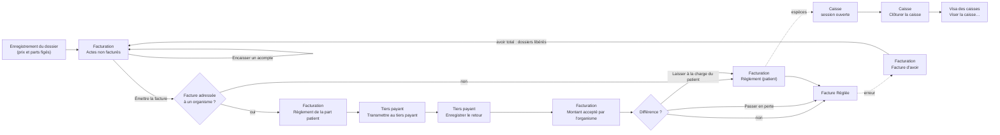
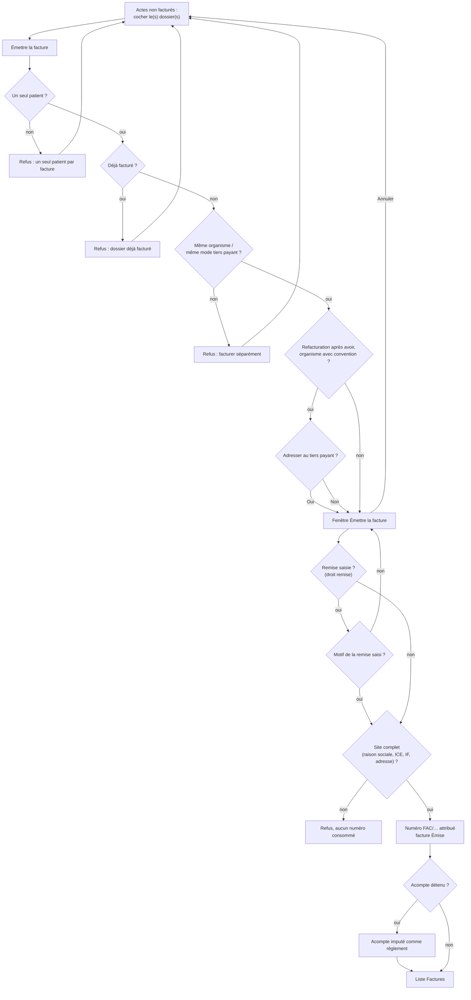
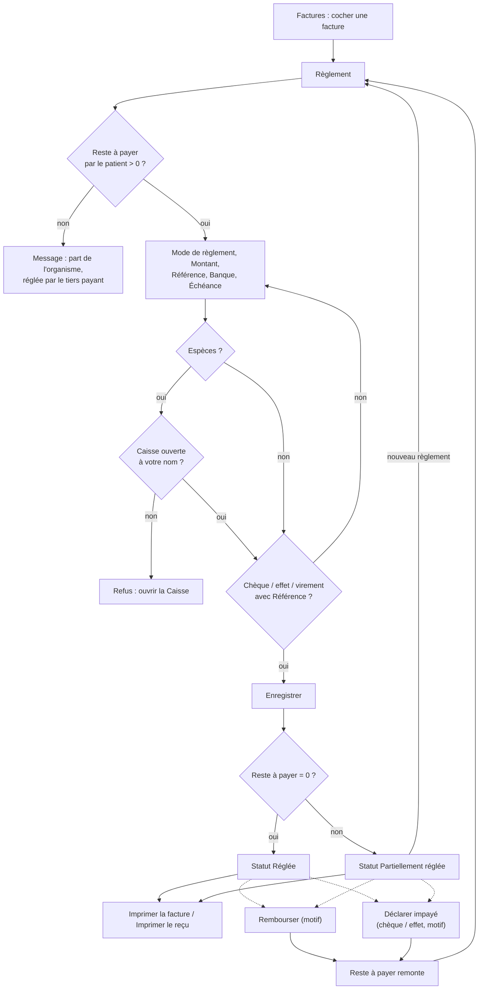
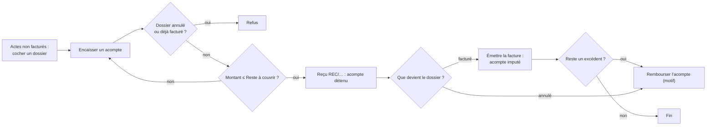
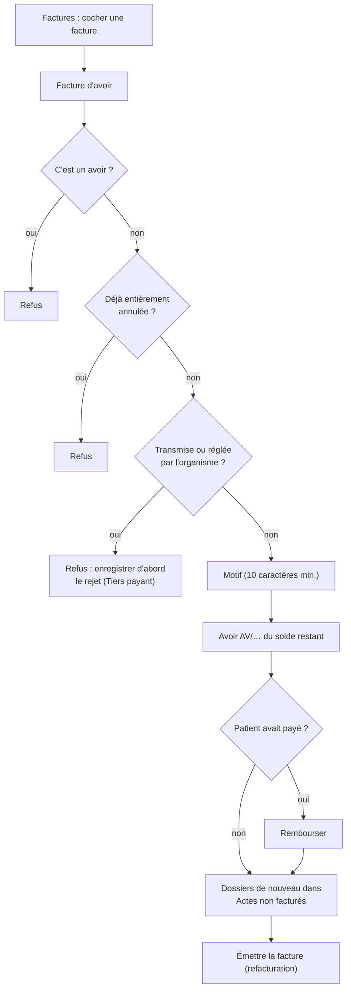
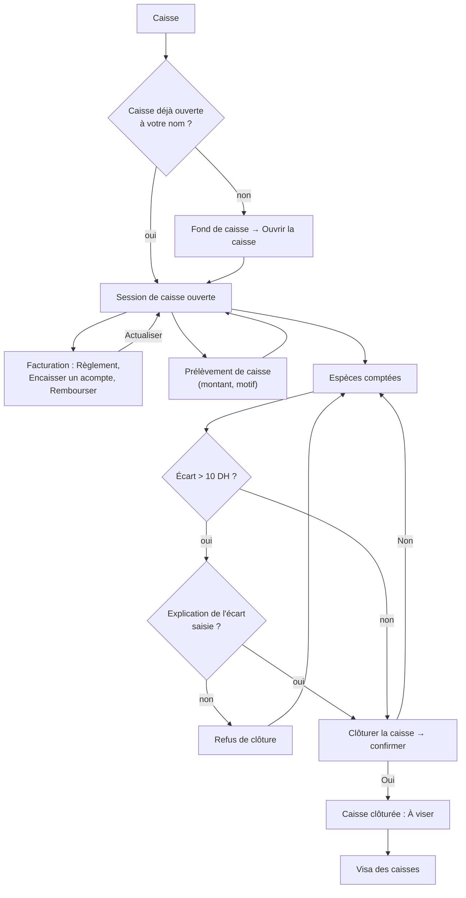
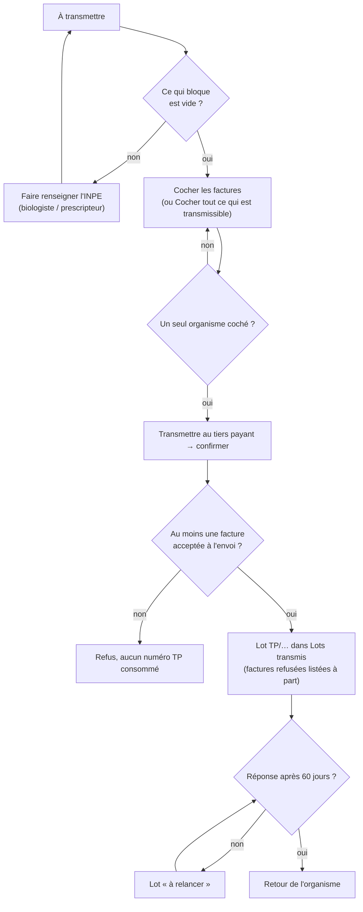
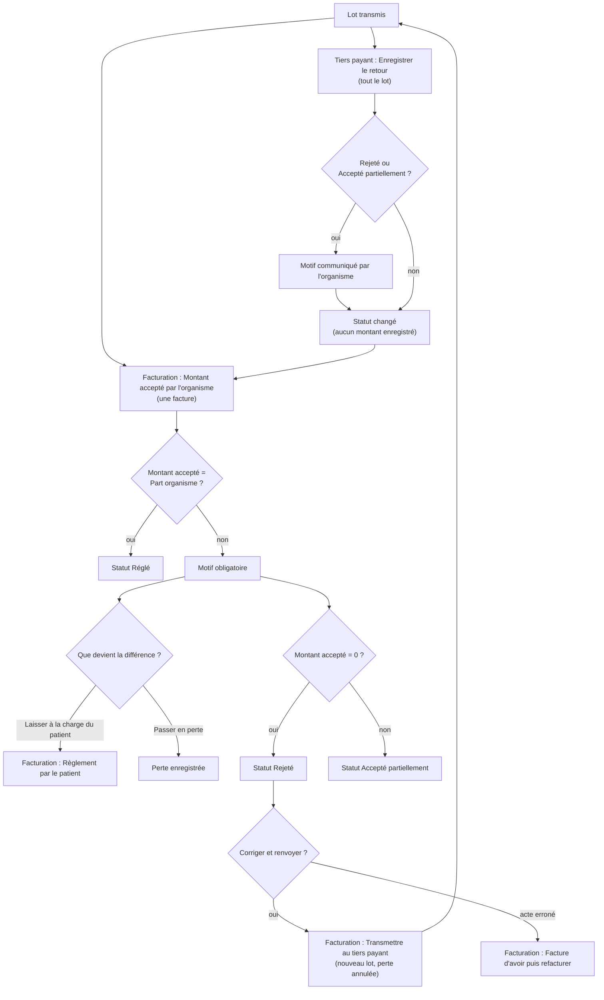
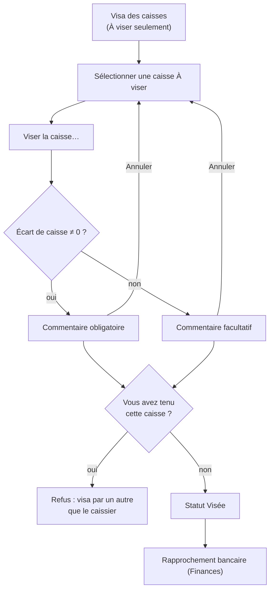

## Facturation, caisse et tiers payant

Ce chapitre couvre l'argent du laboratoire : la facture et l'avoir, les acomptes, l'encaissement au comptoir, la caisse de chaque opérateur, les bordereaux envoyés aux organismes (CNSS, CNOPS, mutuelles…) et le visa des caisses par le responsable.

Écrans concernés, dans le menu :

| Menu | Groupe du menu | Raccourci par défaut |
|---|---|---|
| **Facturation** | Facturation | Ctrl+9 |
| **Caisse** | Facturation | Ctrl+0 |
| **Tiers payant** | Facturation | aucun (on peut en définir un) |
| **Visa des caisses** | Finances | aucun (on peut en définir un) |

Vue d'ensemble du parcours de l'argent :

Raccourcis valables sur tous ces écrans : **F5** actualise l'écran, **Ctrl+F** place le curseur dans la zone de recherche, **Ctrl+P** imprime la liste affichée, **F1** affiche la liste des raccourcis. Les raccourcis se modifient dans la fenêtre des raccourcis.

### Avant de commencer : trois règles qui expliquent tout le reste

**1. La numérotation des factures est continue, sans trou.**
La loi fiscale marocaine exige que les factures portent des numéros qui se suivent, sans saut et sans retour en arrière. Dans l'application :

- Un numéro a cette forme : `FAC/CODE-SITE/ANNÉE/000001`. Exemple : `FAC/CASA/2026/000318`.
- Chaque site a sa propre série, et chaque série repart à 000001 au 1er janvier.
- Le numéro n'est donné qu'au moment exact où vous cliquez sur **Émettre la facture**, et dans la même opération que l'enregistrement de la facture. Il n'existe pas de « brouillon » numéroté.
- Si l'émission échoue (site mal renseigné, dossier déjà facturé, coupure réseau…), rien n'est enregistré et le numéro n'est pas consommé : la facture suivante reprend ce même numéro. Il ne peut donc pas y avoir de trou.
- Deux postes qui émettent en même temps ne peuvent pas obtenir le même numéro : le second attend que le premier ait fini.
- Les autres documents ont leur propre série, elle aussi continue :
  - avoirs : `AV/CODE-SITE/ANNÉE/000001` ;
  - acomptes (reçus) : `REC/CODE-SITE/ANNÉE/000001` ;
  - bordereaux de tiers payant : `TP/CODE-SITE/ANNÉE/00001`.
- Quand un exercice est clôturé, sa série est fermée : plus aucun document ne peut y être numéroté (message « La numérotation « … » est clôturée : aucun document ne peut plus y être rattaché. »).
- Le code du site ne peut plus être changé dès qu'un document a été numéroté avec lui.

**2. Une facture émise ne se modifie pas et ne se supprime pas.**
Pour corriger une facture, on émet une **facture d'avoir** qui l'annule (voir plus bas). Il n'existe aucun bouton « modifier » ou « supprimer » une facture, et c'est voulu.

**3. Le site doit être complet pour facturer.**
Avant d'attribuer un numéro, l'application vérifie la raison sociale, l'ICE (15 chiffres), l'identifiant fiscal, l'adresse et la ville du site. S'il manque l'un d'eux, l'émission est refusée (« L'ICE doit comporter 15 chiffres. », « L'adresse et la ville du site sont obligatoires sur une facture. »…). Ces données se corrigent dans l'administration des sites, pas ici.

### Part patient, part organisme, lettre-clé B

- Le prix de chaque analyse est fixé **à l'enregistrement du dossier**, avec la répartition entre l'organisme et le patient. La facture reprend ces prix « gelés » : une révision de tarif ultérieure ne change pas ce que le patient a payé ou doit.
- Pour un organisme qui rembourse sur le tarif national de référence, la base de remboursement d'un acte est : **coefficient B de l'acte × valeur de la lettre B** (à la date de l'acte). L'organisme paie son taux (par exemple 70 %) de cette base, jamais plus que le prix de l'acte. Si le laboratoire facture au-dessus du tarif de référence, l'excédent est entièrement à la charge du patient.
- Pour un organisme qui rembourse sur le prix du laboratoire, sa part est son taux appliqué au prix facturé (remise déduite).
- **Part organisme** + **Part patient** = **Total à payer**.
- Si le dossier a été enregistré **sans tiers payant** (case non cochée, ou convention expirée), la facture est adressée au patient pour la totalité : c'est le patient qui se fait rembourser avec sa feuille de soins.
- Si le dossier a été enregistré **avec tiers payant** et que l'organisme a une convention en cours, la facture est adressée à l'organisme ; le patient ne paie au comptoir que sa part, et la part de l'organisme est réclamée par bordereau (écran **Tiers payant**).
- Les actes de biologie sont exonérés de TVA ; la TVA reste à 0.
- La facture imprimée porte le code de chaque acte, la part organisme et la part patient par ligne, l'ICE du laboratoire et du destinataire, et le montant total en toutes lettres.

---

### Facturation

Écran de travail du comptoir et de la comptabilité : il montre en haut ce qui a été fait et pas encore facturé, en bas ce qui a été facturé et pas encore payé.

**Qui y a accès**

| Action | Droit nécessaire | Rôles par défaut qui l'ont |
|---|---|---|
| Voir l'écran, imprimer factures et reçus | Consulter la facturation | Administrateur, Biologiste responsable, Secrétariat / accueil, Comptabilité |
| **Émettre la facture** | Émettre une facture | Administrateur, Secrétariat / accueil, Comptabilité |
| Accorder une **Remise** à l'émission | Appliquer une remise | Administrateur, Comptabilité |
| **Règlement**, **Encaisser un acompte**, **Déclarer impayé** | Encaisser un règlement | Administrateur, Secrétariat / accueil, Comptabilité |
| **Facture d'avoir**, **Rembourser**, **Rembourser l'acompte** | Émettre un avoir | Administrateur, Comptabilité |
| **Transmettre au tiers payant**, **Enregistrer le retour**, **Montant accepté par l'organisme** | Export comptable / tiers payant | Administrateur, Comptabilité |

Les boutons pour lesquels vous n'avez pas le droit restent visibles mais grisés. Le Biologiste responsable voit l'écran en lecture seule. Biologiste, Technicien, Préleveur, Responsable qualité et Prescripteur n'ont pas accès.

**L'écran**

- **En haut : « Actes non facturés »** — un dossier par ligne, avec une case à cocher. Colonnes : **N° de dossier**, **Patient**, **Enregistré le**, **Organisme payeur** (ou « Paiement direct »), **Analyses** (nombre), **Total à payer**, **Part organisme**, **Part patient**, **Acompte** (acomptes encore détenus). Le titre affiche le nombre de dossiers à facturer et leur total. Seuls les 500 dossiers les plus récents sont affichés ; le titre le signale quand la limite est atteinte.
  - Un dossier **annulé** apparaît barré et grisé : il n'est là que parce qu'il détient encore un acompte à rembourser.
  - Un dossier **déjà facturé** qui garde un reste d'acompte apparaît grisé avec la mention « Facturé (FAC/…) — acompte à rembourser ».
  - Boutons : **Émettre la facture**, **Encaisser un acompte**, **Rembourser l'acompte**.
- **En bas : « Factures »** — factures et avoirs émis, les plus récents d'abord. Zone de recherche (numéro de facture, nom du destinataire ou numéro de dossier, puis touche Entrée), filtre de statut (« Tout sélectionner », « Émise », « Partiellement réglée », « Réglée », « Créance abandonnée ») et bouton **Actualiser**.
  - Colonnes : case à cocher, **N°**, **Désignation** (Facture ou Facture d'avoir), **Date de facturation**, **Facturé à**, **Total à payer**, **Réglé**, **Reste à payer**, **En retard** (en jours), **Statut**.
  - Couleurs : orange = en retard ; rouge = plus de 60 jours de retard ; gris = réglée ; italique = avoir.
  - Une facture dont une partie a été passée en perte affiche une bulle d'aide sur la colonne **Réglé** (« Hors montant payé : … passés en perte »).
  - Première rangée de boutons : **Règlement**, **Rembourser**, **Déclarer impayé**, **Facture d'avoir**, **Imprimer la facture**, **Imprimer le reçu**.
  - Deuxième rangée : **Transmettre au tiers payant**, **Enregistrer le retour**, **Montant accepté par l'organisme**.
  - À droite : nombre de factures affichées sur le total et somme du **Reste à payer**.

Statuts d'une facture :

| Statut | Signification |
|---|---|
| Émise | Numérotée, rien n'a encore été payé. |
| Partiellement réglée | Une partie a été payée. |
| Réglée | Plus rien à payer (paiements et/ou avoirs). Un avoir est toujours « Réglée ». |
| Créance abandonnée | Prévu dans le filtre ; aucune action de l'écran ne met une facture dans ce statut (à vérifier). |

L'échéance d'une facture patient est le jour même ; celle d'une facture organisme est la date d'émission plus le délai de paiement de l'organisme. Le compteur **En retard** part de cette échéance.

**Scénarios**

*1. Facturer un dossier (patient sans tiers payant ou avec tiers payant)*
1. Dans **Actes non facturés**, cochez le dossier.
2. Cliquez sur **Émettre la facture**.
3. La fenêtre affiche le patient, l'organisme (ou « Sans prise en charge — à la charge du patient »), la liste des dossiers et le **Montant brut**.
4. Vérifiez puis cliquez sur **Émettre la facture** dans la fenêtre. Le numéro est attribué à ce moment.
5. Le dossier disparaît du haut ; la facture apparaît en bas. Si un acompte était détenu sur le dossier, il est automatiquement imputé sur la facture comme règlement (jusqu'à la part que doit le patient).

*2. Regrouper plusieurs dossiers sur une seule facture*
1. Cochez plusieurs dossiers **du même patient** et **du même organisme** (ou tous sans tiers payant).
2. **Émettre la facture**, puis confirmez dans la fenêtre.
- Refusé si les dossiers sont de patients différents (« Une facture ne peut regrouper que les dossiers d'un même patient. ») ou d'organismes / modes de prise en charge différents (« Les dossiers … n'ont pas été enregistrés avec le même organisme payeur… Facturez-les séparément. »).

*3. Accorder une remise (Comptabilité, Administrateur)*
1. Cochez le ou les dossiers, cliquez sur **Émettre la facture**.
2. Dans la fenêtre, saisissez le montant dans **Remise** ; le **Montant net** se recalcule.
3. Saisissez le **Motif de la remise** (obligatoire).
4. Cliquez sur **Émettre la facture**.
- La remise est répartie sur les lignes au prorata et reste écrite sur la facture avec son motif. Elle ne peut pas dépasser le montant brut. Les champs de remise n'apparaissent pas pour le Secrétariat.

*4. Encaisser un règlement complet au comptoir*
1. En bas, cochez **une seule** facture.
2. Cliquez sur **Règlement**.
3. La fenêtre affiche le **Reste à payer** (ou le **Reste à payer par le patient** si une part organisme est réclamée au tiers payant). Le **Montant** est pré-rempli avec ce reste.
4. Choisissez le **Mode de règlement** : Espèces, Carte bancaire, Chèque, Virement, Effet / traite, Paiement mobile.
5. Remplissez les champs qui apparaissent :
   - Chèque, Effet / traite : **Référence** (obligatoire), **Banque**, **Échéance** ;
   - Virement : **Référence** (obligatoire), **Banque** ;
   - Carte bancaire : **Référence** (facultative, numéro d'autorisation).
6. Cliquez sur **Enregistrer**. Le statut passe à « Réglée ».
- En espèces, une caisse doit être ouverte à votre nom (écran **Caisse**), sinon : « Un règlement en espèces exige une session de caisse ouverte. »
- Au-delà de 20 000 DH en espèces, un avertissement rouge s'affiche (risque de sanction fiscale). Ce n'est qu'un avertissement : l'enregistrement reste possible.

*5. Encaisser un règlement partiel*
1. Même procédure que ci-dessus, mais remplacez le **Montant** pré-rempli par le montant réellement reçu.
2. **Enregistrer**. La facture passe à « Partiellement réglée » et le **Reste à payer** diminue.
3. Recommencez autant de fois que nécessaire, avec le même mode ou un autre (par exemple une partie en espèces, le reste par chèque).

*6. Patient dont la part organisme est en tiers payant*
- Le bouton **Règlement** ne propose que la part du patient. Si le patient a déjà tout payé de sa part, un message indique « Le patient ne doit plus que 0,00 … le reste est la part de l'organisme, réglée par le tiers payant. »
- La part de l'organisme se règle uniquement par **Montant accepté par l'organisme** (scénario 13), après transmission du bordereau.

*7. Imprimer une facture ou un reçu*
1. Sélectionnez une facture : cochez-la, ou cliquez simplement sur sa ligne sans rien cocher.
2. Cliquez sur **Imprimer la facture** ou **Imprimer le reçu**. Le PDF s'ouvre ; imprimez-le depuis la visionneuse.
- Si plusieurs lignes sont cochées, rien n'est imprimé (les boutons sont grisés).
- Une réimpression donne exactement le même document (destinataire, ICE, prix figés à l'émission).

*8. Encaisser un acompte avant la facture*
Cas typique : le patient paie au prélèvement, la facture sera faite quand le dossier sera complet.
1. En haut, cochez **un seul** dossier.
2. Cliquez sur **Encaisser un acompte**.
3. La fenêtre affiche le **Reste à couvrir**. Choisissez le **Mode de règlement**, saisissez le **Montant** et, selon le mode, la **Référence**, la **Banque**, l'**Échéance**.
4. **Enregistrer**. Un numéro de reçu `REC/…` est attribué ; la colonne **Acompte** se met à jour.
- L'acompte ne peut pas dépasser ce que le patient devra (sa seule part s'il est en tiers payant) moins les acomptes déjà reçus.
- Refusé sur un dossier annulé ou déjà facturé. En espèces, une caisse ouverte est nécessaire.
- À l'émission de la facture, l'acompte devient automatiquement un règlement de la facture.

*9. Rembourser un acompte (dossier annulé, ou facture plus petite que l'acompte) — Comptabilité, Administrateur*
1. En haut, cochez **un seul** dossier (il peut être barré ou marqué « acompte à rembourser »).
2. Cliquez sur **Rembourser l'acompte**.
3. La fenêtre rappelle le montant et les numéros de reçus concernés. Saisissez le motif (5 caractères minimum) et validez par **OK**.
4. Tous les acomptes encore détenus sur ce dossier sont remboursés.
- Un acompte en espèces sort de **votre** caisse, qui doit être ouverte. Un acompte par chèque, carte ou virement est retiré de la caisse qui l'avait encaissé, si elle est encore ouverte.

*10. Rembourser un règlement — Comptabilité, Administrateur*
1. En bas, cochez **une seule** facture.
2. Cliquez sur **Rembourser**.
3. Choisissez le règlement dans la liste (date, mode, montant, référence, banque, qui l'a encaissé) puis cliquez sur le bouton **Rembourser** de la fenêtre (ou double-clic).
4. Saisissez le motif (5 caractères minimum), **OK**.
5. Le règlement passe à « Remboursé » ; le reste à payer de la facture remonte.
- Un remboursement en espèces exige que **votre** caisse soit ouverte ; il est déduit des espèces attendues.
- Rembourser n'annule pas la facture : si l'acte n'est plus dû, il faut aussi émettre un avoir.

*11. Déclarer un chèque ou un effet impayé*
1. Cochez **une seule** facture, cliquez sur **Déclarer impayé**.
2. Seuls les chèques et effets encaissés sont proposés. Choisissez le règlement, cliquez sur **Déclarer impayé**.
3. Saisissez le motif de rejet communiqué par la banque, **OK**.
4. Le règlement passe à « Impayé » ; la facture redevient due et réapparaît dans le suivi des retards.
- Si la caisse qui avait encaissé le chèque est encore ouverte, le chèque est retiré de son total chèques.

*12. Corriger une facture : émettre un avoir — Comptabilité, Administrateur*
1. Cochez **une seule** facture (pas un avoir).
2. Cliquez sur **Facture d'avoir**.
3. Saisissez le motif (10 caractères minimum) : il sera la justification comptable. **OK**.
4. Un avoir `AV/…` est émis pour **tout ce qui reste à créditer** sur la facture. Il reprend chaque ligne et la remise de la facture d'origine, et mentionne son numéro.
5. Si la facture est entièrement annulée, ses dossiers reviennent en haut dans **Actes non facturés**, prêts à être refacturés correctement.
6. Si le dossier avait un organisme mais avait été facturé au patient, l'application propose, au moment de refacturer, d'adresser la nouvelle facture à l'organisme (« Adresser cette facture au tiers payant … ? »). Répondez **Oui** pour l'organisme, **Non** pour le patient.
- Avoir refusé si la facture a été transmise à l'organisme ou réglée par lui (« … Enregistrez d'abord le rejet de l'organisme, puis émettez l'avoir. »), si elle est déjà entièrement annulée, ou s'il s'agit d'un avoir.
- L'avoir ne rend pas l'argent. Si le patient avait payé, faites ensuite **Rembourser** (scénario 10).
- L'avoir partiel (pour une partie seulement du montant) n'est pas proposé à l'écran : l'avoir porte toujours sur tout le reste.

*13. Saisir le paiement d'un organisme sur une facture (montant accepté) — Comptabilité, Administrateur*
1. Cochez **une seule** facture déjà transmise au tiers payant.
2. Cliquez sur **Montant accepté par l'organisme**.
3. La fenêtre affiche la **Part organisme**. Le **Montant accepté** est pré-rempli avec la totalité ; corrigez-le si l'organisme a payé moins.
4. Saisissez la **Référence du virement ou bordereau** (facultative).
5. S'il y a une différence, la fenêtre affiche « Non accepté : … Que devient la différence ? ». Choisissez :
   - **Laisser à la charge du patient (reste sur la facture)** : le patient pourra la régler au comptoir par **Règlement** ;
   - **Passer en perte** : la différence est soldée comme perte.
6. Saisissez le **Motif communiqué par l'organisme** (obligatoire s'il y a une différence). **Enregistrer**.
7. Le statut du tiers payant devient « Réglé », « Accepté partiellement » ou « Rejeté » (si 0 accepté).
- Une seule saisie par facture : « Le montant accepté a déjà été saisi pour la facture … ».

*14. Transmettre et suivre le tiers payant depuis cet écran*
Les boutons **Transmettre au tiers payant** et **Enregistrer le retour** existent aussi ici, sur les factures cochées. L'écran **Tiers payant** est plus adapté (il montre ce qui bloque et les lots) ; voir plus bas. Particularité de cet écran : c'est le seul endroit où l'on peut **retransmettre une facture rejetée** (cochez-la, **Transmettre au tiers payant**).

**Règles et contrôles**

- Une facture émise est figée ; seule la **Facture d'avoir** la corrige. Un avoir ne peut pas lui-même faire l'objet d'un avoir. Le total des avoirs ne dépasse jamais le total facturé.
- Pas de facture sans ligne ; les analyses annulées et les analyses gratuites ne sont pas facturées.
- Une facture ne peut être adressée à un organisme que s'il a une convention de tiers payant en cours de validité (« … n'a pas de convention de tiers payant en cours de validité… Établissez-la au nom du patient. »).
- Un règlement ne peut pas dépasser le reste à payer, ni (au comptoir) la part du patient.
- Chèque et effet : référence obligatoire. Virement : référence obligatoire.
- Espèces : caisse ouverte obligatoire (règlement, acompte, remboursement).
- Tout remboursement, impayé, avoir, remise ou retour d'organisme exige un motif ; il est conservé dans le journal d'audit.
- Les boutons sont protégés contre le double-clic : un clic = un enregistrement.
- La liste du bas n'affiche que les 50 factures les plus récentes correspondant à la recherche ; utilisez la recherche ou le filtre pour retrouver une facture plus ancienne.

**Flux**

Enregistrement du dossier (prix et répartition figés) → **Facturation** (acompte éventuel, émission, règlement patient) → **Caisse** (clôture en fin de poste) → **Visa des caisses**. Pour la part organisme : **Facturation** → **Tiers payant** (bordereau, retour) → **Facturation** (**Montant accepté par l'organisme**).

Émission d'une facture :

Règlement au comptoir (total, partiel, remboursement, impayé) :

Acompte avant facture :

Correction par avoir :

---

### Caisse

Écran de la caisse de **chaque opérateur** : ouverture avec un fond de caisse, suivi des encaissements du poste, prélèvements déposés en banque, et clôture avec comptage.

**Qui y a accès**

- Ouvrir l'écran et **Ouvrir la caisse** : droit « Encaisser un règlement » — Administrateur, Secrétariat / accueil, Comptabilité.
- **Clôturer la caisse** et **Prélèvement de caisse** : droit « Clôturer la caisse » — Administrateur, Secrétariat / accueil, Comptabilité.
- Le Biologiste responsable n'a pas cet écran.

**L'écran**

- **Sans caisse ouverte** : le champ **Fond de caisse** (pré-rempli 0.00) et le bouton **Ouvrir la caisse**.
- **Caisse ouverte** :
  - une ligne avec le nom de l'opérateur, la date et l'heure d'ouverture et le nombre de règlements ;
  - un tableau : **Fond de caisse**, puis **Espèces**, **Chèque**, **Carte bancaire**, **Virement** encaissés pendant le poste, puis **Remboursements** et **Prélèvements** s'il y en a, puis **Espèces attendues** ;
  - à droite : **Espèces attendues** (en grand), le champ **Espèces comptées**, l'**Écart de caisse** calculé en direct (vert si nul, orange s'il est faible, rouge au-delà de 10 DH) ;
  - le champ **Explication de l'écart**, qui n'apparaît que si l'écart dépasse 10 DH ;
  - les boutons **Clôturer la caisse**, **Actualiser**, **Prélèvement de caisse**.

Calcul : **Espèces attendues** = Fond de caisse + espèces encaissées − remboursements en espèces − prélèvements. Les chèques, cartes et virements sont affichés pour le rapport du poste mais ne sont pas comptés dans le tiroir.

La caisse est personnelle : les règlements que vous saisissez dans **Facturation** vont dans **votre** caisse ouverte.

**Scénarios**

*1. Ouvrir la caisse en début de poste*
1. Ouvrez **Caisse** (Ctrl+0).
2. Saisissez le **Fond de caisse** (montant présent dans le tiroir).
3. Cliquez sur **Ouvrir la caisse**.
- Une seule caisse ouverte à la fois par opérateur (« Une session de caisse est déjà ouverte pour cet opérateur. »).

*2. Encaisser pendant le poste*
Les encaissements ne se font pas sur cet écran mais dans **Facturation** (**Règlement**, **Encaisser un acompte**). Revenez sur **Caisse** et cliquez sur **Actualiser** (ou F5) pour voir les totaux à jour.

*3. Déposer des espèces en banque en cours de poste (prélèvement)*
1. Cliquez sur **Prélèvement de caisse**.
2. Saisissez le montant retiré du tiroir, **OK**.
3. Saisissez le motif (« dépôt en banque », numéro de bordereau…), **OK**.
4. Le montant apparaît dans **Prélèvements** et diminue les **Espèces attendues**.
- Sans cette saisie, la clôture afficherait un manquant égal à l'argent déjà à la banque.

*4. Rembourser en espèces*
Le remboursement se fait dans **Facturation** (**Rembourser** ou **Rembourser l'acompte**). Il est déduit des espèces attendues de la caisse ouverte de la personne qui rembourse.

*5. Clôturer la caisse en fin de poste*
1. Comptez le tiroir.
2. Saisissez le résultat dans **Espèces comptées** (pré-rempli avec les espèces attendues : remplacez-le par votre comptage réel).
3. Regardez l'**Écart de caisse**. S'il dépasse 10 DH (en plus ou en moins), le champ **Explication de l'écart** apparaît : remplissez-le.
4. Cliquez sur **Clôturer la caisse**, puis confirmez (« Clôturer la caisse avec … comptés, soit un écart de … ? »).
5. Un message rappelle l'écart enregistré. L'écran revient à l'état « sans caisse ouverte ».
- Sans explication d'un écart de plus de 10 DH, la clôture est refusée (« Un écart de caisse de … DH doit être expliqué avant la clôture. »).
- La caisse clôturée part ensuite au **Visa des caisses**.

**Règles et contrôles**

- Tolérance d'écart sans explication : 10 DH.
- Un écart positif (excédent) et un écart négatif (manquant) sont affichés avec leur signe.
- Tout règlement en espèces, tout acompte en espèces et tout remboursement en espèces exige une caisse ouverte au nom de l'opérateur.
- Un chèque déclaré impayé ou un règlement par carte remboursé pendant que la caisse d'origine est ouverte est retiré du total de cette caisse ; après la clôture, la caisse n'est plus modifiée.
- Le paiement mobile n'apparaît dans aucune ligne du tableau de caisse (à vérifier avec l'éditeur ; voir la fiche de vérification).
- Il n'y a pas d'impression du rapport de caisse depuis cet écran.

**Flux**

**Ouvrir la caisse** → encaissements dans **Facturation** → **Prélèvement de caisse** si nécessaire → **Clôturer la caisse** → **Visa des caisses** par le responsable.

---

### Tiers payant

Écran de suivi de la part des organismes (CNSS, CNOPS, mutuelles…) : ce qui reste à envoyer, les bordereaux envoyés et ce que l'organisme a répondu.

**Qui y a accès**

- Voir l'écran : droit « Consulter la facturation » — Administrateur, Biologiste responsable, Secrétariat / accueil, Comptabilité.
- **Transmettre au tiers payant** et **Enregistrer le retour** : droit « Export comptable / tiers payant » — Administrateur et Comptabilité uniquement. Pour les autres, ces boutons restent grisés.

**L'écran**

- En haut à droite : choix de la période (« 30 derniers jours », « 90 derniers jours », « 180 derniers jours » par défaut, « 365 derniers jours ») et **Actualiser**. Le titre indique le reste à recouvrer auprès des organismes (rouge s'il y a des bordereaux à relancer).
- **À transmettre** (en haut) : les factures adressées à un organisme, pas encore envoyées. Colonnes : case à cocher, **N°**, **Date de facturation**, **Jours** (depuis l'émission), **Organisme payeur**, **Patient**, **Montant net**, **Part organisme**, **Ce qui bloque**.
  - Ligne rouge = facture bloquée ; la colonne **Ce qui bloque** dit pourquoi : « INPE du biologiste manquant » et/ou « INPE du prescripteur manquant ».
  - Texte orange = facture de plus de 60 jours, à envoyer vite.
  - Boutons : **Cocher tout ce qui est transmissible**, **Transmettre au tiers payant**.
- **Lots transmis** (en bas à gauche) : un bordereau par ligne. Colonnes : **Référence du dossier** (TP/…), **Organisme payeur**, **Transmis le**, **Jours**, **Factures**, **Montant réclamé**, **Réglé**, **Retour de l'organisme** (« sans réponse », « à relancer », « accepté », « N refus »). Bouton : **Enregistrer le retour**.
  - Ligne rouge = sans réponse depuis plus de 60 jours : à relancer.
- **Contenu du lot** (en bas à droite) : les factures du bordereau sélectionné. Colonnes : **N°**, **Patient**, **Part organisme**, **Réglé**, **Statut**, **Motif communiqué par l'organisme**. Une ligne rouge = facture rejetée et pas encore retransmise.

Statuts du tiers payant d'une facture :

| Statut | Signification |
|---|---|
| Sans objet | Facture au patient, pas de tiers payant. |
| À transmettre | Prête à partir dans un bordereau. |
| Transmis | Dans un bordereau envoyé, sans réponse. |
| Accepté | L'organisme a accepté (le paiement n'est pas forcément saisi). |
| Accepté partiellement | L'organisme a accepté moins que demandé. |
| Rejeté | L'organisme a refusé ; à corriger et retransmettre ou passer en perte. |
| Retransmis | Marqué comme renvoyé après un rejet. |
| Réglé | Paiement de l'organisme enregistré. |

**Scénarios**

*1. Préparer et envoyer un bordereau à un organisme*
1. Dans **À transmettre**, cochez les factures d'**un seul** organisme, ou cliquez sur **Cocher tout ce qui est transmissible** puis décochez celles des autres organismes.
2. La barre du bas affiche « N facture(s) sélectionnée(s) — montant ». Si vous avez coché plusieurs organismes, elle l'indique en rouge et le bouton reste grisé.
3. Cliquez sur **Transmettre au tiers payant**, puis confirmez (« Transmettre N facture(s) à …, pour un montant de … ? »).
4. Un numéro de bordereau `TP/…` est attribué ; le message « Lot … transmis — N facture(s), montant » s'affiche et le lot apparaît dans **Lots transmis**.
5. Envoyez à l'organisme le bordereau et les pièces selon votre procédure habituelle (l'application ne produit pas de fichier ni d'impression du bordereau : à vérifier).
- Si certaines factures sont refusées au moment de l'envoi, le bordereau part quand même avec les autres ; un message donne le numéro du bordereau puis la liste des factures non transmises et la raison.

*2. Débloquer une facture (INPE manquant)*
- « INPE du biologiste manquant » : l'INPE est pris sur le biologiste responsable du site au moment de l'émission. Faites renseigner l'INPE du biologiste responsable (administration des utilisateurs / du site). Attention : une facture déjà émise garde ce qui y a été figé ; il faudra alors émettre un avoir et refacturer (à vérifier).
- « INPE du prescripteur manquant » : le prescripteur du dossier n'a pas d'INPE. Même remarque.

*3. Enregistrer la réponse globale de l'organisme sur un bordereau*
1. Dans **Lots transmis**, cliquez sur le bordereau.
2. Vérifiez son contenu à droite.
3. Cliquez sur **Enregistrer le retour**.
4. Choisissez le **Retour de l'organisme** : Accepté, Réglé, Accepté partiellement, Rejeté, Retransmis.
5. Pour « Rejeté » et « Accepté partiellement », saisissez le **Motif communiqué par l'organisme** (obligatoire).
6. **Enregistrer**. La réponse s'applique à **toutes** les factures du bordereau, sauf celles dont le paiement organisme a déjà été saisi (un message les liste).
- Important : ce bouton change le statut mais **n'enregistre aucun argent**. Pour que le reste à payer diminue, saisissez le paiement facture par facture dans **Facturation** → **Montant accepté par l'organisme**.

*4. Enregistrer le paiement d'un organisme*
Se fait dans **Facturation**, facture par facture, avec **Montant accepté par l'organisme** (voir scénario 13 de **Facturation**). Mettez la référence du virement dans **Référence du virement ou bordereau** pour retrouver le rapprochement bancaire.

*5. Traiter un refus*
1. Dans **Contenu du lot**, repérez les lignes rouges et lisez le motif.
2. Deux décisions possibles :
   - **Corriger et retransmettre** : dans **Facturation**, cochez la facture rejetée et cliquez sur **Transmettre au tiers payant**. Elle part dans un **nouveau** bordereau ; la perte ou la part laissée au patient enregistrée lors du refus est annulée automatiquement.
   - **Abandonner la part organisme** : dans **Facturation**, **Montant accepté par l'organisme** avec 0 (ou le montant payé) et **Passer en perte**, ou **Laisser à la charge du patient**.
3. Si l'acte lui-même était erroné : après avoir enregistré le rejet, émettez une **Facture d'avoir** dans **Facturation**, puis refacturez.

*6. Relancer un organisme*
Les bordereaux « à relancer » (rouges) n'ont reçu aucune réponse depuis plus de 60 jours. Contactez l'organisme ; l'application ne garde pas trace de la relance (à vérifier).

**Règles et contrôles**

- Un bordereau = un seul organisme.
- Une facture ne peut être que dans un seul bordereau à la fois (« … ne peut pas figurer dans un second bordereau. »).
- Seules les factures adressées à un organisme avec convention de tiers payant valide à l'émission, ayant une part organisme et non entièrement annulées par avoir, sont proposées.
- Si l'organisme exige l'INPE du biologiste ou du prescripteur, la facture qui ne l'a pas est bloquée.
- Si aucune facture ne peut partir, aucun numéro de bordereau n'est consommé.
- Un refus ou une acceptation partielle exige le motif donné par l'organisme.
- Une facture transmise ne peut plus recevoir d'avoir tant que l'organisme ne l'a pas rejetée.
- Une facture dont le paiement organisme a été saisi ne peut plus être retransmise.

**Flux**

**Facturation** (facture adressée à l'organisme) → **Tiers payant** (bordereau, retour) → **Facturation** (**Montant accepté par l'organisme**, et éventuellement **Règlement** du reste par le patient) → comptabilité / rapprochement bancaire.

Envoi d'un bordereau :

Réponse de l'organisme et paiement :

---

### Visa des caisses

Écran du responsable qui contrôle les caisses clôturées : comptage, écart, explication, prélèvements, puis visa avec commentaire.

**Qui y a accès**

Droit « Viser les caisses » — Administrateur, Biologiste responsable, Comptabilité. Le Secrétariat n'y a pas accès. L'écran est dans le groupe **Finances** du menu.

**L'écran**

- Filtres **Du** / **Au** (30 derniers jours par défaut), case **À viser seulement** (cochée par défaut), boutons **Actualiser** et **Viser la caisse…**. Le titre indique le nombre de caisses à viser.
- Tableau : **Ouverte le**, **Clôturée le**, **Caissier**, **Poste**, **Espèces attendues**, **Espèces comptées**, **Écart de caisse** (orange, rouge au-delà de 10 DH), **Prélèvements**, **Chèques, cartes, virements**, **Statut** (« À viser » ou « Visée »).
- Sous le tableau : l'**Explication de l'écart** donnée par le caissier et, pour une caisse visée, « Visée par … le … : commentaire ».

**Scénarios**

*1. Viser une caisse juste (écart nul)*
1. Sélectionnez la caisse « À viser ».
2. Cliquez sur **Viser la caisse…**.
3. Saisissez un commentaire si vous le souhaitez (facultatif), **OK**.
4. Le statut passe à « Visée » (elle disparaît si **À viser seulement** est coché).

*2. Viser une caisse avec écart*
1. Sélectionnez la caisse, lisez l'explication du caissier en bas.
2. Vérifiez les prélèvements avec les bordereaux de dépôt bancaire.
3. **Viser la caisse…** : le commentaire est obligatoire (décision prise, suite donnée), 1 000 caractères maximum. **OK**.

*3. Revoir les caisses déjà visées*
Décochez **À viser seulement**, ajustez **Du** / **Au**, **Actualiser**.

**Règles et contrôles**

- Seule une caisse clôturée peut être visée ; les caisses encore ouvertes n'apparaissent pas.
- Le caissier ne peut pas viser sa propre caisse (« Le visa est donné par un autre que le caissier : vous avez tenu cette caisse. »). Le bouton reste actif mais l'enregistrement est refusé.
- Écart différent de zéro : commentaire obligatoire.
- Un visa est définitif : pas de bouton pour l'annuler.
- La date de fin ne peut pas précéder la date de début.

**Flux**

**Caisse** (clôture par le caissier) → **Visa des caisses** (contrôle par un autre) → rapprochement bancaire et comptabilité (écrans du groupe **Finances**).

