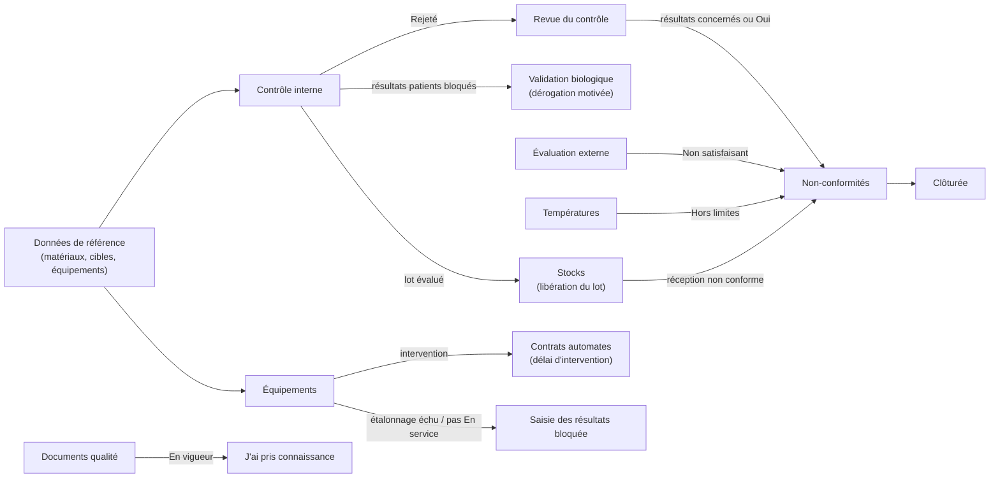
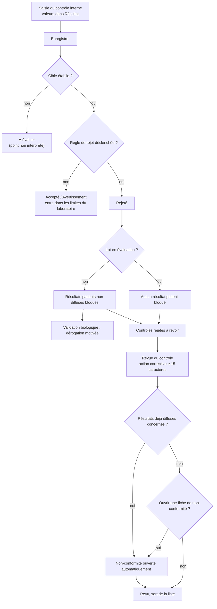
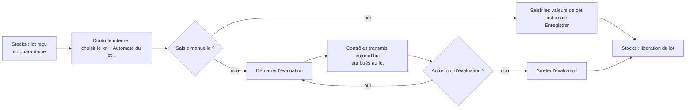
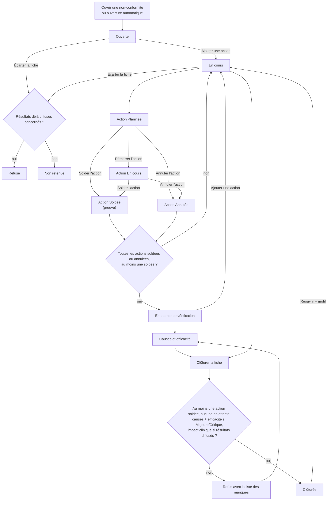
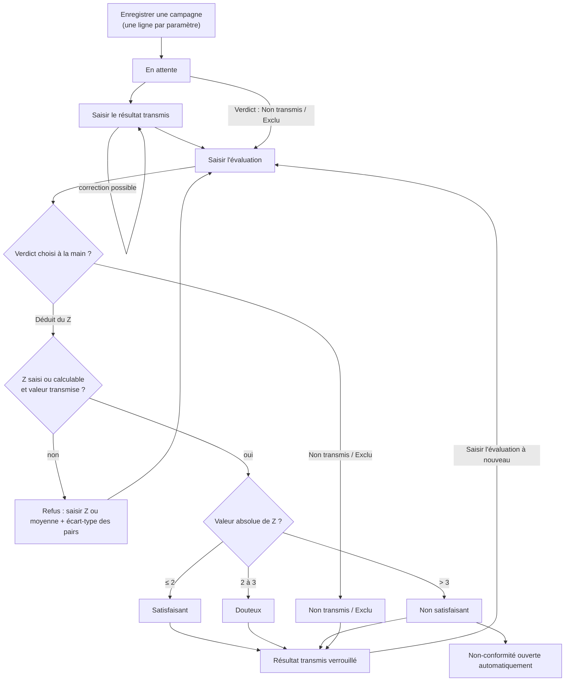
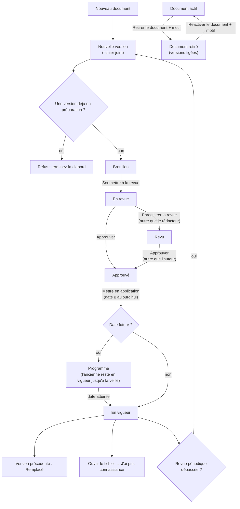
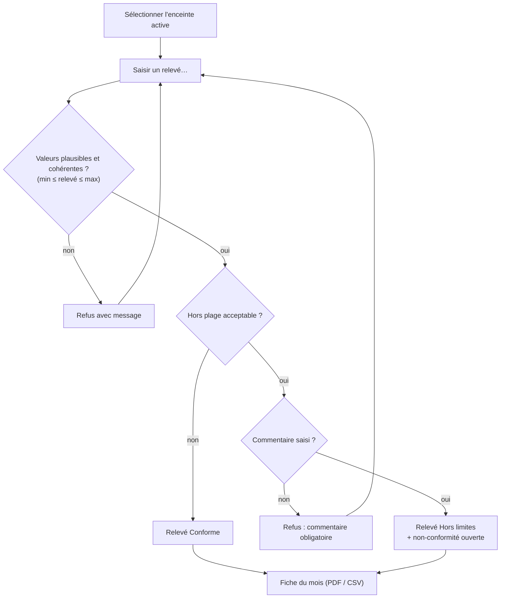
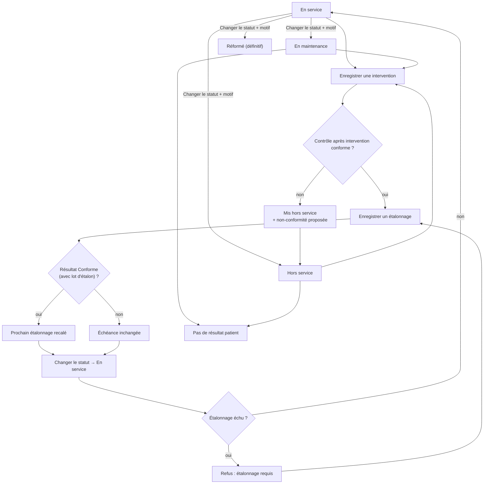
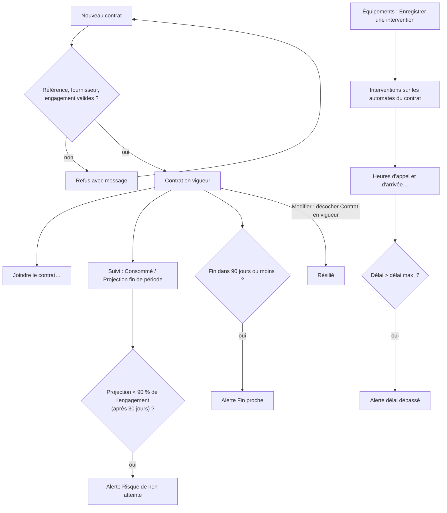

## Qualité et équipements

### Présentation du module

**À quoi sert ce module.** Il réunit le système de management de la qualité du laboratoire (ISO 15189) : la maîtrise analytique (contrôle interne et évaluation externe), le traitement des écarts (non-conformités), la maîtrise documentaire (procédures et modes opératoires), le suivi du matériel (équipements, étalonnages, maintenances), la chaîne du froid (températures) et le suivi des contrats d'automates.

**Ses écrans.** Ils sont répartis dans deux groupes du menu de gauche :

- le groupe **Qualité** : **Contrôle interne**, **Non-conformités**, **Évaluation externe**, **Documents qualité** ;
- dans le groupe **Stocks** : **Températures**, **Équipements**, **Contrats automates**.

**Qui l'utilise.**

| Rôle par défaut | Ce qu'il fait dans ce module |
|---|---|
| Technicien de laboratoire | Saisit le contrôle interne et la valeur transmise en évaluation externe, déclare une non-conformité, lit les documents et atteste sa lecture, saisit les températures, enregistre les interventions sur les équipements. |
| Biologiste | Comme le technicien, plus la revue des contrôles rejetés, l'enregistrement des campagnes et des évaluations externes, le traitement complet des non-conformités. |
| Biologiste responsable, Responsable qualité | Tout le module : règles de Westgard et limites du laboratoire, documents (rédaction, revue, approbation), enceintes, étalonnages, statuts des équipements, consultation des contrats. |
| Comptabilité | **Contrats automates** seulement (consultation et gestion). |
| Administrateur | Tout. |

Le secrétariat, les préleveurs et les prescripteurs n'ont pas ces écrans.

**Liens avec les autres modules.**

- **Administration > Données de référence** fournit les matériaux et cibles de contrôle (onglet **Contrôle interne**) et les équipements avec leurs périodicités (onglet **Automates**).
- Un contrôle rejeté bloque des résultats patients : le biologiste ne les valide ensuite dans **Validation biologique** qu'avec une dérogation motivée.
- Un équipement non étalonné ou qui n'est pas « En service » bloque la **Saisie des résultats** sur cet automate.
- L'évaluation d'un nouveau lot de réactif se fait ici ; sa libération se fait dans **Stocks** (chapitre Stocks et achats).
- Les réceptions non conformes de **Stocks** ouvrent des non-conformités dans le registre de ce module.
- Les contrats automates comptent la consommation à partir des résultats et des **Bons de commande**.

Quelques règles communes à tous les écrans :

- Un bouton auquel vous n'avez pas droit reste visible mais **grisé**. Un écran auquel vous n'avez pas droit n'apparaît pas dans le menu.
- **F5** actualise l'écran, **Ctrl+P** imprime la liste principale de l'écran, **F1** ouvre l'aide de l'écran affiché, **Maj+F1** affiche la liste des raccourcis, **Ctrl+F** place le curseur dans la zone de recherche de l'écran quand il en a une. **Ctrl+S** déclenche le bouton **Enregistrer** de l'écran quand il en a un (c'est le cas du **Contrôle interne**). **Ctrl+N** déclenche l'action principale de **Températures** (**Saisir un relevé…**) et de **Contrats automates** (**Nouveau contrat**).
- Les actions moins fréquentes sont rangées derrière le bouton **Plus d'actions** : cliquez-le pour dérouler le menu.
- Après une action ou une actualisation, la ligne sur laquelle vous travailliez reste sélectionnée.
- Toute action enregistrée (saisie, revue, clôture, changement de statut…) est tracée dans le journal d'audit avec son auteur, sa date et, quand il est demandé, son motif.
- Les non-conformités ouvertes automatiquement (contrôle rejeté, évaluation externe non satisfaisante, température hors limites) reçoivent un numéro dans la même série continue que les non-conformités ouvertes à la main ; leur pilote est la personne dont l'action les a ouvertes.

Vue d'ensemble des flux du groupe :

---

### Contrôle interne

**À quoi sert cet écran.** Saisir les résultats des contrôles de qualité interne, les voir sur la carte de Levey-Jennings et revoir les contrôles rejetés, sur un seul écran. C'est aussi ici qu'on évalue un nouveau lot de réactif avant sa libération, qu'on établit les limites propres au laboratoire et qu'on choisit les règles de Westgard de chaque contrôle.

**Qui y a accès**

| Droit | Ce qu'il permet | Rôles par défaut |
|---|---|---|
| Saisie du contrôle interne | Voir l'écran, **Enregistrer** une série, choisir un lot de réactif, **Démarrer / Arrêter l'évaluation** d'un lot | Biologiste responsable, Biologiste, Technicien de laboratoire, Responsable qualité, Administrateur |
| Revue du contrôle interne | Voir l'écran, **Revue du contrôle** | Biologiste responsable, Biologiste, Responsable qualité, Administrateur |
| Règles du contrôle interne | **Établir les limites du laboratoire**, **Règles de Westgard** | Biologiste responsable, Responsable qualité, Administrateur |

Le secrétariat, les préleveurs, la comptabilité et les prescripteurs n'ont pas accès à cet écran.

**Fonctionnalités**

- **Actualiser** (en haut à droite, F5) : recharge la feuille, les rejets et la carte ; les valeurs tapées et pas encore enregistrées sont conservées.
- **Enregistrer** (en haut à droite, Ctrl+S) : enregistre ensemble toutes les valeurs saisies (une série) ; droit de saisie du contrôle interne.
- **Lot de réactif** (liste de la barre d'outils) : **Lot de réactif en cours (automatique)** par défaut, ou un lot à évaluer (les lots en quarantaine sont marqués « en quarantaine »). La liste des lots n'est remplie que pour qui a le droit de saisie.
- **Automate du lot…** (liste) : l'automate sur lequel le lot choisi est chargé ; active seulement quand un lot est choisi, choisi d'office s'il n'y a qu'un automate.
- **Démarrer l'évaluation** : attribue au lot choisi le prochain contrôle de chaque niveau transmis aujourd'hui par l'automate ; il faut un lot et un automate choisis.
- **Arrêter l'évaluation** : les contrôles transmis reviennent au lot en cours ; il faut un lot choisi.
- Grille **Saisie du contrôle interne** : colonne **Résultat** saisissable, **Entrée** passe à la ligne suivante ; info-bulle de la colonne **Règles de Westgard actives** (règles, CV, nombre de points, matériau périmé).
- **Carte de Levey-Jennings** : affiche le contrôle de la ligne sélectionnée, en haut ou dans la liste des rejets ; survol d'un point = détail ; clic sur un point = détail dans la ligne d'état. Sous la carte, la ligne « Règles actives : … ».
- **Plus d'actions** (dans l'en-tête de la carte) : menu contenant **Établir les limites du laboratoire** et **Règles de Westgard** ; ces deux actions portent toujours sur le contrôle affiché sur la carte. Droit Règles du contrôle interne.
- Fenêtre **Règles de Westgard** : cases des règles, boutons **Multirègle classique (1₂ₛ 1₃ₛ 2₂ₛ R₄ₛ 4₁ₛ 10ₓ)** et **1₃ₛ seule**, **Enregistrer** (grisé si aucune règle n'est cochée), **Annuler**.
- **Contrôles rejetés à revoir** (carte du bas) : liste des rejets non encore revus, pastille rouge « n résultats patients bloqués » quand des résultats patients sont retenus.
- **Revue du contrôle** : demande l'action corrective (15 caractères au moins) et propose d'ouvrir une non-conformité ; droit de revue ; grisé s'il n'y a aucun rejet.
- Question en quittant l'écran avec des valeurs non enregistrées : « Des modifications n'ont pas été enregistrées. Voulez-vous continuer ? ».

**L'écran**

L'écran est divisé en quatre zones.

1. **En haut** : le titre **Contrôle interne** et le compteur (« n contrôles · n rejets à revoir »), puis les boutons **Actualiser** et **Enregistrer**. Dessous, la barre **Lot de réactif** : la liste du lot, la liste **Automate du lot…**, **Démarrer l'évaluation**, **Arrêter l'évaluation**.
2. **À gauche — Saisie du contrôle interne** (le titre indique le nombre de lignes). Une ligne par cible de contrôle active : colonnes **Paramètre**, **Niveau** (Bas, Normal, Élevé, Complémentaire), **Lot de contrôle**, **Automate**, **Résultat** (seule colonne saisissable), **Cible** (moyenne ± écart-type, ou « Aucune cible… »), **Antériorité** (dernière valeur, en rouge si elle était rejetée, en orange si avertissement), **Règles de Westgard actives** (nombre de règles ; le détail, le CV et le nombre de points s'affichent au survol).
   - Une ligne en rouge signale un matériau de contrôle périmé ou hors stabilité après ouverture.
   - Une cible écrite en orange signifie que les limites utilisées sont celles du fournisseur, et non celles du laboratoire.
3. **À droite — Carte de Levey-Jennings** du contrôle sélectionné (60 derniers jours). L'axe vertical est en écarts-types (de −4 à +4) ; la moyenne et les limites ±1, ±2, ±3 s sont tracées et étiquetées avec leur valeur. Un point accepté est un rond vert, un avertissement un triangle orange, un rejet un carré rouge ; un rejet entouré de pointillés a fait l'objet d'une dérogation à la validation. L'en-tête de la carte indique le paramètre, le lot, l'automate, le CV et la base des limites (« limites fournisseur » ou « limites du laboratoire »). Au survol d'un point : valeur, Z, date, règles violées (écrites 1-2s, 1-3s, R-4s…), commentaire. Le bouton **Plus d'actions** de la carte contient **Établir les limites du laboratoire** et **Règles de Westgard**. Sous la carte : « Règles actives : 1-2s · 1-3s · … » (en rouge s'il n'y en a aucune).
4. **En bas — Contrôles rejetés à revoir** : tous les points rejetés non encore revus, colonnes **Mesuré le**, **Paramètre**, **Automate**, **Lot de contrôle**, **Niveau**, **Résultat**, **Écart normalisé (Z)**, **Règles en défaut**, **Résultats déjà diffusés concernés** (en gras si des résultats patients sont touchés). Dans l'en-tête : la pastille des résultats patients bloqués et le bouton **Revue du contrôle**. En bas, une ligne d'état.

Sélectionner une ligne en haut ou en bas affiche sa carte de Levey-Jennings.

**Scénarios**

*1. Saisir une série de contrôles (routine du matin)*
1. Ouvrez **Qualité > Contrôle interne**.
2. Laissez la liste du lot sur **Lot de réactif en cours (automatique)**.
3. Cliquez dans la colonne **Résultat** de la première ligne, tapez la valeur, appuyez sur **Entrée** : le curseur descend à la ligne suivante. La virgule et le point sont acceptés.
4. Saisissez tous les niveaux passés ensemble (bas, normal, élevé) : ils forment une même série, ce qui permet d'appliquer les règles qui comparent les niveaux entre eux (2₂ₛ, R₄ₛ). Les lignes laissées vides sont ignorées.
5. Cliquez **Enregistrer** (ou **Ctrl+S**, ou **Entrée** sur la dernière ligne puis **Enregistrer**).
6. Lisez le résultat :
   - la ligne d'état indique « x/y accepté » ;
   - si un contrôle est **Rejeté**, une fenêtre liste chaque paramètre rejeté avec sa valeur, son Z et la règle violée, et rappelle qu'une action corrective est exigée ;
   - une seconde fenêtre peut signaler un matériau périmé, un contrôle sans cible, ou le nombre de résultats patients bloqués.
7. Les valeurs saisies sont effacées, la grille et la liste des rejets sont rechargées.

Si vous quittez l'écran avec des valeurs saisies et non enregistrées, l'application demande confirmation. Une actualisation, elle, garde les valeurs tapées.

*2. Consulter la carte de Levey-Jennings*
1. Sélectionnez une ligne de la grille de saisie ou de la liste des rejets.
2. La carte s'affiche à droite. Passez la souris sur un point pour lire la valeur ; cliquez pour l'afficher dans la ligne d'état.
3. Pour imprimer la carte : non prévu à l'écran (seule la liste principale s'imprime avec **Ctrl+P**).

*3. Revoir un contrôle rejeté (action corrective)*
1. Dans **Contrôles rejetés à revoir**, sélectionnez la ligne.
2. Cliquez **Revue du contrôle**.
3. Décrivez l'action corrective (au moins 15 caractères) : recalibration, nouveau flacon, maintenance…
4. Si des résultats patients sont concernés, une non-conformité est ouverte automatiquement. Sinon, l'application demande « Ouvrir une fiche de non-conformité pour ce rejet ? » : répondez Oui ou Non.
5. La ligne quitte la liste. La non-conformité ouverte (catégorie Analytique, gravité Majeure, échéance à 14 jours, action immédiate = votre texte, vous en êtes le pilote) apparaît dans **Non-conformités**.
6. Un contrôle déjà revu ne peut pas l'être une seconde fois.

*4. Établir les limites propres au laboratoire*
1. Sélectionnez le contrôle (dans la grille de saisie ou dans la liste des rejets) pour l'afficher sur la carte.
2. Cliquez **Plus d'actions** dans l'en-tête de la carte, puis **Établir les limites du laboratoire**. La question rappelle le paramètre, le niveau, le lot et l'automate concernés.
3. Indiquez sur combien de jours d'antériorité calculer (60 par défaut, de 1 à 3650). Il faut au moins 20 points acceptés sur cette période.
4. L'application affiche la **Moyenne du laboratoire**, l'**Écart-type du laboratoire** et le **Nombre de points**. Ces limites remplacent celles du fournisseur dès 20 points.
5. Si toutes les valeurs de la période sont identiques, le calcul est refusé (écart-type nul) : choisissez une autre période.
6. Pour exclure une période déjà expliquée, choisissez un nombre de jours qui ne la couvre pas.

*5. Choisir les règles de Westgard d'un contrôle*
1. Sélectionnez le contrôle pour l'afficher sur la carte.
2. **Plus d'actions** › **Règles de Westgard**.
3. Cochez ou décochez les règles (1₂ₛ, 1₃ₛ, 2₂ₛ, R₄ₛ, 3₁ₛ, 4₁ₛ, 2/3₂ₛ, 7ₜ, 8ₓ, 10ₓ, 12ₓ). La description de la règle sélectionnée et le nombre de règles actives s'affichent dessous.
4. Raccourcis : **Multirègle classique (1₂ₛ 1₃ₛ 2₂ₛ R₄ₛ 4₁ₛ 10ₓ)** ou **1₃ₛ seule**.
5. Cliquez **Enregistrer**. Si aucune règle n'est cochée, un avertissement rouge s'affiche et **Enregistrer** reste grisé : un contrôle doit garder au moins une règle.

*6. Évaluer un nouveau lot de réactif avant sa libération*
1. Dans la liste du lot, choisissez le lot à évaluer (les lots en quarantaine sont marqués « en quarantaine »).
2. Dans **Automate du lot…**, choisissez l'automate sur lequel il est chargé (choisi d'office s'il n'y en a qu'un).
3. Saisie manuelle : saisissez les valeurs des contrôles de cet automate et cliquez **Enregistrer**. Seules les lignes de cet automate sont attribuées au nouveau lot ; les autres automates restent en contrôle de routine.
4. Contrôles transmis par l'automate : cliquez **Démarrer l'évaluation**. Le prochain contrôle de chaque niveau transmis aujourd'hui par l'automate sera attribué au lot. Recommencez chaque jour d'une évaluation sur plusieurs jours.
5. Cliquez **Arrêter l'évaluation** pour que les contrôles transmis reviennent au lot en cours.
6. La libération du lot se fait ensuite dans l'écran **Stocks** (bouton **Libérer**).

**Règles et contrôles**

- Un contrôle **Rejeté** bloque les résultats patients non encore diffusés du même paramètre sur le même automate, produits depuis le dernier contrôle accepté. Le biologiste ne pourra les valider qu'avec une dérogation motivée (écran **Validation biologique**).
- Un rejet sur un lot en cours d'évaluation ne bloque aucun résultat patient (aucun patient n'a été analysé avec ce lot).
- Un contrôle sans cible est enregistré avec le verdict **À évaluer** : « Aucune cible (moyenne et écart-type) n'est établie pour ce contrôle. » Créez la cible dans **Données de référence**.
- Un matériau périmé est signalé ; le point est quand même enregistré.
- Une valeur aberrante (touche restée enfoncée, valeur hors de toute mesure) est refusée avant tout enregistrement : « La valeur … est techniquement impossible pour ce paramètre. »
- Seuls les points acceptés (ou en avertissement) entrent dans le calcul des limites du laboratoire ; les points rejetés et les points d'évaluation d'un nouveau lot n'y entrent pas.
- Un lot de réactif choisi ne s'applique qu'à un seul automate : sans automate choisi, l'application demande de le choisir.
- **Démarrer l'évaluation** est refusé si le lot n'est plus en attente de libération.
- La revue d'un rejet exige une action corrective ; elle ne se fait qu'une fois.
- Un contrôle doit garder au moins une règle de Westgard.

| Verdict | Signification |
|---|---|
| Accepté | Dans les limites, aucune règle de rejet déclenchée |
| Avertissement | Règle d'avertissement (1₂ₛ) : série utilisable, à surveiller |
| Rejeté | Règle de rejet déclenchée : résultats patients bloqués, revue obligatoire |
| À évaluer | Pas de cible : point non interprétable |

**Flux**

Données de référence (matériau + cible) → **Contrôle interne** (saisie, revue) → **Non-conformités** si besoin → **Validation biologique** (dérogation pour les résultats bloqués). Pour un nouveau lot : réception en **Stocks** → évaluation ici → libération en **Stocks**.

Saisie et revue d'une série :

Évaluation d'un nouveau lot de réactif :

---

### Non-conformités

**À quoi sert cet écran.** Tenir le registre des non-conformités : déclarer un écart, planifier et solder les actions, analyser les causes, vérifier l'efficacité, clôturer, et si besoin réouvrir ou écarter une fiche.

**Qui y a accès**

- **Voir le registre** : toute personne ayant le droit de consultation qualité ou de gestion des non-conformités (Biologiste responsable, Biologiste, Technicien de laboratoire, Responsable qualité, Administrateur).
- **Ouvrir une non-conformité** (déclarer) : droit « déclarer une non-conformité » ou gestion des non-conformités : Biologiste responsable, Biologiste, Technicien de laboratoire, Responsable qualité, Administrateur.
- **Traiter la fiche** (actions, analyse, clôture, réouverture, écarter) : gestion des non-conformités : Biologiste responsable, Biologiste, Responsable qualité, Administrateur. Le technicien déclare l'écart ; la suite reste au biologiste ou à la qualité, ses autres boutons sont grisés.

**Fonctionnalités**

- **Actualiser** (en haut, F5) : recharge le registre.
- **Ouvrir une non-conformité** (bouton principal, en haut) : fenêtre de déclaration (catégorie, gravité, source, description, action immédiate, résultats diffusés, échéance) ; droit de déclaration.
- Pastille **Ouverte** (filtre) : cochée, n'affiche que les fiches Ouvertes, En cours, En attente de vérification ; décochée, affiche aussi les fiches clôturées et non retenues.
- Liste des catégories (filtre) : **Toutes les catégories** ou une catégorie.
- Registre : info-bulle de la **Description** (texte complet, récidive, résultats concernés, jours d'ouverture).
- Carte **Actions** (bas) : **Ajouter une action** (fiche non clôturée), **Démarrer l'action** (action Planifiée), **Solder l'action** (action Planifiée ou En cours, preuve demandée), **Annuler l'action** (action Planifiée ou En cours, motif demandé) ; droit de gestion.
- Panneau de droite (fiche sélectionnée) : référence, gravité et catégorie, statut, **Source de détection**, **Détectée par**, **Détectée le**, **Pilote**, **Échéance**, **Jours d'ouverture**, **Récidive**, résultats déjà diffusés concernés, description.
- **Causes et efficacité** : fenêtre d'analyse rouverte sur ce qui est déjà enregistré ; fiche non clôturée ; droit de gestion.
- **Clôturer la fiche** : clôture après confirmation ; refus avec la liste complète des manques ; droit de gestion.
- **Réouvrir** : actif seulement sur une fiche clôturée ; motif d'au moins 10 caractères ; droit de gestion.
- **Écarter la fiche** : classe le signalement « Non retenue » après confirmation et justification (15 caractères au moins) ; droit de gestion.
- Ligne d'état sous le panneau : référence attribuée, « Enregistré. », nouveau statut.

**L'écran**

- **En haut** : titre **Non-conformités** avec le compteur (« n dossiers · n en retard »), boutons **Actualiser** et **Ouvrir une non-conformité**. Dessous : la pastille **Ouverte** et la liste des catégories.
- **Le registre** : colonnes **Référence**, **Gravité**, **Catégorie**, **Description**, **Détectée le**, **Pilote**, **Échéance**, **Actions** (soldées / total), **Statut**. Après la référence, « ↻ » signale une récidive, « ⚠ » des résultats déjà diffusés concernés. Gravité et statut sont des pastilles de couleur (critique en rouge, majeure en orange) ; une fiche clôturée est grisée ; une fiche en retard est en gras, son échéance en rouge.
- **Sous le registre, la carte Actions** de la fiche sélectionnée (titre « référence — statut ») : colonnes **Type d'action**, **Description**, **Pilote**, **Échéance**, **Statut**, **Date** de solde ; une action en retard est en rouge gras, une action soldée en vert. Au pied : **Ajouter une action**, **Démarrer l'action**, **Solder l'action**, **Annuler l'action**.
- **À droite, le panneau de la fiche** : ses informations (voir Fonctionnalités) puis **Causes et efficacité**, **Clôturer la fiche**, **Réouvrir**, **Écarter la fiche** et la ligne d'état.

Chaque bouton n'est actif que s'il a un sens pour la fiche ou l'action sélectionnée : une fiche clôturée ou non retenue ne propose plus que **Réouvrir** (fiche clôturée seulement).

**Scénarios**

*1. Déclarer une non-conformité*
1. Cliquez **Ouvrir une non-conformité**.
2. Choisissez la **Catégorie** (Pré-analytique, Analytique, Post-analytique, Équipement, Réactif / consommable, Personnel, Documentation, Système d'information, Réclamation, Sécurité / biosécurité, Protection des données, Prestataire externe).
3. Choisissez la **Gravité** (Mineure, Majeure, Critique, Observation).
4. Choisissez la **Source de détection** (Observation du personnel, Contrôle interne de qualité, Évaluation externe de la qualité, Audit interne, Audit externe, Réclamation du patient, Réclamation du prescripteur, Revue de direction, Alarme automate, Information du fournisseur).
5. Rédigez la **Description** (obligatoire) et, si une mesure a été prise sur le champ, l'**Action immédiate**.
6. Si des résultats déjà remis aux patients sont touchés, cochez **Résultats déjà diffusés concernés** et indiquez le nombre de patients.
7. Ajustez l'**Échéance** (J+14 par défaut).
8. Cliquez **Enregistrer**. La référence attribuée s'affiche dans la ligne d'état. Vous êtes le pilote de la fiche.

*2. Ajouter une action*
1. Sélectionnez la fiche, cliquez **Ajouter une action**.
2. Dans **Désignation**, choisissez le type : Correction (traite cette occurrence), Action corrective (supprime la cause) — choix par défaut —, Action préventive, Action d'amélioration.
3. Décrivez l'action (obligatoire), fixez l'**Échéance**, cliquez **Enregistrer**.
4. L'action est « Planifiée » ; vous en êtes le pilote. La fiche passe « En cours » (y compris si elle était « En attente de vérification »).

*3. Faire avancer une action*
1. Sélectionnez l'action dans la carte **Actions**.
2. **Démarrer l'action** : l'action passe « En cours » (seulement depuis « Planifiée »).
3. **Solder l'action** : indiquez la preuve de réalisation (« Quelle preuve atteste que l'action a bien été réalisée ? »). L'action passe « Soldée » ; une action soldée ne se solde pas une seconde fois. Quand toutes les actions sont soldées ou annulées, la fiche passe « En attente de vérification ».

*4. Annuler une action saisie par erreur*
1. Sélectionnez l'action (planifiée ou en cours), cliquez **Annuler l'action**, donnez le motif.
2. Une action soldée ne peut pas être annulée.
3. Une action annulée compte comme terminée pour la clôture. Si c'était la dernière action en attente et qu'au moins une autre est soldée, la fiche passe « En attente de vérification ».

*5. Enregistrer l'analyse des causes et la vérification d'efficacité*
1. Sélectionnez la fiche, cliquez **Causes et efficacité**. La fenêtre s'ouvre sur ce qui est déjà enregistré.
2. Choisissez la **Catégorie de cause** (Erreur humaine, Formation insuffisante, Procédure absente ou imprécise, Procédure non respectée, Défaillance d'équipement, Défaut de réactif, Dérive d'étalonnage, Anomalie logicielle, Défaut de communication, Prestataire externe, Charge de travail, Conditions environnementales, Non déterminée).
3. Rédigez l'**Analyse des causes**, l'**Évaluation de l'impact clinique** (en rouge et obligatoire si des résultats diffusés sont concernés), la **Vérification de l'efficacité**.
4. Si des résultats diffusés sont concernés, cochez **Comptes rendus rectifiés émis** quand c'est fait.
5. Cliquez **Enregistrer**. Vous pouvez rouvrir la fenêtre plus tard pour compléter. La vérification d'efficacité n'est redatée que si son texte change.

*6. Clôturer une fiche*
1. Sélectionnez la fiche, cliquez **Clôturer la fiche**, confirmez.
2. Si quelque chose manque, la liste complète des manques s'affiche (voir règles). Complétez puis recommencez.

*7. Écarter un signalement non fondé*
1. Sélectionnez la fiche, cliquez **Écarter la fiche**, confirmez.
2. Rédigez la justification (au moins 15 caractères).
3. La fiche passe « Non retenue » et ne compte pas parmi les non-conformités de la période.

*8. Réouvrir une fiche clôturée*
1. Décochez **Ouverte** pour afficher les fiches clôturées, sélectionnez la fiche.
2. Cliquez **Réouvrir**, donnez le motif (au moins 10 caractères).
3. La fiche repasse « En cours » avec ses actions et son analyse ; le compteur de jours d'ouverture repart de la date de détection.

*9. Filtrer le registre*
- Décochez **Ouverte** pour voir aussi les fiches clôturées et non retenues.
- Choisissez une catégorie dans la liste (**Toutes les catégories** pour revenir à l'ensemble).

**Règles et contrôles**

- Numérotation : chaque fiche reçoit une référence dans une série annuelle continue, partagée avec les fiches ouvertes automatiquement.
- Récidive : une fiche est marquée récidive si une fiche de même catégorie (et du même service s'il est connu) a été ouverte dans les 12 derniers mois.
- Clôture refusée tant que :
  - aucune action n'est enregistrée ;
  - une action n'est ni soldée ni annulée ;
  - toutes les actions ont été annulées (au moins une doit être soldée) ;
  - pour une fiche **Majeure** ou **Critique** : la catégorie de cause et l'analyse des causes manquent, ou la vérification d'efficacité manque ;
  - si des résultats diffusés sont concernés : l'évaluation de l'impact clinique manque.
- Une fiche avec des résultats déjà diffusés ne peut pas être écartée : « Des résultats ont déjà été diffusés : quelque chose est parvenu au patient… ».
- Une fiche clôturée ou non retenue n'est plus modifiable (ajout, démarrage, solde, annulation d'action et analyse refusés), même depuis un poste qui l'affichait encore ouverte. Une fiche clôturée ne se clôture pas deux fois.
- Une fiche non retenue ne peut pas être réouverte.

| Statut | Signification |
|---|---|
| Ouverte | Déclarée, aucune action encore |
| En cours | Au moins une action en attente |
| En attente de vérification | Toutes les actions soldées ou annulées ; reste l'analyse / l'efficacité puis la clôture |
| Clôturée | Traitée et close |
| Non retenue | Écartée comme signalement non fondé |

**Flux**

Sources : saisie directe, **Contrôle interne** (revue d'un rejet), **Évaluation externe** (verdict non satisfaisant), **Températures** (relevé hors limites), **Équipements** (contrôle après intervention non conforme), réception en **Stocks**. Tout aboutit dans ce registre, qui alimente la revue de direction.

Cycle de vie d'une fiche :

---

### Évaluation externe

**À quoi sert cet écran.** Suivre les campagnes d'évaluation externe de la qualité (EEQ) : inscription des paramètres, valeur transmise à l'organisateur, verdict reçu, et ouverture automatique d'une non-conformité en cas de résultat non satisfaisant.

**Qui y a accès**

- **Voir** : Biologiste responsable, Biologiste, Technicien de laboratoire, Responsable qualité, Administrateur.
- **Saisir le résultat transmis** : droit de saisie du contrôle interne (les mêmes, y compris le technicien).
- **Enregistrer une campagne** et **Saisir l'évaluation** : droit de revue du contrôle interne (Biologiste responsable, Biologiste, Responsable qualité, Administrateur).

**Fonctionnalités**

- **Actualiser** (en haut, F5) : recharge la liste.
- **Enregistrer une campagne** (bouton principal, en haut) : fenêtre de la campagne (programme, campagne, date, date limite, automate, paramètres) ; droit de revue du contrôle interne.
- **Année** (filtre) : n'affiche que les campagnes de l'année choisie.
- Pastille **Évaluations en attente seulement** (filtre) : n'affiche que les lignes sans évaluation.
- **Saisir le résultat transmis** (au pied de la liste) : valeur envoyée et date de transmission ; actif seulement pour une ligne « En attente » ; droit de saisie du contrôle interne.
- **Saisir l'évaluation** (au pied de la liste) : rapport de l'organisateur (valeur assignée, pairs, Z, verdict, commentaires) ; droit de revue ; ouvre une non-conformité si le verdict est « Non satisfaisant ».
- Ligne de détail au pied de la liste : date de transmission, groupe de pairs, commentaires de la ligne sélectionnée.

**L'écran**

- En haut : titre **Évaluation externe de la qualité** avec le compteur (nombre de participations, taux de satisfaisants, nombre de réponses en retard) ; **Actualiser** ; **Enregistrer une campagne**. Dessous : **Année** et la pastille **Évaluations en attente seulement**.
- Grille, une ligne par paramètre et par campagne : **Programme**, **Campagne**, **Date**, **Paramètre**, **Automate**, **Date limite de réponse** (« ! » et orange si dépassée), **Valeur transmise**, **Valeur assignée**, **Z** (rouge si non satisfaisant, orange si douteux), **Biais (%)**, **Verdict** (pastille : vert Satisfaisant, orange Douteux ou réponse en retard, rouge Non satisfaisant et Non transmis, gris Exclu), **Non-conformité**. Les chiffres suivent la langue de l'utilisateur (1,32).
- Au pied : le détail de la ligne et les boutons **Saisir le résultat transmis**, **Saisir l'évaluation**.

**Scénarios**

*1. Enregistrer une campagne à réception des échantillons*
1. Cliquez **Enregistrer une campagne**.
2. Saisissez le **Programme** (ex. nom de l'organisateur) et la **Campagne** (référence), la **Date de la campagne**, cochez et réglez la **Date limite de réponse** si besoin (J+14 proposé), choisissez l'**Automate** (facultatif).
3. Cochez les **Paramètres couverts par la campagne**.
4. Cliquez **Enregistrer**. Le message indique combien de paramètres ont été ajoutés. Un paramètre déjà inscrit pour la même campagne est ignoré.

*2. Saisir la valeur transmise à l'organisateur*
1. Sélectionnez la ligne (verdict « En attente »), cliquez **Saisir le résultat transmis**.
2. Saisissez la **Valeur transmise** exactement comme envoyée et la date **Transmis le** (pas dans le futur).
3. Cliquez **Enregistrer**. La valeur reste modifiable jusqu'à la saisie de l'évaluation.

*3. Saisir le rapport d'évaluation de l'organisateur*
1. Sélectionnez la ligne, cliquez **Saisir l'évaluation**.
2. Saisissez la **Valeur assignée**, la **Moyenne des pairs**, l'**Écart-type des pairs** et, si le rapport le donne, l'**Écart normalisé (Z)** (il fait foi ; sinon il est calculé).
3. Laissez **Verdict** sur **Déduit de l'écart normalisé**, ou choisissez **Non transmis** ou **Exclu** pour ces cas particuliers.
4. Ajoutez l'analyse et les commentaires (**Analyse et commentaires (français)**, **Analyse et commentaires (arabe)**). Un commentaire écrit seulement en arabe est conservé tel quel.
5. Cliquez **Enregistrer**. En cas de verdict **Non satisfaisant**, une non-conformité est ouverte et son numéro s'affiche : complétez-la dans **Non-conformités**.

*4. Consulter le bilan annuel*
1. Choisissez l'**Année**, décochez **Évaluations en attente seulement**.
2. Lisez le taux de satisfaisants dans le compteur ; **Ctrl+P** imprime la liste.

**Règles et contrôles**

- Programme, campagne et au moins un paramètre sont obligatoires ; la date limite ne peut pas précéder la date de campagne.
- La valeur transmise ne peut plus changer une fois l'évaluation saisie.
- Seuls « Non transmis » et « Exclu » se choisissent à la main ; les autres verdicts découlent du Z.
- L'écart-type des pairs doit être strictement positif.
- Sans Z ni moyenne/écart-type des pairs, l'évaluation est refusée : « Saisissez l'écart normalisé, ou la moyenne et l'écart-type des pairs pour le calculer. »
- Un Z, un biais ou une valeur hors de toute mesure (valeur saisie dans la mauvaise unité) est refusé avec un message.
- Classement appliqué : |Z| ≤ 2 Satisfaisant ; 2 < |Z| ≤ 3 Douteux ; |Z| > 3 Non satisfaisant (non-conformité Majeure, catégorie Analytique, échéance J+14, pilote = la personne qui saisit l'évaluation). Le texte d'aide de la fenêtre indique « |Z| ≥ 3 » : pour un Z exactement égal à 3, le verdict sera Douteux (à vérifier).
- Le biais (%) est calculé par rapport à la valeur assignée.

**Flux**

Réception des échantillons EEQ → analyse comme un échantillon patient → **Saisir le résultat transmis** → rapport de l'organisateur → **Saisir l'évaluation** → **Non-conformités** si non satisfaisant.

---

### Documents qualité

**À quoi sert cet écran.** Gérer les procédures, modes opératoires, formulaires et autres documents maîtrisés : rédaction, vérification, approbation, mise en application (immédiate ou programmée), prise de connaissance par le personnel, retrait et réactivation.

**Qui y a accès**

- **Consulter, ouvrir un fichier, déclarer « J'ai pris connaissance »** : droit de consultation qualité (Biologiste responsable, Biologiste, Technicien de laboratoire, Responsable qualité, Administrateur). Le secrétariat, les préleveurs et la comptabilité n'ont pas accès à cet écran.
- **Nouveau document, Nouvelle version, Soumettre à la revue, Enregistrer la revue** : gestion documentaire (Biologiste responsable, Responsable qualité, Administrateur).
- **Approuver, Mettre en application, Retirer / Réactiver le document** : approbation documentaire (Biologiste responsable, Responsable qualité, Administrateur).

**Fonctionnalités**

- **Actualiser** (en haut, F5) : recharge le registre.
- **Nouveau document** (bouton principal, en haut) : crée la fiche du document (référence, type, processus, titres, périodicité, prise de connaissance obligatoire), puis propose de joindre la première version ; gestion documentaire.
- Pastille **Afficher aussi les documents retirés** (filtre).
- Au pied du registre : message d'alerte du document (« Aucune version en vigueur… », « La revue périodique est dépassée… »), **Ouvrir le fichier** (version sélectionnée qui a un fichier), **J'ai pris connaissance** (document actif qui a une version en vigueur et que vous n'avez pas encore lu), **Retirer le document** / **Réactiver le document** (motif demandé ; droit d'approbation).
- Au pied de la liste des versions : **Nouvelle version** (grisé tant qu'une version est en préparation ou sur un document retiré), **Soumettre à la revue** (brouillon), **Enregistrer la revue** (version en revue), **Approuver** (version en revue ou revue), **Mettre en application** (version approuvée, date demandée). Sur un document retiré, ces boutons sont grisés.
- Fenêtre **Nouvelle version** : **Fichier**, **Parcourir…**, **Résumé des modifications (français)**, **Résumé des modifications (arabe)**.
- Fenêtre **Mettre en application** : **En vigueur le** (aujourd'hui ou plus tard) et rappel de la version qui sera retirée la veille.

**L'écran**

- En haut : titre **Documents qualité** avec le compteur (nombre de documents, revues dépassées, documents à lire), **Actualiser**, **Nouveau document**. Dessous : la pastille **Afficher aussi les documents retirés**.
- Le registre des documents : **Référence**, **Titre**, **Type**, **Processus**, **Version en vigueur**, **En vigueur le**, **Prochaine revue**, **Version en cours**, **Responsable**, **Lu**. Au pied : le message d'alerte, **Ouvrir le fichier**, **J'ai pris connaissance**, **Retirer le document** (ou **Réactiver le document**).
- La carte **Versions** du document sélectionné : **Version**, **Statut**, **Modifications**, **Fichier**, **Rédacteur**, **Créé le**, **Vérificateur**, **Approbateur**, **En vigueur le**, **Retiré le**. La version la plus récente est sélectionnée d'office. Au pied : **Nouvelle version**, **Soumettre à la revue**, **Enregistrer la revue**, **Approuver**, **Mettre en application**.

**Scénarios**

*1. Créer un document*
1. Cliquez **Nouveau document**.
2. Saisissez la **Référence** (définitive, unique), le **Type** (Manuel qualité, Procédure, Mode opératoire, Formulaire / enregistrement, Fiche technique, Fiche de données de sécurité, Document externe, Habilitation / fiche de poste), le **Processus** (facultatif), le **Titre (français)** (obligatoire) et, si souhaité, le **Titre (arabe)** et le **Titre (anglais)**.
3. Réglez la **Périodicité de revue (mois)** (24 par défaut, de 1 à 120) et cochez **Prise de connaissance obligatoire** si le personnel doit attester sa lecture.
4. Cliquez **Enregistrer**. L'application propose de joindre tout de suite le fichier de la première version.

*2. Rédiger une nouvelle version*
1. Sélectionnez le document, cliquez **Nouvelle version** (grisé tant qu'une version est déjà en préparation).
2. **Parcourir…** pour choisir le fichier (PDF, JPG, PNG, TIFF, DOCX, XLSX ; 20 Mo maximum). Si Windows refuse l'accès au fichier, copiez-le dans un dossier que vous pouvez ouvrir (par exemple Documents).
3. Résumez les modifications (français, arabe facultatif). Cliquez **Enregistrer**.
4. La version est un **Brouillon** ; la version en vigueur reste applicable.

*3. Faire vérifier et approuver*
1. Le rédacteur sélectionne le brouillon et clique **Soumettre à la revue** (statut **En revue**).
2. Une autre personne clique **Enregistrer la revue** (statut **Revu**).
3. Une personne ayant le droit d'approbation, autre que le rédacteur, clique **Approuver** (statut **Approuvé**). L'approbation est possible directement depuis « En revue ».

*4. Mettre en application*
1. Sélectionnez la version approuvée, cliquez **Mettre en application**.
2. Choisissez la date (aujourd'hui ou plus tard, le temps de former le personnel). La fenêtre rappelle que la version précédente sera retirée la veille.
3. Cliquez **Enregistrer**. Avec la date du jour, la nouvelle version devient **En vigueur** et l'ancienne passe **Remplacé**. Avec une date future, la nouvelle version s'affiche **Programmé** jusqu'à cette date et l'ancienne reste en vigueur jusqu'à la veille.

*5. Lire un document et attester sa lecture*
1. Sélectionnez le document, puis sa version, cliquez **Ouvrir le fichier**.
2. Cliquez **J'ai pris connaissance**, confirmez. La colonne **Lu** est mise à jour pour vous. Vous attestez la lecture de la version en vigueur aujourd'hui (pas d'une version programmée).

*6. Retirer ou réactiver un document*
1. Sélectionnez le document, cliquez **Retirer le document**, donnez le motif. Ses versions restent consultables (cochez **Afficher aussi les documents retirés**), mais n'évoluent plus : revue, approbation, mise en application, nouvelle version et prise de connaissance sont refusées et grisées.
2. Pour le remettre en usage : sélectionnez-le, cliquez **Réactiver le document**, donnez le motif.

**Règles et contrôles**

- Une seule version en préparation à la fois : « Une version de ce document est déjà en cours de rédaction ou d'approbation. Terminez-la avant d'en ouvrir une autre. »
- Le vérificateur ne peut pas être le rédacteur ; l'approbateur ne peut pas être l'auteur.
- Une version doit être approuvée avant d'entrer en application ; la date d'application ne peut pas être passée.
- Un brouillon sans fichier ne peut pas être soumis.
- Un fichier d'un type non autorisé n'est ni enregistré ni ouvert.
- Un brouillon ne peut pas être abandonné ni supprimé depuis l'écran (à vérifier : seul moyen de le dépasser, le mener jusqu'à l'application).
- Un document retiré doit être réactivé avant de faire évoluer ses versions.

| Statut de version | Signification |
|---|---|
| Brouillon | En rédaction |
| En revue | Soumis à vérification |
| Revu | Vérifié, en attente d'approbation |
| Approuvé | Approuvé, pas encore applicable |
| Programmé | Mis en application à une date future, pas encore en vigueur |
| En vigueur | Version applicable aujourd'hui |
| Remplacé | Remplacé par une version plus récente |
| Périmé | Plus applicable |

**Flux**

Rédaction → **Soumettre à la revue** → **Enregistrer la revue** → **Approuver** → **Mettre en application** → lecture par le personnel (**J'ai pris connaissance**) → revue périodique (nouvelle version).

---

### Températures

**À quoi sert cet écran.** Enregistrer les relevés de température des réfrigérateurs, congélateurs et pièces (chaîne du froid), déclarer les enceintes surveillées et sortir la fiche mensuelle pour le dossier qualité. Un relevé hors limites ouvre une non-conformité.

Menu : groupe **Stocks > Températures**.

**Qui y a accès**

- **Saisir un relevé…** : Biologiste responsable, Biologiste, Technicien de laboratoire, Responsable qualité, Administrateur.
- **Nouvelle enceinte… / Modifier l'enceinte…** : Biologiste responsable, Responsable qualité, Administrateur.
- Toute personne qui voit l'écran peut consulter et exporter la fiche du mois.

**Fonctionnalités**

- **Saisir un relevé…** (bouton principal, Ctrl+N, ou double-clic sur une enceinte) : température, minimum et maximum de la période, commentaire ; seulement sur une enceinte active.
- **Nouvelle enceinte…** : déclare une enceinte (désignation, type, plage, relevés par jour, emplacement, n° de série).
- **Modifier l'enceinte…** : modifie l'enceinte sélectionnée, ou la désactive (case **Actif**).
- Zone **Rechercher une enceinte…** (Ctrl+F) : filtre la liste des enceintes.
- Pastille **Afficher les enceintes désactivées** (filtre) : pour réactiver une enceinte ou imprimer ses fiches passées.
- Carte **Relevés** : sélecteur du mois, **Fiche du mois (PDF)**, **Fiche du mois (CSV)** (grisés sans enceinte sélectionnée).
- Pied de la liste : « x enceinte(s) sans relevé aujourd'hui. ».

**L'écran**

- En haut : titre **Températures** avec le nombre d'enceintes, boutons **Nouvelle enceinte…**, **Modifier l'enceinte…**, **Saisir un relevé…**. Dessous : la recherche et la pastille **Afficher les enceintes désactivées**.
- Liste des enceintes : **Désignation**, **Type**, **Emplacement**, **Plage acceptable**, **Relevés du jour** (faits / attendus, en orange quand il en manque), **Dernier relevé**, **Date**, **Statut** (pastille : Conforme, Hors limites, Pas de relevé aujourd'hui, Désactivée). Une enceinte hors limites est en rouge, une enceinte désactivée grisée.
- Carte **Relevés** du mois de l'enceinte sélectionnée, avec le mois et les deux boutons de fiche : **Date**, **Température (°C)**, **Min. de la période (°C)**, **Max. de la période (°C)**, **Statut**, **Relevé par**, **Commentaire**, **Non-conformité**.

**Scénarios**

*1. Saisir le relevé du matin ou du soir*
1. Sélectionnez l'enceinte (active), cliquez **Saisir un relevé…** (ou **Ctrl+N**, ou double-cliquez sur la ligne).
2. Saisissez la **Température (°C)** ; si le thermomètre les donne, le **Min. de la période (°C)** et le **Max. de la période (°C)**.
3. La fenêtre rappelle la plage acceptable. Si une valeur est hors limites, le **Commentaire** est obligatoire : décrivez ce qui a été fait (produits déplacés, technicien appelé…).
4. Cliquez **Enregistrer**. Hors limites : un message annonce la non-conformité ouverte.

*2. Déclarer une nouvelle enceinte*
1. Cliquez **Nouvelle enceinte…**.
2. Saisissez la **Désignation**, le **Type** (Réfrigérateur (2 à 8 °C), Congélateur −20 °C, Congélateur −80 °C, Pièce / ambiant) : la plage par défaut se remplit (2/8, −25/−15, −90/−70, 15/25 °C).
3. Ajustez **Minimum (°C)**, **Maximum (°C)**, **Relevés par jour** (2 par défaut, de 1 à 24), **Emplacement**, **N° de série / inventaire**. Laissez **Actif** coché.
4. Cliquez **Enregistrer**.

*3. Modifier ou désactiver une enceinte*
1. Sélectionnez l'enceinte, cliquez **Modifier l'enceinte…**.
2. Modifiez ; décochez **Actif** pour la retirer du service. Cliquez **Enregistrer**.
3. Pour la retrouver : cochez **Afficher les enceintes désactivées**.

*4. Imprimer la fiche mensuelle*
1. Sélectionnez l'enceinte, choisissez le mois dans la carte **Relevés**.
2. Cliquez **Fiche du mois (PDF)** ou **Fiche du mois (CSV)**. La fiche reprend tous les relevés, leurs auteurs, le nombre de dépassements, le minimum et le maximum du mois.

**Règles et contrôles**

- Une valeur hors plage (relevé, minimum ou maximum) exige un commentaire et ouvre une non-conformité (catégorie Équipement, gravité Majeure, échéance J+7, action immédiate = votre commentaire, vous en êtes le pilote).
- Valeurs refusées : température invraisemblable (en dessous de −200 °C ou au-dessus de 100 °C), y compris pour le minimum et le maximum de la période ; minimum supérieur au maximum ; relevé en dehors de l'intervalle minimum–maximum saisi.
- La plage d'une enceinte doit aussi rester entre −200 et 100 °C, le minimum inférieur au maximum.
- Pas de relevé sur une enceinte désactivée.
- Le nom d'une enceinte est unique.
- Un relevé enregistré ne se corrige ni ne se supprime depuis l'écran.
- Le statut « Pas de relevé aujourd'hui » ne s'affiche qu'à zéro relevé ; un relevé manquant sur deux attendus se voit seulement en orange dans **Relevés du jour**.
- L'enceinte est distincte de la fiche **Équipements** : un réfrigérateur peut exister dans les deux écrans sans lien entre eux.

**Flux**

Relevé quotidien → hors limites → **Non-conformités** (à traiter et clôturer) → fiche mensuelle archivée au dossier qualité.

---

### Équipements

**À quoi sert cet écran.** Suivre le parc d'équipements : échéances de maintenance, d'étalonnage et de contrat, interventions, étalonnages, statut (en service, en maintenance, hors service, réformé). Un automate dont l'étalonnage est échu ou qui n'est pas en service ne peut produire aucun résultat patient.

Menu : groupe **Stocks > Équipements**.

**Qui y a accès**

| Droit | Bouton | Rôles par défaut |
|---|---|---|
| Consultation des équipements | Voir l'écran | Biologiste responsable, Biologiste, Technicien de laboratoire, Responsable qualité, Administrateur |
| Maintenance | **Enregistrer une intervention** | Biologiste responsable, Technicien de laboratoire, Responsable qualité, Administrateur |
| Étalonnage | **Enregistrer un étalonnage** | Biologiste responsable, Responsable qualité, Administrateur |
| Gestion des équipements | **Changer le statut** | Biologiste responsable, Responsable qualité, Administrateur |

La création d'un équipement et le réglage de ses périodicités se font dans **Administration > Données de référence**, onglet **Automates**, bouton **Nouvel équipement**.

**Fonctionnalités**

- **Actualiser** (en haut, F5) : recharge le registre.
- Zone **Rechercher un équipement, un n° de série…** (Ctrl+F) : filtre le registre.
- Pastille **N'afficher que les échéances dépassées et les équipements hors service** (cochée à l'ouverture).
- Carte de l'équipement sélectionné (à droite) : désignation, code, pastille de statut, **Type d'équipement**, **N° de série**, **Emplacement**, **Prochaine maintenance**, **Prochain étalonnage**, **Contrat de maintenance**, ligne de détail (fabricant, modèle, motif du dernier changement de statut) et message d'alerte.
- **Enregistrer une intervention** (bouton principal de la carte) : nature, description, immobilisation, pièces, technicien externe, contrôle après intervention ; droit Maintenance. Si le contrôle n'est pas conforme, l'équipement est mis hors service et une non-conformité est proposée.
- **Enregistrer un étalonnage** : résultat, lot d'étalon, validité, pente, ordonnée à l'origine, commentaire ; droit Étalonnage.
- **Changer le statut** : En service, En maintenance, Hors service ou Réformé, avec motif (5 caractères au moins) ; droit Gestion des équipements.
- Sur un équipement réformé, les trois boutons sont grisés.

**L'écran**

- En haut : titre **Équipement** avec le compteur (nombre d'équipements et d'échéances dépassées), **Actualiser**. Dessous : la recherche et la pastille de filtre.
- À gauche, le registre : **Code**, **Désignation**, **Type d'équipement**, **Statut** (pastille), **N° de série**, **Emplacement**, **Prochaine maintenance**, **Prochain étalonnage**, **Contrat de maintenance** (date de fin). Une date échue est précédée de « ! ». Étalonnage échu ou hors service : ligne rouge ; maintenance échue ou contrat expiré : la date en orange ; réformé : grisé.
- À droite, la carte de l'équipement sélectionné (voir Fonctionnalités) avec ses messages (« Étalonnage échu : aucun résultat patient ne peut être produit sur cet équipement. », « Maintenance préventive échue. », « Le contrat de maintenance a expiré. », « Équipement réformé : la réforme est définitive, plus aucune intervention ne s'enregistre. ») et, en bas, **Changer le statut**, **Enregistrer un étalonnage**, **Enregistrer une intervention**.

**Scénarios**

*1. Enregistrer une intervention (maintenance, panne, nettoyage…)*
1. Sélectionnez l'équipement, cliquez **Enregistrer une intervention**.
2. Choisissez la **Nature de l'intervention** : Maintenance préventive, Réparation après panne (proposée par défaut), Entretien courant, Vérification métrologique, Qualification, Mise à jour logicielle, Nettoyage, Déplacement.
3. Saisissez la **Description (français)** (obligatoire), la **Description (arabe)** et la **Description (anglais)** (facultatives), l'**Immobilisation (h)**, les **Pièces remplacées**, le **Technicien externe**.
4. Laissez cochée **Contrôle après intervention conforme**, ou décochez-la si le contrôle n'est pas conforme.
5. Cliquez **Enregistrer**. L'intervention est datée du jour. Une maintenance préventive recale la date de **Prochaine maintenance**.
6. Contrôle non conforme : un équipement « En service » est mis **Hors service** (« Le contrôle après intervention n'est pas conforme : l'équipement a été mis hors service. »), puis l'application propose « Ouvrir une non-conformité pour cet équipement ? ». Oui ouvre la fenêtre de déclaration préremplie (catégorie Équipement, gravité Majeure) : complétez et enregistrez. Cette proposition n'est faite qu'aux personnes qui ont le droit de déclarer une non-conformité.
7. Si un contrat couvre l'équipement, notez ensuite les heures d'appel et d'arrivée dans **Contrats automates**.

*2. Enregistrer un étalonnage*
1. Sélectionnez l'équipement, cliquez **Enregistrer un étalonnage**.
2. Choisissez le **Résultat de l'étalonnage** : Conforme, Non conforme, Conforme sous réserve, Interrompu.
3. Saisissez le **Lot d'étalon** (obligatoire pour « Conforme » et « Conforme sous réserve »), **Valable jusqu'au** (case cochée par défaut, date à partir d'aujourd'hui), **Pente**, **Ordonnée à l'origine**, **Commentaire**.
4. Cliquez **Enregistrer**. Seul un étalonnage « Conforme » recale la date de **Prochain étalonnage**.

*3. Mettre un équipement en maintenance ou hors service*
1. Sélectionnez l'équipement, cliquez **Changer le statut**.
2. Choisissez le **Nouveau statut** : En maintenance ou Hors service. Saisissez le **Motif** (obligatoire, 5 caractères au moins). Cliquez **Enregistrer**.
3. L'automate ne peut plus produire de résultats patients tant qu'il n'est pas « En service ».

*4. Remettre en service*
1. Enregistrez d'abord l'étalonnage conforme si l'étalonnage est échu.
2. **Changer le statut** → **En service**, motif, **Enregistrer**. Refusé tant que l'étalonnage est échu : « Un étalonnage est requis avant la remise en service. »

*5. Réformer un équipement*
1. **Changer le statut** → **Réformé**, motif, **Enregistrer**. La réforme est définitive : plus aucune intervention, aucun étalonnage ni changement de statut ne s'enregistre ensuite (boutons grisés).

**Règles et contrôles**

- Un automate dont l'étalonnage est échu, ou qui n'est pas « En service », ne peut produire aucun résultat patient.
- Les échéances se calculent à partir de la dernière maintenance préventive ou du dernier étalonnage conforme et de la périodicité saisie dans **Données de référence**. Sans périodicité, aucune alerte.
- Un étalonnage « Conforme » ou « Conforme sous réserve » sans lot d'étalon est refusé (raccordement métrologique, ISO 15189).
- Tout changement de statut doit être motivé ; « En qualification » et « Secours » ne se règlent pas depuis cet écran.
- Un contrôle après intervention non conforme met hors service un équipement qui était en service.
- L'historique des interventions et des étalonnages ne s'affiche pas sur cet écran (les interventions des automates sous contrat sont visibles dans **Contrats automates**).

| Statut | Signification |
|---|---|
| En service | Utilisable |
| En maintenance | Intervention en cours, pas de résultat patient |
| Hors service | En panne, pas de résultat patient |
| En qualification | En cours de mise en service (réglé à la création) |
| Secours | Équipement de remplacement (réglé à la création) |
| Réformé | Retiré définitivement |

**Flux**

Données de référence (création, périodicités) → **Équipements** (interventions, étalonnages, statut) → **Contrats automates** (délais d'intervention) ; un automate hors service ou non étalonné bloque la **Saisie des résultats** ; un contrôle après intervention non conforme mène aux **Non-conformités**.

---

### Contrats automates

**À quoi sert cet écran.** Suivre les contrats d'automates, en particulier la mise à disposition de réactifs (automate prêté contre un engagement d'achat de réactifs ou de volume de tests) : engagement contre consommation, fin de contrat, délais d'intervention du fournisseur, contrat signé joint.

Menu : groupe **Stocks > Contrats automates**.

**Qui y a accès**

| Droit | Boutons | Rôles par défaut |
|---|---|---|
| Consultation des contrats | Voir l'écran, **Ouvrir le contrat joint** | Biologiste responsable, Responsable qualité, Comptabilité, Administrateur |
| Gestion des contrats | **Nouveau contrat**, **Modifier**, **Joindre le contrat…** | Biologiste responsable, Comptabilité, Administrateur |
| Maintenance | **Heures d'appel et d'arrivée…** | Biologiste responsable, Technicien de laboratoire, Responsable qualité, Administrateur (le technicien n'a pas l'écran par défaut) |

**Fonctionnalités**

- **Actualiser** (en haut, F5) : recharge les contrats.
- **Nouveau contrat** (bouton principal, Ctrl+N) : fenêtre complète du contrat ; gestion des contrats.
- **Modifier** (ou double-clic sur une ligne) : même fenêtre sur le contrat sélectionné ; sert aussi à résilier (case **Contrat en vigueur**).
- **Plus d'actions** : **Joindre le contrat…** (PDF, image, DOCX ; remplace le fichier courant après confirmation, l'ancien est archivé ; gestion des contrats) et **Ouvrir le contrat joint** (si un fichier est joint).
- Zone **Rechercher un contrat, un fournisseur…** (Ctrl+F) et pastille **Afficher aussi les contrats résiliés** (filtres).
- Pied de la liste : la règle d'alerte (« risque de non-atteinte » sous 90 % de l'engagement projeté ; fin de contrat signalée 90 jours avant).
- Carte **Interventions sur les automates du contrat** : liste des interventions et bouton **Heures d'appel et d'arrivée…** (intervention sélectionnée ; droit Maintenance).

**L'écran**

- En haut : titre **Contrats automates** avec le compteur (contrats, contrats à risque, fins proches), boutons **Actualiser**, **Modifier**, **Plus d'actions**, **Nouveau contrat**. Dessous : la recherche et la pastille **Afficher aussi les contrats résiliés**.
- Grille des contrats : **Référence**, **Fournisseur**, **Type de contrat**, **Automates**, **Fin** (avec le nombre de jours restants), **Engagement**, **Période mesurée**, **Engagé**, **Attendu à ce jour**, **Consommé**, **Projection fin de période**, **Projection / engagé**, **Alertes** (pastille : Résilié, Échu, Risque de non-atteinte, Fin proche, délais dépassés), **Interventions** (nombre et heures d'arrêt). Au pied, la règle d'alerte.
- En bas : la carte **Interventions sur les automates du contrat** : **Date**, **Automate**, **Nature de l'intervention**, **Description**, **Immobilisation (h)**, **Appel au fournisseur**, **Arrivée du technicien**, **Délai (h)**, **Technicien externe** ; bouton **Heures d'appel et d'arrivée…**.

**Scénarios**

*1. Saisir un contrat de mise à disposition*
1. Cliquez **Nouveau contrat** (ou **Ctrl+N** ; double-cliquez sur une ligne pour la modifier).
2. Saisissez la **Référence**, le **Fournisseur**, le **Type de contrat** (Mise à disposition par défaut ; aussi Location, Achat, Comodat (prêt à usage)), cochez **Contrat en vigueur**.
3. **Début** et **Durée (mois)** (60 par défaut).
4. **Engagement** : Tests par an, Tests sur la durée, Achats de réactifs par an (MAD HT), Achats de réactifs sur la durée (MAD HT), ou Sans engagement ; puis **Engagé** (volume ou montant).
5. **Analyses comptées (codes séparés par des virgules ; vide = toutes)**.
6. **Pénalité (MAD)**, **Visites préventives / an**, **Délai max. d'intervention (h)**.
7. Cochez les **Automates** couverts.
8. **Réactifs captifs et prix contractuels** : une ligne par **Article**, avec **Prix contrat HT / unité** et **Coût par test**.
9. Clauses : **Maintenance (préventive, curative, pièces)**, **Formation**, **Conditions de sortie**, **Pénalités**, **Observations**.
10. Cliquez **Enregistrer**.

*2. Joindre et consulter le contrat signé*
1. Sélectionnez le contrat, **Plus d'actions** › **Joindre le contrat…**, choisissez le fichier (PDF, image, DOCX). Si un fichier existe déjà, l'application demande confirmation ; l'ancien reste archivé.
2. **Plus d'actions** › **Ouvrir le contrat joint** affiche le fichier courant.

*3. Suivre l'engagement*
1. Lisez **Attendu à ce jour**, **Consommé**, **Projection fin de période** et **Projection / engagé**.
2. Engagement en tests : compté sur les résultats produits par les automates du contrat (une analyse demandée = un test). Engagement en montant : compté sur les commandes approuvées des réactifs captifs à ce fournisseur. Un engagement annuel est mesuré par année de contrat.
3. Alerte « Risque de non-atteinte » si la projection est sous 90 % de l'engagement (pas d'alerte pendant les 30 premiers jours d'une période).

*4. Mesurer le délai d'intervention du fournisseur*
1. L'intervention est d'abord enregistrée dans **Équipements** (**Enregistrer une intervention**).
2. Ici, sélectionnez le contrat puis l'intervention, cliquez **Heures d'appel et d'arrivée…**.
3. Cochez et renseignez **Appel au fournisseur** et **Arrivée du technicien** (date et heure, pas dans le futur). Cliquez **Enregistrer**.
4. Le **Délai (h)** est calculé et comparé au délai maximal du contrat ; un dépassement s'affiche en orange et dans **Alertes**.

*5. Résilier un contrat*
1. **Modifier**, décochez **Contrat en vigueur**, **Enregistrer**. Le contrat apparaît « Résilié » ; cochez **Afficher aussi les contrats résiliés** pour le revoir.

**Règles et contrôles**

- Référence et fournisseur obligatoires ; une même référence ne peut pas exister deux fois chez le même fournisseur.
- Durée entre 1 et 240 mois ; engagement obligatoire sauf « Sans engagement » ; visites, délai et pénalité positifs ; prix non négatifs.
- L'heure d'arrivée ne peut pas précéder l'heure d'appel.
- Fichier joint : PDF, image, DOCX (le service accepte aussi XLSX, mais la fenêtre de choix ne le propose pas), taille limitée.
- Le nombre de visites préventives prévues n'est pas comparé aux maintenances réalisées.

**Flux**

**Équipements** (intervention) → **Contrats automates** (délai) ; consommation mesurée à partir de la **Saisie des résultats** et des **Bons de commande** ; alertes utilisées pour la renégociation avec le fournisseur.

---

### Messages d'erreur et d'avertissement

Les messages ci-dessous sont ceux que les écrans de ce module peuvent afficher. « … » remplace une valeur insérée par le logiciel (référence, date, nombre). Les messages communs à toute l'application (connexion perdue, « Erreur inattendue », droits insuffisants, valeur non numérique…) sont décrits dans le chapitre Prise en main.

#### Contrôle interne

| Message | Quand il apparaît | Que faire |
|---|---|---|
| « Choisissez l'automate sur lequel le lot de réactif choisi est chargé : le lot ne s'applique qu'aux contrôles de cet automate. » | Un lot de réactif est choisi mais pas d'**Automate du lot…**, à l'enregistrement ou à **Démarrer l'évaluation**. | Choisissez l'automate dans la liste, puis recommencez. |
| « Le lot de réactif choisi ne s'applique qu'aux contrôles d'un seul automate : saisissez les autres automates comme contrôles de routine ou dans une autre série. » | La série attribue le lot à des contrôles de plusieurs automates. | Saisissez les autres automates dans une série séparée, lot sur « en cours ». |
| « « … » n'est pas une valeur numérique valide. » | Une valeur de **Résultat** ou un nombre de jours n'est pas un nombre. | Corrigez la saisie (chiffres, virgule ou point). |
| « La valeur … est techniquement impossible pour ce paramètre. » | Valeur aberrante (hors de toute mesure). | Vérifiez la frappe et ressaisissez. |
| « Aucun élément sélectionné. » | **Enregistrer** sans aucune valeur, ou une action sans ligne sélectionnée. | Saisissez au moins une valeur ou sélectionnez une ligne. |
| « Rejeté » suivi de la liste des paramètres et « Un contrôle rejeté exige la description de l'action corrective entreprise. » | Une série contient un contrôle rejeté. | Corrigez la cause, puis faites la **Revue du contrôle**. |
| « … résultat(s) patient non diffusé(s) ont été signalés : leur validation exigera une dérogation motivée. » | Le rejet bloque des résultats patients. | Prévenez le biologiste ; refaites le contrôle après correction. |
| « Le matériau de contrôle … est périmé. » | Le matériau utilisé est périmé (le point est enregistré). | Ouvrez un nouveau flacon et refaites le contrôle. |
| « Aucune cible (moyenne et écart-type) n'est établie pour ce contrôle. » | Contrôle sans cible (verdict « À évaluer »). | Créez la cible dans **Données de référence**, onglet **Contrôle interne**. |
| « Des modifications n'ont pas été enregistrées. Voulez-vous continuer ? » | Vous quittez l'écran avec des valeurs non enregistrées. | Non pour revenir et **Enregistrer** ; Oui pour abandonner les valeurs. |
| « Ce résultat de contrôle a déjà été revu : la revue ne se fait qu'une fois. » | Revue d'un rejet déjà revu (souvent depuis un autre poste). | Actualisez (F5) : la ligne disparaît. |
| « Ce contrôle n'est pas rejeté. » | Revue d'un point qui n'est pas rejeté. | Actualisez la liste. |
| « Point de contrôle introuvable. » / « Cible de contrôle introuvable. » | Ligne supprimée ou modifiée entre-temps. | Actualisez. |
| « Il faut au moins … points acceptés pour établir les limites du laboratoire ; … disponible(s) sur la période. » | **Établir les limites du laboratoire** sur une période trop courte. | Allongez la période ou attendez d'avoir 20 points acceptés. |
| « Les … points de la période ont tous la même valeur : l'écart-type serait nul et toute valeur différente rejetterait la série. Choisissez une autre période. » | Valeurs toutes identiques sur la période. | Choisissez une autre période. |
| « La période doit être comprise entre 1 et 3650 jours. » | Nombre de jours hors limites. | Saisissez entre 1 et 3650. |
| « Au moins une règle de Westgard doit être active : une cible sans règle enregistre des points sans jamais rejeter une série. » | Enregistrement d'un contrôle sans règle. | Cochez au moins une règle. |
| « Aucune règle active : le contrôle enregistrera des points sans jamais rejeter une série, ce qui ressemble à un contrôle conforme. » | Fenêtre **Règles de Westgard**, aucune case cochée (avertissement en rouge, **Enregistrer** grisé). | Cochez au moins une règle. |
| « Le lot … n'est plus en attente de libération : son évaluation ne peut pas être démarrée. » | **Démarrer l'évaluation** sur un lot déjà libéré, refusé ou rappelé. | Choisissez un lot en quarantaine. |
| « Lot introuvable. » | Lot supprimé entre-temps. | Actualisez. |

#### Non-conformités

| Message | Quand il apparaît | Que faire |
|---|---|---|
| « La description de la non-conformité est obligatoire. » | **Enregistrer** sans description. | Décrivez l'écart. |
| « La description de l'action est obligatoire. » | Action sans description. | Décrivez l'action. |
| « Quelle preuve atteste que l'action a bien été réalisée ? » | Question au solde d'une action. | Indiquez la preuve (document, enregistrement…). |
| « Cette action est déjà soldée : sa date et sa preuve ne se modifient pas. » | Solde d'une action déjà soldée. | Rien à faire ; actualisez. |
| « Cette action a été annulée. » | Action sur une action annulée. | Ajoutez une nouvelle action si besoin. |
| « Cette action n'est pas au stade « planifiée ». » | **Démarrer l'action** sur une action déjà commencée. | Soldez-la ou annulez-la. |
| « L'annulation d'une action doit être motivée. » | Annulation sans motif. | Donnez le motif. |
| « Une action soldée constitue une preuve et ne s'annule pas. » | Annulation d'une action soldée. | Ajoutez une nouvelle action si l'action était insuffisante. |
| « Clôturer la non-conformité … ? » | Confirmation de clôture. | Oui pour clôturer. |
| « Au moins une action doit être enregistrée avant de clôturer la fiche. » | Clôture sans action. | **Ajouter une action**. |
| « Toutes les actions doivent être soldées ou annulées avant la clôture. » | Une action est encore planifiée ou en cours. | Soldez ou annulez-la. |
| « Toutes les actions ont été annulées : au moins une action doit être soldée avant de clôturer la fiche. » | Clôture d'une fiche dont toutes les actions sont annulées. | Ajoutez et soldez une action réelle, ou écartez la fiche. |
| « Une non-conformité majeure ou critique exige une analyse des causes. » | Clôture d'une fiche majeure/critique sans catégorie de cause ni analyse. | **Causes et efficacité**. |
| « La vérification de l'efficacité des actions est obligatoire avant la clôture. » | Fiche majeure/critique sans vérification d'efficacité. | **Causes et efficacité**, champ **Vérification de l'efficacité**. |
| « Des résultats ayant déjà été diffusés, l'impact clinique doit être évalué. » | Résultats diffusés concernés, impact non rempli. | Renseignez l'**Évaluation de l'impact clinique**. |
| « Cette non-conformité est déjà clôturée. » / « Cette non-conformité a déjà été écartée. » | Action sur une fiche close (souvent par un autre poste). | Actualisez ; réouvrez la fiche clôturée si nécessaire. |
| « Motif de la réouverture de la non-conformité … : » / « La réouverture d'une non-conformité doit être motivée. » | **Réouvrir** ; motif vide ou trop court (10 caractères). | Donnez un motif suffisant. |
| « Cette non-conformité n'est pas clôturée. » | Réouverture d'une fiche qui n'est pas clôturée. | Rien à faire. |
| « Écarter la non-conformité … ? Elle sera enregistrée comme signalement non fondé… » | Confirmation avant d'écarter. | Oui si le signalement n'est pas fondé. |
| « Écarter un signalement doit être justifié : la justification remplace l'analyse des causes que la clôture aurait exigée. » | Justification vide ou trop courte (15 caractères). | Rédigez la justification. |
| « Des résultats ont déjà été diffusés : quelque chose est parvenu au patient, et il s'agit donc bien d'une non-conformité. » | Écarter une fiche avec résultats diffusés. | Traitez la fiche jusqu'à la clôture. |
| « Non-conformité introuvable. » / « Action introuvable. » | Fiche ou action supprimée ou modifiée ailleurs. | Actualisez. |

#### Évaluation externe

| Message | Quand il apparaît | Que faire |
|---|---|---|
| « Le programme d'évaluation externe est obligatoire. » / « La référence de la campagne est obligatoire. » / « Cochez au moins un paramètre. » | Campagne incomplète. | Complétez le champ indiqué. |
| « La date limite de réponse ne peut pas précéder la date de la campagne. » | Dates incohérentes. | Corrigez la date limite. |
| « La campagne … est déjà enregistrée pour tous ces paramètres. » | Tous les paramètres cochés sont déjà inscrits. | Rien à faire, ou cochez d'autres paramètres. |
| « … paramètre(s) enregistré(s) pour cette campagne. » | Information après l'enregistrement. | — |
| « La date de transmission ne peut pas être dans le futur. » | **Transmis le** futur. | Corrigez la date. |
| « Cette participation est déjà évaluée : le résultat transmis ne peut plus être modifié. » | Modification de la valeur transmise après évaluation. | Rien à faire : la valeur est figée. |
| « Aucune valeur transmise n'est enregistrée pour ce paramètre. » | Évaluation déduite du Z sans valeur transmise. | Saisissez d'abord le résultat transmis (ou choisissez « Non transmis »). |
| « Saisissez l'écart normalisé, ou la moyenne et l'écart-type des pairs pour le calculer. » | Ni Z ni pairs. | Saisissez le Z du rapport ou les données des pairs. |
| « L'écart-type des pairs doit être strictement positif. » | Écart-type nul ou négatif. | Corrigez. |
| « L'écart normalisé, le biais ou une valeur saisie est hors de toute mesure : vérifiez l'unité de la valeur assignée et de l'écart-type des pairs. » | Valeur saisie dans la mauvaise unité. | Vérifiez les unités et ressaisissez. |
| « Seuls « Non transmis » et « Exclu » se saisissent à la main ; les autres verdicts découlent de l'écart normalisé. » | Tentative de forcer un autre verdict. | Laissez **Déduit de l'écart normalisé**. |
| « Évaluation non satisfaisante : la non-conformité … a été ouverte. Renseignez l'analyse des causes et les actions correctives dans l'écran Non-conformités. » | Verdict non satisfaisant. | Traitez la fiche dans **Non-conformités**. |
| « Participation à l'évaluation externe introuvable. » | Ligne modifiée ailleurs. | Actualisez. |

#### Documents qualité

| Message | Quand il apparaît | Que faire |
|---|---|---|
| « La référence du document est obligatoire. » / « Le titre du document (en français) est obligatoire. » | Fiche incomplète. | Complétez. |
| « La référence … est déjà utilisée par un autre document. » | Référence en double. | Choisissez une autre référence. |
| « La périodicité de revue doit être comprise entre 1 et 120 mois. » | Périodicité hors limites. | Corrigez. |
| « Le document est créé. Joindre maintenant le fichier de sa première version ? » | Après **Nouveau document**. | Oui pour joindre le fichier. |
| « Le fichier du document est obligatoire. » | Version sans fichier. | **Parcourir…** et choisissez le fichier. |
| « Le document doit être un PDF, une image (JPG, PNG, TIFF) ou un fichier Word ou Excel sans macros (DOCX, XLSX). Les autres fichiers ne sont ni enregistrés ni ouverts. » | Type de fichier refusé. | Enregistrez le document en PDF ou DOCX. |
| « Le fichier dépasse la taille maximale de … Mo. » | Fichier trop gros (20 Mo). | Réduisez-le (PDF compressé). |
| « Le fichier n'a pas pu être lu. Fermez-le s'il est ouvert dans un autre programme. » | Fichier ouvert ailleurs ou illisible. | Fermez-le dans Word/Excel et recommencez. |
| « Windows refuse l'accès à ce fichier. Copiez-le dans un dossier que vous pouvez ouvrir (par exemple Documents), puis choisissez cette copie. » | Droits Windows insuffisants sur le fichier. | Copiez le fichier dans Documents. |
| « Une version de ce document est déjà en cours de rédaction ou d'approbation. Terminez-la avant d'en ouvrir une autre. » | Nouvelle version alors qu'une autre est en préparation. | Menez la version en cours jusqu'à l'application. |
| « Cette version n'est pas un brouillon. » / « Cette version n'est pas en cours de revue. » / « Cette version n'est pas prête pour l'approbation. » | Étape faite sur une version au mauvais statut. | Actualisez et choisissez la bonne version. |
| « Le vérificateur d'un document ne peut pas en être le rédacteur. » / « L'approbateur d'un document ne peut pas en être l'auteur. » | La même personne enchaîne les étapes. | Faites faire la revue ou l'approbation par une autre personne. |
| « Une version doit être approuvée avant d'entrer en application. » | **Mettre en application** trop tôt. | Faites approuver la version. |
| « La date de mise en application ne peut pas être antérieure à aujourd'hui. » | Date passée. | Choisissez aujourd'hui ou plus tard. |
| « Ce document n'a aucune version en vigueur. » | **J'ai pris connaissance** sans version en vigueur. | Attendez la mise en application. |
| « Aucune version en vigueur : ce document ne peut pas encore être appliqué. » / « La revue périodique est dépassée : le document doit être relu et confirmé ou révisé. » | Alertes au pied du registre. | Faites approuver/appliquer une version, ou révisez le document. |
| « Le document … est retiré : réactivez-le avant de faire évoluer ses versions. » | Action sur un document retiré. | **Réactiver le document**. |
| « Le motif est obligatoire. » | Retrait ou réactivation sans motif. | Donnez le motif. |
| « Le document est vide : rien à ouvrir. » / « Aucune application n'est associée à ce type de fichier sur ce poste (lecteur PDF, tableur…). Le document est ici : … » | **Ouvrir le fichier**. | Installez un lecteur PDF / Word, ou ouvrez le fichier depuis le dossier indiqué. |
| « Document introuvable. » / « Version du document introuvable. » | Modifié ailleurs. | Actualisez. |

#### Températures

| Message | Quand il apparaît | Que faire |
|---|---|---|
| « Saisissez la température relevée. » | Relevé sans valeur. | Saisissez la température. |
| « Température invraisemblable : vérifiez la saisie. » | Valeur sous −200 °C ou au-dessus de 100 °C (relevé, minimum, maximum ou plage d'enceinte). | Corrigez la frappe (signe moins, virgule). |
| « Le minimum de la période dépasse le maximum. » | Min > max. | Corrigez. |
| « Le relevé doit se situer entre le minimum et le maximum de la période. » | Relevé hors de l'intervalle min–max saisi. | Corrigez. |
| « Température hors limites : décrivez dans le commentaire ce qui a été fait (produits déplacés, technicien appelé…). » | Valeur hors plage sans commentaire. | Rédigez le commentaire. |
| « Température hors limites pour … : la non-conformité … a été ouverte. » | Relevé hors limites enregistré. | Traitez la fiche dans **Non-conformités**. |
| « Le nom de l'enceinte est obligatoire. » / « Une enceinte porte déjà le nom « … ». » | Désignation vide ou en double. | Saisissez un nom unique. |
| « La température minimale doit être inférieure à la maximale. » | Plage incohérente. | Corrigez la plage. |
| « Le nombre de relevés par jour doit être compris entre 1 et 24. » | Valeur hors limites. | Corrigez. |
| « Enceinte introuvable ou désactivée. » | Relevé sur une enceinte désactivée entre-temps. | Actualisez ; réactivez l'enceinte si besoin. |
| « Période invalide : la date de fin précède la date de début. » | Fiche du mois sur une période incohérente. | Choisissez un autre mois. |

#### Équipements

| Message | Quand il apparaît | Que faire |
|---|---|---|
| « La description de l'intervention est obligatoire. » | Intervention sans description française. | Rédigez la description. |
| « Le contrôle après intervention n'est pas conforme : l'équipement a été mis hors service. » | Contrôle après intervention décoché. | Réparez, étalonnez, puis remettez en service. |
| « Ouvrir une non-conformité pour cet équipement ? » | Après un contrôle non conforme. | Oui pour déclarer l'écart. |
| « Un étalonnage conforme exige le lot d'étalon utilisé : c'est le raccordement au matériau de référence (ISO 15189 § 5.3.1.4). » | Conforme ou Conforme sous réserve sans lot d'étalon. | Saisissez le **Lot d'étalon**. |
| « Un changement de statut d'équipement doit être motivé. » | Motif vide ou de moins de 5 caractères. | Donnez le motif. |
| « Un étalonnage est requis avant la remise en service. » | Remise **En service** avec un étalonnage échu. | **Enregistrer un étalonnage** conforme d'abord. |
| « La remise en service est refusée tant qu'un étalonnage est échu ; enregistrez d'abord l'étalonnage. » / « Une réforme est définitive : l'équipement quittera la liste et ne pourra plus produire de résultat. » | Avertissements dans la fenêtre **Changer le statut**. | Lisez avant d'enregistrer. |
| « Le statut « … » ne se définit pas depuis cet écran. » | Statut En qualification ou Secours. | Ces statuts se règlent à la création. |
| « L'équipement … est réformé : la réforme est définitive, son statut ne peut plus changer. » / « L'équipement … est réformé : aucune maintenance ni aucun étalonnage ne s'enregistre plus sur lui. » | Action sur un équipement réformé. | Rien à faire. |
| « L'étalonnage de cet automate est échu depuis le … : aucun résultat patient ne peut être produit. » / « L'automate n'est pas en service (statut : …). » / « Cet automate est réformé. » | Affichés en saisie des résultats quand l'automate est bloqué. | Étalonnez ou remettez l'automate en service ici. |
| « Équipement introuvable. » | Équipement supprimé ou modifié ailleurs. | Actualisez. |

#### Contrats automates

| Message | Quand il apparaît | Que faire |
|---|---|---|
| « La référence du contrat est obligatoire. » / « Le fournisseur du contrat est obligatoire. » | Fiche incomplète. | Complétez. |
| « Un contrat de ce fournisseur porte déjà la référence …. » | Référence en double chez ce fournisseur. | Vérifiez : modifiez le contrat existant. |
| « La durée du contrat doit être comprise entre 1 et 240 mois. » | Durée hors limites. | Corrigez. |
| « Indiquez le volume ou le montant engagé, ou choisissez « Sans engagement ». » / « L'engagement ne peut pas être négatif. » | Engagement manquant ou négatif. | Saisissez **Engagé** ou choisissez Sans engagement. |
| « Le nombre de visites, le délai d'intervention et la pénalité doivent être des nombres positifs. » | Valeur négative. | Corrigez. |
| « Le prix unitaire ne peut pas être négatif. » | Prix contrat négatif. | Corrigez. |
| « Un fichier est déjà joint (…). Le nouveau deviendra la version courante ; l'ancien reste archivé. Continuer ? » | **Joindre le contrat…** alors qu'un fichier existe. | Oui pour remplacer. |
| « Le fichier est vide. » / « Le fichier dépasse … Mo. » / « Joignez un PDF, une image (JPG, PNG, TIFF) ou un document Word ou Excel sans macros (DOCX, XLSX). » / « Le fichier n'a pas pu être lu… » | Fichier joint refusé. | Choisissez un autre fichier ou réduisez-le. |
| « Aucun fichier joint. » | **Ouvrir le contrat joint** sans fichier. | Joignez d'abord le contrat. |
| « L'heure d'arrivée du technicien ne peut pas précéder l'heure de l'appel. » / « Les heures d'appel et d'arrivée ne peuvent pas être dans le futur. » | Heures incohérentes. | Corrigez les heures. |
| « Contrat introuvable. » / « Intervention introuvable. » | Modifié ailleurs. | Actualisez. |
