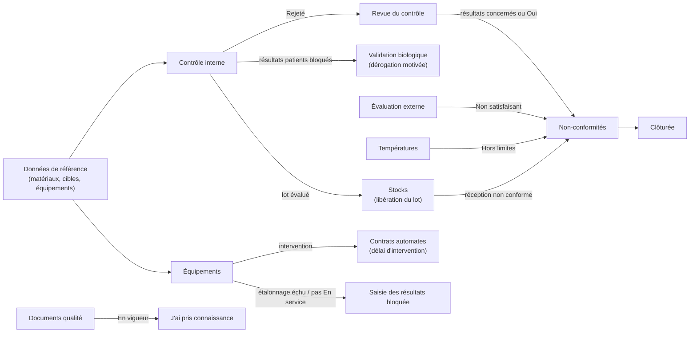
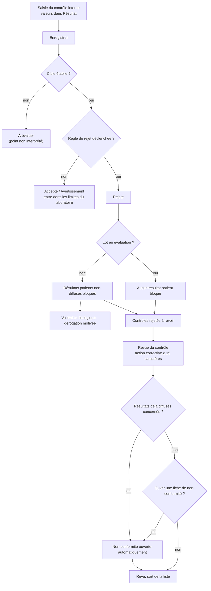
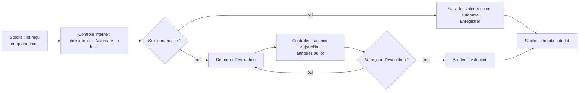
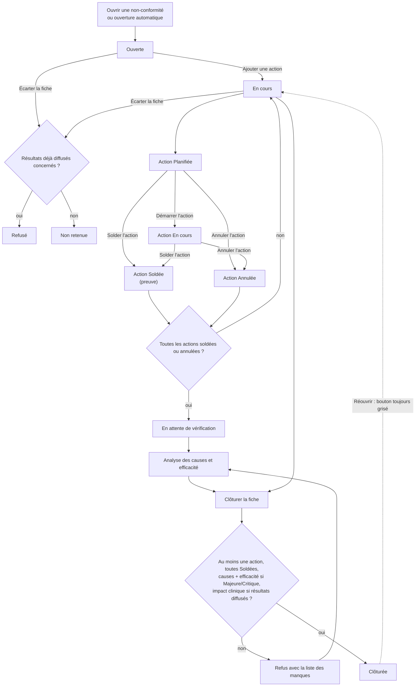
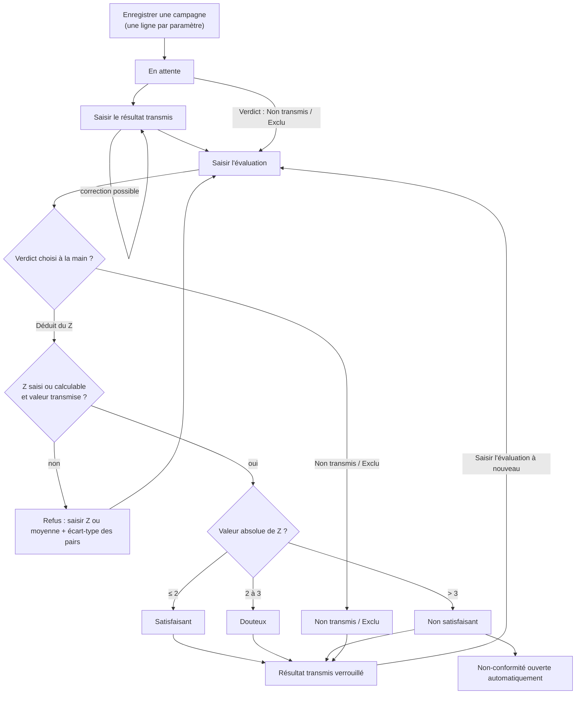
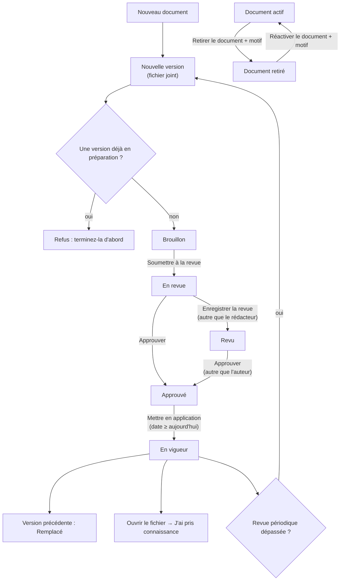
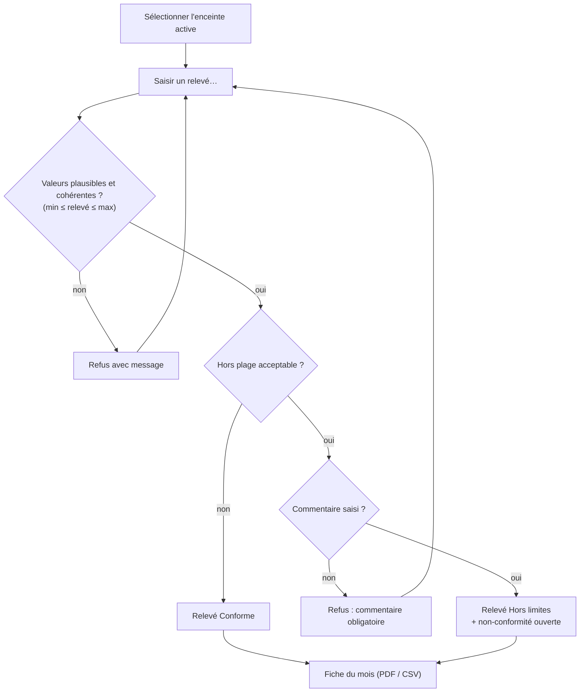
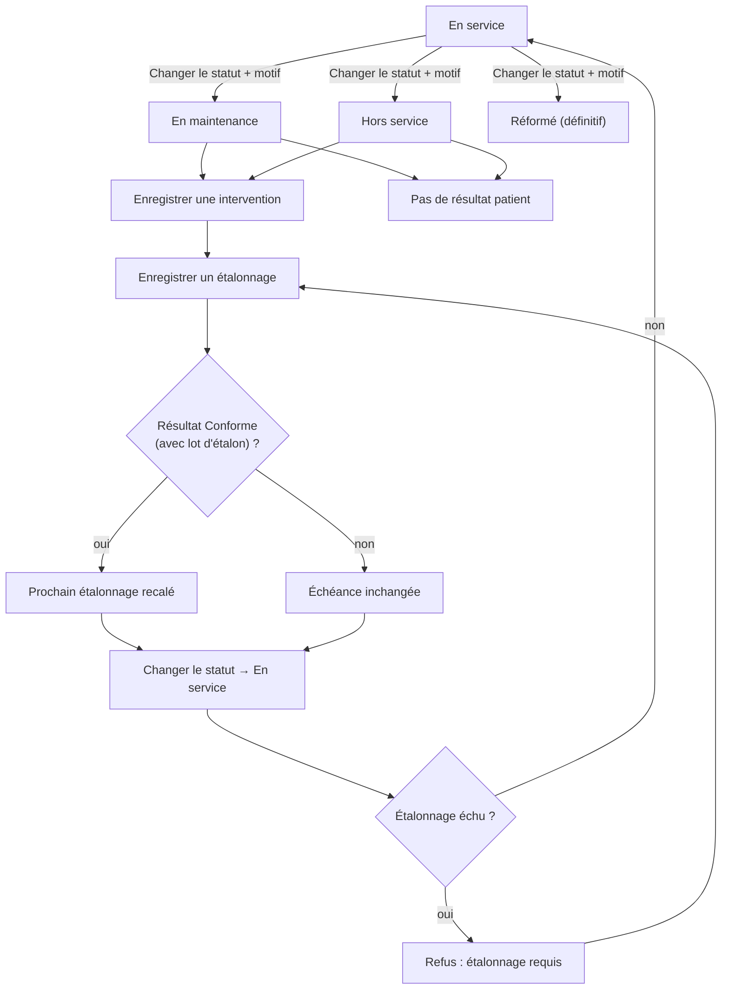
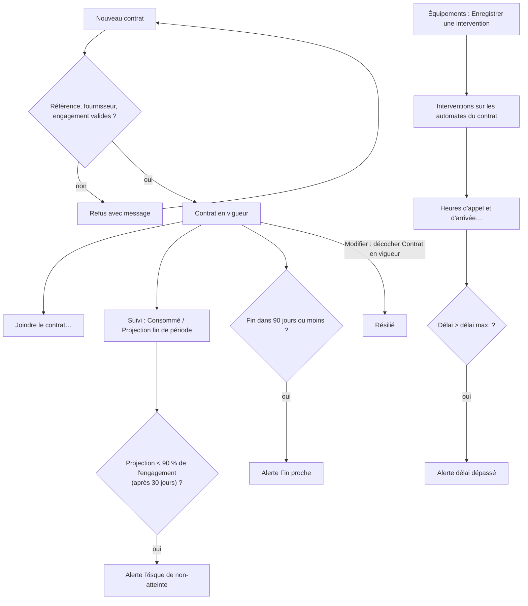

## Qualité et équipements

Ce chapitre couvre deux groupes du menu de gauche :

- le groupe **Qualité** : **Contrôle interne**, **Non-conformités**, **Évaluation externe**, **Documents qualité** ;
- dans le groupe **Stocks** : **Températures**, **Équipements**, **Contrats automates**.

Ces écrans forment le système de management de la qualité du laboratoire (ISO 15189) : maîtrise analytique, traitement des écarts, maîtrise documentaire, suivi du matériel et de la chaîne du froid.

Quelques règles communes à tous les écrans :

- Un bouton auquel vous n'avez pas droit reste visible mais **grisé**. Un écran auquel vous n'avez pas droit n'apparaît pas dans le menu.
- **F5** actualise l'écran, **Ctrl+P** imprime la liste principale de l'écran, **F1** affiche la liste des raccourcis. **Ctrl+S** déclenche le bouton **Enregistrer** de l'écran quand il en a un (c'est le cas du **Contrôle interne**).
- Toute action enregistrée (saisie, revue, clôture, changement de statut…) est tracée dans le journal d'audit avec son auteur, sa date et, quand il est demandé, son motif.
- Les non-conformités ouvertes automatiquement (contrôle rejeté, évaluation externe non satisfaisante, température hors limites) reçoivent un numéro dans la même série continue que les non-conformités ouvertes à la main.

Vue d'ensemble des flux du groupe :

---

### Contrôle interne

Saisir les résultats des contrôles de qualité interne, les voir sur la carte de Levey-Jennings et revoir les contrôles rejetés, sur un seul écran.

**Qui y a accès**

| Droit | Ce qu'il permet | Rôles par défaut |
|---|---|---|
| Saisie du contrôle interne | Voir l'écran, **Enregistrer** une série, **Démarrer / Arrêter l'évaluation** d'un lot | Biologiste responsable, Biologiste, Technicien de laboratoire, Responsable qualité, Administrateur |
| Revue du contrôle interne | Voir l'écran, **Revue du contrôle** | Biologiste responsable, Biologiste, Responsable qualité, Administrateur |
| Règles du contrôle interne | **Établir les limites du laboratoire**, **Règles de Westgard** | Biologiste responsable, Responsable qualité, Administrateur |

Le secrétariat, les préleveurs, la comptabilité et les prescripteurs n'ont pas accès à cet écran.

**L'écran**

L'écran est divisé en trois zones.

1. **En haut à gauche — Saisie du contrôle interne** (le titre indique le nombre de lignes). Une ligne par cible de contrôle active : colonnes **Paramètre**, **Niveau** (Bas, Normal, Élevé, Complémentaire), **Lot de contrôle**, **Automate**, **Résultat** (seule colonne saisissable), **Cible** (moyenne ± écart-type), **Antériorité** (dernière valeur), **Règles de Westgard actives** (nombre de règles ; le détail, le CV et le nombre de points s'affichent au survol).
   - Une ligne en rouge signale un matériau de contrôle périmé ou hors stabilité après ouverture.
   - Une cible écrite en orange signifie que les limites utilisées sont celles du fournisseur, et non celles du laboratoire.
   - Sous la grille : **Enregistrer**, **Actualiser**, la liste du lot de réactif (par défaut **Lot de réactif en cours (automatique)**), la liste **Automate du lot…**, **Démarrer l'évaluation**, **Arrêter l'évaluation**.
2. **En haut à droite — Carte de Levey-Jennings** du contrôle sélectionné (60 derniers jours). L'axe vertical est en écarts-types (de −4 à +4) ; la moyenne et les limites ±1, ±2, ±3 s sont tracées et étiquetées avec leur valeur. Un point accepté est un rond vert, un avertissement un triangle orange, un rejet un carré rouge ; un rejet entouré de pointillés a fait l'objet d'une dérogation à la validation. L'en-tête indique le paramètre, le lot, l'automate, le CV et la base des limites (« limites fournisseur » ou « limites du laboratoire »). Au survol d'un point : valeur, Z, date, règles violées, commentaire. Un clic sur un point affiche son détail en bas de l'écran. Boutons : **Établir les limites du laboratoire**, **Règles de Westgard**.
3. **En bas — Contrôles rejetés à revoir** : tous les points rejetés non encore revus, colonnes **Mesuré le**, **Paramètre**, **Automate**, **Lot de contrôle**, **Niveau**, **Résultat**, **Écart normalisé (Z)**, **Règles de Westgard actives**, **Résultats déjà diffusés concernés** (en gras si des résultats patients sont touchés). Bouton **Revue du contrôle** et une ligne d'état.

Sélectionner une ligne en haut ou en bas affiche sa carte de Levey-Jennings.

**Scénarios**

*1. Saisir une série de contrôles (routine du matin)*
1. Ouvrez **Qualité > Contrôle interne**.
2. Laissez la liste du lot sur **Lot de réactif en cours (automatique)**.
3. Cliquez dans la colonne **Résultat** de la première ligne, tapez la valeur, appuyez sur **Entrée** : le curseur descend à la ligne suivante. La virgule et le point sont acceptés.
4. Saisissez tous les niveaux passés ensemble (bas, normal, élevé) : ils forment une même série, ce qui permet d'appliquer les règles qui comparent les niveaux entre eux (2₂ₛ, R₄ₛ). Les lignes laissées vides sont ignorées.
5. Cliquez **Enregistrer** (ou **Ctrl+S**, ou **Entrée** sur la dernière ligne puis **Enregistrer**).
6. Lisez le résultat :
   - la ligne d'état indique « x/y accepté » ;
   - si un contrôle est **Rejeté**, une fenêtre liste chaque paramètre rejeté avec sa valeur, son Z et la règle violée, et rappelle qu'une action corrective est exigée ;
   - une seconde fenêtre peut signaler un matériau périmé, un contrôle sans cible, ou le nombre de résultats patients bloqués.
7. Les valeurs saisies sont effacées, la grille et la liste des rejets sont rechargées.

Si vous quittez l'écran avec des valeurs saisies et non enregistrées, l'application demande confirmation.

*2. Consulter la carte de Levey-Jennings*
1. Sélectionnez une ligne de la grille de saisie ou de la liste des rejets.
2. La carte s'affiche à droite. Passez la souris sur un point pour lire la valeur ; cliquez pour l'afficher en bas.
3. Pour imprimer la carte : non prévu à l'écran (seule la liste principale s'imprime avec **Ctrl+P**).

*3. Revoir un contrôle rejeté (action corrective)*
1. Dans **Contrôles rejetés à revoir**, sélectionnez la ligne.
2. Cliquez **Revue du contrôle**.
3. Décrivez l'action corrective (au moins 15 caractères) : recalibration, nouveau flacon, maintenance…
4. Si des résultats patients sont concernés, une non-conformité est ouverte automatiquement. Sinon, l'application demande « Ouvrir une fiche de non-conformité pour ce rejet ? » : répondez Oui ou Non.
5. La ligne quitte la liste. La non-conformité ouverte (catégorie Analytique, gravité Majeure, échéance à 14 jours, action immédiate = votre texte) apparaît dans **Non-conformités**.

*4. Établir les limites propres au laboratoire*
1. Sélectionnez la ligne du contrôle dans la grille de saisie.
2. Cliquez **Établir les limites du laboratoire**.
3. Indiquez sur combien de jours d'antériorité calculer (60 par défaut). Il faut au moins 20 points acceptés sur cette période.
4. L'application affiche la **Moyenne du laboratoire**, l'**Écart-type du laboratoire** et le **Nombre de points**. Ces limites remplacent celles du fournisseur dès 20 points.
5. Pour exclure une période déjà expliquée, choisissez un nombre de jours qui ne la couvre pas.

*5. Choisir les règles de Westgard d'un contrôle*
1. Sélectionnez la ligne du contrôle.
2. Cliquez **Règles de Westgard**.
3. Cochez ou décochez les règles (1₂ₛ, 1₃ₛ, 2₂ₛ, R₄ₛ, 3₁ₛ, 4₁ₛ, 2/3₂ₛ, 7ₜ, 8ₓ, 10ₓ, 12ₓ). La description de la règle sélectionnée s'affiche dessous.
4. Raccourcis : **Multirègle classique (1₂ₛ 1₃ₛ 2₂ₛ R₄ₛ 4₁ₛ 10ₓ)** ou **1₃ₛ seule**.
5. Cliquez **Enregistrer**. Si aucune règle n'est cochée, un avertissement rouge rappelle que le contrôle n'enregistrera jamais de rejet.

*6. Évaluer un nouveau lot de réactif avant sa libération*
1. Dans la liste du lot, choisissez le lot à évaluer (les lots en quarantaine sont marqués « en quarantaine »).
2. Dans **Automate du lot…**, choisissez l'automate sur lequel il est chargé (choisi d'office s'il n'y en a qu'un).
3. Saisie manuelle : saisissez les valeurs des contrôles de cet automate et cliquez **Enregistrer**. Seules les lignes de cet automate sont attribuées au nouveau lot ; les autres automates restent en contrôle de routine.
4. Contrôles transmis par l'automate : cliquez **Démarrer l'évaluation**. Le prochain contrôle de chaque niveau transmis aujourd'hui par l'automate sera attribué au lot. Recommencez chaque jour d'une évaluation sur plusieurs jours.
5. Cliquez **Arrêter l'évaluation** pour que les contrôles transmis reviennent au lot en cours.
6. La libération du lot se fait ensuite dans l'écran **Stocks** (fiche du lot).

**Règles et contrôles**

- Un contrôle **Rejeté** bloque les résultats patients non encore diffusés du même paramètre sur le même automate, produits depuis le dernier contrôle accepté. Le biologiste ne pourra les valider qu'avec une dérogation motivée (écran **Validation biologique**).
- Un rejet sur un lot en cours d'évaluation ne bloque aucun résultat patient (aucun patient n'a été analysé avec ce lot).
- Un contrôle sans cible est enregistré avec le verdict **À évaluer** : « Aucune cible (moyenne et écart-type) n'est établie pour ce contrôle. » Créez la cible dans **Données de référence**.
- Un matériau périmé est signalé ; le point est quand même enregistré.
- Seuls les points acceptés (ou en avertissement) entrent dans le calcul des limites du laboratoire ; les points rejetés et les points d'évaluation d'un nouveau lot n'y entrent pas.
- Un lot de réactif choisi ne s'applique qu'à un seul automate : « Le lot de réactif choisi ne s'applique qu'aux contrôles d'un seul automate… ».
- **Démarrer l'évaluation** est refusé si le lot n'est plus en attente de libération.
- La revue d'un rejet exige une action corrective ; sans elle : « Un contrôle rejeté exige la description de l'action corrective entreprise. »

| Verdict | Signification |
|---|---|
| Accepté | Dans les limites, aucune règle de rejet déclenchée |
| Avertissement | Règle d'avertissement (1₂ₛ) : série utilisable, à surveiller |
| Rejeté | Règle de rejet déclenchée : résultats patients bloqués, revue obligatoire |
| À évaluer | Pas de cible : point non interprétable |

**Flux**

Données de référence (matériau + cible) → **Contrôle interne** (saisie, revue) → **Non-conformités** si besoin → **Validation biologique** (dérogation pour les résultats bloqués). Pour un nouveau lot : réception en **Stocks** → évaluation ici → libération en **Stocks**.

Saisie et revue d'une série :

Évaluation d'un nouveau lot de réactif :

---

### Non-conformités

Tenir le registre des non-conformités : déclarer un écart, planifier et solder les actions, analyser les causes, vérifier l'efficacité, clôturer.

**Qui y a accès**

- **Voir le registre** : toute personne ayant le droit de consultation qualité (Biologiste responsable, Biologiste, Technicien de laboratoire, Responsable qualité, Administrateur).
- **Ouvrir et traiter une non-conformité** (tous les boutons) : Biologiste responsable, Biologiste, Responsable qualité, Administrateur. Le technicien voit le registre mais tous les boutons sont grisés.

**L'écran**

- **En haut, le registre** : titre **Non-conformités** (avec le nombre et le nombre en retard), case **Ouverte** (cochée par défaut : n'affiche que les fiches Ouvertes, En cours, En attente de vérification), liste des catégories (**Tout sélectionner** ou une catégorie), boutons **Ouvrir une non-conformité** et **Actualiser**. Colonnes : **Référence**, **Gravité**, **Catégorie**, **Description**, **Détectée le**, **Pilote**, **Échéance**, **Actions** (soldées / total), **Statut**. Après la référence, « ↻ » signale une récidive, « ⚠ » des résultats déjà diffusés concernés. Les fiches critiques sont en rouge, les majeures en orange, les fiches en retard en gras.
- **En bas, la fiche sélectionnée** : description, source de détection, auteur, jours d'ouverture, récidive, résultats concernés ; puis la liste des **Actions** (colonnes **Désignation** (le type d'action), **Description**, **Pilote**, **Échéance**, **Statut**, **Date** de solde). Deux rangées de boutons :
  - actions : **Ajouter une action**, **Démarrer l'action**, **Solder l'action**, **Annuler l'action** ;
  - fiche : **Analyse des causes et efficacité**, **Clôturer la fiche**, **Réouvrir**, **Écarter la fiche**.

**Scénarios**

*1. Déclarer une non-conformité*
1. Cliquez **Ouvrir une non-conformité**.
2. Choisissez la **Catégorie** (Pré-analytique, Analytique, Post-analytique, Équipement, Réactif / consommable, Personnel, Documentation, Système d'information, Réclamation, Sécurité / biosécurité, Protection des données, Prestataire externe).
3. Choisissez la **Gravité** (Mineure, Majeure, Critique, Observation).
4. Choisissez la **Source de détection** (Observation du personnel, Contrôle interne de qualité, Évaluation externe de la qualité, Audit interne, Audit externe, Réclamation du patient, Réclamation du prescripteur, Revue de direction, Alarme automate, Information du fournisseur).
5. Rédigez la **Description** (obligatoire) et, si une mesure a été prise sur le champ, l'**Action immédiate**.
6. Si des résultats déjà remis aux patients sont touchés, cochez **Résultats déjà diffusés concernés** et indiquez le nombre de patients.
7. Ajustez l'**Échéance** (J+14 par défaut).
8. Cliquez **Enregistrer**. La référence attribuée s'affiche en bas. Vous êtes le pilote de la fiche.

*2. Ajouter une action*
1. Sélectionnez la fiche, cliquez **Ajouter une action**.
2. Choisissez le type : Correction (traite cette occurrence), Action corrective (supprime la cause) — choix par défaut —, Action préventive, Action d'amélioration.
3. Décrivez l'action (obligatoire), fixez l'**Échéance**, cliquez **Enregistrer**.
4. L'action est « Planifiée » ; vous en êtes le pilote. La fiche passe « En cours ».

*3. Faire avancer une action*
1. Sélectionnez l'action dans la liste du bas.
2. **Démarrer l'action** : l'action passe « En cours » (seulement depuis « Planifiée »).
3. **Solder l'action** : indiquez la preuve de réalisation (« Quelle preuve atteste que l'action a bien été réalisée ? »). L'action passe « Soldée ». Quand toutes les actions sont soldées, la fiche passe « En attente de vérification ».

*4. Annuler une action saisie par erreur*
1. Sélectionnez l'action (planifiée ou en cours), cliquez **Annuler l'action**, donnez le motif.
2. Une action soldée ne peut pas être annulée.
3. Attention : voir « Règles et contrôles » ci-dessous, une action annulée empêche actuellement la clôture (à vérifier).

*5. Enregistrer l'analyse des causes et la vérification d'efficacité*
1. Sélectionnez la fiche, cliquez **Analyse des causes et efficacité**.
2. Choisissez la catégorie de cause (Erreur humaine, Formation insuffisante, Procédure absente ou imprécise, Procédure non respectée, Défaillance d'équipement, Défaut de réactif, Dérive d'étalonnage, Anomalie logicielle, Défaut de communication, Prestataire externe, Charge de travail, Conditions environnementales, Non déterminée).
3. Rédigez l'analyse des causes, l'**Évaluation de l'impact clinique** (en rouge et obligatoire si des résultats diffusés sont concernés), la **Vérification de l'efficacité**.
4. Si des résultats diffusés sont concernés, cochez **Comptes rendus rectifiés émis** quand c'est fait.
5. Cliquez **Enregistrer**. Vous pouvez rouvrir la fenêtre plus tard pour compléter : un champ laissé vide ne remplace pas le texte déjà enregistré. La fenêtre ne réaffiche pas les textes déjà saisis, et la catégorie de cause choisie est toujours réenregistrée.

*6. Clôturer une fiche*
1. Sélectionnez la fiche, cliquez **Clôturer la fiche**, confirmez.
2. Si quelque chose manque, la liste complète des manques s'affiche (voir règles). Complétez puis recommencez.

*7. Écarter un signalement non fondé*
1. Sélectionnez la fiche, cliquez **Écarter la fiche**, confirmez.
2. Rédigez la justification (au moins 15 caractères).
3. La fiche passe « Non retenue » et ne compte pas parmi les non-conformités de la période.

*8. Réouvrir une fiche clôturée*
1. Décochez **Ouverte** pour afficher les fiches clôturées, sélectionnez la fiche.
2. Bouton **Réouvrir** : il reste grisé pour une fiche clôturée dans la version actuelle (voir le document de vérification). Cette opération n'est donc pas réalisable aujourd'hui depuis l'écran.

*9. Filtrer le registre*
- Décochez **Ouverte** pour voir aussi les fiches clôturées et non retenues.
- Choisissez une catégorie dans la liste.

**Règles et contrôles**

- Numérotation : chaque fiche reçoit une référence dans une série annuelle continue, partagée avec les fiches ouvertes automatiquement.
- Récidive : une fiche est marquée récidive si une fiche de même catégorie a été ouverte dans les 12 derniers mois.
- Clôture refusée tant que :
  - aucune action n'est enregistrée ;
  - toutes les actions ne sont pas soldées ;
  - pour une fiche **Majeure** ou **Critique** : la catégorie de cause et l'analyse des causes manquent, ou la vérification d'efficacité manque ;
  - si des résultats diffusés sont concernés : l'évaluation de l'impact clinique manque.
- Une fiche avec des résultats déjà diffusés ne peut pas être écartée : « Des résultats ont déjà été diffusés : quelque chose est parvenu au patient… ».
- Une fiche clôturée ou non retenue n'est plus modifiable.
- Une action annulée n'est pas « soldée » : la clôture la compte comme non soldée et refuse (« Toutes les actions doivent être soldées avant la clôture. ») — à vérifier, voir vérification.

| Statut | Signification |
|---|---|
| Ouverte | Déclarée, aucune action encore |
| En cours | Au moins une action enregistrée |
| En attente de vérification | Toutes les actions soldées ; reste l'analyse / l'efficacité puis la clôture |
| Clôturée | Traitée et close |
| Non retenue | Écartée comme signalement non fondé |

**Flux**

Sources : saisie directe, **Contrôle interne** (revue d'un rejet), **Évaluation externe** (verdict non satisfaisant), **Températures** (relevé hors limites), réception en **Stocks**. Tout aboutit dans ce registre, qui alimente la revue de direction.

Cycle de vie d'une fiche (tel que le code le fait aujourd'hui) :

Une action **Annulée** fait passer la fiche « En attente de vérification » mais bloque ensuite la clôture (elle n'est pas « Soldée »).

---

### Évaluation externe

Suivre les campagnes d'évaluation externe de la qualité (EEQ) : inscription des paramètres, valeur transmise à l'organisateur, verdict reçu.

**Qui y a accès**

- **Voir** : Biologiste responsable, Biologiste, Technicien de laboratoire, Responsable qualité, Administrateur.
- **Saisir le résultat transmis** : droit de saisie du contrôle interne (les mêmes, y compris le technicien).
- **Enregistrer une campagne** et **Saisir l'évaluation** : droit de revue du contrôle interne (Biologiste responsable, Biologiste, Responsable qualité, Administrateur).

**L'écran**

- En haut : titre avec le nombre de lignes, le taux de résultats satisfaisants et le nombre de réponses en retard ; **Année** ; case **Évaluations en attente seulement** ; **Actualiser**.
- Grille, une ligne par paramètre et par campagne : **Programme**, **Campagne**, **Date**, **Paramètre**, **Automate**, **Date limite de réponse** (« ! » si dépassée), **Valeur transmise**, **Valeur assignée**, **Z**, **Biais (%)**, **Verdict**, **Non-conformité**. Couleurs : rouge pour Non satisfaisant et Non transmis, orange pour Douteux et pour une réponse en retard, vert pour Satisfaisant.
- En bas : détail (date de transmission, groupe de pairs, commentaires) et boutons **Enregistrer une campagne**, **Saisir le résultat transmis**, **Saisir l'évaluation**.

**Scénarios**

*1. Enregistrer une campagne à réception des échantillons*
1. Cliquez **Enregistrer une campagne**.
2. Saisissez le **Programme** (ex. nom de l'organisateur) et la **Campagne** (référence), la **Date de la campagne**, cochez et réglez la **Date limite de réponse** si besoin, choisissez l'**Automate** (facultatif).
3. Cochez les **Paramètres couverts par la campagne**.
4. Cliquez **Enregistrer**. Le message indique combien de paramètres ont été ajoutés. Un paramètre déjà inscrit pour la même campagne est ignoré.

*2. Saisir la valeur transmise à l'organisateur*
1. Sélectionnez la ligne (verdict « En attente »), cliquez **Saisir le résultat transmis**.
2. Saisissez la **Valeur transmise** exactement comme envoyée et la date **Transmis le** (pas dans le futur).
3. Cliquez **Enregistrer**. La valeur reste modifiable jusqu'à la saisie de l'évaluation.

*3. Saisir le rapport d'évaluation de l'organisateur*
1. Sélectionnez la ligne, cliquez **Saisir l'évaluation**.
2. Saisissez la **Valeur assignée**, la **Moyenne des pairs**, l'**Écart-type des pairs** et, si le rapport le donne, l'**Écart normalisé (Z)** (il fait foi ; sinon il est calculé).
3. Laissez **Verdict** sur **Déduit de l'écart normalisé**, ou choisissez **Non transmis** ou **Exclu** pour ces cas particuliers.
4. Ajoutez l'analyse et les commentaires (français, arabe).
5. Cliquez **Enregistrer**. En cas de verdict **Non satisfaisant**, une non-conformité est ouverte et son numéro s'affiche : complétez-la dans **Non-conformités**.

*4. Consulter le bilan annuel*
1. Choisissez l'**Année**, décochez **Évaluations en attente seulement**.
2. Lisez le taux de satisfaisants dans le titre ; **Ctrl+P** imprime la liste.

**Règles et contrôles**

- Programme, campagne et au moins un paramètre sont obligatoires ; la date limite ne peut pas précéder la date de campagne.
- La valeur transmise ne peut plus changer une fois l'évaluation saisie.
- Seuls « Non transmis » et « Exclu » se choisissent à la main ; les autres verdicts découlent du Z.
- L'écart-type des pairs doit être strictement positif.
- Sans Z ni moyenne/écart-type des pairs, l'évaluation est refusée : « Saisissez l'écart normalisé, ou la moyenne et l'écart-type des pairs pour le calculer. »
- Classement appliqué : |Z| ≤ 2 Satisfaisant ; 2 < |Z| ≤ 3 Douteux ; |Z| > 3 Non satisfaisant (non-conformité Majeure, catégorie Analytique, échéance J+14). Le texte d'aide de la fenêtre indique « |Z| ≥ 3 » : pour un Z exactement égal à 3, le verdict sera Douteux (à vérifier).
- Le biais (%) est calculé par rapport à la valeur assignée.

**Flux**

Réception des échantillons EEQ → analyse comme un échantillon patient → **Saisir le résultat transmis** → rapport de l'organisateur → **Saisir l'évaluation** → **Non-conformités** si non satisfaisant.

---

### Documents qualité

Gérer les procédures, modes opératoires, formulaires et autres documents maîtrisés : rédaction, vérification, approbation, mise en application, prise de connaissance.

**Qui y a accès**

- **Consulter, ouvrir un fichier, déclarer « J'ai pris connaissance »** : droit de consultation qualité (Biologiste responsable, Biologiste, Technicien de laboratoire, Responsable qualité, Administrateur). Le secrétariat, les préleveurs et la comptabilité n'ont pas accès à cet écran.
- **Nouveau document, Nouvelle version, Soumettre à la revue, Enregistrer la revue** : gestion documentaire (Biologiste responsable, Responsable qualité, Administrateur).
- **Approuver, Mettre en application, Retirer / Réactiver le document** : approbation documentaire (Biologiste responsable, Responsable qualité, Administrateur).

**L'écran**

- En haut : titre **Documents qualité** (avec le nombre de revues dépassées et de documents à lire), case **Afficher aussi les documents retirés**, **Actualiser**.
- Liste des documents : **Référence**, **Titre**, **Type**, **Processus**, **Version en vigueur**, **En vigueur le**, **Prochaine revue**, **Version en cours**, **Responsable**, **Lu**.
- Liste des **Versions** du document sélectionné : **Version**, **Statut**, **Modifications**, **Fichier**, **Rédacteur**, **Créé le**, **Vérificateur**, **Approbateur**, dates d'application et de retrait (**Retiré le**).
- Boutons : **Nouveau document**, **Nouvelle version**, **Soumettre à la revue**, **Enregistrer la revue**, **Approuver**, **Mettre en application**, **Ouvrir le fichier**, **J'ai pris connaissance**, **Retirer le document** (ou **Réactiver le document**). Un message signale « Aucune version en vigueur » ou « La revue périodique est dépassée ».

**Scénarios**

*1. Créer un document*
1. Cliquez **Nouveau document**.
2. Saisissez la **Référence** (définitive, unique), le **Type** (Manuel qualité, Procédure, Mode opératoire, Formulaire / enregistrement, Fiche technique, Fiche de données de sécurité, Document externe, Habilitation / fiche de poste), le **Processus** (facultatif), le **Titre (français)** (obligatoire) et, si souhaité, les titres arabe et anglais.
3. Réglez la **Périodicité de revue (mois)** (24 par défaut) et cochez **Prise de connaissance obligatoire** si le personnel doit attester sa lecture.
4. Cliquez **Enregistrer**. L'application propose de joindre tout de suite le fichier de la première version.

*2. Rédiger une nouvelle version*
1. Sélectionnez le document, cliquez **Nouvelle version**.
2. **Parcourir…** pour choisir le fichier (PDF, JPG, PNG, TIFF, DOCX, XLSX ; 20 Mo maximum).
3. Résumez les modifications (français, arabe facultatif). Cliquez **Enregistrer**.
4. La version est un **Brouillon** ; la version en vigueur reste applicable.

*3. Faire vérifier et approuver*
1. Le rédacteur sélectionne le brouillon et clique **Soumettre à la revue** (statut **En revue**).
2. Une autre personne clique **Enregistrer la revue** (statut **Revu**).
3. Une personne ayant le droit d'approbation, autre que le rédacteur, clique **Approuver** (statut **Approuvé**). L'approbation est possible directement depuis « En revue ».

*4. Mettre en application*
1. Sélectionnez la version approuvée, cliquez **Mettre en application**.
2. Choisissez la date (aujourd'hui ou plus tard, le temps de former le personnel). La fenêtre rappelle que la version précédente sera retirée la veille.
3. Cliquez **Enregistrer**. La nouvelle version devient **En vigueur**, l'ancienne passe **Remplacé**.

*5. Lire un document et attester sa lecture*
1. Sélectionnez le document, puis sa version, cliquez **Ouvrir le fichier**.
2. Cliquez **J'ai pris connaissance**, confirmez. La colonne **Lu** est mise à jour pour vous.

*6. Retirer ou réactiver un document*
1. Sélectionnez le document, cliquez **Retirer le document**, donnez le motif. Ses versions restent consultables (cochez **Afficher aussi les documents retirés**).
2. Pour le remettre en usage : sélectionnez-le, cliquez **Réactiver le document**, donnez le motif.

**Règles et contrôles**

- Une seule version en préparation à la fois : « Une version de ce document est déjà en cours de rédaction ou d'approbation. Terminez-la avant d'en ouvrir une autre. »
- Le vérificateur ne peut pas être le rédacteur ; l'approbateur ne peut pas être l'auteur.
- Une version doit être approuvée avant d'entrer en application ; la date d'application ne peut pas être passée.
- Un brouillon sans fichier ne peut pas être soumis.
- Un fichier d'un type non autorisé n'est ni enregistré ni ouvert.
- Un brouillon ne peut pas être abandonné ni supprimé depuis l'écran (à vérifier : seul moyen de le dépasser, le mener jusqu'à l'application).

| Statut de version | Signification |
|---|---|
| Brouillon | En rédaction |
| En revue | Soumis à vérification |
| Revu | Vérifié, en attente d'approbation |
| Approuvé | Approuvé, pas encore applicable |
| En vigueur | Version applicable |
| Remplacé | Remplacé par une version plus récente |
| Périmé | Plus applicable |

**Flux**

Rédaction → **Soumettre à la revue** → **Enregistrer la revue** → **Approuver** → **Mettre en application** → lecture par le personnel (**J'ai pris connaissance**) → revue périodique (nouvelle version).

---

### Températures

Enregistrer les relevés de température des réfrigérateurs, congélateurs et pièces, et sortir la fiche mensuelle.

Menu : groupe **Stocks > Températures**.

**Qui y a accès**

- **Saisir un relevé** : Biologiste responsable, Biologiste, Technicien de laboratoire, Responsable qualité, Administrateur.
- **Nouvelle enceinte / Modifier l'enceinte** : Biologiste responsable, Responsable qualité, Administrateur.
- Toute personne qui voit l'écran peut consulter et exporter la fiche du mois.

**L'écran**

- En haut : **Saisir un relevé…**, **Nouvelle enceinte…**, **Modifier l'enceinte…**, case **Afficher les enceintes désactivées**, sélecteur du mois, **Fiche du mois (PDF)**, **Fiche du mois (CSV)**, et un message « x enceinte(s) sans relevé aujourd'hui ».
- Liste des enceintes : **Désignation**, **Type**, **Emplacement**, **Plage acceptable**, **Relevés du jour** (faits / attendus), **Dernier relevé**, **Date**, **Statut** (Conforme, Hors limites, Pas de relevé aujourd'hui, Désactivée).
- Liste des **Relevés** du mois de l'enceinte sélectionnée : **Date**, **Température (°C)**, **Min. de la période (°C)**, **Max. de la période (°C)**, **Statut**, **Relevé par**, **Commentaire**, **Non-conformité**.

**Scénarios**

*1. Saisir le relevé du matin ou du soir*
1. Sélectionnez l'enceinte (active), cliquez **Saisir un relevé…** ou double-cliquez sur la ligne.
2. Saisissez la **Température (°C)** ; si le thermomètre les donne, le **Min. de la période** et le **Max. de la période**.
3. La fenêtre rappelle la plage acceptable. Si une valeur est hors limites, le **Commentaire** est obligatoire : décrivez ce qui a été fait (produits déplacés, technicien appelé…).
4. Cliquez **Enregistrer**. Hors limites : un message annonce la non-conformité ouverte.

*2. Déclarer une nouvelle enceinte*
1. Cliquez **Nouvelle enceinte…**.
2. Saisissez la **Désignation**, le **Type** (Réfrigérateur (2 à 8 °C), Congélateur −20 °C, Congélateur −80 °C, Pièce / ambiant) : la plage par défaut se remplit (2/8, −25/−15, −90/−70, 15/25 °C).
3. Ajustez **Minimum (°C)**, **Maximum (°C)**, **Relevés par jour** (2 par défaut), **Emplacement**, **N° de série / inventaire**. Laissez **Actif** coché.
4. Cliquez **Enregistrer**.

*3. Modifier ou désactiver une enceinte*
1. Sélectionnez l'enceinte, cliquez **Modifier l'enceinte…**.
2. Modifiez ; décochez **Actif** pour la retirer du service. Cliquez **Enregistrer**.
3. Pour la retrouver : cochez **Afficher les enceintes désactivées**.

*4. Imprimer la fiche mensuelle*
1. Sélectionnez l'enceinte, choisissez le mois.
2. Cliquez **Fiche du mois (PDF)** ou **Fiche du mois (CSV)**. La fiche reprend tous les relevés, leurs auteurs, le nombre de dépassements, le minimum et le maximum du mois.

**Règles et contrôles**

- Une valeur hors plage (relevé, minimum ou maximum) exige un commentaire et ouvre une non-conformité (catégorie Équipement, gravité Majeure, échéance J+7, action immédiate = votre commentaire).
- Valeurs refusées : température invraisemblable (en dessous de −200 °C ou au-dessus de 100 °C), minimum supérieur au maximum, relevé en dehors de l'intervalle minimum–maximum saisi.
- Pas de relevé sur une enceinte désactivée.
- Le nom d'une enceinte est unique ; le minimum doit être inférieur au maximum.
- Un relevé enregistré ne se corrige ni ne se supprime depuis l'écran.
- L'enceinte est distincte de la fiche **Équipements** : un réfrigérateur peut exister dans les deux écrans sans lien entre eux (à vérifier).

**Flux**

Relevé quotidien → hors limites → **Non-conformités** (à traiter et clôturer) → fiche mensuelle archivée au dossier qualité.

---

### Équipements

Suivre le parc d'équipements : échéances de maintenance et d'étalonnage, interventions, statut (en service, en maintenance, hors service, réformé).

Menu : groupe **Stocks > Équipements**.

**Qui y a accès**

| Droit | Bouton | Rôles par défaut |
|---|---|---|
| Consultation des équipements | Voir l'écran | Biologiste responsable, Biologiste, Technicien de laboratoire, Responsable qualité, Administrateur |
| Maintenance | **Enregistrer une intervention** | Biologiste responsable, Technicien de laboratoire, Responsable qualité, Administrateur |
| Étalonnage | **Enregistrer un étalonnage** | Biologiste responsable, Responsable qualité, Administrateur |
| Gestion des équipements | **Changer le statut** | Biologiste responsable, Responsable qualité, Administrateur |

La création d'un équipement et le réglage de ses périodicités se font dans **Administration > Données de référence**, onglet **Automates**, bouton **Nouvel équipement**.

**L'écran**

- En haut : titre **Équipement** (avec le nombre d'échéances dépassées), case **N'afficher que les échéances dépassées et les équipements hors service**, **Actualiser**.
- Grille : **Code**, **Désignation**, **Type d'équipement**, **Statut**, **N° de série**, **Emplacement**, **Prochaine maintenance**, **Prochain étalonnage**, **Contrat de maintenance** (date de fin). Une date échue est précédée de « ! ». Étalonnage échu ou hors service : ligne rouge ; maintenance échue, contrat expiré ou en maintenance : ligne orange ; réformé : grisé.
- En bas : détail (fabricant, modèle, série, emplacement, motif du dernier changement de statut), message d'alerte (« Étalonnage échu : aucun résultat patient ne peut être produit sur cet équipement. », « Maintenance préventive échue. », « Le contrat de maintenance a expiré. ») et boutons **Enregistrer une intervention**, **Enregistrer un étalonnage**, **Changer le statut**.

**Scénarios**

*1. Enregistrer une intervention (maintenance, panne, nettoyage…)*
1. Sélectionnez l'équipement, cliquez **Enregistrer une intervention**.
2. Choisissez la **Nature de l'intervention** : Maintenance préventive, Réparation après panne, Entretien courant, Vérification métrologique, Qualification, Mise à jour logicielle, Nettoyage, Déplacement.
3. Saisissez la description (français obligatoire, arabe et anglais facultatifs), l'**Immobilisation (h)**, les **Pièces remplacées**, le **Technicien externe**.
4. Laissez cochée **Contrôle après intervention conforme**, ou décochez-la si le contrôle n'est pas conforme.
5. Cliquez **Enregistrer**. L'intervention est datée du jour. Une maintenance préventive recale la date de **Prochaine maintenance**.
6. Si un contrat couvre l'équipement, notez ensuite les heures d'appel et d'arrivée dans **Contrats automates**.

*2. Enregistrer un étalonnage*
1. Sélectionnez l'équipement, cliquez **Enregistrer un étalonnage**.
2. Choisissez le **Résultat de l'étalonnage** : Conforme, Non conforme, Conforme sous réserve, Interrompu.
3. Saisissez le **Lot d'étalon** (obligatoire pour « Conforme »), **Valable jusqu'au** (facultatif), **Pente**, **Ordonnée à l'origine**, **Commentaire**.
4. Cliquez **Enregistrer**. Seul un étalonnage « Conforme » recale la date de **Prochain étalonnage**.

*3. Mettre un équipement en maintenance ou hors service*
1. Sélectionnez l'équipement, cliquez **Changer le statut**.
2. Choisissez le **Nouveau statut** : En maintenance ou Hors service. Saisissez le **Motif** (obligatoire). Cliquez **Enregistrer**.
3. L'automate ne peut plus produire de résultats patients tant qu'il n'est pas « En service ».

*4. Remettre en service*
1. Enregistrez d'abord l'étalonnage conforme si l'étalonnage est échu.
2. **Changer le statut** → **En service**, motif, **Enregistrer**. Refusé tant que l'étalonnage est échu : « Un étalonnage est requis avant la remise en service. »

*5. Réformer un équipement*
1. **Changer le statut** → **Réformé**, motif, **Enregistrer**. La réforme est définitive.

**Règles et contrôles**

- Un automate dont l'étalonnage est échu, ou qui n'est pas « En service », ne peut produire aucun résultat patient.
- Les échéances se calculent à partir de la dernière maintenance préventive ou du dernier étalonnage conforme et de la périodicité saisie dans **Données de référence**. Sans périodicité, aucune alerte.
- Un étalonnage « Conforme » sans lot d'étalon est refusé (raccordement métrologique, ISO 15189).
- Tout changement de statut doit être motivé ; « En qualification » et « Secours » ne se règlent pas depuis cet écran.
- Décocher **Contrôle après intervention conforme** est enregistré, mais ne change pas le statut de l'équipement : changez-le vous-même (à vérifier).
- L'historique des interventions et des étalonnages ne s'affiche pas sur cet écran (les interventions des automates sous contrat sont visibles dans **Contrats automates**).

| Statut | Signification |
|---|---|
| En service | Utilisable |
| En maintenance | Intervention en cours, pas de résultat patient |
| Hors service | En panne, pas de résultat patient |
| En qualification | En cours de mise en service (réglé à la création) |
| Secours | Équipement de remplacement (réglé à la création) |
| Réformé | Retiré définitivement |

**Flux**

Données de référence (création, périodicités) → **Équipements** (interventions, étalonnages, statut) → **Contrats automates** (délais d'intervention) ; un automate hors service ou non étalonné bloque la **Saisie des résultats**.

---

### Contrats automates

Suivre les contrats d'automates, en particulier la mise à disposition de réactifs (automate prêté contre un engagement d'achat de réactifs ou de volume de tests) : engagement contre consommation, fin de contrat, délais d'intervention du fournisseur.

Menu : groupe **Stocks > Contrats automates**.

**Qui y a accès**

| Droit | Boutons | Rôles par défaut |
|---|---|---|
| Consultation des contrats | Voir l'écran, **Ouvrir le contrat joint** | Biologiste responsable, Responsable qualité, Comptabilité, Administrateur |
| Gestion des contrats | **Nouveau contrat**, **Modifier**, **Joindre le contrat…** | Biologiste responsable, Comptabilité, Administrateur |
| Maintenance | **Heures d'appel et d'arrivée…** | Biologiste responsable, Responsable qualité, Administrateur |

**L'écran**

- En haut : titre **Contrats automates** (nombre, contrats à risque, fins proches), case **Afficher aussi les contrats résiliés**, **Actualiser**, et la règle d'alerte (« risque de non-atteinte » quand la projection est sous 90 % de l'engagement ; fin de contrat signalée 90 jours avant).
- Grille des contrats : **Référence**, **Fournisseur**, **Type de contrat**, **Automates**, **Fin** (avec le nombre de jours restants), **Engagement**, **Période mesurée**, **Engagé**, **Attendu à ce jour**, **Consommé**, **Projection fin de période**, **Projection / engagé**, **Alertes** (Résilié, Échu, Risque de non-atteinte, Fin proche, délais dépassés), **Interventions** (nombre et heures d'arrêt). Risque : rouge ; fin proche ou délais dépassés : orange.
- Boutons : **Nouveau contrat**, **Modifier**, **Joindre le contrat…**, **Ouvrir le contrat joint**.
- En bas : **Interventions sur les automates du contrat** : **Date**, **Automate**, **Nature de l'intervention**, **Description**, **Immobilisation (h)**, **Appel au fournisseur**, **Arrivée du technicien**, **Délai (h)**, **Technicien externe** ; bouton **Heures d'appel et d'arrivée…**.

**Scénarios**

*1. Saisir un contrat de mise à disposition*
1. Cliquez **Nouveau contrat** (ou double-cliquez sur une ligne pour la modifier).
2. Saisissez la **Référence**, le **Fournisseur**, le **Type de contrat** (Mise à disposition par défaut ; aussi Location, Achat, Comodat (prêt à usage)), cochez **Contrat en vigueur**.
3. **Début** et **Durée (mois)** (60 par défaut).
4. **Engagement** : Tests par an, Tests sur la durée, Achats de réactifs par an (MAD HT), Achats de réactifs sur la durée (MAD HT), ou Sans engagement ; puis **Engagé** (volume ou montant).
5. **Analyses comptées** : codes séparés par des virgules (vide = toutes).
6. **Pénalité (MAD)**, **Visites préventives / an**, **Délai max. d'intervention (h)**.
7. Cochez les **Automates** couverts.
8. **Réactifs captifs et prix contractuels** : une ligne par article, avec **Prix contrat HT / unité** et **Coût par test**.
9. Clauses : **Maintenance (préventive, curative, pièces)**, **Formation**, **Conditions de sortie**, **Pénalités**, **Observations**.
10. Cliquez **Enregistrer**.

*2. Joindre et consulter le contrat signé*
1. Sélectionnez le contrat, cliquez **Joindre le contrat…**, choisissez le fichier (PDF, image, DOCX). Si un fichier existe déjà, l'application demande confirmation ; l'ancien reste archivé.
2. **Ouvrir le contrat joint** affiche le fichier courant.

*3. Suivre l'engagement*
1. Lisez **Attendu à ce jour**, **Consommé**, **Projection fin de période** et **Projection / engagé**.
2. Engagement en tests : compté sur les résultats produits par les automates du contrat (une analyse demandée = un test). Engagement en montant : compté sur les commandes approuvées des réactifs captifs à ce fournisseur. Un engagement annuel est mesuré par année de contrat.
3. Alerte « Risque de non-atteinte » si la projection est sous 90 % de l'engagement (pas d'alerte pendant les 30 premiers jours d'une période).

*4. Mesurer le délai d'intervention du fournisseur*
1. L'intervention est d'abord enregistrée dans **Équipements** (**Enregistrer une intervention**).
2. Ici, sélectionnez le contrat puis l'intervention, cliquez **Heures d'appel et d'arrivée…**.
3. Cochez et renseignez **Appel au fournisseur** et **Arrivée du technicien** (date et heure, pas dans le futur). Cliquez **Enregistrer**.
4. Le **Délai (h)** est calculé et comparé au délai maximal du contrat ; un dépassement s'affiche en orange et dans **Alertes**.

*5. Résilier un contrat*
1. **Modifier**, décochez **Contrat en vigueur**, **Enregistrer**. Le contrat apparaît « Résilié » ; cochez **Afficher aussi les contrats résiliés** pour le revoir.

**Règles et contrôles**

- Référence et fournisseur obligatoires ; une même référence ne peut pas exister deux fois chez le même fournisseur.
- Durée entre 1 et 240 mois ; engagement obligatoire sauf « Sans engagement » ; visites, délai et pénalité positifs ; prix non négatifs.
- L'heure d'arrivée ne peut pas précéder l'heure d'appel.
- Fichier joint : PDF, image, DOCX (le service accepte aussi XLSX), taille limitée.

**Flux**

**Équipements** (intervention) → **Contrats automates** (délai) ; consommation mesurée à partir de la **Saisie des résultats** et des **Bons de commande** ; alertes utilisées pour la renégociation avec le fournisseur.

