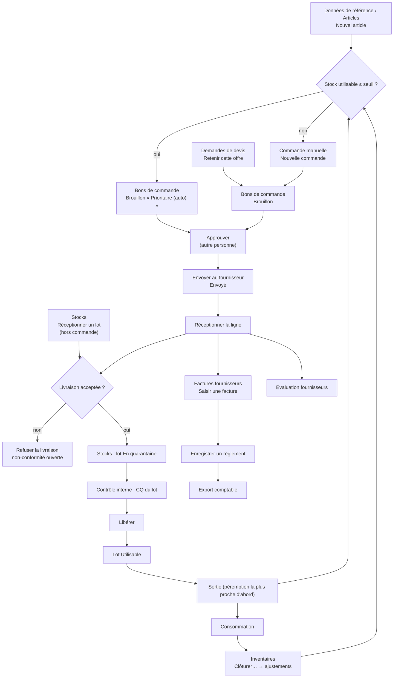
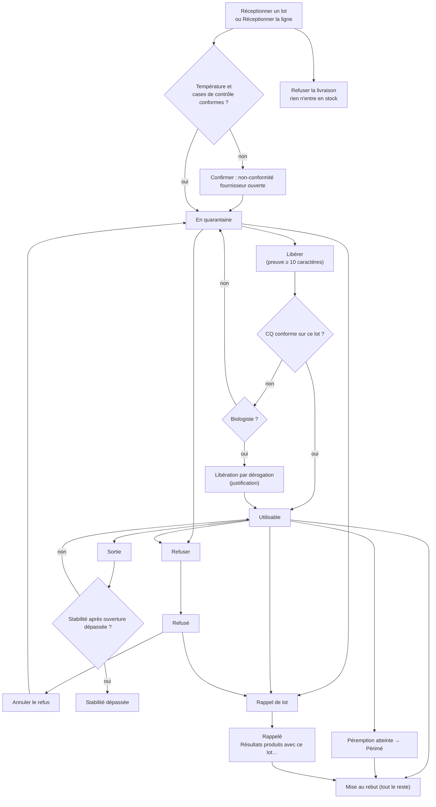
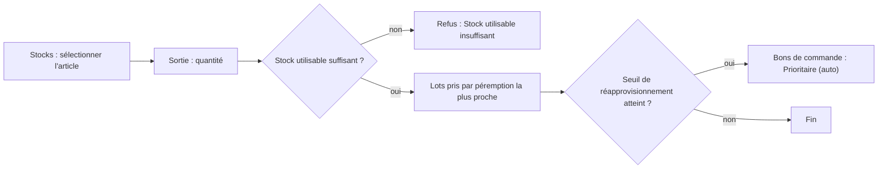
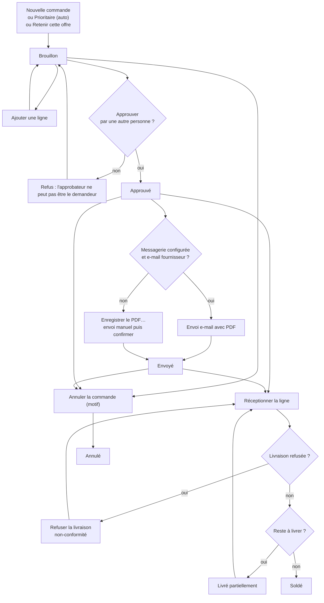
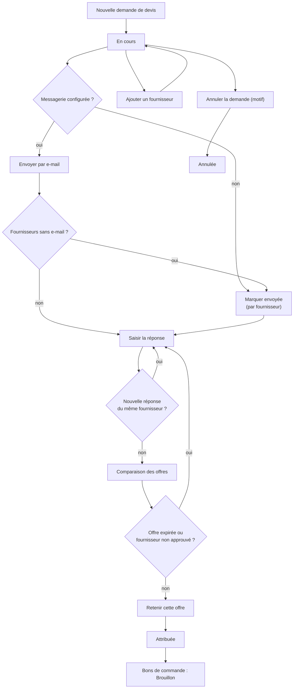
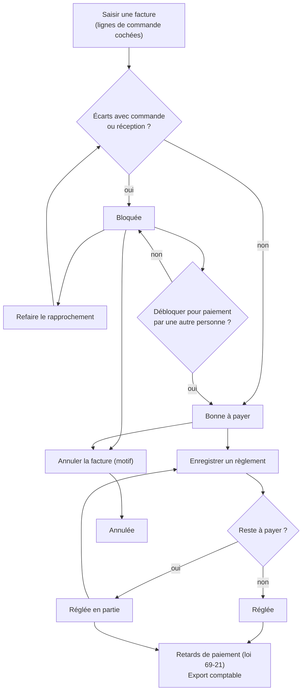
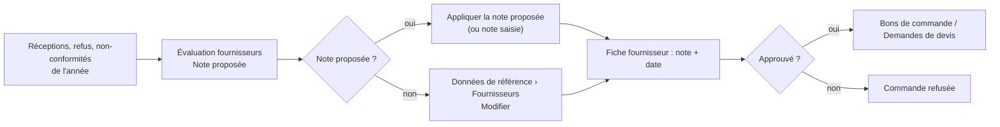
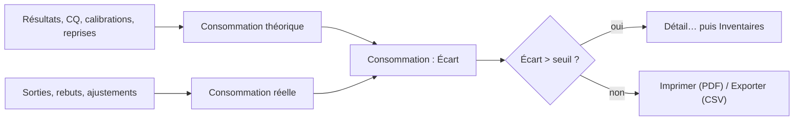
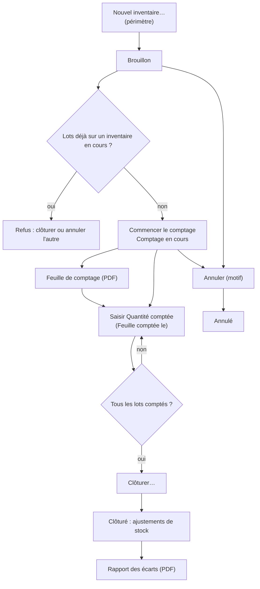

## Stocks et achats

Ce chapitre couvre tout le circuit des réactifs et consommables : la fiche article, la réception des lots, la quarantaine et la libération, les sorties vers la paillasse, les commandes, les demandes de devis, les factures fournisseurs et leur paiement, l'évaluation des fournisseurs, la consommation et les inventaires.

Le menu **Stocks** regroupe les écrans suivants : **Stocks**, **Bons de commande**, **Demandes de devis**, **Factures fournisseurs**, **Évaluation fournisseurs**, **Consommation**, **Inventaires** (et **Températures**, traité dans un autre chapitre).

### Vue d'ensemble du circuit

1. L'article est créé une fois pour toutes dans **Données de référence › Articles** (voir plus bas « Avant de commencer »).
2. Quand le stock utilisable tombe au seuil, le logiciel prépare tout seul un bon de commande « Prioritaire (auto) ». On peut aussi passer par une **Demande de devis**, puis **Retenir cette offre**, ce qui crée un bon de commande brouillon.
3. Le bon de commande est **Approuvé** par une autre personne que son demandeur, puis **Envoyé** au fournisseur.
4. À la livraison, on **Réceptionne la ligne** : le lot entre en stock **en quarantaine**.
5. Un biologiste ou le responsable qualité **Libère** le lot (preuve de vérification, CQ conforme).
6. Les sorties vers la paillasse consomment les lots dans l'ordre de péremption.
7. La facture du fournisseur est saisie contre les lignes reçues ; elle est rapprochée automatiquement, puis payée.
8. La **Consommation** compare ce qui a été consommé en théorie à ce qui a réellement disparu ; les **Inventaires** corrigent le stock.

### Avant de commencer : la fiche article, le prix des lots et les « tests par coffret »

L'écran **Coût de revient et marge** (menu **Pilotage**) calcule le coût réactif de chaque analyse ainsi : prix du lot ÷ tests par coffret × facteur de consommation, corrigé du volume mort. Si l'un de ces éléments manque, le coût de l'analyse est « inconnu ». Voici où chaque élément se saisit.

**La fiche article (Données de référence › onglet Articles)**

Accès : boutons **Nouvel article** et **Modifier**, réservés au droit « gérer les commandes » (rôles par défaut : Administrateur, Comptabilité). Le biologiste responsable n'a pas ce droit par défaut : il doit demander à la comptabilité ou à l'administrateur de saisir ou corriger ces chiffres.

Champs utiles au calcul du coût :

| Champ (libellé exact) | À quoi il sert |
|---|---|
| **Désignation** (liste déroulante sous le code) | Le type d'article. Seuls les articles de type **Réactif** entrent dans le coût de revient. |
| **Unité** | L'unité de stock (coffret, flacon, boîte…). Les quantités, les prix et les tests se rapportent à cette unité. |
| **Tests par coffret** | Nombre de tests réalisables avec une unité de stock. Indispensable au coût de revient. |
| **Analyses consommatrices (codes séparés par des virgules)** | Codes des analyses qui consomment ce réactif (ex. GLY, UREE). Sans ce champ, le réactif n'est rattaché à aucune analyse : ni coût, ni consommation théorique. |
| **Tests par résultat (ex. HBA1C=2 ; défaut 1)** | Facteur de consommation par analyse, écrit CODE=nombre séparés par des points-virgules. |
| **Volume mort par ouverture (%)** | Part perdue à chaque ouverture ; corrige le coût (prix ÷ (1 − volume mort)). |
| **Tests perdus par ouverture** | Utilisé pour la consommation théorique (pas pour le coût). |
| **Tests par calibration** | Tests consommés par une calibration (consommation théorique). |

Autres champs de la fiche : **Code**, **Désignation (FR)**/(AR), **Lieu de conservation** (condition de stockage : il décide si la température à réception est obligatoire), **Fabricant**, **Fournisseur** préféré, **Référence catalogue**, **Emplacement par défaut**, **Stock de sécurité**, **Seuil de réapprovisionnement**, **Quantité à commander**, **Stock maximal**, **Article critique**, **Produit dangereux** et **Classe de danger**, **Actif**, **GTIN (GS1)**, **Marquage CE (DM-DIV)**, **Stock de sécurité (jours)**, **Péremption à réception (jours)**, **Seuil calculé automatiquement**, et le bouton **Appliquer** qui reprend le seuil proposé d'après la consommation.

**Le prix des lots**

Le prix d'un lot est fixé à la réception, et nulle part ailleurs :

- Réception sur bon de commande (**Bons de commande › Réceptionner la ligne**) : le prix du lot est repris automatiquement de la ligne de commande, **net de la remise**. Aucun champ prix n'est demandé à la réception. Le prix doit donc être juste sur la ligne de commande (**Prix unitaire HT**, **Remise (%)**).
- Réception directe (**Stocks › Réceptionner un lot**) : champ **Prix**, facultatif. Laissé vide, le lot n'a pas de prix. Il s'agit du prix d'une unité de stock (à vérifier : le logiciel ne précise pas HT ou TTC ; pour un coût cohérent, saisissez le même type de prix que sur les commandes, c'est-à-dire HT).
- Une nouvelle livraison d'un lot déjà en stock fait la moyenne des prix.
- Aucun écran ne permet de corriger le prix d'un lot après coup.

Quand une analyse n'a pas de lot identifié, le coût prend le prix du dernier lot reçu, puis le dernier prix d'achat de l'article, puis le prix du contrat automate. Un contrat de mise à disposition qui fixe un « coût par test » passe avant tout le reste (voir le chapitre Équipements / contrats).

---

### Stocks

Suivre le stock utilisable de chaque article et de chaque lot, réceptionner, libérer, refuser, rappeler, sortir et mettre au rebut.

**Qui y a accès**

- Voir l'écran : Administrateur, Biologiste responsable, Biologiste, Technicien de laboratoire, Responsable qualité, Comptabilité.
- **Réceptionner un lot**, joindre un certificat : Administrateur, Biologiste responsable, Technicien, Responsable qualité.
- **Sortie** : Administrateur, Biologiste responsable, Technicien.
- **Libérer** : ceux qui revoient le contrôle qualité (Administrateur, Biologiste responsable, Biologiste, Responsable qualité). La libération par dérogation est réservée à ceux qui valident biologiquement (biologistes).
- **Refuser** : un lot encore en quarantaine peut être refusé par celui qui réceptionne ; un lot déjà libéré, seulement par ceux qui peuvent libérer.
- **Annuler le refus**, **Rappel de lot**, **Mise au rebut** : droit « ajuster le stock » (Administrateur, Responsable qualité uniquement).
- **Résultats produits avec ce lot…** : il faut en plus le droit de voir les résultats.

Les boutons sans droit restent visibles mais grisés.

**L'écran**

- En haut, le tableau **Stocks** : **Code**, **Article**, type d'article, **Quantité en stock** (seulement les lots utilisables : libérés, non périmés, non rappelés), **Seuil de réapprovisionnement**, **Lot** (nombre de lots, « Q » pour ceux en quarantaine), **Péremption** la plus proche (avec le nombre de jours), **Fournisseur**, et une colonne d'alertes :
  - « !! » sous le stock de sécurité, « ! » à commander, « Q » lot en quarantaine, « ⏳ » péremption à 30 jours ou moins, « ★ » article critique.
  - Couleurs : rouge gras pour un article critique sous le stock de sécurité ; rouge pour un article sous le stock de sécurité ou périmé ; orange à commander, péremption proche ou lot en quarantaine.
- Case **N'afficher que les articles en alerte**.
- Boutons : **Réceptionner un lot**, **Sortie**, **Actualiser** (F5), **Alertes de stock**.
- En bas, **Lots reçus** de l'article sélectionné : article, **N° de lot**, **Péremption**, jours avant péremption, quantité restante, date de **Réception**, date d'ouverture, **Statut** (Utilisable, En quarantaine, Stabilité dépassée, Périmé, Rappelé, refusé), **Lieu de conservation**.
- Case **En quarantaine** : affiche tous les lots en quarantaine, tous articles confondus.
- Boutons des lots : **Libérer**, **Refuser**, **Annuler le refus**, **Rappel de lot**, **Mise au rebut**.
- Clic droit sur un lot : **Résultats produits avec ce lot…**, **Comparer avec le lot précédent…**, **Certificats d'analyse…**.
- À chaque ouverture de l'écran, le logiciel prépare les bons de commande prioritaires des articles arrivés au seuil, et l'indique en rouge en bas : « Seuil atteint : bon de commande prioritaire … préparé (…) ».

**Scénarios**

*1. Réceptionner une livraison hors bon de commande*

1. Sélectionnez l'article dans le tableau du haut.
2. Cliquez **Réceptionner un lot**.
3. Si vous avez un lecteur, cliquez dans **Scanner le DataMatrix GS1** et scannez la boîte : le **N° de lot** et la **Péremption** se remplissent. Si le code correspond à un autre article, le logiciel propose de passer à cet article.
4. Sinon, saisissez **N° de lot** (obligatoire) et **Péremption**.
5. Saisissez **Quantité** (en unité de stock), **Fournisseur**, **Bon de livraison**, **Prix**, **Lieu de conservation**, **Stabilité après ouverture (jours)**.
6. Saisissez la **Température à l'arrivée (°C)** : obligatoire pour un article réfrigéré ou congelé (la plage attendue s'affiche).
7. Vérifiez les quatre cases, cochées par défaut : **Conforme à la commande**, **Emballage intact**, **Étiquetage en français**, **Certificat d'analyse reçu**. Décochez celles qui ne sont pas conformes.
8. Cliquez **Enregistrer** (ou Entrée). Si une case est décochée ou la température hors plage, le logiciel demande confirmation : une non-conformité fournisseur sera ouverte.
9. Le message rappelle que le lot est en quarantaine.

*2. Refuser une livraison à la porte*

1. Dans la fenêtre de réception, cliquez **Refuser la livraison**.
2. Donnez le motif (au moins 10 caractères).
3. Rien n'entre en stock ; le logiciel affiche « Livraison refusée ; non-conformité … ouverte. ».

*3. Libérer un lot en quarantaine*

1. Sélectionnez le lot (statut « En quarantaine »).
2. Cliquez **Libérer**.
3. Décrivez la preuve de vérification (au moins 10 caractères) : quel contrôle a montré que le lot se comporte correctement.
4. Pour un réactif rattaché à des analyses, le logiciel vérifie qu'un CQ conforme a été passé avec ce lot (écran Contrôle interne). Sinon, il refuse (« aucun contrôle qualité n'a été passé sur ce lot », « aucune série de CQ conforme », ou « niveaux de CQ manquants »).
5. Si vous êtes biologiste, le logiciel propose alors une **Libération par dérogation** : écrivez la justification (au moins 15 caractères, bien que le message indique 10). Elle est conservée sur le lot et dans le journal d'audit.
6. Le lot passe « Utilisable ».

*4. Refuser un lot*

1. Sélectionnez le lot, cliquez **Refuser**, indiquez le motif.
2. Le lot reste bloqué en quarantaine, définitivement, sauf annulation du refus.

*5. Annuler un refus fait par erreur*

1. Sélectionnez le lot refusé, cliquez **Annuler le refus**.
2. Motif d'au moins 10 caractères.
3. Le lot revient **en quarantaine**, pas en service : il faut encore le libérer.

*6. Enregistrer un rappel fabricant*

1. Sélectionnez le lot, cliquez **Rappel de lot**.
2. Saisissez la référence du rappel fabricant (obligatoire).
3. Le logiciel indique combien de résultats patients ont été produits avec ce lot, et ouvre leur liste (si vous avez le droit de voir les résultats). Cliquez **Exporter en CSV** pour la garder.
4. Le lot n'est plus utilisable ; si le stock tombe au seuil, une commande prioritaire est préparée.

*7. Retrouver les patients d'un lot (sans rappel)*

1. Clic droit sur le lot › **Résultats produits avec ce lot…**.
2. La liste donne patient, N° dossier, demande, analyse, paramètre, date, validé ou non. **Exporter en CSV**.

*8. Comparer un nouveau lot au précédent*

1. Clic droit › **Comparer avec le lot précédent…**.
2. Le tableau donne, par niveau de contrôle, n, moyenne et écart-type des deux lots et l'**Écart (%)**. À comparer à l'écart acceptable fixé par le laboratoire.

*9. Joindre ou consulter un certificat d'analyse*

1. Clic droit › **Certificats d'analyse…**.
2. **Joindre un fichier…** (PDF ou image) ; **Ouvrir** (ou double-clic) pour consulter.

*10. Sortir du stock vers la paillasse*

1. Sélectionnez l'article, cliquez **Sortie**.
2. Saisissez la quantité en unité de stock. Le message rappelle le stock utilisable.
3. Le logiciel choisit lui-même les lots, péremption la plus proche d'abord ; une sortie peut prendre sur deux lots.
4. Les lots utilisés s'affichent en bas de l'écran.

*11. Mettre un lot au rebut*

1. Sélectionnez le lot, cliquez **Mise au rebut**, indiquez le motif.
2. Tout le reste du lot est sorti (motif « péremption » si le lot est périmé, sinon « casse/perte »). On ne peut pas mettre au rebut une partie seulement.

*12. Consulter les alertes de stock*

1. Cliquez **Alertes de stock**.
2. Deux tableaux : **Ruptures prévues avant livraison** (stock utilisable, consommation par jour, date de rupture prévue, délai fournisseur) et **Lots arrivant à péremption** (avec le niveau : Péremption proche, Péremption imminente, Périmé).

**Règles et contrôles**

- Un lot reçu est toujours en quarantaine ; il ne compte pas dans la quantité en stock tant qu'il n'est pas libéré.
- Une péremption déjà passée est refusée à la réception.
- Le même N° de lot livré une deuxième fois s'ajoute au lot existant : la péremption doit être la même (« Vérifiez la date ou le numéro de lot »). Un lot refusé ou rappelé ne peut plus recevoir de livraison. Une livraison non conforme ne peut pas s'ajouter à un lot déjà libéré : refusez-la.
- Un article réfrigéré ou congelé exige la température d'arrivée.
- La sortie refuse si le stock utilisable est insuffisant (« Un lot en quarantaine, périmé ou rappelé ne peut pas être sorti »).
- Un lot dont la stabilité après ouverture est dépassée apparaît « Stabilité dépassée » ; une nouvelle unité scellée peut encore être sortie.
- Un lot rappelé ne peut jamais être remis en quarantaine.
- Tous les motifs (libération, refus, rappel, rebut) sont conservés dans le journal d'audit.

**Flux**

Réception (ici ou sur bon de commande) → quarantaine → CQ du lot dans Contrôle interne → **Libérer** → sorties → alerte de seuil → bon de commande prioritaire dans **Bons de commande**.

Cycle de vie d'un lot :

Sortie de stock :

---

### Bons de commande

Préparer, faire approuver, envoyer et réceptionner les commandes fournisseurs.

**Qui y a accès**

- Voir l'écran : tous ceux qui voient le stock (Administrateur, Biologiste responsable, Biologiste, Technicien, Responsable qualité, Comptabilité).
- **Nouvelle commande**, **Ajouter une ligne**, **Envoyer au fournisseur**, **Annuler la commande** : Administrateur, Comptabilité.
- **Approuver** : Administrateur, Biologiste responsable, Responsable qualité. Jamais le demandeur de la commande.
- **Réceptionner la ligne** : Administrateur, Biologiste responsable, Technicien, Responsable qualité.

**L'écran**

- Case **Commandes en cours seulement** (cochée par défaut), boutons **Actualiser**, **Nouvelle commande**, **Imprimer le bon (PDF)**, **Enregistrer le PDF…**.
- Tableau des commandes : **N° de commande**, **Priorité** (« Prioritaire » ou « Prioritaire (auto) »), **Fournisseur**, **Date**, **Livraison prévue** (« ! » si en retard), **Statut**, **Lignes**, **Total HT**, **Total TTC**, **Demandeur**, **Approuvé par**. Les commandes prioritaires non soldées sont en tête, sur fond orange.
- Le titre compte les commandes « à approuver » et « en retard ».
- Tableau des **Lignes** : #, **Code**, **Article**, **Commandé**, **Reçu**, **Reste à livrer**, **Unité**, **Prix unitaire HT**, **Remise**, **TVA**, **Total HT**. Sous le tableau : Total HT, TVA, Total TTC.
- Boutons du bas : **Ajouter une ligne**, **Approuver**, **Envoyer au fournisseur**, **Réceptionner la ligne**, **Annuler la commande**.

Statuts :

| Statut | Signification |
|---|---|
| Brouillon | En préparation, lignes modifiables (ajout seulement) |
| Approuvé | Validé par une autre personne, prêt à envoyer |
| Envoyé | Transmis au fournisseur |
| Livré partiellement | Au moins une ligne reçue, pas toutes |
| Soldé | Tout est reçu |
| Annulé | Annulé avec motif |

**Scénarios**

*1. Créer une commande*

1. Cliquez **Nouvelle commande**.
2. Choisissez le **Fournisseur** (seuls les fournisseurs approuvés sont proposés), la **Livraison prévue** (facultative), la **Réf. devis / proforma**, les **Observations**.
3. **Enregistrer**. Si l'enregistrement AMMPS/DMP du fournisseur a expiré, le logiciel demande « Continuer malgré tout ? ».
4. La fenêtre **Ajouter une ligne** s'ouvre directement.

*2. Ajouter une ligne*

1. Sélectionnez une commande en Brouillon, cliquez **Ajouter une ligne**.
2. Choisissez l'**Article** (ceux du fournisseur préféré en premier).
3. La **Quantité** (quantité à commander de la fiche), le **Prix unitaire HT** (dernier prix, ou prix du contrat automate) et la **Remise (%)** sont pré-remplis : corrigez-les selon le devis. **TVA (%)** : 20 par défaut.
4. **Enregistrer**. Ce prix net deviendra le prix des lots reçus sur cette ligne.

*3. Approuver une commande*

1. Sélectionnez la commande (Brouillon, au moins une ligne), cliquez **Approuver**.
2. Si l'enregistrement du fournisseur a expiré, confirmez ou abandonnez.

*4. Envoyer au fournisseur*

1. Sélectionnez une commande Approuvée, cliquez **Envoyer au fournisseur**.
2. Si la messagerie est configurée et que le fournisseur a une adresse e-mail : confirmez, le PDF part en pièce jointe et la commande passe « Envoyé ».
3. Sinon (ou si l'envoi échoue) : enregistrez le PDF avec **Enregistrer le PDF…**, transmettez-le vous-même (e-mail, fax, en main propre), puis confirmez la question pour marquer la commande envoyée.

*5. Imprimer ou enregistrer le bon*

**Imprimer le bon (PDF)** ouvre le PDF ; **Enregistrer le PDF…** le sauvegarde. Possible seulement à partir du statut Approuvé.

*6. Réceptionner une livraison sur commande*

1. Sélectionnez la commande puis la ligne (la première ligne non soldée est présélectionnée).
2. Cliquez **Réceptionner la ligne**.
3. **Quantité** (le reste à livrer est proposé), **N° de lot** (obligatoire), **Péremption**, **Bon de livraison** (sinon le N° de commande est retenu), **Emplacement par défaut**.
4. Scan GS1, température et cases de contrôle comme pour une réception directe. Un scan d'un autre article que celui de la ligne est signalé.
5. **Enregistrer** : la ligne est mise à jour et le lot entre en stock en quarantaine. Répétez pour chaque ligne ou chaque lot.
6. Pour refuser toute la livraison : **Refuser la livraison**, motif d'au moins 10 caractères ; rien n'est reçu, une non-conformité est ouverte.

*7. Traiter un bon prioritaire automatique*

1. Repérez les commandes « Prioritaire (auto) » en tête de liste.
2. Vérifiez quantités et prix (la quantité est plafonnée à ce qui sera consommé avant péremption, si la fiche le prévoit).
3. Faites approuver puis envoyez.

*8. Annuler une commande*

1. Sélectionnez une commande Brouillon, Approuvée ou Envoyée, cliquez **Annuler la commande**.
2. Indiquez le motif.

**Règles et contrôles**

- Numérotation unique et continue « BC/année/numéro ».
- Commande seulement à un fournisseur approuvé ; date de livraison prévue non passée.
- Un même article ne peut figurer qu'une fois sur une commande.
- L'approbateur ne peut pas être le demandeur. Attention : une commande automatique a pour demandeur la personne qui a ouvert l'écran **Stocks** ou fait la sortie qui l'a déclenchée ; cette personne ne pourra pas l'approuver.
- Une ligne ne peut être ni modifiée ni supprimée : en cas d'erreur, annulez la commande et refaites-la.
- La réception ne peut pas dépasser le reste à livrer.
- Une commande livrée partiellement ou soldée ne peut plus être annulée.
- Les articles sans fournisseur préféré approuvé ne sont pas commandés automatiquement ; ils restent seulement dans les alertes.

**Flux**

Alerte de seuil ou **Demandes de devis** → brouillon → **Approuver** → **Envoyer au fournisseur** → **Réceptionner la ligne** → **Stocks** (libération) → **Factures fournisseurs**.

---

### Demandes de devis

Consulter plusieurs fournisseurs, comparer leurs offres et transformer la meilleure en bon de commande.

**Qui y a accès**

- L'écran et toutes ses actions : Administrateur, Comptabilité.
- **Retenir cette offre** demande en plus le droit de gérer les commandes (Administrateur, Comptabilité).

**L'écran**

- Case **Demandes en cours seulement**, boutons **Actualiser**, **Nouvelle demande de devis**.
- Tableau des demandes : **N° de demande**, **Date**, **Objet**, **Statut** (En cours, Attribuée, Annulée), **Réponse souhaitée avant le**, **Articles**, **Réponses** (reçues / consultés), **Demandeur**, **Offre retenue**, **N° de commande**.
- **Comparaison des offres** : une ligne par article, une colonne par fournisseur ayant répondu (prix net et délai). Vert : prix net le plus bas ; gras : délai le plus court ; offres expirées en gris.
- **Fournisseurs consultés** : **Fournisseur**, **Envoyée le**, **Total HT** (ou « en attente »), **Délai (j)**, **Valable jusqu'au**, **Articles non chiffrés**, **Devis joint**.
- Boutons : **Envoyer par e-mail**, **Marquer envoyée**, **Ajouter un fournisseur**, **Saisir la réponse**, **Ouvrir le devis joint**, **Retenir cette offre**, **Annuler la demande**.

**Scénarios**

*1. Créer une demande*

1. **Nouvelle demande de devis**.
2. **Objet**, **Réponse souhaitée avant le**.
3. Dans **Articles à chiffrer**, cochez les articles et indiquez la **Quantité**. Les réactifs sous contrat automate (grisés, colonne **Sous contrat**) ne peuvent pas être mis en concurrence.
4. Cochez les **Fournisseurs à consulter** (mention « sans e-mail » ou « non approuvé » le cas échéant).
5. **Observations**, puis **Enregistrer**.

*2. Envoyer la demande*

- Par e-mail : **Envoyer par e-mail**, confirmez. Le logiciel indique à combien de fournisseurs elle est partie, ceux sans adresse et les échecs.
- Autrement (téléphone, fax) : sélectionnez le fournisseur, **Marquer envoyée**, confirmez.

*3. Ajouter un fournisseur*

**Ajouter un fournisseur**, choisissez-le, **Enregistrer**.

*4. Saisir une réponse*

1. Sélectionnez le fournisseur, **Saisir la réponse**.
2. **Reçue le**, **Valable jusqu'au**, **Délai (j)**, **Réf. du devis fournisseur**.
3. Dans **Prix proposés**, saisissez **Prix unitaire HT**, **Remise (%)**, **TVA (%)** ; laissez le prix vide pour un article non chiffré.
4. **Conditions**, **Joindre le devis reçu…** (PDF, image, Word, Excel).
5. **Enregistrer**. Une nouvelle réponse du même fournisseur remplace l'ancienne (confirmation demandée).

*5. Retenir une offre*

1. Sélectionnez le fournisseur dont l'offre est retenue, **Retenir cette offre**.
2. Le logiciel avertit si des articles ne sont pas chiffrés (ils ne seront pas commandés).
3. Confirmez : un bon de commande brouillon est créé aux prix de l'offre. Il reste à l'approuver dans **Bons de commande**.

*6. Annuler une demande*

**Annuler la demande**, motif obligatoire.

**Règles et contrôles**

- Au moins un article et un fournisseur ; date de réponse non passée ; quantité positive.
- Une demande Attribuée ou Annulée n'est plus modifiable.
- Une offre expirée ne peut pas être retenue (« demandez au fournisseur de la renouveler »).
- Une offre d'un fournisseur non approuvé peut être saisie mais pas retenue.
- La comparaison se fait sur le prix net de remise, dans l'unité de stock.

**Flux**

Demande → envoi → réponses → **Retenir cette offre** → brouillon dans **Bons de commande**.

---

### Factures fournisseurs

Saisir les factures contre les commandes reçues, laisser le logiciel les rapprocher, débloquer les écarts, payer, et produire la déclaration des retards (loi 69-21) et l'export comptable.

**Qui y a accès**

- Voir l'écran : Administrateur, Biologiste responsable, Comptabilité.
- **Saisir une facture**, **Joindre le scan**, **Annuler la facture** : Administrateur, Biologiste responsable, Comptabilité.
- **Débloquer pour paiement**, **Enregistrer un règlement** : Administrateur, Biologiste responsable.
- **Export comptable** : Administrateur, Comptabilité.
- **Paramètres d'achat** : Administrateur.

**L'écran**

- Titre et résumé : « En retard : … · À payer sous 7 jours : … · Sous 15 jours : … · Bloquées : … ».
- Filtre : **Factures en cours**, **En retard**, **À payer sous 7 jours**, **À payer sous 15 jours**, **Bloquées**, **Toutes**. Boutons **Actualiser**, **Saisir une facture**.
- Tableau : **Fournisseur**, **N° de facture**, **Date de facture**, **Livraison**, **Échéance**, **Jours** (J-n avant, +n de retard), **Statut**, **Total TTC**, **Réglé**, **Reste à payer**, **Scan**. Rouge : en retard ; orange : bloquée.
- Détail : onglets **Lignes**, **Écarts**, **Règlements**, et une ligne de totaux, délai, échéance, auteur de la saisie, déblocage ou annulation.
- Boutons : **Refaire le rapprochement**, **Débloquer pour paiement**, **Enregistrer un règlement**, **Joindre le scan**, **Voir le scan**, **Annuler la facture**, puis **Retards de paiement (loi 69-21)**, **Export comptable**, **Paramètres d'achat**.

| Statut | Signification |
|---|---|
| Bloquée | Écart avec la commande ou la réception |
| Bonne à payer | Rapprochée sans écart, ou débloquée |
| Réglée en partie | Un ou plusieurs règlements, reste dû |
| Réglée | Soldée |
| Annulée | Annulée avec motif |

**Scénarios**

*1. Saisir une facture*

1. **Saisir une facture**.
2. **Fournisseur** (seuls ceux qui ont une commande approuvée), **N° de facture**, **Date de facture**, **Facture reçue le**, **Observations**.
3. Les lignes de commande du fournisseur s'affichent. Cochez celles facturées ; corrigez **Qté facturée**, **Prix unitaire HT facturé**, **TVA (%)** selon le papier.
4. Cochez **Joindre le scan** si vous voulez joindre le fichier tout de suite.
5. **Enregistrer**. Le logiciel annonce soit « bonne à payer » avec l'échéance légale, soit « BLOQUÉE » avec le nombre d'écarts.

*2. Comprendre et lever un blocage*

1. Ouvrez l'onglet **Écarts** : prix différent, TVA différente, ou quantité facturée supérieure à la quantité reçue.
2. Si la marchandise manquante a été reçue depuis, cliquez **Refaire le rapprochement**.
3. Si l'écart est accepté, un responsable (autre que la personne qui a saisi) clique **Débloquer pour paiement** et justifie (au moins 10 caractères).
4. Si la facture est fausse, **Annuler la facture** et la ressaisir.

*3. Enregistrer un règlement*

1. Facture « Bonne à payer » ou « Réglée en partie », **Enregistrer un règlement**.
2. **Date**, **Montant (MAD)** (le reste dû est proposé), **Mode de paiement** (Virement, Chèque, Espèces, Effet de commerce), **Référence**, **Échéance (LCN, chèque)**.
3. **Enregistrer**. Paiement partiel possible.

*4. Joindre ou voir le scan*

**Joindre le scan** (PDF, JPEG, PNG, TIFF ; remplace l'ancien après confirmation) ; **Voir le scan**.

*5. Annuler une facture*

Facture en cours sans aucun règlement, **Annuler la facture**, motif.

*6. Liste des retards de paiement*

1. **Retards de paiement (loi 69-21)**, choisissez **Du** / **Au** (trimestre précédent proposé), **Exporter**.
2. Un fichier CSV s'ouvre : paiements faits en retard et factures échues impayées, avec pénalité et amende.

*7. Export comptable*

**Export comptable**, période, **Format du fichier** (Sage ou CSV générique), **Exporter**.

*8. Paramètres d'achat (administrateur)*

Tolérances de prix (% et MAD), taux directeur BAM, majoration, amendes, journaux et comptes.

**Règles et contrôles**

- Une même facture d'un fournisseur ne peut être saisie deux fois.
- Date de facture non future ; date de réception entre la date de facture et aujourd'hui.
- Toute différence au-delà des tolérances bloque le paiement.
- Celui qui a saisi la facture ne peut pas la débloquer.
- L'échéance suit la loi 69-21 : 60 jours à partir de la livraison sans accord, 120 jours au plus par accord.
- Règlement : montant positif, pas au-delà du reste dû, pas avant la date de facture, pas dans le futur ; référence obligatoire sauf espèces ; date d'échéance obligatoire pour un effet. Le logiciel rappelle qu'un paiement en espèces de plus de 5 000 DH par jour et par fournisseur n'est pas déductible.
- Une facture déjà réglée, même en partie, ne peut pas être annulée.

**Flux**

**Bons de commande** (réception) → saisie de la facture → rapprochement → déblocage éventuel → règlement → export comptable et rapprochement bancaire (chapitre Trésorerie).

---

### Évaluation fournisseurs

Évaluer chaque année les fournisseurs (exigence ISO 15189) à partir des livraisons réelles, et reporter la note sur leur fiche.

**Qui y a accès**

Administrateur, Comptabilité (droit « gérer les commandes »). Le responsable qualité n'y a pas accès par défaut.

**L'écran**

- **Année**, boutons **Actualiser**, **Appliquer la note proposée**, **Rapport annuel PDF**, **Exporter en CSV**.
- Tableau : **Code**, **Fournisseur**, **Livraisons**, **À l'heure (%)**, **Retard moyen (j)**, **Refusées**, **NC**, **Note proposée**, **Note actuelle**, **N° d'enregistrement AMMPS/DMP**, **Enregistrement valable jusqu'au**. En rouge : enregistrement expiré ou note proposée sous 50.
- En bas, la formule : 50 × taux à l'heure + 30 × (1 − part refusée) + max(0 ; 20 − 5 × non-conformités).

**Scénarios**

*1. Faire l'évaluation annuelle*

1. Choisissez l'**Année**.
2. Sélectionnez un fournisseur, **Appliquer la note proposée**.
3. Gardez la note proposée ou tapez la vôtre (0 à 100), validez. La note et la date d'évaluation sont reportées sur la fiche fournisseur ; la note calculée est gardée dans le journal d'audit.

*2. Produire le rapport*

**Rapport annuel PDF** ou **Exporter en CSV**.

**Règles et contrôles**

- Note entre 0 et 100.
- Un fournisseur sans livraison sur l'année n'a pas de note proposée : le bouton reste grisé ; sa note se saisit dans **Données de référence › Fournisseurs**.
- Un fournisseur ne peut être approuvé sans évaluation ; une évaluation de plus de douze mois est signalée.

**Flux**

Réceptions et refus de l'année → évaluation → note sur la fiche → fournisseur approuvé ou non pour **Bons de commande**.

---

### Consommation

Comparer, article par article, la consommation théorique (calculée d'après les résultats, CQ, calibrations et reprises) et la consommation réelle (sorties, rebuts, inventaires).

**Qui y a accès**

Tous ceux qui voient le stock. **Paramètres de stock…** : Administrateur.

**L'écran**

- **Du** / **au** (le mois précédent par défaut), boutons **Actualiser**, **Détail…**, **Imprimer (PDF)**, **Exporter (CSV)**, **Paramètres de stock…**.
- Tableau : **Code**, **Article**, **Unité**, **Stock initial**, **Entrées**, **Tests**, **Consommation théorique**, **Consommation réelle**, **Stock final théorique**, **Stock final réel**, **Écart**, **Écart %**, **Inventaire**.
- Message : nombre d'articles au-delà du seuil d'écart.

**Scénarios**

*1. Analyser l'écart d'un article*

1. Choisissez la période, **Actualiser**.
2. Double-cliquez la ligne ou **Détail…** : tests patients, contrôles qualité, calibrations, reprises, volume mort (par ouverture), et la répartition par analyse.
3. Un écart important : cherchez les sorties non enregistrées, les pertes, les reprises.

*2. Imprimer ou exporter*

**Imprimer (PDF)** ou **Exporter (CSV)**.

*3. Régler les paramètres (administrateur)*

**Paramètres de stock…** : **Seuil d'écart (%)**, **Période de calcul de la consommation (jours)**, **Alerte de péremption, 1er palier (jours)**, **Alerte de péremption, 2e palier (jours)**.

**Règles et contrôles**

- Sans **Analyses consommatrices** sur la fiche, la consommation théorique ne peut pas être calculée.
- Le calcul utilise **Tests par coffret**, **Tests par résultat**, **Tests par calibration** et le volume mort de la fiche.

**Flux**

Résultats et sorties → **Consommation** → correction par **Inventaires** ; les mêmes moyennes alimentent le seuil calculé et les ruptures prévues.

---

### Inventaires

Compter physiquement les lots, et passer les écarts en ajustements de stock à la clôture.

**Qui y a accès**

- Voir l'écran et saisir les quantités comptées : Administrateur, Biologiste responsable, Technicien, Responsable qualité.
- **Nouvel inventaire…**, **Commencer le comptage**, **Clôturer…**, **Annuler** : Administrateur, Biologiste responsable, Responsable qualité.

**L'écran**

- Case **Afficher les inventaires clôturés**, boutons **Nouvel inventaire…**, **Commencer le comptage**, **Clôturer…**, **Annuler**, **Feuille de comptage (PDF)**, **Feuille (CSV)**, **Rapport des écarts (PDF)**.
- Tableau des inventaires : **N° d'inventaire**, **Date**, **Périmètre**, **Statut** (Brouillon, Comptage en cours, Clôturé, Annulé), **Lots**, **Quantité comptée**, **Écart**, **Clôturé le**.
- Tableau des **Lots** : #, **Lieu de conservation**, **Code**, **Article**, **N° de lot**, **Péremption**, **Attendu au démarrage**, **Stock au comptage**, **Quantité comptée** (modifiable), **Compté le**, **Écart**, **Commentaire** (modifiable).
- Case et heure **Feuille comptée le**, pour saisir une feuille papier.

**Scénarios**

*1. Ouvrir un inventaire*

1. **Nouvel inventaire…**.
2. **Périmètre** : **Tout le stock**, **Emplacement** (choisir l'emplacement) ou **Catégorie** (choisir le type d'article). **Commentaire**.
3. **Enregistrer** : « Inventaire … ouvert. ».

*2. Commencer le comptage*

Sélectionnez l'inventaire en Brouillon, **Commencer le comptage** : les quantités attendues sont figées et le nombre de lots à compter s'affiche.

*3. Compter sur papier*

1. **Feuille de comptage (PDF)** (ou **Feuille (CSV)**) : la feuille ne montre pas les quantités attendues.
2. Pour reporter la feuille : cochez **Feuille comptée le** et indiquez l'heure du comptage ; l'écart est calculé sur le stock à cette heure-là.

*4. Saisir les quantités*

1. Tapez la quantité dans **Quantité comptée** pour chaque lot (0 si absent), et un **Commentaire** si besoin.
2. Chaque ligne est enregistrée dès que vous quittez la cellule ; l'écart s'affiche.

*5. Clôturer*

1. **Clôturer…**, confirmez.
2. Chaque écart devient un ajustement de stock « Inventaire n° » ; le nombre d'ajustements s'affiche. Pas de retour possible.
3. **Rapport des écarts (PDF)** pour l'archive.

*6. Annuler un inventaire*

**Annuler**, motif obligatoire (inventaire en Brouillon ou en comptage).

**Règles et contrôles**

- Tous les lots doivent être comptés avant la clôture (« … lot(s) ne sont pas encore comptés »).
- Quantité négative refusée ; heure de comptage ni future, ni antérieure au début du comptage.
- Un lot ne peut être sur deux inventaires en cours en même temps.
- Un périmètre sans lot en stock est refusé.

**Flux**

**Consommation** (écart suspect) → **Inventaires** → ajustements → stock corrigé dans **Stocks** ; un manque peut déclencher une commande prioritaire.

---

### Raccourcis utiles

- **F5** : actualiser l'écran.
- **Ctrl+P** : imprimer la liste affichée.
- **F1** : liste des raccourcis.
- Dans les fenêtres de saisie : **Entrée** = **Enregistrer**, **Échap** = **Annuler**.
- Le lecteur de DataMatrix envoie Entrée à la fin du scan : il remplit le lot et la péremption sans valider la fenêtre.
