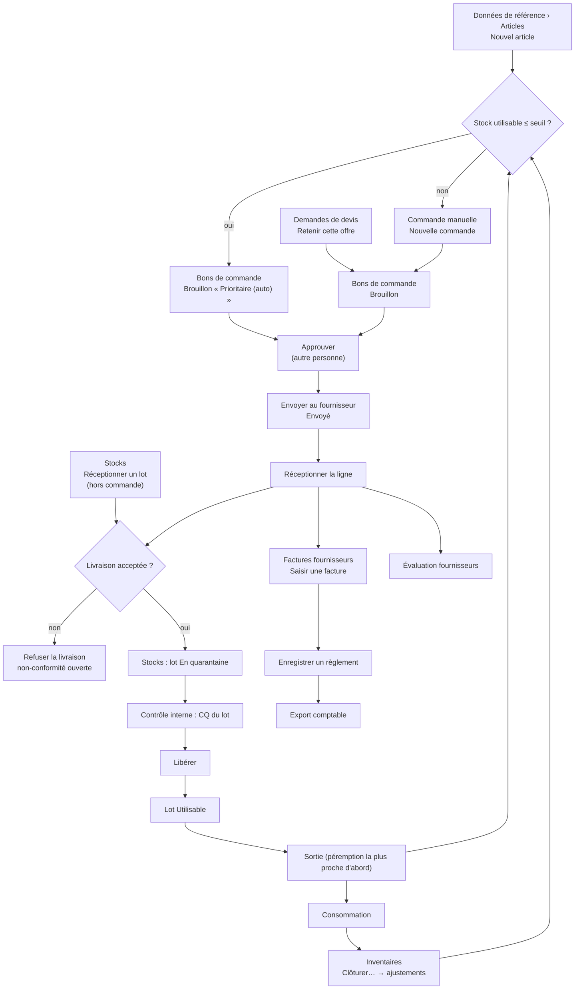
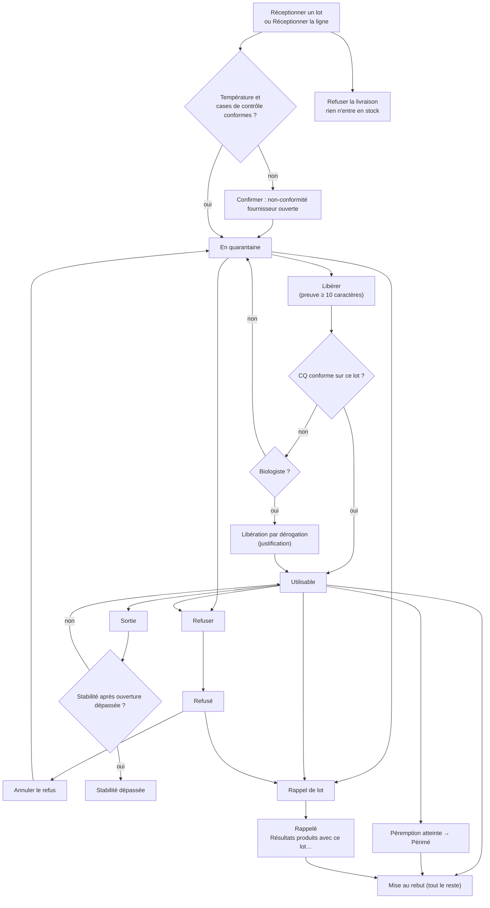
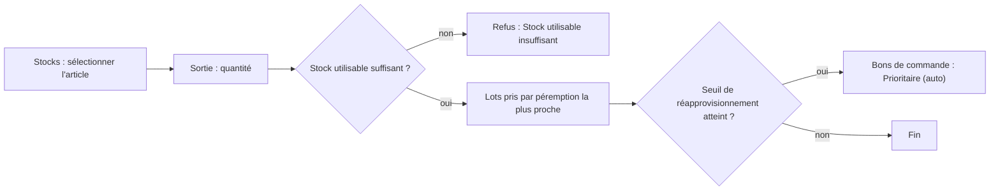
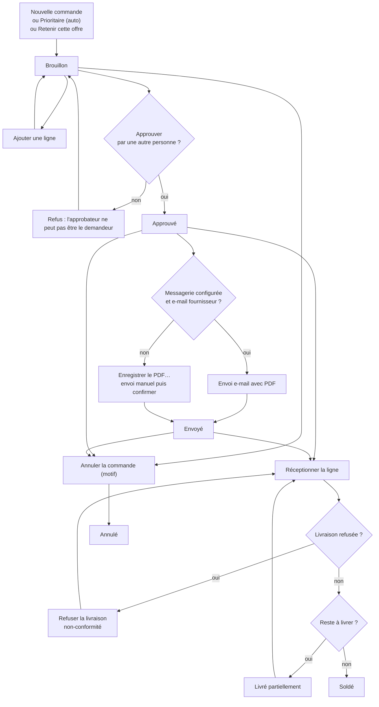
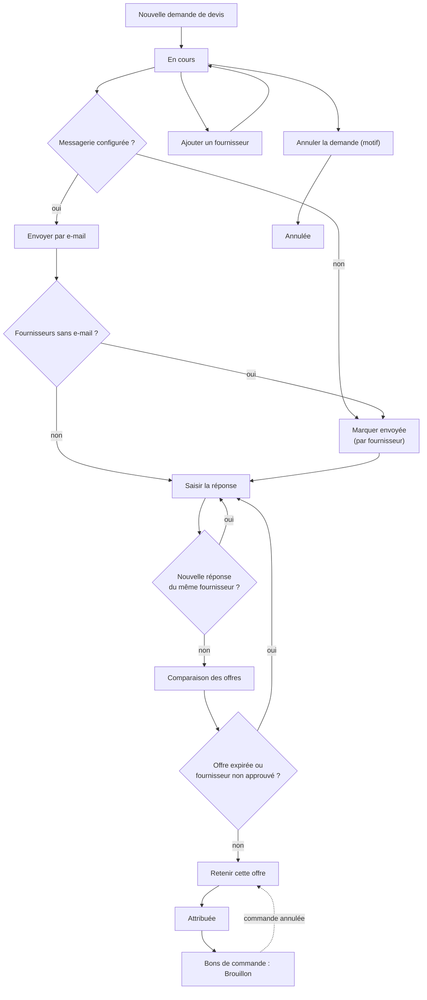
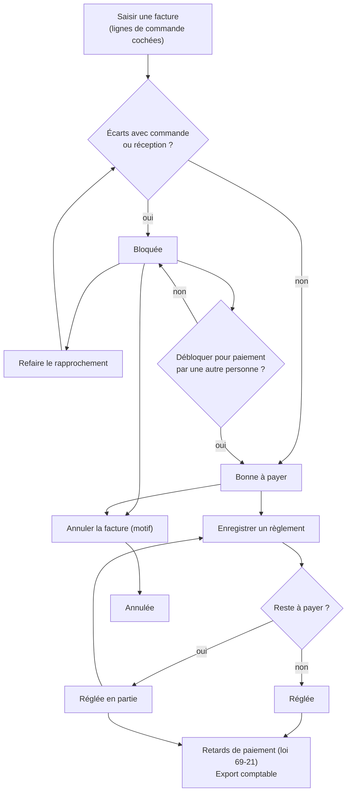
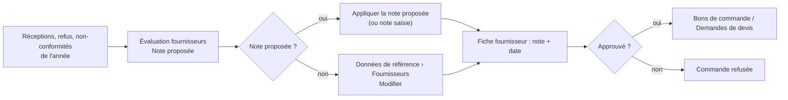
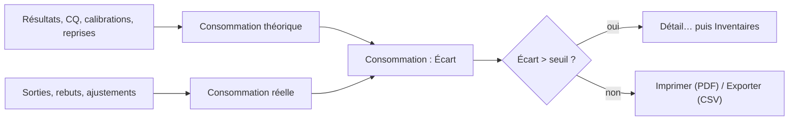
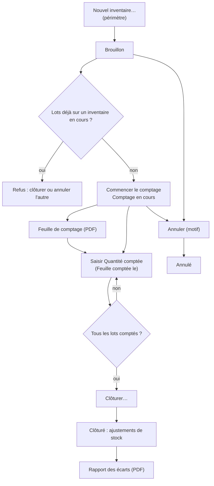

## Stocks et achats

### Présentation du module

**À quoi sert ce module.** Il couvre tout le circuit des réactifs et consommables : la fiche article, la réception des lots, la quarantaine et la libération, les sorties vers la paillasse, les commandes, les demandes de devis, les factures fournisseurs et leur paiement, l'évaluation des fournisseurs, la consommation et les inventaires. Il garantit la traçabilité exigée par ISO 15189 : chaque lot est identifié, contrôlé à réception, libéré sur preuve, et l'on retrouve les patients analysés avec un lot rappelé.

**Ses écrans.** Le groupe **Stocks** du menu de gauche contient : **Stocks**, **Bons de commande**, **Demandes de devis**, **Factures fournisseurs**, **Évaluation fournisseurs**, **Consommation**, **Inventaires**. Le même groupe contient aussi **Températures**, **Équipements** et **Contrats automates**, décrits dans le chapitre Qualité et équipements. La fiche article et la fiche fournisseur se trouvent dans **Administration > Données de référence**.

**Qui l'utilise.**

| Rôle par défaut | Ce qu'il fait dans ce module |
|---|---|
| Technicien de laboratoire | Réceptionne les lots (directement ou sur commande), refuse une livraison, fait les sorties, joint les certificats, compte les inventaires. |
| Biologiste | Voit le stock et libère les lots (y compris par dérogation au contrôle qualité). |
| Biologiste responsable | Réceptionne, libère, sort ; approuve les commandes ; saisit les factures, les débloque et les paie ; ouvre et clôture les inventaires. |
| Responsable qualité | Réceptionne, libère, refuse ; enregistre les rappels, les mises au rebut et les annulations de refus ; approuve les commandes ; ouvre et clôture les inventaires. |
| Comptabilité | Fiches article et fournisseur, commandes, demandes de devis, évaluation fournisseurs, saisie des factures, export comptable. |
| Administrateur | Tout, y compris **Paramètres d'achat** et **Paramètres de stock…**. |

Le secrétariat, les préleveurs et les prescripteurs n'ont pas ces écrans.

**Liens avec les autres modules.**

- **Données de référence** : fiche article (tests par coffret, analyses consommatrices, seuils) et fiche fournisseur (approbation, enregistrement AMMPS/DMP, délai de paiement).
- **Contrôle interne** : l'évaluation d'un nouveau lot de réactif se fait là ; la libération ici exige un CQ conforme passé avec ce lot.
- **Non-conformités** : une réception non conforme ou une livraison refusée ouvre une non-conformité fournisseur.
- **Saisie des résultats** : chaque résultat est rattaché au lot utilisé, ce qui permet la liste des patients d'un lot rappelé et la consommation théorique.
- **Contrats automates** : les réactifs captifs s'achètent au prix du contrat et ne passent pas en demande de devis.
- **Coût de revient et marge** (Pilotage) : utilise le prix des lots et les tests par coffret.
- **Trésorerie et comptabilité** : règlements fournisseurs et export comptable.

Quelques règles communes à tous les écrans :

- Un bouton auquel vous n'avez pas droit reste visible mais **grisé**. Un écran auquel vous n'avez pas droit n'apparaît pas dans le menu.
- Les boutons principaux sont en haut à droite, à côté du titre et du nombre de lignes. Les actions moins fréquentes sont rangées derrière **Plus d'actions** : cliquez-le pour dérouler le menu.
- Les filtres sont sous le titre : une zone de recherche (**Ctrl+F** y place le curseur) et des pastilles à cocher.
- **Ctrl+N** déclenche le bouton principal de l'écran : **Réceptionner un lot** (Stocks), **Nouvelle commande**, **Nouvelle demande de devis**, **Saisir une facture**, **Nouvel inventaire…**.
- Après une action ou une actualisation, la ligne sur laquelle vous travailliez reste sélectionnée.
- Tous les motifs demandés (libération, refus, rappel, rebut, annulation, déblocage) sont conservés dans le journal d'audit avec leur auteur et leur date.

### Vue d'ensemble du circuit

1. L'article est créé une fois pour toutes dans **Données de référence › Articles** (voir plus bas « Avant de commencer »).
2. Quand le stock utilisable tombe au seuil, le logiciel prépare tout seul un bon de commande « Prioritaire (auto) ». On peut aussi passer par une **Demande de devis**, puis **Retenir cette offre**, ce qui crée un bon de commande brouillon.
3. Le bon de commande est **Approuvé** par une autre personne que son demandeur, puis **Envoyé** au fournisseur.
4. À la livraison, on **Réceptionne la ligne** : le lot entre en stock **en quarantaine**.
5. Un biologiste ou le responsable qualité **Libère** le lot (preuve de vérification, CQ conforme).
6. Les sorties vers la paillasse consomment les lots dans l'ordre de péremption.
7. La facture du fournisseur est saisie contre les lignes reçues ; elle est rapprochée automatiquement, puis payée.
8. La **Consommation** compare ce qui a été consommé en théorie à ce qui a réellement disparu ; les **Inventaires** corrigent le stock.

### Avant de commencer : la fiche article, le prix des lots et les « tests par coffret »

L'écran **Coût de revient et marge** (menu **Pilotage**) calcule le coût réactif de chaque analyse ainsi : prix du lot ÷ tests par coffret × facteur de consommation, corrigé du volume mort. Si l'un de ces éléments manque, le coût de l'analyse est « inconnu ». Voici où chaque élément se saisit.

**La fiche article (Données de référence › onglet Articles)**

Accès : boutons **Nouvel article** et **Modifier**, réservés au droit « gérer les commandes » (rôles par défaut : Administrateur, Comptabilité). Le biologiste responsable n'a pas ce droit par défaut : il doit demander à la comptabilité ou à l'administrateur de saisir ou corriger ces chiffres.

Champs utiles au calcul du coût :

| Champ (libellé exact) | À quoi il sert |
|---|---|
| **Désignation** (liste déroulante sous le code) | Le type d'article. Seuls les articles de type **Réactif** entrent dans le coût de revient. |
| **Unité** | L'unité de stock (coffret, flacon, boîte…). Les quantités, les prix et les tests se rapportent à cette unité. |
| **Tests par coffret** | Nombre de tests réalisables avec une unité de stock. Indispensable au coût de revient. |
| **Analyses consommatrices (codes séparés par des virgules)** | Codes des analyses qui consomment ce réactif (ex. GLY, UREE). Sans ce champ, le réactif n'est rattaché à aucune analyse : ni coût, ni consommation théorique. |
| **Tests par résultat (ex. HBA1C=2 ; défaut 1)** | Facteur de consommation par analyse, écrit CODE=nombre séparés par des points-virgules. |
| **Volume mort par ouverture (%)** | Part perdue à chaque ouverture ; corrige le coût (prix ÷ (1 − volume mort)). Entre 0 et 99. |
| **Tests perdus par ouverture** | Utilisé pour la consommation théorique (pas pour le coût). |
| **Tests par calibration** | Tests consommés par une calibration (consommation théorique), de 0 à 1000. |

Autres champs de la fiche : **Code**, **Désignation (FR)**/(AR), **Lieu de conservation** (condition de stockage : il décide si la température à réception est obligatoire), **Fabricant**, **Fournisseur** préféré, **Référence catalogue**, **Emplacement par défaut**, **Stock de sécurité**, **Seuil de réapprovisionnement**, **Quantité à commander**, **Stock maximal**, **Article critique**, **Produit dangereux** et **Classe de danger**, **Actif**, **GTIN (GS1)**, **Marquage CE (DM-DIV)**, **Stock de sécurité (jours)** (0 à 365), **Péremption à réception (jours)** (1 à 3650), **Seuil calculé automatiquement**, et le bouton **Appliquer** qui reprend le seuil proposé d'après la consommation (« Seuil calculé : … = …/jour × … j de délai + … de sécurité »).

**Le prix des lots**

Le prix d'un lot est fixé à la réception, et nulle part ailleurs :

- Réception sur bon de commande (**Bons de commande › Réceptionner la ligne**) : le prix du lot est repris automatiquement de la ligne de commande, **net de la remise**. Aucun champ prix n'est demandé à la réception. Le prix doit donc être juste sur la ligne de commande (**Prix unitaire HT**, **Remise (%)**).
- Réception directe (**Stocks › Réceptionner un lot**) : champ **Prix**, facultatif. Laissé vide, le lot n'a pas de prix. Il s'agit du prix d'une unité de stock (à vérifier : le logiciel ne précise pas HT ou TTC ; pour un coût cohérent, saisissez le même type de prix que sur les commandes, c'est-à-dire HT).
- Une nouvelle livraison d'un lot déjà en stock fait la moyenne des prix.
- Aucun écran ne permet de corriger le prix d'un lot après coup.

Quand une analyse n'a pas de lot identifié, le coût prend le prix du dernier lot reçu, puis le dernier prix d'achat de l'article, puis le prix du contrat automate. Un contrat de mise à disposition qui fixe un « coût par test » passe avant tout le reste (voir le chapitre Qualité et équipements, Contrats automates).

---

### Stocks

**À quoi sert cet écran.** Suivre le stock utilisable de chaque article et de chaque lot, et faire toutes les opérations sur les lots : réceptionner, libérer, refuser, rappeler, sortir vers la paillasse, mettre au rebut. C'est aussi ici qu'on retrouve les patients analysés avec un lot, qu'on compare un nouveau lot au précédent et qu'on garde les certificats d'analyse.

**Qui y a accès**

- Voir l'écran : Administrateur, Biologiste responsable, Biologiste, Technicien de laboratoire, Responsable qualité, Comptabilité.
- **Réceptionner un lot**, joindre un certificat : Administrateur, Biologiste responsable, Technicien, Responsable qualité.
- **Sortie** : Administrateur, Biologiste responsable, Technicien.
- **Libérer** : ceux qui revoient le contrôle qualité (Administrateur, Biologiste responsable, Biologiste, Responsable qualité). La libération par dérogation est réservée aux biologistes.
- **Refuser** : un lot encore en quarantaine peut être refusé par celui qui réceptionne ; un lot déjà libéré, seulement par ceux qui peuvent libérer.
- **Annuler le refus**, **Rappel de lot**, **Mise au rebut** : droit « ajuster le stock » (Administrateur, Responsable qualité uniquement).
- **Résultats produits avec ce lot…** : il faut en plus le droit de voir les résultats.

**Fonctionnalités**

- **Réceptionner un lot** (bouton principal, Ctrl+N) : enregistre une livraison hors bon de commande pour l'article sélectionné ; le lot entre en quarantaine.
- **Sortie** : sort une quantité de l'article sélectionné vers la paillasse ; les lots sont pris par péremption la plus proche. Refusée d'emblée si le stock utilisable ne suffit pas.
- **Alertes de stock** : ouvre la fenêtre des ruptures prévues et des lots arrivant à péremption.
- **Actualiser** (F5) : relit le stock ; prépare aussi les commandes prioritaires des articles arrivés au seuil.
- Zone **Rechercher un article, un code…** (Ctrl+F) : filtre le tableau des articles.
- Pastille **N'afficher que les articles en alerte** : ne garde que les articles sous le seuil, en quarantaine, à péremption proche ou critiques.
- Carte **Lots reçus**, pastille **En quarantaine** : affiche tous les lots en quarantaine, tous articles confondus (au lieu des lots de l'article sélectionné).
- **Libérer** (bouton principal des lots) : passe un lot en quarantaine à « Utilisable », sur preuve écrite (au moins 10 caractères) et CQ conforme ; actif seulement pour un lot en quarantaine, ni refusé, ni rappelé.
- **Refuser** : bloque définitivement le lot, avec motif.
- **Plus d'actions** des lots :
  - **Annuler le refus** : remet un lot refusé (non rappelé) en quarantaine, motif d'au moins 10 caractères ;
  - **Rappel de lot** : enregistre un rappel fabricant (référence obligatoire) et liste les résultats patients concernés ;
  - **Mise au rebut** : sort tout le reste du lot, avec motif ;
  - **Résultats produits avec ce lot…** : liste des patients et résultats rendus avec ce lot, **Exporter en CSV** ;
  - **Comparer avec le lot précédent…** : moyenne et écart-type du CQ des deux lots ;
  - **Certificats d'analyse…** : joindre (**Joindre un fichier…**, PDF ou image) ou **Ouvrir** les certificats des lots de l'article.
- Clic droit sur un lot : les trois mêmes entrées **Résultats produits avec ce lot…**, **Comparer avec le lot précédent…**, **Certificats d'analyse…**.
- Fenêtre **Réceptionner un lot** : **Scanner le DataMatrix GS1**, **N° de lot**, **Péremption**, **Quantité**, **Fournisseur**, **Bon de livraison**, **Prix**, **Lieu de conservation**, **Stabilité après ouverture (jours)**, **Température à l'arrivée (°C)**, cases **Conforme à la commande**, **Emballage intact**, **Étiquetage en français**, **Certificat d'analyse reçu**, boutons **Enregistrer**, **Refuser la livraison**, **Annuler**.

**L'écran**

- En haut : titre **Stocks** et compteur « … articles · … sous le stock de sécurité », boutons **Actualiser**, **Alertes de stock**, **Sortie**, **Réceptionner un lot**. Dessous, la recherche et la pastille **N'afficher que les articles en alerte**.
- Tableau des articles : **Code**, **Article**, **Type**, **Quantité en stock** (seulement les lots utilisables : libérés, non périmés, non rappelés), **Seuil de réapprovisionnement**, **Lot** (nombre de lots, « Q » pour ceux en quarantaine), **Péremption** la plus proche (avec le nombre de jours), **Fournisseur**, et une colonne d'alertes :
  - « !! » sous le stock de sécurité, « ! » à commander, « Q » lot en quarantaine, « ⏳ » péremption à 30 jours ou moins, « ★ » article critique.
  - Couleurs : rouge gras pour un article critique sous le stock de sécurité ; rouge pour un article sous le stock de sécurité ou périmé ; orange à commander, péremption proche ou lot en quarantaine.
- Carte **Lots reçus** de l'article sélectionné, avec la pastille **En quarantaine** et les boutons **Refuser**, **Plus d'actions**, **Libérer** : **Article**, **N° de lot**, **Péremption**, **Jours restants**, **Quantité** restante, **Réception**, **Ouvert le**, **Statut** (pastille : Utilisable, En quarantaine, Stabilité dépassée, Périmé, Rappelé, ou « Ce lot a été refusé. » pour un lot refusé), **Lieu de conservation**.
- À chaque ouverture de l'écran, le logiciel prépare les bons de commande prioritaires des articles arrivés au seuil, et l'indique en bas : « Seuil atteint : bon de commande prioritaire … préparé (…) ».

**Scénarios**

*1. Réceptionner une livraison hors bon de commande*

1. Sélectionnez l'article dans le tableau du haut.
2. Cliquez **Réceptionner un lot** (ou **Ctrl+N**).
3. Si vous avez un lecteur, cliquez dans **Scanner le DataMatrix GS1** et scannez la boîte : le **N° de lot** et la **Péremption** se remplissent. Si le code correspond à un autre article, le logiciel propose de passer à cet article.
4. Sinon, saisissez **N° de lot** (obligatoire) et **Péremption**.
5. Saisissez **Quantité** (en unité de stock), **Fournisseur**, **Bon de livraison**, **Prix**, **Lieu de conservation**, **Stabilité après ouverture (jours)**.
6. Saisissez la **Température à l'arrivée (°C)** : obligatoire pour un article réfrigéré ou congelé (« Obligatoire : attendu … » s'affiche à côté).
7. Vérifiez les quatre cases, cochées par défaut : **Conforme à la commande**, **Emballage intact**, **Étiquetage en français**, **Certificat d'analyse reçu**. Décochez celles qui ne sont pas conformes.
8. Cliquez **Enregistrer** (ou Entrée). Si une case est décochée ou la température hors plage, le logiciel demande confirmation : une non-conformité fournisseur sera ouverte.
9. Le message rappelle que le lot est en quarantaine.

*2. Refuser une livraison à la porte*

1. Dans la fenêtre de réception, cliquez **Refuser la livraison**.
2. Donnez le motif (au moins 10 caractères).
3. Rien n'entre en stock ; le logiciel affiche « Livraison refusée ; non-conformité … ouverte. ».

*3. Libérer un lot en quarantaine*

1. Sélectionnez le lot (statut « En quarantaine »).
2. Cliquez **Libérer**.
3. Décrivez la preuve de vérification (au moins 10 caractères) : quel contrôle a montré que le lot se comporte correctement.
4. Pour un réactif rattaché à des analyses, le logiciel vérifie qu'un CQ conforme a été passé avec ce lot (écran Contrôle interne). Sinon, il refuse (aucun CQ passé sur ce lot, aucune série conforme, ou niveaux de CQ manquants).
5. Si vous êtes biologiste, le logiciel propose alors une **Libération par dérogation** : écrivez la justification (au moins 15 caractères, comme l'indique la question). Elle est conservée sur le lot et dans le journal d'audit.
6. Le lot passe « Utilisable ».

*4. Refuser un lot*

1. Sélectionnez le lot, cliquez **Refuser**, indiquez le motif.
2. Le lot reste bloqué, définitivement, sauf annulation du refus.

*5. Annuler un refus fait par erreur*

1. Sélectionnez le lot refusé, cliquez **Plus d'actions › Annuler le refus**.
2. Motif d'au moins 10 caractères.
3. Le lot revient **en quarantaine**, pas en service : il faut encore le libérer.

*6. Enregistrer un rappel fabricant*

1. Sélectionnez le lot, cliquez **Plus d'actions › Rappel de lot**.
2. Saisissez la référence du rappel fabricant (obligatoire).
3. Le logiciel indique combien de résultats patients ont été produits avec ce lot, et ouvre leur liste (si vous avez le droit de voir les résultats). Cliquez **Exporter en CSV** pour la garder.
4. Le lot n'est plus utilisable ; si le stock tombe au seuil, une commande prioritaire est préparée.

*7. Retrouver les patients d'un lot (sans rappel)*

1. Clic droit sur le lot (ou **Plus d'actions**) › **Résultats produits avec ce lot…**.
2. La liste donne **Patient**, N° dossier, **Demande**, **Analyse**, **Paramètre**, **Date du résultat**, **Validé**. **Exporter en CSV**.

*8. Comparer un nouveau lot au précédent*

1. Clic droit (ou **Plus d'actions**) › **Comparer avec le lot précédent…**.
2. Le tableau donne, par **Contrôle**, **n nouveau**, **Moyenne nouveau**, **ET nouveau**, **n ancien**, **Moyenne ancien**, **ET ancien** et l'**Écart (%)**. À comparer à l'écart acceptable fixé par le laboratoire.

*9. Joindre ou consulter un certificat d'analyse*

1. Clic droit (ou **Plus d'actions**) › **Certificats d'analyse…**.
2. **Joindre un fichier…** (PDF ou image ; droit de réception) ; **Ouvrir** (ou double-clic) pour consulter.

*10. Sortir du stock vers la paillasse*

1. Sélectionnez l'article, cliquez **Sortie**.
2. Saisissez la quantité en unité de stock. La question rappelle le stock utilisable.
3. Le logiciel choisit lui-même les lots, péremption la plus proche d'abord ; une sortie peut prendre sur deux lots.
4. Les lots utilisés s'affichent en bas de l'écran.

*11. Mettre un lot au rebut*

1. Sélectionnez le lot, cliquez **Plus d'actions › Mise au rebut**, indiquez le motif.
2. Tout le reste du lot est sorti (motif « péremption » si le lot est périmé, sinon « casse/perte »). On ne peut pas mettre au rebut une partie seulement.

*12. Consulter les alertes de stock*

1. Cliquez **Alertes de stock**.
2. Deux tableaux : **Ruptures prévues avant livraison** (**Stock utilisable**, **Consommation / jour**, **Rupture prévue le**, **Délai fournisseur**) et **Lots arrivant à péremption** (**Péremption**, **Quantité**, **Niveau** : péremption proche, imminente, périmé).

**Règles et contrôles**

- Un lot reçu est toujours en quarantaine ; il ne compte pas dans la quantité en stock tant qu'il n'est pas libéré.
- Une péremption déjà passée est refusée à la réception.
- Le même N° de lot livré une deuxième fois s'ajoute au lot existant : la péremption doit être la même (« Vérifiez la date ou le numéro de lot »). Un lot refusé ou rappelé ne peut plus recevoir de livraison. Une livraison non conforme ne peut pas s'ajouter à un lot déjà libéré : refusez-la.
- Un article réfrigéré ou congelé exige la température d'arrivée ; pour un article à température ambiante, une température hors plage donne seulement un avertissement.
- La sortie est refusée avant de toucher aux lots si le stock utilisable est insuffisant (« Un lot en quarantaine, périmé ou rappelé ne peut pas être sorti »).
- Un lot dont la stabilité après ouverture est dépassée apparaît « Stabilité dépassée » ; une nouvelle unité scellée peut encore être sortie.
- Un lot rappelé ne peut jamais être remis en quarantaine.
- La justification d'une libération par dérogation compte au moins 15 caractères ; les autres motifs (preuve, refus de livraison, annulation du refus) au moins 10.

**Flux**

Réception (ici ou sur bon de commande) → quarantaine → CQ du lot dans Contrôle interne → **Libérer** → sorties → alerte de seuil → bon de commande prioritaire dans **Bons de commande**.

Cycle de vie d'un lot :

Sortie de stock :

---

### Bons de commande

**À quoi sert cet écran.** Préparer les commandes fournisseurs, les faire approuver par une autre personne, les envoyer (par e-mail ou à la main), puis réceptionner les livraisons ligne par ligne. Les commandes prioritaires préparées automatiquement au seuil arrivent ici.

**Qui y a accès**

- Voir l'écran : tous ceux qui voient le stock (Administrateur, Biologiste responsable, Biologiste, Technicien, Responsable qualité, Comptabilité).
- **Nouvelle commande**, **Ajouter une ligne**, **Envoyer au fournisseur**, **Annuler la commande** : Administrateur, Comptabilité.
- **Approuver** : Administrateur, Biologiste responsable, Responsable qualité. Jamais le demandeur de la commande.
- **Réceptionner la ligne** : Administrateur, Biologiste responsable, Technicien, Responsable qualité.

**Fonctionnalités**

- **Nouvelle commande** (bouton principal, Ctrl+N) : crée un brouillon pour un fournisseur approuvé, puis ouvre directement **Ajouter une ligne**.
- **Imprimer le bon (PDF)** : ouvre le PDF du bon ; possible à partir du statut Approuvé.
- **Plus d'actions** (en haut) › **Enregistrer le PDF…** : enregistre le PDF dans un fichier.
- **Actualiser** (F5).
- Zone **Rechercher une commande, un fournisseur…** (Ctrl+F) et pastille **Commandes en cours seulement** (cochée par défaut).
- Carte **Lignes** :
  - **Ajouter une ligne** : ajoute un article au brouillon (un article une seule fois) ;
  - **Approuver** : approuve un brouillon qui a au moins une ligne ; grisé pour l'auteur de la commande, avec l'info-bulle « Vous avez établi cette commande : elle doit être approuvée par une autre personne. » ;
  - **Envoyer au fournisseur** : envoi par e-mail avec le PDF, ou confirmation d'un envoi manuel ; commande Approuvée seulement ;
  - **Plus d'actions** › **Annuler la commande** : commande Brouillon, Approuvée ou Envoyée, motif obligatoire ;
  - **Réceptionner la ligne** (bouton principal de la carte) : réception d'un lot sur la ligne sélectionnée, tant qu'il reste à livrer.
- Fenêtre **Réceptionner la ligne** : **Scanner le DataMatrix GS1**, **Quantité**, **N° de lot**, **Péremption**, **Bon de livraison**, **Emplacement par défaut**, température et cases de contrôle, **Enregistrer**, **Refuser la livraison**, **Annuler**.

**L'écran**

- En haut : titre **Bons de commande** et compteur (« … commandes », « … à approuver », « … en retard »), boutons **Actualiser**, **Imprimer le bon (PDF)**, **Plus d'actions**, **Nouvelle commande**. Dessous, la recherche et la pastille **Commandes en cours seulement**.
- Tableau des commandes : **N° de commande**, **Priorité** (« Prioritaire » ou « Prioritaire (auto) »), **Fournisseur**, **Date**, **Livraison prévue** (« ! » si en retard), **Statut** (pastille ; une commande annulée affiche « Annulée : » suivi du motif), **Lignes**, **Total HT**, **Total TTC**, **Demandeur**, **Approuvé par**. Les commandes prioritaires non soldées sont en tête, sur fond orange.
- Carte **Lignes** : #, **Code**, **Article**, **Commandé**, **Reçu**, **Reste à livrer**, **Unité**, **Prix unitaire HT**, **Remise**, **TVA**, **Total HT**. Sous le tableau : « Total HT … MAD · TVA … MAD · Total TTC … MAD ».

Statuts :

| Statut | Signification |
|---|---|
| Brouillon | En préparation, lignes modifiables (ajout seulement) |
| Approuvé | Validé par une autre personne, prêt à envoyer |
| Envoyé | Transmis au fournisseur |
| Livré partiellement | Au moins une ligne reçue, pas toutes |
| Soldé | Tout est reçu |
| Annulé | Annulé avec motif |

**Scénarios**

*1. Créer une commande*

1. Cliquez **Nouvelle commande** (ou **Ctrl+N**).
2. Choisissez le **Fournisseur** (seuls les fournisseurs approuvés sont proposés), la **Livraison prévue** (facultative), la **Réf. devis / proforma**, les **Observations**.
3. **Enregistrer**. Si l'enregistrement AMMPS/DMP du fournisseur a expiré, le logiciel demande « Continuer malgré tout ? ».
4. La fenêtre **Ajouter une ligne** s'ouvre directement.

*2. Ajouter une ligne*

1. Sélectionnez une commande en Brouillon, cliquez **Ajouter une ligne**.
2. Choisissez l'**Article** (ceux du fournisseur préféré en premier).
3. La **Quantité** (quantité à commander de la fiche), le **Prix unitaire HT** (dernier prix, ou prix du contrat automate) et la **Remise (%)** sont pré-remplis : corrigez-les selon le devis. **TVA (%)** : 20 par défaut.
4. **Enregistrer**. Ce prix net deviendra le prix des lots reçus sur cette ligne.

*3. Approuver une commande*

1. Sélectionnez la commande (Brouillon, au moins une ligne), cliquez **Approuver**. Si c'est vous qui l'avez établie, le bouton est grisé : faites-la approuver par un collègue.
2. Si l'enregistrement du fournisseur a expiré, confirmez ou abandonnez.

*4. Envoyer au fournisseur*

1. Sélectionnez une commande Approuvée, cliquez **Envoyer au fournisseur**.
2. Si la messagerie est configurée et que le fournisseur a une adresse e-mail : confirmez, le PDF part en pièce jointe et la commande passe « Envoyé ».
3. Sinon (ou si l'envoi échoue) : enregistrez le PDF avec **Plus d'actions › Enregistrer le PDF…**, transmettez-le vous-même (e-mail, fax, en main propre), puis confirmez la question pour marquer la commande envoyée.

*5. Imprimer ou enregistrer le bon*

**Imprimer le bon (PDF)** ouvre le PDF ; **Plus d'actions › Enregistrer le PDF…** le sauvegarde. Possible seulement à partir du statut Approuvé.

*6. Réceptionner une livraison sur commande*

1. Sélectionnez la commande puis la ligne (la première ligne non soldée est présélectionnée).
2. Cliquez **Réceptionner la ligne**.
3. **Quantité** (le reste à livrer est proposé), **N° de lot** (obligatoire), **Péremption**, **Bon de livraison** (sinon le N° de commande est retenu), **Emplacement par défaut**.
4. Scan GS1, température et cases de contrôle comme pour une réception directe. Un scan d'un autre article que celui de la ligne est signalé.
5. **Enregistrer** : la ligne est mise à jour et le lot entre en stock en quarantaine. Répétez pour chaque ligne ou chaque lot.
6. Pour refuser toute la livraison : **Refuser la livraison**, motif d'au moins 10 caractères ; rien n'est reçu, une non-conformité est ouverte.

*7. Traiter un bon prioritaire automatique*

1. Repérez les commandes « Prioritaire (auto) » en tête de liste.
2. Vérifiez quantités et prix (la quantité est plafonnée à ce qui sera consommé avant péremption, si la fiche le prévoit).
3. Faites approuver (par une autre personne que celle qui l'a déclenchée) puis envoyez.

*8. Annuler une commande*

1. Sélectionnez une commande Brouillon, Approuvée ou Envoyée, cliquez **Plus d'actions › Annuler la commande** dans la carte **Lignes**.
2. Indiquez le motif. Il s'affiche dans la colonne **Statut** (« Annulée : … ») ; les **Observations** de la commande ne sont pas modifiées.

**Règles et contrôles**

- Numérotation unique et continue « BC/année/numéro ».
- Commande seulement à un fournisseur approuvé ; date de livraison prévue non passée.
- Un même article ne peut figurer qu'une fois sur une commande.
- L'approbateur ne peut pas être le demandeur. Attention : une commande automatique a pour demandeur la personne qui a ouvert l'écran **Stocks** ou fait la sortie qui l'a déclenchée ; cette personne ne pourra pas l'approuver.
- Une ligne ne peut être ni modifiée ni supprimée : en cas d'erreur, annulez la commande et refaites-la.
- La réception ne peut pas dépasser le reste à livrer. Une réception refusée (par exemple pour une péremption différente d'un lot déjà en stock) ne compte pas dans la quantité reçue.
- Une commande livrée partiellement ou soldée ne peut plus être annulée.
- Les articles sans fournisseur préféré approuvé ne sont pas commandés automatiquement ; ils restent seulement dans les alertes.

**Flux**

Alerte de seuil ou **Demandes de devis** → brouillon → **Approuver** → **Envoyer au fournisseur** → **Réceptionner la ligne** → **Stocks** (libération) → **Factures fournisseurs**.

---

### Demandes de devis

**À quoi sert cet écran.** Consulter plusieurs fournisseurs sur une liste d'articles, saisir leurs offres, les comparer au prix net et au délai, et transformer la meilleure en bon de commande brouillon.

**Qui y a accès**

- L'écran et toutes ses actions : Administrateur, Comptabilité.
- **Retenir cette offre** demande en plus le droit de gérer les commandes (Administrateur, Comptabilité).

**Fonctionnalités**

- **Nouvelle demande de devis** (bouton principal, Ctrl+N) : objet, date de réponse souhaitée, articles à chiffrer, fournisseurs à consulter.
- **Actualiser** (F5).
- Zone **Rechercher une demande de devis…** (Ctrl+F) et pastille **Demandes en cours seulement**.
- Barre d'actions sous la demande :
  - **Envoyer par e-mail** : envoie la demande aux fournisseurs qui ne l'ont pas encore reçue ; actif si la demande est en cours et qu'un fournisseur reste à contacter ;
  - **Ajouter un fournisseur** : consulte un fournisseur de plus ;
  - **Saisir la réponse** : saisit l'offre du fournisseur sélectionné ;
  - **Plus d'actions** › **Marquer envoyée** (demande transmise autrement, pour le fournisseur sélectionné), **Ouvrir le devis joint**, **Annuler la demande** (motif obligatoire) ;
  - **Retenir cette offre** (bouton principal) : crée un bon de commande brouillon aux prix de l'offre sélectionnée ; jamais pour une offre expirée.
- Fenêtre **Saisir la réponse** : **Reçue le**, **Valable jusqu'au**, **Délai (j)**, **Réf. du devis fournisseur**, **Prix proposés (laissez le prix vide pour un article non chiffré)** avec **Prix unitaire HT**, **Remise (%)**, **TVA (%)**, **Conditions (paiement, port, minimum de commande…)**, **Joindre le devis reçu…**.

**L'écran**

- En haut : titre **Demandes de devis** et compteur (« … demandes », « … en cours »), boutons **Actualiser**, **Nouvelle demande de devis**. Dessous, la recherche et la pastille.
- Tableau des demandes : **N° de demande**, **Date**, **Objet**, **Statut** (En cours, Attribuée, Annulée), **Réponse souhaitée avant le**, **Articles**, **Réponses** (reçues / consultés), **Demandeur**, **Offre retenue**, **N° de commande**.
- **Comparaison des offres** : une ligne par article, une colonne par fournisseur ayant répondu (prix net et délai). Légende : « Vert : prix net le plus bas de la ligne · Gras : délai le plus court · Offres expirées en gris, jamais retenues. »
- **Fournisseurs consultés** : **Fournisseur**, **Envoyée le** (« non envoyée »), **Total HT** (ou « en attente »), **Délai (j)**, **Valable jusqu'au** (« expirée »), **Articles non chiffrés**, **Devis joint**. Mention « non approuvé » pour un fournisseur non approuvé.

**Scénarios**

*1. Créer une demande*

1. **Nouvelle demande de devis** (ou **Ctrl+N**).
2. **Objet**, **Réponse souhaitée avant le**.
3. Dans **Articles à chiffrer (cochez et indiquez la quantité)**, cochez les articles et indiquez la **Quantité**. Les réactifs sous contrat automate (grisés, colonne **Sous contrat**) ne peuvent pas être mis en concurrence.
4. Cochez les **Fournisseurs à consulter** (mention « sans e-mail » ou « non approuvé » le cas échéant).
5. **Observations**, puis **Enregistrer**.

*2. Envoyer la demande*

- Par e-mail : **Envoyer par e-mail**, confirmez. Le logiciel indique à combien de fournisseurs elle est partie, ceux sans adresse et les échecs.
- Autrement (téléphone, fax) : sélectionnez le fournisseur, **Plus d'actions › Marquer envoyée**, confirmez.

*3. Ajouter un fournisseur*

**Ajouter un fournisseur**, choisissez-le, **Enregistrer**.

*4. Saisir une réponse*

1. Sélectionnez le fournisseur, **Saisir la réponse**.
2. **Reçue le**, **Valable jusqu'au**, **Délai (j)** (0 à 3650 jours), **Réf. du devis fournisseur**.
3. Dans **Prix proposés**, saisissez **Prix unitaire HT**, **Remise (%)**, **TVA (%)** ; laissez le prix vide pour un article non chiffré.
4. **Conditions**, **Joindre le devis reçu…** (PDF, image, Word, Excel).
5. **Enregistrer**. Une nouvelle réponse du même fournisseur remplace l'ancienne (confirmation demandée).

*5. Retenir une offre*

1. Sélectionnez le fournisseur dont l'offre est retenue, **Retenir cette offre**.
2. Le logiciel avertit si des articles ne sont pas chiffrés (ils ne seront pas commandés).
3. Confirmez : un bon de commande brouillon est créé aux prix de l'offre. Il reste à l'approuver dans **Bons de commande**.
4. Si ce bon de commande est ensuite annulé, la demande attribuée peut être attribuée à nouveau : **Retenir cette offre** redevient actif.

*6. Annuler une demande*

**Plus d'actions › Annuler la demande**, motif obligatoire.

**Règles et contrôles**

- Au moins un article et un fournisseur ; date de réponse non passée ; quantité positive.
- Une demande Attribuée ou Annulée n'est plus modifiable (seule exception : une nouvelle attribution quand la commande créée a été annulée).
- Une offre expirée ne peut pas être retenue (« demandez au fournisseur de la renouveler »).
- Une offre d'un fournisseur non approuvé peut être saisie mais pas retenue (le bouton reste actif ; le refus vient au clic).
- La comparaison se fait sur le prix net de remise, dans l'unité de stock.

**Flux**

Demande → envoi → réponses → **Retenir cette offre** → brouillon dans **Bons de commande**.

---

### Factures fournisseurs

**À quoi sert cet écran.** Saisir les factures des fournisseurs contre les lignes de commande reçues, laisser le logiciel les rapprocher (prix, TVA, quantités), débloquer les écarts acceptés, enregistrer les règlements, et produire la déclaration des retards de paiement (loi 69-21) et l'export comptable.

**Qui y a accès**

- Voir l'écran : Administrateur, Biologiste responsable, Comptabilité.
- **Saisir une facture**, **Joindre le scan**, **Annuler la facture** : Administrateur, Biologiste responsable, Comptabilité.
- **Débloquer pour paiement**, **Enregistrer un règlement** : Administrateur, Biologiste responsable.
- **Export comptable** : Administrateur, Comptabilité.
- **Paramètres d'achat** : Administrateur.

**Fonctionnalités**

- **Saisir une facture** (bouton principal, Ctrl+N) : facture contre les lignes de commande d'un fournisseur ; rapprochement immédiat.
- **Actualiser** (F5).
- **Plus d'actions** (en haut) :
  - **Retards de paiement (loi 69-21)** : fichier CSV des paiements en retard et des factures échues impayées sur une période ;
  - **Export comptable** : écritures d'achat et de règlement de la période, au format Sage ou CSV générique ;
  - **Paramètres d'achat** : tolérances, taux, journaux et comptes.
- Zone **Rechercher un fournisseur, une facture…** (Ctrl+F).
- Pastilles de filtre, une seule active à la fois, avec leur nombre : **Factures en cours**, **En retard**, **À payer sous 7 jours**, **À payer sous 15 jours**, **Bloquées**, **Toutes**.
- Carte **Facture** (détail de la facture sélectionnée) :
  - **Refaire le rapprochement** : facture bloquée seulement ;
  - **Débloquer pour paiement** : facture bloquée seulement ; refusé d'emblée à la personne qui l'a saisie ; justification d'au moins 10 caractères ;
  - **Voir le scan** : si un scan est joint ;
  - **Plus d'actions** › **Joindre le scan** (facture non annulée), **Annuler la facture** (facture en cours sans aucun règlement, motif obligatoire) ;
  - **Enregistrer un règlement** (bouton principal de la carte) : facture « Bonne à payer » ou « Réglée en partie ».

**L'écran**

- En haut : titre **Factures fournisseurs** et compteur, résumé « En retard : … · À payer sous 7 jours : … · Sous 15 jours : … · Bloquées : … », boutons **Actualiser**, **Plus d'actions**, **Saisir une facture**. Dessous, la recherche et les pastilles.
- Tableau : **Fournisseur**, **N° de facture**, **Date de facture**, **Livraison**, **Échéance**, **Jours** (J-n avant, +n de retard), **Statut**, **Total TTC**, **Réglé**, **Reste à payer**, **Scan**. Rouge : en retard ; orange : bloquée.
- Carte **Facture** : onglets **Lignes**, **Écarts** (**Écart constaté**), **Règlements** (**Date**, **Montant (MAD)**, **Mode de paiement**, **Référence (virement, chèque, effet)**, **Créé par**), et une ligne « Total HT … · TVA … · Total TTC … · Délai … jours, échéance le … · Saisie par … », complétée par le déblocage (« Débloquée par … le … : … ») ou l'annulation (« Annulée : … »).

| Statut | Signification |
|---|---|
| Bloquée | Écart avec la commande ou la réception |
| Bonne à payer | Rapprochée sans écart, ou débloquée |
| Réglée en partie | Un ou plusieurs règlements, reste dû |
| Réglée | Soldée |
| Annulée | Annulée avec motif |

**Scénarios**

*1. Saisir une facture*

1. **Saisir une facture** (ou **Ctrl+N**).
2. **Fournisseur** (seuls ceux qui ont une commande approuvée), **N° de facture**, **Date de facture**, **Facture reçue le**, **Observations**.
3. Les lignes de commande du fournisseur s'affichent (**Commandé**, **Reçu**, **Déjà facturé**). Cochez celles facturées ; corrigez **Qté facturée**, **Prix unitaire HT facturé**, **TVA (%)** selon le papier.
4. Cochez **Joindre le scan** si vous voulez joindre le fichier tout de suite.
5. **Enregistrer**. Le logiciel annonce soit « bonne à payer » avec l'échéance légale, soit « BLOQUÉE » avec le nombre d'écarts.

*2. Comprendre et lever un blocage*

1. Ouvrez l'onglet **Écarts** : prix différent, TVA différente, ou quantité facturée supérieure à la quantité reçue.
2. Si la marchandise manquante a été reçue depuis, cliquez **Refaire le rapprochement**.
3. Si l'écart est accepté, un responsable (autre que la personne qui a saisi) clique **Débloquer pour paiement** et justifie (au moins 10 caractères).
4. Si la facture est fausse, **Plus d'actions › Annuler la facture** et ressaisissez-la.

*3. Enregistrer un règlement*

1. Facture « Bonne à payer » ou « Réglée en partie », **Enregistrer un règlement**.
2. **Date**, **Montant (MAD)** (le reste dû est proposé), **Mode de paiement** (Virement, Chèque, Espèces, Effet de commerce), **Référence (virement, chèque, effet)**, **Échéance (LCN, chèque)** (active pour un chèque ou un effet).
3. **Enregistrer**. Paiement partiel possible.

*4. Joindre ou voir le scan*

**Plus d'actions › Joindre le scan** (PDF, JPEG, PNG, TIFF ; remplace l'ancien après confirmation) ; **Voir le scan**.

*5. Annuler une facture*

Facture en cours sans aucun règlement, **Plus d'actions › Annuler la facture**, motif.

*6. Liste des retards de paiement*

1. **Plus d'actions › Retards de paiement (loi 69-21)**, choisissez **Du** / **Au** (trimestre précédent proposé), **Exporter**.
2. Un fichier CSV s'ouvre : paiements faits en retard et factures échues impayées, avec pénalité et amende.

*7. Export comptable*

**Plus d'actions › Export comptable**, période (**Du** / **Au**), **Format du fichier** (Sage ou CSV générique), **Exporter**.

*8. Paramètres d'achat (administrateur)*

**Plus d'actions › Paramètres d'achat** : **Tolérance de prix (%)**, **Tolérance de prix (MAD)**, **Taux directeur BAM (%)**, **Majoration (points)**, **Amende 1er mois (%)**, **Amende mois suivants (%)**, **Journal des achats**, **Journal de banque**, **Journal de caisse**, **Compte fournisseurs**, **TVA récupérable**, **Compte banque**, **Compte caisse**, **Comptes de charge par catégorie d'article**. Les pourcentages ne peuvent pas dépasser 100.

**Règles et contrôles**

- Une même facture d'un fournisseur ne peut être saisie deux fois.
- Date de facture non future ; date de réception entre la date de facture et aujourd'hui.
- TVA entre 0 et 100 % ; quantité facturée supérieure à zéro.
- Toute différence au-delà des tolérances bloque le paiement.
- Celui qui a saisi la facture ne peut pas la débloquer.
- L'échéance suit la loi 69-21 : 60 jours à partir de la livraison sans accord, 120 jours au plus par accord.
- Règlement : montant positif, pas au-delà du reste dû, pas avant la date de facture, pas dans le futur ; référence obligatoire sauf espèces ; date d'échéance obligatoire pour un effet. Le logiciel rappelle qu'un paiement en espèces de plus de 5 000 DH par jour et par fournisseur n'est pas déductible.
- Une facture déjà réglée, même en partie, ne peut pas être annulée.

**Flux**

**Bons de commande** (réception) → saisie de la facture → rapprochement → déblocage éventuel → règlement → export comptable et rapprochement bancaire (chapitre Trésorerie).

---

### Évaluation fournisseurs

**À quoi sert cet écran.** Évaluer chaque année les fournisseurs (exigence ISO 15189) à partir des livraisons réelles : ponctualité, livraisons refusées, non-conformités. La note retenue est reportée sur la fiche fournisseur ; un fournisseur non approuvé ne peut plus recevoir de commande.

**Qui y a accès**

Administrateur, Comptabilité (droit « gérer les commandes »), pour l'écran et tous ses boutons. Le responsable qualité n'y a pas accès par défaut.

**Fonctionnalités**

- **Appliquer la note proposée** (bouton principal) : reporte sur la fiche du fournisseur sélectionné la note proposée, ou une note saisie (0 à 100) ; grisé s'il n'y a pas de note proposée.
- **Rapport annuel PDF** : « Évaluation annuelle des fournisseurs … » avec la formule.
- **Exporter en CSV**.
- **Actualiser** (F5).
- Zone **Rechercher un fournisseur…** (Ctrl+F) et liste **Année**.

**L'écran**

- En haut : titre **Évaluation fournisseurs** et compteur, boutons **Actualiser**, **Rapport annuel PDF**, **Exporter en CSV**, **Appliquer la note proposée**. Dessous, la recherche et l'**Année**.
- Tableau : **Code**, **Fournisseur**, **Livraisons**, **À l'heure (%)**, **Retard moyen (j)**, **Refusées**, **NC**, **Note proposée**, **Note actuelle**, **N° d'enregistrement AMMPS/DMP**, **Enregistrement valable jusqu'au**. En rouge : enregistrement expiré ou note proposée sous 50.
- En bas, la formule : « Note proposée /100 = 50 × taux de livraisons à l'heure + 30 × (1 − part des livraisons refusées) + max(0 ; 20 − 5 × non-conformités). »

**Scénarios**

*1. Faire l'évaluation annuelle*

1. Choisissez l'**Année**.
2. Sélectionnez un fournisseur, **Appliquer la note proposée**.
3. Gardez la note proposée ou tapez la vôtre (0 à 100), validez. La note et la date d'évaluation sont reportées sur la fiche fournisseur ; la note calculée est gardée dans le journal d'audit.

*2. Produire le rapport*

**Rapport annuel PDF** ou **Exporter en CSV**.

**Règles et contrôles**

- Note entre 0 et 100.
- Un fournisseur sans livraison sur l'année n'a pas de note proposée : le bouton reste grisé ; sa note se saisit dans **Données de référence › Fournisseurs**.
- Un fournisseur ne peut être approuvé sans évaluation ; une évaluation de plus de douze mois est signalée.

**Flux**

Réceptions et refus de l'année → évaluation → note sur la fiche → fournisseur approuvé ou non pour **Bons de commande**.

---

### Consommation

**À quoi sert cet écran.** Comparer, article par article et sur une période, la consommation théorique (calculée d'après les résultats, les CQ, les calibrations, les reprises et le volume mort) et la consommation réelle (sorties, rebuts, inventaires). Un écart important signale des sorties non enregistrées, des pertes ou des reprises non tracées.

**Qui y a accès**

Tous ceux qui voient le stock. **Paramètres de stock…** : Administrateur.

**Fonctionnalités**

- **Détail…** (bouton principal, Entrée ou double-clic sur la ligne) : origine de la consommation théorique de l'article (**Résultats patients**, **Contrôles qualité**, **Calibrations**, **Reprises**, **Volume mort (… ouverture(s))**) et répartition par **Analyse**.
- **Imprimer (PDF)** et **Exporter (CSV)** : le tableau de la période.
- **Plus d'actions** › **Paramètres de stock…** : seuil d'écart, période de calcul, paliers d'alerte de péremption.
- **Actualiser** (F5).
- Zone **Rechercher un article, un code…** (Ctrl+F), dates **Du** / **au** (le mois précédent par défaut).

**L'écran**

- En haut : titre **Consommation** et compteur, boutons **Actualiser**, **Imprimer (PDF)**, **Exporter (CSV)**, **Plus d'actions**, **Détail…**. Dessous, la recherche et la période.
- Tableau : **Code**, **Article**, **Unité**, **Stock initial**, **Entrées**, **Tests**, **Consommation théorique**, **Consommation réelle**, **Stock final théorique**, **Stock final réel**, **Écart**, **Écart %**, **Inventaire**. Les articles au-delà du seuil d'écart sont signalés.
- Message en bas : la formule de calcul, ou « … article(s) dépassent le seuil d'écart : vérifiez les sorties non enregistrées, les pertes et les reprises. ».

**Scénarios**

*1. Analyser l'écart d'un article*

1. Choisissez la période, **Actualiser**.
2. Double-cliquez la ligne, appuyez sur Entrée ou cliquez **Détail…** : tests patients, contrôles qualité, calibrations, reprises, volume mort (par ouverture), et la répartition par analyse.
3. Un écart important : cherchez les sorties non enregistrées, les pertes, les reprises, puis faites un inventaire.

*2. Imprimer ou exporter*

**Imprimer (PDF)** ou **Exporter (CSV)**.

*3. Régler les paramètres (administrateur)*

**Plus d'actions › Paramètres de stock…** : **Seuil d'écart (%)** (0 à 100), **Période de calcul de la consommation (jours)** (7 à 730), **Alerte de péremption, 1er palier (jours)** (au plus 365), **Alerte de péremption, 2e palier (jours)** (inférieur au 1er).

**Règles et contrôles**

- Sans **Analyses consommatrices** sur la fiche, la consommation théorique ne peut pas être calculée (le détail l'indique).
- Le calcul utilise **Tests par coffret**, **Tests par résultat**, **Tests par calibration** et le volume mort de la fiche.

**Flux**

Résultats et sorties → **Consommation** → correction par **Inventaires** ; les mêmes moyennes alimentent le seuil calculé et les ruptures prévues.

---

### Inventaires

**À quoi sert cet écran.** Compter physiquement les lots (tout le stock, un emplacement ou une catégorie d'article), et passer les écarts en ajustements de stock à la clôture. Les feuilles de comptage et le rapport des écarts servent d'archive.

**Qui y a accès**

- Voir l'écran et saisir les quantités comptées : Administrateur, Biologiste responsable, Technicien, Responsable qualité.
- **Nouvel inventaire…**, **Commencer le comptage**, **Clôturer…**, **Annuler** : Administrateur, Biologiste responsable, Responsable qualité.

**Fonctionnalités**

- **Nouvel inventaire…** (bouton principal, Ctrl+N) : **Date** (au plus aujourd'hui), **Périmètre** (**Tout le stock**, **Emplacement** ou **Catégorie**), **Commentaire**.
- **Commencer le comptage** : fige les quantités attendues ; inventaire en Brouillon seulement.
- **Plus d'actions** › **Annuler** : inventaire en Brouillon ou en comptage, motif obligatoire.
- Zone **Rechercher un inventaire…** (Ctrl+F) et pastille **Afficher les inventaires clôturés**.
- Carte **Lots** :
  - **Feuille de comptage (PDF)** et **Feuille (CSV)** : feuille à compter, sans les quantités attendues ;
  - **Rapport des écarts (PDF)** ;
  - case et heure **Feuille comptée le** : pour reporter une feuille papier à l'heure où elle a été comptée (explication dans l'info-bulle) ;
  - **Clôturer…** : inventaire en comptage, tous les lots comptés.
- Colonnes modifiables **Quantité comptée** et **Commentaire** : chaque ligne est enregistrée dès que vous quittez la cellule.

**L'écran**

- En haut : titre **Inventaires** et compteur, boutons **Commencer le comptage**, **Plus d'actions**, **Nouvel inventaire…**. Dessous, la recherche et la pastille.
- Tableau des inventaires : **N° d'inventaire**, **Date**, **Périmètre**, **Statut** (pastille : Brouillon, Comptage en cours, Clôturé, Annulé), **Lots**, **Quantité comptée**, **Écart**, **Clôturé le**.
- Carte **Lots**, avec ses boutons : #, **Lieu de conservation**, **Code**, **Article**, **N° de lot**, **Péremption**, **Attendu au démarrage**, **Stock au comptage**, **Quantité comptée**, **Compté le**, **Écart**, **Commentaire**.
- Pendant le comptage, une consigne courte rappelle de saisir chaque lot et comment reporter une feuille papier.

**Scénarios**

*1. Ouvrir un inventaire*

1. **Nouvel inventaire…** (ou **Ctrl+N**).
2. **Date** (aujourd'hui par défaut, pas dans le futur).
3. **Périmètre** : **Tout le stock**, **Emplacement** (choisir l'emplacement) ou **Catégorie** (choisir le type d'article). **Commentaire**.
4. **Enregistrer** : « Inventaire … ouvert. ».

*2. Commencer le comptage*

Sélectionnez l'inventaire en Brouillon, **Commencer le comptage** : les quantités attendues sont figées et le nombre de lots à compter s'affiche.

*3. Compter sur papier*

1. **Feuille de comptage (PDF)** (ou **Feuille (CSV)**) : la feuille ne montre pas les quantités attendues.
2. Pour reporter la feuille : cochez **Feuille comptée le** et indiquez l'heure du comptage ; l'écart est calculé sur le stock à cette heure-là. L'heure ne s'applique qu'aux lignes pas encore comptées.

*4. Saisir les quantités*

1. Tapez la quantité dans **Quantité comptée** pour chaque lot (0 si absent), et un **Commentaire** si besoin.
2. Chaque ligne est enregistrée dès que vous quittez la cellule ; l'écart s'affiche.

*5. Clôturer*

1. **Clôturer…**, confirmez.
2. Chaque écart devient un ajustement de stock « Inventaire n° » ; le nombre d'ajustements s'affiche. Pas de retour possible.
3. **Rapport des écarts (PDF)** pour l'archive.

*6. Annuler un inventaire*

**Plus d'actions › Annuler**, motif obligatoire (inventaire en Brouillon ou en comptage).

**Règles et contrôles**

- Tous les lots doivent être comptés avant la clôture (« … lot(s) ne sont pas encore comptés »).
- Quantité négative refusée ; heure de comptage ni future, ni antérieure au début du comptage ; date de l'inventaire pas dans le futur.
- Un lot ne peut être sur deux inventaires en cours en même temps.
- Un périmètre sans lot en stock est refusé.

**Flux**

**Consommation** (écart suspect) → **Inventaires** → ajustements → stock corrigé dans **Stocks** ; un manque peut déclencher une commande prioritaire.

---

### Raccourcis utiles

- **F1** : aide de l'écran affiché ; **Maj+F1** : liste des raccourcis.
- **F5** : actualiser l'écran.
- **Ctrl+P** : imprimer la liste affichée.
- **Ctrl+F** : aller dans la zone de recherche de l'écran.
- **Ctrl+N** : bouton principal de l'écran (**Réceptionner un lot**, **Nouvelle commande**, **Nouvelle demande de devis**, **Saisir une facture**, **Nouvel inventaire…**).
- Dans **Consommation** : **Entrée** sur une ligne = **Détail…**.
- Dans les fenêtres de saisie : **Entrée** = **Enregistrer**, **Échap** = **Annuler**.
- Le lecteur de DataMatrix envoie Entrée à la fin du scan : il remplit le lot et la péremption sans valider la fenêtre.

---

### Messages d'erreur et d'avertissement

Les messages ci-dessous sont ceux que les écrans de ce module peuvent afficher. « … » remplace une valeur insérée par le logiciel (numéro, date, quantité). Les messages communs à toute l'application (connexion perdue, « Erreur inattendue », droits insuffisants, « Aucun élément sélectionné. »…) sont décrits dans le chapitre Prise en main.

#### Stocks (réception, libération, lots)

| Message | Quand il apparaît | Que faire |
|---|---|---|
| « Le lot est enregistré en quarantaine : il doit être libéré, preuve de vérification à l'appui, avant toute utilisation sur un échantillon patient. » | Après chaque réception enregistrée. | Faites le CQ du lot, puis **Libérer**. |
| « Livraison refusée ; non-conformité … ouverte. » | Après **Refuser la livraison**. | Suivez la non-conformité dans **Non-conformités**. |
| « Motif du refus de la livraison (au moins 10 caractères) : » | **Refuser la livraison**. | Décrivez le problème (colis abîmé, température…). |
| « Indiquez le motif du refus de la livraison. » | Refus de livraison sans motif. | Saisissez le motif. |
| « La réception présente un écart : une non-conformité fournisseur sera ouverte. Enregistrer la réception ? » | Une case de contrôle décochée ou une température hors plage. | Oui pour réceptionner avec non-conformité ; Non pour corriger, ou refusez la livraison. |
| « Température hors de la plage ambiante (…) : vérifiez l'état du produit. » | Article à température ambiante reçu hors plage. | Vérifiez le produit ; refusez si besoin. |
| « Article à conserver entre … : relevez la température à l'arrivée avant d'enregistrer la réception. » | Article réfrigéré ou congelé sans température saisie. | Mesurez et saisissez la **Température à l'arrivée (°C)**. |
| « Le numéro de lot est obligatoire : c'est lui qui rend la traçabilité possible. » | **N° de lot** vide. | Saisissez ou scannez le lot. |
| « La quantité doit être positive. » | Quantité nulle ou négative. | Corrigez la quantité. |
| « « … » n'est pas une valeur numérique valide. » | **Prix**, quantité de sortie ou autre nombre mal saisi. | Saisissez un nombre. |
| « La date de péremption saisie (…) est déjà passée. » | Péremption passée (saisie ou scannée). | Vérifiez la boîte ; refusez un produit périmé. |
| « Le lot … est déjà en stock avec la péremption … : une nouvelle livraison du même lot a la même péremption. Vérifiez la date ou le numéro de lot. » | Même lot, autre péremption. | Corrigez la date ou le numéro de lot. |
| « Le lot … de cet article est refusé ou rappelé : une nouvelle livraison de ce lot ne peut pas entrer en stock. Refusez la livraison. » | Livraison d'un lot refusé ou rappelé. | **Refuser la livraison**. |
| « Le lot … est déjà libéré : une livraison non conforme de ce lot ne peut pas être ajoutée au stock libéré. Refusez la livraison. » | Réception non conforme d'un lot déjà libéré. | **Refuser la livraison**. |
| « Le GTIN … n'est associé à aucun article. » | Code scanné inconnu. | Saisissez le lot à la main, ou renseignez le **GTIN (GS1)** sur la fiche article. |
| « Le code scanné correspond à l'article …, pas à …. Passer à l'article … ? » | Scan d'un autre article en réception directe. | Oui pour changer d'article, Non pour rester. |
| « Aucun code scanné. » / « Code GS1 illisible à partir de « … ». » / « Code GS1 tronqué : l'élément (…) est incomplet. » / « GTIN « … » invalide (8, 12, 13 ou 14 chiffres avec clé de contrôle correcte). » / « Date GS1 « … » invalide (format AAMMJJ attendu). » | Scan GS1 incomplet ou illisible. | Rescannez, ou saisissez le lot et la péremption à la main. |
| « Preuve de vérification du lot … : quel contrôle a montré que ce lot se comporte correctement ? » | **Libérer**. | Décrivez le contrôle (au moins 10 caractères). |
| « La libération d'un lot exige la preuve de sa vérification. » | Preuve vide. | Saisissez la preuve. |
| « Le lot … ne peut pas être libéré : aucun contrôle qualité n'a été passé sur ce lot. » / « Le lot … ne peut pas être libéré : aucune série de CQ conforme sur ce lot. » / « Le lot … ne peut pas être libéré : niveaux de CQ manquants ou non conformes (…). » | **Libérer** un réactif sans CQ conforme passé avec ce lot. | Passez le CQ du lot dans **Contrôle interne**, ou (biologiste) libérez par dérogation. |
| « Libérer le lot … par dérogation ? Justification de la décision du biologiste (au moins … caractères) : » | Biologiste, CQ absent ou non conforme. | Justifiez la décision (au moins 15 caractères) ou annulez. |
| « La libération d'un lot sans CQ conforme exige une justification écrite. » / « La justification de la dérogation doit compter au moins … caractères. » | Justification vide ou trop courte. | Complétez la justification. |
| « Seul un biologiste peut libérer un lot par dérogation au contrôle qualité. » | Non-biologiste qui tente une dérogation. | Faites libérer par un biologiste. |
| « Le lot … n'est pas utilisable (quarantaine, péremption ou rappel). » | Opération sur un lot non utilisable. | Choisissez un lot utilisable. |
| « Motif du refus du lot … : » / « Le refus d'un lot doit être motivé. » | **Refuser** (sans motif). | Saisissez le motif. |
| « Ce lot a été refusé. » | Libération ou réception sur un lot refusé. | Annulez d'abord le refus si c'était une erreur. |
| « Motif de l'annulation du refus du lot …. Le lot retourne en quarantaine : la vérification d'acceptation reste due. » / « L'annulation d'un refus de lot doit être motivée. » | **Annuler le refus**. | Saisissez le motif (au moins 10 caractères). |
| « Ce lot n'est pas refusé. » | **Annuler le refus** sur un lot non refusé. | Actualisez. |
| « Un lot rappelé par le fabricant ne peut pas être remis en quarantaine : le rappel n'est pas une erreur de saisie. » | Annulation du refus d'un lot rappelé. | Aucune : le lot reste rappelé. |
| « Référence du rappel fabricant pour le lot … : » / « La référence du rappel fabricant est obligatoire. » | **Rappel de lot**. | Saisissez la référence de l'avis fabricant. |
| « … résultat(s) patient ont été produits avec le lot …. Ces comptes rendus doivent être revus. » | Après un rappel. | Exportez la liste et faites revoir les comptes rendus. |
| « Aucun résultat patient n'a été produit avec ce lot. » | Rappel ou liste d'un lot jamais utilisé. | Aucune. |
| « Motif de la mise au rebut du lot … (… restant) : » / « Tout ajustement de stock doit être motivé : sans motif, il est indiscernable d'une perte. » | **Mise au rebut** (sans motif). | Saisissez le motif. |
| « Quantité à sortir pour … (en …). Stock utilisable : …. Les lots sont consommés par péremption la plus proche. » | **Sortie**. | Saisissez la quantité. |
| « Stock utilisable insuffisant pour … : … disponible. Un lot en quarantaine, périmé ou rappelé ne peut pas être sorti. » | Sortie supérieure au stock utilisable. | Réduisez la quantité ou libérez un lot. |
| « Quantité insuffisante : … disponible. » | Quantité demandée supérieure à ce qui reste sur le lot. | Réduisez la quantité. |
| « La reprise dépasse la quantité initialement reçue. » | Retour en stock supérieur à la réception. | Corrigez la quantité. |
| « Seuil atteint : bon de commande prioritaire … préparé (…) » | Ouverture de l'écran ou sortie qui fait passer un article sous le seuil. | Faites approuver et envoyer la commande dans **Bons de commande**. |
| « Aucun point de CQ enregistré sur ces deux lots pour les mêmes contrôles. » | **Comparer avec le lot précédent…** sans données communes. | Passez le CQ sur le nouveau lot. |
| « Le fichier choisi est vide. » / « Le fichier dépasse … Mo. Numérisez-le en résolution plus basse ou en PDF. » / « Joignez un PDF ou une image (JPG, PNG, TIFF). » / « Le fichier n'a pas pu être lu. Fermez-le s'il est ouvert dans un autre programme. » | **Joindre un fichier…** (certificat) refusé. | Choisissez un autre fichier, réduisez-le ou fermez-le. |
| « Certificat de lot introuvable. » / « Lot introuvable. » / « Article de stock introuvable. » | Donnée modifiée ailleurs. | Actualisez (F5). |

#### Bons de commande

| Message | Quand il apparaît | Que faire |
|---|---|---|
| « Aucun fournisseur approuvé. Ouvrez Données de référence › Fournisseurs, modifiez le fournisseur et cochez « Approuvé », puis revenez ici. » | **Nouvelle commande** sans fournisseur approuvé. | Faites approuver un fournisseur. |
| « Ce fournisseur n'est pas approuvé : aucune commande ne peut lui être passée. » | Commande à un fournisseur non approuvé. | Choisissez un autre fournisseur ou faites-le évaluer et approuver. |
| « L'enregistrement AMMPS/DMP du fournisseur … a expiré le …. » puis « Continuer malgré tout ? » | Création ou approbation avec un enregistrement expiré. | Non pour attendre le renouvellement ; Oui pour passer outre (tracé). |
| « La date de livraison prévue ne peut pas être passée. » | **Livraison prévue** passée. | Choisissez une date à venir. |
| « L'article … figure déjà sur cette commande. » | Même article ajouté deux fois. | Annulez la commande et refaites-la avec la bonne quantité. |
| « La quantité reçue doit être positive. » / « Le prix unitaire ne peut pas être négatif. » / « La remise et la TVA doivent être comprises entre 0 et 100 %. » | Ligne ou réception mal saisie. | Corrigez la valeur. |
| « Ce bon de commande n'est pas un brouillon. » / « Ce bon de commande n'est plus modifiable (statut : …). » | Ajout de ligne ou approbation hors brouillon. | Actualisez ; une commande approuvée ne se modifie plus. |
| « Le bon de commande ne comporte aucune ligne. » | Approbation d'une commande vide. | Ajoutez une ligne. |
| « L'approbateur d'une commande ne peut pas en être le demandeur. » | Approbation par le demandeur (le bouton est normalement grisé). | Faites approuver par un collègue. |
| « Vous avez établi cette commande : elle doit être approuvée par une autre personne. » | Info-bulle sur **Approuver** grisé. | Faites approuver par un collègue. |
| « Le bon de commande doit être approuvé avant envoi. » / « Le bon de commande ne peut être imprimé ou envoyé qu'une fois approuvé. » | Envoi ou impression d'un brouillon. | Faites approuver d'abord. |
| « Envoyer le bon de commande … à … par e-mail (…), avec le PDF en pièce jointe ? » | **Envoyer au fournisseur**, messagerie configurée. | Oui pour envoyer. |
| « Le bon de commande … a été envoyé à … ; il est marqué « envoyé ». » | Envoi réussi. | Aucune. |
| « La messagerie (SMTP) n'est pas configurée : aucun e-mail ne peut être envoyé depuis le logiciel. » / « Le fournisseur … n'a pas d'adresse e-mail dans sa fiche. » | Envoi par e-mail impossible. | Envoyez le PDF vous-même, ou faites configurer la messagerie / compléter la fiche. |
| « Enregistrez le PDF et transmettez-le vous-même au fournisseur (e-mail, fax ou remise en main propre). Confirmez-vous que la commande … a bien été transmise à … ? Elle sera alors marquée « envoyée ». » | Envoi manuel. | Oui seulement après avoir transmis le bon. |
| « Bon de commande enregistré : … » | Après **Enregistrer le PDF…**. | Aucune. |
| « Motif de l'annulation de la commande … : » / « Le motif d'annulation est obligatoire. » | **Annuler la commande**. | Saisissez le motif. |
| « Une commande partiellement livrée ne peut être annulée. » | Annulation après une réception. | Aucune : réceptionnez ou laissez la commande ouverte. |
| « Réception impossible dans le statut « … ». » / « Ce bon de commande est déjà soldé. » | Réception sur un brouillon, une commande annulée ou soldée. | Vérifiez la commande. |
| « La réception dépasse la quantité commandée (reste : …). » | Quantité reçue supérieure au reste à livrer. | Réceptionnez au plus le reste ; le surplus fait l'objet d'une autre commande. |
| « Le code scanné correspond à l'article …, pas à l'article … de cette ligne. » | Scan d'un autre article à la réception sur commande. | Choisissez la bonne ligne. |
| Messages de réception (température, lot, péremption, GS1, refus de livraison) | Fenêtre **Réceptionner la ligne**. | Voir le tableau **Stocks** ci-dessus. |
| « Bon de commande introuvable. » / « Ligne de commande introuvable. » | Donnée modifiée ailleurs. | Actualisez. |

#### Demandes de devis

| Message | Quand il apparaît | Que faire |
|---|---|---|
| « Choisissez au moins un article. » / « Choisissez au moins un fournisseur à consulter. » | Demande sans article ou sans fournisseur. | Cochez au moins un article et un fournisseur. |
| « La quantité demandée doit être positive. » | Quantité nulle. | Corrigez la quantité. |
| « La date de réponse souhaitée ne peut pas être passée. » | **Réponse souhaitée avant le** passée. | Choisissez une date à venir. |
| « L'article … est un réactif captif du contrat … : il s'achète au prix du contrat, sans demande de devis. » | Réactif sous contrat automate. | Retirez l'article ; commandez-le au prix du contrat. |
| « Cet article figure déjà sur la demande de devis. » | Article en double. | Retirez le doublon. |
| « Envoyer la demande … par e-mail aux fournisseurs qui ne l'ont pas encore reçue ? » | **Envoyer par e-mail**. | Oui pour envoyer. |
| « Demande envoyée par e-mail à … fournisseur(s). » / « Sans adresse e-mail, à contacter autrement puis à marquer envoyée : … » / « Envoi refusé par le serveur de messagerie pour : … » | Compte rendu de l'envoi. | Contactez les autres fournisseurs, puis **Marquer envoyée**. |
| « La messagerie (SMTP) n'est pas configurée… » suivi de « Transmettez la demande par téléphone ou par fax, puis utilisez « Marquer envoyée » pour chaque fournisseur. » | Messagerie non configurée. | Transmettez autrement, puis **Marquer envoyée**. |
| « Confirmez-vous que la demande … a été transmise à … ? » | **Marquer envoyée**. | Oui si la demande est partie. |
| « Tous les fournisseurs actifs sont déjà consultés. » | **Ajouter un fournisseur** sans fournisseur restant. | Aucune. |
| « Ce fournisseur est déjà consulté sur cette demande. » / « Ce fournisseur n'a pas été consulté sur cette demande : ajoutez-le d'abord. » | Ajout en double, ou réponse d'un fournisseur non consulté. | Ajoutez d'abord le fournisseur. |
| « … a déjà répondu. La nouvelle réponse remplacera la précédente. Continuer ? » | **Saisir la réponse** une deuxième fois. | Oui pour remplacer. |
| « L'offre ne chiffre aucun article. » | Réponse sans aucun prix. | Saisissez au moins un prix. |
| « Le prix unitaire ne peut pas être négatif. » / « La remise et la TVA doivent être comprises entre 0 et 100 %. » / « Un même article ne peut être chiffré deux fois dans une offre. » | Prix mal saisis. | Corrigez. |
| « Le délai de livraison doit être un nombre de jours positif. » / « Le délai de livraison doit être compris entre 0 et … jours. » | **Délai (j)** négatif ou trop grand. | Saisissez entre 0 et 3650. |
| « La date de réception de l'offre ne peut pas être future. » / « La date de validité ne peut pas précéder la date de réception de l'offre. » | Dates de l'offre incohérentes. | Corrigez **Reçue le** ou **Valable jusqu'au**. |
| « Le fichier dépasse … Mo. » / « Joignez un PDF, une image (JPG, PNG, TIFF) ou un document Word ou Excel sans macros (DOCX, XLSX). » / « Le fichier n'a pas pu être lu… » / « Aucun fichier joint. » | Devis joint refusé ou absent. | Choisissez un autre fichier. |
| « Retenir l'offre de … (… MAD HT) ? Un bon de commande brouillon sera créé à ses prix ; il devra être approuvé par une autre personne. » | **Retenir cette offre**. | Oui pour créer la commande. |
| « Attention : cette offre ne chiffre pas … article(s) ; ils ne figureront pas sur la commande. » | Offre incomplète. | Commandez ces articles à part. |
| « Offre retenue. Bon de commande brouillon … créé : il est à approuver dans « Bons de commande ». » | Après attribution. | Faites approuver la commande. |
| « Cette offre a expiré le … : demandez au fournisseur de la renouveler. » | Offre expirée. | Demandez une nouvelle offre et saisissez-la. |
| « Ce fournisseur n'est pas approuvé : aucune commande ne peut lui être passée. » | **Retenir cette offre** pour un fournisseur non approuvé. | Retenez une autre offre ou faites approuver le fournisseur. |
| « Cette demande de devis est close : elle n'est plus modifiable. » | Action sur une demande attribuée ou annulée. | Aucune (sauf nouvelle attribution si la commande a été annulée). |
| « Motif de l'annulation de la demande … : » / « Le motif d'annulation est obligatoire. » | **Annuler la demande**. | Saisissez le motif. |
| « Demande de devis introuvable. » / « Offre introuvable. » / « Article de la demande introuvable. » | Donnée modifiée ailleurs. | Actualisez. |

#### Factures fournisseurs

| Message | Quand il apparaît | Que faire |
|---|---|---|
| « Aucun fournisseur n'a de commande approuvée : une facture se saisit contre les lignes d'un bon de commande. » | **Saisir une facture** sans commande approuvée. | Saisissez et approuvez d'abord la commande. |
| « Le numéro de la facture du fournisseur est obligatoire. » | **N° de facture** vide. | Saisissez-le. |
| « La facture … de … est déjà saisie. » | Doublon. | Retrouvez la facture existante. |
| « La date de la facture ne peut pas être dans le futur. » / « La date de réception de la facture doit être comprise entre la date de la facture et aujourd'hui. » | Dates incohérentes. | Corrigez les dates. |
| « Cochez au moins une ligne de commande à facturer. » | Aucune ligne cochée. | Cochez les lignes facturées. |
| « La quantité facturée doit être supérieure à zéro. » / « Le prix unitaire HT et le taux de TVA doivent être positifs (TVA entre 0 et 100 %). » / « Le taux de TVA doit être compris entre 0 et 100 %. » | Ligne mal saisie. | Corrigez la ligne. |
| « La ligne de commande « … » figure deux fois sur la facture. » / « Une ligne de commande n'existe pas ou n'appartient pas à ce fournisseur. » | Lignes incohérentes. | Actualisez et ressaisissez. |
| « Rapprochement sans écart : la facture est bonne à payer. Échéance légale : …. » | Facture conforme. | Payez avant l'échéance. |
| « La facture est BLOQUÉE : … écart(s) avec la commande ou la réception. Elle ne pourra être payée qu'après déblocage par un responsable. Échéance légale : …. » | Écarts détectés. | Lisez l'onglet **Écarts**, puis rapprochez, débloquez ou annulez. |
| « La facture reste bloquée : … écart(s). » | **Refaire le rapprochement** sans changement. | Attendez la réception manquante ou faites débloquer. |
| « La facture est déjà bonne à payer, réglée ou annulée : le rapprochement ne peut plus être refait. » / « La facture a déjà été rapprochée : ses lignes ne peuvent plus être modifiées. » | Rapprochement d'une facture non bloquée. | Actualisez. |
| « La personne qui a saisi la facture ne peut pas la débloquer : une autre personne habilitée doit le faire. » | **Débloquer pour paiement** par l'auteur de la saisie (refusé avant toute question). | Faites débloquer par un collègue. |
| « La facture … présente … écart(s). Justifiez son paiement (ce motif est conservé dans le journal d'audit) : » / « Indiquez pourquoi la facture peut être payée malgré les écarts. » | **Débloquer pour paiement**. | Justifiez (au moins 10 caractères). |
| « Seule une facture bloquée peut être débloquée. » | Déblocage d'une facture non bloquée. | Actualisez. |
| « La facture n'est pas bonne à payer : elle doit être rapprochée sans écart, ou débloquée par un responsable. » | Règlement d'une facture bloquée. | Faites débloquer d'abord. |
| « Le montant du règlement doit être supérieur à zéro. » / « Le règlement dépasse le reste à payer (… MAD). » | Montant incorrect. | Corrigez le montant. |
| « Le règlement ne peut pas être antérieur à la date de la facture. » / « La date du règlement ne peut pas être dans le futur. » | Date incorrecte. | Corrigez la date. |
| « Indiquez la référence du virement, du chèque ou de l'effet. » | Référence vide (hors espèces). | Saisissez la référence. |
| « Saisissez la date d'échéance de la LCN : elle est postérieure à la date de règlement. » / « L'échéance ne peut pas précéder la date du règlement. » | Effet sans échéance, ou échéance incohérente. | Corrigez l'**Échéance (LCN, chèque)**. |
| « Un scan est déjà joint à cette facture. Le remplacer ? » | **Joindre le scan** une deuxième fois. | Oui pour remplacer. |
| « Le fichier est vide ou dépasse … Mo. » / « Seuls les fichiers PDF, JPEG, PNG et TIFF sont acceptés. » / « Le fichier n'a pas pu être lu… » | Scan refusé. | Choisissez un autre fichier. |
| « Aucun scan n'est joint à cette facture. » | **Voir le scan** sans scan. | Joignez le scan. |
| « Motif de l'annulation de la facture … : » / « Le motif de l'annulation est obligatoire. » | **Annuler la facture**. | Saisissez le motif. |
| « Une facture déjà réglée, même en partie, ne peut pas être annulée. » / « La facture est déjà annulée. » | Annulation impossible. | Aucune. |
| « Aucun retard de paiement sur cette période. » | **Retards de paiement (loi 69-21)** sans retard. | Aucune. |
| « Aucune facture ni aucun règlement fournisseur sur cette période. » | **Export comptable** sur une période vide. | Choisissez une autre période. |
| « La date de début doit précéder la date de fin. » | Période inversée. | Corrigez **Du** / **Au**. |
| « Les tolérances et les taux doivent être des nombres positifs, les pourcentages au plus égaux à 100. » / « Chaque journal et chaque compte doit être renseigné (20 caractères au plus). » | **Paramètres d'achat** hors limites. | Corrigez la valeur. |
| « Facture fournisseur introuvable. » / « Fournisseur introuvable. » | Donnée modifiée ailleurs. | Actualisez. |

#### Évaluation fournisseurs

| Message | Quand il apparaît | Que faire |
|---|---|---|
| « Note d'évaluation de … (proposée : …/100) : » | **Appliquer la note proposée**. | Validez la note proposée ou saisissez la vôtre. |
| « « … » n'est pas une valeur numérique valide. » | Note non numérique. | Saisissez un nombre. |
| « La note d'évaluation doit être comprise entre 0 et 100. » | Note hors limites. | Saisissez entre 0 et 100. |
| « Fournisseur introuvable. » | Fournisseur supprimé entre-temps. | Actualisez. |

#### Consommation

| Message | Quand il apparaît | Que faire |
|---|---|---|
| « … article(s) dépassent le seuil d'écart : vérifiez les sorties non enregistrées, les pertes et les reprises. » | Après le calcul de la période. | Ouvrez **Détail…** des articles signalés, puis faites un inventaire. |
| « Aucune analyse consommatrice n'est renseignée sur cet article : la consommation théorique ne peut pas être calculée. » | **Détail…** d'un article sans analyses consommatrices. | Renseignez **Analyses consommatrices** sur la fiche article. |
| « Période invalide : la date de fin précède la date de début. » | Période inversée. | Corrigez **Du** / **au**. |
| « Paramètre hors limites : seuil d'écart 0 à 100 %, période de 7 à 730 jours, 2e palier de péremption inférieur au 1er (au plus 365 jours). » | **Paramètres de stock…** hors limites. | Corrigez la valeur. |

#### Inventaires

| Message | Quand il apparaît | Que faire |
|---|---|---|
| « Choisissez l'emplacement à inventorier. » / « Choisissez la catégorie à inventorier. » | Périmètre **Emplacement** ou **Catégorie** sans choix. | Choisissez l'emplacement ou la catégorie. |
| « La date de l'inventaire ne peut pas être dans le futur. » | **Date** future. | Choisissez aujourd'hui ou une date passée. |
| « Aucun lot en stock dans ce périmètre. » | Périmètre vide. | Choisissez un autre périmètre. |
| « Des lots de ce périmètre sont déjà sur l'inventaire …, toujours en cours de comptage. Clôturez-le ou annulez-le avant de commencer celui-ci. » | **Commencer le comptage** en chevauchement. | Clôturez ou annulez l'autre inventaire. |
| « Des lots de cet inventaire sont aussi sur l'inventaire …, toujours en cours de comptage : leurs écarts seraient passés deux fois. Annulez l'un des deux inventaires avant de clôturer. » | **Clôturer…** en chevauchement. | Annulez l'un des deux. |
| « Inventaire … ouvert. » / « … lot(s) à compter. » | Création, démarrage du comptage. | Imprimez la feuille et comptez. |
| « « … » n'est pas une valeur numérique valide. » | **Quantité comptée** non numérique. | Saisissez un nombre (0 si absent). |
| « La quantité comptée ne peut pas être négative. » | Quantité négative. | Corrigez. |
| « L'heure du comptage ne peut pas être dans le futur. » / « L'heure du comptage est antérieure au début du comptage de l'inventaire. » | **Feuille comptée le** incohérente. | Corrigez l'heure. |
| « L'inventaire n'est plus en brouillon : son périmètre est figé. » / « L'inventaire n'est pas en cours de comptage. » / « L'inventaire est clôturé. » | Action qui ne correspond pas au statut. | Actualisez. |
| « … lot(s) ne sont pas encore comptés : comptez-les (0 s'ils sont absents) avant de clôturer. » | **Clôturer…** avec des lots non comptés. | Complétez la colonne **Quantité comptée**. |
| « Clôturer l'inventaire … ? Les écarts seront passés en ajustements de stock, sans retour possible. » | **Clôturer…**. | Oui seulement après vérification des écarts. |
| « Inventaire … clôturé : … ajustement(s) passé(s). » | Après la clôture. | Imprimez le **Rapport des écarts (PDF)**. |
| « Motif de l'annulation de l'inventaire … : » / « Indiquez le motif de l'annulation. » | **Annuler**. | Saisissez le motif. |
| « Inventaire introuvable. » / « Lot introuvable sur la feuille de comptage. » | Donnée modifiée ailleurs. | Actualisez. |

#### Fiche article et fiche fournisseur (Données de référence)

| Message | Quand il apparaît | Que faire |
|---|---|---|
| « « … » : écrivez CODE=nombre (ex. HBA1C=2), séparés par des points-virgules, avec un point décimal. » | **Tests par résultat** mal écrit. | Corrigez le format. |
| « Le volume mort doit être un pourcentage entre 0 et 99, ou un nombre de tests positif. » | **Volume mort par ouverture (%)** ou **Tests perdus par ouverture** hors limites. | Corrigez la valeur. |
| « Valeur hors limites : tests par calibration (0 à 1000), stock de sécurité (0 à 365 jours), péremption à réception (1 à 3650 jours). » | Valeurs de la fiche hors limites. | Corrigez la valeur. |
| « La dénomination du fournisseur est obligatoire. » / « L'ICE du fournisseur est invalide. » | Fiche fournisseur incomplète. | Saisissez la dénomination ou corrigez l'ICE. |
| « Le délai de paiement convenu ne peut pas dépasser … jours (loi n° 69-21). Sans accord, il est de 60 jours à compter de la livraison. » | Délai de paiement trop long. | Saisissez au plus 120 jours. |
| « La note d'évaluation doit être comprise entre 0 et 100. » | Note hors limites sur la fiche. | Corrigez la note. |
