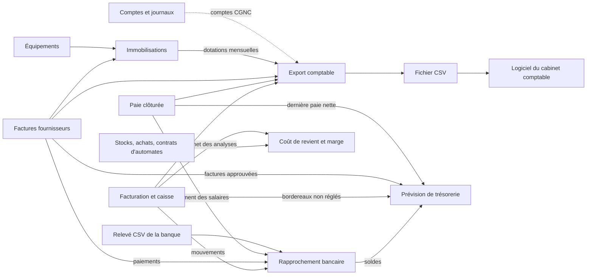
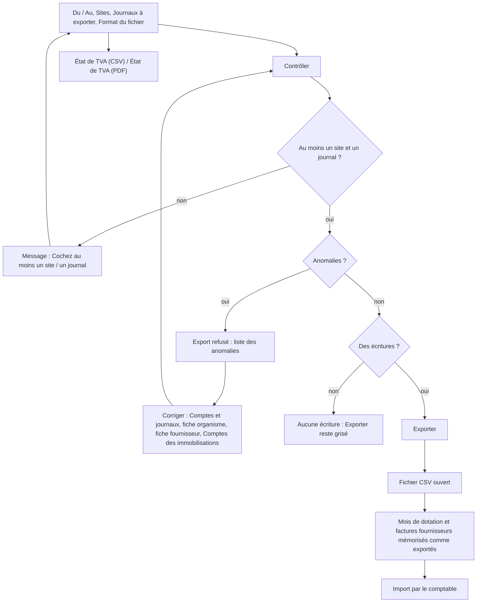
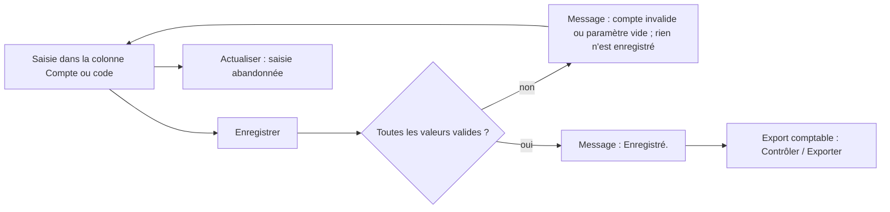
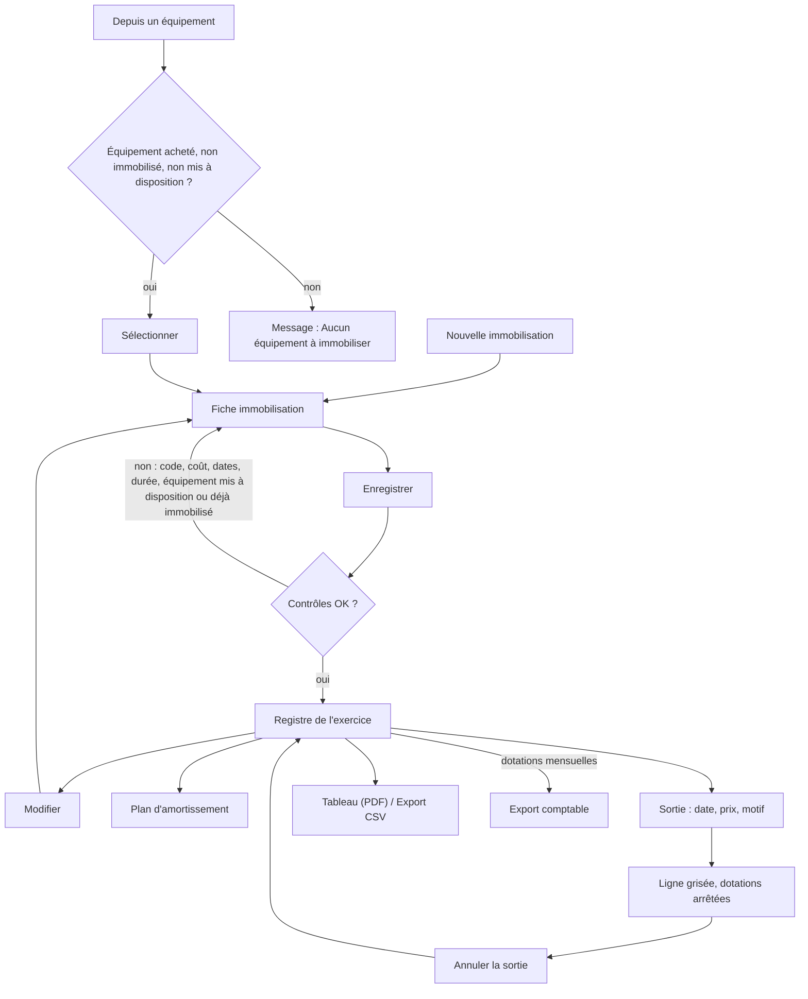
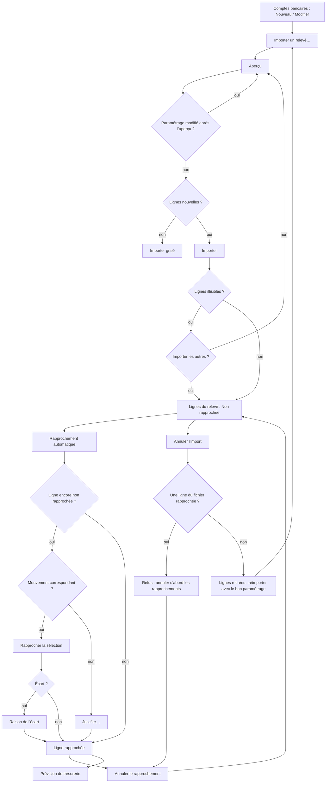
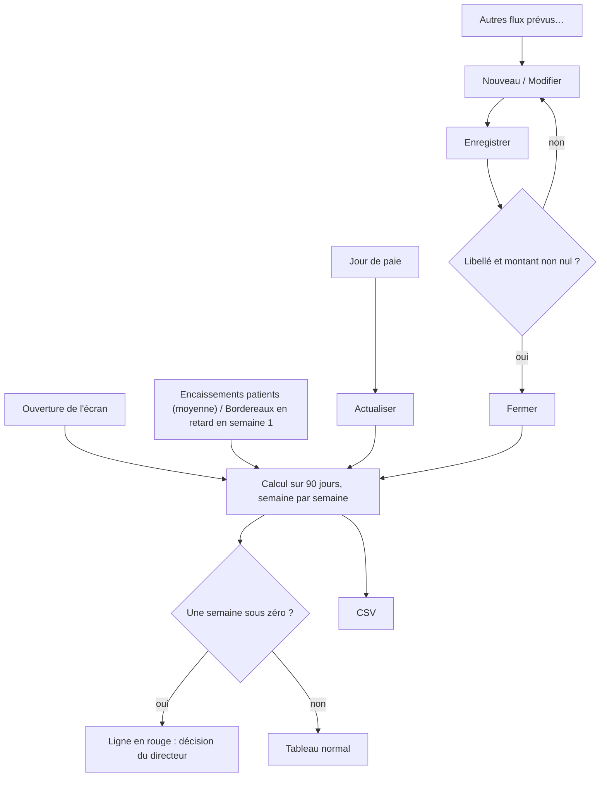
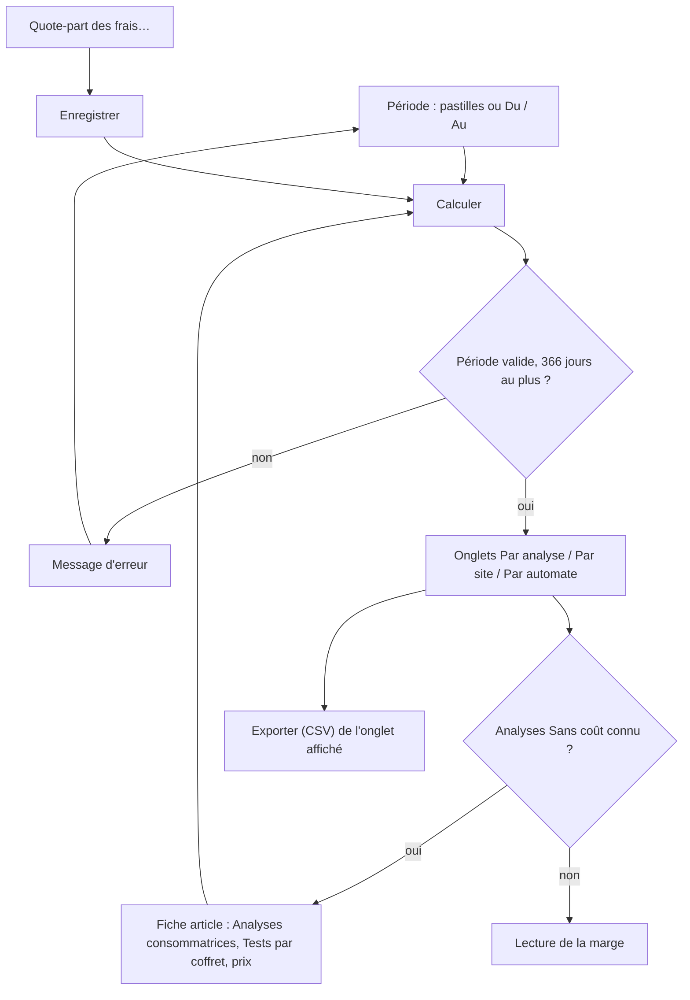

## Finances

### Présentation du module

**À quoi sert le module.** Le groupe **Finances** du menu prépare le travail du comptable et suit l'argent du laboratoire. On y trouve :
- l'export des écritures et l'état de TVA ;
- le paramétrage des comptes ;
- le registre des immobilisations ;
- le rapprochement bancaire ;
- la prévision de trésorerie ;
- le coût de revient des analyses.

L'écran **Visa des caisses**, rangé dans le même groupe, est décrit avec la caisse (chapitre Facturation, caisse et tiers payant).

Principe général : MarocLIS ne tient pas la comptabilité générale. Il produit des écritures propres (plan comptable marocain, CGNC) que le cabinet comptable importe dans son logiciel (Sage ou autre). Aucun écran de ce groupe ne passe d'écriture lui-même.

**Qui l'utilise.** Le service comptable, le biologiste responsable (directeur) et l'administrateur. Le responsable qualité peut consulter le registre des immobilisations.

**Ses écrans** (menu **Finances**) :

| Écran | Ce qu'on y fait |
|---|---|
| **Export comptable** | Contrôler puis exporter les écritures d'une période ; état de TVA |
| **Comptes et journaux** | Codes journaux et comptes CGNC utilisés par l'export |
| **Immobilisations** | Registre, plan d'amortissement, sorties, tableau pour le bilan |
| **Rapprochement bancaire** | Import du relevé CSV, rapprochement avec les mouvements enregistrés |
| **Prévision de trésorerie** | Solde prévu semaine par semaine sur 90 jours |
| **Coût de revient et marge** | Marge par analyse, par site et par automate |

**Liens avec les autres modules.** Plusieurs modules alimentent ces écrans :
- la facturation et la caisse ;
- les factures fournisseurs (module Achats) ;
- la paie clôturée (Ressources humaines) ;
- les équipements (Données de référence) ;
- les stocks et les contrats d'automates.

Rien ne repart de ces écrans vers les autres modules, sauf les mois de dotation et les factures marqués « exportés ».

Le titre du groupe s'affiche dès que l'utilisateur a le droit d'ouvrir au moins un de ses écrans. Un bouton pour lequel l'utilisateur n'a pas le droit reste visible mais grisé. Seul **Quote-part des frais…** fait exception : il est masqué.

**Présentation commune des écrans.** Chaque écran suit la même disposition :
- un en-tête avec le titre à gauche et les actions principales à droite (le bouton bleu est l'action principale) ;
- une rangée de filtres ;
- des cadres (cartes) qui portent chacun un titre ;
- dans plusieurs écrans, les actions rares sont réunies sous un bouton **Plus d'actions**.

Les fenêtres de saisie ont **Annuler** et le bouton principal en bas à droite. Une liste garde la ligne choisie après une actualisation. **F5** actualise l'écran affiché. **Ctrl+S** déclenche le bouton **Enregistrer** visible.

Droits par défaut (rôles livrés avec l'application) :

| Droit | Écrans concernés | Rôles qui l'ont par défaut |
|---|---|---|
| Export comptable | Export comptable, Comptes et journaux | Administrateur, Biologiste responsable, Comptabilité |
| Immobilisations — consulter | Immobilisations (lecture) | Administrateur, Biologiste responsable, Comptabilité, Responsable qualité |
| Immobilisations — gérer | Immobilisations (saisie, sortie, comptes) | Administrateur, Biologiste responsable, Comptabilité |
| Trésorerie — consulter / gérer | Rapprochement bancaire, Prévision de trésorerie | Administrateur, Biologiste responsable, Comptabilité (les deux droits) |
| Pilotage — consulter | Coût de revient et marge | Administrateur, Biologiste responsable |
| Pilotage — paramètres de coût | bouton « Quote-part des frais… » | Administrateur, Biologiste responsable |

Le rôle Comptabilité n'a pas accès à **Coût de revient et marge**.

---

### Export comptable

**À quoi sert cet écran**

Cet écran produit, pour une période, le fichier des écritures comptables à remettre au comptable. Ce fichier couvre les ventes, les encaissements, les opérations diverses, la paie, les dotations et les achats. L'écran produit aussi l'état de TVA de la même période. Les écritures sont contrôlées avant tout export : un fichier n'est jamais produit avec une écriture fausse.

**Qui y a accès** : droit « Export comptable » (Administrateur, Biologiste responsable, Comptabilité). Sans ce droit, les quatre boutons sont grisés.

**Fonctionnalités**
- **Contrôler** (en-tête) : calcule les écritures de la période et les vérifie (équilibre, comptes renseignés). Affiche le récapitulatif par journal et les anomalies.
- **État de TVA (CSV)** (en-tête) : produit l'état de TVA de la période et des sites choisis, en tableur. Pas besoin de **Contrôler** avant.
- **État de TVA (PDF)** (en-tête) : le même état en PDF, avec la mention « Document de travail à vérifier avec votre comptable ».
- **Exporter** (en-tête, bouton principal) : produit et ouvre le fichier CSV des écritures. Il est grisé tant que **Contrôler** n'a pas été fait, et tant qu'il reste une anomalie ou qu'il n'y a aucune écriture.
- **Du** / **Au** (carte « Période et contenu ») : la période. Par défaut, le mois civil précédent.
- **Format du fichier** : « Sage (écritures, séparateur point-virgule) » ou « CSV générique (dates ISO, point décimal) ».
- **Sites** : la liste des sites auxquels l'utilisateur a accès, tous cochés au départ.
- **Journaux à exporter** : six cases, toutes cochées au départ.
- Carte **Journaux à exporter** (récapitulatif) : une ligne par journal, avec **Journal**, **Nature**, **Écritures**, **Débit** et **Crédit**.
- Ligne d'état : le résultat du dernier contrôle, en vert, rouge ou gris.
- Carte **Points à corriger** : les anomalies, avec **Anomalie**, **Date**, **Journal**, **N° pièce**, **Libellé** et **Compte ou montants**.

**L'écran**
- En-tête : le titre **Export comptable**, puis **Contrôler**, **État de TVA (CSV)**, **État de TVA (PDF)** et **Exporter** à droite.
- Carte **Période et contenu** : **Du**, **Au**, **Format du fichier**, **Sites** et **Journaux à exporter**. Les six journaux sont :
  - « Ventes et avoirs » ;
  - « Encaissements, acomptes et caisse » ;
  - « Opérations diverses (pertes, imputations) » ;
  - « Paie » ;
  - « Dotations aux amortissements » ;
  - « Achats fournisseurs ».
- Carte **Journaux à exporter** : le récapitulatif par journal, puis la ligne d'état.
- Carte **Points à corriger** : la liste des anomalies, en rouge.

**Scénarios**

1. *Exporter les écritures du mois pour le comptable*
   1. Vérifier **Du** et **Au** (le mois précédent est proposé).
   2. Cocher les sites et les journaux voulus.
   3. Choisir le **Format du fichier** (Sage en général).
   4. Cliquer **Contrôler**. Le récapitulatif par journal s'affiche.
   5. Si la ligne d'état dit « N écriture(s), toutes équilibrées et affectées à un compte : l'export est possible. », cliquer **Exporter**. Le fichier CSV s'ouvre (Excel ou le programme associé).
   6. Enregistrer le fichier et le transmettre au comptable.
2. *Corriger un export refusé*
   1. Après **Contrôler**, si la ligne d'état dit « Export refusé : N anomalie(s) à corriger… », lire la carte **Points à corriger**.
   2. « Compte manquant ou invalide » : un compte n'est pas renseigné, ou ce n'est pas un compte CGNC. Selon le cas, corriger :
      - dans **Comptes et journaux** ;
      - dans la fiche de l'organisme payeur (champ **Compte comptable**) ;
      - dans la fiche fournisseur (**Compte auxiliaire**) ;
      - dans les comptes des immobilisations.
   3. « Écriture déséquilibrée » : la colonne **Compte ou montants** donne les totaux débit et crédit. Signaler l'écriture à l'administrateur. Ce cas est rare, normalement impossible (à vérifier).
   4. Cliquer de nouveau **Contrôler**, puis **Exporter**.
3. *Exporter un seul journal* (par exemple la paie) : décocher les autres journaux, puis **Contrôler** et **Exporter**.
4. *Imprimer l'état de TVA de la période*
   1. Régler **Du**, **Au** et les **Sites**.
   2. Cliquer **État de TVA (PDF)** ou **État de TVA (CSV)**. Il n'est pas nécessaire de cliquer **Contrôler** avant.
   3. L'état donne :
      - le chiffre d'affaires exonéré (analyses, art. 91 CGI) ;
      - le chiffre d'affaires taxable par taux, avec la TVA collectée ;
      - les achats et les immobilisations par taux, avec leur TVA ;
      - le prorata de déduction, la TVA déductible après prorata et la TVA due (un crédit si elle est négative).
   4. Il porte la mention « Document de travail à vérifier avec votre comptable : ce n'est pas la déclaration de TVA. »

**Règles et contrôles**
- **Exporter** reste grisé tant qu'on n'a pas cliqué **Contrôler**, et tant qu'il reste une anomalie ou qu'il n'y a aucune écriture. Le fichier n'est jamais produit à moitié.
- Si l'on change la période, les sites ou les journaux après **Contrôler**, le bouton **Exporter** reste actif. Le fichier est quand même recalculé et recontrôlé avec les nouveaux choix, mais le récapitulatif affiché reste celui de l'ancien contrôle. Recliquez **Contrôler** après tout changement.
- Si **Exporter** est refusé, l'écran refait le contrôle tout seul et affiche les anomalies.
- Quand la période n'a aucune écriture, la ligne d'état affiche « Aucune facture ni aucun règlement fournisseur sur cette période. ». Ce texte, repris des achats, vaut ici pour tous les journaux.
- Si le journal des dotations est coché sans registre des immobilisations, la ligne d'état ajoute « Aucun registre des immobilisations installé : pas de dotations aux amortissements. ».
- Chaque export est tracé dans le journal des accès aux données, car les libellés contiennent des noms de patients (loi 09-08). Le fichier sort du laboratoire : transmettez-le par un moyen sûr.
- **Ne pas exporter deux fois la même période vers le logiciel comptable.** Un second export de la même période redonne les mêmes écritures, et les importer deux fois les doublerait.
- Les achats peuvent aussi être exportés depuis **Factures fournisseurs** > **Export comptable**. N'utilisez qu'un seul des deux chemins pour une période donnée, sinon les achats seront importés deux fois.
- Format Sage : le N° de pièce est limité à 13 caractères et le libellé à 35. Une pièce plus longue est raccourcie, et le numéro complet est mis en tête du libellé.

**Choix comptables appliqués (pour le comptable)** : ce sont les comptes proposés par défaut. Tous se changent dans **Comptes et journaux**.
- *Ventes (VT)* :
  - au débit, le patient (3421) et, pour la part réclamée à un tiers payant, l'organisme (3421 ou son compte propre) ;
  - au crédit, les produits (7124, un compte par département possible) et, le cas échéant, la TVA facturée (4455). Les analyses sont exonérées (art. 91 CGI) ;
  - un avoir passe en sens inverse, d'abord sur la part du patient.
- *Encaissements (CAI / BQ)* :
  - espèces sur la caisse du site (5161) ;
  - chèque, carte, virement, effet/traite (LCN) et paiement mobile, chacun sur son compte de trésorerie (5141 par défaut, ou 5111 « Chèques et valeurs à encaisser » si le cabinet le préfère) ;
  - règlements des organismes sur 5141 ;
  - un chèque impayé ou un remboursement contre-passe l'encaissement le jour où il survient.
- *Patients en compte global* (réglage par défaut) : les encaissements d'une session de caisse sont cumulés par jour et par mode de règlement, sur le compte tiers « PATIENTS ». Le livre de caisse montre la recette de la session, pas chaque ticket. L'autre réglage crée un compte tiers par patient (n° de dossier).
- *Acomptes* : 4421 à l'encaissement, puis de 4421 vers le patient lorsqu'il règle la facture.
- *Opérations diverses (OD)* :
  - perte sur créance (6585) ;
  - part refusée par l'organisme et laissée au patient : transfert du compte de l'organisme au compte du patient le jour de la réponse, et retour si le bordereau est rouvert ;
  - écart de caisse à la clôture : manquant 6588, excédent 7588 ;
  - espèces envoyées à la banque : de 5161 vers 5115.
- *Paie* : pour chaque mois de paie clôturé :
  - au débit, les salaires bruts (6171) et les charges patronales (6174) ;
  - au crédit, la CNSS/AMO (4441), l'IR (4452), les avances (3431), les autres retenues (4488) et le net à payer (4432).
- *Dotations* :
  - une écriture par immobilisation et par mois, datée du dernier jour du mois (ou de la date de sortie) ;
  - 6193 au débit, 28xxx au crédit ;
  - un mois exporté est mémorisé. Si l'immobilisation est corrigée ensuite, les mois déjà exportés sont redonnés à l'identique. Le premier mois non exporté porte la différence (une reprise si elle est négative).
- *Achats (ACH)* :
  - au débit, la charge par catégorie d'article (6122 par défaut) et la TVA récupérable sur charges (34552) ; au crédit, le fournisseur (4411) ;
  - règlement : le fournisseur au débit ; au crédit, la banque (5141) ou la caisse (5161), à la date du règlement saisi. Un règlement par effet (LCN) est donc passé à la date de sa remise, directement en banque. Il n'y a pas de compte d'effets à payer : à valider avec le comptable.
- *Facture d'une immobilisation* : quand une immobilisation du registre est liée à une facture fournisseur, cette facture est immobilisée et non passée en charge :
  - le coût va au compte d'immobilisation (2332… selon la catégorie) ;
  - la TVA va en 34551 « TVA récupérable sur immobilisations » si elle est récupérable ; sinon, elle est ajoutée au coût ;
  - la dette est portée en 4481 « Dettes sur acquisitions d'immobilisations », et ses règlements soldent 4481 ;
  - si la facture avait déjà été exportée en charges avant le lien, l'écriture déjà partie n'est pas modifiée. Une écriture de reclassement, datée du jour du lien, déplace la part de l'immobilisation des charges (et de 34552) vers l'immobilisation (et 34551). Le fournisseur reste alors en 4411 (à confirmer avec le comptable).

**Flux** : la facturation, la caisse, la paie, les factures fournisseurs et les immobilisations alimentent cet écran. Il produit un fichier CSV, que le cabinet comptable importe dans son logiciel.

---

### Comptes et journaux

**À quoi sert cet écran**

Cet écran fixe, dans un seul tableau, les codes journaux et les comptes CGNC que l'export comptable utilise : ventes, clients, trésorerie, paie et achats.

**Qui y a accès** : droit « Export comptable » (Administrateur, Biologiste responsable, Comptabilité). Sans ce droit, **Actualiser** et **Enregistrer** sont grisés.

**Fonctionnalités**
- **Actualiser** (en-tête) : relit les valeurs enregistrées et abandonne la saisie en cours, sans demander de confirmation.
- **Enregistrer** (en-tête, ou **Ctrl+S**) : vérifie toutes les valeurs, puis enregistre. Si une seule valeur est fausse, rien n'est enregistré.
- Bandeau jaune : rappelle que les comptes proposés sont ceux du CGNC, à faire valider par le comptable.
- Colonne **Compte ou code** : la seule colonne modifiable. On y tape un compte, ou on choisit une valeur dans une liste (ligne **Compte des patients**).

**L'écran**
- En-tête : le titre, **Actualiser** et **Enregistrer**.
- Un bandeau jaune : « Comptes du plan comptable marocain (CGNC) proposés par défaut : faites-les valider par votre comptable. Un département, un site ou un mode de règlement laissé vide suit le compte par défaut de sa rubrique. »
- Un tableau à trois colonnes : **Rubrique**, **Paramètre** et **Compte ou code**. Les rubriques sont les suivantes :

| Rubrique | Contenu |
|---|---|
| Journaux | Journal des ventes (VT), de caisse (CAI), de banque (BQ), des opérations diverses (OD), de paie (OD), des dotations (OD) |
| Clients et organismes | Clients patients (3421) ; **Compte des patients** (liste : compte global ou un compte par patient) ; compte tiers global des patients (PATIENTS) ; organismes sans compte propre (3421) ; acomptes reçus (4421) ; créances irrécouvrables (6585) |
| Produits et TVA | Produits par défaut (7124) ; produits hors analyses (7124) ; TVA facturée (4455) ; puis une ligne par département |
| Trésorerie | Caisse par défaut (5161) ; une ligne par site ; un compte par mode de règlement (chèque, carte, virement, effet/traite, paiement mobile) ; banque des règlements des organismes (5141) ; virements de fonds de la caisse vers la banque (5115) ; manquants (6588) et excédents (7588) de caisse |
| Paie | 6171, 6174, 4441, 4452, 3431, 4488, 4432 |
| Achats | Journaux des achats, de la banque et de la caisse fournisseurs ; fournisseurs (4411) ; TVA récupérable sur charges (34552) ; TVA récupérable sur immobilisations (34551) ; dettes sur acquisitions d'immobilisations (4481) ; banque (5141) et caisse (5161) des règlements fournisseurs ; un compte d'achat par catégorie d'article |

**Scénarios**

1. *Adapter les comptes au plan du cabinet comptable*
   1. Cliquer dans la colonne **Compte ou code** de la ligne voulue, puis taper le compte (par exemple 71241 pour un département).
   2. Répéter pour chaque ligne à changer.
   3. Cliquer **Enregistrer**. Le message « Enregistré. » confirme.
2. *Donner un compte de produits propre à un département* : remplir la ligne « Produits du département … ». La laisser vide pour revenir au compte par défaut.
3. *Passer les patients en compte individuel* : dans la ligne **Compte des patients**, choisir « Un compte tiers par patient (n° de dossier) », puis **Enregistrer**.
4. *Abandonner une saisie non enregistrée* : cliquer **Actualiser**. Les valeurs enregistrées reviennent, sans confirmation.

**Règles et contrôles**
- Un compte doit être un compte général CGNC : des chiffres, de la classe 1 à 8, au moins 4 chiffres. Un code journal ou un compte tiers s'écrit en lettres et chiffres, sans espace, 20 caractères au plus. Sinon, le message est « « X » n'est pas un compte valide… ».
- Seules les lignes de département, de site et de mode de règlement peuvent rester vides. Pour les autres, le message est « Le paramètre … ne peut pas être vide. ». Ce message donne le nom technique du paramètre, et non son libellé à l'écran.
- Si une seule valeur est fausse, rien n'est enregistré.
- Chaque modification est tracée (avec la liste des paramètres changés).
- Les comptes des immobilisations ne sont pas ici : ils se règlent dans **Immobilisations** > **Plus d'actions** > **Comptes**.
- Le compte d'un organisme payeur se règle dans sa fiche (**Compte comptable**). Le compte d'un fournisseur se règle dans sa fiche (**Compte auxiliaire**).

**Flux** : l'**Export comptable** lit ces réglages à chaque **Contrôler** et à chaque **Exporter**.

---

### Immobilisations

**À quoi sert cet écran**

Cet écran tient le registre des immobilisations par exercice : valeur brute, amortissements et valeur nette. Il donne aussi le plan d'amortissement de chaque bien et enregistre les sorties. Il produit le tableau des immobilisations pour le bilan.

**Qui y a accès**
- Consultation : Administrateur, Biologiste responsable, Comptabilité, Responsable qualité.
- Saisie, modification, sortie et comptes (droit « Immobilisations — gérer ») : Administrateur, Biologiste responsable, Comptabilité. Sans ce droit, **Nouvelle immobilisation**, **Depuis un équipement**, **Modifier**, **Sortie** et **Comptes** sont grisés.

**Fonctionnalités**
- **Nouvelle immobilisation** (en-tête, bouton principal) : ouvre une fiche vide.
- **Depuis un équipement** (en-tête) : propose les équipements achetés, pas encore immobilisés et non mis à disposition par un fournisseur. La fiche s'ouvre pré-remplie.
- **Plus d'actions** (en-tête) contient trois actions :
  - **Tableau (PDF)** : le tableau des immobilisations et des amortissements de l'exercice (A3 paysage) ;
  - **Export CSV** : le même tableau en tableur, avec en plus le fournisseur, le n° de facture et l'équipement ;
  - **Comptes** : les comptes d'immobilisation, d'amortissement et de dotation de chaque catégorie.
- **Exercice** (filtre) : l'année civile affichée. Changer l'année recharge le registre.
- **Actualiser** (filtre) : recharge le registre de l'exercice.
- **Modifier** (barre sous le registre) : rouvre la fiche du bien choisi.
- **Plan d'amortissement** (barre sous le registre, ou double-clic sur la ligne) : montre le plan **Par exercice** et **Par mois**. La fenêtre a ses propres boutons **Export CSV** et **Fermer**.
- **Sortie** (barre sous le registre) : enregistre une cession, une mise au rebut ou un vol. Sur un bien déjà sorti, le bouton devient **Annuler la sortie** et demande une confirmation.
- Carte **Équipement lié — maintenance et pannes** : le résumé et les interventions de l'équipement lié à la ligne choisie. On ne peut que les lire.

**L'écran**
- En-tête : le titre **Immobilisations**. Dessous, une ligne grise résume l'exercice : « Registre des immobilisations {année} — N immobilisation(s) · valeur brute … · dotation … · VNA … ». À droite : **Plus d'actions**, **Depuis un équipement** et **Nouvelle immobilisation**.
- Rangée de filtres : **Exercice** et **Actualiser**.
- Carte du registre, avec une ligne par bien. Les colonnes sont **Code**, **Désignation**, **Catégorie**, **Compte**, **Date d'acquisition**, **Mise en service**, **Valeur brute**, **Méthode**, **Durée (ans)**, **Taux**, **Amort. cumulés début**, **Dotation**, **Sorties valeur brute**, **Sorties amort.**, **Valeur brute fin**, **Amort. cumulés fin**, **VNA**, **Date de sortie**, **Prix de cession**, **Résultat de cession** et **Équipement**.
  - Les colonnes fournisseur et n° de facture ne sont pas affichées à l'écran ; elles figurent dans l'**Export CSV**.
  - Un bien sorti s'affiche en gris.
  - Les équipements mis à disposition par un fournisseur (mise à disposition, comodat, location) viennent en fin de liste, en petit et en gris, sans montant.
  - En bas de la carte, une barre porte **Modifier**, **Plan d'amortissement** et **Sortie** (ou **Annuler la sortie**).
- Une ligne de rappel : « Registre par exercice civil. Les équipements mis à disposition par leur fournisseur figurent en fin de liste, sans valeur ni amortissement. Les dotations mensuelles sont reprises par l'export comptable. »
- Carte **Équipement lié — maintenance et pannes**, pour l'équipement lié à la ligne choisie :
  - le fabricant et le n° de série ;
  - le nombre d'interventions et de pannes, l'arrêt cumulé et le coût ;
  - la prochaine maintenance et le prochain étalonnage ;
  - la fin du contrat de maintenance ;
  - la liste des interventions (**Date**, **Nature de l'intervention**, **Description**, **Arrêt (h)**, **Coût (MAD)**, **Technicien externe**, **Contrôle après intervention**), avec les pannes sur fond orangé.

  Ces informations viennent du module Équipements et ne se modifient pas ici.

**Scénarios**

1. *Inscrire une nouvelle immobilisation*
   1. Cliquer **Nouvelle immobilisation**.
   2. Remplir **Code** (n° d'inventaire), **Désignation** et **Catégorie**. Les catégories sont : matériel de laboratoire, matériel informatique, mobilier, matériel de transport, agencements et aménagements, autres.
   3. Saisir **Date d'acquisition** et **Mise en service**.
   4. Choisir la **Méthode** (Linéaire ou Dégressif) et la **Durée (ans)**. La durée proposée est de 5 ans, ou de 10 ans pour le mobilier et les agencements. La **Valeur résiduelle (MAD)** se laisse en général à zéro.
   5. Saisir **Coût HT (MAD)**, frais de transport et d'installation compris, puis **TVA (MAD)**. Ne cocher **TVA récupérable** que si le comptable le confirme.
   6. Choisir le **Fournisseur**. La liste **Facture fournisseur** propose alors ses factures. En choisir une remplit le **N° de facture**, ainsi que le coût, la TVA et la date d'acquisition s'ils sont encore vides. Le **N° de facture** peut aussi être tapé à la main.
   7. Choisir l'**Équipement** lié s'il s'agit d'un appareil suivi dans le module Équipements.
   8. Contrôler la ligne d'aide, qui indique la base amortissable et le taux (ou le coefficient dégressif).
   9. Cliquer **Enregistrer**.
2. *Immobiliser un appareil déjà déclaré dans les équipements*
   1. Cliquer **Depuis un équipement**. La liste montre les appareils achetés (date d'achat renseignée), pas encore immobilisés et non mis à disposition par un fournisseur.
   2. Double-cliquer l'appareil, ou le choisir puis cliquer **Sélectionner**.
   3. La fiche s'ouvre pré-remplie (code, nom, fournisseur, dates, matériel de laboratoire, linéaire). Saisir le coût, puis **Enregistrer**.
3. *Corriger une immobilisation* : choisir la ligne, cliquer **Modifier**, corriger, puis **Enregistrer**. Si l'on change la catégorie, vérifier aussi la **Durée (ans)** : elle n'est pas recalculée.
4. *Consulter le plan d'amortissement*
   1. Choisir la ligne, puis **Plan d'amortissement** (ou double-cliquer la ligne).
   2. La fenêtre montre le plan **Par exercice** et **Par mois**.
   3. **Export CSV**, dans cette fenêtre, exporte le plan mois par mois. **Fermer** la referme.
5. *Enregistrer la sortie d'un bien (cession, rebut, vol)*
   1. Choisir la ligne, puis **Sortie**.
   2. Saisir **Date de sortie** (pas dans le futur), **Prix de cession** (0 pour un rebut) et **Motif de la sortie** (obligatoire).
   3. Cliquer **Enregistrer**.
6. *Annuler une sortie saisie par erreur* : choisir la ligne grisée, cliquer **Annuler la sortie**, puis confirmer. Les dotations reprennent jusqu'à la fin du plan.
7. *Imprimer le tableau des immobilisations et des amortissements*
   1. Choisir l'**Exercice**.
   2. Cliquer **Plus d'actions** > **Tableau (PDF)**. Le tableau est en A3 paysage, avec des sous-totaux par catégorie, le total, puis les équipements mis à disposition.
   3. **Plus d'actions** > **Export CSV** donne le même tableau avec, en plus, le fournisseur, le n° de facture et l'équipement.
8. *Changer les comptes d'une catégorie*
   1. Cliquer **Plus d'actions** > **Comptes**. Pour chaque catégorie, saisir **Immobilisation**, **Amortissement** et **Dotation**.
   2. Cliquer **Enregistrer**.
   3. Les comptes par défaut sont :
      - 2332/28332 (matériel de laboratoire) ;
      - 2355/28355 (informatique) ;
      - 2351/28351 (mobilier) ;
      - 2340/28340 (transport) ;
      - 2327/28327 (agencements) ;
      - 2380/28380 (autres) ;
      - 6193 pour la dotation.

**Règles et contrôles**
- Le code, la désignation et un coût HT supérieur à zéro sont obligatoires. Le code est unique sur le site (« Le code … est déjà utilisé par une autre immobilisation. »).
- La mise en service ne peut pas précéder l'acquisition. La durée doit être comprise entre 1 et 50 ans. Le dégressif n'est possible qu'à partir de 3 ans. La valeur résiduelle doit être inférieure à la valeur brute.
- Les montants se tapent en chiffres. La notation « 1e5 » et les nombres démesurés sont refusés.
- *Base amortissable* : le coût HT, plus la TVA quand elle n'est pas récupérable. C'est le cas courant d'un laboratoire dont les analyses sont exonérées (art. 91 CGI), à confirmer avec le comptable.
- *Linéaire* : prorata par mois, à partir du mois de mise en service. Le dernier mois absorbe l'arrondi.
- *Dégressif* : coefficient 1,5 (3 à 4 ans), 2 (5 à 6 ans) ou 3 (au-delà), à partir du mois d'acquisition. Le calcul passe au linéaire quand celui-ci devient plus favorable.
- Les exercices sont des années civiles.
- Un **équipement mis à disposition** (mise à disposition, comodat, location) reste la propriété du fournisseur. Il est refusé (« Cet équipement est mis à disposition par son fournisseur… »).
- Un équipement ne peut être immobilisé qu'une fois (« Cet équipement est déjà inscrit au registre sous le code … »).
- *Sortie* :
  - les dotations s'arrêtent au mois de la sortie ;
  - le **Résultat de cession** (prix moins valeur nette) figure au tableau ;
  - l'écriture de cession elle-même est passée par le comptable : elle ne fait pas partie de l'export.
- *Comptes* : l'immobilisation en classe 2 (hors 28), l'amortissement en 28…, la dotation en classe 6. Des chiffres uniquement, de quatre à vingt (la saisie s'arrête au vingtième).
- *Changement de catégorie* d'un bien déjà exporté (dotations ou facture) : un virement de compte à compte est préparé automatiquement, daté du jour, pour le prochain export. Le comptable peut préférer une date de début d'exercice : à vérifier avec lui.
- Il n'existe pas de bouton de suppression d'une immobilisation.

**Flux** : la facture fournisseur et la fiche équipement donnent l'immobilisation. Ses dotations mensuelles sont reprises par l'**Export comptable** (journal « Dotations aux amortissements »), puis dans le tableau annuel pour le bilan.

---

### Rapprochement bancaire

**À quoi sert cet écran**

Cet écran compare, pour un compte bancaire et une période, les lignes du relevé de la banque avec les mouvements que l'application a enregistrés : règlements, remises carte, versements d'espèces, paiements fournisseurs, salaires… Il sert aussi à justifier ce qui reste.

**Qui y a accès** : droits « Trésorerie » (Administrateur, Biologiste responsable, Comptabilité). Avec la seule consultation, tous les boutons d'action sont grisés.

**Fonctionnalités**
- **Importer un relevé…** (en-tête) : lit un fichier CSV de la banque (.csv ou .txt, 10 Mo au plus), avec un aperçu et le choix des colonnes.
- **Comptes bancaires** (en-tête) : la liste des comptes du laboratoire. La fenêtre a ses boutons :
  - **Nouveau** ;
  - **Modifier** (grisé tant qu'aucun compte n'est choisi ; on peut aussi double-cliquer le compte) ;
  - **Fermer**.
- **Plus d'actions** > **Annuler l'import** (en-tête) : retire toutes les lignes du fichier dont fait partie la ligne choisie.
- **Compte bancaire** (filtre) : le compte affiché. Changer de compte recharge l'écran.
- **Du** / **Au** (filtre) : la période des lignes. Il faut ensuite cliquer **Actualiser**.
- **Actualiser** (filtre) : recharge le relevé et les mouvements.
- Pastille **Lignes non rapprochées seulement · N** (filtre) : n'affiche que le reste à faire. N donne le nombre de lignes non rapprochées.
- **Rapprocher la sélection** (barre du bas) : relie la ligne du relevé choisie aux mouvements choisis à droite. Il est actif seulement si la ligne n'est pas rapprochée et qu'au moins un mouvement est choisi.
- **Justifier…** (barre du bas) : explique une ligne sans mouvement (frais, agios, timbre…).
- **Annuler le rapprochement** (barre du bas) : défait un rapprochement ou une justification, après confirmation.
- **Rapprochement automatique** (barre du bas, bouton principal) : rapproche les cas certains de la période.

**L'écran**
- En-tête : le titre **Rapprochement bancaire**, puis **Plus d'actions**, **Comptes bancaires** et **Importer un relevé…** à droite.
- Rangée de filtres : **Compte bancaire** (la liste des comptes actifs), **Du** / **Au** (par défaut, du 1er du mois précédent à aujourd'hui), **Actualiser** et la pastille **Lignes non rapprochées seulement · N**.
- Carte **Relevé bancaire**, à gauche : **Date**, **Libellé**, **Référence**, **Montant** et **Statut**.
  - Le statut vaut « Non rapprochée », ou la nature du rapprochement, avec « (auto) » s'il est automatique, et l'écart éventuel.
  - Une ligne rapprochée s'affiche en vert, ou en orange s'il reste un écart.
  - Le commentaire s'affiche en survolant le statut.
- Carte **Mouvements enregistrés non rapprochés**, à droite : **Date**, **Nature**, **Libellé**, **Référence** et **Montant**. La nature peut être :
  - Règlement patient, Acompte, Remise carte, Règlement organisme ;
  - Versement d'espèces, Paiement fournisseur, Virement des salaires ;
  - Chèque impayé, Remboursement patient.
- Carte du bas, avec les soldes :
  - Solde du relevé et Solde rapproché ;
  - Lignes du relevé non rapprochées et Mouvements non rapprochés (tout le site) ;
  - Solde d'ouverture, avec le nombre de lignes et de mouvements restants.

  Elle porte la barre **Rapprocher la sélection**, **Justifier…**, **Annuler le rapprochement** et, à droite, **Rapprochement automatique**.

**Scénarios**

1. *Déclarer un compte bancaire (une fois)*
   1. Cliquer **Comptes bancaires**, puis **Nouveau**.
   2. Saisir **Banque**, **Intitulé du compte**, **RIB (24 chiffres)** et **Compte comptable** (5141 est proposé ; mettre le sous-compte du cabinet).
   3. Saisir le **Solde d'ouverture (DH)** et la date **Au** : c'est le solde du relevé à cette date. Seules les lignes postérieures le font varier.
   4. Laisser **Actif** coché, puis **Enregistrer**.
2. *Corriger ou clôturer un compte*
   1. Cliquer **Comptes bancaires**, choisir le compte, puis **Modifier** (ou double-cliquer le compte).
   2. Pour clôturer le compte, décocher **Actif**.
   3. **Fermer** pour revenir.
3. *Importer un relevé CSV*
   1. Choisir le **Compte bancaire**, puis cliquer **Importer un relevé…** et choisir le fichier.
   2. La fenêtre affiche le fichier brut en colonnes numérotées et l'aperçu des lignes lues.
   3. Ajuster si besoin :
      - **Séparateur** (Automatique, « ; », « , », Tabulation), **Lignes à ignorer**, **Format de date** (jj/MM/aaaa par défaut), **Décimales** (Automatique, « , », « . ») et **Ligne d'en-têtes** ;
      - **Col. date**, **Col. date valeur**, **Col. libellé** et **Col. référence** ;
      - soit **Col. montant** (montant signé), soit **Col. débit** et **Col. crédit**. Mettre 0 pour une colonne absente.
   4. Cliquer **Aperçu**. Chaque ligne indique « Nouvelle », « Déjà importée » (en gris) ou, en rouge, la raison du refus : Date illisible, Montant illisible, Montant nul ou Libellé vide. Le bas résume le nombre de lignes nouvelles et leur total.
   5. Cliquer **Importer**. Si des lignes sont illisibles, confirmer qu'on importe les autres.
   6. Le paramétrage des colonnes est mémorisé pour le prochain relevé de ce compte.
4. *Rapprochement automatique* : régler **Du** / **Au**, cliquer **Actualiser**, puis **Rapprochement automatique**. Un message indique le nombre de lignes rapprochées ; les autres restent à faire à la main.
5. *Rapprocher à la main (une remise de chèques, un lot carte payé net de commission)*
   1. Cliquer une ligne non rapprochée du relevé, à gauche.
   2. À droite, sélectionner le ou les mouvements correspondants. Ctrl+clic ou Maj+clic permet d'en prendre plusieurs.
   3. Cliquer **Rapprocher la sélection**.
   4. Si les montants ne sont pas égaux, une fenêtre demande la raison de l'écart (commission, frais…). La saisir (5 caractères au moins), puis cliquer **OK**.
6. *Justifier une ligne sans mouvement (frais bancaires, agios, timbre)* : choisir la ligne, cliquer **Justifier…**, écrire la justification, puis **OK**. Le comptable passera l'écriture d'après ce texte.
7. *Défaire un rapprochement ou une justification* : choisir la ligne rapprochée, cliquer **Annuler le rapprochement**, puis confirmer. Les mouvements redeviennent disponibles. L'historique est conservé.
8. *Retirer un relevé importé avec un mauvais paramétrage*
   1. Choisir une ligne de ce relevé, puis **Plus d'actions** > **Annuler l'import**, puis confirmer.
   2. Toutes les lignes de ce fichier sont retirées. Le fichier peut ensuite être réimporté avec le bon paramétrage.
9. *Ne voir que le reste à faire* : cliquer la pastille **Lignes non rapprochées seulement**.

**Règles et contrôles**
- Après un changement de **Du** ou **Au**, cliquer **Actualiser** : l'écran ne se recharge pas tout seul. Il se recharge au changement de compte.
- *Rapprochement automatique* : il ne retient que les cas certains. Il faut le même montant au centime, le même sens et une date dans la fenêtre du mouvement :
  - 2 jours avant ;
  - 5 jours après ;
  - 45 jours après pour un chèque ou un effet émis par le laboratoire.

  Il rapproche d'abord par référence : un n° de chèque, de virement ou de remise d'au moins 4 caractères trouvé dans le libellé. Il rapproche ensuite les paires uniques. Tout cas ambigu est laissé à l'utilisateur.
- *Effet (LCN) ou chèque post-daté payé à un fournisseur* : il est attendu à la banque à sa date d'échéance, et non à sa date de saisie.
- Les doublons sont ignorés : réimporter un relevé qui chevauche le précédent n'ajoute rien deux fois, même si le format de la banque a changé.
- Un montant de relevé démesuré (dix millions de milliards ou plus) est refusé comme illisible.
- Refus possibles :
  - « RIB invalide : 24 chiffres, dont la clé de contrôle des deux derniers. » ;
  - « Ce RIB est déjà déclaré pour un autre compte bancaire. » ;
  - un compte comptable qui ne commence pas par 51 ;
  - « Aucune ligne nouvelle à importer… » ;
  - « Le fichier dépasse 10 Mo… ».
- Rapprochement manuel :
  - un encaissement ne peut pas expliquer un débit, ni un décaissement un crédit ;
  - un mouvement ne peut servir qu'à une seule ligne ;
  - un écart exige une raison.
- Si l'on modifie un réglage du relevé après l'**Aperçu**, **Importer** se grise (« Le paramétrage a changé : cliquez sur « Aperçu » avant d'importer. »).
- **Annuler l'import** est refusé tant qu'une ligne du fichier est rapprochée : annulez d'abord ces rapprochements.
- Un compte clôturé ne reçoit plus de relevé.
- Les mouvements proposés à droite sont ceux de tout le site, pas d'un seul compte.
- Rien ici ne passe d'écriture comptable.

**Flux** :
1. Les encaissements (caisse, organismes), les versements, les paiements fournisseurs et la paie créent les mouvements.
2. On importe le relevé, puis on rapproche.
3. Le comptable passe les lignes justifiées.
4. Les soldes alimentent la **Prévision de trésorerie**.

---

### Prévision de trésorerie

**À quoi sert cet écran**

Cet écran prévoit le solde des comptes bancaires semaine par semaine, sur 90 jours. On voit ainsi à l'avance une semaine où le compte passerait dans le rouge.

**Qui y a accès** : droits « Trésorerie » (Administrateur, Biologiste responsable, Comptabilité). Avec la seule consultation, la liste des flux s'ouvre en lecture seule : **Nouveau** et **Modifier** y sont grisés.

**Fonctionnalités**
- **Autres flux prévus…** (en-tête) : la liste des rentrées et sorties saisies à la main (loyer, leasing, CNSS, IR, échéance d'emprunt…). La fenêtre a ses boutons :
  - **Nouveau** ;
  - **Modifier** (grisé tant qu'aucune ligne n'est choisie ; on peut aussi double-cliquer la ligne) ;
  - **Fermer**, qui recalcule la prévision.
- **CSV** (en-tête) : exporte le tableau des semaines.
- **Actualiser** (en-tête) : relance le calcul, notamment après un changement du jour de paie.
- **Encaissements patients (moyenne)** (filtre, case) : ajoute la moyenne des encaissements au comptoir. Le calcul est relancé aussitôt.
- **Bordereaux en retard en semaine 1** (filtre, case) : compte les bordereaux en retard comme payés en semaine 1. Le calcul est relancé aussitôt.
- **Jour de paie (0 = fin de mois)** (filtre) : le jour où les salaires sortent. Ce champ ne relance pas le calcul : cliquer **Actualiser**.
- « Solde le plus bas sur la période » (sous le titre) : en rouge s'il est négatif.

**L'écran**
- En-tête : le titre **Prévision de trésorerie**, avec dessous « Solde le plus bas sur la période : … ». À droite : **Autres flux prévus…**, **CSV** et **Actualiser**.
- Rangée de filtres : les cases **Encaissements patients (moyenne)** et **Bordereaux en retard en semaine 1**, puis le champ **Jour de paie (0 = fin de mois)**.
- Carte **Semaines** : **Sem.**, **Du**, **Au**, **Solde début**, **Organismes**, **Patients**, **Fournisseurs**, **Salaires**, **Autres flux**, **Variation** et **Solde fin**. Une semaine dont le solde de fin est négatif est en rouge.
- Carte **Hypothèses** :
  - le solde d'ouverture par compte ;
  - ce qui n'est pas compté (bordereaux en retard, factures fournisseurs non approuvées) ;
  - la dernière paie nette et la moyenne des encaissements patients ;
  - la méthode de calcul.

**Scénarios**

1. *Consulter la prévision* : ouvrir l'écran. Le calcul se fait à l'ouverture. Repérer les lignes rouges et le « Solde le plus bas sur la période ».
2. *Inclure les encaissements au comptoir* : cocher **Encaissements patients (moyenne)**. Le calcul est relancé aussitôt.
3. *Compter les bordereaux en retard comme payés en semaine 1* : cocher **Bordereaux en retard en semaine 1**.
4. *Fixer le jour de paie* : saisir le jour (par exemple 28, ou 0 pour la fin du mois), puis cliquer **Actualiser**. Ce champ ne relance pas le calcul tout seul.
5. *Ajouter une sortie ou une rentrée prévue (loyer, leasing, CNSS, IR, échéance d'emprunt)*
   1. Cliquer **Autres flux prévus…**, puis **Nouveau**.
   2. Saisir le **Libellé** et le **Montant (DH, négatif = sortie)**.
   3. Choisir la **Périodicité** (Une fois, Chaque semaine, Chaque mois, Chaque trimestre, Chaque année), la **Première date** et, si besoin, une **Date de fin**.
   4. Laisser **Actif** coché, puis **Enregistrer**. **Fermer** recalcule la prévision.
6. *Arrêter un flux prévu*
   1. Cliquer **Autres flux prévus…**, puis choisir la ligne et cliquer **Modifier**.
   2. Décocher **Actif**, ou mettre une **Date de fin**.
   3. Cliquer **Enregistrer**.
7. *Exporter la prévision* : cliquer **CSV**.

**Règles et contrôles**
- *Solde de départ* : le solde de chaque relevé à sa dernière ligne importée, plus ce que l'application a enregistré après cette date et qu'aucun relevé ne montre encore. Un effet (LCN) ou un chèque post-daté non encore échu compte à sa date d'échéance.
- *Organismes* : les bordereaux non réglés, pour le reste dû. Chacun est placé à sa date d'envoi plus le délai de paiement réellement constaté de l'organisme : la médiane des 12 derniers mois, sinon le délai contractuel. Un bordereau déjà en retard n'est pas compté, sauf si la case correspondante est cochée.
- *Fournisseurs* : les factures approuvées, pour le reste à payer, à leur échéance. Une facture échue tombe en semaine 1. Les factures non approuvées ne sont pas comptées ; leur montant est rappelé dans **Hypothèses**.
- *Salaires* : le net de la dernière paie clôturée, au jour de paie.
- Un flux saisi à la main doit avoir un libellé et un montant non nul (« Saisissez un montant non nul : positif pour une rentrée, négatif pour une sortie. »). La date de fin ne peut pas précéder la première date.
- Il n'existe pas de bouton de suppression d'un flux : on le désactive.
- Sans compte bancaire actif, la carte **Hypothèses** affiche « Aucun compte bancaire actif : déclarez-en un dans « Comptes bancaires ». »

**Flux** :
1. Les relevés importés et le rapprochement donnent le solde de départ.
2. Les bordereaux de tiers payant, les factures fournisseurs approuvées et la paie clôturée donnent les flux prévus.
3. Le directeur décide (relance d'un organisme, report d'un paiement).

---

### Coût de revient et marge

**À quoi sert cet écran**

Cet écran mesure, pour une période, ce que rapporte chaque analyse (le prix net moyen facturé) face à ce qu'elle coûte en réactifs et en frais indirects. Le calcul est donné par analyse, par site et par automate.

**Qui y a accès**
- Droit « Pilotage — consulter » : Administrateur, Biologiste responsable.
- Le bouton **Quote-part des frais…** n'apparaît qu'avec le droit « Pilotage — paramètres de coût », qu'ont les mêmes rôles.

**Fonctionnalités**
- Pastilles de période : **Ce mois-ci**, **Le mois dernier**, **Cette année**, **L'année dernière** et **Période libre**. Une pastille remplit **Du** et **Au**. Changer une date à la main passe sur **Période libre**.
- **Du** / **Au** : la période libre.
- **Quote-part des frais…** (en-tête, droit « paramètres de coût ») : le montant de frais indirects ajouté à chaque analyse.
- **Exporter (CSV)** (en-tête) : exporte l'onglet affiché. Sur un tableau vide, le message est « Aucune donnée ».
- **Calculer** (en-tête, bouton principal ; **F5**) : lance le calcul sur la période.
- Onglets **Par analyse**, **Par site** et **Par automate**.

**L'écran**
- En-tête : le titre « Coût de revient et marge — date → date ». À droite : **Quote-part des frais…**, **Exporter (CSV)** et **Calculer**.
- Rangée de période : les pastilles, puis **Du** et **Au**.
- Quatre tuiles de chiffres clés :
  - le CA (MAD), avec le nombre d'analyses ;
  - le coût réactifs, en orange s'il y a des analyses sans coût connu ;
  - la quote-part frais, avec le montant par analyse ;
  - la marge, avec son pourcentage.
- Une ligne qui rappelle la méthode de calcul.
- Trois onglets (**Par analyse**, **Par site**, **Par automate**), qui ont tous les mêmes colonnes : **Code**, **Libellé**, **Analyses**, **CA (MAD)**, **Prix net moyen**, **Coût réactifs**, **Quote-part frais**, **Coût / analyse**, **Marge / analyse**, **Marge**, **Marge %** et **Sans coût connu**.
  - Une ligne à marge négative est en rouge.
  - La colonne **Sans coût connu** est en orange quand elle n'est pas vide.
  - Les lignes sont triées par chiffre d'affaires décroissant.

**Scénarios**

1. *Voir la marge du mois* : ouvrir l'écran (le mois en cours est calculé à l'ouverture). Pour une autre période, choisir une pastille ou des dates, puis cliquer **Calculer**.
2. *Comparer les automates ou les sites* : ouvrir l'onglet **Par automate** ou **Par site**. Les résultats saisis à la main, sans automate, sont regroupés sous « — ».
3. *Exporter un tableau* : ouvrir l'onglet voulu, puis cliquer **Exporter (CSV)**. Seul l'onglet affiché est exporté.
4. *Régler la quote-part des frais indirects*
   1. Cliquer **Quote-part des frais…**.
   2. Saisir la **Quote-part par analyse (MAD)**. C'est le montant ajouté au coût de chaque analyse pour les contrôles, les calibrants, les consommables, le personnel et les locaux.
   3. Cliquer **Enregistrer**. Le calcul est relancé.
   4. Mettre 0 pour obtenir une marge sur les réactifs seulement. La méthode est à valider avec le comptable.
5. *Réduire les analyses « Sans coût connu »*
   1. Pour chaque réactif concerné, ouvrir sa fiche article (menu **Données de référence**).
   2. Renseigner :
      - **Analyses consommatrices (codes séparés par des virgules)** ;
      - **Tests par coffret** ;
      - si besoin, **Tests par résultat (ex. HBA1C=2 ; défaut 1)** et **Volume mort par ouverture (%)**.
   3. S'assurer qu'un prix d'achat existe (réception d'un lot avec prix, ou commande).
   4. Revenir à l'écran et cliquer **Calculer**.

**Comment le coût réactif d'une analyse est calculé**
- On prend tous les articles de stock du site qui déclarent l'analyse parmi leurs **Analyses consommatrices**.
- Pour chaque article :
  - si un contrat d'automate en vigueur fixe un coût par test pour ce réactif, ce coût est retenu. Le contrat de l'automate qui a passé l'analyse passe en priorité ;
  - sinon, on prend le prix unitaire, dans cet ordre : le prix du lot noté sur le résultat, sinon celui du dernier lot reçu, sinon le dernier prix commandé, sinon le prix unitaire du contrat ;
  - ce prix est divisé par les **Tests par coffret**, multiplié par le facteur **Tests par résultat**, puis augmenté du **Volume mort**. Par exemple, avec 10 % de volume mort, le coût est divisé par 0,9.
- Les coûts de tous les réactifs de l'analyse s'additionnent.
- Les contrôles, les calibrants et les consommables ne sont pas comptés analyse par analyse : ils relèvent de la quote-part des frais.
- **Sans coût connu** compte les analyses dont au moins un réactif n'a ni prix ni nombre de tests par coffret, ou pour lesquelles aucun réactif ne déclare l'analyse. Dans le premier cas, le coût affiché ne comprend que les réactifs connus : il est sous-estimé.
- **Quote-part frais** = quote-part par analyse × nombre d'analyses.
- **Coût / analyse** = (coût réactifs + quote-part) ÷ analyses.
- **Marge** = CA − coût réactifs − quote-part.
- **Marge %** = marge ÷ CA.
- Le **CA** est le prix net facturé, remises déduites, au tarif figé sur le dossier.

**Règles et contrôles**
- La période est comptée sur la date d'enregistrement des dossiers. Elle ne peut pas dépasser 366 jours (« La période ne peut pas dépasser 366 jours. »). La fin ne peut pas précéder le début.
- Les analyses annulées et les analyses sous-traitées à un laboratoire partenaire sont exclues. Le coût de ces dernières est la facture du partenaire.
- Le calcul porte sur tous les sites accessibles à l'utilisateur.
- La quote-part doit être comprise entre 0 et 100 000 MAD.

**Flux** : plusieurs sources alimentent cet écran :
- le catalogue (prix) ;
- les stocks et les achats (prix des lots, tests par coffret) ;
- les contrats d'automates (coût par test) ;
- les résultats (automate, lot).

Il éclaire les décisions de tarif et le choix d'un fournisseur ou d'un automate.

---

### Messages d'erreur et d'avertissement

Les messages ci-dessous sont ceux que les écrans du module peuvent afficher. « … » remplace une valeur que l'application insère (un nombre, un code, une date). Les messages communs à toute l'application sont décrits au chapitre « Prise en main » : connexion perdue, « Erreur inattendue », droit manquant, modification faite en même temps par un autre poste, nombre illisible.

#### Export comptable

| Message | Quand il apparaît | Que faire |
|---|---|---|
| « Contrôlez les écritures de la période avant de les exporter. » | Ligne d'état, à l'ouverture ou avant le premier contrôle | Cliquer **Contrôler**. |
| « Cochez au moins un site. » | Aucun site coché | Cocher un site au moins. |
| « Vous n'avez pas accès à l'un des sites choisis. » | Un site coché n'est plus accessible à l'utilisateur | Rouvrir l'écran ; demander l'accès à l'administrateur si besoin. |
| « La date de début doit précéder la date de fin. » | **Du** est après **Au** | Corriger les dates. |
| « Cochez au moins un journal. » | Aucun journal coché | Cocher un journal au moins. |
| « Export refusé : … anomalie(s) à corriger (écriture déséquilibrée ou compte manquant). Elles sont listées ci-dessous. » | Le contrôle trouve des anomalies | Corriger chaque ligne de **Points à corriger**, puis **Contrôler**. |
| « Aucune facture ni aucun règlement fournisseur sur cette période. » | La période n'a aucune écriture dans les journaux cochés | Vérifier la période et les journaux. Rien à exporter. |
| « Aucun registre des immobilisations installé : pas de dotations aux amortissements. » | Journal des dotations coché sans registre | Décocher ce journal, ou ignorer le message. |
| « Compte manquant ou invalide » (colonne **Anomalie**) | Une écriture n'a pas de compte valide | Renseigner le compte (Comptes et journaux, fiche organisme, fiche fournisseur, comptes des immobilisations). |
| « Écriture déséquilibrée » (colonne **Anomalie**) | Débit et crédit ne sont pas égaux | Signaler à l'administrateur. |

#### Comptes et journaux

| Message | Quand il apparaît | Que faire |
|---|---|---|
| « Enregistré. » | L'enregistrement a réussi | Rien. |
| « « … » n'est pas un compte valide : un compte général du CGNC (classe 1 à 8, au moins 4 chiffres) ou, pour un journal ou un compte tiers, des lettres et chiffres sans espace (20 au plus). » | Une valeur tapée n'a pas la bonne forme | Corriger la valeur, puis **Enregistrer** de nouveau. |
| « Le paramètre … ne peut pas être vide. » (le nom technique du paramètre) | Une ligne obligatoire est vide | Remplir la ligne, ou cliquer **Actualiser** pour retrouver la valeur enregistrée. |

#### Immobilisations

| Message | Quand il apparaît | Que faire |
|---|---|---|
| « Exercice invalide. » | Année hors limites | Choisir une autre année. |
| « Le code de l'immobilisation est obligatoire. » | **Code** vide | Saisir le n° d'inventaire. |
| « Le code ne peut pas dépasser … caractères. » | Code trop long | Raccourcir le code. |
| « Le code … est déjà utilisé par une autre immobilisation. » | Code déjà pris sur le site | Choisir un autre code. |
| « La désignation est obligatoire. » / « La désignation ne peut pas dépasser … caractères. » | Désignation vide ou trop longue | Corriger la désignation. |
| « La référence de la facture ne peut pas dépasser … caractères. » / « Les notes ne peuvent pas dépasser … caractères. » | Texte trop long | Raccourcir. |
| « La date d'acquisition est obligatoire. » | Date absente | Saisir la date. |
| « La mise en service ne peut pas précéder l'acquisition. » | Dates inversées | Corriger les dates. |
| « Le coût hors taxes doit être supérieur à zéro. » | Coût vide ou nul | Saisir le coût HT. |
| « Un montant ne peut pas être négatif. » | TVA ou valeur négative | Corriger le montant. |
| « La durée d'utilisation doit être comprise entre 1 et … ans. » | Durée hors limites (50 ans au plus) | Corriger la durée. |
| « Le dégressif n'est possible que pour une durée d'au moins trois ans. » | Dégressif sur moins de 3 ans | Passer en linéaire ou allonger la durée. |
| « La valeur résiduelle doit être positive et inférieure à la valeur brute. » | Valeur résiduelle trop forte | Corriger (en général 0). |
| « Cet équipement est mis à disposition par son fournisseur (contrat … : mise à disposition, comodat ou location). Il reste la propriété du fournisseur et ne peut être ni immobilisé ni amorti par le laboratoire. » | Équipement couvert par un contrat de mise à disposition | Ne pas l'immobiliser. |
| « Cet équipement est déjà inscrit au registre sous le code … » | Équipement déjà immobilisé | Ouvrir l'immobilisation existante. |
| « Équipement introuvable. » / « Immobilisation introuvable. » | La fiche a été modifiée ailleurs entre-temps | Cliquer **Actualiser**. |
| « Aucun équipement à immobiliser : la fiche équipement doit porter une date d'achat, et l'équipement ne doit être ni déjà immobilisé ni mis à disposition par un fournisseur. » | **Depuis un équipement** sans candidat | Compléter la date d'achat dans la fiche équipement, ou utiliser **Nouvelle immobilisation**. |
| « Indiquez le motif de la sortie (cession, mise au rebut, vol…). » / « Le motif de la sortie ne peut pas dépasser … caractères. » | Motif absent ou trop long | Saisir un motif court. |
| « La date de sortie ne peut pas être dans le futur. » / « La sortie ne peut pas précéder l'acquisition. » | Date de sortie impossible | Corriger la date. |
| « Cette immobilisation est déjà sortie du registre. » / « Cette immobilisation n'est pas sortie du registre. » | Sortie déjà faite, ou annulation sans sortie | Cliquer **Actualiser**. |
| « Annuler la sortie de l'immobilisation … ? Les dotations reprendront jusqu'à la fin du plan. » | Confirmation de **Annuler la sortie** | Répondre **Oui** pour annuler la sortie. |
| « Compte invalide : l'immobilisation en classe 2 (hors 28), l'amortissement en 28…, la dotation en classe 6 ; chiffres uniquement, quatre au moins. » | Fenêtre **Comptes** | Corriger le compte. |

#### Rapprochement bancaire

| Message | Quand il apparaît | Que faire |
|---|---|---|
| « Aucun compte bancaire actif : déclarez-en un dans « Comptes bancaires ». » | Import sans compte actif | Créer un compte bancaire. |
| « Le nom de la banque est obligatoire. » / « L'intitulé du compte est obligatoire. » | Fiche du compte incomplète | Compléter. |
| « RIB invalide : 24 chiffres, dont la clé de contrôle des deux derniers. » | RIB mal tapé | Recopier le RIB du relevé. |
| « Ce RIB est déjà déclaré pour un autre compte bancaire. » | RIB en double | Modifier le compte existant. |
| « Le compte comptable « … » n'est pas un compte de trésorerie CGNC : 4 à 12 chiffres commençant par 51 (5141 Banques). » | Compte comptable invalide | Saisir un compte 51… |
| « « … » n'est pas une valeur numérique valide. » | Solde d'ouverture illisible | Taper un nombre. |
| « Texte trop long (… caractères au plus). » | Libellé ou commentaire trop long | Raccourcir. |
| « Compte bancaire introuvable. » | Compte supprimé ou modifié ailleurs | Cliquer **Actualiser**. |
| « Ce compte bancaire est clôturé : aucun relevé ne peut plus y être importé. » | Import sur un compte inactif | Réactiver le compte ou choisir le bon. |
| « Le fichier dépasse 10 Mo : ce n'est pas un relevé bancaire au format CSV. » | Fichier trop gros | Choisir l'export CSV de la banque. |
| « Le fichier n'a pas pu être lu. Fermez-le s'il est ouvert dans un autre programme. » | Fichier verrouillé | Fermer Excel, puis réessayer. |
| « Indiquez la colonne de la date d'opération. » / « Indiquez la colonne du libellé. » / « Indiquez la colonne du montant, ou les colonnes débit et crédit. » | Colonne à 0 | Donner le numéro de colonne d'après l'aperçu. |
| « Le nombre de lignes à ignorer doit être compris entre 0 et 100. » | Valeur hors limites | Corriger. |
| « Le paramétrage a changé : cliquez sur « Aperçu » avant d'importer. » | Réglage modifié après l'aperçu | Cliquer **Aperçu**. |
| « … ligne(s) illisible(s) ne seront pas importées. Importer les autres ? » | L'aperçu contient des lignes refusées | **Oui** pour importer les autres, **Non** pour corriger le paramétrage. |
| « … ligne(s) importée(s) ; … déjà présente(s), … illisible(s). » | Fin de l'import | Rien. |
| « Aucune ligne nouvelle à importer : le relevé est déjà importé ou illisible avec ces colonnes. » | Rien de nouveau | Vérifier le fichier et les colonnes. |
| « … ligne(s) rapprochée(s) automatiquement. Les autres restent à rapprocher à la main. » | Fin du rapprochement automatique | Rapprocher le reste à la main. |
| « Choisissez au moins un mouvement enregistré. » / « Le même mouvement est choisi deux fois. » | Sélection à droite vide ou en double | Revoir la sélection. |
| « Cette ligne du relevé est déjà rapprochée. » / « Le mouvement « … » est déjà rapproché avec une autre ligne. » | Rapprochement en double | Annuler d'abord l'autre rapprochement. |
| « Un encaissement ne peut pas expliquer un débit, ni un décaissement un crédit. » | Sens opposés | Choisir des mouvements du même sens. |
| « Les mouvements choisis laissent un écart de … avec la ligne. Raison de l'écart (commission, frais…) : » | Montants différents | Écrire la raison (5 caractères au moins). |
| « Les mouvements choisis laissent un écart de … DH avec la ligne du relevé : indiquez-en la raison (commission, frais…). » | Écart sans raison | Indiquer la raison. |
| « Ce qui justifie la ligne « … » (…) sans mouvement enregistré (frais bancaires, agios, timbre…) : » | **Justifier…** | Écrire la justification. |
| « Indiquez ce qui justifie cette ligne (frais bancaires, agios, timbre…). » | Justification vide | Écrire la justification. |
| « Annuler le rapprochement de la ligne « … » (…) ? Les mouvements redeviennent disponibles. » | Confirmation | **Oui** pour défaire. |
| « Cette ligne du relevé n'est pas rapprochée. » / « Ce rapprochement a déjà été annulé. » | Rien à défaire | Cliquer **Actualiser**. |
| « Annuler tout l'import dont fait partie la ligne du … « … » (…) ? Toutes les lignes importées avec ce fichier seront retirées du relevé ; le fichier pourra être réimporté avec le bon paramétrage. » | Confirmation de **Annuler l'import** | **Oui** pour retirer le fichier. |
| « Impossible d'annuler cet import : … de ses lignes sont rapprochées. Annulez d'abord leur rapprochement. » | Lignes déjà rapprochées | Défaire ces rapprochements d'abord. |
| « Import annulé : … ligne(s) retirée(s) du relevé. » | Fin de l'annulation | Réimporter si besoin. |
| « Ligne de relevé introuvable. » | Ligne retirée entre-temps | Cliquer **Actualiser**. |
| « La date de fin précède la date de début. » | **Au** avant **Du** | Corriger les dates. |

#### Prévision de trésorerie

| Message | Quand il apparaît | Que faire |
|---|---|---|
| « Aucun compte bancaire actif : déclarez-en un dans « Comptes bancaires ». » | Carte **Hypothèses**, aucun compte déclaré | Déclarer le compte dans **Rapprochement bancaire** > **Comptes bancaires**. |
| « Le libellé est obligatoire. » | Flux sans libellé | Saisir le libellé. |
| « Saisissez un montant non nul : positif pour une rentrée, négatif pour une sortie. » | Montant nul | Saisir le montant signé. |
| « La date de fin précède la date de début. » | Date de fin avant la première date | Corriger. |
| « Texte trop long (… caractères au plus). » | Libellé trop long | Raccourcir. |
| « Élément de prévision introuvable. » | Flux modifié ailleurs | Fermer et rouvrir **Autres flux prévus…**. |

#### Coût de revient et marge

| Message | Quand il apparaît | Que faire |
|---|---|---|
| « La date de fin précède la date de début. » | Dates inversées | Corriger. |
| « La période ne peut pas dépasser … jours. » (366) | Période trop longue | Raccourcir la période. |
| « La quote-part doit être comprise entre 0 et 100 000 MAD. » | Valeur hors limites | Corriger. |
| « Aucune donnée » | **Exporter (CSV)** sur un onglet vide | Calculer une période qui a des analyses. |
