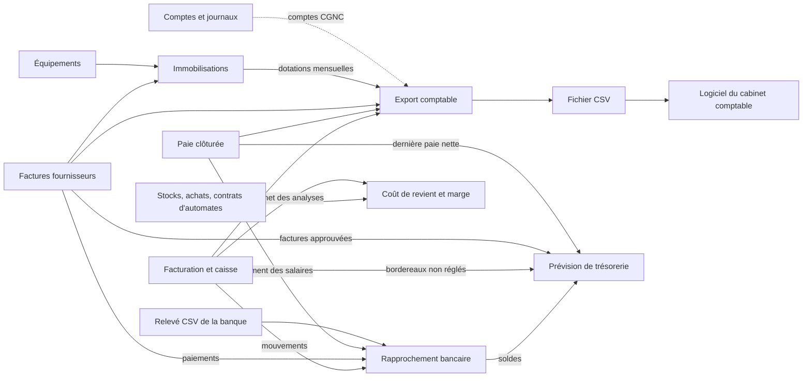
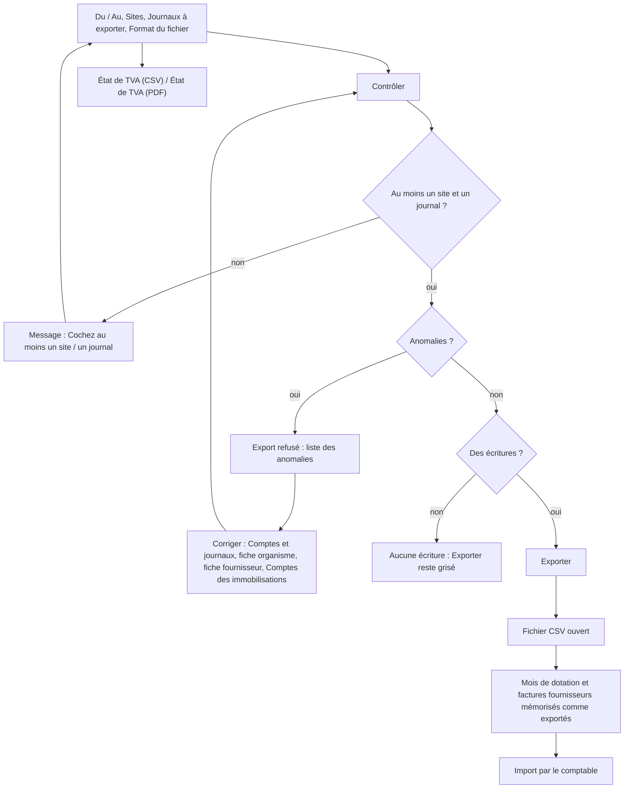
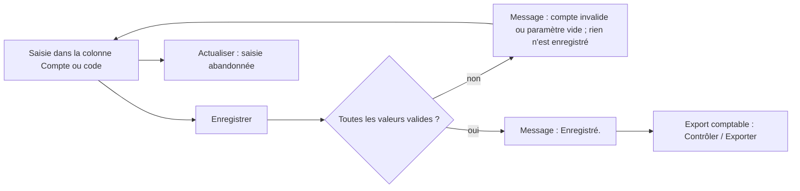
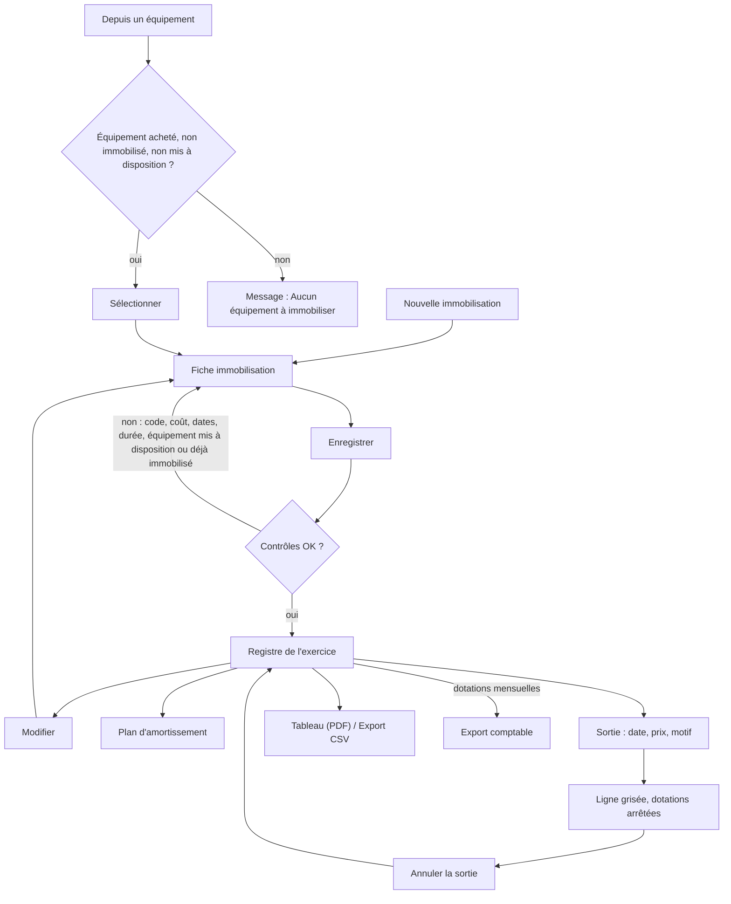
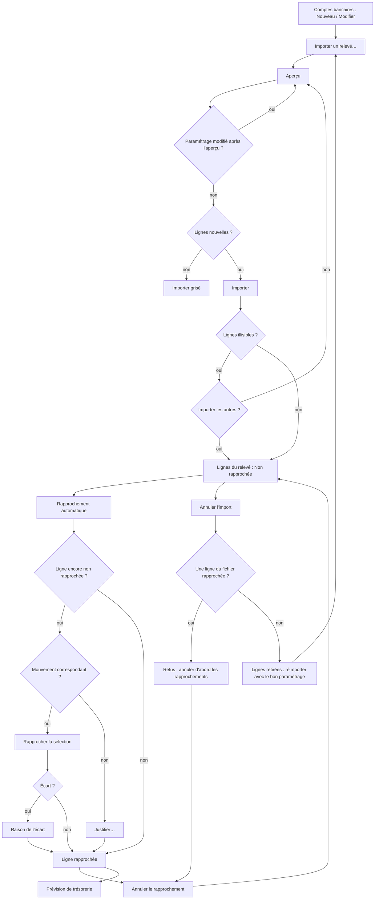
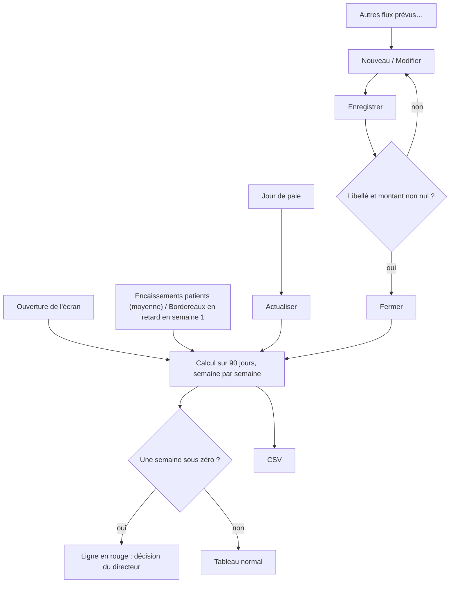
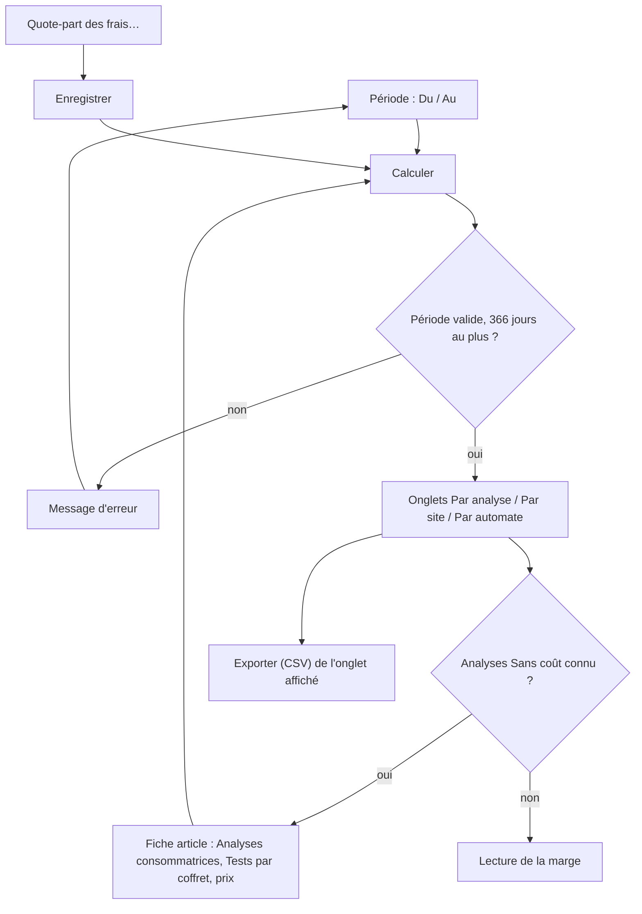

## Finances

Le groupe **Finances** du menu réunit les écrans qui préparent le travail du comptable et suivent l'argent du laboratoire : l'export des écritures, le paramétrage des comptes, le registre des immobilisations, le rapprochement bancaire, la prévision de trésorerie et le coût de revient des analyses. L'écran **Visa des caisses**, rangé dans le même groupe, est décrit avec la caisse (chapitre facturation).

Principe général : MarocLIS ne tient pas la comptabilité générale. Il produit des écritures propres (plan comptable marocain, CGNC) que le cabinet comptable importe dans son logiciel (Sage ou autre). Aucun écran de ce groupe ne passe d'écriture lui-même.

Le titre du groupe s'affiche dès que l'utilisateur a le droit d'ouvrir au moins un de ses écrans. Un bouton pour lequel l'utilisateur n'a pas le droit reste visible mais grisé (sauf **Quote-part des frais…**, qui est masqué).

Droits par défaut (rôles livrés avec l'application) :

| Droit | Écrans concernés | Rôles qui l'ont par défaut |
|---|---|---|
| Export comptable | Export comptable, Comptes et journaux | Administrateur, Biologiste responsable, Comptabilité |
| Immobilisations — consulter | Immobilisations (lecture) | Administrateur, Biologiste responsable, Comptabilité, Responsable qualité |
| Immobilisations — gérer | Immobilisations (saisie, sortie, comptes) | Administrateur, Biologiste responsable, Comptabilité |
| Trésorerie — consulter / gérer | Rapprochement bancaire, Prévision de trésorerie | Administrateur, Biologiste responsable, Comptabilité (les deux droits) |
| Pilotage — consulter | Coût de revient et marge | Administrateur, Biologiste responsable |
| Pilotage — paramètres de coût | bouton « Quote-part des frais… » | Administrateur, Biologiste responsable |

Le rôle Comptabilité n'a pas accès à **Coût de revient et marge**.

---

### Export comptable

Produire, pour une période, le fichier des écritures comptables (ventes, encaissements, opérations diverses, paie, dotations, achats) à remettre au comptable, et l'état de TVA de la même période.

**Qui y a accès** : droit « Export comptable » — Administrateur, Biologiste responsable, Comptabilité.

**L'écran**
- En haut : **Du** / **Au** (par défaut, le mois civil précédent), **Format du fichier** (« Sage (écritures, séparateur point-virgule) » ou « CSV générique (dates ISO, point décimal) »).
- **Sites** : la liste des sites auxquels l'utilisateur a accès, tous cochés au départ.
- **Journaux à exporter** : six cases, toutes cochées au départ :
  - « Ventes et avoirs »
  - « Encaissements, acomptes et caisse »
  - « Opérations diverses (pertes, imputations) »
  - « Paie »
  - « Dotations aux amortissements »
  - « Achats fournisseurs »
- Boutons : **Contrôler**, **Exporter**, **État de TVA (CSV)**, **État de TVA (PDF)**.
- Au milieu : un tableau récapitulatif par journal (**Journal**, **Nature**, **Écritures**, **Débit**, **Crédit**).
- Une ligne d'état (en vert, rouge ou gris).
- En bas : la liste des anomalies en rouge (**Anomalie**, **Date**, **Journal**, **N° pièce**, **Libellé**, **Compte ou montants**).

**Scénarios**

1. *Exporter les écritures du mois pour le comptable*
   1. Vérifier **Du** et **Au** (le mois précédent est proposé).
   2. Cocher les sites voulus et les journaux voulus.
   3. Choisir le **Format du fichier** (Sage en général).
   4. Cliquer **Contrôler**. Le récapitulatif par journal s'affiche.
   5. Si la ligne d'état dit « N écriture(s), toutes équilibrées et affectées à un compte : l'export est possible. », cliquer **Exporter**. Le fichier CSV s'ouvre (Excel ou programme associé). L'enregistrer et le transmettre au comptable.
2. *Corriger un export refusé*
   1. Après **Contrôler**, si la ligne d'état dit « Export refusé : N anomalie(s) à corriger… », lire la liste du bas.
   2. « Compte manquant ou invalide » : un compte n'est pas renseigné ou n'est pas un compte CGNC. Selon le cas, corriger dans **Comptes et journaux**, dans la fiche de l'organisme payeur (champ **Compte comptable**), dans la fiche fournisseur (**Compte auxiliaire**) ou dans les comptes des immobilisations.
   3. « Écriture déséquilibrée » : la colonne **Compte ou montants** donne les totaux débit et crédit. Signaler l'écriture à l'administrateur (à vérifier : cas rare, normalement impossible).
   4. Cliquer de nouveau **Contrôler**, puis **Exporter**.
3. *Exporter un seul journal* (par exemple la paie) : décocher les autres journaux, puis **Contrôler** → **Exporter**.
4. *Imprimer l'état de TVA de la période*
   1. Régler **Du**, **Au** et les **Sites**.
   2. Cliquer **État de TVA (PDF)** ou **État de TVA (CSV)**. Il n'est pas nécessaire de cliquer **Contrôler** avant.
   3. L'état donne :
      - le chiffre d'affaires exonéré (analyses, art. 91 CGI) ;
      - le chiffre d'affaires taxable par taux avec la TVA collectée ;
      - les achats et les immobilisations par taux avec leur TVA ;
      - le prorata de déduction, la TVA déductible après prorata et la TVA due (crédit si négatif).
   4. Il porte la mention « Document de travail à vérifier avec votre comptable : ce n'est pas la déclaration de TVA. »

**Règles et contrôles**
- **Exporter** reste grisé tant qu'on n'a pas cliqué **Contrôler**, et tant qu'il reste une anomalie ou qu'il n'y a aucune écriture. Le fichier n'est jamais produit à moitié.
- Si l'on change la période, les sites ou les journaux après **Contrôler**, le bouton **Exporter** reste actif. Le fichier est quand même recalculé et recontrôlé avec les nouveaux choix, mais le récapitulatif affiché est alors celui de l'ancien contrôle. Recliquez **Contrôler** après tout changement.
- « Cochez au moins un site. » / « Cochez au moins un journal. » / « La date de début doit précéder la date de fin. »
- « Aucun registre des immobilisations installé : pas de dotations aux amortissements. » apparaît si le journal des dotations est coché sans registre.
- Chaque export est tracé dans le journal des accès aux données, car les libellés contiennent des noms de patients (loi 09-08). Le fichier sort du laboratoire : transmettez-le par un moyen sûr.
- **Ne pas exporter deux fois la même période vers le logiciel comptable.** Un second export de la même période redonne les mêmes écritures, et les importer deux fois les doublerait.
- Les achats peuvent aussi être exportés depuis **Factures fournisseurs** > **Export comptable**. N'utilisez qu'un seul des deux chemins pour une période donnée, sinon les achats seront importés deux fois.
- Format Sage : le N° de pièce est limité à 13 caractères et le libellé à 35. Une pièce plus longue est raccourcie et le numéro complet est mis en tête du libellé.

**Choix comptables appliqués (pour le comptable)** — ce sont les comptes proposés par défaut ; tous se changent dans **Comptes et journaux**.
- *Ventes (VT)* :
  - au débit, le patient (3421) et, pour la part réclamée à un tiers payant, l'organisme (3421 ou son compte propre) ;
  - au crédit, les produits (7124, un compte par département possible) et la TVA facturée (4455) le cas échéant. Les analyses sont exonérées (art. 91 CGI) ;
  - un avoir passe en sens inverse, d'abord sur la part du patient.
- *Encaissements (CAI / BQ)* :
  - espèces sur la caisse du site (5161) ;
  - chèque, carte, virement, effet/traite (LCN) et paiement mobile chacun sur son compte de trésorerie (5141 par défaut ; 5111 « Chèques et valeurs à encaisser » si le cabinet le préfère) ;
  - règlements des organismes sur 5141 ;
  - un chèque impayé ou un remboursement contre-passe l'encaissement le jour où il survient.
- *Patients en compte global* (réglage par défaut) : les encaissements d'une session de caisse sont cumulés par jour et par mode de règlement, sur le compte tiers « PATIENTS ». Le livre de caisse montre la recette de la session, pas chaque ticket. L'autre réglage crée un compte tiers par patient (n° de dossier).
- *Acomptes* : 4421 à l'encaissement, puis 4421 vers le patient lorsqu'il règle la facture.
- *Opérations diverses (OD)* :
  - perte sur créance (6585) ;
  - part refusée par l'organisme et laissée au patient : transfert du compte de l'organisme au compte du patient le jour de la réponse, et retour si le bordereau est rouvert ;
  - écart de caisse à la clôture : manquant 6588, excédent 7588 ;
  - espèces envoyées à la banque : 5161 vers 5115.
- *Paie* : pour chaque mois de paie clôturé, salaires bruts 6171 et charges patronales 6174 au débit ; au crédit CNSS/AMO 4441, IR 4452, avances 3431, autres retenues 4488 et net à payer 4432.
- *Dotations* :
  - une écriture par immobilisation et par mois, datée du dernier jour du mois (ou de la date de sortie) ;
  - 6193 au débit, 28xxx au crédit ;
  - un mois exporté est mémorisé. Si l'immobilisation est corrigée ensuite, les mois déjà exportés sont redonnés à l'identique, et le premier mois non exporté porte la différence (une reprise si elle est négative).
- *Achats (ACH)* :
  - charge par catégorie d'article (6122 par défaut) et TVA récupérable sur charges (34552) au débit, fournisseur 4411 au crédit ;
  - règlement : fournisseur au débit, banque 5141 ou caisse 5161 au crédit, à la date du règlement saisi. Un règlement par effet (LCN) est donc passé à la date de sa remise, directement en banque. Il n'y a pas de compte d'effets à payer : à valider avec le comptable.
- *Facture d'une immobilisation* : quand une immobilisation du registre est liée à une facture fournisseur, cette facture est immobilisée et non passée en charge :
  - le coût va au compte d'immobilisation (2332… selon la catégorie) ;
  - la TVA va en 34551 « TVA récupérable sur immobilisations » si elle est récupérable, sinon elle est ajoutée au coût ;
  - la dette est portée en 4481 « Dettes sur acquisitions d'immobilisations », et ses règlements soldent 4481 ;
  - si la facture avait déjà été exportée en charges avant le lien, l'écriture déjà partie n'est pas modifiée : une écriture de reclassement, datée du jour du lien, déplace la part de l'immobilisation des charges (et 34552) vers l'immobilisation (et 34551). Le fournisseur reste alors en 4411 (à confirmer avec le comptable).

**Flux** : facturation, caisse, paie, factures fournisseurs et immobilisations alimentent cet écran → fichier CSV → import dans le logiciel du cabinet comptable.

---

### Comptes et journaux

Fixer, en un seul tableau, les codes journaux et les comptes CGNC utilisés par l'export comptable (ventes, clients, trésorerie, paie, achats).

**Qui y a accès** : droit « Export comptable » — Administrateur, Biologiste responsable, Comptabilité.

**L'écran**
- Boutons **Actualiser** et **Enregistrer**.
- Un avertissement : les comptes proposés sont ceux du CGNC, à faire valider par le comptable. Un département, un site ou un mode de règlement laissé vide suit le compte par défaut de sa rubrique.
- Un tableau à trois colonnes : **Rubrique**, **Paramètre**, **Compte ou code** (seule cette dernière se modifie). Les rubriques :

| Rubrique | Contenu |
|---|---|
| Journaux | Journal des ventes (VT), de caisse (CAI), de banque (BQ), des opérations diverses (OD), de paie (OD), des dotations (OD) |
| Clients et organismes | Clients patients (3421), **Compte des patients** (liste : compte global ou un compte par patient), compte tiers global des patients (PATIENTS), organismes sans compte propre (3421), acomptes reçus (4421), créances irrécouvrables (6585) |
| Produits et TVA | Produits par défaut (7124), produits hors analyses (7124), TVA facturée (4455), puis une ligne par département |
| Trésorerie | Caisse par défaut (5161), une ligne par site, un compte par mode de règlement (chèque, carte, virement, effet/traite, paiement mobile), banque des règlements des organismes (5141), virements de fonds caisse vers banque (5115), manquants (6588) et excédents (7588) de caisse |
| Paie | 6171, 6174, 4441, 4452, 3431, 4488, 4432 |
| Achats | Journaux achats / banque / caisse fournisseurs, fournisseurs (4411), TVA récupérable sur charges (34552), TVA récupérable sur immobilisations (34551), dettes sur acquisitions d'immobilisations (4481), banque (5141) et caisse (5161) des règlements fournisseurs, un compte d'achat par catégorie d'article |

**Scénarios**

1. *Adapter les comptes au plan du cabinet comptable*
   1. Cliquer dans la colonne **Compte ou code** de la ligne voulue et taper le compte (par exemple 71241 pour un département).
   2. Répéter pour chaque ligne à changer.
   3. Cliquer **Enregistrer**. Le message « Enregistré. » confirme.
2. *Donner un compte de produits propre à un département* : remplir la ligne « Produits du département … ». La laisser vide pour revenir au compte par défaut.
3. *Passer les patients en compte individuel* : dans la ligne **Compte des patients**, choisir « Un compte tiers par patient (n° de dossier) », puis **Enregistrer**.
4. *Abandonner une saisie non enregistrée* : cliquer **Actualiser**. Les valeurs enregistrées reviennent, sans confirmation.

**Règles et contrôles**
- Un compte doit être un compte général CGNC : chiffres, classe 1 à 8, au moins 4 chiffres. Un code journal ou un compte tiers s'écrit en lettres et chiffres, sans espace, 20 caractères au plus. Sinon : « « X » n'est pas un compte valide… ».
- Seules les lignes de département, de site et de mode de règlement peuvent rester vides. Pour les autres : « Le paramètre … ne peut pas être vide. » Ce message donne le nom technique du paramètre et non son libellé à l'écran.
- Si une seule valeur est fausse, rien n'est enregistré.
- Chaque modification est tracée (liste des paramètres changés).
- Les comptes des immobilisations ne sont pas ici : ils se règlent dans **Immobilisations** > **Comptes**.
- Le compte d'un organisme payeur se règle dans sa fiche (**Compte comptable**). Le compte d'un fournisseur se règle dans sa fiche (**Compte auxiliaire**).

**Flux** : ces réglages sont lus à chaque **Contrôler** et **Exporter** de l'**Export comptable**.

---

### Immobilisations

Tenir le registre des immobilisations par exercice (valeur brute, amortissements, valeur nette), le plan d'amortissement de chaque bien, les sorties, et produire le tableau des immobilisations pour le bilan.

**Qui y a accès**
- Consultation : Administrateur, Biologiste responsable, Comptabilité, Responsable qualité.
- Saisie, modification, sortie et comptes : Administrateur, Biologiste responsable, Comptabilité.

**L'écran**
- En haut : **Exercice** (année civile), **Actualiser**, **Nouvelle immobilisation**, **Depuis un équipement**, **Modifier**, **Plan d'amortissement**, **Sortie** (devient **Annuler la sortie** sur un bien déjà sorti), **Tableau (PDF)**, **Export CSV**, **Comptes**.
- Le titre résume l'exercice : nombre d'immobilisations, valeur brute, dotation, VNA, et le nombre d'équipements mis à disposition.
- Le registre a une ligne par bien : **Code**, **Désignation**, **Catégorie**, **Compte**, **Date d'acquisition**, **Mise en service**, **Valeur brute**, **Méthode**, **Durée (ans)**, **Taux**, **Amort. cumulés début**, **Dotation**, **Sorties valeur brute**, **Sorties amort.**, **Valeur brute fin**, **Amort. cumulés fin**, **VNA**, **Date de sortie**, **Prix de cession**, **Résultat de cession**, **Équipement**.
  - Un bien sorti s'affiche en gris.
  - Les équipements mis à disposition par un fournisseur (mise à disposition, comodat, location) viennent en fin de liste, en petit et en gris, sans montant.
- En bas : **Équipement lié — maintenance et pannes**. Cette partie donne, pour l'équipement lié à la ligne choisie, le fabricant, le n° de série, les interventions et les pannes, l'arrêt cumulé, le coût, la prochaine maintenance et le prochain étalonnage, ainsi que la liste des interventions (pannes sur fond orangé). Ces informations viennent du module Équipements et ne se modifient pas ici.

**Scénarios**

1. *Inscrire une nouvelle immobilisation*
   1. Cliquer **Nouvelle immobilisation**.
   2. Remplir **Code** (n° d'inventaire), **Désignation** et **Catégorie** (matériel de laboratoire, matériel informatique, mobilier, matériel de transport, agencements et aménagements, autres).
   3. Saisir **Date d'acquisition** et **Mise en service**.
   4. Choisir la **Méthode** (Linéaire ou Dégressif) et la **Durée (ans)**. La durée proposée est de 5 ans, ou de 10 ans pour le mobilier et les agencements. La **Valeur résiduelle (MAD)** se laisse en général à zéro.
   5. Saisir **Coût HT (MAD)** (frais de transport et d'installation compris), **TVA (MAD)**, et cocher **TVA récupérable** seulement si le comptable le confirme.
   6. Choisir le **Fournisseur**. La liste **Facture fournisseur** propose alors ses factures. En choisir une remplit le **N° de facture**, ainsi que le coût, la TVA et la date d'acquisition s'ils sont encore vides. Le **N° de facture** peut aussi être tapé à la main.
   7. Choisir l'**Équipement** lié s'il s'agit d'un appareil suivi dans le module Équipements.
   8. Contrôler la ligne d'aide, qui indique la base amortissable et le taux (ou le coefficient dégressif).
   9. Cliquer **Enregistrer**.
2. *Immobiliser un appareil déjà déclaré dans les équipements*
   1. Cliquer **Depuis un équipement**. La liste montre les appareils achetés (date d'achat renseignée), pas encore immobilisés et non mis à disposition par un fournisseur.
   2. Double-cliquer l'appareil, ou le choisir puis **Sélectionner**.
   3. La fiche s'ouvre pré-remplie (code, nom, fournisseur, dates, matériel de laboratoire, linéaire). Saisir le coût, puis **Enregistrer**.
3. *Corriger une immobilisation* : choisir la ligne, **Modifier**, corriger, **Enregistrer**.
4. *Consulter le plan d'amortissement*
   1. Choisir la ligne, puis **Plan d'amortissement** (ou double-clic sur la ligne).
   2. La fenêtre montre le plan **Par exercice** et **Par mois**.
   3. **Export CSV** dans cette fenêtre exporte le plan mois par mois. **Fermer** la referme.
5. *Enregistrer la sortie d'un bien (cession, rebut, vol)*
   1. Choisir la ligne, puis **Sortie**.
   2. Saisir **Date de sortie** (pas dans le futur), **Prix de cession** (0 pour un rebut) et **Motif de la sortie** (obligatoire).
   3. Cliquer **Enregistrer**.
6. *Annuler une sortie saisie par erreur* : choisir la ligne grisée, cliquer **Annuler la sortie**, puis confirmer. Les dotations reprennent jusqu'à la fin du plan.
7. *Imprimer le tableau des immobilisations et des amortissements* :
   1. Choisir l'**Exercice**, puis cliquer **Tableau (PDF)** (A3 paysage, sous-totaux par catégorie, total, puis les équipements mis à disposition).
   2. **Export CSV** donne le même tableau avec, en plus, fournisseur, n° de facture et équipement.
8. *Changer les comptes d'une catégorie*
   1. Cliquer **Comptes**. Pour chaque catégorie, saisir **Immobilisation**, **Amortissement** et **Dotation**.
   2. Cliquer **Enregistrer**.
   3. Les comptes par défaut : 2332/28332 (matériel de laboratoire), 2355/28355 (informatique), 2351/28351 (mobilier), 2340/28340 (transport), 2327/28327 (agencements), 2380/28380 (autres), et 6193 pour la dotation.

**Règles et contrôles**
- Code, désignation et coût HT supérieur à zéro sont obligatoires. Le code est unique sur le site (« Le code … est déjà utilisé par une autre immobilisation. »).
- La mise en service ne peut pas précéder l'acquisition. La durée doit être comprise entre 1 et 50 ans. Le dégressif n'est possible qu'à partir de 3 ans. La valeur résiduelle doit être inférieure à la valeur brute.
- *Base amortissable* : coût HT, plus la TVA quand elle n'est pas récupérable. C'est le cas courant d'un laboratoire dont les analyses sont exonérées (art. 91 CGI), à confirmer avec le comptable.
- *Linéaire* : prorata par mois à partir du mois de mise en service. Le dernier mois absorbe l'arrondi.
- *Dégressif* : coefficient 1,5 (3 à 4 ans), 2 (5 à 6 ans) ou 3 (au-delà), à partir du mois d'acquisition, avec passage au linéaire quand celui-ci devient plus favorable.
- Les exercices sont des années civiles.
- **Équipement mis à disposition** (mise à disposition, comodat, location) : il reste la propriété du fournisseur et est refusé (« Cet équipement est mis à disposition par son fournisseur… »). Un équipement ne peut être immobilisé qu'une fois (« Cet équipement est déjà inscrit au registre sous le code … »).
- *Sortie* :
  - les dotations s'arrêtent au mois de la sortie ;
  - le **Résultat de cession** (prix moins valeur nette) figure au tableau ;
  - l'écriture de cession elle-même est passée par le comptable : elle ne fait pas partie de l'export.
- *Comptes* : immobilisation en classe 2 (hors 28), amortissement en 28…, dotation en classe 6, chiffres uniquement, quatre au moins.
- *Changement de catégorie* d'un bien déjà exporté (dotations ou facture) : un virement de compte à compte est préparé automatiquement, daté du jour, pour le prochain export. Le comptable peut préférer une date de début d'exercice : à vérifier avec lui.
- Il n'existe pas de bouton de suppression d'une immobilisation.

**Flux** : facture fournisseur et fiche équipement → immobilisation → dotations mensuelles reprises par l'**Export comptable** (journal « Dotations aux amortissements ») → tableau annuel pour le bilan.

---

### Rapprochement bancaire

Comparer, pour un compte bancaire et une période, les lignes du relevé de la banque avec les mouvements que l'application a enregistrés (règlements, remises carte, versements d'espèces, paiements fournisseurs, salaires…), et justifier ce qui reste.

**Qui y a accès** : droits « Trésorerie » — Administrateur, Biologiste responsable, Comptabilité. Avec la seule consultation, tous les boutons d'action sont grisés.

**L'écran**
- En haut : **Compte bancaire** (liste des comptes actifs), **Du** / **Au** (par défaut du 1er du mois précédent à aujourd'hui), **Actualiser**, **Comptes bancaires**, **Importer un relevé…**.
- Deuxième rangée : **Rapprochement automatique**, **Rapprocher la sélection**, **Justifier…**, **Annuler le rapprochement**, **Annuler l'import**, et la case **Lignes non rapprochées seulement**.
- À gauche, **Relevé bancaire** : **Date**, **Libellé**, **Référence**, **Montant**, **Statut**.
  - Le statut vaut « Non rapprochée », ou la nature du rapprochement, avec « (auto) » s'il est automatique et l'écart éventuel.
  - Une ligne rapprochée s'affiche en vert, ou en orange s'il reste un écart.
  - Le commentaire s'affiche en survolant le statut.
- À droite, **Mouvements enregistrés non rapprochés** : **Date**, **Nature**, **Libellé**, **Référence**, **Montant**. La nature peut être :
  - Règlement patient, Acompte, Remise carte, Règlement organisme ;
  - Versement d'espèces, Paiement fournisseur, Virement des salaires ;
  - Chèque impayé, Remboursement patient.
- En bas, les soldes :
  - Solde du relevé, Solde rapproché ;
  - Lignes du relevé non rapprochées, Mouvements non rapprochés (tout le site) ;
  - Solde d'ouverture, nombre de lignes et de mouvements restants.

**Scénarios**

1. *Déclarer un compte bancaire (une fois)*
   1. Cliquer **Comptes bancaires**, puis **Nouveau**.
   2. Saisir **Banque**, **Intitulé du compte**, **RIB (24 chiffres)** et **Compte comptable** (5141 proposé ; mettre le sous-compte du cabinet).
   3. Saisir le **Solde d'ouverture (DH)** et la date **Au** : le solde du relevé à cette date. Seules les lignes postérieures le font varier.
   4. Laisser **Actif** coché, puis **Enregistrer**.
2. *Corriger ou clôturer un compte* : **Comptes bancaires** → choisir le compte → **Modifier** (ou double-clic). Décocher **Actif** pour le clôturer. **Fermer** pour revenir.
3. *Importer un relevé CSV*
   1. Choisir le **Compte bancaire**, puis cliquer **Importer un relevé…** et choisir le fichier (.csv ou .txt, 10 Mo au plus).
   2. La fenêtre affiche le fichier brut en colonnes numérotées et l'aperçu des lignes lues.
   3. Ajuster si besoin :
      - **Séparateur** (Automatique, « ; », « , », Tabulation), **Lignes à ignorer**, **Format de date** (jj/MM/aaaa par défaut), **Décimales** (Automatique, « , », « . »), **Ligne d'en-têtes** ;
      - **Col. date**, **Col. date valeur**, **Col. libellé**, **Col. référence** ;
      - soit **Col. montant** (montant signé), soit **Col. débit** et **Col. crédit**. Mettre 0 pour une colonne absente.
   4. Cliquer **Aperçu**. Chaque ligne indique « Nouvelle », « Déjà importée » (en gris) ou la raison du refus en rouge (Date illisible, Montant illisible, Montant nul, Libellé vide). Le bas résume le nombre de lignes nouvelles et leur total.
   5. Cliquer **Importer**. Si des lignes sont illisibles, confirmer qu'on importe les autres.
   6. Le paramétrage des colonnes est mémorisé pour le prochain relevé de ce compte.
4. *Rapprochement automatique* : régler **Du** / **Au**, puis cliquer **Rapprochement automatique**. Un message indique le nombre de lignes rapprochées ; les autres restent à faire à la main.
5. *Rapprocher à la main (une remise de chèques, un lot carte payé net de commission)*
   1. Cliquer une ligne non rapprochée du relevé, à gauche.
   2. À droite, sélectionner le ou les mouvements correspondants (Ctrl+clic ou Maj+clic pour en prendre plusieurs).
   3. Cliquer **Rapprocher la sélection**.
   4. Si les montants ne sont pas égaux, une fenêtre demande la raison de l'écart (commission, frais…) : la saisir (5 caractères au moins), puis **OK**.
6. *Justifier une ligne sans mouvement (frais bancaires, agios, timbre)* : choisir la ligne, cliquer **Justifier…**, écrire la justification, puis **OK**. Le comptable passera l'écriture d'après ce texte.
7. *Défaire un rapprochement ou une justification* : choisir la ligne rapprochée, cliquer **Annuler le rapprochement**, puis confirmer. Les mouvements redeviennent disponibles. L'historique est conservé.
8. *Retirer un relevé importé avec un mauvais paramétrage*
   1. Choisir une ligne de ce relevé, puis **Annuler l'import**, puis confirmer.
   2. Toutes les lignes de ce fichier sont retirées. Le fichier peut ensuite être réimporté avec le bon paramétrage.
9. *Ne voir que le reste à faire* : cocher **Lignes non rapprochées seulement**.

**Règles et contrôles**
- Après un changement de **Du** ou **Au**, cliquer **Actualiser** : l'écran ne se recharge pas tout seul (il se recharge au changement de compte).
- *Rapprochement automatique* : il ne retient que les cas certains. Il faut le même montant au centime, le même sens et une date dans la fenêtre du mouvement :
  - 2 jours avant ;
  - 5 jours après ;
  - 45 jours après pour un chèque ou un effet émis par le laboratoire.
  
  Il rapproche d'abord par référence (n° de chèque, de virement ou de remise d'au moins 4 caractères trouvé dans le libellé), puis les paires uniques. Tout cas ambigu est laissé à l'utilisateur.
- *Effet (LCN) ou chèque post-daté payé à un fournisseur* : il est attendu à la banque à sa date d'échéance, et non à sa date de saisie.
- Les doublons sont ignorés : réimporter un relevé qui chevauche le précédent n'ajoute rien deux fois, même si le format de la banque a changé.
- Refus possibles :
  - « RIB invalide : 24 chiffres, dont la clé de contrôle des deux derniers. » ;
  - « Ce RIB est déjà déclaré pour un autre compte bancaire. » ;
  - compte comptable qui ne commence pas par 51 ;
  - « Aucune ligne nouvelle à importer… » ;
  - « Le fichier dépasse 10 Mo… ».
- Rapprochement manuel :
  - un encaissement ne peut pas expliquer un débit, ni un décaissement un crédit ;
  - un mouvement ne peut servir qu'à une seule ligne ;
  - un écart exige une raison.
- Si l'on modifie un réglage du relevé après l'**Aperçu**, **Importer** se grise (« Le paramétrage a changé : cliquez sur « Aperçu » avant d'importer. »).
- **Annuler l'import** est refusé tant qu'une ligne du fichier est rapprochée : annulez d'abord ces rapprochements.
- Un compte clôturé ne reçoit plus de relevé.
- Les mouvements proposés à droite sont ceux de tout le site, pas d'un seul compte.
- Rien ici ne passe d'écriture comptable.

**Flux** : encaissements (caisse, organismes), versements, paiements fournisseurs et paie créent les mouvements → import du relevé → rapprochement → les lignes justifiées sont passées par le comptable. Les soldes alimentent la **Prévision de trésorerie**.

---

### Prévision de trésorerie

Prévoir, semaine par semaine sur 90 jours, le solde des comptes bancaires, pour voir à l'avance une semaine où le compte passerait dans le rouge.

**Qui y a accès** : droits « Trésorerie » — Administrateur, Biologiste responsable, Comptabilité. Avec la seule consultation, la liste des flux s'ouvre en lecture seule.

**L'écran**
- En haut : les cases **Encaissements patients (moyenne)** et **Bordereaux en retard en semaine 1**, le champ **Jour de paie (0 = fin de mois)**, et les boutons **Actualiser**, **Autres flux prévus…** et **CSV**.
- Tableau par semaine : **Sem.**, **Du**, **Au**, **Solde début**, **Organismes**, **Patients**, **Fournisseurs**, **Salaires**, **Autres flux**, **Variation**, **Solde fin**. Une semaine dont le solde de fin est négatif est en rouge.
- En bas :
  - le solde d'ouverture par compte ;
  - ce qui n'est pas compté (bordereaux en retard, factures fournisseurs non approuvées) ;
  - la dernière paie nette et la moyenne des encaissements patients ;
  - le solde le plus bas sur la période et la méthode de calcul.

**Scénarios**

1. *Consulter la prévision* : ouvrir l'écran. Le calcul se fait à l'ouverture. Repérer les lignes rouges et le « Solde le plus bas sur la période ».
2. *Inclure les encaissements au comptoir* : cocher **Encaissements patients (moyenne)**. Le calcul est relancé aussitôt.
3. *Compter les bordereaux en retard comme payés en semaine 1* : cocher **Bordereaux en retard en semaine 1**.
4. *Fixer le jour de paie* : saisir le jour (par exemple 28, ou 0 pour la fin du mois), puis cliquer **Actualiser**. Ce champ ne relance pas le calcul tout seul.
5. *Ajouter une sortie ou une rentrée prévue (loyer, leasing, CNSS, IR, échéance d'emprunt)*
   1. Cliquer **Autres flux prévus…**, puis **Nouveau**.
   2. Saisir le **Libellé** et le **Montant (DH, négatif = sortie)**.
   3. Choisir la **Périodicité** (Une fois, Chaque semaine, Chaque mois, Chaque trimestre, Chaque année), la **Première date** et, si besoin, une **Date de fin**.
   4. Laisser **Actif** coché, puis **Enregistrer**. **Fermer** recalcule la prévision.
6. *Arrêter un flux prévu* : **Autres flux prévus…** → choisir la ligne → **Modifier** → décocher **Actif** (ou mettre une **Date de fin**) → **Enregistrer**.
7. *Exporter la prévision* : cliquer **CSV**.

**Règles et contrôles**
- *Solde de départ* : solde de chaque relevé à sa dernière ligne importée, plus ce que l'application a enregistré après cette date et qu'aucun relevé ne montre encore. Un effet (LCN) ou un chèque post-daté non encore échu compte à sa date d'échéance.
- *Organismes* : bordereaux non réglés, pour le reste dû. Chacun est placé à sa date d'envoi plus le délai de paiement réellement constaté de l'organisme (médiane des 12 derniers mois, sinon délai contractuel). Un bordereau déjà en retard n'est pas compté, sauf si la case correspondante est cochée.
- *Fournisseurs* : factures approuvées, pour le reste à payer, à leur échéance. Une facture échue tombe en semaine 1. Les factures non approuvées ne sont pas comptées (leur montant est rappelé en bas).
- *Salaires* : net de la dernière paie clôturée, au jour de paie.
- Un flux saisi à la main doit avoir un libellé et un montant non nul (« Saisissez un montant non nul : positif pour une rentrée, négatif pour une sortie. »). La date de fin ne peut pas précéder la première date.
- Il n'existe pas de bouton de suppression d'un flux : on le désactive.
- Sans compte bancaire actif : « Aucun compte bancaire actif : déclarez-en un dans « Comptes bancaires ». »

**Flux** : relevés importés et rapprochement → solde de départ ; bordereaux de tiers payant, factures fournisseurs approuvées et paie clôturée → flux prévus → décision du directeur (relance d'organisme, report d'un paiement).

---

### Coût de revient et marge

Mesurer, pour une période, ce que rapporte chaque analyse (prix net moyen facturé) face à ce qu'elle coûte en réactifs et en frais indirects, par analyse, par site et par automate.

**Qui y a accès**
- Droit « Pilotage — consulter » : Administrateur, Biologiste responsable.
- Le bouton **Quote-part des frais…** n'apparaît qu'avec le droit « Pilotage — paramètres de coût », qu'ont les mêmes rôles.

**L'écran**
- En haut : la période (liste « Ce mois-ci », « Le mois dernier », « Cette année », « L'année dernière », « Période libre », puis **Du** / **Au**), **Calculer**, **Exporter (CSV)** et **Quote-part des frais…**.
- Quatre cases de chiffres clés :
  - CA (MAD) avec le nombre d'analyses ;
  - Coût réactifs, en orange s'il y a des analyses sans coût connu ;
  - Quote-part frais, avec le montant par analyse ;
  - Marge, avec le pourcentage.
- Une ligne qui rappelle la méthode de calcul.
- Trois onglets : **Par analyse**, **Par site**, **Par automate**. Chacun a les mêmes colonnes : **Code**, **Libellé**, **Analyses**, **CA (MAD)**, **Prix net moyen**, **Coût réactifs**, **Quote-part frais**, **Coût / analyse**, **Marge / analyse**, **Marge**, **Marge %**, **Sans coût connu**.
  - Une ligne à marge négative est en rouge.
  - La colonne **Sans coût connu** est en orange quand elle n'est pas vide.
  - Les lignes sont triées par chiffre d'affaires décroissant.

**Scénarios**

1. *Voir la marge du mois* : ouvrir l'écran (le mois en cours est calculé à l'ouverture), ou choisir une période, puis cliquer **Calculer**.
2. *Comparer les automates ou les sites* : ouvrir l'onglet **Par automate** ou **Par site**. Les résultats saisis à la main, sans automate, sont regroupés sous « — ».
3. *Exporter un tableau* : ouvrir l'onglet voulu, puis cliquer **Exporter (CSV)**. Seul l'onglet affiché est exporté.
4. *Régler la quote-part des frais indirects*
   1. Cliquer **Quote-part des frais…**.
   2. Saisir la **Quote-part par analyse (MAD)** : le montant ajouté au coût de chaque analyse pour les contrôles, calibrants, consommables, personnel et locaux.
   3. Cliquer **Enregistrer**. Le calcul est relancé.
   4. Mettre 0 pour obtenir une marge sur réactifs seulement. La méthode est à valider avec le comptable.
5. *Réduire les analyses « Sans coût connu »*
   1. Pour chaque réactif concerné, ouvrir sa fiche article (menu **Données de référence**).
   2. Renseigner :
      - **Analyses consommatrices (codes séparés par des virgules)** ;
      - **Tests par coffret** ;
      - si besoin, **Tests par résultat (ex. HBA1C=2 ; défaut 1)** et **Volume mort par ouverture (%)**.
   3. S'assurer qu'un prix d'achat existe (réception d'un lot avec prix ou commande).
   4. Revenir à l'écran et cliquer **Calculer**.

**Comment le coût réactif d'une analyse est calculé**
- On prend tous les articles de stock du site qui déclarent l'analyse parmi leurs **Analyses consommatrices**.
- Pour chaque article :
  - si un contrat d'automate en vigueur fixe un coût par test pour ce réactif (en priorité le contrat de l'automate qui a passé l'analyse), ce coût est retenu ;
  - sinon, on prend le prix unitaire, dans cet ordre : prix du lot noté sur le résultat, sinon du dernier lot reçu, sinon dernier prix commandé, sinon prix unitaire du contrat ;
  - ce prix est divisé par les **Tests par coffret**, multiplié par le facteur **Tests par résultat**, puis augmenté du **Volume mort**. Par exemple, avec 10 % de volume mort, le coût est divisé par 0,9.
- Les coûts de tous les réactifs de l'analyse s'additionnent.
- Contrôles, calibrants et consommables ne sont pas comptés analyse par analyse : ils relèvent de la quote-part des frais.
- **Sans coût connu** compte les analyses dont au moins un réactif n'a ni prix ni nombre de tests par coffret, ou pour lesquelles aucun réactif ne déclare l'analyse. Dans le premier cas, le coût affiché ne comprend que les réactifs connus et il est sous-estimé.
- **Quote-part frais** = quote-part par analyse × nombre d'analyses.
- **Coût / analyse** = (coût réactifs + quote-part) ÷ analyses.
- **Marge** = CA − coût réactifs − quote-part.
- **Marge %** = marge ÷ CA.
- **CA** est le prix net facturé (remises déduites, au tarif figé sur le dossier).

**Règles et contrôles**
- La période est comptée sur la date d'enregistrement des dossiers. Elle ne peut pas dépasser 366 jours (« La période ne peut pas dépasser 366 jours. »). La fin ne peut pas précéder le début.
- Les analyses annulées et les analyses sous-traitées à un laboratoire partenaire sont exclues : le coût de ces dernières est la facture du partenaire.
- Le calcul porte sur tous les sites accessibles à l'utilisateur.
- La quote-part doit être comprise entre 0 et 100 000 MAD.

**Flux** : catalogue (prix), stocks et achats (prix des lots, tests par coffret), contrats d'automates (coût par test) et résultats (automate, lot) → cet écran → décisions de tarif, choix de fournisseur ou d'automate.

