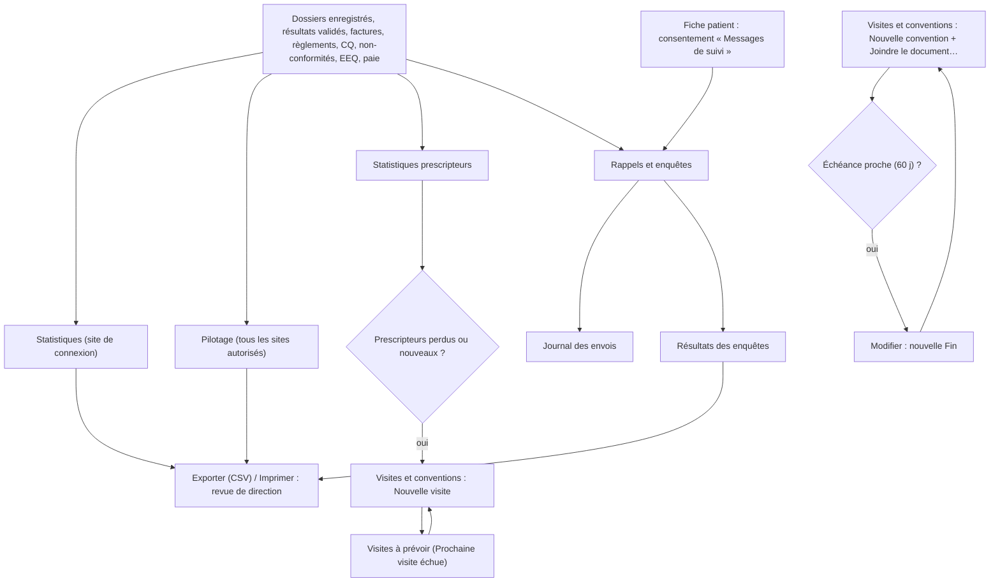
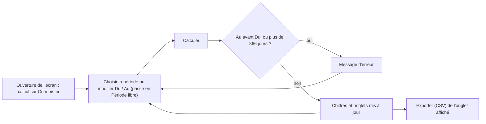
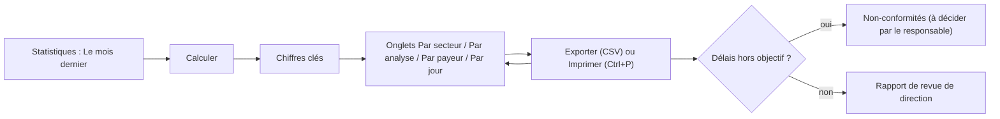
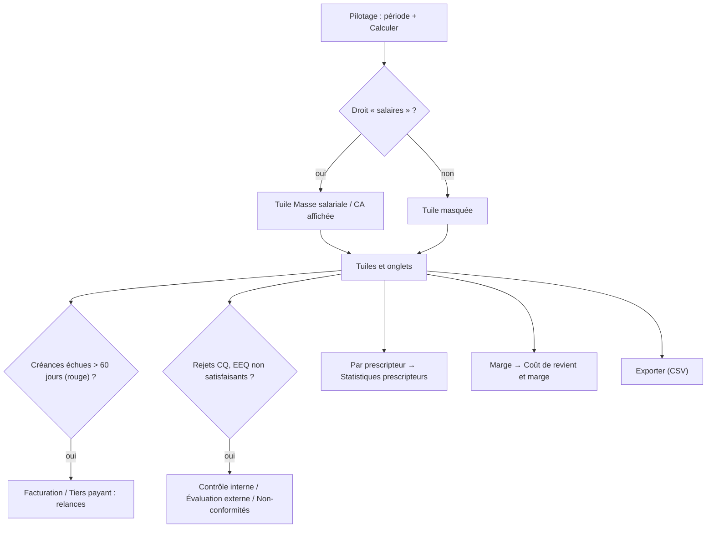
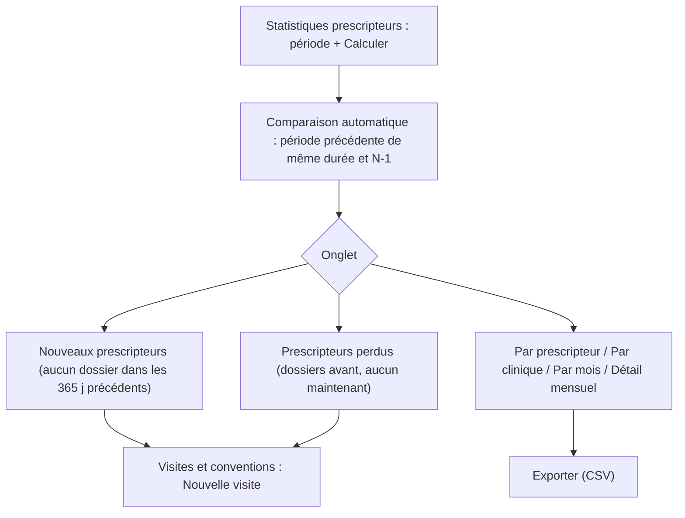
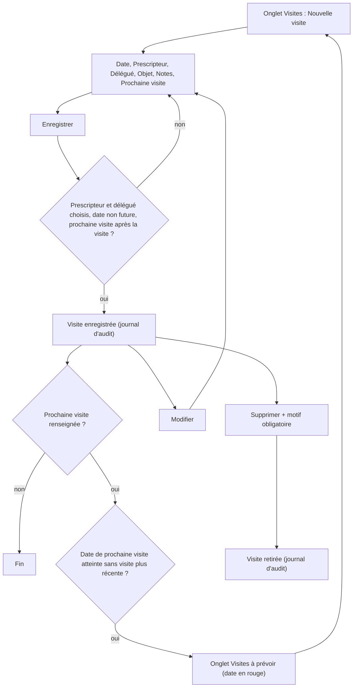
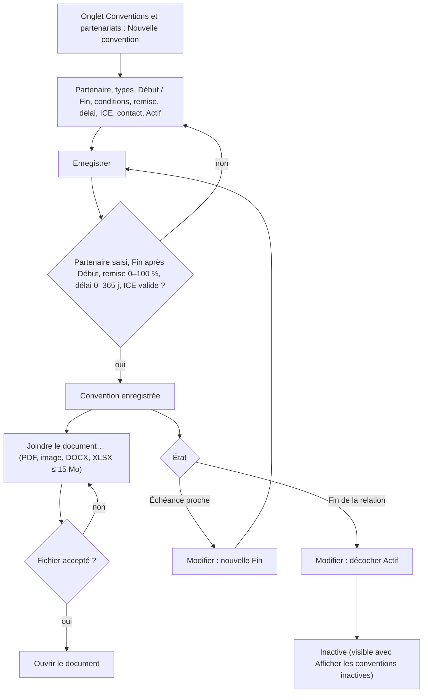
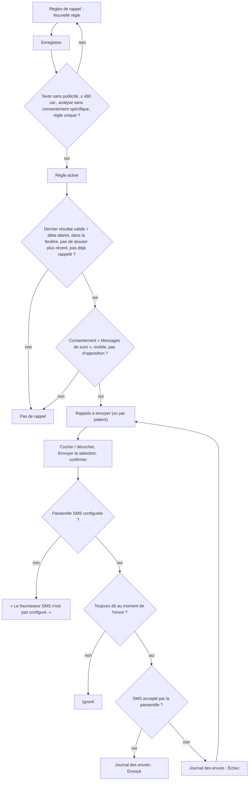
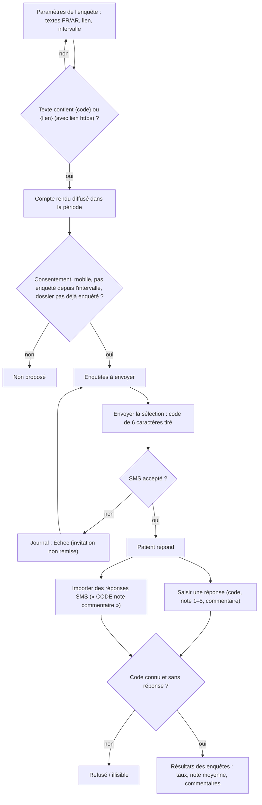

## Pilotage, statistiques et relations

Ce chapitre couvre les écrans de suivi de l'activité et de la relation avec les prescripteurs, les partenaires et les patients : **Statistiques**, **Pilotage** (en haut du menu), puis le groupe RELATIONS : **Statistiques prescripteurs**, **Visites et conventions**, **Rappels et enquêtes**.

Les écrans de ce chapitre (sauf **Rappels et enquêtes** pour les envois) ne modifient aucun dossier patient : ils lisent l'activité et la présentent.

Vue d'ensemble :

**Barre de période** (commune) :

**Barre de période commune.** Tous ces écrans ont en haut la même barre :

- une liste de période : **Ce mois-ci** (par défaut), **Le mois dernier**, **Cette année**, **L'année dernière**, **Période libre** ;
- deux dates **Du** et **Au** (modifier une date passe automatiquement en **Période libre**) ;
- un bouton **Calculer** (sur **Visites et conventions** il s'appelle **Actualiser**) ;
- un bouton **Exporter (CSV)** qui exporte **l'onglet affiché** dans un fichier CSV (séparateur point-virgule, accents conservés) qui s'ouvre directement dans Excel.

Règles communes : la date de fin ne peut pas précéder la date de début (« La date de fin précède la date de début. ») et la période est limitée à 366 jours (« La période ne peut pas dépasser 366 jours. »). L'écran calcule automatiquement à l'ouverture sur le mois en cours ; après un changement de dates, cliquer **Calculer**. Un export sur un onglet vide affiche « Aucun élément sélectionné. » (sur **Statistiques**, il ne se passe simplement rien).

### Statistiques

Les chiffres d'activité d'une période pour la revue de direction (ISO 15189) : volumes, délais, montants.

**Qui y a accès** : droit « consulter les statistiques ». Rôles livrés : Biologiste responsable, Biologiste, Responsable qualité, Comptabilité, Administrateur.

**L'écran**

- Titre « Statistiques d'activité — jj/mm/aa → jj/mm/aa », barre de période (**Calculer**, **Exporter (CSV)**).
- Huit chiffres clés :

  | Chiffre | Signification |
  |---|---|
  | Dossiers | Dossiers enregistrés dans la période ayant au moins une analyse non annulée |
  | Patients | Patients distincts de ces dossiers |
  | Analyses | Analyses réalisées (non annulées) ; entre parenthèses le nombre d'analyses **annulées** |
  | Délai réception → validation · dans les délais | Délai moyen en heures entre la réception de l'échantillon et la validation biologique, puis le % d'analyses validées avant l'heure de rendu promise |
  | Montant facturable | Somme des prix appliqués aux analyses réalisées |
  | Facturé | Factures émises datées dans la période |
  | Avoirs | Avoirs émis datés dans la période |
  | Encaissé | Règlements encaissés dans la période |

- Quatre onglets :
  - **Par secteur** : Code, Secteur, Analyses, Validées, Délai moyen, Dans les délais, Montant facturable.
  - **Par analyse** : Code, Désignation, Analyses, Délai moyen, Montant facturable.
  - **Par payeur** : Payeur (« Patient payant » quand il n'y a pas d'organisme), Dossiers, Analyses, Montant facturable, Part organisme, Part patient.
  - **Par jour** : Date, Dossiers, Analyses — tous les jours de la période, y compris les jours vides (fermeture, panne).

**Scénarios**

1. *Préparer la revue de direction du mois écoulé*
   1. Ouvrir **Statistiques**.
   2. Choisir **Le mois dernier** dans la liste de période.
   3. Cliquer **Calculer**.
   4. Lire les chiffres clés ; ouvrir chaque onglet.
   5. Pour chaque onglet utile, cliquer **Exporter (CSV)** et enregistrer le fichier depuis Excel.
2. *Analyser une période libre* (par exemple un trimestre) : modifier **Du** et **Au** (la liste passe en **Période libre**), cliquer **Calculer**.
3. *Comparer les secteurs* : onglet **Par secteur**, trié du plus grand nombre d'analyses au plus petit ; repérer les délais moyens élevés et les faibles % **Dans les délais**.
4. *Connaître la répartition par organisme* : onglet **Par payeur**, trié par montant décroissant.
5. *Imprimer un onglet* : afficher l'onglet puis **Imprimer** (Ctrl+P) dans le bandeau.

**Règles et contrôles**

- Les chiffres portent sur le **site de connexion** uniquement (pour plusieurs sites, voir **Pilotage**).
- Une analyse annulée n'est comptée que dans le chiffre « annulées », nulle part ailleurs.
- Un dossier est rattaché au jour de son **enregistrement** (heure locale du laboratoire).
- Le délai moyen ne compte que les analyses qui ont à la fois une heure de réception et une heure de validation ; « — » s'affiche quand il n'y en a aucune.
- « Montant facturable » (prix des analyses) et « Facturé » (factures émises) peuvent différer : factures non encore émises, factures d'une autre période, remises.
- La déclaration épidémiologique (maladies à déclaration obligatoire) n'existe pas dans cet écran, bien qu'un droit porte ce nom (à vérifier avec l'éditeur).

**Flux** : écran de lecture. Les fichiers CSV alimentent le rapport de revue de direction ; les écarts de délais renvoient vers **Non-conformités** si besoin.

### Pilotage

Le tableau de bord du directeur sur une période : chiffre d'affaires, marge, créances, masse salariale, qualité et délais, tous sites confondus.

**Qui y a accès** : droit « pilotage ». Rôles livrés : Biologiste responsable, Administrateur. La tuile de masse salariale demande **en plus** le droit « salaires » (Biologiste responsable : oui).

**L'écran**

- Titre « Pilotage — jj/mm/aaaa → jj/mm/aaaa · N site(s) » : tous les sites auxquels votre compte a accès sont additionnés.
- Barre de période (**Calculer**, **Exporter (CSV)**).
- Tuiles :

  | Tuile | Contenu |
  |---|---|
  | Chiffre d'affaires | Prix des analyses réalisées · nombre de dossiers |
  | Facturé net / encaissé | Factures moins avoirs / règlements encaissés |
  | Coût réactifs | Coût réactif estimé des analyses de la période |
  | Marge | Chiffre d'affaires moins coût réactifs · % de marge |
  | Créances échues / encours | Montant échu (en rouge s'il y en a) / total restant dû |
  | Masse salariale / CA | Coût employeur des mois de paie **clôturés** entièrement compris dans la période · % du chiffre d'affaires de ces mêmes mois. « Aucun mois de paie clôturé sur la période » sinon. Tuile **absente** sans le droit « salaires ». |
  | Délai de rendu moyen | Délai réception → validation · % dans les délais (même calcul que **Statistiques**) |
  | Rejets CQ | Contrôles rejetés / contrôles passés · % |

- Onglets :
  - **Par jour**, **Par site**, **Par payeur**, **Par prescripteur** : Libellé, Dossiers, Analyses, CA (MAD), Part (du chiffre d'affaires). « Patient payant » et « (Sans prescripteur) » regroupent les dossiers sans organisme ou sans prescripteur.
  - **Créances échues** : Ancienneté (Non échu, 1 à 30 jours, 31 à 60 jours, 61 à 90 jours, 91 à 180 jours, Plus de 180 jours), Factures, Montant dû (MAD). Les tranches de plus de 60 jours non nulles sont en rouge.
  - **Qualité** : Résultats de CQ, Rejets CQ, Non-conformités ouvertes, Non-conformités déclarées sur la période, EEQ satisfaisants, EEQ à surveiller, EEQ non satisfaisants, EEQ non rendus, Délai de rendu moyen, Dans les délais.

**Scénarios**

1. *Revue mensuelle de direction*
   1. Ouvrir **Pilotage**, choisir **Le mois dernier**, cliquer **Calculer**.
   2. Lire les tuiles ; contrôler la tuile **Créances échues / encours**.
   3. Onglet **Créances échues** : repérer les tranches en rouge, puis traiter les relances dans **Facturation** / **Tiers payant**.
   4. Onglet **Qualité** : comparer aux objectifs qualité.
   5. Exporter chaque onglet utile avec **Exporter (CSV)**.
2. *Suivre le poids de chaque prescripteur ou organisme* : onglets **Par prescripteur** / **Par payeur**, triés par CA décroissant.
3. *Comparer les sites* : onglet **Par site** (seuls les sites autorisés pour votre compte apparaissent).
4. *Bilan annuel* : choisir **L'année dernière** puis **Calculer**.

**Règles et contrôles**

- Le chiffre d'affaires est le prix des analyses non annulées des dossiers enregistrés dans la période ; il peut différer du « Facturé net ».
- Les créances sont calculées **à aujourd'hui**, quelle que soit la période choisie.
- Le coût réactif et la marge suivent la méthode de l'écran **Coût de revient et marge** (groupe FINANCES) : analyses sous-traitées exclues.
- Les salaires ne sont jamais montrés à qui n'a pas le droit « salaires ».

**Flux** : Pilotage → actions dans **Facturation** / **Tiers payant** (créances), **Non-conformités** / **Évaluation externe** (qualité), **Coût de revient et marge** (détail par analyse), **Statistiques prescripteurs** (détail par prescripteur).

### Statistiques prescripteurs

Ce que chaque médecin et chaque clinique envoie au laboratoire, et comment cela évolue.

**Qui y a accès** : droit « relations — consultation ». Rôles livrés : Biologiste responsable, Comptabilité, Administrateur.

**L'écran**

- Titre « Activité par prescripteur — période (comparé à période précédente) ». La période précédente a la même durée et se termine la veille du début.
- Barre de période (**Calculer**, **Exporter (CSV)**).
- Quatre tuiles : **Dossiers** (avec l'évolution en % vs période précédente), **CA (MAD)** (idem), **Nouveaux prescripteurs**, **Prescripteurs perdus**.
- Six onglets :
  - **Par prescripteur** : Prescripteur, Clinique / établissement, Dossiers, Analyses, CA (MAD), Dossiers période préc., CA période préc., Dossiers vs préc., Dossiers vs N-1, CA vs préc., CA vs N-1. Les nouveaux prescripteurs sont sur fond vert.
  - **Par clinique / établissement** : mêmes colonnes ; « (Cabinet / sans établissement) » regroupe les médecins de ville.
  - **Par mois** : Mois, Dossiers, Analyses, CA (MAD), Dossiers N-1, CA N-1, Évolution vs N-1, Prescripteurs actifs, Nouveaux.
  - **Nouveaux prescripteurs** : ceux qui ont envoyé des dossiers dans la période et aucun dans les 365 jours précédents.
  - **Prescripteurs perdus** : ceux qui avaient envoyé des dossiers dans la période précédente et aucun dans la période ; triés par CA perdu.
  - **Détail mensuel** : Prescripteur, Clinique / établissement, Mois, Dossiers, Analyses, CA (MAD) — pour un export complet.

**Scénarios**

1. *Repérer les prescripteurs perdus ce trimestre*
   1. Saisir **Du** / **Au** sur le trimestre, cliquer **Calculer**.
   2. Onglet **Prescripteurs perdus** : la liste commence par ceux qui pesaient le plus.
   3. Planifier une visite dans **Visites et conventions** (objet « Point sur le service » ou « Réclamation »).
2. *Accueillir les nouveaux prescripteurs* : onglet **Nouveaux prescripteurs**, puis visite de suivi.
3. *Comparer à l'année dernière* : onglet **Par mois**, colonnes N-1 et **Évolution vs N-1**.
4. *Exporter le détail pour un tableur* : onglet **Détail mensuel**, **Exporter (CSV)**.

**Règles et contrôles**

- Un dossier compte s'il n'est pas annulé ; ses analyses et son CA sont ceux de ses analyses non annulées, au prix appliqué.
- Tous les sites autorisés pour votre compte sont additionnés.
- « — » dans une évolution signifie qu'il n'y avait rien à comparer (zéro avant).
- « (Sans prescripteur) » regroupe les dossiers sans médecin prescripteur.

**Flux** : Statistiques prescripteurs → **Visites et conventions** (visite de suivi) ; complète l'onglet **Par prescripteur** du **Pilotage**.

### Visites et conventions

Le suivi des visites du délégué chez les prescripteurs et le registre des conventions (cliniques, entreprises, laboratoires partenaires, mutuelles), avec le document signé.

**Qui y a accès**

- Consultation : droit « relations — consultation » (Biologiste responsable, Comptabilité, Administrateur).
- Création, modification, suppression, pièce jointe : droit « relations — gestion » (Biologiste responsable, Administrateur). Sans ce droit, les boutons correspondants sont masqués ; **Ouvrir le document** reste disponible.

**L'écran**

- Titre « Visites et conventions », barre de période (**Actualiser**, **Exporter (CSV)**) et, à droite, les boutons de l'onglet affiché.
- Rappel en haut : « Suivi de la relation uniquement : comptes rendus de visite, délais de résultats, réclamations. Aucun contenu promotionnel ni avantage au prescripteur. »
- Onglets :
  - **Visites** (visites dont la date est dans la période) et **Visites à prévoir** (visites dont la **Prochaine visite** est arrivée sans qu'une visite plus récente au même prescripteur ait eu lieu) : Date, Prescripteur, Clinique / établissement, Délégué, Objet, Notes, Prochaine visite (en rouge quand elle est due). Boutons : **Nouvelle visite**, **Modifier**, **Supprimer**.
  - **Conventions et partenariats** : Partenaire, Type de partenaire, Type de convention, Référence, Début, Fin, État, Remise convenue (%), Contact, Document. Boutons : **Nouvelle convention**, **Modifier**, **Joindre le document…**, **Ouvrir le document**, case **Afficher les conventions inactives**. Une convention qui se termine dans les 60 jours est sur fond orange.

| État d'une convention | Signification |
|---|---|
| En vigueur | Active, la date du jour est entre Début et Fin (ou pas de Fin) |
| Échéance proche | En vigueur et se termine dans 60 jours ou moins : à renouveler |
| Hors période | Active mais pas encore commencée ou déjà terminée |
| Inactive | Case **Actif** décochée (visible seulement avec **Afficher les conventions inactives**) |

**Scénarios**

1. *Enregistrer une visite chez un prescripteur*
   1. Onglet **Visites**, cliquer **Nouvelle visite**.
   2. Renseigner **Date** (aujourd'hui par défaut), **Prescripteur**, **Délégué** (vous par défaut), **Objet** (Suivi, Point sur le service, Réclamation, Remise des résultats, Logistique des prélèvements, Autre), **Notes**.
   3. Cocher et renseigner **Prochaine visite** si une nouvelle visite est prévue.
   4. Cliquer **Enregistrer**.
2. *Modifier une visite* : sélectionner la ligne (onglet **Visites** ou **Visites à prévoir**) puis **Modifier**, ou double-cliquer la ligne dans l'onglet **Visites**. Corriger, **Enregistrer**.
3. *Supprimer une visite saisie par erreur*
   1. Sélectionner la visite, cliquer **Supprimer**.
   2. Confirmer « Confirmez-vous la suppression de « date — prescripteur » ? » et saisir le motif (obligatoire).
   3. La visite disparaît des listes ; la suppression et son motif restent au journal d'audit.
4. *Préparer la tournée du délégué* : onglet **Visites à prévoir**, **Exporter (CSV)** ou **Imprimer** (Ctrl+P). Après chaque visite, enregistrer une nouvelle visite : la ligne disparaît des visites à prévoir.
5. *Enregistrer une convention* (clinique, médecine du travail, laboratoire partenaire, mutuelle…)
   1. Onglet **Conventions et partenariats**, cliquer **Nouvelle convention**.
   2. Renseigner **Partenaire** (obligatoire), **Type de partenaire** (Clinique, Hôpital, Entreprise, Laboratoire, Association / mutuelle, Autre), **Prescripteur rattaché** (facultatif, si le partenaire est aussi un prescripteur), **Type de convention** (Convention de soins, Médecine du travail, Prélèvements sur site, Sous-traitance, Tiers payant / facturation directe, Autre), **Référence**, **Début**, **Fin** (laisser décochée pour une convention sans fin / tacite reconduction), **Conditions convenues**, **Remise convenue (%)**, **Délai de paiement (jours)**, **ICE**, **Interlocuteur**, **Téléphone**, **Courriel**, **Observations**, case **Actif**.
   3. Cliquer **Enregistrer**.
6. *Enregistrer une convention de sous-traitance avec un laboratoire partenaire* : comme le scénario 5, avec **Type de partenaire** = Laboratoire et **Type de convention** = Sous-traitance ; préciser dans **Conditions convenues** les analyses, tarifs, délais, transport ; joindre le contrat signé (scénario 7). Remarque : ce registre est documentaire ; l'envoi des échantillons se fait dans **Sous-traitance** (groupe LISTE DE TRAVAIL), qui n'utilise pas cette convention (à vérifier).
7. *Joindre le document signé*
   1. Sélectionner la convention, cliquer **Joindre le document…**.
   2. Choisir un fichier PDF, image (JPG, PNG, TIFF) ou Word / Excel sans macros (DOCX, XLSX), 15 Mo au plus.
   3. Le nom du fichier apparaît dans la colonne **Document**. Joindre à nouveau ajoute une nouvelle version.
8. *Consulter le document signé* : sélectionner la convention, cliquer **Ouvrir le document**.
9. *Renouveler ou modifier une convention* : sélectionner la ligne, **Modifier** (ou double-clic), changer **Fin** et les conditions, **Enregistrer**.
10. *Mettre fin à une convention* : **Modifier**, décocher **Actif**, **Enregistrer**. Il n'y a pas de suppression de convention. Pour la revoir, cocher **Afficher les conventions inactives**.

**Règles et contrôles**

- Visite : « La date de visite ne peut pas être dans le futur. », « La prochaine visite doit être postérieure à la visite. », « Choisissez le prescripteur et le délégué. ». Notes : 2 000 caractères au plus.
- Seuls les prescripteurs actifs et le personnel actif du site sont proposés ; un prescripteur ou délégué désactivé déjà cité dans la fiche reste affiché avec « (inactif) ».
- Convention : « Indiquez le partenaire. », « La date de fin précède la date de début. », « La remise doit être comprise entre 0 et 100 %. », « Le délai de paiement doit être compris entre 0 et 365 jours. », ICE contrôlé (« L'ICE du prescripteur est invalide. »), conditions : 4 000 caractères au plus.
- Pièce jointe : « Le fichier dépasse 15 Mo. », « Joignez un PDF, une image (JPG, PNG, TIFF) ou un document Word ou Excel sans macros (DOCX, XLSX). », « Aucun fichier joint. », « Le fichier n'a pas pu être lu. Fermez-le s'il est ouvert dans un autre programme. »
- La remise et le délai de paiement saisis dans une convention sont **informatifs** : ils ne s'appliquent pas automatiquement aux factures (à vérifier ; les tarifs se règlent dans **Données de référence**).
- La période ne filtre que l'onglet **Visites** ; **Visites à prévoir** et les conventions sont toujours complets. Les données sont celles du site de connexion.
- Toute création, modification, suppression et pièce jointe est tracée au journal d'audit.

**Flux** : **Statistiques prescripteurs** (prescripteurs perdus / nouveaux) → **Visites et conventions** (visite, prochaine visite) → **Visites à prévoir** pour la tournée suivante.

Visites :

Conventions :

### Rappels et enquêtes

Envoyer par SMS des rappels de bilan (par exemple HbA1c tous les 3 mois) et des enquêtes de satisfaction, puis suivre les réponses.

**Qui y a accès** : droit « campagnes de messages patients ». Rôles livrés : Biologiste responsable, Administrateur.

**L'écran**

- Titre « Rappels de bilan et enquêtes de satisfaction », barre de période (**Calculer**, **Exporter (CSV)**), boutons de l'onglet affiché.
- Rappel en haut : seuls les patients ayant donné le consentement « Messages de suivi (rappels de bilan, enquête de satisfaction par SMS) », avec un numéro de mobile, reçoivent ces SMS ; contenu informatif uniquement, sans publicité. Si aucune passerelle SMS n'est configurée : « Aucune passerelle SMS n'est configurée : l'aperçu est possible, l'envoi non. » WhatsApp n'est pas proposé.
- Onglets :
  - **Rappels à envoyer** (calculés pour **aujourd'hui**, la période n'est pas utilisée) : case **Envoyer** (cochée par défaut), Patient, Téléphone, Analyse / bilan, Date du résultat, Rappel prévu le, Message (texte exact qui partira), SMS (nombre de SMS facturés). Bouton **Envoyer la sélection**.
  - **Règles de rappel** : Code, Analyse / bilan, Délai (mois), Fenêtre (jours), Modèle, Active. Boutons **Nouvelle règle**, **Modifier**.
  - **Enquêtes à envoyer** (dossiers dont le compte rendu est sorti dans la période) : case **Envoyer**, Patient, Téléphone, Dossier, Compte rendu le, Message, SMS. Boutons **Envoyer la sélection**, **Saisir une réponse**, **Importer des réponses SMS**, **Paramètres de l'enquête**.
  - **Résultats des enquêtes** : tuiles **Invités** (dont **Remis**), **Réponses** (taux), **Note moyenne** (sur 5), **Répartition des notes** (1★ à 5★) ; liste des commentaires (Date, Note, Commentaire). Mêmes trois boutons que l'onglet précédent.
  - **Journal des envois** (période) : Envoyé le, Type (Rappel de bilan / Enquête de satisfaction), Patient, Téléphone, Statut (Envoyé / Échec, en rouge), Message.

**Scénarios**

1. *Créer une règle de rappel de bilan*
   1. Onglet **Règles de rappel**, cliquer **Nouvelle règle**.
   2. Choisir l'**Analyse / bilan** (un bilan est marqué « (Bilan (panel)) »).
   3. **Délai (mois)** : délai après le résultat (3 par défaut, de 1 à 60).
   4. **Fenêtre (jours)** : nombre de jours après l'échéance pendant lesquels le rappel reste proposé (60 par défaut, de 1 à 365).
   5. **Texte en français** et **Texte en arabe** (un texte par défaut est proposé). Champs utilisables : {patient} {analyse} {date} {labo} {telephone} {code} {lien}.
   6. Laisser **Actif** coché, cliquer **Enregistrer**.
2. *Modifier ou désactiver une règle* : sélectionner la règle, **Modifier** (ou double-clic), changer le texte ou décocher **Actif**, **Enregistrer**. Une règle ne se supprime pas.
3. *Envoyer les rappels du jour*
   1. Onglet **Rappels à envoyer** (la liste se calcule à l'ouverture de l'onglet).
   2. Relire les messages ; décocher **Envoyer** pour les patients à ne pas relancer.
   3. Cliquer **Envoyer la sélection**, confirmer « Envoyer N SMS maintenant ? ».
   4. Le bilan s'affiche : « N envoyé(s), N en échec, N ignoré(s). » (ignoré = patient revenu entre-temps ou consentement retiré depuis l'aperçu).
   5. Vérifier les échecs dans **Journal des envois**. Un rappel en échec réapparaît dans **Rappels à envoyer** tant qu'il est dans la fenêtre.
4. *Régler l'enquête de satisfaction*
   1. Onglet **Enquêtes à envoyer** ou **Résultats des enquêtes**, cliquer **Paramètres de l'enquête**.
   2. Modifier **Texte en français**, **Texte en arabe** ; **Lien de l'enquête (https, facultatif)** ; **Intervalle minimal entre deux enquêtes (jours)** (90 par défaut).
   3. **Enregistrer**.
5. *Envoyer les enquêtes de satisfaction*
   1. Choisir la période (dossiers dont le compte rendu est sorti dans la période), cliquer **Calculer**, ouvrir **Enquêtes à envoyer**.
   2. Le code affiché « XXXXXX » est provisoire : le vrai code est tiré à l'envoi.
   3. Décocher si besoin, cliquer **Envoyer la sélection**, confirmer.
6. *Saisir une réponse reçue par téléphone ou à l'accueil*
   1. Cliquer **Saisir une réponse**.
   2. Saisir le **Code de l'enquête** (6 caractères), la **Note** (1 à 5) et le **Commentaire**.
   3. **Enregistrer** : « Enregistré. »
7. *Importer les réponses reçues par SMS*
   1. Copier les SMS reçus depuis la messagerie de la passerelle ou le téléphone.
   2. Cliquer **Importer des réponses SMS**, coller dans **Réponses reçues**, un SMS par ligne, sous la forme « CODE note commentaire » (exemple « K7PQ2M 4 accueil rapide »).
   3. **Enregistrer**. Le bilan s'affiche : « N réponse(s) enregistrée(s), N refusée(s), N illisible(s). », suivi des 20 premières lignes refusées ou illisibles.
8. *Lire les résultats de satisfaction* : choisir la période, onglet **Résultats des enquêtes**. Exporter les commentaires avec **Exporter (CSV)**.
9. *Contrôler ce qui est parti* : onglet **Journal des envois** sur la période ; les échecs sont en rouge avec la raison entre crochets.

**Règles et contrôles**

- **Consentement** : seuls les patients ayant le consentement « Messages de suivi », un numéro de mobile, et n'ayant pas refusé toute utilisation de leurs données au-delà des soins, apparaissent. Le consentement est saisi dans la fiche patient.
- **Pas de publicité** : un texte contenant un mot promotionnel est refusé (« Formulation promotionnelle refusée (« … ») : les messages aux patients sont informatifs uniquement. »). Sont refusés notamment : promo, réduction, remise, offre, offert, gratuit, solde, rabais, prix, tarif, %, et leurs équivalents arabes.
- **Analyses sensibles** : une règle sur une analyse (ou un bilan contenant une analyse) sous consentement spécifique (VIH, génétique, dépistage prénatal) est refusée : « Cette analyse, ou une analyse de ce bilan, exige un consentement spécifique… ».
- Texte : obligatoire, 480 caractères au plus, champs inconnus refusés (« Champ inconnu dans le message : {…}. »). Une règle par analyse ou bilan (« Une règle de rappel existe déjà pour cette analyse ou ce bilan. »).
- Quand un rappel est dû : le dernier résultat validé de l'analyse + le délai ; pas de rappel si le patient a déjà un dossier plus récent pour cette analyse (même dans un autre site), ni si la fenêtre est passée, ni si ce résultat a déjà été rappelé. Un seul rappel par patient et par envoi.
- Enquête : le texte doit contenir {code} ou {lien} (« Le message d'enquête doit contenir {code} ou {lien}. ») ; {lien} seul exige un lien https ; un patient n'est pas réinterrogé avant l'intervalle choisi ; une enquête n'a qu'une réponse (« L'enquête … a déjà une réponse. »).
- Envoi : « Le fournisseur SMS n'est pas configuré. », « Aucun destinataire sélectionné. », 500 messages au plus par envoi (« Envoi limité à 500 messages à la fois. »). Pendant un envoi, l'écran est bloqué jusqu'à la fin.
- Les aperçus, exports et envois sont inscrits au journal d'accès aux données (ces listes contiennent des noms et numéros de patients).

**Flux** : fiche patient (consentement « Messages de suivi ») → compte rendu validé → **Rappels et enquêtes** (rappel à l'échéance, enquête après le compte rendu) → **Journal des envois** → **Résultats des enquêtes** (revue de direction, avec **Pilotage**).

Rappels de bilan :

Enquêtes de satisfaction :

