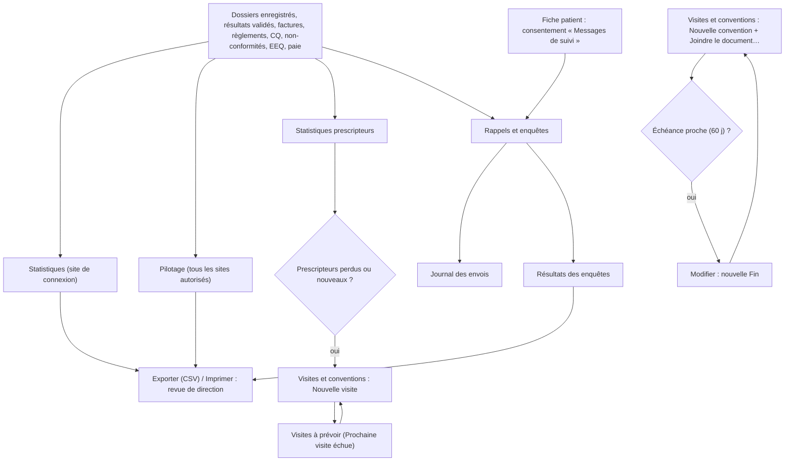
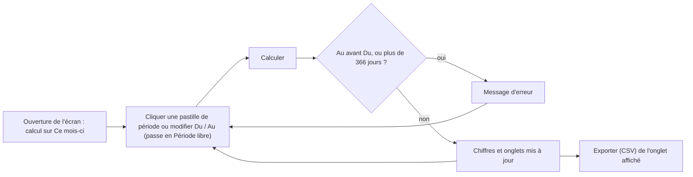
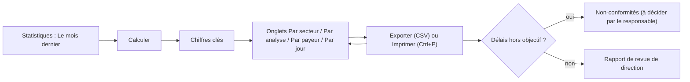
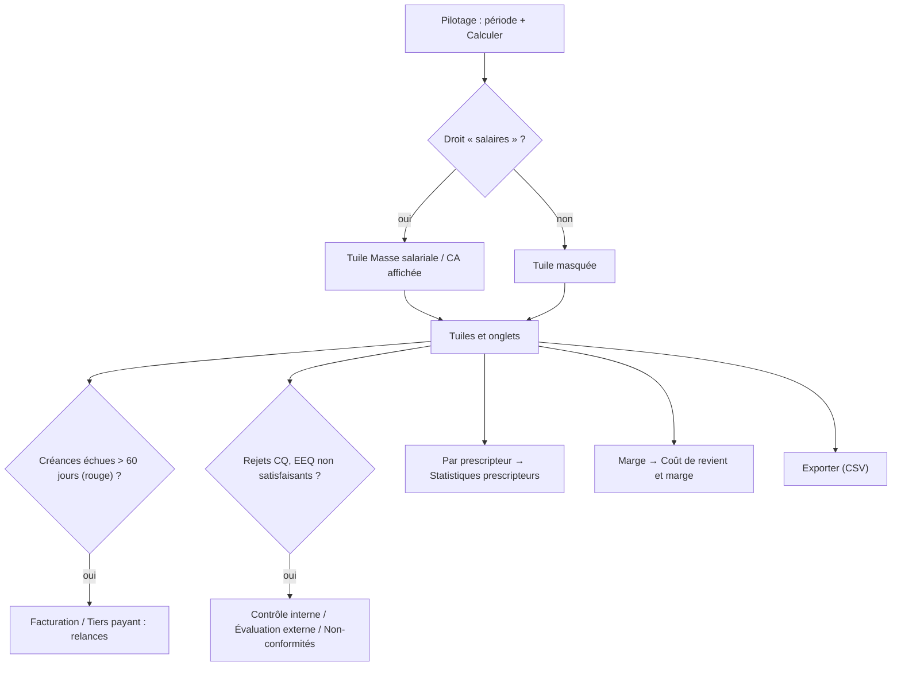
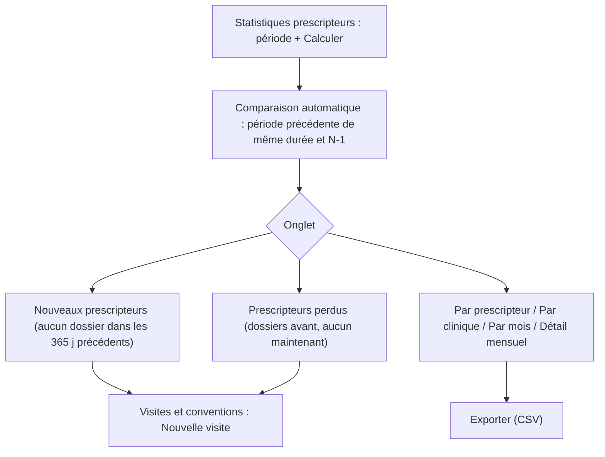
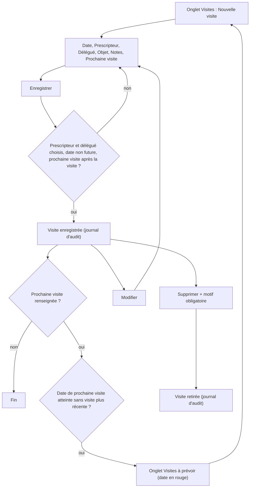
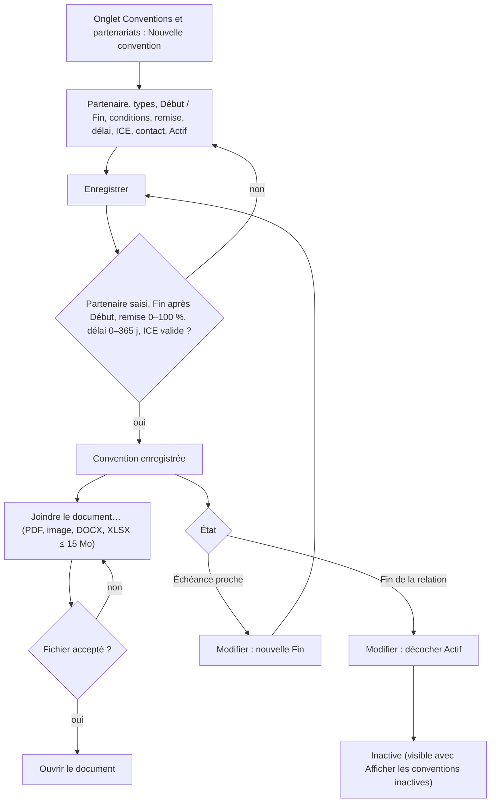
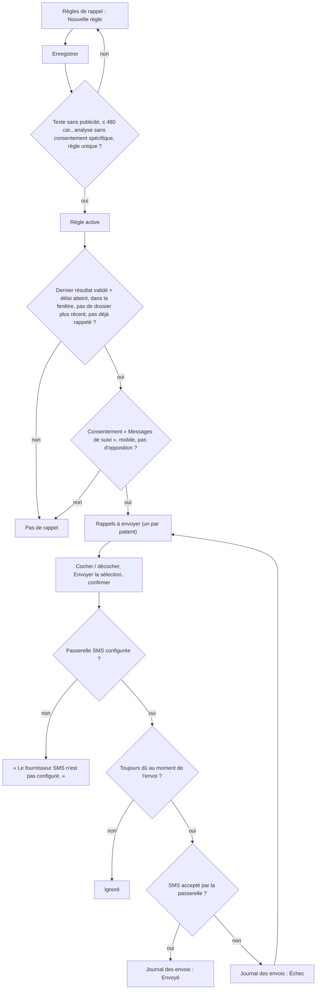
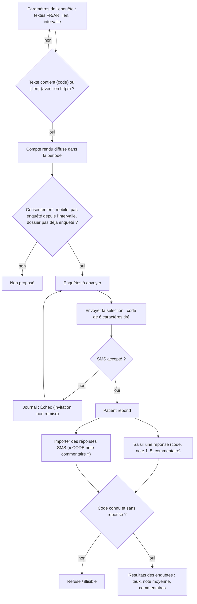

## Pilotage, statistiques et relations

### Présentation du module

**À quoi sert le module.** Ce chapitre couvre les écrans qui suivent l'activité du laboratoire. Il couvre aussi la relation avec les prescripteurs, les partenaires et les patients :
- **Statistiques** et **Pilotage**, en haut du menu ;
- le groupe RELATIONS : **Statistiques prescripteurs**, **Visites et conventions** et **Rappels et enquêtes**.

Ces écrans ne modifient aucun dossier patient : ils lisent l'activité et la présentent. Font exception les envois de SMS de **Rappels et enquêtes**, ainsi que les visites et conventions qu'on y enregistre.

**Qui l'utilise.** Le biologiste responsable (directeur), le responsable qualité, la comptabilité et l'administrateur. Chaque écran demande son propre droit :

| Écran | Droit demandé | Rôles livrés qui l'ont |
|---|---|---|
| **Statistiques** | « consulter les statistiques » | Biologiste responsable, Biologiste, Responsable qualité, Comptabilité, Administrateur |
| **Pilotage** | « pilotage » (et « salaires » pour la masse salariale) | Biologiste responsable, Administrateur |
| **Statistiques prescripteurs** | « relations — consultation » | Biologiste responsable, Comptabilité, Administrateur |
| **Visites et conventions** | « relations — consultation » ; « relations — gestion » pour saisir | Biologiste responsable, Comptabilité (consultation), Administrateur |
| **Rappels et enquêtes** | « campagnes de messages patients » | Biologiste responsable, Administrateur |

**Liens avec les autres modules.** Ces écrans lisent :
- les dossiers et les résultats validés ;
- les factures et les règlements (Facturation) ;
- le contrôle qualité, les non-conformités et l'évaluation externe (Qualité) ;
- la paie (Ressources humaines) ;
- le coût des réactifs (Finances, **Coût de revient et marge**) ;
- le consentement « Messages de suivi » de la fiche patient.

Ils servent la revue de direction (ISO 15189), les relances de créances et le suivi des prescripteurs.

Vue d'ensemble :

**Barre de période** (commune) :

**Barre de période commune.** Tous ces écrans ont en haut la même barre :

- l'en-tête, avec le titre de l'écran à gauche et, à droite :
  - les boutons propres à l'écran ;
  - **Exporter (CSV)** ;
  - **Calculer** (**F5**).

  Sur **Visites et conventions**, **Calculer** s'appelle **Actualiser**. Sur **Visites et conventions** et **Rappels et enquêtes**, ce bouton est secondaire : le bouton bleu est l'action de l'onglet (« Nouvelle visite », « Envoyer la sélection »…) ;
- une rangée de pastilles de période : **Ce mois-ci** (par défaut), **Le mois dernier**, **Cette année**, **L'année dernière** et **Période libre** ;
- deux dates **Du** et **Au**. Modifier une date passe automatiquement sur **Période libre**.

Le bouton **Exporter (CSV)** exporte **l'onglet affiché** dans un fichier CSV (séparateur point-virgule, accents conservés), qui s'ouvre directement dans Excel.

Règles communes :
- La date de fin ne peut pas précéder la date de début (« La date de fin précède la date de début. »).
- La période est limitée à 366 jours (« La période ne peut pas dépasser 366 jours. »).
- L'écran calcule automatiquement à l'ouverture, sur le mois en cours. Après un changement de dates, cliquer **Calculer**.
- Un export sur un onglet vide affiche « Aucune donnée ». Sur **Statistiques**, **Exporter (CSV)** est grisé tant qu'aucun calcul n'a abouti ; sur un onglet vide, il ne se passe rien.
- Une liste garde la ligne choisie après une actualisation.

### Statistiques

**À quoi sert cet écran**

Cet écran donne les chiffres d'activité d'une période pour la revue de direction (ISO 15189) : les volumes, les délais et les montants. Il ne porte que sur le site de connexion.

**Qui y a accès** : droit « consulter les statistiques ». Rôles livrés : Biologiste responsable, Biologiste, Responsable qualité, Comptabilité, Administrateur.

**Fonctionnalités**
- Pastilles **Ce mois-ci**, **Le mois dernier**, **Cette année**, **L'année dernière** et **Période libre** : elles choisissent la période.
- **Du** / **Au** : la période libre.
- **Calculer** (bouton principal, **F5**) : calcule les chiffres de la période. Le calcul se fait aussi à l'ouverture.
- **Exporter (CSV)** : exporte l'onglet affiché. Il est grisé tant qu'aucun calcul n'a abouti.
- Onglets **Par secteur**, **Par analyse**, **Par payeur** et **Par jour** : le détail des chiffres.
- **Imprimer** (Ctrl+P, dans le bandeau de la fenêtre) : imprime la liste affichée.

**L'écran**

- En-tête : le titre « Statistiques d'activité — jj/mm/aa → jj/mm/aa », puis **Exporter (CSV)** et **Calculer**. Dessous, la rangée de période.
- Huit tuiles de chiffres clés :

  | Chiffre | Signification |
  |---|---|
  | Dossiers | Dossiers enregistrés dans la période qui ont au moins une analyse non annulée |
  | Patients | Patients distincts de ces dossiers |
  | Analyses | Analyses réalisées (non annulées) ; entre parenthèses, le nombre d'analyses **annulées** |
  | Délai réception → validation · dans les délais | Délai moyen en heures entre la réception de l'échantillon et la validation biologique, puis le % d'analyses validées avant l'heure de rendu promise |
  | Montant facturable | Somme des prix appliqués aux analyses réalisées |
  | Facturé | Factures émises datées dans la période |
  | Avoirs | Avoirs émis datés dans la période |
  | Encaissé | Règlements encaissés dans la période |

- Quatre onglets, chacun dans un cadre :
  - **Par secteur** : Code, Secteur, Analyses, Validées, Délai moyen, Dans les délais, Montant facturable.
  - **Par analyse** : Code, Désignation, Analyses, Délai moyen, Montant facturable.
  - **Par payeur** : Payeur (« Patient payant » quand il n'y a pas d'organisme), Dossiers, Analyses, Montant facturable, Part organisme, Part patient.
  - **Par jour** : Date, Dossiers, Analyses. Tous les jours de la période y figurent, y compris les jours vides (fermeture, panne).

**Scénarios**

1. *Préparer la revue de direction du mois écoulé*
   1. Ouvrir **Statistiques**.
   2. Cliquer la pastille **Le mois dernier**.
   3. Cliquer **Calculer**.
   4. Lire les chiffres clés, puis ouvrir chaque onglet.
   5. Pour chaque onglet utile, cliquer **Exporter (CSV)** et enregistrer le fichier depuis Excel.
2. *Analyser une période libre* (par exemple un trimestre) : modifier **Du** et **Au** (la pastille **Période libre** se sélectionne), puis cliquer **Calculer**.
3. *Comparer les secteurs* : onglet **Par secteur**, trié du plus grand nombre d'analyses au plus petit. Repérer les délais moyens élevés et les faibles % **Dans les délais**.
4. *Connaître la répartition par organisme* : onglet **Par payeur**, trié par montant décroissant.
5. *Imprimer un onglet* : afficher l'onglet, puis **Imprimer** (Ctrl+P) dans le bandeau.

**Règles et contrôles**

- Les chiffres portent sur le **site de connexion** uniquement. Pour plusieurs sites, voir **Pilotage**.
- Une analyse annulée n'est comptée que dans le chiffre « annulées », nulle part ailleurs.
- Un dossier est rattaché au jour de son **enregistrement** (heure locale du laboratoire).
- Le délai moyen ne compte que les analyses qui ont à la fois une heure de réception et une heure de validation. « — » s'affiche quand il n'y en a aucune.
- « Montant facturable » (prix des analyses) et « Facturé » (factures émises) peuvent différer : factures non encore émises, factures d'une autre période, remises.
- La déclaration épidémiologique (maladies à déclaration obligatoire) n'existe pas dans cet écran, bien qu'un droit porte ce nom (à vérifier avec l'éditeur).

**Flux** : cet écran ne fait que lire. Les fichiers CSV alimentent le rapport de revue de direction. Les écarts de délais renvoient vers **Non-conformités** si besoin.

### Pilotage

**À quoi sert cet écran**

C'est le tableau de bord du directeur sur une période. Il donne, tous sites confondus :
- le chiffre d'affaires et la marge ;
- les créances ;
- la masse salariale ;
- la qualité et les délais.

**Qui y a accès** : droit « pilotage ». Rôles livrés : Biologiste responsable, Administrateur. La tuile de masse salariale demande **en plus** le droit « salaires », qu'a le Biologiste responsable.

**Fonctionnalités**
- Pastilles de période, **Du** / **Au** : comme sur tous les écrans du chapitre.
- **Calculer** (bouton principal, **F5**) : calcule le tableau de bord. Le calcul se fait aussi à l'ouverture.
- **Exporter (CSV)** : exporte l'onglet affiché. Sur un onglet vide, le message est « Aucune donnée ».
- Onglets **Par jour**, **Par site**, **Par payeur**, **Par prescripteur**, **Créances échues** et **Qualité**.

**L'écran**

- En-tête : le titre « Pilotage — jj/mm/aaaa → jj/mm/aaaa · N site(s) ». Tous les sites auxquels votre compte a accès sont additionnés. À droite : **Exporter (CSV)** et **Calculer**.
- Rangée de période.
- Tuiles :

  | Tuile | Contenu |
  |---|---|
  | Chiffre d'affaires | Prix des analyses réalisées · nombre de dossiers |
  | Facturé net / encaissé | Factures moins avoirs / règlements encaissés |
  | Coût réactifs | Coût réactif estimé des analyses de la période |
  | Marge | Chiffre d'affaires moins coût réactifs · % de marge |
  | Créances échues / encours | Montant échu (en rouge s'il y en a) / total restant dû |
  | Masse salariale / CA | Coût employeur des mois de paie **clôturés** entièrement compris dans la période · % du chiffre d'affaires de ces mêmes mois. Sinon : « Aucun mois de paie clôturé sur la période ». Tuile **absente** sans le droit « salaires ». |
  | Délai de rendu moyen | Délai réception → validation · % dans les délais (même calcul que **Statistiques**) |
  | Rejets CQ | Contrôles rejetés / contrôles passés · % |

- Onglets :
  - **Par jour**, **Par site**, **Par payeur** et **Par prescripteur** : Libellé, Dossiers, Analyses, CA (MAD), Part (du chiffre d'affaires). « Patient payant » regroupe les dossiers sans organisme, « (Sans prescripteur) » les dossiers sans prescripteur.
  - **Créances échues** : Ancienneté (Non échu, 1 à 30 jours, 31 à 60 jours, 61 à 90 jours, 91 à 180 jours, Plus de 180 jours), Factures, Montant dû (MAD). Les tranches de plus de 60 jours non nulles sont en rouge.
  - **Qualité** : Résultats de CQ, Rejets CQ, Non-conformités ouvertes, Non-conformités déclarées sur la période, EEQ satisfaisants, EEQ à surveiller, EEQ non satisfaisants, EEQ non rendus, Délai de rendu moyen, Dans les délais.

**Scénarios**

1. *Revue mensuelle de direction*
   1. Ouvrir **Pilotage**, cliquer **Le mois dernier**, puis **Calculer**.
   2. Lire les tuiles, et contrôler la tuile **Créances échues / encours**.
   3. Onglet **Créances échues** : repérer les tranches en rouge, puis traiter les relances dans **Facturation** / **Tiers payant**.
   4. Onglet **Qualité** : comparer aux objectifs qualité.
   5. Exporter chaque onglet utile avec **Exporter (CSV)**.
2. *Suivre le poids de chaque prescripteur ou organisme* : onglets **Par prescripteur** / **Par payeur**, triés par CA décroissant.
3. *Comparer les sites* : onglet **Par site**. Seuls les sites autorisés pour votre compte apparaissent.
4. *Bilan annuel* : cliquer **L'année dernière**, puis **Calculer**.

**Règles et contrôles**

- Le chiffre d'affaires est le prix des analyses non annulées des dossiers enregistrés dans la période. Il peut différer du « Facturé net ».
- Les créances sont calculées **à aujourd'hui**, quelle que soit la période choisie.
- Le coût réactif et la marge suivent la méthode de l'écran **Coût de revient et marge** (groupe FINANCES) : les analyses sous-traitées sont exclues.
- Les salaires ne sont jamais montrés à qui n'a pas le droit « salaires ».
- Une ligne de créance ou de prescripteur ne mène pas à son détail : ouvrir **Facturation** ou **Statistiques prescripteurs** à la main.

**Flux** : le Pilotage mène aux actions suivantes :
- **Facturation** / **Tiers payant**, pour les créances ;
- **Non-conformités** / **Évaluation externe**, pour la qualité ;
- **Coût de revient et marge**, pour le détail par analyse ;
- **Statistiques prescripteurs**, pour le détail par prescripteur.

### Statistiques prescripteurs

**À quoi sert cet écran**

Cet écran montre ce que chaque médecin et chaque clinique envoie au laboratoire, et comment cela évolue. La comparaison avec la période précédente et avec l'année précédente (N-1) est automatique.

**Qui y a accès** : droit « relations — consultation ». Rôles livrés : Biologiste responsable, Comptabilité, Administrateur.

**Fonctionnalités**
- Pastilles de période, **Du** / **Au** : comme sur tous les écrans du chapitre.
- **Calculer** (bouton principal, **F5**) : calcule l'activité et les comparaisons. Le calcul se fait aussi à l'ouverture.
- **Exporter (CSV)** : exporte l'onglet affiché.
- Six onglets, décrits ci-dessous.

**L'écran**

- En-tête : le titre « Activité par prescripteur — période (comparé à période précédente) ». La période précédente a la même durée et se termine la veille du début. À droite : **Exporter (CSV)** et **Calculer**.
- Quatre tuiles :
  - **Dossiers**, avec l'évolution en % par rapport à la période précédente ;
  - **CA (MAD)**, avec la même évolution ;
  - **Nouveaux prescripteurs** ;
  - **Prescripteurs perdus**.
- Six onglets :
  - **Par prescripteur** : Prescripteur, Clinique / établissement, Dossiers, Analyses, CA (MAD), Dossiers période préc., CA période préc., Dossiers vs préc., Dossiers vs N-1, CA vs préc., CA vs N-1. Les nouveaux prescripteurs sont sur fond vert.
  - **Par clinique / établissement** : les mêmes colonnes. « (Cabinet / sans établissement) » regroupe les médecins de ville.
  - **Par mois** : Mois, Dossiers, Analyses, CA (MAD), Dossiers N-1, CA N-1, Évolution vs N-1, Prescripteurs actifs, Nouveaux.
  - **Nouveaux prescripteurs** : ceux qui ont envoyé des dossiers dans la période et aucun dans les 365 jours précédents.
  - **Prescripteurs perdus** : ceux qui avaient envoyé des dossiers dans la période précédente et aucun dans la période, triés par CA perdu.
  - **Détail mensuel** : Prescripteur, Clinique / établissement, Mois, Dossiers, Analyses, CA (MAD). Cet onglet sert à un export complet.

**Scénarios**

1. *Repérer les prescripteurs perdus ce trimestre*
   1. Saisir **Du** / **Au** sur le trimestre, puis cliquer **Calculer**.
   2. Ouvrir l'onglet **Prescripteurs perdus**. La liste commence par ceux qui pesaient le plus.
   3. Planifier une visite dans **Visites et conventions** (objet « Point sur le service » ou « Réclamation »). Il n'y a pas de bouton direct : rechoisir le prescripteur dans **Nouvelle visite**.
2. *Accueillir les nouveaux prescripteurs* : onglet **Nouveaux prescripteurs**, puis une visite de suivi.
3. *Comparer à l'année dernière* : onglet **Par mois**, colonnes N-1 et **Évolution vs N-1**.
4. *Exporter le détail pour un tableur* : onglet **Détail mensuel**, puis **Exporter (CSV)**.

**Règles et contrôles**

- Un dossier compte s'il n'est pas annulé. Ses analyses et son CA sont ceux de ses analyses non annulées, au prix appliqué.
- Tous les sites autorisés pour votre compte sont additionnés.
- « — » dans une évolution signifie qu'il n'y avait rien à comparer (zéro avant).
- « (Sans prescripteur) » regroupe les dossiers sans médecin prescripteur.

**Flux** : cet écran mène à **Visites et conventions** (visite de suivi). Il complète l'onglet **Par prescripteur** du **Pilotage**.

### Visites et conventions

**À quoi sert cet écran**

Cet écran a deux usages :
- suivre les visites du délégué chez les prescripteurs ;
- tenir le registre des conventions (cliniques, entreprises, laboratoires partenaires, mutuelles), avec le document signé.

**Qui y a accès**

- Consultation : droit « relations — consultation » (Biologiste responsable, Comptabilité, Administrateur).
- Création, modification, suppression et pièce jointe : droit « relations — gestion » (Biologiste responsable, Administrateur). Sans ce droit, les boutons correspondants sont masqués, et le double-clic n'ouvre rien. **Ouvrir le document** reste disponible.

**Fonctionnalités**
- **Nouvelle visite** (bouton principal, onglets **Visites** et **Visites à prévoir**) : enregistre une visite.
- **Nouvelle convention** (bouton principal, onglet **Conventions et partenariats**) : enregistre une convention.
- **Modifier** : ouvre la visite ou la convention choisie. Il est grisé sans ligne choisie. Le double-clic fait de même dans **Visites** et **Conventions et partenariats**, mais pas dans **Visites à prévoir**.
- **Plus d'actions** contient trois actions :
  - **Supprimer** (visites) : retire une visite saisie par erreur, avec un motif obligatoire ;
  - **Joindre le document…** (conventions) : ajoute le document signé (PDF, image, DOCX, XLSX, 15 Mo au plus) ;
  - **Ouvrir le document** (conventions) : ouvre la dernière version jointe. Il est grisé s'il n'y a pas de document.
- **Actualiser** (**F5**) : recharge l'onglet.
- **Exporter (CSV)** : exporte l'onglet affiché.
- Pastilles de période, **Du** / **Au** : elles ne filtrent que l'onglet **Visites**.
- **Afficher les conventions inactives** (case au bout de la ligne de rappel, onglet des conventions) : montre aussi les conventions désactivées.

**L'écran**

- En-tête : le titre « Visites et conventions », avec dessous « N visite(s) · N à prévoir · N convention(s) ». À droite : **Modifier**, **Plus d'actions**, **Exporter (CSV)**, **Actualiser**, puis **Nouvelle visite** ou **Nouvelle convention** selon l'onglet.
- Rangée de période.
- Ligne de rappel : « Suivi de la relation uniquement : comptes rendus de visite, délais de résultats, réclamations. Aucun contenu promotionnel ni avantage au prescripteur. ». La case **Afficher les conventions inactives** est au bout de cette ligne, sur l'onglet des conventions.
- Onglets, chacun dans un cadre :
  - **Visites** (visites dont la date est dans la période) et **Visites à prévoir** : Date, Prescripteur, Clinique / établissement, Délégué, Objet, Notes, Prochaine visite (en rouge quand elle est due). Une visite est « à prévoir » quand sa **Prochaine visite** est arrivée sans qu'une visite plus récente au même prescripteur ait eu lieu.
  - **Conventions et partenariats** : Partenaire, Type de partenaire, Type de convention, Référence, Début, Fin, État (pastille), Remise convenue (%), Contact, Document. Une convention qui se termine dans les 60 jours a une pastille orange.

| État d'une convention | Signification |
|---|---|
| En vigueur (pastille verte ✓) | Active, et la date du jour est entre Début et Fin (ou il n'y a pas de Fin) |
| Échéance proche (pastille orange !) | En vigueur et se termine dans 60 jours ou moins : à renouveler |
| Hors période (pastille grise ○) | Active, mais pas encore commencée ou déjà terminée |
| Inactive (pastille grise ○) | Case **Actif** décochée (visible seulement avec **Afficher les conventions inactives**) |

**Scénarios**

1. *Enregistrer une visite chez un prescripteur*
   1. Onglet **Visites**, cliquer **Nouvelle visite**.
   2. Renseigner :
      - **Date** (aujourd'hui par défaut) ;
      - **Prescripteur** ;
      - **Délégué** (vous par défaut) ;
      - **Objet** (Suivi, Point sur le service, Réclamation, Remise des résultats, Logistique des prélèvements, Autre) ;
      - **Notes**.
   3. Cocher et renseigner **Prochaine visite** si une nouvelle visite est prévue.
   4. Cliquer **Enregistrer**.
2. *Modifier une visite* : sélectionner la ligne (onglet **Visites** ou **Visites à prévoir**), puis cliquer **Modifier**. Dans l'onglet **Visites**, on peut aussi double-cliquer la ligne. Corriger, puis **Enregistrer**.
3. *Supprimer une visite saisie par erreur*
   1. Sélectionner la visite, puis cliquer **Plus d'actions** > **Supprimer**.
   2. Confirmer « Confirmez-vous la suppression de « date — prescripteur » ? » et saisir le motif (obligatoire).
   3. La visite disparaît des listes. La suppression et son motif restent au journal d'audit.
4. *Préparer la tournée du délégué* : onglet **Visites à prévoir**, puis **Exporter (CSV)** ou **Imprimer** (Ctrl+P). Après chaque visite, enregistrer une nouvelle visite : la ligne disparaît des visites à prévoir.
5. *Enregistrer une convention* (clinique, médecine du travail, laboratoire partenaire, mutuelle…)
   1. Onglet **Conventions et partenariats**, cliquer **Nouvelle convention**.
   2. Renseigner :
      - **Partenaire** (obligatoire) ;
      - **Type de partenaire** (Clinique, Hôpital, Entreprise, Laboratoire, Association / mutuelle, Autre) ;
      - **Prescripteur rattaché** (facultatif, si le partenaire est aussi un prescripteur) ;
      - **Type de convention** (Convention de soins, Médecine du travail, Prélèvements sur site, Sous-traitance, Tiers payant / facturation directe, Autre) ;
      - **Référence**, **Début** et **Fin**. Laisser **Fin** décochée pour une convention sans fin ou à tacite reconduction ;
      - **Conditions convenues**, **Remise convenue (%)** et **Délai de paiement (jours)** ;
      - **ICE**, **Interlocuteur**, **Téléphone**, **Courriel** et **Observations** ;
      - la case **Actif**.
   3. Cliquer **Enregistrer**.
6. *Enregistrer une convention de sous-traitance avec un laboratoire partenaire*
   1. Procéder comme au scénario 5, avec **Type de partenaire** = Laboratoire et **Type de convention** = Sous-traitance.
   2. Préciser dans **Conditions convenues** les analyses, les tarifs, les délais et le transport.
   3. Joindre le contrat signé (scénario 7).

   Remarque : ce registre est documentaire. L'envoi des échantillons se fait dans **Sous-traitance** (groupe LISTE DE TRAVAIL), qui n'utilise pas cette convention (à vérifier).
7. *Joindre le document signé*
   1. Sélectionner la convention, puis cliquer **Plus d'actions** > **Joindre le document…**.
   2. Choisir un fichier PDF, une image (JPG, PNG, TIFF) ou un fichier Word / Excel sans macros (DOCX, XLSX), de 15 Mo au plus.
   3. Le nom du fichier apparaît dans la colonne **Document**. Joindre à nouveau ajoute une nouvelle version.
8. *Consulter le document signé* : sélectionner la convention, puis cliquer **Plus d'actions** > **Ouvrir le document**.
9. *Renouveler ou modifier une convention* : sélectionner la ligne, puis **Modifier** (ou double-cliquer). Changer **Fin** et les conditions, puis **Enregistrer**.
10. *Mettre fin à une convention* : **Modifier**, décocher **Actif**, puis **Enregistrer**. Il n'y a pas de suppression de convention. Pour la revoir, cocher **Afficher les conventions inactives**.

**Règles et contrôles**

- Visite :
  - « La date de visite ne peut pas être dans le futur. » ;
  - « La prochaine visite doit être postérieure à la visite. » ;
  - « Choisissez le prescripteur et le délégué. » ;
  - les notes font 2 000 caractères au plus.
- Seuls les prescripteurs actifs et le personnel actif du site sont proposés. Un prescripteur ou un délégué désactivé déjà cité dans la fiche reste affiché avec « (inactif) ».
- Convention :
  - « Indiquez le partenaire. » ;
  - « La date de fin précède la date de début. » ;
  - « La remise doit être comprise entre 0 et 100 %. » ;
  - « Le délai de paiement doit être compris entre 0 et 365 jours. » ;
  - l'ICE est contrôlé (« L'ICE du prescripteur est invalide. ») ;
  - les conditions font 4 000 caractères au plus.
- Pièce jointe :
  - « Le fichier dépasse 15 Mo. » ;
  - « Joignez un PDF, une image (JPG, PNG, TIFF) ou un document Word ou Excel sans macros (DOCX, XLSX). » ;
  - « Aucun fichier joint. » ;
  - « Le fichier n'a pas pu être lu. Fermez-le s'il est ouvert dans un autre programme. ».
- La remise et le délai de paiement saisis dans une convention sont **informatifs** : ils ne s'appliquent pas automatiquement aux factures (à vérifier). Les tarifs se règlent dans le **Catalogue des analyses**.
- La période ne filtre que l'onglet **Visites**. **Visites à prévoir** et les conventions sont toujours complets. Les données sont celles du site de connexion.
- Toute création, modification, suppression et pièce jointe est tracée au journal d'audit.

**Flux** :
1. **Statistiques prescripteurs** signale les prescripteurs perdus ou nouveaux.
2. On enregistre la visite et la prochaine visite dans **Visites et conventions**.
3. **Visites à prévoir** prépare la tournée suivante.

Visites :

Conventions :

### Rappels et enquêtes

**À quoi sert cet écran**

Cet écran envoie par SMS des rappels de bilan (par exemple une HbA1c tous les 3 mois) et des enquêtes de satisfaction. Il sert ensuite à suivre les réponses.

**Qui y a accès** : droit « campagnes de messages patients ». Rôles livrés : Biologiste responsable, Administrateur.

**Fonctionnalités**
- **Envoyer la sélection** (bouton principal, onglets **Rappels à envoyer** et **Enquêtes à envoyer**) : envoie les SMS des lignes cochées, après confirmation.
- **Nouvelle règle** (bouton principal, onglet **Règles de rappel**) : crée une règle de rappel.
- **Modifier** (onglet **Règles de rappel**, ou double-clic sur la règle) : rouvre la règle choisie.
- **Plus d'actions**, sur les onglets **Enquêtes à envoyer** et **Résultats des enquêtes**, contient trois actions :
  - **Saisir une réponse** : enregistre une réponse reçue par téléphone ou à l'accueil ;
  - **Importer des réponses SMS** : enregistre en une fois des réponses copiées depuis la passerelle ;
  - **Paramètres de l'enquête** : les textes, le lien et l'intervalle entre deux enquêtes.
- **Calculer** (**F5**, bouton secondaire) : recalcule l'onglet affiché. Changer d'onglet le recalcule aussi.
- **Exporter (CSV)** : exporte l'onglet affiché. L'export est inscrit au journal d'accès aux données.
- Pastilles de période, **Du** / **Au** : elles comptent pour **Enquêtes à envoyer**, **Résultats des enquêtes** et **Journal des envois**, pas pour les rappels ni les règles.
- Case **Envoyer** sur chaque ligne à envoyer : décocher un patient à ne pas relancer.

**L'écran**

- En-tête : le titre « Rappels et enquêtes », avec dessous « Rappels de bilan et enquêtes de satisfaction ». À droite :
  - **Modifier** et **Plus d'actions**, selon l'onglet ;
  - **Exporter (CSV)** et **Calculer** ;
  - le bouton bleu de l'onglet.
- Rangée de période.
- Rappel : seuls les patients qui ont donné le consentement « Messages de suivi (rappels de bilan, enquête de satisfaction par SMS) » et qui ont un numéro de mobile reçoivent ces SMS. Le contenu est informatif uniquement, sans publicité. WhatsApp n'est pas proposé. Si aucune passerelle SMS n'est configurée, le rappel ajoute « Aucune passerelle SMS n'est configurée : l'aperçu est possible, l'envoi non. ».
- Onglets, chacun dans un cadre :
  - **Rappels à envoyer** (calculés pour **aujourd'hui** ; la période n'est pas utilisée) : case **Envoyer** (cochée par défaut), Patient, Téléphone, Analyse / bilan, Date du résultat, Rappel prévu le, Message (le texte exact qui partira), SMS (le nombre de SMS facturés).
  - **Règles de rappel** : Code, Analyse / bilan, Délai (mois), Fenêtre (jours), Modèle, Active.
  - **Enquêtes à envoyer** (dossiers dont le compte rendu est sorti dans la période) : case **Envoyer**, Patient, Téléphone, Dossier, Compte rendu le, Message, SMS.
  - **Résultats des enquêtes** :
    - les tuiles **Invités** (dont **Remis**), **Réponses** (taux), **Note moyenne** (sur 5) et **Répartition des notes** (de 1★ à 5★) ;
    - la liste des commentaires (Date, Note, Commentaire).
  - **Journal des envois** (période) : Envoyé le, Type (Rappel de bilan / Enquête de satisfaction), Patient, Téléphone, Statut, Message. Le statut est une pastille : verte « Envoyé » ou rouge « Échec ».

**Scénarios**

1. *Créer une règle de rappel de bilan*
   1. Onglet **Règles de rappel**, cliquer **Nouvelle règle**.
   2. Choisir l'**Analyse / bilan**. Un bilan est marqué « (Bilan (panel)) ».
   3. **Délai (mois)** : le délai après le résultat (3 par défaut, de 1 à 60).
   4. **Fenêtre (jours)** : le nombre de jours après l'échéance pendant lesquels le rappel reste proposé (60 par défaut, de 1 à 365).
   5. **Texte en français** et **Texte en arabe** : un texte par défaut est proposé. Champs utilisables : {patient} {analyse} {date} {labo} {telephone} {code} {lien}.
   6. Laisser **Actif** coché, puis cliquer **Enregistrer**.
2. *Modifier ou désactiver une règle* : sélectionner la règle, puis **Modifier** (ou double-cliquer). Changer le texte ou décocher **Actif**, puis **Enregistrer**. Une règle ne se supprime pas.
3. *Envoyer les rappels du jour*
   1. Ouvrir l'onglet **Rappels à envoyer**. La liste se calcule à l'ouverture de l'onglet.
   2. Relire les messages, et décocher **Envoyer** pour les patients à ne pas relancer.
   3. Cliquer **Envoyer la sélection**, puis confirmer « Envoyer N SMS maintenant ? ».
   4. Le bilan s'affiche : « N envoyé(s), N en échec, N ignoré(s). ». Un rappel est « ignoré » quand le patient est revenu entre-temps, ou quand il a retiré son consentement depuis l'aperçu.
   5. Vérifier les échecs dans **Journal des envois**. Un rappel en échec réapparaît dans **Rappels à envoyer** tant qu'il est dans la fenêtre.
4. *Régler l'enquête de satisfaction*
   1. Ouvrir l'onglet **Enquêtes à envoyer** ou **Résultats des enquêtes**, puis cliquer **Plus d'actions** > **Paramètres de l'enquête**.
   2. Modifier **Texte en français** et **Texte en arabe**, le **Lien de l'enquête (https, facultatif)** et l'**Intervalle minimal entre deux enquêtes (jours)** (90 par défaut).
   3. Cliquer **Enregistrer**.
5. *Envoyer les enquêtes de satisfaction*
   1. Choisir la période (les dossiers dont le compte rendu est sorti dans la période), cliquer **Calculer**, puis ouvrir **Enquêtes à envoyer**.
   2. Le code affiché « XXXXXX » est provisoire : le vrai code est tiré à l'envoi.
   3. Décocher si besoin, cliquer **Envoyer la sélection**, puis confirmer.
6. *Saisir une réponse reçue par téléphone ou à l'accueil*
   1. Cliquer **Plus d'actions** > **Saisir une réponse**.
   2. Saisir le **Code de l'enquête** (6 caractères), la **Note** (1 à 5) et le **Commentaire**.
   3. Cliquer **Enregistrer**. Le message « Enregistré. » confirme.
7. *Importer les réponses reçues par SMS*
   1. Copier les SMS reçus depuis la messagerie de la passerelle ou depuis le téléphone.
   2. Cliquer **Plus d'actions** > **Importer des réponses SMS**.
   3. Coller les SMS dans **Réponses reçues**, un SMS par ligne, sous la forme « CODE note commentaire » (exemple : « K7PQ2M 4 accueil rapide »).
   4. Cliquer **Enregistrer**. Le bilan s'affiche : « N réponse(s) enregistrée(s), N refusée(s), N illisible(s). ». Il est suivi des 20 premières lignes refusées ou illisibles. Une ligne refusée montre le code technique du refus (par exemple « Survey_AlreadyAnswered » pour une enquête qui a déjà une réponse).
8. *Lire les résultats de satisfaction* : choisir la période, puis ouvrir l'onglet **Résultats des enquêtes**. Exporter les commentaires avec **Exporter (CSV)**.
9. *Contrôler ce qui est parti* : ouvrir l'onglet **Journal des envois** sur la période. Les échecs ont une pastille rouge, avec la raison entre crochets (un code technique, par exemple « Messaging_SmsFailed »).

**Règles et contrôles**

- **Consentement** : n'apparaissent que les patients qui remplissent trois conditions :
  - ils ont le consentement « Messages de suivi » ;
  - ils ont un numéro de mobile ;
  - ils n'ont pas refusé toute utilisation de leurs données au-delà des soins.

  Le consentement est saisi dans la fiche patient.
- **Pas de publicité** : un texte qui contient un mot promotionnel est refusé (« Formulation promotionnelle refusée (« … ») : les messages aux patients sont informatifs uniquement. »). Sont refusés notamment : promo, réduction, remise, offre, offert, gratuit, solde, rabais, prix, tarif, %, et leurs équivalents arabes.
- **Analyses sensibles** : une règle sur une analyse sous consentement spécifique (VIH, génétique, dépistage prénatal), ou sur un bilan qui en contient une, est refusée (« Cette analyse, ou une analyse de ce bilan, exige un consentement spécifique… »).
- **Texte** :
  - il est obligatoire et fait 480 caractères au plus ;
  - les champs inconnus sont refusés (« Champ inconnu dans le message : {…}. ») ;
  - il y a une règle par analyse ou bilan (« Une règle de rappel existe déjà pour cette analyse ou ce bilan. »).
- **Quand un rappel est dû** : à la date du dernier résultat validé de l'analyse, plus le délai. Il n'y a pas de rappel dans trois cas :
  - le patient a déjà un dossier plus récent pour cette analyse, même dans un autre site ;
  - la fenêtre est passée ;
  - ce résultat a déjà été rappelé.

  Il n'y a qu'un seul rappel par patient et par envoi.
- **Enquête** :
  - le texte doit contenir {code} ou {lien} (« Le message d'enquête doit contenir {code} ou {lien}. ») ;
  - {lien} seul exige un lien https ;
  - un patient n'est pas réinterrogé avant l'intervalle choisi ;
  - une enquête n'a qu'une réponse (« L'enquête … a déjà une réponse. »).
- **Envoi** :
  - « Le fournisseur SMS n'est pas configuré. » ;
  - « Aucun destinataire sélectionné. » ;
  - 500 messages au plus par envoi (« Envoi limité à 500 messages à la fois. »).

  Pendant un envoi, la barre du haut et les onglets sont bloqués jusqu'à la fin.
- Les aperçus, les exports et les envois sont inscrits au journal d'accès aux données, car ces listes contiennent des noms et des numéros de patients.

**Flux** :
1. Le consentement « Messages de suivi » est saisi dans la fiche patient.
2. Le compte rendu est validé.
3. **Rappels et enquêtes** propose le rappel à l'échéance et l'enquête après le compte rendu.
4. Les envois vont au **Journal des envois**.
5. Les **Résultats des enquêtes** servent à la revue de direction, avec le **Pilotage**.

Rappels de bilan :

Enquêtes de satisfaction :

### Messages d'erreur et d'avertissement

« … » remplace une valeur que l'application insère. Les messages communs à toute l'application (connexion perdue, « Erreur inattendue », droit manquant…) sont décrits au chapitre « Prise en main ».

#### Statistiques, Pilotage, Statistiques prescripteurs (barre de période)

| Message | Quand il apparaît | Que faire |
|---|---|---|
| « La date de fin précède la date de début. » | **Au** est avant **Du** | Corriger les dates, puis **Calculer**. |
| « La période ne peut pas dépasser … jours. » (366) | Période trop longue | Raccourcir la période (un an au plus). |
| « Aucune donnée » | **Exporter (CSV)** sur un onglet vide (Pilotage, Statistiques prescripteurs et les écrans des relations) | Calculer une période qui a des données. |

#### Visites et conventions

| Message | Quand il apparaît | Que faire |
|---|---|---|
| « Choisissez le prescripteur et le délégué. » | Visite enregistrée sans l'un des deux | Choisir le prescripteur et le délégué. |
| « Choisissez le prescripteur visité. » / « Choisissez le délégué. » | Même cause (contrôle de l'application) | Idem. |
| « La date de visite ne peut pas être dans le futur. » | Date après aujourd'hui | Corriger la date. |
| « La prochaine visite doit être postérieure à la visite. » | Prochaine visite avant la visite | Corriger ou décocher **Prochaine visite**. |
| « Texte trop long (… caractères au plus). » | Notes ou conditions trop longues | Raccourcir le texte. |
| « Confirmez-vous la suppression de « … » ? » | **Supprimer** une visite | Saisir le motif, puis **OK** ; **Annuler** pour renoncer. |
| « Indiquez le motif. » | Suppression sans motif | Saisir le motif. |
| « Visite introuvable. » / « Convention introuvable. » | La fiche a été supprimée ou modifiée ailleurs | Cliquer **Actualiser**. |
| « Indiquez le partenaire. » | Convention sans partenaire | Saisir le partenaire. |
| « La date de fin précède la date de début. » | **Fin** avant **Début** | Corriger les dates. |
| « La remise doit être comprise entre 0 et 100 %. » | Remise hors limites | Corriger. |
| « Le délai de paiement doit être compris entre 0 et 365 jours. » | Délai hors limites | Corriger. |
| « L'ICE du prescripteur est invalide. » | ICE mal tapé (15 chiffres attendus) | Recopier l'ICE. |
| « Le fichier dépasse … Mo. » (15) | Document trop gros | Numériser en PDF plus léger. |
| « Le fichier est vide. » | Fichier de 0 octet | Choisir le bon fichier. |
| « Joignez un PDF, une image (JPG, PNG, TIFF) ou un document Word ou Excel sans macros (DOCX, XLSX). » | Type de fichier refusé | Convertir le document. |
| « Le fichier n'a pas pu être lu. Fermez-le s'il est ouvert dans un autre programme. » | Fichier verrouillé | Fermer le fichier, puis réessayer. |
| « Aucun fichier joint. » | **Ouvrir le document** sans document | Joindre d'abord le document. |

#### Rappels et enquêtes

| Message | Quand il apparaît | Que faire |
|---|---|---|
| « Aucun élément sélectionné. » | **Envoyer la sélection** sans ligne cochée | Cocher les lignes à envoyer. |
| « Envoyer … SMS maintenant ? » | Confirmation d'envoi | **Oui** pour envoyer. |
| « … envoyé(s), … en échec, … ignoré(s). » | Fin de l'envoi | Lire les échecs dans **Journal des envois**. |
| « Le fournisseur SMS n'est pas configuré. » | Aucune passerelle SMS | Demander à l'administrateur de configurer la passerelle. |
| « Aucun destinataire sélectionné. » | Rien à envoyer | Cocher des lignes. |
| « Envoi limité à … messages à la fois. » (500) | Trop de lignes cochées | Envoyer en plusieurs fois. |
| « Saisissez le texte du message. » | Texte vide | Saisir le texte. |
| « Message trop long (… caractères au plus). » (480) | Texte trop long | Raccourcir. |
| « Formulation promotionnelle refusée (« … ») : les messages aux patients sont informatifs uniquement. » | Mot publicitaire | Reformuler sans ce mot. |
| « Champ inconnu dans le message : … » | Champ entre accolades mal écrit | Utiliser {patient} {analyse} {date} {labo} {telephone} {code} {lien}. |
| « Choisissez une analyse ou un bilan, pas les deux. » | Règle mal remplie | Garder un seul choix. |
| « Le délai doit être compris entre … et … mois. » (1 et 60) | Délai hors limites | Corriger. |
| « La fenêtre d'envoi doit être comprise entre 1 et 365 jours. » | Fenêtre hors limites | Corriger. |
| « Une règle de rappel existe déjà pour cette analyse ou ce bilan. » | Règle en double | Modifier la règle existante. |
| « Cette analyse, ou une analyse de ce bilan, exige un consentement spécifique (VIH, génétique, dépistage prénatal) : elle ne peut pas faire l'objet d'un rappel par SMS. » | Analyse sensible | Ne pas créer de rappel pour cette analyse. |
| « Règle de rappel introuvable. » | Règle modifiée ailleurs | Cliquer **Calculer**. |
| « Le lien de l'enquête doit être une adresse https valide. » | Lien mal écrit | Saisir une adresse qui commence par https://. |
| « Le message d'enquête doit contenir {code} ou {lien}. » | Texte sans code ni lien | Ajouter {code}. |
| « Un message d'enquête sans {code} n'a que {lien}, qui reste vide sans lien d'enquête : renseignez une adresse https ou ajoutez {code}. » | {lien} sans adresse | Renseigner le lien ou ajouter {code}. |
| « L'intervalle doit être compris entre 0 et 3650 jours. » | Intervalle hors limites | Corriger. |
| « Code d'enquête invalide : … » | Code mal tapé (6 caractères) | Vérifier le code. |
| « Code d'enquête inconnu : … » | Code qui n'existe pas | Vérifier le code auprès du patient. |
| « L'enquête … a déjà une réponse. » | Deuxième réponse au même code | Rien : la première réponse est gardée. |
| « La note doit être comprise entre 1 et 5. » | Note hors limites | Corriger. |
| « … réponse(s) enregistrée(s), … refusée(s), … illisible(s). » | Fin de l'import des SMS | Relire les lignes refusées (codes techniques) et les saisir à la main si besoin. |
| « Enregistré. » | Réponse ou paramètres enregistrés | Rien. |
