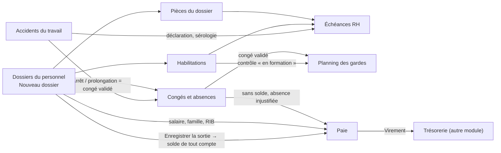
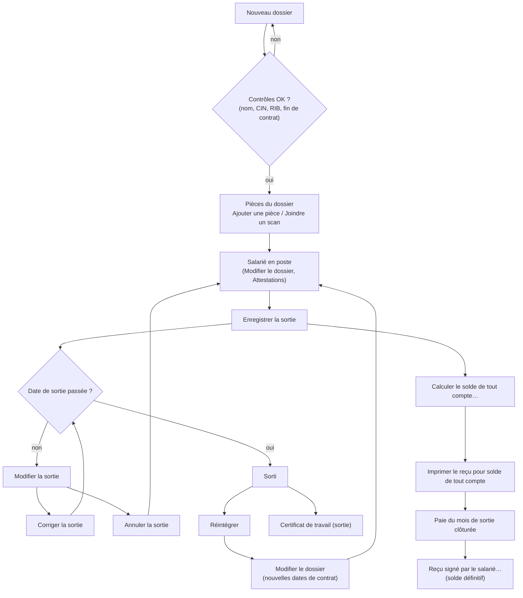
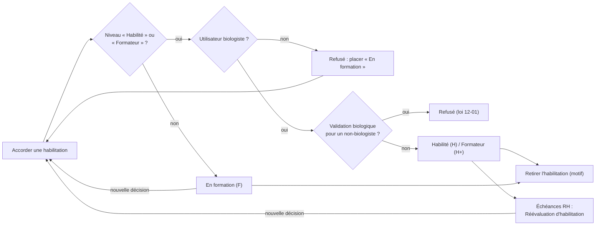
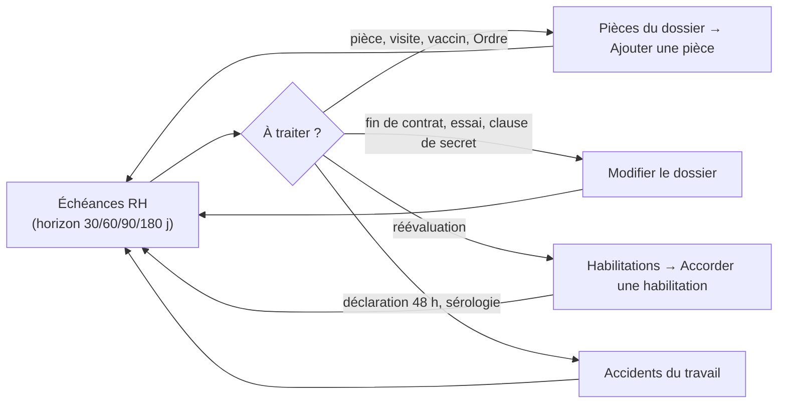
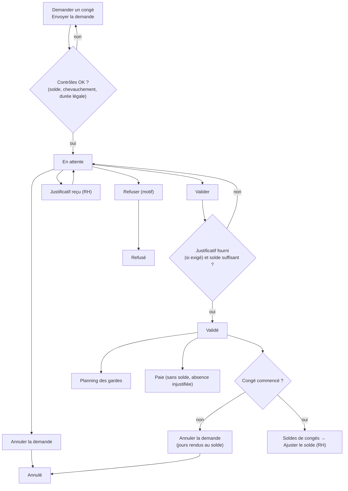
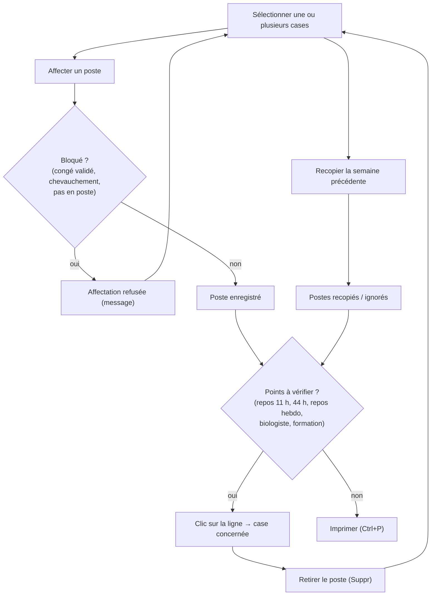
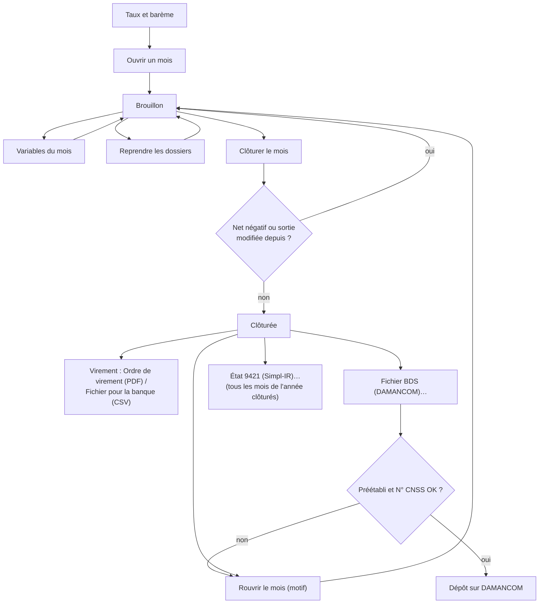
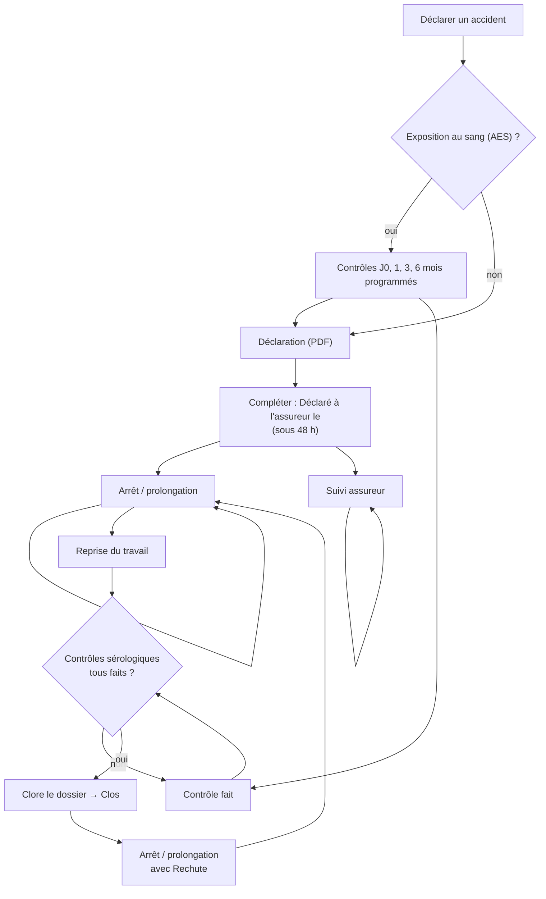

## Ressources humaines (menu « Personnel »)

### Présentation du module

**À quoi sert le module.** Le groupe **Personnel** du menu de gauche tient tout ce qui concerne les salariés du laboratoire :
- le dossier de chaque personne et ses pièces justificatives ;
- les habilitations exigées par la norme ISO 15189 ;
- les échéances à surveiller ;
- les congés ;
- le planning des gardes ;
- la paie (CNSS, AMO, IR, BDS, état 9421) ;
- les accidents du travail et les accidents d'exposition au sang.

**Qui l'utilise.** La RH et la direction (Administrateur, Biologiste responsable) gèrent tout. Le Responsable qualité consulte les dossiers, les habilitations et les échéances. Le Biologiste déclare les accidents. Chaque membre du personnel demande ses propres congés. Le détail des droits est donné ci-dessous.

**Ses écrans** (menu **Personnel**) :

| Écran | Ce qu'on y fait |
|---|---|
| **Dossiers du personnel** | Identité, poste, contrat, salaire, pièces, sortie, attestations, solde de tout compte |
| **Habilitations** | Matrice des habilitations par activité, automate ou discipline |
| **Échéances RH** | Pièces à renouveler, réévaluations, fins de contrat, pièces manquantes, accidents à déclarer |
| **Congés et absences** | Demandes, validation, soldes, jours fériés |
| **Planning des gardes** | Planning mensuel et contrôles (repos, 44 h, biologiste de service) |
| **Paie** | Bulletins, clôture, virement, BDS DAMANCOM, état 9421 |
| **Accidents du travail** | Déclaration sous 48 h, arrêts, reprise, suivi sérologique |

**Liens avec les autres modules.**
- Le **Compte SIL** relie un dossier au compte de connexion (Administration > Utilisateurs) : sans ce lien, la personne ne peut pas demander ses congés.
- La qualification de biologiste du compte utilisateur conditionne les habilitations « Habilité » et « Formateur ».
- La paie clôturée part à l'**Export comptable**. Le virement des salaires se rapproche dans **Rapprochement bancaire** (Finances).
- La fiche du site (Administration > **Paramètres**) donne le numéro d'affiliation CNSS et l'identifiant fiscal.

Vue d'ensemble des flux du module :

**Présentation commune des écrans.** Chaque écran a la même disposition :
- en haut, le titre et un compteur ; à droite, **Actualiser** et l'action principale (en bleu) ;
- dessous, une rangée de recherche et de filtres (pastilles) ;
- la liste dans un cadre. Sous la liste, une barre donne le détail de la ligne choisie et les actions qui s'y appliquent.

Une liste garde la ligne choisie après une actualisation. Quitter un écran pendant son chargement ne produit plus de message d'erreur.

### Qui a quel droit (vue d'ensemble)

Chaque écran et chaque bouton dépend d'un droit. Un bouton dont vous n'avez pas le droit reste visible mais grisé. Un écran pour lequel vous n'avez aucun droit n'apparaît pas dans le menu.

| Droit | Ce qu'il permet | Rôles qui l'ont par défaut |
|---|---|---|
| Consulter le personnel (hr.view) | Voir les dossiers, la matrice des habilitations, les échéances, le planning, tous les congés, les accidents | Administrateur, Biologiste responsable, Responsable qualité |
| Gérer le personnel (hr.manage) | Créer et modifier les dossiers, les pièces, les sorties, les attestations et les jours fériés ; ajuster les soldes ; saisir une absence injustifiée | Administrateur, Biologiste responsable |
| Gérer les habilitations (hr.habilitations) | Accorder et retirer une habilitation | Administrateur, Biologiste responsable |
| Salaires (hr.salary) | Voir et modifier le salaire, le RIB et la banque ; la paie ; l'attestation de salaire ; le solde de tout compte | Administrateur, Biologiste responsable |
| Demander un congé (hr.leave.request) | Demander et annuler ses propres congés | Tous les rôles du personnel (sauf Prescripteur) |
| Valider les congés (hr.leave.approve) | Valider ou refuser les demandes, saisir un congé pour un collègue | Administrateur, Biologiste responsable |
| Planning (hr.planning) | Construire le planning des gardes | Administrateur, Biologiste responsable |
| Accidents (hr.accidents) | Déclarer et suivre les accidents du travail et les AES | Administrateur, Biologiste responsable, Biologiste |

Remarques importantes :
- Le rôle **Comptabilité** n'a pas le droit Salaires : il ne voit ni la paie ni les salaires. Vérifiez si c'est voulu dans votre laboratoire ; l'administrateur peut ajouter ce droit au rôle.
- Accorder une habilitation au niveau « Habilité » ou « Formateur » exige en plus que **votre compte utilisateur** porte une qualification de biologiste (médecin ou pharmacien biologiste). Un administrateur sans cette qualification ne peut placer quelqu'un qu'« En formation ».

Raccourcis valables sur tous ces écrans :
- **F5** actualise l'écran ;
- **Ctrl+P** (ou le bouton **Imprimer** en haut de la fenêtre) imprime en PDF la liste principale affichée ;
- **Ctrl+F** place le curseur dans la zone de recherche ;
- **F1** ouvre l'aide de l'écran, et **Maj+F1** la liste des raccourcis.

---

### Dossiers du personnel

**À quoi sert cet écran**

Cet écran tient le dossier de chaque salarié :
- l'identité, le poste et le contrat ;
- la rémunération ;
- les pièces justificatives ;
- la sortie ;
- les attestations et le solde de tout compte.

**Qui y a accès.** L'écran apparaît avec le droit Consulter le personnel (Administrateur, Biologiste responsable, Responsable qualité).
- Créer, modifier, enregistrer une sortie ou délivrer une attestation de travail demande le droit Gérer le personnel.
- Le salaire, le RIB, l'attestation de salaire et le solde de tout compte demandent le droit Salaires.

Le Responsable qualité consulte donc tout, sans rien modifier et sans voir les salaires.

**Fonctionnalités**
- **Nouveau dossier** (en-tête, bouton principal ; droit Gérer le personnel) : crée le dossier d'un salarié. Le matricule est attribué automatiquement.
- **Actualiser** (en-tête) : recharge la liste.
- Zone de recherche « Nom, matricule ou fonction… » : filtre la liste quand on appuie sur **Entrée**.
- Pastille **Afficher les salariés sortis** : ajoute les anciens salariés à la liste.
- **Modifier le dossier** (panneau de droite, ou double-clic sur la ligne ; droit Gérer le personnel) : rouvre la fiche du salarié.
- **Pièces du dossier** (panneau de droite) : diplômes, vaccinations, visites médicales… La fenêtre a ses boutons **Ajouter une pièce**, **Modifier la pièce**, **Joindre un scan**, **Ouvrir le scan** et **Retirer la pièce**.
- Bouton de sortie (panneau de droite ; droit Gérer le personnel). Son libellé change selon la situation :
  - **Enregistrer la sortie** pour un salarié en poste ;
  - **Modifier la sortie** pour une sortie à venir, avec un menu **Corriger la sortie** / **Annuler la sortie** ;
  - **Réintégrer** pour un salarié sorti.
- **Attestations** (panneau de droite) : un menu avec trois documents :
  - **Attestation de travail** (salarié en poste, droit Gérer le personnel) ;
  - **Attestation de salaire** (droit Salaires) ;
  - **Certificat de travail (sortie)** (sortie enregistrée).

  Une entrée qui ne s'applique pas est grisée.
- **Solde de tout compte** (panneau de droite ; droit Salaires) : un menu avec **Calculer le solde de tout compte…**, **Imprimer le reçu pour solde de tout compte** et **Reçu signé par le salarié…**.
- Ligne d'état, sous le panneau : confirme un enregistrement (« Dossier enregistré. », report du solde sur la paie…).

**L'écran.**
- En-tête : le titre « Dossiers du personnel », avec dessous « N en poste · N affichés ». À droite : **Actualiser** et **Nouveau dossier**.
- Rangée de recherche : la zone « Nom, matricule ou fonction… » et la pastille **Afficher les salariés sortis**.
- La liste : **Matricule**, **Désignation** (nom du salarié), **Métier**, **Intitulé du poste**, **Secteur**, **Type de contrat**, **Date d'embauche**, **Fin de contrat** et **Compte SIL**.
  - Un salarié dont la sortie est enregistrée porte après son nom « (sortie prévue le …) » ou « (sorti le …) ».
  - Un salarié sorti est grisé.
  - Un contrat dont la date de fin est dépassée apparaît en rouge.
- Panneau de droite, pour le salarié choisi :
  - le nom et une pastille d'état (« sortie prévue le … », « sorti le … » ou « Fin de contrat … ») ;
  - les éléments du dossier (**Matricule**, **Métier**, **Type de contrat**, **Date d'embauche**, **Fin de contrat**, **Compte SIL**) ;
  - les boutons **Modifier le dossier**, **Pièces du dossier**, le bouton de sortie, **Attestations** et **Solde de tout compte** ;
  - la ligne d'état.

**Scénarios.**

1. **Rechercher un salarié**
   1. Tapez un nom, un matricule ou un intitulé de poste dans la zone de recherche.
   2. Appuyez sur **Entrée**. La liste se filtre.
   3. Pour voir aussi les anciens salariés, cliquez la pastille **Afficher les salariés sortis**.

2. **Créer le dossier d'un nouveau salarié**
   1. Cliquez **Nouveau dossier**.
   2. Section **Identité** : **Nom** et **Prénom** (obligatoires), **Nom en arabe**, **Sexe**, **Date de naissance** (case à cocher, puis la date), **CIN**, **N° CNSS**, **Situation familiale**, **Enfants à charge**, **Téléphone**, **Courriel**, **Ville** et **Adresse**.
   3. Section **Poste** :
      - **Métier** (Biologiste, Technicien, Infirmier / préleveur, Secrétariat / accueil, Coursier / chauffeur, Agent d'entretien, Fonctions support) ;
      - **Intitulé du poste** et **Secteur** ;
      - **Compte SIL** (le compte de connexion de la personne) ;
      - **Exposé au risque biologique** ;
      - **Clause de secret signée le**.

      Pour un nouveau dossier, la case **Exposé au risque biologique** se coche toute seule pour les métiers exposés (biologiste, technicien, infirmier/préleveur, coursier, agent d'entretien). Vous pouvez la changer.
   4. Section **Contrat** : **Type de contrat** (CDI, CDD, ANAPEC (Idmaj), Tahfiz, Stage, Temps partiel, Intérim, Associé (non salarié)), **Date d'embauche**, **Fin de contrat**, **Fin de période d'essai** et **Heures / semaine** (44 par défaut).
   5. Section **Rémunération** (visible seulement avec le droit Salaires) : **Salaire de base brut (DH)**, **RIB (24 chiffres)** et **Banque**. Sans ce droit, une ligne indique que ces champs sont réservés.
   6. Cliquez **Enregistrer**. Le matricule est attribué automatiquement. Si un contrôle échoue, un message s'affiche et la fenêtre reste ouverte avec ce que vous avez tapé : corrigez et cliquez de nouveau **Enregistrer**.

   Reliez toujours le dossier au **Compte SIL** de la personne : sans ce lien, elle ne pourra pas demander ses congés.

3. **Modifier un dossier**
   1. Sélectionnez le salarié, puis cliquez **Modifier le dossier** (ou double-cliquez la ligne).
   2. Corrigez les champs, puis cliquez **Enregistrer**. Le message « Dossier enregistré. » s'affiche dans le panneau.

4. **Ajouter une pièce au dossier (diplôme, vaccination, visite médicale…)**
   1. Sélectionnez le salarié, puis cliquez **Pièces du dossier**.
   2. Cliquez **Ajouter une pièce**.
   3. Choisissez le **Type** : Diplôme, Inscription à l'Ordre, Permis de conduire, Vaccination hépatite B, Autre vaccination, Visite médicale, Formation sécurité, Visa du contrat (étranger), Titre de séjour, Formation continue, Autre. L'**Intitulé** est proposé selon le type.
   4. Remplissez **Numéro**, **Délivré par**, **Obtenu le**, **À renouveler le** et **Observations**.
   5. Pour une **Visite médicale**, choisissez l'**Aptitude (visite médicale)** : Apte, Apte avec réserves ou Inapte. Seule l'aptitude est enregistrée, jamais le diagnostic.
   6. Cliquez **Enregistrer**.

5. **Joindre le scan d'une pièce**
   1. Dans **Pièces du dossier**, sélectionnez la pièce, puis cliquez **Joindre un scan**.
   2. Choisissez un fichier PDF, JPG, PNG ou TIFF. Si la pièce a déjà un scan, l'application demande si vous voulez le remplacer.
   3. La colonne **Scan** affiche « Joint ».

6. **Consulter le scan d'une pièce** : sélectionnez la pièce, puis cliquez **Ouvrir le scan**. Sans droit de modification, un double-clic sur la pièce ouvre aussi le scan.

7. **Corriger une pièce** : sélectionnez-la, cliquez **Modifier la pièce** (ou double-cliquez), corrigez, puis **Enregistrer**. Pour un renouvellement (nouvelle carte, nouvelle visite), préférez **Ajouter une pièce** : l'ancienne reste comme historique, et les échéances prennent la plus récente.

8. **Retirer une pièce saisie par erreur** : sélectionnez-la, cliquez **Retirer la pièce**, indiquez le motif (5 caractères au moins), puis **OK**. Le motif est gardé dans le journal d'audit.

9. **Enregistrer le départ d'un salarié**
   1. Sélectionnez le salarié, puis cliquez **Enregistrer la sortie**.
   2. Saisissez :
      - la **Date de sortie** (le dernier jour travaillé) ;
      - le **Motif** (Démission, Fin de CDD, Licenciement, Licenciement pour faute grave, Rupture d'un commun accord, Retraite, Décès, Rupture en période d'essai) ;
      - un **Commentaire** si besoin.
   3. Si le dossier est relié à un **Compte SIL**, la fenêtre l'annonce : « Le compte LIS « … » lié à ce dossier sera désactivé à la date de sortie (dès l'enregistrement si cette date est aujourd'hui ou passée). »
   4. Cliquez **Enregistrer**. Sous le panneau de droite, une ligne dit ce qu'il advient du compte :
      - « Sortie enregistrée. Le compte LIS « … » est désactivé. » : la date de sortie est aujourd'hui ou passée ;
      - « Sortie enregistrée. Le compte LIS « … » sera désactivé le jj/mm/aaaa. » : sortie à venir ;
      - « Le compte LIS « … » reste actif : c'est le dernier administrateur. … » : nommez d'abord un autre administrateur, puis désactivez ce compte dans **Utilisateurs**.

   Vous pouvez enregistrer la sortie à l'avance (préavis en cours). Jusqu'à la date de sortie, la personne reste dans l'effectif : elle peut prendre des congés et garde ses habilitations. Toutes ses habilitations prennent fin le lendemain de la date de sortie.

   La sortie est refusée si un congé demandé ou validé, pas encore commencé, tombe après la date de sortie. Annulez d'abord ce congé dans **Congés et absences**, ou datez la sortie après lui.

10. **Corriger ou annuler une sortie qui n'a pas encore eu lieu**
    1. Sélectionnez le salarié : le bouton s'appelle alors **Modifier la sortie**. Cliquez-le.
    2. Un menu propose deux choix :
       - **Corriger la sortie** : autre date, autre motif ;
       - **Annuler la sortie** : démission retirée, erreur de saisie. Le motif est obligatoire.
    3. Les habilitations suivent la nouvelle date, ou sont rétablies. Un solde de tout compte déjà calculé est vidé et sera à recalculer.
    4. Une sortie avancée à aujourd'hui désactive aussitôt le compte SIL relié. Un compte déjà désactivé par la sortie n'est pas réactivé par une correction ou une annulation : la ligne d'état le rappelle (« Le compte LIS « … » est désactivé. Un administrateur peut le réactiver dans Administration › Utilisateurs. »).

11. **Réintégrer un ancien salarié**
    1. Cliquez la pastille **Afficher les salariés sortis**, puis sélectionnez la personne. Le bouton s'appelle **Réintégrer**.
    2. Choisissez la **Date de réintégration** (au plus tôt le lendemain de la sortie), puis cliquez **Enregistrer**.
    3. Ouvrez ensuite **Modifier le dossier** pour saisir les dates du nouveau contrat (fin de contrat, période d'essai) : elles sont remises à vide.
    4. Les habilitations ne reviennent pas : accordez-les de nouveau dans **Habilitations**.

12. **Délivrer une attestation**
    1. Sélectionnez le salarié, puis cliquez **Attestations**.
    2. Choisissez le document :
       - **Attestation de travail** : salarié en poste, droit Gérer le personnel ;
       - **Attestation de salaire** : droit Salaires ; le salaire de base doit être renseigné ;
       - **Certificat de travail (sortie)** : la sortie doit être enregistrée.
    3. Le document s'ouvre en PDF, prêt à imprimer et à signer.

13. **Calculer le solde de tout compte** (droit Salaires, sortie enregistrée)
    1. Sélectionnez le salarié, cliquez **Solde de tout compte**, puis **Calculer le solde de tout compte…**.
    2. La fenêtre rappelle l'entrée, la sortie, le motif, l'ancienneté et la catégorie. Elle propose les montants légaux :
       - **Salaire mensuel de référence** : la moyenne du brut des derniers mois complets ; à défaut, le salaire de base et la prime d'ancienneté ;
       - **Jours de congé restants** et **Indemnité de congés payés** ;
       - **Préavis non effectué (dispense de l'employeur)** et **Indemnité de préavis** ;
       - **Indemnité de licenciement** (quand elle est due) ;
       - **Observations**, et le total des indemnités.
    3. Chaque montant peut être corrigé. Changer le salaire de référence ou les jours recalcule les montants qui en dépendent. Les jours se tapent en chiffres.
    4. Cliquez **Enregistrer**. La ligne d'état indique l'une des trois situations :
       - le solde a été reporté sur le bulletin du mois de sortie ;
       - il le sera à l'ouverture de cette paie ;
       - cette paie est déjà clôturée, et il faut alors la rouvrir.

14. **Imprimer le reçu pour solde de tout compte** : **Solde de tout compte** > **Imprimer le reçu pour solde de tout compte**. Le solde doit avoir été enregistré.

15. **Enregistrer la signature du reçu**
    1. Cliquez **Solde de tout compte** > **Reçu signé par le salarié…**.
    2. Saisissez la **Date de signature**, puis cliquez **Enregistrer**.
    3. Le solde devient définitif : il ne peut plus être modifié.

**Règles et contrôles.**
- Le nom et le prénom sont obligatoires. Le nom est mis en majuscules.
- Un CDD, un contrat ANAPEC, un contrat Tahfiz ou un stage doit avoir une **Fin de contrat** (« Ce type de contrat (CDD, ANAPEC, Tahfiz, stage) doit avoir une date de fin. »). La fin de contrat et la fin d'essai ne peuvent pas précéder l'embauche.
- Les heures hebdomadaires sont comprises entre 0 et 60.
- Le RIB doit compter 24 chiffres et sa clé doit être juste (contrôle à la saisie).
- Les montants se tapent en chiffres. La notation « 1e5 » et les nombres démesurés sont refusés.
- Une CIN ne peut figurer que dans un seul dossier. Un compte SIL ne peut être relié qu'à un seul dossier.
- Les matricules se suivent sans trou : un dossier refusé ne consomme pas de numéro.
- Une sortie déjà passée ne se corrige plus et ne s'annule plus : on réintègre. Une sortie dont le solde est signé, ou dont la paie du mois est clôturée, ne se corrige plus non plus.
- La sortie ne peut pas laisser un congé demandé ou validé après elle (« Un congé demandé ou validé (… – …) tombe après la date de sortie du … »).
- L'attestation de travail est refusée pour un salarié sorti (« délivrez un certificat de travail »). Le certificat de travail est refusé tant que la sortie n'est pas enregistrée.
- Une fois le reçu signé, le solde ne change plus. Le salarié peut le dénoncer dans les 60 jours (le rappel est affiché).
- Toute création, modification, sortie ou retrait de pièce est tracée dans le journal d'audit.
- Le compte SIL relié au dossier est désactivé à la date de sortie (le dernier jour travaillé compris) : tout de suite si la date est atteinte quand la sortie est enregistrée, sinon automatiquement ce jour-là, à la première connexion d'un utilisateur sur un poste ou au contrôle de session d'un poste resté connecté (toutes les minutes). La personne ne peut plus se connecter, et un poste resté ouvert à son nom se ferme. Chaque désactivation est écrite au journal d'audit (« Désactivation du compte … : sortie de … le … ») et au journal de sécurité. Exception : le dernier compte actif qui gère les utilisateurs n'est jamais désactivé ainsi. Réactiver un compte (réintégration) se fait dans **Utilisateurs** (chapitre Administration).

**Flux.**
1. On crée le dossier, puis on ajoute les pièces (visite d'embauche, vaccination, clause de secret).
2. On accorde les **Habilitations**.
3. Le salarié entre dans le **Planning des gardes** et dans **Congés et absences**, puis dans la **Paie**.
4. Au départ : **Enregistrer la sortie**, puis **Calculer le solde de tout compte**. La paie du mois de sortie est clôturée, puis on enregistre **Reçu signé par le salarié…** et on délivre le **Certificat de travail (sortie)**.

---

### Habilitations

**À quoi sert cet écran**

Cet écran est la matrice des habilitations exigée par la norme ISO 15189. Il a un salarié par ligne et une activité par colonne. Chaque case donne le niveau et la date de réévaluation.

**Qui y a accès.**
- Consultation et export : droit Consulter le personnel (Administrateur, Biologiste responsable, Responsable qualité).
- **Accorder une habilitation** et **Retirer l'habilitation** : droit Gérer les habilitations (Administrateur, Biologiste responsable). Les niveaux « Habilité » et « Formateur » exigent en plus d'être biologiste.

**Fonctionnalités**
- **Actualiser** (en-tête) : recharge la matrice.
- **Exporter (CSV)** (en-tête) : la matrice pour l'auditeur, avec une ligne par habilitation.
- **Accorder une habilitation** (barre sous la matrice, bouton principal ; ou double-clic sur une case) : enregistre une décision pour le salarié de la ligne choisie.
- **Retirer l'habilitation** (barre sous la matrice) : met fin à l'habilitation de la case choisie, avec un motif obligatoire.
- Détail de la case (à gauche de la barre) : le niveau, la date, le signataire, la réévaluation et les preuves.

**L'écran.**
- En-tête : le titre « Habilitations », avec dessous « N salariés · N habilitations · N réévaluations en retard ». À droite : **Actualiser** et **Exporter (CSV)**.
- La matrice, dans un cadre : **Matricule**, **Désignation** et **Métier**, puis une colonne par activité (et par automate ou discipline). Les colonnes « Prélèvement adulte » et « Prélèvement pédiatrique » sont toujours présentes.
- Dans une case : **F** = En formation (orange), **H** = Habilité, **H+** = Formateur, suivi du mois de réévaluation (mm/aa). Une case rouge signale une réévaluation dépassée.
- Sous la matrice, une barre : le détail de la case sélectionnée, puis **Retirer l'habilitation** et **Accorder une habilitation**. Sans aucune habilitation, le détail affiche « Aucune habilitation enregistrée. Sélectionnez un salarié puis « Accorder une habilitation ». »
- Seuls les salariés en poste et les habilitations en cours sont affichés.

**Scénarios.**

1. **Accorder une habilitation**
   1. Cliquez la case du salarié dans la colonne de l'activité voulue (ou n'importe quelle case de sa ligne).
   2. Cliquez **Accorder une habilitation** (ou double-cliquez la case).
   3. Choisissez l'**Activité** : Prélèvement adulte, Prélèvement pédiatrique, Prélèvement à domicile, Utilisation d'automate, Techniques manuelles, Validation technique, Validation biologique, Transport d'échantillons, Réception des échantillons.
   4. Pour Utilisation d'automate, choisissez l'automate dans **Automate ou discipline**. Pour Techniques manuelles, Validation technique et Validation biologique, choisissez la discipline.
   5. Choisissez le **Niveau** : En formation, Habilité ou Formateur.
   6. Indiquez :
      - **Décidée le** : ni dans le futur, ni avant la date d'embauche ;
      - **Réévaluation le** : proposée à un an ;
      - **Preuves (formation, évaluation…)**.
   7. Cliquez **Enregistrer**.

2. **Faire évoluer un salarié (de « En formation » à « Habilité »)** : refaites le scénario 1 sur la même activité. La nouvelle décision remplace l'ancienne, qui est close et conservée dans l'historique.

3. **Retirer une habilitation**
   1. Cliquez la case concernée.
   2. Cliquez **Retirer l'habilitation**, indiquez le motif, puis **OK**.

4. **Exporter la matrice pour l'auditeur** : cliquez **Exporter (CSV)**. Le fichier a une ligne par habilitation (matricule, nom, métier, activité, automate ou discipline, niveau, décidée le, signée par, réévaluation, preuves). Il s'ouvre dans votre tableur.

**Règles et contrôles.**
- Seul un biologiste peut accorder « Habilité » ou « Formateur » (« Seul un biologiste peut habiliter un salarié à travailler seul ou à former. Vous pouvez le placer « En formation ». »).
- La **Validation biologique** ne s'accorde qu'à un salarié dont le métier est Biologiste (loi 12-01).
- L'automate ou la discipline est obligatoire pour les activités qui en ont besoin.
- La date de décision ne peut ni être dans le futur, ni précéder l'embauche (« La date de décision ne peut pas précéder l'embauche (…). »).
- La réévaluation doit être postérieure à la décision.
- Aucune habilitation après la date de sortie d'un salarié. Une habilitation accordée pendant le préavis prend fin avec la sortie.
- Le retrait demande toujours un motif.
- L'historique des habilitations retirées ou remplacées n'est pas affiché à l'écran. Il est conservé (journal d'audit).

**Flux.**
1. Une fois le dossier créé, le salarié reçoit une habilitation « En formation ».
2. Le biologiste signe ensuite le niveau « Habilité ».
3. Les réévaluations dues apparaissent dans **Échéances RH**.
4. Le **Planning des gardes** signale un salarié seul au poste alors qu'il n'est qu'en formation.

---

### Échéances RH

**À quoi sert cet écran**

Cet écran liste ce que la RH doit traiter :
- les pièces à renouveler et les pièces manquantes ;
- les réévaluations d'habilitation ;
- les fins de contrat et de période d'essai ;
- les déclarations d'accident et les contrôles sérologiques.

**Qui y a accès.** Droit Consulter le personnel. **Modifier le dossier** demande le droit Gérer le personnel.

**Fonctionnalités**
- **Actualiser** (en-tête) : recharge la liste.
- Liste d'horizon (rangée de filtres) : **Dans les 30 jours**, **Dans les 60 jours** (par défaut), **Dans les 90 jours** et **Dans les 180 jours**. Changer d'horizon recharge la liste.
- **Pièces du dossier** (barre sous la liste, bouton principal) : ouvre les pièces du salarié de la ligne choisie.
- **Modifier le dossier** (barre sous la liste ; droit Gérer le personnel) : ouvre son dossier.

**L'écran.**
- En-tête : le titre « Échéances RH », avec dessous « N points à traiter · N en retard ou manquants ». À droite : **Actualiser**.
- Rangée de filtres : la liste d'horizon.
- La liste : **Statut** (« Manquant », « En retard » ou « Dans N j »), **Échéance**, **Matricule**, **Désignation**, **Métier**, **À traiter** et **Détail**. En rouge : en retard ou manquant. En orange : dans les 30 jours.
- Sous la liste, une barre : **Modifier le dossier** et **Pièces du dossier**.

Ce qui peut apparaître dans **À traiter** :

| Libellé | Quand |
|---|---|
| Pièce à renouveler | Une pièce (ou la dernière visite médicale) arrive à sa date « À renouveler le » |
| Visite d'embauche absente | Aucune visite médicale dans le dossier |
| Déclaré inapte | La dernière visite médicale dit « Inapte » |
| Vaccination hépatite B absente | Salarié exposé au risque biologique sans cette vaccination |
| Clause de secret non signée | Date « Clause de secret signée le » vide |
| Inscription à l'Ordre absente | Biologiste sans pièce « Inscription à l'Ordre » |
| Fin de contrat | Date de fin de contrat dans l'horizon |
| Fin de période d'essai | Date de fin d'essai dans l'horizon (jusqu'à 30 jours après) |
| Réévaluation d'habilitation | Date de réévaluation dans l'horizon |
| Déclaration d'accident à l'assureur (48 h) | Accident non déclaré à l'assureur |
| Contrôle sérologique après AES | Contrôle prévu non fait |

**Scénarios.**

1. **Faire le point de la semaine** : choisissez l'horizon (la liste se recharge), puis traitez d'abord les lignes rouges.
2. **Compléter une pièce manquante ou renouvelée** : sélectionnez la ligne, cliquez **Pièces du dossier**, puis **Ajouter une pièce** (voir « Dossiers du personnel »). À la fermeture, la liste se met à jour.
3. **Corriger une date du dossier (fin de contrat, clause de secret)** : sélectionnez la ligne, cliquez **Modifier le dossier**, corrigez, puis **Enregistrer**.
4. **Traiter une réévaluation d'habilitation** : allez dans **Habilitations** et accordez de nouveau l'habilitation avec une nouvelle date de réévaluation. Il n'y a pas de bouton direct depuis cet écran.
5. **Traiter une ligne d'accident** : allez dans **Accidents du travail**. Les boutons de cet écran ouvrent le dossier du personnel, pas le dossier d'accident.

**Règles et contrôles.**
- Une pièce sans date de renouvellement n'apparaît jamais.
- Pour une pièce renouvelée, seule la date la plus récente compte.
- Les points « manquants » sont toujours en tête.

**Flux.** Depuis cet écran, on traite chaque point dans le bon écran :
- **Dossiers du personnel**, pour les pièces ;
- **Habilitations**, pour les réévaluations ;
- **Accidents du travail**, pour les déclarations et la sérologie.

---

### Congés et absences

**À quoi sert cet écran**

Cet écran gère les demandes de congé de l'année et leur validation. Il tient aussi les soldes de congés payés et le calendrier des jours fériés.

**Qui y a accès.**
- Tout membre du personnel qui a le droit Demander un congé voit l'écran, mais seulement **ses propres demandes** et **son propre solde**.
- Les personnes qui ont Valider les congés, Gérer le personnel ou Consulter le personnel voient les demandes de tous.
- **Valider** et **Refuser** : droit Valider les congés (Administrateur, Biologiste responsable).
- **Ajuster le solde**, ajouter ou retirer un jour férié, saisir une « Absence injustifiée », **Justificatif reçu** : droit Gérer le personnel.

**Fonctionnalités**
- **Demander un congé** (en-tête, bouton principal ; droit Demander un congé ou Gérer le personnel) : ouvre la fenêtre de demande, avec le calcul des jours et du solde.
- **Actualiser** (en-tête) : recharge la liste.
- **Année** (rangée de filtres) : l'année affichée. Changer l'année recharge la liste.
- Pastille **En attente seulement (toutes années)** : ne montre que les demandes à traiter, toutes années confondues.
- **Soldes de congés** (rangée de filtres) : le tableau des soldes. La fenêtre a son bouton **Ajuster le solde** (droit Gérer le personnel).
- **Jours fériés** (rangée de filtres) : le calendrier de l'année. La fenêtre a ses boutons **Ajouter un jour férié** et **Retirer** (droit Gérer le personnel).
- **Valider** (barre sous la liste, bouton principal ; droit Valider les congés) : valide la demande en attente, après confirmation.
- **Refuser** (barre sous la liste ; droit Valider les congés) : refuse avec un motif, que le salarié verra.
- **Justificatif reçu** (barre sous la liste ; droit Gérer le personnel) : marque « Fourni » le justificatif d'une demande en attente qui en exige un, après confirmation. Actif seulement pour une demande en attente dont le justificatif est « Manquant ».
- **Annuler la demande** (barre sous la liste) : annule une demande en attente, ou validée et pas encore commencée.

**L'écran.**
- En-tête : le titre « Congés et absences », avec dessous « N en attente · N validés ». À droite : **Actualiser** et **Demander un congé**.
- Rangée de filtres : **Année**, la pastille **En attente seulement (toutes années)**, **Soldes de congés** et **Jours fériés**.
- La liste :
  - **Statut** (En attente, Validé, Refusé ou Annulé), en pastille ;
  - **Désignation**, **Secteur** et **Type** ;
  - **Du** et **Au**, avec « (ap.-midi) » ou « (matin) » pour une demi-journée ;
  - **Jours** ;
  - **Justificatif** (Fourni / Manquant). Un justificatif manquant est en rouge ;
  - **Collègues absents** et **Décision**.
- Sous la liste, une barre :
  - le détail de la demande : type, jours décomptés, motif, et une alerte s'il y a des collègues du même secteur absents ;
  - **Annuler la demande**, **Justificatif reçu**, **Refuser** et **Valider**.

**Scénarios.**

1. **Demander un congé (pour soi)**
   1. Cliquez **Demander un congé**.
   2. Votre nom est déjà choisi dans **Salarié**.
   3. Choisissez le **Type** : Congé annuel payé, Congé sans solde, Maladie, Maternité (14 semaines), Naissance (3 j), Mariage du salarié (4 j), Mariage d'un enfant (2 j), Décès conjoint, enfant, ascendant (3 j), Décès frère ou sœur (2 j), Circoncision, opération d'un proche (2 j), Accident du travail.
   4. Saisissez **Du** et **Au**. Pour une demi-journée, cochez **À partir de l'après-midi** ou **Jusqu'au matin seulement**.
   5. Lisez le nombre de jours décomptés et votre solde disponible (en rouge s'il est insuffisant).
   6. Ajoutez un **Motif** si besoin. Cochez **Justificatif remis à la RH (certificat, acte d'état civil…)** si vous l'avez remis.
   7. Cliquez **Envoyer la demande**. Elle apparaît « En attente ».

2. **Saisir un congé pour un collègue (RH ou valideur)** : même procédure, en choisissant le collègue dans **Salarié**. Avec le droit Gérer le personnel, le type **Absence injustifiée** est aussi proposé.

3. **Valider une demande**
   1. Sélectionnez une demande « En attente ».
   2. Cliquez **Valider**. La confirmation rappelle le type, les dates et les jours. Le cas échéant, elle ajoute « N collègue(s) du service … absent(s) sur une partie de ces jours ».
   3. Répondez **Oui**. Pour un congé annuel, les jours sont débités du solde.

4. **Refuser une demande** : sélectionnez-la, cliquez **Refuser**, saisissez le motif (le salarié le verra), puis **OK**.

4 bis. **Enregistrer un justificatif remis après la demande (RH)** — par exemple un arrêt maladie saisi avant l'arrivée du certificat.
   1. Sélectionnez la demande « En attente » dont le **Justificatif** est « Manquant ».
   2. Cliquez **Justificatif reçu**. La confirmation rappelle le type, le salarié et les dates (« Confirmer la réception du justificatif de … de … du … au … ? La demande pourra ensuite être validée. »). Répondez **Oui**.
   3. La colonne **Justificatif** passe à « Fourni » ; la demande peut être validée. L'action est écrite au journal d'audit (« Justificatif reçu pour le congé … »).
   - On ne marque pas le justificatif de sa propre demande. Une demande validée, refusée ou annulée ne se modifie plus (« Cette demande a déjà été traitée. »).

5. **Annuler une demande**
   1. Sélectionnez une demande en attente, ou validée et pas encore commencée.
   2. Cliquez **Annuler la demande**, ajoutez un commentaire si besoin, puis **OK**.
   3. Un congé annuel validé puis annulé rend ses jours au solde.

6. **Consulter les soldes** : cliquez **Soldes de congés**. Les colonnes sont **Matricule**, **Désignation**, **Droit annuel**, **Acquis**, **Pris**, **En attente**, **Solde** et **Disponible** (en rouge si négatif). Un salarié ne voit que sa propre ligne.

7. **Saisir un reliquat ou corriger un solde (RH)**
   1. Dans **Soldes de congés**, sélectionnez le salarié, puis cliquez **Ajuster le solde**.
   2. Saisissez **Jours (+ ou −)** et le **Motif**, puis **Enregistrer**.
   3. Faites-le une fois à l'installation, pour reprendre les reliquats de l'année précédente.

8. **Tenir le calendrier des jours fériés (RH)**
   1. Choisissez l'année en haut de l'écran, puis cliquez **Jours fériés**.
   2. Les fêtes civiles sont déjà présentes. Pour une fête religieuse (Aïd al-Fitr, Aïd al-Adha, 1er Moharram, Aïd al-Mawlid) :
      1. cliquez **Ajouter un jour férié** ;
      2. choisissez la **Date** et saisissez la **Désignation** ;
      3. laissez **Fête religieuse** cochée, puis **Enregistrer**.
   3. Si ce jour tombe dans des congés déjà saisis, un message l'indique : « Ce jour férié tombe dans des congés déjà saisis : leurs jours ont été recomptés, et la différence rendue au solde pour les congés validés. ». Il est suivi d'une ligne par congé recompté (ancien et nouveau nombre de jours).
   4. Pour retirer un jour, sélectionnez-le, cliquez **Retirer**, puis confirmez.

**Règles et contrôles.**
- Congé annuel : 1,5 jour ouvrable par mois de service (2 avant 18 ans), plus 1,5 jour par tranche de 5 ans d'ancienneté, 30 jours au plus. Les mois sont crédités automatiquement.
- Jours ouvrables : du lundi au samedi, hors jours fériés. La maladie, la maternité et l'accident du travail se comptent en jours calendaires.
- Un jour férié ajouté après coup recompte les congés déjà saisis qui le couvrent. Les jours rendus reviennent au solde pour les congés validés.
- Seul le congé annuel payé est débité du solde. Il est refusé si le solde est insuffisant (« Solde insuffisant : … jours demandés, … disponibles. »).
- Les congés familiaux ont une durée maximale légale (« Ce congé est de N jours au plus. »).
- Deux demandes ne peuvent pas se chevaucher.
- On ne valide ni ne refuse sa propre demande.
- Maladie, maternité, naissance, mariages, décès, événement familial et accident du travail ne peuvent être validés que si le justificatif est marqué « Fourni » (« Le justificatif doit être remis avant la validation. »). Il se coche dans la demande ou, remis plus tard, par la RH avec **Justificatif reçu** sur la demande en attente.
- Un refus doit être motivé.
- Un congé validé déjà commencé ne s'annule plus : la RH corrige par **Ajuster le solde**.
- Une absence injustifiée, ou une demande saisie par la RH, ne peut être annulée que par la RH ou un valideur.
- Un compte non relié à un dossier du personnel ne peut pas demander de congé (« Votre compte n'est relié à aucun dossier du personnel : demandez à la RH de le relier. »).
- Une sortie ne peut pas laisser un congé demandé ou validé après elle : annulez le congé avant d'avancer la sortie.

**Flux.**
1. Le salarié fait sa demande, puis le valideur la valide.
2. Le congé validé apparaît dans le **Planning des gardes**, où aucun poste ne peut y être placé.
3. Les congés sans solde et les absences injustifiées sont repris dans la **Paie** (« Reprendre les dossiers »).

---

### Planning des gardes

**À quoi sert cet écran**

Cet écran construit le planning mensuel. Il a une ligne par personne et une colonne par jour, avec les congés et les jours fériés. Il donne aussi la liste des points qui posent problème.

**Qui y a accès.**
- Consultation : droit Consulter le personnel ou Planning.
- **Affecter un poste**, **Retirer le poste** et **Recopier la semaine précédente** : droit Planning (Administrateur, Biologiste responsable).

Les autres membres du personnel n'ont pas accès à cet écran.

**Fonctionnalités**
- **Recopier la semaine précédente** (en-tête) : recopie les postes de la semaine précédente sur la semaine de la case choisie, après confirmation.
- **Actualiser** (en-tête) : recharge le mois.
- **Mois précédent** / **Mois suivant** (rangée de navigation) : change de mois. Le mois affiché est entre les deux boutons.
- **Affecter un poste** (barre sous la grille, bouton principal ; ou double-clic sur une case) : place un poste sur la ou les cases choisies.
- **Retirer le poste** (barre sous la grille, ou touche **Suppr**) : retire les postes des cases choisies, après confirmation.
- Cadre des points à vérifier : cliquer une ligne amène la grille sur la case concernée.
- **Imprimer** (Ctrl+P) : la grille du mois en PDF.

**L'écran.**
- En-tête : le titre « Planning des gardes », avec dessous « N personne(s) · N poste(s) · N point(s) à vérifier ». À droite : **Actualiser** et **Recopier la semaine précédente**.
- Rangée de navigation : **Mois précédent**, le mois affiché et **Mois suivant**.
- La grille : **Désignation** (le nom et le métier abrégé), les **Heures** du mois, puis un jour par colonne.
  - Codes : M matin · AM après-midi · J journée · S samedi · N nuit · D dimanche/férié · A astreinte · CA, MA… congés.
  - Les dimanches et les fériés sont grisés. Un congé validé est surligné. Une case en rouge a un problème.
- Sous la grille, une barre : la légende et la case choisie, puis **Retirer le poste** et **Affecter un poste**.
- Dessous, le cadre des points à vérifier : **Date**, **Désignation** et **À vérifier**.

**Scénarios.**

1. **Affecter un poste à une ou plusieurs cases**
   1. Cliquez une case (ou plusieurs, avec **Ctrl** ou **Maj**). Le double-clic sur une case ouvre directement la fenêtre.
   2. Cliquez **Affecter un poste**.
   3. Choisissez le **Poste** : Matin (7 h–14 h), Après-midi (14 h–20 h), Journée (8 h–17 h), Samedi (7 h 30–13 h), Garde de nuit (20 h–8 h le lendemain), Garde dimanche/férié (8 h–14 h), Astreinte (journée à domicile, sans heures).
   4. Corrigez **Début** et **Fin** si besoin ; le nombre d'heures de travail s'affiche. Ajoutez des **Observations**.
   5. Cliquez **Enregistrer**. Les cases refusées sont listées dans un message (« N affectation(s) refusée(s) : … »).

2. **Modifier un poste** : il n'y a pas de modification directe. Retirez le poste (scénario 3), puis affectez le bon.

3. **Retirer un poste** : sélectionnez la ou les cases, cliquez **Retirer le poste** (ou appuyez sur **Suppr**), puis confirmez.

4. **Recopier la semaine précédente**
   1. Cliquez un jour de la semaine à remplir.
   2. Cliquez **Recopier la semaine précédente**, puis confirmez.
   3. Un message indique combien de postes ont été recopiés et combien ont été ignorés (congé, poste déjà présent, salarié pas en poste).

5. **Contrôler le planning** : lisez la liste des points à vérifier. Cliquez chaque ligne pour aller sur la case et corriger.

6. **Imprimer le planning** : bouton **Imprimer** en haut de la fenêtre (Ctrl+P). La grille du mois sort en PDF (la lisibilité d'un mois complet est à vérifier).

**Règles et contrôles.**
- Refusé (bloquant) :
  - un poste pendant un congé validé (« Le salarié est en congé validé ce jour-là. ») ;
  - deux postes qui se chevauchent (« Le salarié a déjà un poste sur ces heures. ») ;
  - un salarié pas encore embauché ou déjà sorti ;
  - une heure de fin égale à l'heure de début.

  Une astreinte peut s'ajouter à un poste travaillé, une seule par jour.
- Signalé (non bloquant) dans la liste des points à vérifier :
  - repos de moins de 11 h entre deux postes ;
  - plus de 44 h dans la semaine ;
  - aucun jour de repos dans la semaine ;
  - aucun biologiste de service ni d'astreinte un jour donné (loi 12-01) ;
  - un poste prévu pendant un congé validé ;
  - un salarié seul au poste alors qu'il n'est habilité qu'« en formation ».
- L'astreinte ne compte pas dans les 44 h. Si le salarié est appelé, saisissez le poste effectué.

**Flux.** **Congés et absences** et **Habilitations** alimentent les contrôles du planning. Le planning ne transmet rien à la paie : les heures supplémentaires se saisissent à la main dans **Variables du mois**.

---

### Paie

**À quoi sert cet écran**

Cet écran prépare la paie mensuelle :
- les bulletins ;
- les cotisations CNSS et AMO, et l'IR ;
- la clôture du mois ;
- les virements ;
- la déclaration CNSS (BDS) et l'état 9421.

**Qui y a accès.** Droit Salaires uniquement (Administrateur, Biologiste responsable). Personne d'autre ne voit cet écran.

**Fonctionnalités**
- **Actualiser** (en-tête) : recharge le mois affiché.
- **Plus d'actions** (en-tête) contient trois actions :
  - **Taux et barème** : les taux CNSS, AMO, frais professionnels, SMIG, barème IR…
  - **État 9421 (Simpl-IR)…** : la déclaration annuelle des salaires, en XML ;
  - **Fichier BDS (DAMANCOM)…** : la déclaration CNSS du mois clôturé.
- **Mois de paie** (rangée de filtres) : choisit le mois affiché ; chaque mois porte son statut (Brouillon ou Clôturée).
- **Ouvrir un mois** (rangée de filtres) : prépare les bulletins d'un nouveau mois.
- Barre sous la liste, de gauche à droite :
  - les totaux du mois ;
  - **Bulletin** : le bulletin sélectionné, en PDF ;
  - **Tous les bulletins** : un PDF, une page par salarié ;
  - **Journal de paie** et **Récapitulatif CNSS** : des fichiers CSV ;
  - **Virement** : ordre de virement en PDF ou fichier pour la banque, sur un mois clôturé ;
  - **Reprendre les dossiers** : reprend les salaires, les absences et les embauches ;
  - **Clôturer le mois** (devient **Rouvrir le mois** sur un mois clôturé) ;
  - **Variables du mois** (bouton principal, ou double-clic sur un bulletin) : les heures supplémentaires, primes, retenues…

**Avant le premier mois.**
- Vérifiez dans **Paramètres**, fiche du site, le **numéro d'affiliation CNSS** et l'**identifiant fiscal (IF)**. Sans eux, le fichier BDS et l'état 9421 sont refusés.
- Vérifiez dans chaque dossier le salaire de base, le N° CNSS, la situation familiale, les enfants et le RIB.

**L'écran.**
- En-tête : le titre « Paie », avec dessous « [mois] · [statut] · N bulletin(s) ». À droite : **Actualiser** et **Plus d'actions**.
- Rangée de filtres : **Mois de paie** et **Ouvrir un mois**.
- La liste des bulletins : **Matricule**, **Désignation**, **Jours**, **Salaire de base**, **Brut**, **CNSS + AMO**, **IR**, **Net à payer**, **Coût employeur** et **À vérifier**. La colonne **À vérifier** signale :
  - un net négatif ;
  - un RIB manquant ou un N° CNSS manquant ;
  - un salaire sous le SMIG ;
  - les exonérations Stage / Tahfiz / Contrat d'insertion.
- Sous la liste, la barre des totaux et des actions décrite plus haut.

| Statut du mois | Ce qu'on peut faire |
|---|---|
| Brouillon | Saisir les variables, reprendre les dossiers, imprimer des bulletins marqués « PROVISOIRE — paie non clôturée », clôturer |
| Clôturée | Imprimer, exporter, virement, fichier BDS ; rouvrir (avec motif) |

**Scénarios.**

1. **Vérifier les taux de l'année**
   1. Cliquez **Plus d'actions** > **Taux et barème**.
   2. Contrôlez les valeurs :
      - **Plafond CNSS mensuel (DH)**, **CNSS salarié (%)**, **CNSS patronale (%)**, **Allocations familiales (%)** et **Formation professionnelle (%)** ;
      - **AMO salarié (%)** et **AMO patronale (%)** ;
      - **Frais pro. taux bas (%)**, **Frais pro. taux haut (%)**, **Seuil annuel taux bas (DH)** et **Plafond annuel frais pro. (DH)** ;
      - **Charge de famille / an (DH)**, **SMIG mensuel (DH)**, **Heures par mois** et **Transport exonéré / mois (DH)** ;
      - **Barème IR annuel (plafond:taux|…|:taux)**.
   3. Cliquez **Enregistrer**. Les mois en brouillon de l'année sont recalculés ; les mois clôturés ne changent pas. À refaire à chaque loi de finances.

2. **Ouvrir le mois**
   1. Cliquez **Ouvrir un mois**. Le mois qui suit le dernier mois ouvert est proposé dans **Mois de paie**.
   2. Cliquez **Ouvrir un mois**. Un bulletin est préparé pour chaque salarié en poste ce mois-là dont le salaire de base est renseigné. Les congés sans solde, les absences injustifiées validées et les arrêts d'accident du travail sont repris.

3. **Saisir les variables d'un salarié**
   1. Sélectionnez le bulletin, puis cliquez **Variables du mois** (ou double-cliquez).
   2. Remplissez **Autres jours non payés**, **Heures supp. à 25 %**, **Heures supp. à 50 %**, **Heures supp. à 100 %**, **Primes imposables (DH)**, **Indemnité de transport (DH)**, **Autres indemnités exonérées**, **Remboursement d'avance**, **Autres retenues** et **Observations**.
   3. La fenêtre rappelle le résultat actuel (brut, CNSS, AMO, IR, net, ancienneté). Elle rappelle aussi les jours repris des congés, le prorata d'entrée ou de sortie, les indemnités de départ et l'arrêt d'accident.
   4. Cliquez **Enregistrer** : le bulletin est recalculé.

4. **Reprendre les dossiers** (après une embauche, une sortie, un congé validé ou un changement de salaire) : cliquez **Reprendre les dossiers**. Les nouveaux salariés sont ajoutés. Les salaires, les situations familiales et les absences sont mis à jour. Les variables déjà tapées sont gardées. Le message « N nouveau(x) bulletin(s) ; salaires, situations familiales et absences repris des dossiers. » confirme.

5. **Imprimer les bulletins** : **Bulletin** (le bulletin sélectionné) ou **Tous les bulletins** (un PDF, une page par salarié).

6. **Exporter le journal et le récapitulatif CNSS** : **Journal de paie** ou **Récapitulatif CNSS** (des fichiers CSV pour le tableur et pour le comptable).

7. **Clôturer le mois**
   1. Contrôlez la colonne **À vérifier** et les totaux.
   2. Cliquez **Clôturer le mois**, puis confirmez. Les bulletins ne seront plus recalculés. Les jours de congé payés par un solde de tout compte du mois quittent le compte du salarié.

8. **Payer les salaires (virement)**
   1. Sur un mois clôturé, cliquez **Virement**.
   2. Choisissez **Ordre de virement (PDF)**, à signer pour la banque, ou **Fichier pour la banque (CSV)**.
   3. Les salariés sans RIB ne sont pas dans le virement : il faut les payer autrement (à vérifier sur l'ordre imprimé).
   4. L'application n'enregistre pas que la paie a été payée. Le débit bancaire se rapproche dans **Rapprochement bancaire**.

9. **Produire le fichier BDS pour la CNSS (DAMANCOM)**
   1. Téléchargez sur DAMANCOM le préétabli du mois (fichier AFFEBDS_…).
   2. Sur le mois clôturé, cliquez **Plus d'actions** > **Fichier BDS (DAMANCOM)…**, puis choisissez le préétabli.
   3. Enregistrez le fichier proposé. Un message indique le nombre de salariés déclarés et d'entrants. Déposez le fichier sur DAMANCOM.

10. **Produire l'état 9421 (Simpl-IR)**
    1. Cliquez **Plus d'actions** > **État 9421 (Simpl-IR)…**.
    2. Saisissez :
       - l'**Année** (l'année précédente est proposée) ;
       - le **Code de la commune** ;
       - le **Code du taux de frais professionnels jusqu'au seuil annuel (35 %)** et **…au-delà du seuil annuel (25 %)**.

       Ces codes sont mémorisés sur ce poste.
    3. Cliquez **Exporter**, enregistrez le fichier XML, puis déposez-le sur Simpl-IR. Les versements de l'IR se complètent sur Simpl-IR.

11. **Rouvrir un mois clôturé**
    1. Sélectionnez le mois, cliquez **Rouvrir le mois**, saisissez le motif, puis **OK**.
    2. Une deuxième question demande s'il faut recalculer avec les taux actuels. Répondez **Non** dans le cas normal. Répondez **Oui** seulement pour corriger un taux mal saisi (c'est tracé dans l'audit).
    3. Corrigez, cliquez **Reprendre les dossiers** si besoin, puis clôturez de nouveau.

**Règles et contrôles.**
- Un mois ne s'ouvre qu'une fois par site. Il faut au moins un salarié avec un salaire de base (« Aucun salarié en poste ce mois-là n'a de salaire de base renseigné. »).
- Variables :
  - des nombres positifs ;
  - pas plus de jours non payés que de jours ouvrables dans le mois ;
  - pas plus de 100 heures supplémentaires.
- La clôture est refusée dans deux cas :
  - un bulletin a un net négatif ;
  - une sortie a été corrigée ou annulée depuis la préparation. Il faut d'abord **Reprendre les dossiers**.
- Le virement et le fichier BDS ne se font que sur un mois clôturé.
- Le fichier BDS est refusé dans les cas suivants :
  - le préétabli n'est pas un fichier DAMANCOM, ou ce n'est pas celui du bon mois ou du bon affilié ;
  - un salarié n'a pas de N° CNSS ;
  - un N° CNSS est en double ou trop long ;
  - la paie d'un autre site du même affilié n'est pas ouverte ou pas clôturée.

  Après la correction d'un dossier, rouvrez le mois, reprenez les dossiers, puis clôturez de nouveau.
- L'état 9421 est refusé dans trois cas :
  - des mois de l'année ne sont pas clôturés ;
  - des mois ne sont pas ouverts alors qu'il y avait du personnel ;
  - l'IF du site manque.
- Un mois garde pour toujours les taux avec lesquels il a été clôturé.
- Heures supplémentaires : +25 % de 6 h à 21 h ; +50 % de 21 h à 6 h ou le jour de repos ; +100 % la nuit du jour de repos.

**Flux.**
1. **Dossiers du personnel** et **Congés et absences** (et les arrêts d'**Accidents du travail**) alimentent l'ouverture du mois.
2. On saisit les variables, puis on clôture.
3. Le virement est rapproché en Trésorerie.
4. Le BDS est déposé sur DAMANCOM chaque mois, et l'état 9421 en début d'année.

Le solde de tout compte d'un départ est reporté sur le bulletin du mois de sortie.

---

### Accidents du travail

**À quoi sert cet écran**

Cet écran déclare et suit les accidents du travail, les accidents de trajet et les accidents d'exposition au sang (AES). Il couvre :
- la déclaration à l'assureur sous 48 h ;
- les arrêts et la reprise ;
- le suivi de l'assureur ;
- les contrôles sérologiques.

**Qui y a accès.**
- Consultation et impression de la déclaration et du registre : droit Accidents ou Consulter le personnel.
- Déclarer et suivre : droit Accidents (Administrateur, Biologiste responsable, Biologiste). Le biologiste de garde peut ainsi déclarer un AES à tout moment.

**Fonctionnalités**
- **Déclarer un accident** (en-tête, bouton principal ; droit Accidents) : ouvre la fiche de déclaration.
- **Actualiser** (en-tête) : recharge la liste.
- **Année** (rangée de filtres) : l'année affichée. Changer l'année recharge la liste.
- **Registre de l'année** (rangée de filtres) : le registre en PDF, avec un récapitulatif par secteur et par nature.
- Barre au pied du dossier sélectionné (droit Accidents, sauf **Déclaration (PDF)**) :
  - **Compléter** : modifie le dossier (date d'envoi à l'assureur, n° de sinistre, IPP). Le double-clic sur la ligne fait de même ;
  - **Déclaration (PDF)** : la déclaration à envoyer à l'assureur ;
  - **Arrêt / prolongation** : un arrêt d'après le certificat médical, ou une rechute ;
  - **Reprise du travail** ;
  - **Suivi assureur** : une relance, une réponse ou une note ;
  - **Contrôle fait** : la date d'un contrôle sérologique ;
  - **Clore le dossier**.

**L'écran.**
- En-tête : le titre « Accidents du travail », avec dessous « N accident(s) cette année · N dossier(s) en cours · N déclaration(s) en retard ». À droite : **Actualiser** et **Déclarer un accident**.
- Rangée de filtres : **Année** et **Registre de l'année**.
- La liste :
  - **N° de dossier**, **Date et heure**, **Salarié**, **Secteur** et **Nature** ;
  - **Déclaré à l'assureur le**. Elle affiche aussi « À déclarer avant le … », ou en rouge « NON DÉCLARÉ — délai de 48 h dépassé » ;
  - **Arrêt (j)** et **Reprise le** ;
  - **Prochain contrôle** (rouge s'il est dépassé) ;
  - **Statut** (En cours / Clos).
- Le cadre du dossier sélectionné :
  - le résumé ;
  - l'historique (**Date**, **Étape**, **Détail**, **Saisi par**) ;
  - le **Suivi sérologique** (**Échéance**, **Fait le**) ;
  - à son pied, la barre des actions.

**Scénarios.**

1. **Déclarer un accident**
   1. Cliquez **Déclarer un accident**.
   2. Choisissez le **Salarié** et la **Nature** : Accident du travail, Accident de trajet ou Exposition au sang (AES).
   3. Saisissez **Date et heure**, **Lieu**, **Circonstances détaillées** (obligatoire), **Nature et siège des lésions**, **Témoins** et **Premiers soins donnés sur place**.
   4. Pour un AES : le **Type d'exposition (AES)** (Piqûre par aiguille, Coupure par objet tranchant, Projection sur muqueuse, Projection sur peau lésée) et **Source identifiée**.
   5. Remplissez ensuite :
      - **Vu par le médecin le** ;
      - **Assureur accidents du travail** (le dernier utilisé est proposé) ;
      - **N° de sinistre** et **Déclaré à l'assureur le** ;
      - **L'employeur avance les indemnités journalières (subrogation)** ;
      - **Taux d'IPP fixé (%)** et **Observations**.
   6. Cliquez **Enregistrer**. Un numéro de dossier est attribué. Pour un AES, le bilan initial (J0) et les contrôles à 1, 3 et 6 mois sont programmés.

2. **Imprimer la déclaration pour l'assureur** : sélectionnez le dossier, puis cliquez **Déclaration (PDF)**.

3. **Noter l'envoi de la déclaration** : cliquez **Compléter**, remplissez **Déclaré à l'assureur le** (et le **N° de sinistre**), puis **Enregistrer**. L'étape « Déclaré à l'assureur » s'ajoute à l'historique, et l'alerte rouge disparaît.

4. **Enregistrer un arrêt de travail ou une prolongation**
   1. Cliquez **Arrêt / prolongation**.
   2. Saisissez **Du** et **Au** d'après le certificat médical, puis **Enregistrer**.
   3. L'arrêt devient un congé « Accident du travail » validé. Il apparaît dans les congés et dans le planning, et la paie retient ces jours.

5. **Enregistrer la reprise du travail** : cliquez **Reprise du travail**, saisissez **Reprise le** (au plus tôt le lendemain du dernier arrêt, et pas dans le futur), puis **Enregistrer**.

6. **Noter un échange avec l'assureur** : cliquez **Suivi assureur**, choisissez l'**Étape** (Relance de l'assureur, Réponse de l'assureur, Note), saisissez le **Détail** (obligatoire, sauf pour une relance), puis **Enregistrer**.

7. **Noter un contrôle sérologique fait**
   1. Sélectionnez le contrôle dans **Suivi sérologique**. Sinon, c'est le prochain contrôle à faire qui est pris.
   2. Cliquez **Contrôle fait**, saisissez la date, puis **Enregistrer**.
   3. Seule la date est enregistrée, jamais le résultat.

8. **Compléter le dossier** (réponse de l'assureur, taux d'IPP) : cliquez **Compléter**, modifiez, puis **Enregistrer**. Le salarié ne peut pas être changé.

9. **Clore le dossier** : cliquez **Clore le dossier**, saisissez une conclusion si vous le souhaitez (règlement, consolidation), puis **OK**.

10. **Déclarer une rechute**
    1. Sélectionnez le dossier clos, puis cliquez **Arrêt / prolongation**. La case **Rechute (rouvre un dossier clos)** est cochée.
    2. Saisissez les dates, puis **Enregistrer**.
    3. Le dossier est rouvert.

11. **Imprimer le registre de l'année** : choisissez l'année, puis cliquez **Registre de l'année** (un PDF avec un récapitulatif par secteur et par nature).

**Règles et contrôles.**
- La déclaration doit parvenir à l'assureur dans les 48 heures (loi 18-12). Passé ce délai, le dossier est en rouge et apparaît dans **Échéances RH**.
- La date de l'accident ne peut pas être dans le futur, ni hors de la période d'emploi. Un salarié sorti depuis moins de 30 jours peut encore être choisi.
- Pour un AES, le type d'exposition est obligatoire.
- La déclaration et la consultation ne peuvent pas précéder l'accident. L'IPP est comprise entre 0 et 100 %.
- L'arrêt commence au plus tôt le lendemain de l'accident (le jour même est payé par l'employeur). Il ne peut ni chevaucher un autre congé, ni dépasser la date de sortie.
- La reprise ne peut pas tomber pendant un arrêt (« Un arrêt court jusqu'au … : la reprise ne peut être qu'après. »).
- Un dossier ne se clôt pas tant qu'un contrôle sérologique reste à faire.
- Un dossier clos refuse un arrêt, sauf en rechute.
- Aucun résultat ni diagnostic n'est enregistré.

**Flux.**
1. On déclare l'accident et on envoie le PDF à l'assureur.
2. **Compléter** note la date d'envoi.
3. Les arrêts vont vers **Congés et absences**, **Planning des gardes** et **Paie**.
4. Après la reprise viennent les contrôles sérologiques, suivis aussi dans **Échéances RH**.
5. On clôt le dossier.

---

### Messages d'erreur et d'avertissement

« … » remplace une valeur que l'application insère (une date, un nom, un nombre). Les messages communs à toute l'application (connexion perdue, « Erreur inattendue », droit manquant, modification faite en même temps ailleurs, nombre illisible) sont décrits au chapitre « Prise en main ».

#### Dossiers du personnel

| Message | Quand il apparaît | Que faire |
|---|---|---|
| « Le nom et le prénom sont obligatoires. » | Nom ou prénom vide | Compléter. |
| « Ce type de contrat (CDD, ANAPEC, Tahfiz, stage) doit avoir une date de fin. » | Contrat à durée limitée sans fin | Cocher et saisir **Fin de contrat**. |
| « La fin du contrat précède la date d'embauche. » / « La fin de la période d'essai précède la date d'embauche. » | Dates inversées | Corriger. |
| « Les heures hebdomadaires doivent être comprises entre 0 et 60. » | Heures hors limites | Corriger. |
| « Le salaire saisi n'est pas un montant valide. » | Salaire illisible ou négatif | Taper un montant en chiffres. |
| « Le RIB doit compter 24 chiffres et sa clé doit être juste. » | RIB mal tapé | Recopier le RIB du relevé d'identité bancaire. |
| « Le nombre d'enfants à charge n'est pas valide. » | Valeur impossible | Corriger. |
| « La CIN … figure déjà dans un autre dossier du personnel. » | CIN en double | Ouvrir le dossier existant (cocher **Afficher les salariés sortis**). |
| « Ce compte SIL est déjà rattaché à un autre dossier du personnel. » | Compte déjà relié | Choisir le bon compte, ou délier l'autre dossier. |
| « Dossier du personnel introuvable. » | Dossier modifié ailleurs | Cliquer **Actualiser**. |
| « Dossier enregistré. » | Enregistrement réussi | Rien. |
| « Ce salarié est déjà sorti le … » | Deuxième sortie | Utiliser **Modifier la sortie** ou **Réintégrer**. |
| « La date de sortie précède la date d'embauche. » | Date impossible | Corriger. |
| « Un congé demandé ou validé (… – …) tombe après la date de sortie du … : annulez-le dans « Congés et absences » ou datez la sortie après lui. » | Congé à venir après la sortie | Annuler le congé, ou reculer la date de sortie. |
| « Le compte LIS « … » lié à ce dossier sera désactivé à la date de sortie (dès l'enregistrement si cette date est aujourd'hui ou passée). » | Fenêtre de sortie d'un dossier relié à un compte | Vérifier la date, puis **Enregistrer**. |
| « Sortie enregistrée. Le compte LIS « … » est désactivé. » | Ligne d'état, sortie à aujourd'hui ou passée | Rien. |
| « Sortie enregistrée. Le compte LIS « … » sera désactivé le … » | Ligne d'état, sortie à venir | Rien : la désactivation se fait d'elle-même ce jour-là. |
| « Le compte LIS « … » reste actif : c'est le dernier administrateur. Nommez un autre administrateur, puis désactivez-le dans Administration › Utilisateurs. » | Sortie du seul compte qui gère les utilisateurs | Donner le rôle Administrateur à un autre compte, puis désactiver celui-ci. |
| « Le compte LIS « … » est désactivé. Un administrateur peut le réactiver dans Administration › Utilisateurs. » | Ligne d'état après une sortie annulée ou corrigée, compte déjà désactivé | Demander à l'administrateur de réactiver le compte si la personne reste. |
| « Aucune sortie n'est enregistrée pour ce salarié. » | Correction sans sortie | Rien à corriger. |
| « La sortie du … a déjà pris effet : elle ne peut plus être corrigée ni annulée. Utilisez la réintégration. » | Sortie passée | Cliquer **Réintégrer**. |
| « Le solde de tout compte de la sortie du … est signé ou déjà payé (paie du mois clôturée) : la sortie ne peut plus être corrigée ni annulée. » | Sortie verrouillée | Rien ; réintégrer si la personne revient. |
| « Annuler la sortie de … prévue le … ? Le salarié reste dans l'effectif et retrouve ses habilitations. Indiquez le motif (démission retirée, erreur de saisie…). » | **Annuler la sortie** | Saisir le motif, puis **OK**. |
| « Le motif de l'annulation de la sortie est obligatoire. » | Motif vide | Saisir le motif. |
| « Ce salarié est déjà actif. » / « La réembauche doit suivre la date de sortie (…). » | Réintégration impossible | Choisir une date après la sortie. |
| « L'intitulé de la pièce est obligatoire. » | Pièce sans intitulé | Compléter. |
| « La date de renouvellement précède la date d'obtention. » | Dates inversées | Corriger. |
| « Indiquez l'aptitude décidée par le médecin du travail. » | Visite médicale sans aptitude | Choisir l'aptitude. |
| « Cette pièce a déjà un scan (…). Le remplacer ? » | Nouveau scan sur une pièce | **Oui** pour remplacer. |
| « Le fichier choisi est vide. » / « Le fichier dépasse … Mo. Numérisez-le en résolution plus basse ou en PDF. » / « Joignez un PDF ou une image (JPG, PNG, TIFF). » | Scan refusé | Choisir un autre fichier. |
| « Le fichier n'a pas pu être lu. Fermez-le s'il est ouvert dans un autre programme. » | Fichier verrouillé | Fermer le fichier, puis réessayer. |
| « Aucun scan n'est joint à cette pièce. » | **Ouvrir le scan** sans scan | Joindre le scan d'abord. |
| « Retirer « … » du dossier ? Indiquez pourquoi (erreur de saisie…). » / « Indiquez pourquoi la pièce est retirée. » | **Retirer la pièce** | Saisir le motif (5 caractères au moins). |
| « Pièce introuvable. » | Pièce retirée ailleurs | Fermer et rouvrir la fenêtre. |
| « Le reçu s'imprime depuis le solde de tout compte. » | Mauvais menu | Utiliser **Solde de tout compte** > **Imprimer le reçu…**. |
| « Ce salarié a quitté le laboratoire : délivrez un certificat de travail. » | Attestation de travail pour un salarié sorti | Choisir **Certificat de travail (sortie)**. |
| « Ce salarié est toujours en poste : enregistrez d'abord sa sortie. » | Certificat de travail pour un salarié en poste | Enregistrer la sortie. |
| « Aucun salaire n'est renseigné dans le dossier de ce salarié. » | Attestation de salaire sans salaire | Saisir le salaire de base. |
| « Les montants du solde doivent être positifs ou nuls. » | Montant négatif | Corriger. |
| « Pas d'indemnité de préavis si le préavis a été effectué. » | Indemnité de préavis avec préavis fait | Mettre l'indemnité à 0, ou cocher la dispense. |
| « Le reçu est signé : le solde de tout compte ne peut plus être modifié. » | Solde déjà signé | Rien. |
| « Le solde de tout compte n'a pas encore été calculé et enregistré. » | Reçu demandé sans solde | Calculer et enregistrer le solde. |
| « La date de signature ne peut pas être dans le futur. » / « Le reçu ne peut pas être signé avant la date de sortie. » | Date de signature impossible | Corriger la date. |
| « Solde enregistré et reporté sur le bulletin du mois de sortie. » | Ligne d'état | Rien. |
| « Solde enregistré : il sera repris à l'ouverture ou l'actualisation de la paie du mois de sortie. » | Ligne d'état | Ouvrir la paie du mois de sortie le moment venu. |
| « Solde enregistré, mais la paie du mois de sortie est clôturée : rouvrez-la pour mettre le bulletin à jour. » | Ligne d'état | Rouvrir la paie de ce mois, reprendre les dossiers, clôturer. |
| « Signature du reçu enregistrée : le solde ne peut plus être modifié. » | Ligne d'état | Rien. |

#### Habilitations

| Message | Quand il apparaît | Que faire |
|---|---|---|
| « Seul un biologiste peut habiliter un salarié à travailler seul ou à former. Vous pouvez le placer « En formation ». » | Niveau Habilité / Formateur sans qualification de biologiste | Placer « En formation », ou faire signer par un biologiste. |
| « La validation biologique ne peut être accordée qu'à un biologiste (loi 12-01). » | Salarié non biologiste | Choisir une autre activité. |
| « Choisissez l'automate ou la discipline concernés. » | Activité qui en a besoin | Choisir l'automate ou la discipline. |
| « La date de décision ne peut pas être dans le futur. » | Date après aujourd'hui | Corriger. |
| « La date de décision ne peut pas précéder l'embauche (…). » | Date avant l'embauche | Corriger. |
| « La réévaluation doit être postérieure à la décision. » | Dates inversées | Corriger. |
| « Ce salarié est sorti : aucune habilitation ne peut lui être accordée. » | Salarié sorti | Rien, ou le réintégrer. |
| « Retirer l'habilitation « … » de … ? Indiquez le motif. » / « Indiquez le motif du retrait. » | **Retirer l'habilitation** | Saisir le motif. |
| « Cette habilitation est déjà retirée. » / « Habilitation introuvable. » | Déjà fait ailleurs | Cliquer **Actualiser**. |

#### Congés et absences

| Message | Quand il apparaît | Que faire |
|---|---|---|
| « Votre compte n'est relié à aucun dossier du personnel : demandez à la RH de le relier. » | Demande par un compte sans dossier | La RH renseigne le **Compte SIL** du dossier. |
| « Aucun salarié actif : créez d'abord les dossiers dans « Dossiers du personnel ». » | Aucun dossier | Créer les dossiers. |
| « Vous ne pouvez agir que sur vos propres demandes. » | Action sur la demande d'un autre sans droit | Demander à la RH ou au valideur. |
| « Une absence injustifiée est saisie par la RH. » | Type réservé | Demander à la RH. |
| « La date de fin précède la date de début. » | Dates inversées | Corriger. |
| « Le salarié n'est pas en poste à ces dates. » | Avant l'embauche ou après la sortie | Corriger les dates. |
| « Aucun jour ouvrable dans cette période (dimanches et jours fériés). » | Période sans jour travaillé | Corriger les dates. |
| « Ce congé est de … jours au plus. » | Durée légale dépassée | Raccourcir, ou saisir le reste en congé annuel. |
| « Une demande couvre déjà une partie de ces jours (… – …). » | Chevauchement | Modifier ou annuler l'autre demande. |
| « Solde insuffisant : … jours demandés, … disponibles. » | Congé annuel au-delà du solde | Réduire la demande, ou choisir un congé sans solde. |
| « Valider … de … du … au … (… j) ? » (avec « … collègue(s) du service … absent(s) sur une partie de ces jours » le cas échéant) | Confirmation de **Valider** | **Oui** pour valider. |
| « On ne décide pas de sa propre demande de congé. » | Validation, refus ou **Justificatif reçu** sur sa propre demande | Un autre valideur ou une autre personne de la RH doit le faire. |
| « Le justificatif doit être remis avant la validation. » | Type qui exige un justificatif non fourni | Quand le justificatif est remis, la RH clique **Justificatif reçu**, puis la demande est validée. |
| « Confirmer la réception du justificatif de … de … du … au … ? La demande pourra ensuite être validée. » | **Justificatif reçu** | **Oui** si le justificatif a bien été remis. |
| « Le justificatif de cette demande est déjà enregistré. » | **Justificatif reçu** sur une demande déjà « Fourni » | Rien : la demande peut être validée. |
| « Ce type de congé ne demande pas de justificatif. » | **Justificatif reçu** sur un congé annuel ou sans solde | Rien. |
| « Motif du refus pour … (le salarié le verra) : » / « Un refus doit être motivé. » | **Refuser** | Saisir le motif. |
| « Cette demande a déjà été traitée. » | Demande déjà validée ou refusée (validation, refus, **Justificatif reçu**) | Cliquer **Actualiser**. |
| « Annuler … du … ? Commentaire (facultatif) : » | **Annuler la demande** | **OK** pour annuler. |
| « Cette demande n'est plus en cours. » | Annulation d'une demande déjà annulée ou refusée | Rien. |
| « Le congé a commencé : la RH corrige par un ajustement du solde. » | Annulation d'un congé commencé | La RH utilise **Ajuster le solde**. |
| « Cette demande a été saisie par la RH : seule la RH ou un valideur des congés peut l'annuler. » | Annulation par le salarié | Demander à la RH. |
| « Demande de congé introuvable. » | Demande modifiée ailleurs | Cliquer **Actualiser**. |
| « Saisissez un nombre de jours non nul, 60 au plus. » | Ajustement hors limites | Corriger. |
| « Le motif de l'ajustement est obligatoire. » | Ajustement sans motif | Saisir le motif. |
| « Le nom du jour férié est obligatoire. » | Désignation vide | Saisir le nom. |
| « Le … est déjà férié. » | Jour en double | Rien. |
| « Ce jour férié tombe dans des congés déjà saisis : leurs jours ont été recomptés, et la différence rendue au solde pour les congés validés. » | Ajout d'un férié dans une période de congé | Information : vérifier les lignes listées. |
| « Retirer « … » (…) du calendrier ? » | **Retirer** un jour férié | **Oui** pour retirer. |
| « Jour férié introuvable. » | Jour retiré ailleurs | Fermer et rouvrir la fenêtre. |

#### Planning des gardes

| Message | Quand il apparaît | Que faire |
|---|---|---|
| « … affectation(s) refusée(s) : » suivi des raisons | Une partie des cases n'a pas pu recevoir le poste | Lire les raisons et corriger. |
| « Le salarié est en congé validé ce jour-là. » | Poste pendant un congé | Choisir un autre salarié. |
| « Le salarié a déjà un poste sur ces heures. » | Chevauchement | Retirer l'autre poste ou changer les heures. |
| « Le salarié n'est pas en poste ce jour-là. » | Avant l'embauche ou après la sortie | Choisir un autre jour ou un autre salarié. |
| « L'heure de fin doit différer de l'heure de début. » | Heures égales | Corriger **Début** ou **Fin**. |
| « Retirer … poste(s) du planning ? » | **Retirer le poste** | **Oui** pour retirer. |
| « Recopier les postes de la semaine du … sur celle du … ? Les postes impossibles (congé, poste déjà là) seront ignorés. » | **Recopier la semaine précédente** | **Oui** pour recopier. |
| « … poste(s) recopié(s), … ignoré(s). » | Fin de la recopie | Vérifier les points à vérifier. |
| « La semaine source et la semaine cible sont identiques. » | Recopie sur la même semaine | Choisir un jour de la semaine suivante. |
| « Le mois demandé n'est pas valide. » / « Poste introuvable. » | Mois ou poste modifié ailleurs | Cliquer **Actualiser**. |

#### Paie

| Message | Quand il apparaît | Que faire |
|---|---|---|
| « Mois de paie invalide. » | Mois impossible | Choisir un autre mois. |
| « La paie de … est déjà ouverte. » | Mois déjà ouvert | Choisir ce mois dans **Mois de paie**. |
| « Aucun salarié en poste ce mois-là n'a de salaire de base renseigné. » | Ouverture sans salaire | Saisir les salaires de base dans les dossiers. |
| « Mois de paie introuvable. » / « Bulletin introuvable. » | Donnée modifiée ailleurs | Cliquer **Actualiser**. |
| « Ce mois est clôturé. » | Modification d'un mois clôturé | Rouvrir le mois d'abord. |
| « Ce mois n'est pas clôturé. » | Action réservée à un mois clôturé | Clôturer d'abord. |
| « Ce salarié a déjà un bulletin ce mois-ci. » | Bulletin en double | Rien. |
| « Saisissez des nombres positifs. » | Variable négative | Corriger. |
| « Au plus … jours non payés. » | Jours non payés au-delà du mois | Corriger. |
| « Plus de 100 heures supplémentaires dans le mois : vérifiez la saisie. » | Heures excessives | Corriger. |
| « … nouveau(x) bulletin(s) ; salaires, situations familiales et absences repris des dossiers. » | Fin de **Reprendre les dossiers** | Rien. |
| « Clôturer la paie de … ? Les bulletins ne seront plus recalculés. » | **Clôturer le mois** | **Oui** pour clôturer. |
| « Un bulletin a un net négatif : réduisez ses retenues avant de clôturer. » | Net négatif | Corriger les variables. |
| « La sortie de … a été corrigée ou annulée depuis la préparation de ce mois : « Reprendre les dossiers » avant de clôturer, pour que le prorata et les indemnités suivent la sortie actuelle. » | Sortie modifiée | Cliquer **Reprendre les dossiers**, puis clôturer. |
| « Aucun bulletin à clôturer. » | Mois vide | Reprendre les dossiers. |
| « Motif de réouverture de la paie de … : » / « Le motif de réouverture est obligatoire. » | **Rouvrir le mois** | Saisir le motif. |
| « Recalculer ce mois avec les paramètres de paie … tels qu'ils sont maintenant ? … » | Deuxième question à la réouverture | **Non** dans le cas normal ; **Oui** seulement pour corriger un taux. |
| « Clôturez d'abord le mois : seule une paie clôturée est envoyée à la banque. » | **Virement** sur un brouillon | Clôturer. |
| « Clôturez d'abord le mois : seule une paie clôturée est déclarée à la CNSS. » | **Fichier BDS** sur un brouillon | Clôturer. |
| « Un taux ou montant est invalide. » | **Taux et barème** | Corriger la valeur. |
| « Le barème IR est mal écrit : des plafonds croissants « 40000:0|60000:10|…|:37 ». » | Barème mal tapé | Recopier le barème au bon format. |
| « Ce fichier n'est pas un préétabli e-BDS de DAMANCOM : les enregistrements A00 et A01 manquent. » / « … la ligne … n'est pas lisible. » | Mauvais fichier choisi | Télécharger le préétabli sur DAMANCOM. |
| « Le numéro d'affiliation CNSS du site n'est pas renseigné : saisissez-le dans Paramètres, fiche du site. » | Fiche du site incomplète | Compléter **Paramètres** > **Site**. |
| « Ce préétabli est celui de l'affilié …, alors que le numéro d'affiliation CNSS du site est … » | Mauvais affilié | Prendre le préétabli du bon affilié. |
| « Ce préétabli concerne la période …, pas la paie de … : téléchargez celui du bon mois sur DAMANCOM. » | Mauvais mois | Prendre le bon préétabli. |
| « La paie de … n'est pas clôturée sur : … Le BDS est celui de l'affilié pour tous ses sites : clôturez-la avant de le produire. » | Autre site en brouillon | Clôturer la paie de l'autre site. |
| « La paie de … n'a pas été ouverte sur : …, qui a pourtant du personnel salarié ce mois-là. … » | Autre site sans paie | Ouvrir et clôturer la paie de ce site. |
| « Ces salariés ne peuvent pas être déclarés sans numéro CNSS : … » | N° CNSS manquant | Compléter les dossiers, rouvrir, reprendre, clôturer. |
| « Numéro CNSS trop long pour le fichier BDS (9 chiffres au plus) : … » | N° CNSS mal tapé | Corriger le dossier. |
| « Le même numéro CNSS figure sur plusieurs bulletins du mois, le fichier BDS n'en déclarerait qu'un : … » | N° CNSS en double | Corriger le dossier concerné. |
| « Fichier BDS enregistré : … salarié(s) déclaré(s), dont … entrant(s) absent(s) du préétabli. Déposez-le sur DAMANCOM, qui le contrôle au dépôt. » | Fin du BDS | Déposer le fichier. |
| « Saisissez le code de la commune et les deux codes de taux du référentiel Simpl-IR. » | Fenêtre de l'état 9421 incomplète | Compléter les codes. |
| « Des mois de … ne sont pas clôturés : … Clôturez-les avant de produire l'état 9421. » | Mois non clôturés | Clôturer ces mois. |
| « Aucune paie n'a été établie en … pour ce site. » | Année sans paie | Choisir la bonne année. |
| « Des mois de … n'ont pas de paie ouverte alors que le site avait du personnel salarié : … » | Mois manquants | Ouvrir et clôturer ces mois. |
| « L'identifiant fiscal (IF) du site n'est pas renseigné : saisissez-le dans Paramètres, fiche du site. » | IF manquant | Compléter **Paramètres** > **Site**. |
| « État 9421 enregistré : … salarié(s) déclaré(s). Déposez-le sur Simpl-IR et complétez-y les versements de l'IR. » | Fin de l'état 9421 | Déposer le fichier. |
| « Impossible d'écrire le document sur ce poste. » | Dossier d'enregistrement interdit en écriture | Choisir un autre dossier. |

#### Accidents du travail

| Message | Quand il apparaît | Que faire |
|---|---|---|
| « Aucun salarié actif : créez d'abord les dossiers dans « Dossiers du personnel ». » | Aucun salarié à choisir | Créer les dossiers. |
| « Décrivez les circonstances de l'accident. » | Circonstances vides | Compléter. |
| « Indiquez le type d'exposition au sang. » | AES sans type | Choisir le type. |
| « La date de l'accident ne peut pas être dans le futur. » | Date après maintenant | Corriger. |
| « À cette date, la personne ne faisait pas partie du personnel. » | Hors période d'emploi | Vérifier le salarié et la date. |
| « La déclaration ne peut pas précéder l'accident. » / « La consultation ne peut pas précéder l'accident. » | Dates inversées | Corriger. |
| « Le taux d'incapacité doit être compris entre 0 et 100 %. » | IPP hors limites | Corriger. |
| « Le salarié d'un dossier ne se change pas : déclarez un nouvel accident. » | Changement de salarié | Déclarer un nouvel accident. |
| « Ce dossier d'accident n'existe pas. » | Dossier modifié ailleurs | Cliquer **Actualiser**. |
| « Ce dossier est clos. Une rechute le rouvre. » | Arrêt sur un dossier clos | Cocher **Rechute (rouvre un dossier clos)**. |
| « La date de fin précède la date de début. » | Arrêt mal daté | Corriger. |
| « L'arrêt commence au plus tôt le lendemain de l'accident : le jour même est payé par l'employeur. » | Arrêt le jour même | Commencer le lendemain. |
| « Le salarié n'est pas en poste à ces dates. » | Arrêt après la sortie | Corriger. |
| « Une demande couvre déjà une partie de ces jours (… – …). » | Chevauchement avec un congé | Annuler ou corriger l'autre congé. |
| « La reprise s'enregistre le jour où elle a lieu, pas à l'avance. » | Reprise future | Attendre le jour de la reprise. |
| « La reprise ne peut pas précéder l'accident. » / « Un arrêt court jusqu'au … : la reprise ne peut être qu'après. » | Reprise mal datée | Corriger. |
| « Cette étape s'enregistre par son propre bouton. » | Étape réservée | Utiliser le bon bouton. |
| « Précisez le contenu de la réponse ou de la note. » | **Suivi assureur** sans détail | Saisir le détail. |
| « La date du contrôle ne peut pas être dans le futur. » / « Le contrôle ne peut pas être antérieur à l'accident. » | Date de contrôle impossible | Corriger. |
| « Ce contrôle n'existe pas dans le dossier. » | Contrôle retiré ailleurs | Cliquer **Actualiser**. |
| « Des contrôles sérologiques restent à faire : le dossier ne peut pas être clos. » | Clôture prématurée | Noter les contrôles faits d'abord. |
| « Motif ou conclusion de la clôture (règlement de l'assureur, consolidation…). Peut rester vide. » | **Clore le dossier** | **OK** pour clore. |
