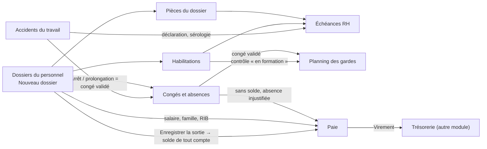
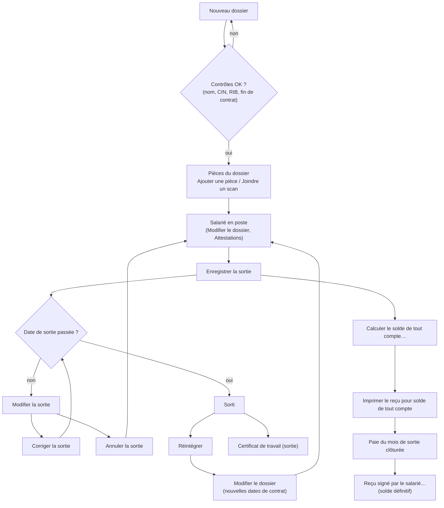
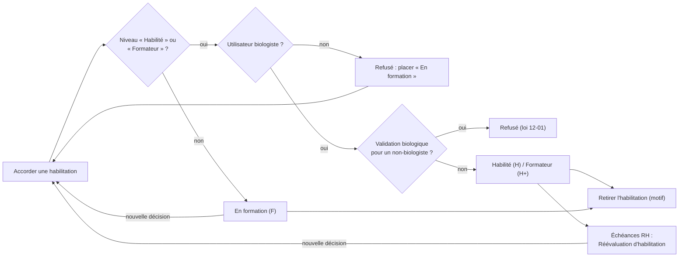
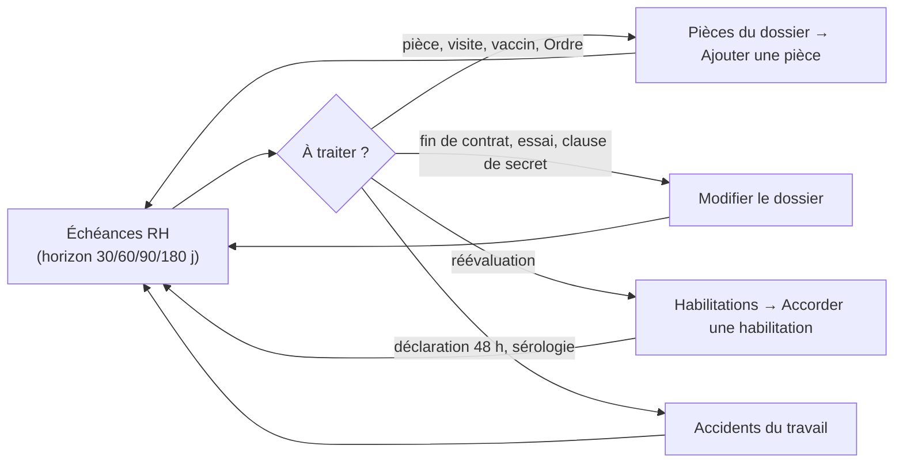
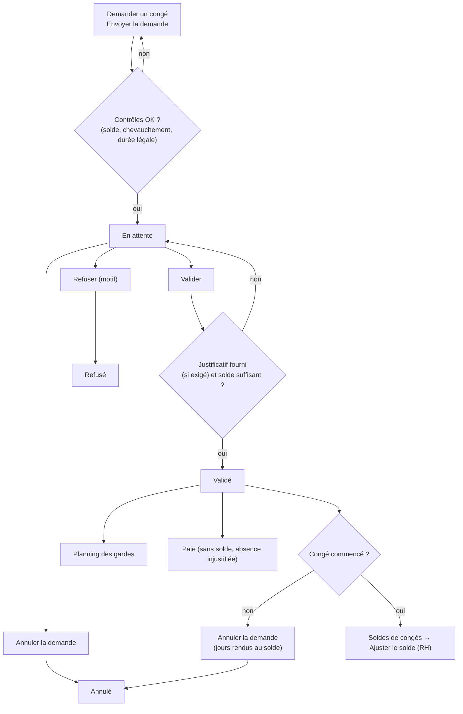
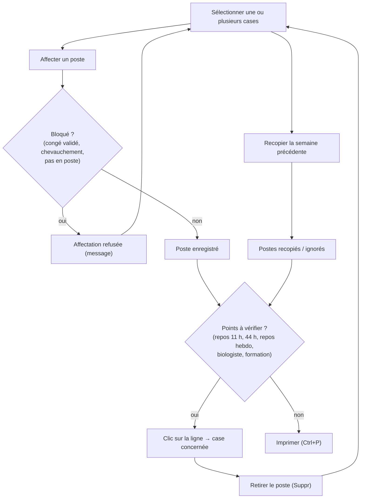
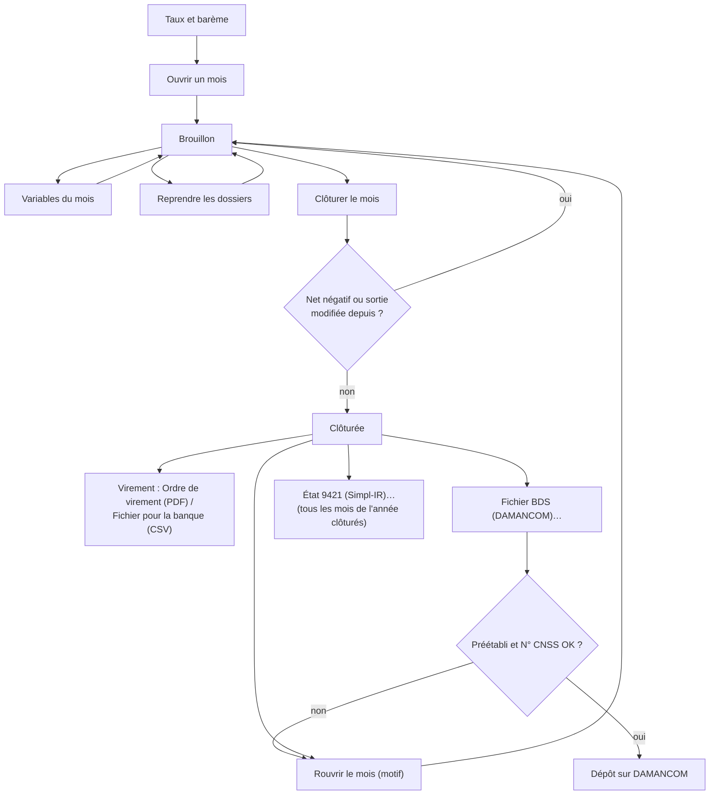
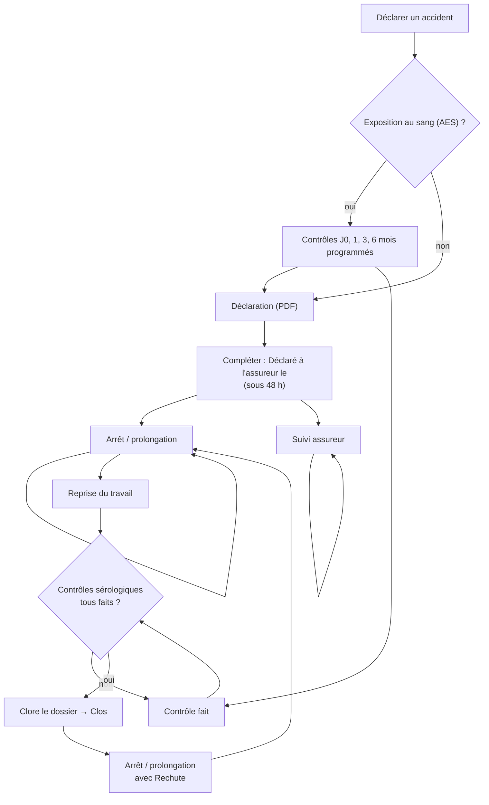

## Ressources humaines (menu « Personnel »)

Ce chapitre couvre le groupe **Personnel** du menu de gauche : **Dossiers du personnel**, **Habilitations**, **Échéances RH**, **Congés et absences**, **Planning des gardes**, **Paie** et **Accidents du travail**.

Vue d'ensemble des flux du module :

### Qui a quel droit (vue d'ensemble)

Chaque écran et chaque bouton dépend d'un droit. Un bouton dont vous n'avez pas le droit reste visible mais grisé. Un écran dont vous n'avez aucun droit n'apparaît pas dans le menu.

| Droit | Ce qu'il permet | Rôles qui l'ont par défaut |
|---|---|---|
| Consulter le personnel (hr.view) | Voir les dossiers, la matrice des habilitations, les échéances, le planning, tous les congés, les accidents | Administrateur, Biologiste responsable, Responsable qualité |
| Gérer le personnel (hr.manage) | Créer et modifier les dossiers, les pièces, les sorties, les attestations, les jours fériés, ajuster les soldes, saisir une absence injustifiée | Administrateur, Biologiste responsable |
| Gérer les habilitations (hr.habilitations) | Accorder et retirer une habilitation | Administrateur, Biologiste responsable |
| Salaires (hr.salary) | Voir et modifier salaire, RIB, banque ; paie ; attestation de salaire ; solde de tout compte | Administrateur, Biologiste responsable |
| Demander un congé (hr.leave.request) | Demander et annuler ses propres congés | Tous les rôles du personnel (sauf Prescripteur) |
| Valider les congés (hr.leave.approve) | Valider ou refuser les demandes, saisir un congé pour un collègue | Administrateur, Biologiste responsable |
| Planning (hr.planning) | Construire le planning des gardes | Administrateur, Biologiste responsable |
| Accidents (hr.accidents) | Déclarer et suivre les accidents du travail et les AES | Administrateur, Biologiste responsable, Biologiste |

Remarques importantes :
- Le rôle **Comptabilité** n'a pas le droit Salaires : il ne voit ni la paie ni les salaires (à vérifier si c'est voulu dans votre laboratoire ; l'administrateur peut l'ajouter au rôle).
- Accorder une habilitation au niveau « Habilité » ou « Formateur » exige en plus que **votre compte utilisateur** porte une qualification de biologiste (médecin ou pharmacien biologiste). Un administrateur sans cette qualification ne peut placer quelqu'un qu'« En formation ».

Raccourcis valables sur tous ces écrans : **F5** actualise l'écran, **Ctrl+P** (ou le bouton **Imprimer** en haut de la fenêtre) imprime en PDF la liste principale affichée, **Ctrl+F** place le curseur dans la zone de recherche, **F1** affiche la liste des raccourcis.

---

### Dossiers du personnel

Cet écran tient le dossier de chaque salarié : identité, poste, contrat, rémunération, pièces justificatives, sortie, attestations et solde de tout compte.

**Qui y a accès.** L'écran apparaît avec le droit Consulter le personnel (Administrateur, Biologiste responsable, Responsable qualité). Créer, modifier, enregistrer une sortie ou délivrer une attestation de travail demande le droit Gérer le personnel. Le salaire, le RIB, l'attestation de salaire et le solde de tout compte demandent le droit Salaires. Le Responsable qualité consulte donc tout, sans rien modifier et sans voir les salaires.

**L'écran.**
- En haut : le titre « Personnel — N actifs », une zone de recherche (« Nom, matricule ou fonction… »), le bouton **Actualiser** et la case **Afficher les salariés sortis**.
- La liste : **Matricule**, **Désignation** (nom du salarié), **Métier**, **Intitulé du poste**, **Secteur**, **Type de contrat**, **Date d'embauche**, **Fin de contrat**, **Compte SIL**.
- Un salarié dont la sortie est enregistrée porte après son nom « (sortie prévue le …) » ou « (sorti le …) ». Un salarié sorti est grisé. Un contrat dont la date de fin est dépassée apparaît en rouge.
- En bas : **Nouveau dossier**, **Modifier le dossier**, **Pièces du dossier**, le bouton de sortie (son libellé change : **Enregistrer la sortie**, **Modifier la sortie** ou **Réintégrer**), **Attestations**, **Solde de tout compte**.

**Scénarios.**

1. **Rechercher un salarié**
   1. Tapez un nom, un matricule ou un intitulé de poste dans la zone de recherche.
   2. Appuyez sur **Entrée**. La liste se filtre.
   3. Pour voir aussi les anciens salariés, cochez **Afficher les salariés sortis**.

2. **Créer le dossier d'un nouveau salarié**
   1. Cliquez **Nouveau dossier**.
   2. Section **Identité** : **Nom** et **Prénom** (obligatoires), **Nom en arabe**, **Sexe**, **Date de naissance** (case à cocher puis date), **CIN**, **N° CNSS**, **Situation familiale**, **Enfants à charge**, **Téléphone**, **Courriel**, **Ville**, **Adresse**.
   3. Section **Poste** : **Métier** (Biologiste, Technicien, Infirmier / préleveur, Secrétariat / accueil, Coursier / chauffeur, Agent d'entretien, Fonctions support), **Intitulé du poste**, **Secteur**, **Compte SIL** (le compte de connexion de la personne), **Exposé au risque biologique**, **Clause de secret signée le**.
      - Pour un nouveau dossier, la case **Exposé au risque biologique** se coche toute seule pour les métiers exposés (biologiste, technicien, infirmier/préleveur, coursier, agent d'entretien). Vous pouvez la changer.
   4. Section **Contrat** : **Type de contrat** (CDI, CDD, ANAPEC (Idmaj), Tahfiz, Stage, Temps partiel, Intérim, Associé (non salarié)), **Date d'embauche**, **Fin de contrat**, **Fin de période d'essai**, **Heures / semaine** (44 par défaut).
   5. Section **Rémunération** (visible seulement avec le droit Salaires) : **Salaire de base brut (DH)**, **RIB (24 chiffres)**, **Banque**. Sans ce droit, une ligne indique que ces champs sont réservés.
   6. Cliquez **Enregistrer**. Le matricule est attribué automatiquement. Si un contrôle échoue, un message s'affiche et la fenêtre reste ouverte avec ce que vous avez tapé : corrigez et cliquez de nouveau **Enregistrer**.

   Reliez toujours le dossier au **Compte SIL** de la personne : sans ce lien, elle ne pourra pas demander ses congés.

3. **Modifier un dossier**
   1. Sélectionnez le salarié, cliquez **Modifier le dossier** (ou double-cliquez sur la ligne).
   2. Corrigez les champs, cliquez **Enregistrer**. Le message « Dossier enregistré. » s'affiche en bas.

4. **Ajouter une pièce au dossier (diplôme, vaccination, visite médicale…)**
   1. Sélectionnez le salarié, cliquez **Pièces du dossier**.
   2. Cliquez **Ajouter une pièce**.
   3. Choisissez le **Type** : Diplôme, Inscription à l'Ordre, Permis de conduire, Vaccination hépatite B, Autre vaccination, Visite médicale, Formation sécurité, Visa du contrat (étranger), Titre de séjour, Formation continue, Autre. L'**Intitulé** est proposé selon le type.
   4. Remplissez **Numéro**, **Délivré par**, **Obtenu le**, **À renouveler le**, **Observations**.
   5. Pour une **Visite médicale**, choisissez l'**Aptitude (visite médicale)** : Apte, Apte avec réserves, Inapte. Seule l'aptitude est enregistrée, jamais le diagnostic.
   6. Cliquez **Enregistrer**.

5. **Joindre le scan d'une pièce**
   1. Dans **Pièces du dossier**, sélectionnez la pièce, cliquez **Joindre un scan**.
   2. Choisissez un fichier PDF, JPG, PNG ou TIFF. Si la pièce a déjà un scan, l'application demande si vous voulez le remplacer.
   3. La colonne **Scan** affiche « Joint ».

6. **Consulter le scan d'une pièce** : sélectionnez la pièce, cliquez **Ouvrir le scan**. Sans droit de modification, un double-clic sur la pièce ouvre aussi le scan.

7. **Corriger une pièce** : sélectionnez-la, cliquez **Modifier la pièce** (ou double-clic), corrigez, **Enregistrer**. Pour un renouvellement (nouvelle carte, nouvelle visite), préférez **Ajouter une pièce** : l'ancienne reste comme historique et les échéances prennent la plus récente.

8. **Retirer une pièce saisie par erreur** : sélectionnez-la, cliquez **Retirer la pièce**, indiquez le motif (5 caractères au moins), **OK**. Le motif est gardé dans le journal d'audit.

9. **Enregistrer le départ d'un salarié**
   1. Sélectionnez le salarié, cliquez **Enregistrer la sortie**.
   2. Saisissez la **Date de sortie** (le dernier jour travaillé), le **Motif** (Démission, Fin de CDD, Licenciement, Licenciement pour faute grave, Rupture d'un commun accord, Retraite, Décès, Rupture en période d'essai) et un **Commentaire** si besoin.
   3. Cliquez **Enregistrer**.
   - Vous pouvez enregistrer la sortie à l'avance (préavis en cours). Jusqu'à la date de sortie, la personne reste dans l'effectif : elle peut prendre des congés et garde ses habilitations. Toutes ses habilitations prennent fin le lendemain de la date de sortie.

10. **Corriger ou annuler une sortie qui n'a pas encore eu lieu**
    1. Sélectionnez le salarié : le bouton s'appelle alors **Modifier la sortie**. Cliquez-le.
    2. Un menu propose **Corriger la sortie** (autre date, autre motif) ou **Annuler la sortie** (démission retirée, erreur de saisie ; motif obligatoire).
    3. Les habilitations suivent la nouvelle date ou sont rétablies. Un solde de tout compte déjà calculé est vidé et sera à recalculer.

11. **Réintégrer un ancien salarié**
    1. Cochez **Afficher les salariés sortis**, sélectionnez la personne. Le bouton s'appelle **Réintégrer**.
    2. Choisissez la **Date de réintégration** (au plus tôt le lendemain de la sortie), cliquez **Enregistrer**.
    3. Ouvrez ensuite **Modifier le dossier** pour saisir les dates du nouveau contrat (fin de contrat, période d'essai) : elles sont remises à vide.
    4. Les habilitations ne reviennent pas : accordez-les de nouveau dans **Habilitations**.

12. **Délivrer une attestation**
    1. Sélectionnez le salarié, cliquez **Attestations**.
    2. Choisissez **Attestation de travail** (salarié en poste, droit Gérer le personnel), **Attestation de salaire** (droit Salaires ; le salaire de base doit être renseigné) ou **Certificat de travail (sortie)** (la sortie doit être enregistrée).
    3. Le document s'ouvre en PDF, prêt à imprimer et signer.

13. **Calculer le solde de tout compte** (droit Salaires, sortie enregistrée)
    1. Sélectionnez le salarié, cliquez **Solde de tout compte**, puis **Calculer le solde de tout compte…**.
    2. La fenêtre rappelle l'entrée, la sortie, le motif, l'ancienneté et la catégorie. Elle propose les montants légaux :
       - **Salaire mensuel de référence** (moyenne du brut des derniers mois complets, ou salaire de base et prime d'ancienneté s'il n'y en a pas) ;
       - **Jours de congé restants** et **Indemnité de congés payés** ;
       - **Préavis non effectué (dispense de l'employeur)** et **Indemnité de préavis** ;
       - **Indemnité de licenciement** (quand elle est due) ;
       - **Observations**, et le total des indemnités.
    3. Chaque montant peut être corrigé. Changer le salaire de référence ou les jours recalcule les montants qui en dépendent.
    4. Cliquez **Enregistrer**. Un message en bas indique si le solde a été reporté sur le bulletin du mois de sortie, s'il le sera à l'ouverture de cette paie, ou si cette paie est déjà clôturée (il faut alors la rouvrir).

14. **Imprimer le reçu pour solde de tout compte** : **Solde de tout compte** > **Imprimer le reçu pour solde de tout compte**. Le solde doit avoir été enregistré.

15. **Enregistrer la signature du reçu** : **Solde de tout compte** > **Reçu signé par le salarié…**, saisissez la **Date de signature**, **Enregistrer**. Le solde devient définitif : il ne peut plus être modifié.

**Règles et contrôles.**
- Nom et prénom obligatoires. Le nom est mis en majuscules.
- Un CDD, un contrat ANAPEC, Tahfiz ou un stage doit avoir une **Fin de contrat** (« Ce type de contrat (CDD, ANAPEC, Tahfiz, stage) doit avoir une date de fin. »). La fin de contrat et la fin d'essai ne peuvent pas précéder l'embauche.
- Heures hebdomadaires entre 0 et 60.
- Le RIB doit compter 24 chiffres et sa clé doit être juste (contrôle à la saisie).
- Une CIN ne peut figurer que dans un seul dossier. Un compte SIL ne peut être relié qu'à un seul dossier.
- Les matricules se suivent sans trou : un dossier refusé ne consomme pas de numéro.
- Une sortie déjà passée ne se corrige plus et ne s'annule plus : on réintègre. Une sortie dont le solde est signé, ou dont la paie du mois est clôturée, ne se corrige plus non plus.
- L'attestation de travail est refusée pour un salarié sorti (« délivrez un certificat de travail »). Le certificat de travail est refusé tant que la sortie n'est pas enregistrée.
- Une fois le reçu signé, le solde ne change plus. Le salarié peut le dénoncer dans les 60 jours (rappel affiché).
- Toute création, modification, sortie ou retrait de pièce est tracée dans le journal d'audit.
- La sortie d'un salarié ne désactive pas son compte de connexion : faites-le dans l'administration des utilisateurs (à vérifier dans le chapitre Administration).

**Flux.** Nouveau dossier → pièces (visite d'embauche, vaccination, clause de secret) → **Habilitations** → **Planning des gardes** et **Congés et absences** → **Paie**. Au départ : **Enregistrer la sortie** → **Calculer le solde de tout compte** → paie du mois de sortie clôturée → **Reçu signé par le salarié…** → **Certificat de travail (sortie)**.

---

### Habilitations

Cet écran est la matrice des habilitations exigée par la norme ISO 15189 : un salarié par ligne, une activité par colonne, le niveau et la date de réévaluation dans chaque case.

**Qui y a accès.** Consultation et export : droit Consulter le personnel (Administrateur, Biologiste responsable, Responsable qualité). **Accorder une habilitation** et **Retirer l'habilitation** : droit Gérer les habilitations (Administrateur, Biologiste responsable). Les niveaux « Habilité » et « Formateur » exigent en plus d'être biologiste.

**L'écran.**
- En haut : « Habilitations — N salariés, N habilitations, N réévaluations en retard », **Actualiser**, **Exporter (CSV)**.
- La matrice : **Matricule**, **Désignation**, **Métier**, puis une colonne par activité (et par automate ou discipline). Les colonnes « Prélèvement adulte » et « Prélèvement pédiatrique » sont toujours présentes.
- Dans une case : **F** = En formation (orange), **H** = Habilité, **H+** = Formateur, suivi du mois de réévaluation (mm/aa). Une case rouge : réévaluation dépassée.
- Sous la matrice : le détail de la case sélectionnée (niveau, date, signataire, réévaluation, preuves), puis **Accorder une habilitation** et **Retirer l'habilitation**.
- Seuls les salariés en poste et les habilitations en cours sont affichés.

**Scénarios.**

1. **Accorder une habilitation**
   1. Cliquez la case du salarié dans la colonne de l'activité voulue (ou n'importe quelle case de sa ligne).
   2. Cliquez **Accorder une habilitation** (ou double-cliquez la case).
   3. Choisissez l'**Activité** : Prélèvement adulte, Prélèvement pédiatrique, Prélèvement à domicile, Utilisation d'automate, Techniques manuelles, Validation technique, Validation biologique, Transport d'échantillons, Réception des échantillons.
   4. Pour Utilisation d'automate, choisissez l'automate dans **Automate ou discipline** ; pour Techniques manuelles, Validation technique et Validation biologique, choisissez la discipline.
   5. Choisissez le **Niveau** : En formation, Habilité, Formateur.
   6. Indiquez **Décidée le** (pas dans le futur), **Réévaluation le** (proposée à un an), **Preuves (formation, évaluation…)**.
   7. Cliquez **Enregistrer**.

2. **Faire évoluer un salarié (de « En formation » à « Habilité »)** : refaites le scénario 1 sur la même activité. La nouvelle décision remplace l'ancienne, qui est close et conservée dans l'historique.

3. **Retirer une habilitation**
   1. Cliquez la case concernée.
   2. Cliquez **Retirer l'habilitation**, indiquez le motif, **OK**.

4. **Exporter la matrice pour l'auditeur** : cliquez **Exporter (CSV)**. Le fichier (une ligne par habilitation : matricule, nom, métier, activité, automate ou discipline, niveau, décidée le, signée par, réévaluation, preuves) s'ouvre dans votre tableur.

**Règles et contrôles.**
- Seul un biologiste peut accorder « Habilité » ou « Formateur » (« Seul un biologiste peut habiliter un salarié à travailler seul ou à former. Vous pouvez le placer « En formation ». »).
- La **Validation biologique** ne s'accorde qu'à un salarié dont le métier est Biologiste (loi 12-01).
- Automate ou discipline obligatoire pour les activités qui en ont besoin.
- La réévaluation doit être postérieure à la décision.
- Aucune habilitation après la date de sortie d'un salarié ; une habilitation accordée pendant le préavis prend fin avec la sortie.
- Le retrait demande toujours un motif.
- L'historique des habilitations retirées ou remplacées n'est pas affiché à l'écran ; il est conservé (journal d'audit).

**Flux.** Dossier créé → habilitation « En formation » → « Habilité » signé par le biologiste → les réévaluations dues apparaissent dans **Échéances RH** → le **Planning des gardes** signale un salarié seul au poste alors qu'il n'est qu'en formation.

---

### Échéances RH

Cet écran liste ce que la RH doit traiter : pièces à renouveler, réévaluations, fins de contrat et d'essai, pièces manquantes, déclarations d'accident et contrôles sérologiques.

**Qui y a accès.** Droit Consulter le personnel. **Modifier le dossier** demande le droit Gérer le personnel.

**L'écran.**
- En haut : « Échéances — N points à traiter, dont N en retard ou manquants », une liste d'horizon (**Dans les 30 jours**, **Dans les 60 jours** par défaut, **Dans les 90 jours**, **Dans les 180 jours**), **Actualiser**.
- La liste : **Statut** (« Manquant », « En retard » ou « Dans N j »), **Échéance**, **Matricule**, **Désignation**, **Métier**, **À traiter**, **Détail**. Rouge : en retard ou manquant. Orange : dans les 30 jours.
- En bas : **Pièces du dossier**, **Modifier le dossier**.

Ce qui peut apparaître dans **À traiter** :

| Libellé | Quand |
|---|---|
| Pièce à renouveler | Une pièce (ou la dernière visite médicale) arrive à sa date « À renouveler le » |
| Visite d'embauche absente | Aucune visite médicale dans le dossier |
| Déclaré inapte | La dernière visite médicale dit « Inapte » |
| Vaccination hépatite B absente | Salarié exposé au risque biologique sans cette vaccination |
| Clause de secret non signée | Date « Clause de secret signée le » vide |
| Inscription à l'Ordre absente | Biologiste sans pièce « Inscription à l'Ordre » |
| Fin de contrat | Date de fin de contrat dans l'horizon |
| Fin de période d'essai | Date de fin d'essai dans l'horizon (jusqu'à 30 jours après) |
| Réévaluation d'habilitation | Date de réévaluation dans l'horizon |
| Déclaration d'accident à l'assureur (48 h) | Accident non déclaré à l'assureur |
| Contrôle sérologique après AES | Contrôle prévu non fait |

**Scénarios.**

1. **Faire le point de la semaine** : choisissez l'horizon, cliquez **Actualiser**, traitez d'abord les lignes rouges.
2. **Compléter une pièce manquante ou renouvelée** : sélectionnez la ligne, cliquez **Pièces du dossier**, puis **Ajouter une pièce** (voir « Dossiers du personnel »). À la fermeture, la liste se met à jour.
3. **Corriger une date du dossier (fin de contrat, clause de secret)** : sélectionnez la ligne, cliquez **Modifier le dossier**, corrigez, **Enregistrer**.
4. **Traiter une réévaluation d'habilitation** : allez dans **Habilitations** et accordez de nouveau l'habilitation avec une nouvelle date de réévaluation (il n'y a pas de bouton direct depuis cet écran).
5. **Traiter une ligne d'accident** : allez dans **Accidents du travail** (les boutons de cet écran ouvrent le dossier du personnel, pas le dossier d'accident).

**Règles et contrôles.** Une pièce sans date de renouvellement n'apparaît jamais. Pour une pièce renouvelée, seule la date la plus récente compte. Les points « manquants » sont toujours en tête.

**Flux.** Échéances RH → **Dossiers du personnel** (pièces), **Habilitations** (réévaluation) ou **Accidents du travail** (déclaration, sérologie).

---

### Congés et absences

Cet écran gère les demandes de congé de l'année, leur validation, les soldes de congés payés et le calendrier des jours fériés.

**Qui y a accès.**
- Tout membre du personnel ayant le droit Demander un congé voit l'écran, mais seulement **ses propres demandes** et **son propre solde**.
- Les personnes ayant Valider les congés, Gérer le personnel ou Consulter le personnel voient les demandes de tous.
- **Valider** et **Refuser** : droit Valider les congés (Administrateur, Biologiste responsable).
- **Ajuster le solde**, ajouter ou retirer un jour férié, saisir une « Absence injustifiée » : droit Gérer le personnel.

**L'écran.**
- En haut : « Congés — N en attente, N validés », l'**année**, **Actualiser**, **En attente seulement (toutes années)**.
- La liste : **Statut** (En attente, Validé, Refusé, Annulé), **Désignation**, **Secteur**, **Type**, **Du**, **Au** (avec « (ap.-midi) » ou « (matin) » pour une demi-journée), **Jours**, **Justificatif** (Fourni / Manquant), **Collègues absents**, **Décision**. Les demandes en attente sont en orange ; un justificatif manquant est en rouge.
- Sous la liste : le détail de la demande (type, jours décomptés, motif, alerte s'il y a des collègues du même secteur absents).
- En bas : **Demander un congé**, **Valider**, **Refuser**, **Annuler la demande**, **Soldes de congés**, **Jours fériés**.

**Scénarios.**

1. **Demander un congé (pour soi)**
   1. Cliquez **Demander un congé**.
   2. Votre nom est déjà choisi dans **Salarié**.
   3. Choisissez le **Type** : Congé annuel payé, Congé sans solde, Maladie, Maternité (14 semaines), Naissance (3 j), Mariage du salarié (4 j), Mariage d'un enfant (2 j), Décès conjoint, enfant, ascendant (3 j), Décès frère ou sœur (2 j), Circoncision, opération d'un proche (2 j), Accident du travail.
   4. Saisissez **Du** et **Au**. Cochez **À partir de l'après-midi** ou **Jusqu'au matin seulement** pour une demi-journée.
   5. Lisez le nombre de jours décomptés et votre solde disponible (en rouge s'il est insuffisant).
   6. Ajoutez un **Motif** si besoin. Cochez **Justificatif remis à la RH (certificat, acte d'état civil…)** si vous l'avez remis.
   7. Cliquez **Envoyer la demande**. Elle apparaît « En attente ».

2. **Saisir un congé pour un collègue (RH ou valideur)** : même procédure, en choisissant le collègue dans **Salarié**. Avec le droit Gérer le personnel, le type **Absence injustifiée** est aussi proposé.

3. **Valider une demande**
   1. Sélectionnez une demande « En attente ».
   2. Cliquez **Valider**. La confirmation rappelle le type, les dates, les jours et, le cas échéant, le nombre de collègues du secteur absents.
   3. Répondez **Oui**. Pour un congé annuel, les jours sont débités du solde.

4. **Refuser une demande** : sélectionnez-la, cliquez **Refuser**, saisissez le motif (le salarié le verra), **OK**.

5. **Annuler une demande**
   1. Sélectionnez une demande en attente, ou validée et pas encore commencée.
   2. Cliquez **Annuler la demande**, ajoutez un commentaire si besoin, **OK**.
   3. Un congé annuel validé puis annulé rend ses jours au solde.

6. **Consulter les soldes** : cliquez **Soldes de congés**. Colonnes : **Matricule**, **Désignation**, **Droit annuel**, **Acquis**, **Pris**, **En attente**, **Solde**, **Disponible** (en rouge si négatif). Un salarié ne voit que sa propre ligne.

7. **Saisir un reliquat ou corriger un solde (RH)**
   1. Dans **Soldes de congés**, sélectionnez le salarié, cliquez **Ajuster le solde**.
   2. Saisissez **Jours (+ ou −)** et le **Motif**, **Enregistrer**.
   3. À faire une fois à l'installation pour reprendre les reliquats de l'année précédente.

8. **Tenir le calendrier des jours fériés (RH)**
   1. Choisissez l'année en haut de l'écran, cliquez **Jours fériés**.
   2. Les fêtes civiles sont déjà présentes. Pour une fête religieuse (Aïd al-Fitr, Aïd al-Adha, 1er Moharram, Aïd al-Mawlid), cliquez **Ajouter un jour férié**, choisissez la **Date**, saisissez la **Désignation**, laissez **Fête religieuse** cochée, **Enregistrer**.
   3. Pour retirer un jour, sélectionnez-le, **Retirer**, confirmez.

**Règles et contrôles.**
- Congé annuel : 1,5 jour ouvrable par mois de service (2 avant 18 ans), +1,5 jour par tranche de 5 ans d'ancienneté, 30 jours au plus. Les mois sont crédités automatiquement.
- Jours ouvrables : du lundi au samedi, hors jours fériés. Maladie, maternité et accident du travail se comptent en jours calendaires.
- Seul le congé annuel payé est débité du solde. Il est refusé si le solde est insuffisant (« Solde insuffisant : … j demandés, … j disponibles. »).
- Les congés familiaux ont une durée maximale légale (« Ce congé est de N jours au plus. »).
- Deux demandes ne peuvent pas se chevaucher.
- On ne valide ni ne refuse sa propre demande.
- Maladie, maternité, naissance, mariages, décès, événement familial et accident du travail ne peuvent être validés que si le justificatif est marqué « Fourni » (« Le justificatif doit être remis avant la validation. »). Attention : cette case ne se coche qu'au moment de la demande (voir le document de vérification).
- Un refus doit être motivé.
- Un congé validé déjà commencé ne s'annule plus : la RH corrige par **Ajuster le solde**.
- Une absence injustifiée, ou une demande saisie par la RH, ne peut être annulée que par la RH ou un valideur.
- Un compte non relié à un dossier du personnel ne peut pas demander de congé (« Votre compte n'est relié à aucun dossier du personnel : demandez à la RH de le relier. »).

**Flux.** Demande → validation → le congé apparaît dans le **Planning des gardes** (aucun poste ne peut y être placé) → les congés sans solde et absences injustifiées sont repris dans la **Paie** (« Reprendre les dossiers »).

---

### Planning des gardes

Cet écran construit le planning mensuel : une ligne par personne, une colonne par jour, avec les congés et les jours fériés, et la liste des points qui posent problème.

**Qui y a accès.** Consultation : droit Consulter le personnel ou Planning. **Affecter un poste**, **Retirer le poste**, **Recopier la semaine précédente** : droit Planning (Administrateur, Biologiste responsable). Les autres membres du personnel n'ont pas accès à cet écran.

**L'écran.**
- En haut : « Planning — N personnes, N postes, N point(s) à vérifier », **Mois précédent**, le mois affiché, **Mois suivant**, **Actualiser**.
- La grille : **Désignation** (nom et métier abrégé), **Heures** du mois, puis un jour par colonne. Codes : M matin · AM après-midi · J journée · S samedi · N nuit · D dimanche/férié · A astreinte · CA, MA… congés. Dimanches et fériés sont grisés ; un congé validé est surligné ; une case en rouge a un problème.
- En dessous : **Affecter un poste**, **Retirer le poste**, **Recopier la semaine précédente**, et une ligne d'aide.
- En bas : la liste des points à vérifier (**Date**, **Désignation**, **À vérifier**). Cliquer une ligne amène la grille sur la case concernée.

**Scénarios.**

1. **Affecter un poste à une ou plusieurs cases**
   1. Cliquez une case (ou plusieurs avec **Ctrl** ou **Maj**). Le double-clic sur une case ouvre directement la fenêtre.
   2. Cliquez **Affecter un poste**.
   3. Choisissez le **Poste** : Matin (7 h–14 h), Après-midi (14 h–20 h), Journée (8 h–17 h), Samedi (7 h 30–13 h), Garde de nuit (20 h–8 h le lendemain), Garde dimanche/férié (8 h–14 h), Astreinte (journée à domicile, sans heures).
   4. Corrigez **Début** et **Fin** si besoin ; le nombre d'heures de travail s'affiche. Ajoutez des **Observations**.
   5. Cliquez **Enregistrer**. Les cases refusées sont listées dans un message.

2. **Modifier un poste** : il n'y a pas de modification directe. Retirez le poste (scénario 3), puis affectez le bon.

3. **Retirer un poste** : sélectionnez la ou les cases, cliquez **Retirer le poste** (ou touche **Suppr**), confirmez.

4. **Recopier la semaine précédente**
   1. Cliquez un jour de la semaine à remplir.
   2. Cliquez **Recopier la semaine précédente**, confirmez.
   3. Un message indique combien de postes ont été recopiés et combien ignorés (congé, poste déjà présent, salarié pas en poste).

5. **Contrôler le planning** : lisez la liste du bas. Cliquez chaque ligne pour aller sur la case et corriger.

6. **Imprimer le planning** : bouton **Imprimer** en haut de la fenêtre (Ctrl+P). La grille du mois sort en PDF (lisibilité d'un mois complet à vérifier).

**Règles et contrôles.**
- Refusé (bloquant) : un poste pendant un congé validé (« Le salarié est en congé validé ce jour-là. »), deux postes qui se chevauchent (« Le salarié a déjà un poste sur ces heures. »), un salarié pas encore embauché ou déjà sorti, une heure de fin égale à l'heure de début. Une astreinte peut s'ajouter à un poste travaillé, une seule par jour.
- Signalé (non bloquant) dans la liste « À vérifier » :
  - repos de moins de 11 h entre deux postes ;
  - plus de 44 h dans la semaine ;
  - aucun jour de repos dans la semaine ;
  - aucun biologiste de service ni d'astreinte un jour donné (loi 12-01) ;
  - un poste prévu pendant un congé validé ;
  - un salarié seul au poste alors qu'il n'est habilité qu'« en formation ».
- L'astreinte ne compte pas dans les 44 h. Si le salarié est appelé, saisissez le poste effectué.

**Flux.** **Congés et absences** et **Habilitations** alimentent les contrôles du planning. Le planning ne transmet rien à la paie : les heures supplémentaires se saisissent à la main dans **Variables du mois**.

---

### Paie

Cet écran prépare la paie mensuelle : bulletins, cotisations CNSS et AMO, IR, clôture, virements, déclarations CNSS (BDS) et état 9421.

**Qui y a accès.** Droit Salaires uniquement (Administrateur, Biologiste responsable). Personne d'autre ne voit cet écran.

**Avant le premier mois.** Vérifiez dans Paramètres, fiche du site, le **numéro d'affiliation CNSS** et l'**identifiant fiscal (IF)** : sans eux, le fichier BDS et l'état 9421 sont refusés. Vérifiez dans chaque dossier le salaire de base, le N° CNSS, la situation familiale, les enfants et le RIB.

**L'écran.**
- En haut : « Paie de [mois] — [statut], N bulletin(s) », la liste des mois (chaque mois avec son statut Brouillon ou Clôturée), **Ouvrir un mois**, **Actualiser**, **Taux et barème**, **État 9421 (Simpl-IR)…**.
- La liste des bulletins : **Matricule**, **Désignation**, **Jours**, **Salaire de base**, **Brut**, **CNSS + AMO**, **IR**, **Net à payer**, **Coût employeur**, **À vérifier** (Net négatif, RIB manquant, N° CNSS manquant, Sous le SMIG, exonérations Stage / Tahfiz / Contrat d'insertion).
- La ligne des totaux du mois.
- En bas : **Variables du mois**, **Bulletin**, **Tous les bulletins**, **Journal de paie**, **Récapitulatif CNSS**, **Reprendre les dossiers**, **Clôturer le mois** (devient **Rouvrir le mois**), **Virement**, et dessous **Fichier BDS (DAMANCOM)…**.

| Statut du mois | Ce qu'on peut faire |
|---|---|
| Brouillon | Saisir les variables, reprendre les dossiers, imprimer des bulletins marqués « PROVISOIRE — paie non clôturée », clôturer |
| Clôturée | Imprimer, exporter, virement, fichier BDS ; rouvrir (avec motif) |

**Scénarios.**

1. **Vérifier les taux de l'année**
   1. Cliquez **Taux et barème**.
   2. Contrôlez : **Plafond CNSS mensuel (DH)**, **CNSS salarié (%)**, **CNSS patronale (%)**, **Allocations familiales (%)**, **Formation professionnelle (%)**, **AMO salarié (%)**, **AMO patronale (%)**, **Frais pro. taux bas (%)**, **Frais pro. taux haut (%)**, **Seuil annuel taux bas (DH)**, **Plafond annuel frais pro. (DH)**, **Charge de famille / an (DH)**, **SMIG mensuel (DH)**, **Heures par mois**, **Transport exonéré / mois (DH)**, **Barème IR annuel (plafond:taux|…|:taux)**.
   3. **Enregistrer**. Les mois en brouillon de l'année sont recalculés ; les mois clôturés ne changent pas. À refaire à chaque loi de finances.

2. **Ouvrir le mois**
   1. Cliquez **Ouvrir un mois**. Le mois suivant le dernier ouvert est proposé dans **Mois de paie**.
   2. Cliquez **Ouvrir un mois**. Un bulletin est préparé pour chaque salarié en poste ce mois-là dont le salaire de base est renseigné. Les congés sans solde, absences injustifiées validées et arrêts d'accident du travail sont repris.

3. **Saisir les variables d'un salarié**
   1. Sélectionnez le bulletin, cliquez **Variables du mois** (ou double-clic).
   2. Remplissez : **Autres jours non payés**, **Heures supp. à 25 %**, **Heures supp. à 50 %**, **Heures supp. à 100 %**, **Primes imposables (DH)**, **Indemnité de transport (DH)**, **Autres indemnités exonérées**, **Remboursement d'avance**, **Autres retenues**, **Observations**.
   3. Le résultat actuel est rappelé (brut, CNSS, AMO, IR, net, ancienneté), ainsi que les jours repris des congés, le prorata d'entrée ou de sortie, les indemnités de départ et l'arrêt d'accident.
   4. **Enregistrer** : le bulletin est recalculé.

4. **Reprendre les dossiers** (après une embauche, une sortie, un congé validé ou un changement de salaire) : cliquez **Reprendre les dossiers**. Les nouveaux salariés sont ajoutés, les salaires, situations familiales et absences mis à jour ; les variables déjà tapées sont gardées.

5. **Imprimer les bulletins** : **Bulletin** (le bulletin sélectionné) ou **Tous les bulletins** (un PDF, une page par salarié).

6. **Exporter le journal et le récapitulatif CNSS** : **Journal de paie** ou **Récapitulatif CNSS** (fichiers CSV pour le tableur et le comptable).

7. **Clôturer le mois**
   1. Contrôlez la colonne **À vérifier** et les totaux.
   2. Cliquez **Clôturer le mois**, confirmez. Les bulletins ne seront plus recalculés. Les jours de congé payés par un solde de tout compte du mois quittent le compte du salarié.

8. **Payer les salaires (virement)**
   1. Sur un mois clôturé, cliquez **Virement**.
   2. Choisissez **Ordre de virement (PDF)** à signer pour la banque, ou **Fichier pour la banque (CSV)**.
   3. Les salariés sans RIB ne sont pas dans le virement : ils sont à payer autrement (à vérifier sur l'ordre imprimé).
   4. L'application n'enregistre pas que la paie a été payée ; le débit bancaire se rapproche dans le module Trésorerie.

9. **Produire le fichier BDS pour la CNSS (DAMANCOM)**
   1. Téléchargez sur DAMANCOM le préétabli du mois (fichier AFFEBDS_…).
   2. Sur le mois clôturé, cliquez **Fichier BDS (DAMANCOM)…**, choisissez le préétabli.
   3. Enregistrez le fichier proposé. Un message indique le nombre de salariés déclarés et d'entrants. Déposez-le sur DAMANCOM.

10. **Produire l'état 9421 (Simpl-IR)**
    1. Cliquez **État 9421 (Simpl-IR)…**.
    2. Saisissez l'**Année** (l'année précédente est proposée), le **Code de la commune**, le **Code du taux de frais professionnels jusqu'au seuil annuel (35 %)** et **…au-delà du seuil annuel (25 %)**. Ces codes sont mémorisés sur ce poste.
    3. Cliquez **Exporter**, enregistrez le fichier XML, déposez-le sur Simpl-IR. Les versements de l'IR se complètent sur Simpl-IR.

11. **Rouvrir un mois clôturé**
    1. Sélectionnez le mois, cliquez **Rouvrir le mois**, saisissez le motif, **OK**.
    2. Une deuxième question demande s'il faut recalculer avec les taux actuels : répondez **Non** dans le cas normal ; **Oui** seulement pour corriger un taux mal saisi (tracé dans l'audit).
    3. Corrigez, **Reprendre les dossiers** si besoin, puis clôturez de nouveau.

**Règles et contrôles.**
- Un mois ne s'ouvre qu'une fois par site. Il faut au moins un salarié avec salaire de base (« Aucun salarié en poste ce mois-là n'a de salaire de base renseigné. »).
- Variables : nombres positifs ; pas plus de jours non payés que de jours ouvrables du mois ; pas plus de 100 heures supplémentaires.
- Clôture refusée si un bulletin a un net négatif, ou si une sortie a été corrigée ou annulée depuis la préparation (il faut d'abord **Reprendre les dossiers**).
- Virement et fichier BDS : seulement sur un mois clôturé.
- Fichier BDS refusé si : le préétabli n'est pas un fichier DAMANCOM, n'est pas celui du bon mois ou du bon affilié, un salarié n'a pas de N° CNSS, un N° CNSS est en double ou trop long, ou la paie d'un autre site du même affilié n'est pas ouverte ou pas clôturée. Après correction d'un dossier : rouvrir le mois, reprendre les dossiers, clôturer de nouveau.
- État 9421 refusé si des mois de l'année ne sont pas clôturés ou pas ouverts alors qu'il y avait du personnel, ou si l'IF du site manque.
- Un mois garde, pour toujours, les taux avec lesquels il a été clôturé.
- Heures supplémentaires : +25 % de 6 h à 21 h, +50 % de 21 h à 6 h ou le jour de repos, +100 % la nuit du jour de repos.

**Flux.** **Dossiers du personnel** et **Congés et absences** (et arrêts d'**Accidents du travail**) → ouverture → variables → clôture → virement (rapproché en Trésorerie) → BDS DAMANCOM chaque mois → état 9421 en début d'année. Le solde de tout compte d'un départ est reporté sur le bulletin du mois de sortie.

---

### Accidents du travail

Cet écran déclare et suit les accidents du travail, les accidents de trajet et les accidents d'exposition au sang (AES) : déclaration à l'assureur sous 48 h, arrêts, reprise, suivi de l'assureur et contrôles sérologiques.

**Qui y a accès.** Consultation, impression de la déclaration et du registre : droit Accidents ou Consulter le personnel. Déclarer et suivre : droit Accidents (Administrateur, Biologiste responsable, Biologiste). Ainsi le biologiste de garde peut déclarer un AES à tout moment.

**L'écran.**
- En haut : « N accident(s) cette année · N dossier(s) en cours · N déclaration(s) en retard », l'**année**, **Actualiser**, **Déclarer un accident**, **Registre de l'année**.
- La liste : **N° de dossier**, **Date et heure**, **Salarié**, **Secteur**, **Nature**, **Déclaré à l'assureur le** (ou « À déclarer avant le … », ou en rouge « NON DÉCLARÉ — délai de 48 h dépassé »), **Arrêt (j)**, **Reprise le**, **Prochain contrôle** (rouge si dépassé), **Statut** (En cours / Clos).
- Sous la liste : le résumé du dossier sélectionné, l'historique (**Date**, **Étape**, **Détail**, **Saisi par**) et le **Suivi sérologique** (**Échéance**, **Fait le**).
- En bas : **Compléter**, **Arrêt / prolongation**, **Reprise du travail**, **Suivi assureur**, **Contrôle fait**, **Déclaration (PDF)**, **Clore le dossier**.

**Scénarios.**

1. **Déclarer un accident**
   1. Cliquez **Déclarer un accident**.
   2. Choisissez le **Salarié** et la **Nature** : Accident du travail, Accident de trajet, Exposition au sang (AES).
   3. Saisissez **Date et heure**, **Lieu**, **Circonstances détaillées** (obligatoire), **Nature et siège des lésions**, **Témoins**, **Premiers soins donnés sur place**.
   4. Pour un AES : **Type d'exposition (AES)** (Piqûre par aiguille, Coupure par objet tranchant, Projection sur muqueuse, Projection sur peau lésée) et **Source identifiée**.
   5. **Vu par le médecin le**, **Assureur accidents du travail** (le dernier utilisé est proposé), **N° de sinistre**, **Déclaré à l'assureur le**, **L'employeur avance les indemnités journalières (subrogation)**, **Taux d'IPP fixé (%)**, **Observations**.
   6. Cliquez **Enregistrer**. Un numéro de dossier est attribué. Pour un AES, le bilan initial (J0) et les contrôles à 1, 3 et 6 mois sont programmés.

2. **Imprimer la déclaration pour l'assureur** : sélectionnez le dossier, cliquez **Déclaration (PDF)**.

3. **Noter l'envoi de la déclaration** : cliquez **Compléter**, remplissez **Déclaré à l'assureur le** (et le **N° de sinistre**), **Enregistrer**. L'étape « Déclaré à l'assureur » s'ajoute à l'historique et l'alerte rouge disparaît.

4. **Enregistrer un arrêt de travail ou une prolongation**
   1. Cliquez **Arrêt / prolongation**.
   2. Saisissez **Du** et **Au** d'après le certificat médical, **Enregistrer**.
   3. L'arrêt devient un congé « Accident du travail » validé : il apparaît dans les congés et le planning, et la paie retient ces jours.

5. **Enregistrer la reprise du travail** : cliquez **Reprise du travail**, saisissez **Reprise le** (au plus tôt le lendemain du dernier arrêt, pas dans le futur), **Enregistrer**.

6. **Noter un échange avec l'assureur** : cliquez **Suivi assureur**, choisissez l'**Étape** (Relance de l'assureur, Réponse de l'assureur, Note), saisissez le **Détail** (obligatoire sauf pour une relance), **Enregistrer**.

7. **Noter un contrôle sérologique fait** : sélectionnez le contrôle dans **Suivi sérologique** (sinon le prochain à faire est pris), cliquez **Contrôle fait**, saisissez la date, **Enregistrer**. Seule la date est enregistrée, jamais le résultat.

8. **Compléter le dossier** (réponse de l'assureur, taux d'IPP) : **Compléter**, modifiez, **Enregistrer**. Le salarié ne peut pas être changé.

9. **Clore le dossier** : cliquez **Clore le dossier**, saisissez une conclusion si vous voulez (règlement, consolidation), **OK**.

10. **Déclarer une rechute** : sélectionnez le dossier clos, cliquez **Arrêt / prolongation** ; la case **Rechute (rouvre un dossier clos)** est cochée ; saisissez les dates, **Enregistrer**. Le dossier est rouvert.

11. **Imprimer le registre de l'année** : choisissez l'année, cliquez **Registre de l'année** (PDF avec récapitulatif par secteur et nature).

**Règles et contrôles.**
- La déclaration doit parvenir à l'assureur dans les 48 heures (loi 18-12). Passé ce délai, le dossier est en rouge et apparaît dans **Échéances RH**.
- La date de l'accident ne peut pas être dans le futur, ni hors de la période d'emploi. Un salarié sorti depuis moins de 30 jours peut encore être choisi.
- Pour un AES, le type d'exposition est obligatoire.
- La déclaration et la consultation ne peuvent pas précéder l'accident. IPP entre 0 et 100 %.
- L'arrêt commence au plus tôt le lendemain de l'accident (le jour même est payé par l'employeur). Il ne peut pas chevaucher un autre congé, ni dépasser la date de sortie.
- La reprise ne peut pas tomber pendant un arrêt (« Un arrêt court jusqu'au … : la reprise ne peut être qu'après. »).
- Un dossier ne se clôt pas tant qu'un contrôle sérologique reste à faire.
- Un dossier clos refuse un arrêt, sauf en rechute.
- Aucun résultat ni diagnostic n'est enregistré.

**Flux.** Déclaration → PDF à l'assureur → **Compléter** (date d'envoi) → arrêts (vers **Congés et absences**, **Planning des gardes**, **Paie**) → reprise → contrôles sérologiques (suivis aussi dans **Échéances RH**) → clôture.

