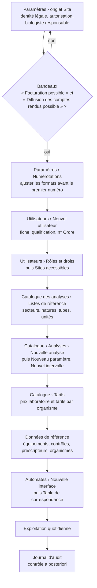
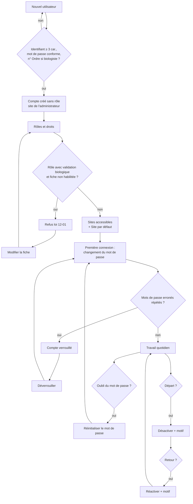
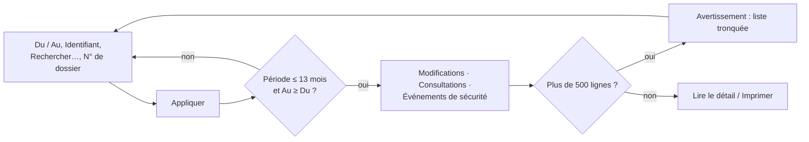
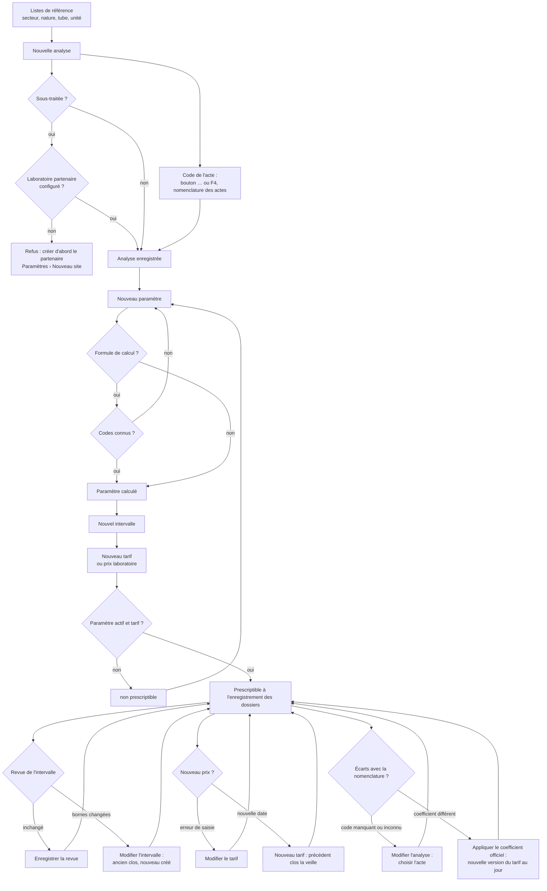
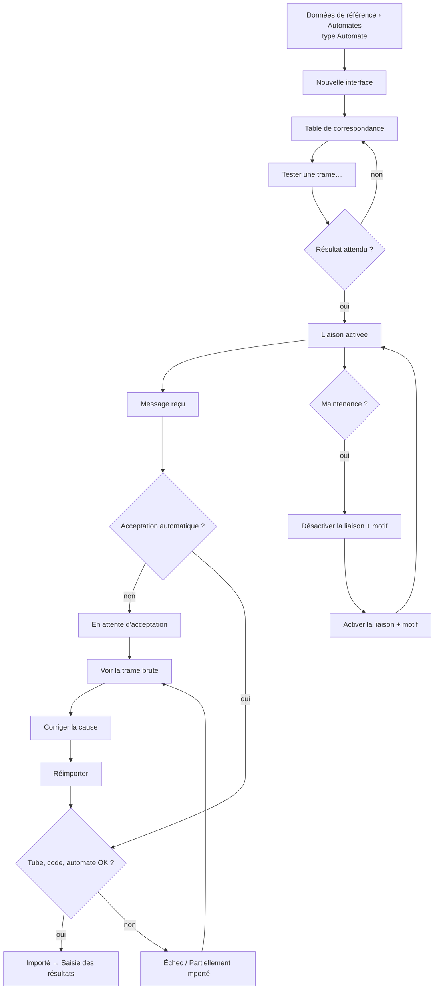
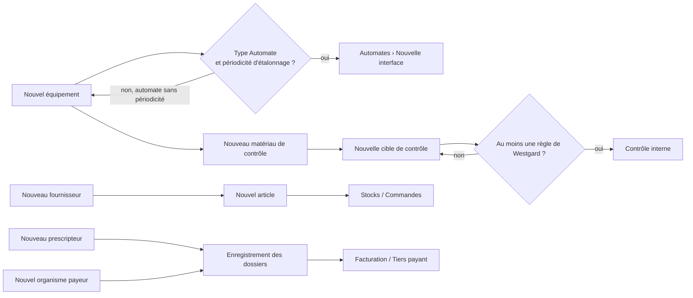
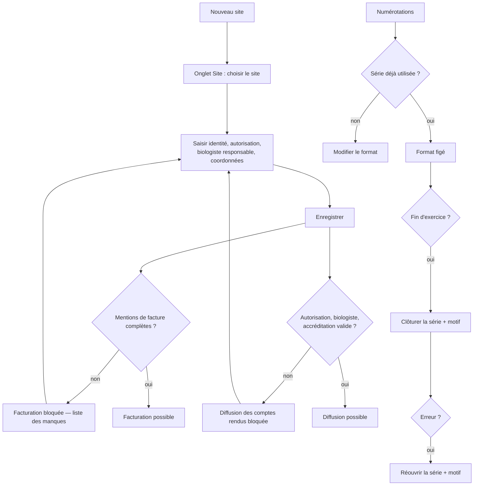
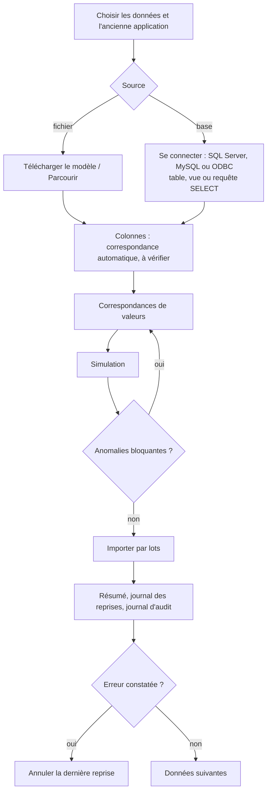

## Administration

### Présentation du module

**À quoi sert le module.** Le groupe **ADMINISTRATION** du menu règle tout ce dont les autres écrans ont besoin pour fonctionner :
- les comptes du personnel, leurs rôles, leurs droits et leurs sites ;
- le journal d'audit (qui a fait quoi, qui a consulté quel dossier) ;
- le catalogue des analyses : analyses, paramètres, valeurs usuelles, tarifs, profils, analyses en cascade, listes de référence, et la nomenclature officielle des actes de biologie médicale (NABM) ;
- les liaisons avec les automates ;
- les données de référence : équipements, contrôle interne, articles, fournisseurs, prescripteurs, organismes payeurs ;
- les paramètres du laboratoire : identité du site, numérotations, paramètres généraux, format des factures, lieux de stockage des tubes, imprimantes du poste ;
- la reprise des données de l'application utilisée avant MarocLIS (patients, prescripteurs, catalogue, antériorités, créances).

**Qui l'utilise.** L'administrateur règle presque tout. Le biologiste responsable tient le catalogue et les automates. Le responsable qualité tient les valeurs usuelles, les équipements et le contrôle interne, et lit le journal d'audit. Le service comptable tient les tarifs, les organismes payeurs, les articles et les fournisseurs. Le détail des droits est donné plus bas.

**Ses écrans** (groupe **ADMINISTRATION** du menu) :

| Menu | Ce qu'on y fait | Raccourci par défaut |
|---|---|---|
| **Utilisateurs** | Comptes, rôles et droits, sites accessibles, journal de sécurité | aucun (on peut en définir un) |
| **Journal d'audit** | Qui a modifié quoi, qui a consulté quel dossier, connexions | aucun |
| **Catalogue des analyses** | Analyses, paramètres, valeurs usuelles, tarifs, profils, analyses en cascade, listes de référence, nomenclature des actes et écarts | aucun |
| **Automates** | Liaisons avec les automates, table de correspondance, journal des messages | aucun |
| **Données de référence** | Équipements, contrôle interne, articles, fournisseurs, prescripteurs, organismes payeurs | aucun |
| **Paramètres** | Identité légale du site, numérotations, paramètres, format des factures, lieux de stockage, imprimantes du poste | aucun |
| **Reprise de données** | Reprendre les données de l'ancienne application depuis un fichier Excel/CSV ou sa base, contrôlées avant import | aucun |

Le groupe n'apparaît que si vous avez le droit d'ouvrir au moins un de ces écrans. Une entrée pour laquelle vous n'avez pas le droit n'est pas affichée du tout.

**Présentation commune des écrans.**
- En haut, le titre de l'écran et une phrase qui le résume (par exemple « Comptes, rôles et journal de sécurité — un compte se désactive, il ne se supprime jamais. »).
- Dessous, des onglets plats, puis, dans chaque onglet, une rangée de recherche et de filtres et une ou plusieurs listes présentées en cartes. Les boutons d'une liste sont dans l'en-tête ou le pied de sa carte.
- Une ligne d'état confirme ce qui vient d'être fait ou dit ce qui manque.
- Un bouton que votre rôle ne permet pas d'utiliser est grisé.

**Raccourcis valables sur tous ces écrans** : **F5** actualise l'écran, **Ctrl+F** place le curseur dans la zone de recherche, **Ctrl+P** (ou le bouton **Imprimer** en haut de la fenêtre) imprime la liste principale affichée, **Ctrl+S** déclenche le bouton **Enregistrer** visible, **F1** ouvre l'aide de l'écran et **Maj+F1** la liste des raccourcis. Dans toutes les fenêtres de saisie de ce chapitre, **Entrée** vaut **Enregistrer** et **Échap** vaut **Annuler**.

**Liens avec les autres modules.**
- Le compte utilisateur (qualification, n° d'Ordre) conditionne la validation biologique dans **Validation biologique** et le choix du biologiste responsable du site.
- Le catalogue alimente l'enregistrement des dossiers (analyses, profils, prix), la saisie des résultats (paramètres, limites, formules, cascades), le compte rendu (valeurs usuelles) et la facturation (tarifs, codes d'actes, coefficients).
- Le site complet débloque la **Facturation** et la diffusion des **Comptes rendus**. Le format choisi dans l'onglet **Factures** est celui du bouton d'impression des factures.
- Les lieux de stockage sont proposés à la **Réception** et à la **Sérothèque**.
- Les automates déclarés dans **Données de référence** reçoivent leur liaison dans **Automates** ; leurs résultats arrivent dans **Saisie des résultats** ou au **Contrôle interne**.

### Vue d'ensemble : mettre en service une installation

L'ordre ci-dessous est celui qu'impose l'application : chaque étape a besoin de la précédente.

### Qui a accès à quoi (rôles livrés)

| Droit (tel qu'affiché dans l'arbre des droits) | Ce qu'il permet | Rôles livrés qui l'ont |
|---|---|---|
| `admin.users.view` | Ouvrir **Utilisateurs** (lecture) | Administrateur, Biologiste responsable, Responsable qualité |
| `admin.users.manage` | Créer, modifier, désactiver un compte, mot de passe, sites | Administrateur seul |
| `admin.roles.manage` | Attribuer des rôles, créer un rôle, modifier ses droits | Administrateur seul |
| `admin.audit.view` | Ouvrir **Journal d'audit** et l'onglet **Journal de sécurité** | Administrateur, Biologiste responsable, Responsable qualité |
| `catalog.view` | Ouvrir **Catalogue des analyses** | tous les rôles sauf Comptabilité et Prescripteur |
| `catalog.manage` | Analyses (dont leur code d'acte), paramètres, profils, cascades, listes de référence, prescripteurs | Administrateur, Biologiste responsable |
| `catalog.ranges.manage` | Valeurs usuelles (intervalles) et leur revue | Administrateur, Biologiste responsable, Responsable qualité |
| `billing.tariffs.manage` | Tarifs, prix du laboratoire, coefficient officiel, organismes payeurs | Administrateur, Comptabilité |
| `billing.payment.bounce` | **Déclarer impayé** un chèque ou un effet (Facturation › **Plus d'actions**) | Administrateur, Comptabilité |
| `instruments.view` | Ouvrir **Automates** | Administrateur, Biologiste responsable, Biologiste, Technicien de laboratoire, Responsable qualité |
| `instruments.configure` | Créer / modifier une interface et sa table de correspondance, tester une trame | Administrateur, Biologiste responsable |
| `instruments.control` | Activer / désactiver une liaison | Administrateur, Biologiste responsable, Technicien de laboratoire |
| `instruments.replay` | **Réimporter** une transmission (accepter une transmission retenue) | Administrateur, Biologiste responsable, Biologiste, Technicien de laboratoire |
| `admin.maintenance.run` | Purger le journal des messages automates | Administrateur seul |
| `admin.sites.manage` | Onglet **Site** des **Paramètres**, **Nouveau site** | Administrateur seul |
| `admin.settings.manage` | Numérotations, paramètres, format des factures, plafond des remises, lieux de stockage | Administrateur seul |
| `billing.discount.approve` | Approuver, sur place, une remise au-delà du plafond accordée par un autre utilisateur (jamais la sienne) | Administrateur, Biologiste responsable, Comptabilité |
| `admin.migration` | Ouvrir **Reprise de données** : lire l'ancienne application, simuler, importer, annuler la dernière reprise | Administrateur seul (accordé aussi aux installations existantes au démarrage) |
| `results.validate_remote` | **Validation à distance** : se connecter au service de validation depuis un téléphone (exige aussi `results.validate_biological`) | Aucun rôle livré (l'Administrateur a tous les droits mais ne peut pas valider sans qualification de biologiste) : à ajouter dans **Rôles et droits** au rôle des biologistes de garde |

Changements récents des rôles livrés :
- nouveau droit `results.validate_remote` (validation à distance depuis un téléphone), donné à aucun rôle clinique : l'administrateur l'ajoute au rôle des biologistes concernés, ou crée un rôle « Biologiste de garde » (voir « Service de validation à distance ») ;
- nouveau droit `billing.discount.approve` (approuver une remise au-delà du plafond), donné à l'Administrateur, au Biologiste responsable et à la Comptabilité, y compris sur une base existante au démarrage suivant ; il peut être retiré ou ajouté à un rôle dans **Rôles et droits** ;
- le Biologiste et le Technicien de laboratoire peuvent maintenant **Réimporter** une transmission d'automate retenue (avant : biologiste responsable et administrateur seulement) ;
- le Biologiste peut retirer une validation et rééditer un compte rendu archivé ; le Secrétariat / accueil peut rééditer un compte rendu archivé (le compte rendu perdu est remis tel qu'il a été diffusé) ;
- **Déclarer impayé** a son propre droit, `billing.payment.bounce`, livré à la Comptabilité (ajouté à la mise à jour) et à l'Administrateur ; le Secrétariat / accueil garde l'encaissement et la clôture de sa propre caisse, mais voit **Déclarer impayé** grisé. Un rôle créé par le laboratoire qui doit déclarer des impayés doit recevoir ce droit dans **Rôles et droits**.

Attention (à vérifier avec votre organisation) : le rôle Comptabilité a le droit de gérer les tarifs mais pas celui d'ouvrir le Catalogue ; en pratique, seul l'administrateur peut saisir un tarif d'analyse avec les rôles livrés (voir la fiche de vérification).

---

### Utilisateurs

**À quoi sert cet écran**

Gérer les comptes du personnel :
- créer et modifier les comptes ;
- leur donner des rôles et des sites ;
- réinitialiser un mot de passe, déverrouiller, désactiver ou réactiver un compte ;
- créer des rôles et choisir leurs droits ;
- surveiller les connexions dans le journal de sécurité.

Un compte ne se supprime jamais : il signe le journal d'audit et les comptes rendus. On le désactive.

**Qui y a accès** : ouverture avec `admin.users.view` (administrateur, biologiste responsable, responsable qualité). Les boutons de modification des comptes demandent `admin.users.manage`, ceux des rôles `admin.roles.manage` : les deux ne sont livrés qu'à l'administrateur. Pour les autres, les boutons sont grisés et l'arbre des droits est en lecture seule. L'onglet **Journal de sécurité** n'apparaît que si vous avez `admin.audit.view`.

**Fonctionnalités**

Onglet **Utilisateurs** :
- Zone **Rechercher…** : filtre la liste quand on appuie sur **Entrée**.
- Case **Inclure les comptes désactivés** : ajoute les comptes désactivés à la liste.
- **Nouvel utilisateur** (au bout de la rangée de recherche ; `admin.users.manage`) : crée un compte.
- **Modifier** (au bout de la rangée ; `admin.users.manage`) : rouvre la fiche du compte sélectionné. Le double-clic sur la liste n'ouvre rien.
- Panneau de droite, pour le compte sélectionné :
  - **Rôles et droits** (`admin.roles.manage`) : coche les rôles du compte ;
  - **Sites accessibles** (`admin.users.manage`) : choisit les sites et le site par défaut ;
  - **Réinitialiser le mot de passe** (`admin.users.manage`) : donne un mot de passe provisoire ;
  - **Déverrouiller** (`admin.users.manage`) : actif seulement pour un compte actif verrouillé ou ayant des échecs de connexion ;
  - **Désactiver** / **Réactiver** (`admin.users.manage`) : demande un motif ; grisé sur votre propre compte.

Onglet **Rôles et droits** :
- **Nouveau rôle** (pied de la liste des rôles ; `admin.roles.manage`) : demande un code puis une désignation française.
- **Désactiver le rôle** / **Activer le rôle** (pied de la liste ; `admin.roles.manage`) : grisé pour un rôle livré.
- Arbre des droits, groupés par module, avec des cases à cocher (lecture seule sans `admin.roles.manage`).
- **Enregistrer les droits** (`admin.roles.manage`) : enregistre les cases cochées, après confirmation.

Onglet **Journal de sécurité** :
- Case **N'afficher que l'utilisateur sélectionné** : limite la liste au compte sélectionné dans l'onglet **Utilisateurs**.
- **Actualiser** : relit les événements.

**L'écran** : en haut le titre « Utilisateurs » et la phrase « Comptes, rôles et journal de sécurité — un compte se désactive, il ne se supprime jamais. », puis trois onglets.

- **Utilisateurs** :
  - Rangée du haut : **Rechercher…**, **Inclure les comptes désactivés**, le compteur « N comptes · M actifs », puis **Nouvel utilisateur** et **Modifier** à droite.
  - La liste : **Identifiant**, **Nom complet**, **Qualification**, **N° Ordre des médecins / pharmaciens**, **Rôles et droits**, **Secteurs autorisés**, **Statut** (Actif, Actif (nombre d'échecs), Compte verrouillé, Désactivé), **Dernière connexion**, et une colonne de signes : ⚿ mot de passe à changer, ! mot de passe trop ancien, ⌛ habilitation expirée, ✓ biologiste habilité à valider. Une ligne rouge signale un compte verrouillé ou un biologiste qui ne remplit pas les conditions de la loi 12-01 ; une ligne orange un mot de passe ou une habilitation à revoir.
  - Le panneau de droite : le nom et l'identifiant du compte, son statut en pastille, puis **Qualification**, **N° Ordre des médecins / pharmaciens**, **Rôles et droits**, **Secteurs autorisés** et **Dernière connexion**. Dessous, un message explique le défaut du compte (habilitation expirée, n° d'Ordre absent, compte verrouillé, mot de passe trop ancien ou jamais changé). Puis les cinq boutons, et la phrase « Un compte ne se supprime pas : … ». Sans compte sélectionné, le panneau affiche « Aucun compte sélectionné ».
- **Rôles et droits** : à gauche la liste des rôles (**Code**, **Désignation**, **Utilisateurs** actifs, nombre de **Droits**, **Rôle livré**) avec **Désactiver le rôle** et **Nouveau rôle** au pied ; à droite l'arbre des droits, groupés par module (Patients, Dossiers, Résultats…), et **Enregistrer les droits**. Pour un rôle livré, une note dit : « Rôle livré avec le produit : ses droits sont modifiables, mais il ne peut être ni renommé ni désactivé. »
- **Journal de sécurité** : les 300 derniers événements (**Date**, **Événement**, **Statut** Réussi/Échec, **Identifiant**, **Poste**, **Motif**), avec la case **N'afficher que l'utilisateur sélectionné**, le nombre de lignes et **Actualiser**. Les échecs sont en rouge, les changements de privilèges en orange.

**Scénarios**

1. **Créer un compte**
   1. Cliquez **Nouvel utilisateur**.
   2. Saisissez **Identifiant** (3 caractères au moins, sans espace ; il sera mis en minuscules et ne pourra plus être changé), **Mot de passe initial** (10 caractères au moins, mêlant lettres, chiffres et caractères spéciaux), **Nom complet**, éventuellement **Nom complet (arabe)**, **Courriel**, **Téléphone**.
   3. Choisissez la **Qualification** (Médecin biologiste, Pharmacien biologiste, Technicien de laboratoire, Infirmier / préleveur, Personnel administratif, Médecin prescripteur, Non renseignée) et la **Langue de travail**.
   4. Pour un biologiste ou un médecin prescripteur, saisissez le **N° Ordre des médecins / pharmaciens** (obligatoire) et l'**INPE**. Si l'habilitation a une date de fin, cochez **Habilitation valable jusqu'au** et choisissez la date.
   5. **Secteurs autorisés** : codes des secteurs séparés par des virgules (ex. `BIOCH, HEMA`). Vide = tous les secteurs, à réserver au biologiste responsable.
   6. **Prescripteur associé** : uniquement pour un compte de médecin extérieur (rôle Prescripteur) ; le compte ne verra que les demandes de ce prescripteur.
   7. **Enregistrer**. Le message confirme la création et rappelle que le titulaire devra changer son mot de passe à la première connexion.
   8. Le compte est créé **sans rôle** et avec accès au seul site de l'administrateur : enchaînez avec les scénarios 3 et 4.

2. **Modifier une fiche** : sélectionnez le compte, **Modifier** (le double-clic n'ouvre rien sur cette liste), corrigez, **Enregistrer**. L'identifiant et le mot de passe ne sont pas modifiables ici.

3. **Attribuer ou retirer des rôles**
   1. Sélectionnez le compte, cliquez **Rôles et droits** dans le panneau de droite.
   2. Cochez / décochez les rôles. Sous la liste, pour le rôle sélectionné, l'application indique le nombre de droits (« N droit(s) accordé(s) par ce rôle. ») et avertit s'il accorde la validation biologique ou la gestion des utilisateurs.
   3. **Enregistrer**. Seuls les rôles actifs sont proposés.

4. **Définir les sites accessibles**
   1. Sélectionnez le compte, **Sites accessibles**.
   2. Cochez au moins un site, choisissez le **Site par défaut** (celui ouvert à la connexion) parmi les sites cochés. Un laboratoire partenaire (sous-traitance) ne peut pas être un site de travail.
   3. **Enregistrer**.

5. **Réinitialiser un mot de passe oublié**
   1. Sélectionnez le compte, **Réinitialiser le mot de passe**.
   2. Tapez un mot de passe provisoire et communiquez-le de vive voix (il n'est jamais affiché ni généré).
   3. Le titulaire devra le changer à la prochaine connexion ; sa session ouverte est fermée.

6. **Déverrouiller un compte** (après plusieurs mots de passe erronés) : sélectionnez-le, **Déverrouiller**. Le mot de passe n'est pas changé.

7. **Désactiver un départ / réactiver un retour** : sélectionnez le compte, **Désactiver** (ou **Réactiver**), saisissez le motif obligatoire, validez. La sortie d'un salarié dans **Dossiers du personnel** désactive le compte lié le lendemain de sa date de sortie, dernier jour travaillé (aussitôt si la date de sortie est déjà passée ; sinon à la première connexion ou au contrôle de session qui suit ce lendemain), avec le motif au journal d'audit et une ligne « Compte désactivé » au **Journal de sécurité**. Le dernier administrateur n'est jamais désactivé ainsi. Une sortie annulée ou reportée avant d'être effective laisse le compte actif ; un compte déjà désactivé ne se réactive qu'ici (**Réactiver**). Un compte sans dossier du personnel se désactive toujours ici.

8. **Créer un rôle** : onglet **Rôles et droits**, **Nouveau rôle**, tapez le code (majuscules, sans espace) puis la désignation française. Le rôle est créé **sans aucun droit** : cochez ses droits dans l'arbre puis **Enregistrer les droits**.

9. **Modifier les droits d'un rôle** : sélectionnez le rôle, cochez / décochez dans l'arbre, **Enregistrer les droits**. Une confirmation indique le nombre de droits ajoutés et retirés et le nombre d'utilisateurs actifs concernés. Les rôles livrés sont modifiables.

10. **Désactiver / réactiver un rôle créé par le laboratoire** : sélectionnez-le, **Désactiver le rôle** (confirmation si des utilisateurs actifs l'ont) ou **Activer le rôle**. Impossible pour un rôle livré (bouton grisé).

11. **Surveiller les connexions** : onglet **Journal de sécurité**, éventuellement **N'afficher que l'utilisateur sélectionné**, **Actualiser**.

12. **Créer le compte de service des automates** : l'hôte des automates fonctionne sous un compte nommé `interface`. S'il manque, l'écran **Automates** l'indique (« Compte de service des automates introuvable. ») ; créez-le ici par **Nouvel utilisateur** avec l'identifiant `interface` (droits nécessaires : à vérifier).

**Règles et contrôles**

- Aucun compte ne se supprime : il signe le journal d'audit et les comptes rendus. On désactive.
- Un identifiant n'est jamais réattribué (« L'identifiant « … » est déjà attribué… »).
- Médecin biologiste, pharmacien biologiste et médecin prescripteur exigent le n° d'Ordre (« Cette qualification exige le numéro d'inscription à l'Ordre. »). Une date d'habilitation déjà passée est refusée (« … vérifiez l'année »).
- Un rôle qui donne la validation biologique ne peut être attribué qu'à un médecin ou pharmacien biologiste inscrit à l'Ordre (loi 12-01) ; ajouter ce droit à un rôle tenu par des personnes non habilitées est refusé et les noms sont cités.
- Vous ne pouvez pas modifier votre propre qualification, n° d'Ordre, date d'habilitation, secteurs ou prescripteur associé : demandez-le à un autre administrateur.
- Vous ne pouvez pas vous désactiver vous-même. L'application refuse toute opération qui laisserait l'installation sans aucun compte actif capable de gérer les utilisateurs.
- On ne déverrouille pas un compte désactivé : il faut le réactiver, avec un motif.
- On ne peut réinitialiser le mot de passe que d'un compte qui n'a pas plus de droits que soi.
- Un rôle livré ne peut être ni renommé ni désactivé.
- Création, rôles, droits, désactivations, déverrouillages sont tracés dans le journal de sécurité.
- Un compte modifié (désactivé, mot de passe réinitialisé, droits changés) voit sa session fermée : son titulaire doit se reconnecter.

**Flux** : création du compte → rôles → sites accessibles → première connexion du titulaire avec changement obligatoire du mot de passe. Pour un biologiste, la fiche (qualification, n° d'Ordre, date) conditionne la validation biologique et le choix comme biologiste responsable du site dans **Paramètres**.

---

### Journal d'audit

**À quoi sert cet écran**

Retrouver après coup :
- qui a créé, modifié ou supprimé un enregistrement ;
- qui a consulté quel dossier patient (et répondre à une demande d'accès d'un patient, loi 09-08) ;
- les événements de sécurité (connexions, refus, changements de droits).

L'écran est en lecture seule : rien ne peut y être modifié ni effacé.

**Qui y a accès** : `admin.audit.view` (administrateur, biologiste responsable, responsable qualité).

**Fonctionnalités**
- **Du** / **Au** : la période (ouverte par défaut sur les 30 derniers jours).
- **Identifiant** : limite aux actions d'un compte.
- **Rechercher…** : un mot à retrouver dans les lignes.
- **N° de dossier** : limite l'onglet **Consultations** à un dossier patient.
- **Appliquer** (ou **Entrée** dans une des zones) : relit les trois onglets avec ces filtres.
- Onglets **Modifications**, **Consultations**, **Événements de sécurité**.
- Cadre **Détail de la ligne sélectionnée** en bas : valeurs avant / après, motif, justification d'un accès dérogatoire.
- **Imprimer** (Ctrl+P) : imprime la liste affichée.

**L'écran** : en haut le titre et le compteur de lignes (ou l'avertissement orange de liste tronquée) ; la rangée de filtres **Du**, **Au**, **Identifiant**, **Rechercher…**, **N° de dossier** et **Appliquer** ; les trois onglets ; en bas, le cadre de détail.

- **Modifications** : **Date**, **Identifiant**, **Enregistrement**, **Opération** (Création, Modification, Suppression logique, Suppression définitive), **N° de dossier**, **Champs modifiés**, **Motif**, **Poste**. Suppressions en rouge, modifications motivées en orange.
- **Consultations** : **Date**, **Identifiant**, **Nature de l'accès** (Consultation du dossier patient, de la demande, du compte rendu, Impression, Export, Transmission hors du laboratoire, Recherche de patients, Réponse à une demande d'accès (CNDP)), **N° de dossier**, **Enregistrements**, **Recherche effectuée**, **Écran**, **Accès dérogatoire**, **Poste**. Accès dérogatoires en rouge ; exports et transmissions en orange.
- **Événements de sécurité** : **Date**, **Identifiant**, **Événement**, **Statut** (Oui / refusé), **Motif**, **Observations**, **Poste**.

**Scénarios**

1. **Chercher qui a modifié un enregistrement** : réglez **Du** / **Au**, tapez éventuellement l'**Identifiant** ou un mot dans **Rechercher…**, **Appliquer** (ou Entrée dans une zone). Onglet **Modifications**, sélectionnez la ligne et lisez le détail en bas.
2. **Répondre à une demande d'accès d'un patient (loi 09-08, CNDP)** : tapez le **N° de dossier** du patient, réglez la période, **Appliquer**. L'onglet **Consultations** liste alors toutes les consultations de ce dossier, sans limite de 500 lignes. Imprimez la liste avec **Imprimer** / Ctrl+P (la liste imprimée est la grille affichée ; à vérifier).
3. **Contrôler les connexions et refus** : onglet **Événements de sécurité**, filtrez par **Identifiant** si besoin.
4. **Vérifier les accès dérogatoires** : onglet **Consultations**, repérez les lignes rouges ; la justification saisie s'affiche dans le détail.

**Règles et contrôles**

- Période de 13 mois au plus (« La période ne peut excéder treize mois : affinez la recherche. ») ; la date de fin ne peut précéder la date de début.
- Au-delà de 500 lignes par onglet, la liste est tronquée et un avertissement orange le dit : affinez avant de conclure.
- Le filtre **N° de dossier** ne s'applique qu'à l'onglet **Consultations** (pas aux modifications).
- Consulter le journal est lui-même tracé comme une consultation (et comme « Réponse à une demande d'accès » quand un n° de dossier est saisi).

**Flux** : écran de contrôle a posteriori, alimenté par tous les autres ; il ne transmet rien à un autre écran.

---

### Catalogue des analyses

**À quoi sert cet écran**

Décrire ce que le laboratoire sait faire :
- les analyses, leurs paramètres et leurs valeurs usuelles ;
- les prix (tarifs par organisme et prix du laboratoire) ;
- les profils (bilans) et les analyses en cascade ;
- les listes de base (secteurs, natures de prélèvement, tubes, unités) ;
- le lien de chaque analyse avec la nomenclature officielle des actes de biologie médicale (NABM), et le contrôle des écarts avec cette nomenclature.

**Code interne et code NABM.** Chaque analyse a deux codes :
- le **Code** : le code interne du laboratoire (ex. `GLY`, `NFS`). Il est saisi une seule fois à la création, mis en majuscules, et ne change plus jamais : les automates, les listes de travail et les résultats s'y réfèrent ;
- le **Code de l'acte** : le code de l'acte dans la nomenclature officielle (ex. `B118`). Il sert au remboursement (tiers payant, facture « cotation B »). Il se choisit dans la nomenclature, se corrige, et peut être vide pour une analyse hors nomenclature (non remboursée).

Plusieurs analyses peuvent citer le même acte. Le catalogue livré à l'installation (92 analyses et 11 bilans, voir **Données livrées à l'installation** au chapitre Prise en main) porte le code d'acte de chaque analyse qui correspond clairement à un acte, avec le coefficient officiel de cet acte. Les analyses facturées en plusieurs actes ou dont l'acte n'est pas évident restent sans code, à choisir par le laboratoire : bilan lipidique, transaminases, ionogramme, bandelette urinaire, ECBU, prélèvement vaginal, groupage, albuminémie (l'acte B101 vise la méthode immunologique) et vitamine D (deux actes possibles, B384 et B439). Leurs valeurs usuelles sont des valeurs indicatives de départ, à valider par le biologiste : elles portent la source « À vérifier par le laboratoire » jusqu'à la revue (scénario 13). Ce catalogue n'est créé que sur une base neuve : une base déjà en service garde le sien, sans ajout.

**Qui y a accès** : ouverture avec `catalog.view` (tous les rôles du personnel sauf Comptabilité). Création et modification des analyses (et de leur code d'acte), paramètres, profils, cascades et listes : `catalog.manage` (administrateur, biologiste responsable). Valeurs usuelles : `catalog.ranges.manage` (administrateur, biologiste responsable, responsable qualité). Tarifs, prix laboratoire et **Appliquer le coefficient officiel** : `billing.tariffs.manage` (administrateur ; la Comptabilité a ce droit mais n'ouvre pas cet écran). Les boutons non autorisés sont grisés.

**Fonctionnalités**

Onglet **Analyses** :
- Zone **Code, nom ou synonyme de l'analyse** : filtre la liste quand on appuie sur **Entrée**.
- Liste **Tous les secteurs** : limite à un secteur.
- Pastilles **Toutes · N** et **À compléter · N** : « À compléter » ne garde que les analyses non prescriptibles (sans tarif ou sans paramètre actif) ou dont une tranche d'âge a une unité à confirmer.
- Case **Inclure les entrées désactivées** (cochée par défaut).
- **Nouvelle analyse** (en-tête de la liste ; `catalog.manage`) et **Modifier l'analyse** (ou double-clic).
- **Nouveau paramètre** et **Modifier le paramètre** (ou double-clic) pour l'analyse sélectionnée (`catalog.manage`).
- **Nouvel intervalle**, **Modifier l'intervalle** (ou double-clic) et **Enregistrer la revue** pour le paramètre sélectionné (`catalog.ranges.manage`).

Onglet **Tarifs** (tarifs de l'analyse sélectionnée dans l'onglet **Analyses**) :
- **Nouveau tarif** et **Modifier le tarif** (ou double-clic) (`billing.tariffs.manage`).

Onglet **Profils** :
- **Nouveau profil** et **Modifier le profil** (ou double-clic) (`catalog.manage`).

Onglet **Analyses en cascade** :
- **Nouvelle règle en cascade** et **Modifier la règle** (ou double-clic) (`catalog.manage`).

Onglet **Listes de référence** :
- Choix de la liste : **Secteurs techniques**, **Natures de prélèvement**, **Types de tube**, **Unités de mesure**.
- **Ajouter** et **Modifier** (ou double-clic) (`catalog.manage`).

Onglet **Nomenclature des actes** (lecture seule) :
- Zone « Code (B118, 118) ou libellé de l'acte… » : filtre en direct, sans tenir compte des accents.
- Pastilles **Tous**, **2005**, **2012**, **2016**, chacune avec son nombre d'actes : limite aux actes d'un arrêté.

Onglet **Écarts avec la nomenclature** :
- Pastilles **Tous**, **Code manquant**, **Code inconnu**, **Coefficient différent**, chacune avec son nombre.
- **Modifier l'analyse** (ou double-clic ; `catalog.manage`) : ouvre la fiche de l'analyse de la ligne pour choisir ou corriger son code d'acte.
- **Appliquer le coefficient officiel** (bouton principal ; `billing.tariffs.manage`) : actif seulement sur une ligne « Coefficient différent ».

Fenêtre de l'analyse :
- Bouton **…** à côté de **Code de l'acte**, ou **F4** dans la case : ouvre la fenêtre « Nomenclature des actes de biologie médicale » pour choisir l'acte.

Après la correction d'une ligne d'écart, la ligne voisine devient la ligne courante : on corrige les analyses l'une après l'autre.

**L'écran** : en haut le titre « Catalogue des analyses » et la phrase « Analyses, tarifs, profils, règles réflexes et listes de référence. », puis sept onglets et une ligne d'état en bas.

- **Analyses** : la rangée de filtres, puis trois zones :
  - à gauche les analyses (**Code**, **Désignation**, **Secteur**, **Nature du prélèvement**, **Paramètres**, **Prix**, **Délai de rendu**, **Statut** avec mentions « non prescriptible », « Sous-traitée », « Consentement requis avant enregistrement »…), avec **Modifier l'analyse** et **Nouvelle analyse** ;
  - en haut à droite les paramètres de l'analyse sélectionnée (**Type de résultat**, **Unité**, **Domaine de mesure**, **Seuils critiques**, **Delta-check (%)**, mentions « interne », « inexploitable »), avec **Modifier le paramètre** et **Nouveau paramètre** ;
  - en bas à droite les intervalles du paramètre sélectionné (**Population concernée**, **Valeurs usuelles**, **Validité**, **Dernière revue**, **Source de l'intervalle**, mentions « remplacé », « revue à faire », « Seuil décisionnel », « unité d'âge à confirmer »), avec **Enregistrer la revue** dans l'en-tête de la carte et **Modifier l'intervalle**, **Nouvel intervalle** au pied.
- **Tarifs** : les tarifs de l'analyse sélectionnée (**Organisme payeur**, **Validité**, **Lettre-clé**, **Coefficient**, **Tarif national de référence**, **Prix**, **Dépassement du tarif de référence**, **TVA**). Sans analyse choisie, la note dit : « Sélectionnez une analyse dans l'onglet « Analyses » pour voir et réviser ses tarifs. »
- **Profils** : les profils (bilans) avec **Somme du détail** et **Prix forfaitaire**, à droite leur composition.
- **Analyses en cascade** : **Déclencheur**, **Condition**, **Analyse ajoutée**, **Description**, **Ajout** (Automatique / À confirmer), mentions « règle inopérante », « non facturée ».
- **Listes de référence** : la liste choisie, avec sa colonne **Utilisé par**.
- **Nomenclature des actes** : la note « Liste officielle en lecture seule : arrêtés 1796-03 (2005), 827-12 (2012) et 1968-16 (2016). La valeur en dirhams de la lettre-clé B reste celle saisie dans les tarifs. », puis la liste « Actes de biologie médicale — N » : **Code NABM**, **Libellé de l'acte**, **Coefficient** (ex. « B 30 »), **Chapitre**, **Arrêté** (la référence complète de l'arrêté s'affiche au survol), **Utilisé par** (nombre d'analyses du catalogue qui citent l'acte). La liste livrée compte 492 actes, de B100 à B591. Un acte retiré de la nomenclature est grisé.
- **Écarts avec la nomenclature** : une note qui explique les trois écarts, puis la liste « Écarts avec la nomenclature — N » des analyses actives à revoir : **Code interne**, **Désignation**, **Code NABM**, **Libellé de l'acte**, **Coef. officiel**, **Coef. actuel**, **Écart** (pastille : Code manquant, Code inconnu, Coefficient différent avec, entre parenthèses, le nombre de tarifs concernés quand il y en a plusieurs).

**Scénarios**

1. **Créer une analyse**
   1. Onglet **Analyses**, **Nouvelle analyse**.
   2. **Code** (le code interne : saisi une seule fois, mis en majuscules, jamais modifiable), **Désignation (français)** obligatoire, arabe et anglais facultatifs, **Libellé court**, **Synonymes de recherche**.
   3. **Secteur** et **Nature du prélèvement** (obligatoires), **Type de tube**, **Volume requis (mL)**, **Code LOINC**, **Code de l'acte** (voir le scénario 4), **Consentement spécifique requis** (général, génétique écrit, VIH et conseil, dépistage prénatal).
   4. **Technique analytique**, **Réactif / coffret**, cases **Sous accréditation**, **Sous-traitée**, **Maladie à déclaration obligatoire**.
   5. **Délai routine (h)**, **Délai urgent (min)**, **Réalisable en urgence** ; **Jeûne (h, dérogation)**, **Stabilité 20 °C (h)**, **Stabilité 4 °C (h)**, **Ordre d'affichage**, **Renseignement clinique exigé**.
   6. Bloc **Prix du laboratoire** (si vous avez le droit des tarifs) : **Lettre-clé** (B par défaut), **Coefficient**, **Valeur de la lettre-clé** (préremplie avec la dernière valeur connue), **Prix laboratoire**. La base de remboursement et le dépassement à la charge du patient se calculent en direct.
   7. **Actif**, puis **Enregistrer**. La ligne d'état confirme « … enregistrée ; prix du laboratoire appliqué à partir du … ».
   8. Ajoutez au moins un paramètre et un tarif : sans eux l'analyse reste « non prescriptible ».

2. **Marquer une analyse comme sous-traitée** : dans la fiche, cochez **Sous-traitée** puis choisissez le **Laboratoire partenaire**. La liste ne propose que les sites de type « Laboratoire correspondant » ; s'il n'y en a aucun, l'enregistrement est refusé (« Aucun laboratoire partenaire n'est configuré… »). Créez-le d'abord dans **Paramètres** › **Nouveau site**.

3. **Modifier une analyse** : sélectionnez-la, **Modifier l'analyse** (ou double-clic). La fenêtre s'ouvre sur toute la fiche enregistrée ; le **Code** interne reste celui créé par le laboratoire (il ne change jamais). Un champ que la fenêtre ne montre pas (les jours d'exécution) est gardé tel quel.

4. **Lier une analyse à un acte de la nomenclature**
   1. Dans la fiche de l'analyse, cliquez le bouton **…** à côté de **Code de l'acte**, ou appuyez sur **F4** dans la case.
   2. La fenêtre « Nomenclature des actes de biologie médicale » s'ouvre, placée sur l'acte déjà saisi s'il existe. Tapez un code (« B118 » ou « 118 ») ou un mot du libellé dans **Rechercher** ; les flèches haut / bas déplacent la sélection sans quitter la zone.
   3. **Sélectionner** (ou double-clic sur l'acte). Le code de l'acte est rempli. Si vous avez le droit des tarifs, la lettre-clé B et le coefficient officiel sont proposés pour le prix du laboratoire ; un prix qui suivait la base de remboursement la suit.
   4. Sous la case, une ligne dit quel acte est cité : « Nomenclature : B118 — … — coefficient officiel B … ». Une case vide affiche « Sans code d'acte : analyse hors nomenclature (non remboursée). Bouton « … » ou F4 pour choisir l'acte. »
   5. **Enregistrer**. L'onglet **Nomenclature des actes** met à jour sa colonne **Utilisé par**.

   Vous pouvez aussi taper le code à la main (il est mis en majuscules, les espaces sont retirés). Un code qui ne figure pas dans la nomenclature est signalé en rouge (« Le code … ne figure pas dans la nomenclature des actes. ») et demande une confirmation à l'enregistrement.

5. **Créer un code interne pour une analyse hors nomenclature** : créez l'analyse comme au scénario 1 avec votre propre **Code** et laissez **Code de l'acte** vide. L'analyse est facturée au prix du laboratoire, sans remboursement. Elle apparaît dans l'onglet **Écarts avec la nomenclature** comme « Code manquant » : c'est normal pour une analyse hors nomenclature.

6. **Contrôler le catalogue contre la nomenclature**
   1. Onglet **Écarts avec la nomenclature**. Choisissez une pastille pour ne voir qu'un type d'écart.
   2. « Code manquant » : l'analyse n'a pas de code d'acte. Si elle est remboursable, **Modifier l'analyse** et choisissez l'acte (scénario 4).
   3. « Code inconnu » : le code saisi n'existe pas dans la nomenclature (faute de frappe, ancien code, code interne tapé dans la mauvaise case). **Modifier l'analyse** et corrigez.
   4. « Coefficient différent » : un tarif en vigueur n'a pas le coefficient officiel de l'acte. Voir le scénario 7.

7. **Aligner un tarif sur le coefficient officiel**
   1. Onglet **Écarts avec la nomenclature**, sélectionnez une ligne « Coefficient différent ».
   2. Cliquez **Appliquer le coefficient officiel**. La confirmation dit combien de tarifs en vigueur recevront une nouvelle version et à partir de quelle date.
   3. Confirmez. Chaque tarif en vigueur concerné reçoit une nouvelle version à compter du jour ; un prix qui suivait la base de remboursement la suit. Les demandes déjà tarifées et les factures émises gardent leur prix. La ligne d'état confirme (« … : coefficient officiel de l'acte … appliqué à N tarifs à compter du … »).
   4. Un tarif dont une révision est déjà programmée après aujourd'hui n'est pas touché : la ligne d'état le signale ; reprenez-le dans l'onglet **Tarifs**.
   5. L'opération est tracée au journal d'audit avec les coefficients remplacés. La ligne voisine devient la ligne courante.

8. **Ajouter un paramètre**
   1. Sélectionnez l'analyse, **Nouveau paramètre**.
   2. **Code**, **Type de résultat** (Numérique, Numérique avec opérateur, Texte libre, Liste de choix, Semi-quantitatif, Titre, Intitulé de section), **Unité**, **Décimales**, désignations, **Libellé court**, **Code LOINC**, **CV analytique (%)**, **Ordre d'affichage**, **Retrait sur le compte rendu**.
   3. Limites : **Domaine de mesure**, **Limites techniques**, **Seuils critiques** (bas / haut). Les limites techniques doivent englober le domaine de mesure.
   4. **Delta-check (%)** et **Fenêtre delta (j)** (la fenêtre est obligatoire dès qu'un delta est saisi).
   5. Pour une liste de choix ou un semi-quantitatif : remplissez **Réponses autorisées** (code, libellé, Normale, Anormal, Critique) ou cliquez **Ajouter Négatif / Positif** ; **Retirer** enlève la ligne sélectionnée.
   6. Cases **interne** (non imprimé), **Toujours porter au compte rendu**, **Actif** ; **Enregistrer**.

9. **Créer un paramètre calculé** : dans le paramètre (type numérique), remplissez **Formule de calcul** en citant les autres paramètres de la même analyse entre crochets, par ex. `[CHOL] - [HDL] - [TG]/5`. Un code inconnu est signalé avant l'enregistrement.

10. **Modifier un paramètre** : **Modifier le paramètre** (ou double-clic). La fenêtre s'ouvre sur tout le paramètre enregistré, réponses autorisées comprises. Le type est figé dès qu'un résultat existe (le nombre de résultats est affiché).

11. **Saisir des valeurs usuelles**
    1. Sélectionnez le paramètre, **Nouvel intervalle**.
    2. Population : **Sexe**, **Tranche d'âge (de / à)** avec l'unité (j, mois, ans), **Grossesse** (Sans distinction, Grossesse en cours, Hors grossesse) et **Trimestre**, éventuellement **Automate** (intervalle propre à une technique).
    3. **Valeurs usuelles** (bornes), ou **Réponse attendue** pour un paramètre codé ; **Seuil décisionnel** ; **Intervalle imprimé** si les bornes ne suffisent pas ; **Source de l'intervalle**, **Dernière revue**, **À compter du**, **Jusqu'au**.
    4. **Enregistrer**. En cas d'intervalles concurrents, le plus spécifique l'emporte (indice affiché).

12. **Réviser un intervalle** : **Modifier l'intervalle**, changez les bornes, **Enregistrer**. Si l'intervalle est en vigueur, l'ancien est clos la veille et un nouveau est créé (« Intervalle révisé : le précédent a été clos et reste consultable. »).

13. **Enregistrer une revue périodique sans changement (ISO 15189)** : sélectionnez l'intervalle, **Enregistrer la revue**, complétez la source si besoin, confirmez avec **Enregistrer la revue**. La revue est datée du jour. Les intervalles jamais revus ou revus il y a plus de 3 ans sont marqués « revue à faire ».

14. **Réviser un prix (nouvelle valeur du B, nouveau tarif d'organisme)**
    1. Sélectionnez l'analyse dans l'onglet **Analyses**, puis onglet **Tarifs**, **Nouveau tarif**.
    2. **Organisme payeur** (« Tarif du laboratoire » pour les patients payants), **À compter du** (date postérieure au tarif en vigueur, proposée automatiquement), **Lettre-clé**, **Coefficient**, **Valeur de la lettre-clé**, **Prix**, **Exonéré de TVA** (coché par défaut) ou taux de **TVA**.
    3. **Enregistrer**. Le tarif précédent est clos la veille ; les factures déjà émises gardent leur prix.
    4. La valeur de la lettre-clé B est nationale mais se saisit **analyse par analyse** : il n'existe pas de bouton de révision globale du B. (Le coefficient, lui, s'aligne sur la nomenclature par le scénario 7.)

15. **Corriger une faute de frappe sur un tarif** : onglet **Tarifs**, sélectionnez le tarif, **Modifier le tarif** (ou double-clic). Seuls prix, coefficient, lettre-clé, valeur et TVA changent ; organisme et dates restent. Les dossiers déjà facturés gardent leur prix.

16. **Créer ou modifier un profil (bilan)** : onglet **Profils**, **Nouveau profil** / **Modifier le profil** ; **Code**, désignations, **Synonymes de recherche**, **Prix forfaitaire** (facultatif), cases **Détailler sur la facture** (à garder pour le tiers payant), **Regrouper sur le compte rendu**, **Actif** ; cochez les analyses et, si besoin, **facultative** ; **Enregistrer**. Le total du détail et le forfait s'affichent. Attention : en modification, les **Synonymes de recherche** s'ouvrent vides et sont effacés si on ne les ressaisit pas.

17. **Créer une analyse en cascade (réflexe)** : onglet **Analyses en cascade**, **Nouvelle règle en cascade** ; **Analyse du déclencheur**, **Paramètre déclencheur**, **Condition** (Supérieur à, Inférieur à, Dans l'intervalle, Hors intervalle, Réponse codée égale à) avec **Seuil** / **Seuil supérieur** / **Réponse déclenchante** ; **Analyse ajoutée** ; **Description (français)** obligatoire ; **Ajouter sans confirmation** (sinon le biologiste valide la proposition), **Acte facturable**, **Actif** ; **Enregistrer**.

18. **Gérer les listes de référence** : onglet **Listes de référence**, choisissez la liste, **Ajouter** ou **Modifier**. Secteur : ordre, **Dans le périmètre d'accréditation**. Nature de prélèvement : **Jeûne requis (h)**, **Consignes de prélèvement**, **Consignes remises au patient**. Type de tube : **Couleur du bouchon** (#RRGGBB), **Additif / anticoagulant**, **Ordre de prélèvement** (obligatoire), volumes, « à l'abri de la lumière », « transport sous glace ». Unité : **Symbole**, **Symbole (arabe)**, **Code UCUM**, **Facteur vers l'unité SI** et **Unité SI** (l'un ne va pas sans l'autre).

19. **Désactiver une analyse, un paramètre, une entrée de liste** : décochez **Actif** et enregistrez (rien ne se supprime).

**Règles et contrôles**

- Les codes internes (analyse, paramètre, profil, entrées de liste) ne se modifient jamais après création. Le code de l'acte, lui, se corrige.
- Le type de résultat d'un paramètre est figé dès qu'un résultat existe.
- Une analyse qui a des analyses en cours sans résultat ne peut pas être désactivée (« N analyse(s) en cours attendent encore un résultat… ») ; une entrée de liste utilisée non plus.
- Le délai urgent ne peut dépasser le délai de routine ; la stabilité à 20 °C ne peut dépasser celle à 4 °C.
- Un tarif ne s'écrase pas : chaque nouveau prix est une nouvelle version, sans chevauchement (« Une révision doit prendre effet après le … »). Un acte qui porte un code de nomenclature exige coefficient et valeur de lettre-clé.
- **Appliquer le coefficient officiel** ne change que les tarifs en vigueur, à partir du jour ; il laisse les révisions déjà programmées, les demandes déjà tarifées et les factures émises.
- La nomenclature des actes est en lecture seule : on ne peut ni ajouter ni modifier un acte officiel.
- Les actes de biologie médicale sont exonérés de TVA ; un taux n'est exigé que si la case est décochée.
- Un intervalle en vigueur n'est pas réécrit : il est remplacé. Un intervalle hors du domaine de mesure est refusé.
- Un profil doit contenir au moins une analyse non facultative, sans analyse désactivée.
- Une règle en cascade doit pouvoir se déclencher (seuils cohérents, réponse codée existante) et ne peut ajouter l'analyse du déclencheur lui-même.
- Une analyse est « non prescriptible » tant qu'elle n'a pas de paramètre actif ou de tarif.

**Flux** : catalogue → enregistrement des dossiers (choix des analyses et des profils, prix) → saisie des résultats (paramètres, limites, formules, cascades) → validation et compte rendu (valeurs usuelles, mention d'accréditation) → facturation (tarifs, code de l'acte et coefficient sur la facture « cotation B » et au tiers payant). Une analyse sous-traitée part vers l'écran **Sous-traitance**.

---

### Automates

**À quoi sert cet écran**

Relier les automates au LIS :
- configurer la liaison (protocole, liaison série, réseau ou dossier de fichiers) ;
- traduire les codes de l'automate en paramètres du catalogue ;
- tester une trame sans rien enregistrer ;
- surveiller les messages reçus, réimporter ceux qui ont échoué ou qui sont retenus, et purger le journal.

**Qui y a accès** : ouverture avec `instruments.view` (administrateur, biologistes, technicien, responsable qualité). Création / modification / table de correspondance / test de trame : `instruments.configure` (administrateur, biologiste responsable ; le test demande aussi le droit de voir les résultats). Activer / désactiver une liaison : `instruments.control` (administrateur, biologiste responsable, technicien). **Réimporter** : `instruments.replay` (administrateur, biologiste responsable, biologiste, technicien). **Voir la trame brute** : droit de voir les résultats. **Purger le journal** : `admin.maintenance.run` (administrateur).

**Fonctionnalités**
- **Actualiser** (en-tête) : relit les liaisons et le journal. L'état de l'hôte se met aussi à jour seul toutes les quelques secondes.
- Carte **Liaisons** :
  - **Nouvelle interface** (`instruments.configure`) : crée la liaison d'un automate qui n'en a pas encore ;
  - **Désactiver la liaison** / **Activer la liaison** (`instruments.control`) : demande un motif ;
  - **Modifier l'interface** (ou double-clic ; `instruments.configure`).
- Carte **Correspondances** (de la liaison sélectionnée) :
  - **Table de correspondance** (`instruments.configure`) : fenêtre avec **Ajouter des paramètres…**, **Tout cocher**, **Ajouter à la correspondance**, **Retirer la ligne** et **Enregistrer** ;
  - **Tester une trame…** (`instruments.configure` et lecture des résultats) : fenêtre avec **Charger la dernière trame reçue**, **Analyser la trame** et, pour une liaison COBAS INTEGRA, **Exemple de trame**.
- Carte **Journal des messages** :
  - **Voir la trame brute** (ou double-clic ; lecture des résultats) ;
  - **Purger le journal** (`admin.maintenance.run`) ;
  - **Réimporter** (`instruments.replay`) : actif seulement sur une ligne Échec, Partiellement importé ou En attente d'acceptation.

**L'écran** : en haut le titre « Automates », l'état de l'hôte des automates (actif avec le nombre de liaisons en service et en défaut, en défaut, ou « Ce poste ne pilote pas les automates… ») et **Actualiser**. Trois cartes :

- **Liaisons** : **Automate**, **Protocole**, **Point de connexion**, **Sens**, **État en direct** (pastille), nombre de correspondances, **Messages (jour)**, **Dernier message**, **Statut** (désactivée, aucune correspondance active, acceptation automatique, erreur de liaison, non piloté ici…).
- **Correspondances** de la liaison sélectionnée : **Code automate**, **Paramètre**, **Désignation**, **Unité**, **Conversion**, alertes (« unités différentes sans conversion », « aucune traduction des réponses »).
- **Journal des messages** (200 derniers) : **Date et heure**, **Sens**, **Échantillons**, **Résultats** (reçus/importés), **Statut** en pastille (Reçu, Importé, Partiellement importé, Échec, Ignoré, En attente d'acceptation), **Anomalies**.

**Scénarios**

1. **Déclarer une nouvelle liaison**
   1. Prérequis : l'automate existe dans **Données de référence › Automates** avec le type « Automate ».
   2. **Nouvelle interface**, choisissez l'automate (seuls ceux sans liaison sont proposés).
   3. **Protocole** (ASTM E1394, HL7 v2, POCT1-A, CSV, Texte délimité (propriétaire), Fichier à largeur fixe, Roche COBAS INTEGRA), **Liaison physique** (Série (RS-232), TCP/IP, Dépôt de fichiers), **Sens** (Unidirectionnel, Bidirectionnel, Envoi de la liste de travail).
   4. Selon la liaison : **Port série**, **Débit**, **Bits de données**, **Parité** (Aucune, Paire, Impaire, Marque, Espace), **Bits d'arrêt** (1, 1,5, 2), **Contrôle de flux** (Aucun, Xon/Xoff, RTS/CTS, RTS/CTS + Xon/Xoff) ; ou **Hôte**, **Port TCP**, **Le LIS écoute (l'automate se connecte)** ; ou **Dossier entrant**, **Motif de fichier**, **Dossier des fichiers traités**, **Dossier sortant**.
   5. **Encodage** (ISO-8859-1 par défaut), **Délai d'acquittement (s)**, **Tentatives**, **Signaler les codes inconnus**, **Router les contrôles vers le CIQ**.
   6. **Format des messages** : **Profil fabricant** (Standard (norme ASTM / HL7), Roche cobas (code suivi de « / »), Abbott Architect / Alinity, Roche cobas INTEGRA 400 plus, Personnalisé) et réglages fins seulement si le manuel de l'automate le demande.
   7. Laissez **acceptation automatique** décochée au départ ; cochez **Liaison activée** si vous voulez qu'elle tourne ; **Enregistrer**. La prise en compte par l'hôte se fait en quelques secondes.

2. **Déclarer un Roche cobas INTEGRA 400 plus** : voir plus bas **Interface COBAS INTEGRA 400 plus** (préréglage, numéros de test de la table, essai avec **Exemple de trame**).

3. **Remplir la table de correspondance** : sélectionnez la liaison, **Table de correspondance**, **Ajouter des paramètres…**, tapez un code d'analyse (ex. NFS) ou de paramètre, cochez (ou **Tout cocher**), **Ajouter à la correspondance** ; pour chaque ligne saisissez le **Code automate**, éventuellement **Unité automate**, **Facteur** et **Décalage** de conversion, **Réponses codées** ; **Retirer la ligne** si besoin ; **Enregistrer**. Une ligne retirée qui a déjà servi est conservée, désactivée.

4. **Tester une trame**
   1. **Tester une trame…** (depuis l'écran, ou depuis la fenêtre de modification de l'interface après son premier enregistrement ; avant, une note de cette fenêtre dit « Le test de trame sera disponible après le premier enregistrement. »).
   2. Collez une trame (« Collez une trame (lignes, <CR>, <STX>… acceptés) ou chargez la dernière reçue. »), ou cliquez **Charger la dernière trame reçue**, ou, pour une liaison COBAS INTEGRA, **Exemple de trame** (voir plus bas).
   3. **Analyser la trame**. La grille montre, ligne par ligne : **Tube**, **Dossier · patient**, **Champ test brut**, **Code lu**, **Paramètre**, **Valeur reçue**, **Valeur LIS**, **Alarme automate**, **Type**, **Ce que ferait le LIS** ; le résumé dit « … résultat(s) seraient enregistrés sur … ».
   4. **Fermer**. Rien n'est enregistré : l'écran montre ce que le LIS ferait de chaque résultat.

5. **Activer l'acceptation automatique** : **Modifier l'interface**, cochez **acceptation automatique**, confirmez. Refusé tant que la table de correspondance est vide.

6. **Couper une liaison (automate en maintenance)** : sélectionnez-la, **Désactiver la liaison**, motif obligatoire. **Activer la liaison** pour la remettre, avec motif.

7. **Traiter une transmission retenue ou en échec** : dans le **Journal des messages**, lisez **Anomalies** ; **Voir la trame brute** pour le texte exact ; corrigez la cause (tube pas encore réceptionné, code inconnu à ajouter, automate remis en service, étalonnage enregistré…) ; puis **Réimporter**, confirmez. Le nombre de valeurs enregistrées est affiché. Sans acceptation automatique, c'est aussi ainsi que le technicien ou le biologiste accepte une transmission « En attente d'acceptation ».

8. **Purger le journal des messages** : **Purger le journal** ; l'application annonce combien de trames seront supprimées et combien sont gardées parce que encore réimportables ; confirmez, saisissez le motif.

**Règles et contrôles**

- Une seule liaison par automate. L'automate doit être de type « Automate ».
- Une liaison bidirectionnelle exige au moins une correspondance ; l'acceptation automatique exige une table renseignée.
- Deux codes ne peuvent viser le même paramètre ; un code ne peut servir deux fois ; un facteur nul est refusé.
- Sur une liaison COBAS INTEGRA, chaque code actif de la table doit être un numéro de test de 1 à 999 (« 031 », « 31 » ou « 0-031 ») ; un même numéro écrit de deux façons (« 31 » et « 031 ») compte comme un doublon. Une table enregistrée avant cette règle avec un code comme « GLUC3 » ne s'enregistre plus tant que ce code n'est pas corrigé.
- Sans acceptation automatique, chaque transmission reste « En attente d'acceptation » jusqu'à **Réimporter** (droit livré à l'administrateur, au biologiste responsable, au biologiste et au technicien). Les valeurs passent ensuite par la validation technique et biologique comme des valeurs saisies.
- Les résultats d'un automate hors service, en maintenance, réformé ou à l'étalonnage échu sont retenus.
- Un résultat déjà validé biologiquement n'est pas écrasé par l'automate (compte rendu rectifié nécessaire).
- La purge ne supprime jamais une trame encore réimportable ; elle est tracée avec votre nom et le motif.
- Seul le poste désigné comme hôte pilote réellement les automates.

**Flux** : Données de référence (automate) → Automates (liaison, correspondances) → messages reçus → résultats dans **Saisie des résultats** (ou contrôles dans le **Contrôle interne**) → validation.

#### Interface COBAS INTEGRA 400 plus

L'automate Roche COBAS INTEGRA 400 plus a son propre protocole (pas ASTM). C'est le LIS qui l'interroge : il demande les résultats et les tubes sans demande, puis envoie la liste de travail. Ce qui suit est la description complète ; le chapitre Phase analytique et comptes rendus (**Résultats reçus des automates**) y renvoie.

**Préréglage.** Dans la fenêtre de l'interface (**Nouvelle interface** ou **Modifier l'interface**), cadre **Format des messages**, choisissez le **Profil fabricant** « Roche cobas INTEGRA 400 plus » (choisir le protocole « Roche COBAS INTEGRA » fait de même). Il règle d'un coup :

| Réglage | Valeur |
|---|---|
| Protocole | Roche COBAS INTEGRA |
| Liaison physique | Série (RS-232) |
| Sens | Envoi de la liste de travail |
| Débit, bits de données, parité, bits d'arrêt | 9600, 8, Aucune, 1 |
| Contrôle de flux | Xon/Xoff |
| Encodage | ASCII |
| Délai d'acquittement / tentatives | 180 s / 3 |

- Le **Port série** (par exemple COM1) reste à choisir : il dépend du poste. Le débit de 9600 est un point de départ : alignez-le sur l'écran de configuration de l'automate.
- Les listes **Parité**, **Bits d'arrêt** et **Contrôle de flux** s'affichent en français ; la valeur enregistrée reste celle du port série, si bien qu'un profil enregistré avant reste valable.
- Les champs **Composant du code test** et **Composant du tube** sont grisés pour ce protocole : les lignes de l'INTEGRA ont des champs fixes (numéro de test, code-barres, valeur).
- La note de la fenêtre rappelle : « COBAS INTEGRA : le LIS interroge l'automate (résultats, tubes sans demande). Codes = numéros de test (« 031 »). Fin de ligne, contrôle de bloc et intervalle d'interrogation : section Instruments:RocheIntegra du fichier de configuration. »
- Les autres profils proposés sont « Personnalisé », « Standard (norme ASTM / HL7) », « Roche cobas (code suivi de « / ») » et « Abbott Architect / Alinity ». Choisir un autre profil sur une liaison INTEGRA la repasse en ASTM.

**Table de correspondance.** Pour l'INTEGRA, le **Code automate** est le **numéro de test** de l'application Roche, de 1 à 999. « 031 », « 31 » et « 0-031 » (l'écriture des documents Roche) désignent le même test : il est demandé à l'automate sous cette forme et le résultat qui revient en « 031 » retrouve sa ligne, quelle que soit l'écriture choisie dans la table. À l'enregistrement de la table :
- un code actif qui n'est pas un numéro de test (« GLUC3 », « 0-0?? ») est refusé : « « … » n'est pas un numéro de test COBAS INTEGRA : saisissez le numéro du test (1 à 999), par exemple « 031 » ou « 0-031 ». » ;
- un même numéro écrit deux fois (« 31 » et « 031 ») est refusé : « Deux correspondances portent le même code automate. »

Exemple de la base de démonstration (interface DEMO-INTEGRA, applications sérum/plasma) :

| N° de test | Paramètre | N° de test | Paramètre | N° de test | Paramètre |
|---|---|---|---|---|---|
| 031 | GLY (glucose) | 297 | BILT (bilirubine totale) | 596 | FER |
| 003 | UREE | 735 | BILD (bilirubine directe) | 609 | AMY (amylase) |
| 445 | CREAT (Jaffé compensé) | 615 | AU (acide urique) | 052 | LIP (lipase) |
| 586 | CHOL | 042 | CA (calcium) | 323 | CK |
| 010 | TG | 614 | PHOS | 607 | LDH |
| 494 | ASAT | 059 | MG | 501 | NA (ISE indirecte) |
| 495 | ALAT | 592 | ALB | 502 | K |
| 551 | PAL | 027 | PROT (protéines totales) | 503 | CL |
| 498 | GGT | | | | |

- Vérifiez chaque numéro dans les définitions de tests de **votre** automate avant d'activer la liaison : le laboratoire peut utiliser une autre application du même test (avec ou sans phosphate de pyridoxal, urines, STAT ; par exemple ASAT 594 au lieu de 494, Na direct 401 au lieu de 501).
- HDL, LDL direct, CRP et HbA1c n'ont pas de numéro dans la table livrée : ajoutez-les depuis les définitions de l'automate.
- Les résultats d'étalonnage envoyés par l'INTEGRA sont lus mais pas importés.

**Exemple de trame.** Dans **Tester une trame…**, le bouton **Exemple de trame** (seulement pour une liaison INTEGRA) fabrique une trame INTEGRA pour le tube de la dernière transmission (sinon un tube fictif « TUBE-0001 », que le test montre comme tube inconnu) avec jusqu'à trois numéros de test actifs de la table, et l'analyse aussitôt.

**Mettre en service un INTEGRA**
1. **Nouvelle interface**, choisissez l'automate.
2. **Profil fabricant** « Roche cobas INTEGRA 400 plus » ; saisissez le **Port série** ; vérifiez le débit sur l'automate.
3. **Enregistrer**, puis **Table de correspondance** : un numéro de test par paramètre ; **Enregistrer**.
4. **Tester une trame…** › **Exemple de trame** : chaque ligne doit trouver son paramètre ; une ligne « code inconnu » signale un numéro absent de la table.
5. Laissez l'acceptation automatique décochée tant que les premiers résultats réels n'ont pas été contrôlés au **Journal des messages**.

---

### Données de référence

**À quoi sert cet écran**

Tenir à jour les fichiers de base des autres modules :
- les équipements et automates ;
- les matériaux et cibles du contrôle interne ;
- les articles de stock et les fournisseurs ;
- les prescripteurs ;
- les organismes payeurs.

**Qui y a accès** : l'entrée apparaît si vous avez au moins un de ces droits : gestion des équipements (administrateur, biologiste responsable, responsable qualité), règles de contrôle qualité (mêmes rôles), gestion des commandes (administrateur, comptabilité), `catalog.manage` (administrateur, biologiste responsable), gestion des tarifs (administrateur, comptabilité). Chaque onglet n'est modifiable qu'avec son droit ; les boutons sont grisés sinon.

**Fonctionnalités**
- Case **Inclure les comptes désactivés** (en-tête) : ajoute les entrées désactivées à toutes les listes.
- Ligne d'état (en-tête) : « Données de référence complètes : tous les écrans sont exploitables. » ou « Écrans encore inexploitables faute de données de référence — … » suivi des écrans concernés.
- Un bouton de création et un bouton **Modifier** par onglet :

| Onglet | Boutons | Droit pour modifier |
|---|---|---|
| **Automates** (tous les équipements) | **Nouvel équipement**, **Modifier** | gestion des équipements |
| **Contrôle interne** (matériaux, puis cibles du matériau sélectionné) | **Nouveau matériau de contrôle**, **Modifier** ; **Nouvelle cible de contrôle**, **Modifier** | règles de contrôle qualité |
| **Articles** | **Nouvel article**, **Modifier** | gestion des commandes |
| **Fournisseurs** | **Nouveau fournisseur**, **Modifier** | gestion des commandes |
| **Prescripteurs** (zone **Rechercher…**, Entrée) | **Nouveau prescripteur**, **Modifier** | `catalog.manage` |
| **Organismes payeurs** | **Nouvel organisme payeur**, **Modifier** (ou double-clic) | gestion des tarifs |

**L'écran** : en haut le titre « Données de référence », la ligne d'état et la case **Inclure les comptes désactivés** ; puis six onglets. Chaque onglet a une liste en carte avec ses boutons dans l'en-tête ; certains ont une note (périodicités des équipements, cible du contrôle interne, évaluation des fournisseurs, taux des organismes payeurs). L'onglet **Contrôle interne** montre les matériaux en haut et, en bas, les cibles du matériau sélectionné.

**Scénarios**

1. **Déclarer un équipement / automate** : **Nouvel équipement** ; **Code**, désignations, **Type d'équipement**, **Emplacement**, **N° de série**, **Fabricant**, **Modèle**, **Version logicielle**, **Fournisseur**, **Contrat de maintenance**, **Assistance technique**, **Contrat valable jusqu'au**, **Mise en service** ; **Périodicités** (maintenance, étalonnage, vérification, en jours) ; dates de **Dernière maintenance**, **Dernier étalonnage**, **Dernière vérification** (reprise du classeur papier) ; **Enregistrer**. Pour un automate, la périodicité d'étalonnage est obligatoire.
2. **Modifier un équipement** : **Modifier**. La fenêtre s'ouvre sur toute la fiche enregistrée.
3. **Déclarer un matériau de contrôle** : onglet **Contrôle interne**, **Nouveau matériau de contrôle** ; **Lot de contrôle**, désignation, **Niveau**, **Péremption**, **Référence catalogue**, **Ouvert le**, **Stabilité après ouverture (jours)**, **Actif** ; **Enregistrer**.
4. **Définir une cible de contrôle** : sélectionnez le matériau, **Nouvelle cible de contrôle** ; **Matériau de contrôle**, **Automate**, **Paramètre**, **Moyenne assignée**, **Écart-type assigné**, **CV maximal (%)**, cochez les **Règles de Westgard actives** (au moins une ; une nouvelle cible a d'office la multirègle classique 1₂ₛ 1₃ₛ 2₂ₛ R₄ₛ 4₁ₛ 10ₓ) ; **Enregistrer**. Il faut d'abord un matériau, un équipement et un paramètre au catalogue.
5. **Créer un article de stock** : onglet **Articles**, **Nouvel article** ; code, désignation, **Unité**, **Tests par coffret**, **Lieu de conservation**, **Fournisseur**, **Analyses consommatrices**, **Stock de sécurité**, **Seuil de réapprovisionnement** (≥ stock de sécurité), **Quantité à commander**, **Stock maximal**, **Article critique**, **Produit dangereux** et **Classe de danger**, **GTIN (GS1)**, **Marquage CE (DM-DIV)**, paramètres de consommation ; en modification, **Appliquer** reprend le seuil calculé proposé.
6. **Créer un fournisseur** : **Nouveau fournisseur** ; code, dénomination, **ICE**, **Identifiant fiscal (IF)**, **Registre de commerce**, **Contact**, coordonnées, **Délai (j)**, **Délai de règlement (j)** (loi 69-21 : 60 jours, 120 au plus par accord), **Compte auxiliaire**, **Approuvé** (exige **Dernière évaluation** et **Note (0-100)**), **N° d'enregistrement AMMPS/DMP** et sa validité.
7. **Créer ou corriger un prescripteur** : onglet **Prescripteurs**, **Nouveau prescripteur** ; **Nom** (obligatoire), **Prénom**, nom arabe, type, **Spécialité**, **Établissement**, **N° Ordre des médecins / pharmaciens**, **INPE** (nécessaire au tiers payant), **ICE**, **Téléphone**, **Téléphone mobile**, **Fax**, **Courriel**, **Ville**, **Adresse**, **Téléphone résultats critiques**, **Remise** (mode de transmission des comptes rendus), **Envoyer les comptes rendus partiels**, **Remise** (%), **Observations**, **Actif**. En modification, la fenêtre s'ouvre sur toute la fiche enregistrée.
8. **Paramétrer un organisme payeur** : onglet **Organismes payeurs**, **Nouvel organisme payeur** / **Modifier** ; type, **Taux de remboursement (%)** (saisir 70 pour 70 %), **Délai de règlement (jours)**, **Tarification sur la TNR** (imposée pour un régime AMO), **Ordonnance obligatoire**, **INPE du biologiste exigé**, **Convention de tiers payant**, **N° de convention**, **Convention valable jusqu'au**, **Compte comptable** ; **Enregistrer**. Les taux livrés à l'installation sont à confirmer contre la convention.

**Règles et contrôles**

- Un automate sans périodicité d'étalonnage est refusé (sinon le blocage « étalonnage échu » ne pourrait jamais jouer).
- Une cible de contrôle sans règle de Westgard est refusée.
- Le seuil de réapprovisionnement ne peut être inférieur au stock de sécurité.
- Un fournisseur ne peut être approuvé sans évaluation (ISO 15189 § 4.6).
- Le mode de transmission d'un prescripteur exige l'adresse correspondante (courriel, mobile ou fax).
- Les données de cet écran ne se suppriment pas : on décoche **Actif**.

**Flux** : ces fichiers alimentent **Équipements** et **Automates**, le **Contrôle interne**, les **Stocks** et **Commandes**, l'enregistrement des dossiers (prescripteur, organisme) et la **Facturation** / **Tiers payant**.

---

### Paramètres

**À quoi sert cet écran**

Régler ce qui est propre au laboratoire :
- l'identité légale de chaque site, son autorisation, son biologiste responsable et son logo ; créer un nouveau site ;
- les numérotations (dossiers, factures, reçus, bordereaux…) ;
- les paramètres généraux ;
- le format d'impression des factures patients ;
- les lieux de stockage des tubes ;
- les imprimantes du poste.

**Qui y a accès** : l'entrée apparaît avec `admin.sites.manage` ou `admin.settings.manage` (livrés à l'administrateur seul). Onglet **Site** et **Nouveau site** modifiables avec `admin.sites.manage` ; onglets **Numérotations**, **Paramètres** et **Factures** modifiables avec `admin.settings.manage`. L'onglet **Lieux de stockage** n'apparaît qu'avec `admin.settings.manage`. L'onglet **Imprimantes** concerne le poste sur lequel vous êtes.

**Fonctionnalités**

Onglet **Site** :
- Liste du site à afficher (code — raison sociale).
- **Nouveau site** (à côté de la liste ; `admin.sites.manage`) : crée un site ou un laboratoire partenaire.
- **Choisir le logo…** et **Retirer le logo** (`admin.sites.manage`).
- **Enregistrer** (`admin.sites.manage`) et **Actualiser**, au pied de la fiche.

Onglet **Numérotations** :
- **Modifier le format** (`admin.settings.manage`) : seulement pour une série au statut « Modifiable ».
- **Valeur de départ** (`admin.settings.manage`) : le prochain numéro de la série. Libre avant le premier numéro ; ensuite seulement vers l'avant pour les dossiers et les autres séries ; jamais pour les factures et les avoirs une fois utilisés.
- **Clôturer la série** / **Réouvrir la série** (`admin.settings.manage`) : demande un motif.

Onglet **Paramètres** :
- **Modifier** et **Nouveau** (`admin.settings.manage`).

Onglet **Factures** :
- Liste **Format par défaut des factures patients**.
- Cases **Options du format existant** et **Options du format cotation B**.
- **Plafond des remises** : **Pourcentage maximal du brut (%)** et **Montant maximal (DH)** (`admin.settings.manage`).
- **Enregistrer** (`admin.settings.manage`) et **Actualiser**.

Onglet **Lieux de stockage** :
- **Ajouter** : demande le nom du nouveau lieu.
- **Renommer** (ou double-clic) : demande le nouveau nom.
- **Désactiver** / **Réactiver** : retire le lieu des listes (ou l'y remet).

Onglet **Imprimantes** :
- Listes des deux imprimantes, case d'impression directe, **Enregistrer**, **Imprimer une étiquette de test**, **Actualiser**.

**L'écran** : en haut le titre « Paramètres » et la phrase « Identité du laboratoire, numérotations, paramètres, lieux de stockage et imprimantes de ce poste. », puis six onglets. En arabe, les fiches des onglets **Site**, **Factures** et **Imprimantes** sont inversées : chaque champ est à droite, sous son libellé, et les cases à cocher précèdent le champ qu'elles commandent.

- **Site** : en haut la liste des sites, **Nouveau site** et le bandeau « Facturation possible… » ou « Facturation bloquée — » suivi de ce qui manque ; dessous le bandeau « Diffusion des comptes rendus possible. » ou « Diffusion des comptes rendus bloquée — … ». Pour un laboratoire partenaire, une note dit : « Laboratoire partenaire : aucune facturation ni validation de compte rendu sur ce site ; son identité et ses coordonnées figurent sur les bordereaux d'envoi. » Puis les champs : **Code**, **Désignation (français)**, **Désignation (arabe)**, **Type de site** (Laboratoire principal, Laboratoire satellite, Centre de prélèvement, Laboratoire correspondant) ; **Identité légale (mentions obligatoires sur facture)** : **Raison sociale**, **ICE**, **Identifiant fiscal (IF)**, **Taxe professionnelle**, **Registre de commerce**, **Tribunal**, **N° d'affiliation CNSS**, **INPE** ; **Autorisation et accréditation** : **N° d'autorisation du ministère de la Santé**, **Date de l'autorisation**, **Biologiste responsable**, **Site accrédité (ISO 15189)**, **N° d'accréditation**, **Accréditation valable jusqu'au** ; **Coordonnées** : **Adresse** (français et arabe), **Ville**, **Région**, **Code postal**, **Téléphone**, **Fax**, **Courriel**, **Site web** ; **Logo du laboratoire** avec **Choisir le logo…** et **Retirer le logo**. Au pied : la ligne d'état, **Enregistrer** et **Actualiser**.
- **Numérotations** : **Série**, **Site**, année (colonne **Date**), **Format**, **Prochain numéro**, **Valeur suivante**, **Dernier attribué**, **Statut** (Modifiable, En service, Clôturée). Une série clôturée est en rouge, une série en service est grisée, une série encore modifiable ressort en couleur. Une note rappelle que le format est figé dès le premier numéro.
- **Paramètres** : **Clé**, **Valeur** (masquée si sensible), **Site**, **Description**, **Sensible**. Une note rappelle que ces paramètres sont communs à tous les postes.
- **Factures** : la phrase « Format d'impression des factures patients. Les options s'appliquent aux nouvelles impressions et aux réimpressions ; elles ne changent jamais un montant. Les avoirs et les reçus gardent le format existant. », puis :
  - **Format par défaut des factures patients** : « Format existant (montant, part organisme, part patient) » ou « Format cotation B (code de l'acte, cotation en B, montant en DH) » ;
  - **Options du format existant** : **Afficher la colonne code national de l'acte**, **Afficher la colonne cotation (coefficient)**, **Afficher le montant en lettres** ;
  - **Options du format cotation B** : **Afficher le prix en DH de chaque acte**, **Afficher la ligne « Prise de sang (PC) » même à 0,00 DH**, **Afficher le montant en lettres**, **Afficher la valeur de la lettre B utilisée** ;
  - **Plafond des remises** : la phrase « Une remise au-delà du plafond n'est accordée qu'avec l'approbation, à l'émission de la facture, d'un autre utilisateur ayant le droit billing.discount.approve. Le plafond appliqué est le plus bas des deux. », puis **Pourcentage maximal du brut (%)** (10 par défaut) et **Montant maximal (DH)** (vide par défaut, indication « vide = sans plafond en DH ») ;
  - au pied : la ligne d'état, **Enregistrer** et **Actualiser**.
- **Lieux de stockage** : la note « Seuls les lieux actifs sont proposés à la réception et à la sérothèque. Renommer ou désactiver un lieu ne modifie pas les tubes déjà rangés : ils gardent le nom enregistré. », puis la liste **Lieu de stockage**, **Statut** (pastille actif / désactivé), **Tubes rangés**, avec **Ajouter**, **Renommer** et **Désactiver** / **Réactiver**.
- **Imprimantes** : la phrase « Choix propres à ce poste de travail : chaque PC peut avoir sa propre imprimante A4 et sa propre imprimante d'étiquettes. », l'imprimante **Comptes rendus, factures, fiches de paillasse (A4)**, la case **Imprimer directement sur cette imprimante, sans aperçu à l'écran**, l'imprimante **Étiquettes des tubes (imprimante d'étiquettes)**, puis **Enregistrer**, **Imprimer une étiquette de test**, **Actualiser**.

**Scénarios**

1. **Compléter l'identité du site (premier jour)**
   1. Onglet **Site**, choisissez le site dans la liste.
   2. Renseignez au minimum **Raison sociale**, **ICE** (15 chiffres), **Identifiant fiscal (IF)**, **Adresse** et **Ville** (pour facturer), **N° d'autorisation du ministère de la Santé** et **Biologiste responsable** (pour diffuser les comptes rendus). Les espaces et barres dans ICE, IF et CNSS sont retirés automatiquement.
   3. **Enregistrer**. L'enregistrement est accepté même incomplet ; les bandeaux disent ce qui bloque encore. Quand tout est complet : « Configuration complète : la facturation et la diffusion des comptes rendus sont débloquées. »

2. **Désigner le biologiste responsable** : la liste ne propose que les comptes actifs habilités à valider (biologiste avec n° d'Ordre). Créez ou complétez d'abord la fiche dans **Utilisateurs**.

3. **Déclarer l'accréditation** : cochez **Site accrédité (ISO 15189)**, saisissez **N° d'accréditation** (obligatoire) et **Accréditation valable jusqu'au**, **Enregistrer**. Une accréditation expirée bloque la diffusion.

4. **Mettre le logo** : **Choisir le logo…** (PNG, JPG, BMP), puis **Enregistrer** ; **Retirer le logo** puis **Enregistrer** pour l'enlever. Le logo est imprimé en tête des comptes rendus et des factures.

5. **Créer un nouveau site ou un laboratoire partenaire**
   1. Cliquez **Nouveau site** à côté de la liste des sites.
   2. Dans la fenêtre, saisissez le **Code** (lettres majuscules sans accent, chiffres, « - » et « _ » ; mis en majuscules), la **Désignation (français)**, la **Désignation (arabe)** si besoin, et le **Type de site** : « Laboratoire correspondant » (proposé par défaut, pour un laboratoire partenaire de sous-traitance), Laboratoire principal, Laboratoire satellite ou Centre de prélèvement.
   3. Validez. En cas de refus (code déjà pris, code invalide…), la fenêtre se rouvre avec vos saisies : corrigez seulement ce qui est refusé.
   4. Le site créé est sélectionné ; la ligne d'état dit « Site … créé : complétez sa fiche ci-dessous puis enregistrez. ». Complétez la fiche puis **Enregistrer**.
   5. Pour un site de travail, donnez ensuite l'accès aux utilisateurs dans **Utilisateurs** › **Sites accessibles**. Un partenaire n'est jamais proposé à la connexion ni dans les accès des utilisateurs ; il devient choisissable comme **Laboratoire partenaire** dans la fiche d'une analyse sous-traitée.

6. **Ajuster le format d'une numérotation avant le premier numéro** : onglet **Numérotations**, sélectionnez une série au statut « Modifiable », **Modifier le format**, saisissez le format avec les jetons `{SITE}`, `{YEAR}`, `{YY}`, `{MM}`, `{SEQ:n}` (n = nombre de chiffres ; `{SEQ}` obligatoire), validez. Le **Prochain numéro** affiche le résultat.

   **Fixer la valeur de départ** (après une reprise de données, pour ne pas reprendre les numéros de l'ancienne application) : sélectionnez la série, **Valeur de départ**, tapez le prochain numéro (par exemple 50001), validez. Le préfixe se règle avec **Modifier le format** (par exemple `ML{YY}-{SEQ:6}`). Une série de dossiers déjà utilisée ne peut qu'avancer ; une série de factures ou d'avoirs déjà utilisée est figée (série chronologique ininterrompue).

7. **Clôturer une série en fin d'exercice** : sélectionnez la série, **Clôturer la série**, motif obligatoire. Plus aucun document ne peut y être numéroté. **Réouvrir la série** (motif obligatoire) en cas d'erreur.

8. **Modifier un paramètre** : onglet **Paramètres**, sélectionnez la ligne, **Modifier**, saisissez la valeur. **Nouveau** crée un paramètre (clé puis valeur), valable pour toute l'installation. Les messages aux patients et les coûts du pilotage se règlent sur leurs propres écrans.

9. **Choisir le format des factures patients**
   1. Onglet **Factures**.
   2. Dans **Format par défaut des factures patients**, choisissez :
      - « Format existant (montant, part organisme, part patient) » : la facture habituelle ;
      - « Format cotation B (code de l'acte, cotation en B, montant en DH) » : la facture codée que beaucoup de laboratoires remettent (code de l'acte, libellé, coefficient de chaque acte, total en B, prise de sang, montant en dirhams).
   3. Cochez les options du format choisi. Par défaut : format existant ; montant en lettres affiché dans les deux formats ; ligne « Prise de sang (PC) » affichée même à 0,00 DH ; pas de prix par acte, pas de colonne code ni cotation dans le format existant, pas de valeur de la lettre B.
   4. **Enregistrer**. La ligne d'état confirme « Format d'impression des factures enregistré. ».
   5. Le choix vaut pour les nouvelles impressions comme pour les réimpressions. Il ne change jamais un montant. Les avoirs et les reçus gardent le format existant.

9 bis. **Régler le plafond des remises**
   1. Onglet **Factures**, partie **Plafond des remises**.
   2. **Pourcentage maximal du brut (%)** : de 0 à 100 (10 par défaut ; 100 revient à ne pas plafonner en pourcentage).
   3. **Montant maximal (DH)** : un montant, ou vide pour ne pas plafonner en dirhams.
   4. **Enregistrer** (le même bouton enregistre le format des factures et le plafond). Le plafond appliqué à une facture est le plus bas des deux : 10 % d'une facture de 747,00 DH = 74,70 DH ; avec un maximum de 50 DH, le plafond est 50,00 DH.
   5. Au-delà, la fenêtre **Émettre la facture** demande l'identifiant et le mot de passe d'un autre utilisateur ayant `billing.discount.approve` (voir **Facturation › Remise au-delà du plafond**). Le changement de plafond est tracé au journal d'audit (« Plafond des remises modifié : 10 % du brut, montant maximal aucun »).

10. **Gérer les lieux de stockage des tubes**
    1. Onglet **Lieux de stockage**.
    2. Une installation neuve en contient déjà cinq : « Réfrigérateur 2–8 °C », « Congélateur −20 °C », « Congélateur −80 °C », « Sérothèque » et « Température ambiante ». Renommez-les d'après vos enceintes, désactivez ceux qui ne servent pas. (Une base déjà en service garde sa liste : rien n'y est ajouté.)
    3. **Ajouter** : tapez le nom (réfrigérateur, congélateur, paillasse…) et validez.
    4. **Renommer** (ou double-clic) : tapez le nouveau nom. Les tubes déjà rangés gardent l'ancien nom.
    5. **Désactiver** : confirmez. Le lieu n'est plus proposé à la réception ni à la sérothèque ; les tubes qui y sont rangés gardent ce lieu. **Réactiver** le remet dans les listes.

11. **Choisir les imprimantes de ce poste** : onglet **Imprimantes**, choisissez l'imprimante A4 et l'imprimante d'étiquettes (ou « Aucune : étiquettes en PDF »), cochez au besoin l'impression directe, **Enregistrer** ; **Imprimer une étiquette de test** pour vérifier. **Actualiser** relit les imprimantes installées.

**Règles et contrôles**

- Facturation bloquée tant que raison sociale, ICE, IF, adresse et ville manquent ; diffusion des comptes rendus bloquée sans autorisation du ministère, sans biologiste responsable, ou avec une accréditation expirée.
- Le biologiste responsable doit être médecin ou pharmacien biologiste inscrit à l'Ordre (loi 12-01).
- Le code du site ne peut plus changer dès qu'un numéro de dossier ou de facture a été émis avec lui ; il doit être unique.
- Un site déjà utilisé (utilisateurs, dossiers ou factures numérotés) ne peut pas devenir un laboratoire partenaire : créez le partenaire avec **Nouveau site**.
- **Numéros de dossier et numéros de bordereau de sous-traitance** : un seul compteur partagé par tous les sites. Le format ne change pas (par ex. `2610-000123` pour un dossier, `ST/2026/00012` pour un bordereau), mais deux sites ne peuvent plus produire le même numéro ; dans l'onglet **Numérotations**, ces séries apparaissent sans site (« — »). Les factures, avoirs, reçus et bordereaux de tiers payant restent numérotés par site.
- Le format d'une série est figé dès le premier numéro (série continue exigée par la DGI). Chaque nouvelle année, la série est créée automatiquement au premier document avec le format par défaut : un format personnalisé n'est pas reporté (à vérifier en début d'année).
- La valeur d'un paramètre sensible n'est jamais affichée ; sa modification est tracée au journal de sécurité.
- Le format des factures et ses options sont tracés au journal d'audit ; le plafond des remises aussi, avec ses valeurs.
- Une valeur de plafond illisible (saisie à la main dans l'onglet **Paramètres**) laisse le plafond par défaut (10 %), elle ne le lève pas.
- Un nom de lieu de stockage est unique sur le site (actif ou désactivé).
- Les imprimantes sont propres à chaque poste ; les autres paramètres sont communs à tous les postes.

**Flux** : Paramètres (site complet) → débloque **Facturation** et la diffusion dans **Comptes rendus** ; numérotations → numéros de dossier à l'enregistrement, factures, bordereaux ; format des factures → impression des factures patients ; lieux de stockage → **Réception** et **Sérothèque** ; imprimantes → étiquettes au **Prélèvement** et documents A4.

### Reprise de données

**À quoi sert cet écran**

Faire entrer dans MarocLIS les données de l'application que le laboratoire utilisait avant, sans les ressaisir :
- les **patients** (identité, CIN, date de naissance, sexe, téléphones, adresse, organisme AMO ou mutuelle et n° d'immatriculation) ;
- les **prescripteurs** ;
- le **catalogue et les tarifs** (code, libellé, prix ou coefficient B, code d'acte NABM) ;
- les **antériorités** : les résultats validés des anciens dossiers, gardés en lecture seule et marqués « reprise » ;
- les **créances ouvertes** : ce que patients et organismes devaient encore à la date de bascule.

Les données viennent d'un fichier Excel (.xlsx) ou CSV, ou directement de la base de l'ancienne application (SQL Server ou SQL Server Express, MySQL ou MariaDB, ou toute autre base par ODBC). Cette base n'est jamais modifiée : elle est lue en lecture seule, et seule une requête SELECT peut y être envoyée.

**Qui y a accès** : droit `admin.migration`, livré à l'administrateur seul. Sans ce droit l'entrée n'apparaît pas dans le menu.

**Fonctionnalités**
- **Données à reprendre** : Patients, Prescripteurs, Catalogue et tarifs, Antériorités, Créances ouvertes — dans cet ordre, car les antériorités et les créances désignent des patients déjà repris.
- **Ancienne application** : le nom de l'application quittée (par ex. LABOWIN). Il sert à reconnaître chaque ligne lors d'une nouvelle reprise : gardez le même nom d'un essai à l'autre.
- **Lire depuis** : **Fichier Excel ou CSV** (**Parcourir…**, choix de la **Feuille**) ou **Base de l'ancienne application** (**Se connecter…**, choix de la **Table ou vue**, ou **Requête SELECT…**).
- **Télécharger le modèle** : le classeur à remplir pour les données choisies, en-têtes en français, colonnes obligatoires en couleur, une ligne d'exemple. **Plus d'actions** › **Télécharger tous les modèles…** enregistre les cinq modèles, en Excel et en CSV.
- **Profil de reprise** : la connexion, la correspondance des colonnes de chaque type de données et les correspondances de valeurs, enregistrées sous un nom (**Enregistrer le profil**) pour l'essai suivant et l'import définitif. Le mot de passe n'est conservé que si vous cochez « Mémoriser le mot de passe », chiffré pour votre compte Windows. **Plus d'actions** › **Exporter le profil…** / **Importer un profil…** (sans mot de passe) pour passer d'un poste à l'autre, **Supprimer le profil**.
- **Rapprocher par nom et date de naissance** : un patient sans CIN commune est rattaché à un patient MarocLIS qui a les mêmes nom, prénom et date de naissance (signalé dans le rapport pour vérification). Décochée, la ligne est ignorée.
- Onglets : **Aperçu** (200 premières lignes lues), **Colonnes**, **Correspondances**, **Rapport d'anomalies**, **Journal des reprises**, **Ancien n° → patient**, **Créances reprises**.
- **Simulation** : contrôle toutes les lignes sans rien écrire et compte ce qui serait **à créer**, **à mettre à jour**, **ignoré** et **en erreur**.
- **Importer** : écrit les lignes par lots de 200, chaque lot dans sa propre transaction ; **Arrêter** interrompt entre deux lots (les lots écrits restent).
- **Plus d'actions** › **Annuler la dernière reprise…** : retire ce que la dernière reprise a créé et que rien n'a utilisé depuis.

**L'écran** : en haut le titre « Reprise de données » et la phrase « Données de l'ancienne application, contrôlées avant import » ; **Plus d'actions** à droite. Dessous la carte **Source** (données à reprendre, ancienne application, profil, fichier ou base, case de rapprochement par nom), puis les onglets, et en bas la barre d'action avec la progression, **Arrêter**, **Simulation** et **Importer**. En arabe, l'écran est inversé.

**Correspondance des colonnes.** À la lecture, chaque colonne de la source est associée au champ MarocLIS qui porte le même nom ou un nom voisin (« NOM_PAT », « DATE_NAISS », « GSM », « MUTUELLE »…). L'onglet **Colonnes** montre, pour chaque champ, la colonne retenue et des exemples de valeurs ; changez-la dans la liste, ou choisissez « (non reprise) ». **Associer automatiquement** refait la proposition. Un champ obligatoire sans colonne est en rouge et bloque l'import.

**Correspondances de valeurs.** Les champs codés (sexe, organisme, code d'analyse, unité, spécialité du prescripteur, section, type d'échantillon) ne sont pas recopiés tels quels : l'onglet **Correspondances** liste chaque valeur distincte de la source, le nombre de lignes qui l'emploient et la valeur MarocLIS proposée (par le code, le libellé ou le code NABM). État « Proposée », « Validée », « Manquante » ou « Ignorée ». Une valeur **Manquante** bloque l'import et figure au rapport d'anomalies ; choisissez sa valeur MarocLIS, ou « (Ignorer ces lignes) » pour une analyse interne ou un organisme abandonné. Une unité sans correspondance est gardée telle qu'écrite. Les choix sont enregistrés avec le profil.

**Une ligne n'est jamais reprise deux fois.** Chaque ligne est identifiée par l'ancienne application, le type de données et son ancien identifiant (à défaut l'ancien n° de dossier, la CIN, ou les nom et date de naissance). Une deuxième reprise de la même source met donc à jour ce qu'elle avait créé, au lieu de le dupliquer ; une mise à jour ne fait que compléter les champs vides de MarocLIS. Un patient qui n'a pas encore été repris est cherché par sa CIN, puis par nom, prénom et date de naissance.

**Anciens numéros.** L'ancien n° de dossier d'un patient et l'ancien n° de dossier d'une antériorité sont gardés. Tapés dans la recherche des patients (ou dans l'onglet **Ancien n° → patient**), ils retrouvent le patient et ses antériorités. Les nouveaux dossiers reçoivent un numéro MarocLIS ; pour démarrer la série à une valeur choisie, voir **Paramètres** › **Numérotations** › **Valeur de départ**.

**Antériorités.** Les résultats repris apparaissent dans l'historique d'un paramètre en **Saisie des résultats** et en **Validation biologique** (colonne **Antériorité**, courbe, liste avec la mention « reprise » à côté de l'ancien n° de dossier), et servent de valeur précédente pour le contrôle de cohérence (delta check). Ils ne sont ni modifiables ni validables : ce ne sont pas des résultats MarocLIS.

**Créances ouvertes.** Elles sont enregistrées comme soldes d'ouverture, à part : elles ne créent pas de facture et ne consomment aucun numéro de la série des factures. L'onglet **Créances reprises** en donne la liste et le total.

**Reprendre les données d'une autre application**

1. **Préparer la bascule.** Choisissez la date de bascule. Faites d'abord un **essai sur une copie** de la base MarocLIS (ou sur une installation de test) ; gardez l'ancienne application ouverte **en lecture seule** pendant quelques mois pour les questions sur les anciens dossiers.
2. **Ouvrir l'écran** : **ADMINISTRATION** › **Reprise de données**. Saisissez le nom de l'**Ancienne application**.
3. **Choisir la source.**
   - Fichier : **Télécharger le modèle**, remplissez-le (ou exportez depuis l'ancienne application), puis **Parcourir…** et choisissez la feuille.
   - Base : **Se connecter…**, choisissez le **Type de base** :
     - **SQL Server / SQL Server Express** : **Serveur** avec l'instance (par ex. `.\SQLEXPRESS` ou `PC-ACCUEIL\SQLEXPRESS`), **Windows** ou **Connexion SQL Server** (utilisateur et mot de passe), **Lister les bases** puis la **Base de données** ;
     - **MySQL / MariaDB** : **Serveur**, **Port** (3306), **Utilisateur**, **Mot de passe**, **Base de données** ;
     - **Autre (ODBC)** : une **Source de données ODBC (DSN)** déclarée sur le poste, ou une **chaîne de connexion ODBC**.

     **Tester la connexion**, puis **Se connecter**. Choisissez la **Table ou vue** ; si les données sont réparties sur plusieurs tables, **Requête SELECT…** (une seule requête de lecture, vérifiée avant l'envoi).

4. **Vérifier les colonnes** (onglet **Colonnes**) et les **Correspondances** de valeurs ; corrigez ce qui est proposé à tort.

5. **Simulation.** Lisez le **Rapport d'anomalies** : ligne, champ, gravité (Info, Avertissement, Erreur, Bloquant), problème et suggestion. Une **Erreur** écarte la ligne ; un **Bloquant** empêche l'import. Corrigez la source ou les correspondances et relancez la simulation. **Exporter (CSV)** donne le rapport à l'ancienne équipe ou à votre prestataire.

6. **Enregistrer le profil**, pour refaire la même reprise le jour de la bascule.
7. **Importer.** Confirmez les nombres annoncés. Le résumé final donne les créés, mis à jour, ignorés et en erreur ; la reprise est inscrite au **Journal des reprises** et au **Journal d'audit**.

8. Recommencez dans l'ordre : **Patients**, **Prescripteurs**, **Catalogue et tarifs**, **Antériorités**, **Créances ouvertes**.
9. **Le jour de la bascule** : terminez dans l'ancienne application les dossiers en cours (ou ressaisissez-les dans MarocLIS) ; arrêtez la saisie dans l'ancienne application ; relancez les reprises avec le profil enregistré (seules les nouveautés sont créées ou complétées) ; réglez dans **Paramètres** › **Numérotations** la **Valeur de départ** des dossiers et faites démarrer la série des factures à la date de bascule, sans reprendre les anciens numéros de facture ; vérifiez quelques patients par leur ancien n° de dossier.
10. **En cas d'erreur** : **Plus d'actions** › **Annuler la dernière reprise…** retire les patients, prescripteurs, analyses, antériorités et créances créés par la dernière reprise et que rien n'a utilisés depuis (un patient qui a déjà un dossier reste). Les mises à jour de fiches existantes ne sont pas annulées.

**Règles et contrôles**
- Champs obligatoires : nom et prénom du patient, et sa date de naissance ou son âge ; nom du prescripteur ; code de l'analyse ; date, code d'analyse et résultat d'une antériorité ; montant d'une créance et son débiteur (patient ou organisme).
- Dates lues : JJ/MM/AAAA, AAAA-MM-JJ, années sur deux chiffres, dates Excel. Montants : « 1 234,50 », « 1.234,50 », « 1234.5 », « 120 DH ».
- CIN, INPE, téléphones et e-mail mal formés ne sont pas repris (avertissement) ; la ligne l'est.
- Doublons dans la source : même ancien identifiant ou même CIN (erreur), mêmes nom, prénom et date de naissance (avertissement).
- Patients existants : rattachement par la CIN, puis par nom et date de naissance (avertissement à confirmer) ; plusieurs candidats : erreur, fusionnez d'abord les doublons.
- Catalogue : un prix manquant est calculé par coefficient × valeur de la lettre B ; un code NABM inconnu de la nomenclature n'est pas repris ; une analyse existante n'est que complétée.
- Une créance négative (avoir) est refusée, une créance nulle ignorée.
- Au plus 500 000 lignes par reprise ; découpez au-delà (par année).
- La base de l'ancienne application est lue dans une transaction annulée à la fin ; une requête qui contient INSERT, UPDATE, DELETE, DROP, EXEC, plusieurs instructions ou tout autre ordre d'écriture est refusée.

**Flux**

### Service de validation à distance

Le service **MarocLIS.Api** permet aux biologistes de valider depuis leur téléphone (voir chapitre « Phase analytique et comptes rendus », « Validation à distance »). Il tourne sur le serveur du laboratoire, à côté de SQL Server, et n'est joignable que par le réseau privé **Tailscale** : aucun port n'est ouvert sur Internet ni sur le réseau du laboratoire.

**Principe**

- Le service écoute uniquement sur `127.0.0.1:5080` (la machine elle-même), en HTTP.
- `tailscale serve` le publie sur le réseau Tailscale en HTTPS, à l'adresse `https://<machine>.<tailnet>.ts.net`, avec un certificat valide, et indique au service quel appareil appelle.
- Seuls les appareils inscrits au réseau Tailscale du laboratoire atteignent cette adresse ; il faut ensuite un compte MarocLIS avec les droits de validation à distance.

**Installation (une fois)**

1. Sur le serveur, installer le **ASP.NET Core Runtime 10** (programme « Hosting Bundle » ou « ASP.NET Core Runtime x64 » sur https://dotnet.microsoft.com/download/dotnet/10.0). Inutile si le service est publié en mode autonome (« self-contained »).
2. Copier le dossier publié du service (par exemple `C:\MarocLIS\Api`) : il contient `MarocLIS.Api.exe`, `appsettings.json` et le dossier `wwwroot`, qui est l'application du téléphone (servie par le service lui-même ; rien à installer d'autre).
3. Dans `appsettings.json` : recopier dans `Database:ConnectionString` la chaîne de connexion des postes, et la section `PasswordPolicy` des postes (le délai d'inactivité et le blocage après échecs sont ceux du poste). Ne pas changer `Urls` (`http://127.0.0.1:5080`) : au démarrage, le service écrit un avertissement dans son journal s'il écoute au-delà de la machine.
4. Compte du service : avec `Integrated Security=true`, le compte Windows qui fait tourner le service doit pouvoir se connecter à SQL Server et lire / écrire la base MarocLIS (même rôle de base que les postes). Un compte dédié (par exemple `LAB\svc-maroclis`) est préférable à LocalSystem.
5. Créer le service, dans PowerShell lancé en administrateur, depuis le dossier du service :
   - avec le script livré : `.\install-api-service.ps1 -Account 'LAB\svc-maroclis' -Password (Read-Host -AsSecureString)` (sans `-Account`, le service tourne en LocalSystem). Le script vérifie le runtime, crée le service en démarrage automatique différé, le fait redémarrer après un arrêt anormal, crée le dossier `logs` et vérifie que `http://127.0.0.1:5080/` répond ;
   - ou à la main : `sc.exe create MarocLIS.Api binPath= "C:\MarocLIS\Api\MarocLIS.Api.exe" start= delayed-auto obj= LAB\svc-maroclis password= ...`, puis `sc.exe failure MarocLIS.Api reset= 86400 actions= restart/60000/restart/60000/restart/300000` et `sc.exe start MarocLIS.Api`.
6. Installer **Tailscale** sur le serveur et le connecter au réseau (tailnet) du laboratoire. Dans la console d'administration Tailscale (DNS), activer **MagicDNS** et **HTTPS Certificates**.
7. Sur le serveur : `tailscale serve --bg 5080`. La commande affiche l'adresse publiée, `https://<machine>.<tailnet>.ts.net` ; la configuration est conservée aux redémarrages. `tailscale serve status` la montre, `tailscale serve --https=443 off` la retire.
8. Sur chaque téléphone : installer l'application Tailscale, se connecter au tailnet du laboratoire, puis ouvrir l'adresse publiée dans le navigateur et ajouter l'application « MarocLIS Validation » à l'écran d'accueil (Android : Chrome, menu **⋮** › **Ajouter à l'écran d'accueil** ; iPhone : Safari, **Partager** › **Sur l'écran d'accueil**).
9. Dans MarocLIS, **Rôles et droits** : ajouter le droit `results.validate_remote` au rôle des biologistes concernés (ils doivent aussi avoir `results.validate_biological` et une qualification de biologiste valide).

**Mise à jour du service** : arrêter le service (`sc.exe stop MarocLIS.Api`), copier les nouveaux fichiers en gardant `appsettings.json`, redémarrer. Les téléphones doivent se reconnecter ; ils prennent la nouvelle version de l'application à l'ouverture suivante. Le service ne met pas la base à jour : mettez d'abord à jour un poste (qui applique les migrations au démarrage), puis le service. Pour le retirer : `.\install-api-service.ps1 -Uninstall`.

**Sécurité, à savoir**

- Ne jamais utiliser `tailscale funnel` : il publierait le service sur Internet.
- Le nom de l'appareil (en-têtes Tailscale) n'est cru que si la requête vient de la machine elle-même, c'est-à-dire de `tailscale serve`. Une requête venue d'ailleurs est enregistrée sous son adresse IP.
- Les sessions sont gardées en mémoire : redémarrer le service déconnecte tous les téléphones. Désactiver un compte, réinitialiser son mot de passe ou lui retirer un droit ferme sa session à la requête suivante.
- Le journal de sécurité enregistre les connexions, refus, expirations et déconnexions du téléphone, avec le poste « Mobile · *appareil* » ; les validations et appels de critiques portent ce même poste.
- Retirer un téléphone perdu : le supprimer du tailnet dans la console Tailscale, et changer le mot de passe du biologiste.
- Journaux du service : dossier `logs` du service (`maroclis-api-*.log`), et journal d'événements Windows en cas d'échec au démarrage.

---

### Messages d'erreur et d'avertissement

« … » remplace une valeur que l'application insère (un nom, un code, une date, un nombre). Les messages communs à toute l'application (connexion perdue, « Erreur inattendue », droit manquant, modification faite en même temps ailleurs, nombre illisible) sont décrits au chapitre « Prise en main ».

#### Utilisateurs

| Message | Quand il apparaît | Que faire |
|---|---|---|
| « Le nom complet de l'utilisateur est obligatoire. » | Fiche sans nom | Saisir le nom complet. |
| « L'identifiant doit comporter au moins … caractères. » | Identifiant trop court | Allonger l'identifiant. |
| « L'identifiant ne peut pas contenir d'espace. » | Espace dans l'identifiant | Retirer l'espace. |
| « L'identifiant « … » est déjà attribué. Un identifiant n'est jamais réattribué, afin que deux personnes ne soient pas confondues dans le journal d'audit. » | Identifiant déjà pris, même par un compte désactivé | Choisir un autre identifiant (ou réactiver l'ancien compte s'il s'agit de la même personne). |
| « Un mot de passe initial est obligatoire. » | Création sans mot de passe | Saisir le mot de passe initial. |
| « Le mot de passe doit comporter au moins … caractères et mêler lettres, chiffres et caractères spéciaux. » | Mot de passe trop faible (création ou réinitialisation) | Choisir un mot de passe plus long et varié. |
| « Cette qualification exige le numéro d'inscription à l'Ordre. » | Biologiste ou médecin prescripteur sans n° d'Ordre | Saisir le **N° Ordre des médecins / pharmaciens**. |
| « L'habilitation saisie a expiré le … : vérifiez l'année. » | Date d'habilitation déjà passée | Corriger la date. |
| « Loi n° 12-01 : la validation biologique exige un numéro d'inscription à l'Ordre en cours de validité. » / « Le numéro d'inscription à l'Ordre est obligatoire pour un médecin prescripteur. » | Note dans la fiche, selon la qualification | Information. |
| « Le prescripteur sélectionné est introuvable. » | Prescripteur associé supprimé ou désactivé entre-temps | Rouvrir la fiche et choisir un autre prescripteur. |
| « Vous ne pouvez pas modifier votre propre qualification, votre numéro d'inscription à l'Ordre, sa validité, vos secteurs autorisés ni votre prescripteur associé. Demandez-le à un autre administrateur. » | Modification de sa propre fiche | Faire faire la modification par un autre administrateur. |
| « Le compte … est créé. Son titulaire devra changer le mot de passe à la première connexion. » | Création réussie | Attribuer les rôles et les sites. |
| « Ce rôle accorde la validation biologique, réservée par la loi n° 12-01 à un biologiste inscrit à l'Ordre. » / « Ce rôle accorde la gestion des utilisateurs, donc la maîtrise de tous les droits. » | Avertissement dans la fenêtre **Rôles et droits** | Vérifier que le compte doit vraiment avoir ce rôle. |
| « Seul un médecin ou un pharmacien biologiste peut procéder à la validation biologique. » / « Le biologiste doit être inscrit à l'Ordre pour valider un résultat. » | Rôle de validation donné à un compte non habilité | Corriger la qualification et le n° d'Ordre du compte, ou choisir un autre rôle. |
| « Au moins un site doit être accessible à cet utilisateur. » | Aucun site coché | Cocher au moins un site. |
| « Un laboratoire partenaire (sous-traitance) ne peut pas être attribué comme site de travail à un utilisateur. » | Partenaire coché dans **Sites accessibles** | Décocher le partenaire. |
| « Nouveau mot de passe provisoire pour … . Communiquez-le de vive voix : son titulaire devra le changer à la prochaine connexion. » | **Réinitialiser le mot de passe** | Taper le mot de passe provisoire. |
| « Le mot de passe de … est réinitialisé. Il devra être changé à la prochaine connexion. » | Réinitialisation réussie | Communiquer le mot de passe de vive voix. |
| « Opération refusée : le compte … détient des permissions que vous n'avez pas. Seul un utilisateur disposant au moins des mêmes droits peut réinitialiser son mot de passe. » | Réinitialisation d'un compte plus puissant | Demander à un administrateur qui a ces droits. |
| « Ce compte n'est pas verrouillé. » | **Déverrouiller** sur un compte non verrouillé | Rien à faire. |
| « Le compte … est désactivé : il ne peut pas être déverrouillé. Réactivez-le d'abord, en indiquant le motif. » | **Déverrouiller** sur un compte désactivé | Cliquer **Réactiver**. |
| « Motif de la désactivation du compte … : » / « Motif de la réactivation du compte … : » | **Désactiver** / **Réactiver** | Saisir le motif. |
| « La désactivation d'un compte doit être motivée. » | Motif vide | Saisir un motif. |
| « Vous ne pouvez pas désactiver votre propre compte. » | Désactivation de soi-même | Demander à un autre administrateur. |
| « Opération refusée : … est le dernier compte actif habilité à gérer les utilisateurs. … » | Désactivation ou retrait de droits qui laisserait l'installation sans administrateur | Donner d'abord ce droit à un autre compte actif. |
| « Utilisateur introuvable. » / « Cet utilisateur est désactivé. » | Compte modifié ailleurs entre-temps | Cliquer **Actualiser** (F5). |
| « Code du nouveau rôle (majuscules, sans espace) : » puis « Désignation française du nouveau rôle : » | **Nouveau rôle** | Saisir le code puis la désignation. |
| « Le code du rôle est obligatoire. » / « La désignation française du rôle est obligatoire. » | Saisie vide | Compléter. |
| « Le code de rôle « … » existe déjà. » | Code déjà pris | Choisir un autre code. |
| « Le rôle est créé sans aucun droit. Attribuez-lui ses droits dans l'arborescence, puis enregistrez. » | Rôle créé | Cocher ses droits puis **Enregistrer les droits**. |
| « Rôle … : … droit(s) ajouté(s), … droit(s) retiré(s). La modification s'applique immédiatement à … utilisateur(s) actif(s). Confirmer ? » | **Enregistrer les droits** | Confirmer ou annuler. |
| « Aucune modification à enregistrer. » | **Enregistrer les droits** sans changement | Rien. |
| « Ce rôle accorderait la validation biologique à des utilisateurs qui n'y sont pas habilités : … . Corrigez leur fiche de personnel d'abord. » | Droit de validation ajouté à un rôle tenu par des non-biologistes | Corriger les fiches citées ou retirer ce droit. |
| « Opération refusée : retirer la gestion des utilisateurs à ce rôle ne laisserait aucun compte actif habilité à administrer le système. » | Retrait du dernier droit d'administration | Donner d'abord ce droit à un autre rôle tenu par un compte actif. |
| « Désactiver le rôle … ? Il cesse immédiatement d'accorder ses droits à … utilisateur(s) actif(s). » | **Désactiver le rôle** | Confirmer ou annuler. |
| « Le rôle livré « … » ne peut pas être désactivé ; ses droits restent modifiables. » | Désactivation d'un rôle livré | Modifier ses droits à la place. |
| « Rôle introuvable. » / « Droit inconnu : … » | Rôle modifié ailleurs, ou droit inconnu de cette version | Cliquer **Actualiser**. |
| « Enregistré. » | Enregistrement réussi | Rien. |
| « Votre compte a été modifié (désactivation, mot de passe réinitialisé ou droits changés). La session est fermée ; reconnectez-vous. » | Sur le poste du titulaire, après une modification de son compte | Se reconnecter. |

#### Journal d'audit

| Message | Quand il apparaît | Que faire |
|---|---|---|
| « La date de fin précède la date de début. » | **Au** avant **Du** | Corriger les dates. |
| « La période ne peut excéder treize mois : affinez la recherche. » | Période trop longue | Raccourcir la période. |
| « Plus de … lignes : la liste est tronquée. Affinez la période ou les filtres avant de conclure. » | Plus de 500 lignes dans l'onglet | Réduire la période ou ajouter un filtre. |
| « Le numéro de dossier est obligatoire pour répondre à une demande d'accès. » | Demande d'accès sans n° de dossier | Saisir le **N° de dossier**. |

#### Catalogue des analyses

| Message | Quand il apparaît | Que faire |
|---|---|---|
| « Le code de l'analyse est obligatoire. » / « La désignation française est obligatoire. » | Fiche incomplète | Compléter. |
| « Le secteur technique et la nature du prélèvement sont obligatoires. » | Secteur ou nature vide | Choisir les deux. |
| « Le code … est déjà porté par une autre analyse. » | Code interne déjà pris | Choisir un autre code. |
| « Le code d'une analyse ne se modifie pas (…) : automates, listes de travail et résultats enregistrés s'y réfèrent. » | Tentative de changer le code interne | Garder le code ; créer une autre analyse si besoin. |
| « Le délai urgent annoncé dépasse le délai de routine : c'est une promesse que le laboratoire ne tiendra pas. » | Délai urgent trop long | Corriger les délais. |
| « Le délai de rendu doit être supérieur à zéro. » | Délai nul | Saisir un délai. |
| « La stabilité à température ambiante ne peut pas dépasser la stabilité réfrigérée. » | Stabilités inversées | Corriger. |
| « Désignez le laboratoire sous-traitant. » | **Sous-traitée** coché sans partenaire | Choisir le **Laboratoire partenaire**. |
| « Aucun laboratoire partenaire n'est configuré : déclarez-le dans les paramètres avant de sous-traiter une analyse. » | Aucun site « Laboratoire correspondant » | Le créer dans **Paramètres** › **Nouveau site**. |
| « … analyse(s) en cours attendent encore un résultat : la désactivation les laisserait sans suite. » | Désactivation d'une analyse en cours | Attendre la fin des analyses en cours. |
| « L'analyse doit comporter au moins un paramètre. » | Analyse sans paramètre | Ajouter un paramètre. |
| « Le code … ne figure pas dans la nomenclature des actes. » | Note rouge sous **Code de l'acte** | Vérifier le code, ou le choisir avec **…** / F4. |
| « Le code d'acte … ne figure pas dans la nomenclature officielle des actes de biologie médicale. Enregistrer l'analyse avec ce code quand même ? » | Enregistrement avec un code hors nomenclature | Annuler et corriger, ou confirmer si le code est voulu. |
| « Sélectionnez un acte dans la liste. » | **Sélectionner** sans acte choisi | Choisir un acte. |
| « Indiquez un code d'acte. » / « Le code d'acte … ne figure pas dans la nomenclature des actes de biologie médicale. » | Recherche d'un acte vide ou inconnu | Saisir un code existant. |
| « Appliquer le coefficient officiel de l'acte … (B …) à l'analyse … ? … » | **Appliquer le coefficient officiel** | Lire le nombre de tarifs concernés et la date, puis confirmer. |
| « … : coefficient officiel de l'acte … appliqué à … tarif(s) à compter du … » | Application réussie (ligne d'état) | Rien. |
| « … tarif(s) ont déjà une révision programmée après aujourd'hui : à reprendre dans l'onglet Tarifs. » | Une partie des tarifs non touchée | Reprendre ces tarifs dans l'onglet **Tarifs**. |
| « L'analyse … n'a pas de code d'acte : choisissez-le d'abord dans la fiche de l'analyse. » | Application sur une analyse sans code | **Modifier l'analyse** et choisir l'acte. |
| « Les tarifs en vigueur de l'analyse … ont déjà le coefficient officiel de l'acte … . » | Rien à aligner | Rien ; cliquer **Actualiser**. |
| « Les tarifs de l'analyse … ont déjà une révision programmée après aujourd'hui : modifiez-les dans l'onglet Tarifs. » | Tous les tarifs ont une révision programmée | Corriger dans l'onglet **Tarifs**. |
| « Le code du paramètre est obligatoire. » / « La désignation française du paramètre est obligatoire. » | Fiche incomplète | Compléter. |
| « Le code … est déjà porté par un paramètre de cette analyse. » / « Le code d'un paramètre ne se modifie pas (…). » | Code en double ou modifié | Choisir un autre code / garder le code. |
| « Un paramètre à réponse codée exige au moins une réponse autorisée, faute de quoi aucun résultat ne peut être saisi. » | Liste de choix sans réponse | Remplir **Réponses autorisées**. |
| « Chaque réponse autorisée exige un code et un libellé français. » / « Deux réponses autorisées portent le même code. » | Réponses incomplètes ou en double | Corriger les réponses. |
| « Le type de résultat est figé : … résultat(s) sont déjà enregistrés et deviendraient illisibles. » | Changement de type après des résultats | Créer un nouveau paramètre. |
| « La borne basse du domaine de mesure dépasse la borne haute. » / « La limite technique basse dépasse la limite technique haute. » / « Le seuil critique bas dépasse le seuil critique haut. » | Bornes inversées | Corriger. |
| « Les limites techniques doivent englober le domaine de mesure, sinon la saisie est refusée pour des valeurs que la méthode est censée rendre. » | Limites techniques trop étroites | Élargir les limites techniques. |
| « Un delta-check exige une fenêtre en jours : … » / « Le delta-check doit être un pourcentage positif. » / « Le delta-check ne s'applique qu'à un paramètre numérique. » | Delta-check incomplet ou impossible | Saisir la **Fenêtre delta (j)**, un pourcentage positif, ou retirer le delta. |
| « La formule référence des codes inconnus de cette analyse : … . Le calcul resterait vide sans aucune alerte. » | Code inconnu dans la formule | Corriger les codes entre crochets. |
| « La formule ne référence aucun paramètre : … » / « La formule se référence elle-même : le calcul ne peut pas aboutir. » / « Une formule de calcul ne s'applique qu'à un paramètre numérique. » / « Un intitulé de section ne porte pas de résultat et ne peut donc pas être calculé. » | Formule impossible | Corriger la formule ou le type. |
| « L'intervalle de référence est vide. » / « La borne inférieure dépasse la borne supérieure. » | Bornes manquantes ou inversées | Corriger. |
| « La tranche d'âge est incohérente. » | Âge « de » après « à » | Corriger. |
| « Le trimestre de grossesse doit être 1, 2 ou 3. » / « Un intervalle de grossesse ne peut s'appliquer au sexe masculin. » / « Un trimestre ne peut être précisé pour un intervalle hors grossesse. » | Population incohérente | Corriger sexe, grossesse ou trimestre. |
| « L'intervalle est entièrement au-dessus du domaine de mesure : … » / « … entièrement sous le domaine de mesure : … » | Intervalle hors domaine | Vérifier les bornes ou le domaine du paramètre. |
| « La date de fin de validité précède la date de début. » / « La révision doit prendre effet après le … , date d'entrée en vigueur de l'intervalle qu'elle remplace. » | Dates incohérentes | Corriger les dates. |
| « Intervalle révisé : le précédent a été clos et reste consultable. » / « Revue enregistrée au … . » | Révision ou revue réussie | Rien. |
| « Le prix ne peut pas être négatif. » / « Le coefficient ne peut pas être négatif. » / « La valeur de la lettre-clé ne peut pas être négative. » | Valeur négative | Corriger. |
| « La lettre-clé est obligatoire. » | Lettre-clé vide | Saisir la lettre-clé (B). |
| « Un acte non exonéré exige un taux de TVA. » | Case **Exonéré de TVA** décochée sans taux | Saisir le taux, ou recocher la case. |
| « L'acte … porte un code de la nomenclature : sans coefficient ni valeur de lettre-clé, la base de remboursement serait nulle … » | Tarif d'un acte codé sans coefficient | Saisir coefficient et valeur de la lettre-clé. |
| « Un tarif prend déjà effet au … pour ce payeur. » / « Une révision doit prendre effet après le … , date du tarif en vigueur. » | Date de tarif en conflit | Choisir une date postérieure. |
| « Ce tarif n'existe plus. Actualisez la liste. » | Tarif modifié ailleurs | Cliquer **Actualiser**. |
| « Tarif enregistré, applicable au … . » / « Tarif corrigé. » / « … enregistrée ; prix du laboratoire appliqué à partir du … . » | Enregistrement réussi | Rien. |
| « Le code du profil est obligatoire. » / « La désignation française du profil est obligatoire. » | Fiche incomplète | Compléter. |
| « Le profil doit contenir au moins une analyse. » / « Toutes les analyses sont facultatives : sélectionner le profil n'ajouterait rien au dossier. » | Profil vide ou tout facultatif | Cocher au moins une analyse non facultative. |
| « Le profil comporte des analyses désactivées : … . … » / « La même analyse figure deux fois dans le profil. » | Composition invalide | Retirer les analyses citées. |
| « Le code … est déjà porté par un autre profil. » / « Le prix forfaitaire ne peut pas être négatif. » | Code en double, prix négatif | Corriger. |
| « Choisissez le paramètre qui déclenche la règle. » / « Choisissez l'analyse à ajouter. » / « La description française de la règle est obligatoire. » | Règle en cascade incomplète | Compléter. |
| « Cette condition exige un seuil, … » / « Cette condition exige deux seuils. » / « Cette condition exige une réponse codée déclenchante. » / « Le seuil inférieur doit être strictement inférieur au seuil supérieur. » | Condition incomplète | Saisir les seuils ou la réponse. |
| « La réponse « … » ne figure pas parmi les réponses autorisées du paramètre : … » / « Une condition sur réponse codée ne s'applique pas au paramètre numérique … . » / « Une condition numérique sur le paramètre … , qui n'est pas numérique, ne peut jamais se déclencher. » | Condition inadaptée au paramètre | Changer la condition ou le paramètre. |
| « L'analyse à ajouter est celle à laquelle appartient le déclencheur : … » / « L'analyse … est désactivée et ne peut pas être ajoutée en cascade. » | Analyse ajoutée impossible | Choisir une autre analyse. |
| « Le code est obligatoire. » / « La désignation française est obligatoire. » / « Le symbole de l'unité est obligatoire. » | Entrée de liste incomplète | Compléter. |
| « Le code … est déjà utilisé dans cette liste. » / « Le code ne se modifie pas (…) : les enregistrements existants s'y réfèrent. » | Code en double ou modifié | Corriger. |
| « … enregistrement(s) s'y réfèrent encore : la désactivation les laisserait pointer vers une entrée que les écrans n'offrent plus. » | Désactivation d'une entrée utilisée | Laisser l'entrée active. |
| « L'ordre de prélèvement est obligatoire : … » / « La couleur du bouchon doit être au format #RRGGBB. » / « Le volume minimal dépasse le volume nominal du tube. » | Type de tube incomplet ou incohérent | Corriger. |
| « Le facteur de conversion doit être strictement positif. » / « Un facteur de conversion exige l'unité SI cible. » / « Une unité SI cible exige un facteur de conversion. » | Conversion d'unité incomplète | Saisir les deux, ou aucun. |
| « La durée de jeûne ne peut pas être négative. » | Jeûne négatif | Corriger. |

#### Automates

| Message | Quand il apparaît | Que faire |
|---|---|---|
| « Compte de service des automates introuvable. » | Pas de compte `interface` | Le créer dans **Utilisateurs**. |
| « Hôte des automates en défaut : … » | L'hôte ne tourne pas | Lire la cause ; prévenir le support informatique. |
| « Ce poste ne pilote pas les automates : les liaisons sont configurables ici, l'exécution se fait sur le poste hôte. » | Poste qui n'est pas l'hôte | Information. |
| « Aucun automate sans liaison : créez d'abord l'automate dans Données de référence › Automates (type « Automate »). » | **Nouvelle interface** sans automate libre | Déclarer l'automate dans **Données de référence**. |
| « L'automate … possède déjà une interface : … » | Deuxième liaison pour un automate | Modifier la liaison existante. |
| « Une interface se rattache à un automate : créez-la depuis l'écran des équipements. » | Automate non choisi | Choisir l'automate. |
| « Le port série est obligatoire pour une connexion série. » / « Le port TCP doit être compris entre 1 et 65535. » / « L'adresse de l'hôte est obligatoire en mode client TCP. » / « Le dossier de dépôt est obligatoire pour une interface par fichiers. » | Liaison incomplète | Compléter le champ cité. |
| « Un composant doit être compris entre 1 et 9. » / « Le champ « … » n'existe pas pour ce protocole. » / « Le suffixe à ignorer ne doit pas dépasser 10 caractères. » / « La liste des types de résultat ne doit pas dépasser 60 caractères. » | Réglage fin du format invalide | Remettre le profil fabricant, ou corriger le réglage. |
| « Activer l'acceptation automatique ? Les résultats de l'automate seront enregistrés au dossier du patient sans relecture préalable. » | Case **acceptation automatique** cochée | Confirmer seulement après un test de trame réussi. |
| « L'acceptation automatique exige une table de correspondance renseignée : … » | Table vide | Remplir la table de correspondance. |
| « Enregistré. La modification est prise en compte par l'hôte dans les … secondes. » | Liaison enregistrée | Attendre quelques secondes. |
| « Le code transmis par l'automate est obligatoire. » | Ligne de correspondance sans code | Saisir le **Code automate**. |
| « Deux correspondances portent le même code automate. » / « Le code automate « … » est déjà relié à un autre paramètre de cet automate (même désactivé). … » | Code en double ; sur une liaison COBAS INTEGRA, aussi un même numéro de test écrit de deux façons (« 31 » et « 031 ») | Choisir un autre code, ou garder une seule ligne pour ce numéro. |
| « « … » n'est pas un numéro de test COBAS INTEGRA : saisissez le numéro du test (1 à 999), par exemple « 031 » ou « 0-031 ». » | Table d'une liaison COBAS INTEGRA avec un code actif qui n'est pas un numéro de test | Remplacer le code par le numéro du test de l'automate, ou **Retirer la ligne**. |
| « Deux codes pointent vers le même paramètre : … » | Paramètre en double | Retirer une des deux lignes. |
| « Le facteur et le décalage doivent être numériques. » / « Un facteur de conversion nul annulerait toutes les valeurs. » / « Le facteur et le décalage de conversion doivent rester inférieurs à 10 000 000 000 en valeur absolue. » | Conversion invalide | Corriger le **Facteur** ou le **Décalage**. |
| « Aucune trame de résultats reçue sur cette liaison. » | **Charger la dernière trame reçue** sans message | Coller une trame, ou utiliser **Exemple de trame** (INTEGRA). |
| « La trame enregistrée est vide : il n'y a rien à réimporter. » | Trame vide au journal | Rien à réimporter. |
| Messages « COBAS INTEGRA » dans **Anomalies** (« Trame COBAS INTEGRA illisible : … », « Somme de contrôle du bloc COBAS INTEGRA incorrecte (…) … », « L'automate COBAS INTEGRA a signalé une erreur (bloc 99, code …). », « Résultat d'étalonnage COBAS INTEGRA lu mais non importé. »…) | Trame INTEGRA incomplète, altérée ou non traitée | Vérifier la liaison série (débit, contrôle de flux) et l'écran de l'automate. |
| « Motif de la désactivation de la liaison de … (par exemple : automate en maintenance) : » / « Motif de la réactivation de la liaison de … : » | **Désactiver** / **Activer la liaison** | Saisir le motif. |
| « Indiquez le motif : couper une liaison arrête l'arrivée des résultats, … » | Motif vide | Saisir un motif. |
| « Cette ligne ne peut pas être réimportée : seules les transmissions en échec, partielles ou retenues le peuvent. » | **Réimporter** sur une ligne importée | Rien à faire. |
| « Réimporter cette transmission ? Les valeurs de l'automate seront enregistrées au dossier du patient. » | **Réimporter** | Confirmer après avoir corrigé la cause. |
| « Réimportation effectuée : … valeur(s) enregistrée(s). » | Réimportation réussie | Valider les résultats. |
| « Réimportation effectuée, aucune valeur enregistrée : lisez les anomalies de la ligne. » | Toutes les valeurs refusées à nouveau | Lire **Anomalies** et corriger la cause. |
| « Message introuvable au journal. » | Ligne purgée entre-temps | Cliquer **Actualiser**. |
| « Aucune trame n'a dépassé la durée de conservation de … jours. » | **Purger le journal** sans trame ancienne | Rien. |
| « … trame(s) antérieure(s) au … seront supprimées. … trame(s) sont conservées parce qu'elles restent réimportables. » | Confirmation de purge | Confirmer ou annuler. |
| « … trame(s) conservée(s) malgré leur âge : elles sont encore réimportables. Traitez-les depuis le journal. » | Trames anciennes non traitées | Les réimporter ou les traiter. |
| « Motif de la purge. … » / « Indiquez le motif de la purge : … » | Purge | Saisir le motif. |
| « La durée de conservation du journal est à … jour(s) : corrigez-la avant de purger. » | Durée de conservation mal réglée | Faire corriger le paramètre. |
| « … trame(s) supprimée(s). » | Purge réussie | Rien. |

#### Données de référence

| Message | Quand il apparaît | Que faire |
|---|---|---|
| « Écrans encore inexploitables faute de données de référence — … » | Ligne d'état : une liste est vide ou un organisme a un taux à confirmer | Compléter les onglets cités. |
| « Le code de l'équipement est obligatoire. » / « La désignation française de l'équipement est obligatoire. » | Fiche incomplète | Compléter. |
| « Le code d'équipement « … » est déjà utilisé. » | Code en double | Choisir un autre code. |
| « Un automate exige une périodicité d'étalonnage : … » | Automate sans périodicité d'étalonnage | Saisir la périodicité. |
| « La périodicité de maintenance doit être comprise entre 1 et 3650 jours. » / « La périodicité d'étalonnage doit être comprise entre 1 et 3650 jours. » / « La périodicité de vérification doit être comprise entre 1 et 3650 jours. » | Périodicité hors limites | Corriger. |
| « Le numéro de lot du matériau de contrôle est obligatoire. » / « La désignation française du matériau est obligatoire. » | Fiche incomplète | Compléter. |
| « Le lot … au niveau … existe déjà : … » | Lot et niveau déjà déclarés | Modifier le matériau existant. |
| « La date de péremption saisie (…) est déjà passée. » / « La date d'ouverture ne peut pas être postérieure à aujourd'hui. » | Dates impossibles | Corriger. |
| « Créez d'abord un matériau de contrôle. » / « Créez d'abord un équipement. » / « Aucun paramètre d'analyse n'est disponible dans le catalogue. » | **Nouvelle cible de contrôle** trop tôt | Créer ce qui manque. |
| « Au moins une règle de Westgard doit être active : … » | Cible sans règle | Cocher au moins une règle. |
| « Une cible existe déjà pour ce matériau, ce paramètre et cet automate. » | Cible en double | Modifier la cible existante. |
| « Le CV maximal doit être compris entre 0 et 100 %. » / « L'écart-type doit être strictement positif. » / « Un écart-type sans moyenne ne permet aucun calcul : renseignez les deux. » | Valeurs de cible invalides | Corriger. |
| « Le code de l'article est obligatoire. » / « La désignation française de l'article est obligatoire. » / « L'unité de mesure est obligatoire. » | Fiche incomplète | Compléter. |
| « Le code d'article « … » est déjà utilisé sur ce site. » | Code en double | Choisir un autre code. |
| « Le seuil de réapprovisionnement ne peut pas être inférieur au stock de sécurité : … » / « Le stock maximal ne peut pas être inférieur au seuil de réapprovisionnement. » / « Les seuils de stock ne peuvent pas être négatifs. » | Seuils incohérents | Corriger les seuils. |
| « Le volume mort doit être un pourcentage entre 0 et 99, ou un nombre de tests positif. » | Volume mort invalide | Corriger. |
| « Un produit déclaré dangereux doit porter sa classe de danger. » | **Produit dangereux** sans classe | Choisir la **Classe de danger**. |
| « GTIN « … » invalide (8, 12, 13 ou 14 chiffres avec clé de contrôle correcte). » | GTIN mal tapé | Scanner ou recopier le GTIN. |
| « Le code du fournisseur est obligatoire. » / « La dénomination du fournisseur est obligatoire. » / « Le code de fournisseur « … » est déjà utilisé. » | Fiche incomplète ou code en double | Compléter / corriger. |
| « L'ICE du fournisseur est invalide. » | ICE mal tapé | Recopier les 15 chiffres. |
| « Un fournisseur ne peut être approuvé sans évaluation : … » / « La note d'évaluation doit être comprise entre 0 et 100. » | **Approuvé** sans évaluation valide | Saisir **Dernière évaluation** et **Note (0-100)**. |
| « Le délai de paiement convenu ne peut pas dépasser … jours (loi n° 69-21). … » | Délai trop long | Corriger le délai. |
| « Le nom du prescripteur est obligatoire. » / « La dénomination de l'établissement est obligatoire. » | Fiche incomplète | Compléter. |
| « Une adresse de courriel est nécessaire pour ce mode de transmission. » / « Un numéro de mobile est nécessaire pour ce mode de transmission. » | Mode de transmission sans coordonnée | Saisir le courriel ou le mobile, ou changer de mode. |
| « L'INPE du prescripteur est invalide. » / « L'ICE du prescripteur est invalide. » / « La remise doit être comprise entre 0 et 100 %. » | Valeur invalide | Corriger. |
| « Le code de l'organisme payeur est obligatoire. » / « La désignation française de l'organisme payeur est obligatoire. » / « Le code « … » est déjà attribué à un autre organisme payeur. » | Fiche incomplète ou code en double | Compléter / corriger. |
| « Le taux de remboursement doit être compris entre 0 et 100 %. » / « Le délai de règlement doit être compris entre 0 et 365 jours. » / « L'ICE de l'organisme payeur est invalide. » | Valeur invalide | Corriger. |
| « Un régime AMO se règle obligatoirement sur le tarif national de référence. » | AMO sans **Tarification sur la TNR** | Cocher la case. |
| « Le paiement direct ne donne lieu à aucun remboursement : le taux doit être nul. » / « Le paiement direct ne peut pas faire l'objet d'une convention de tiers payant. » | Paiement direct mal réglé | Mettre le taux à 0 et décocher la convention. |
| « « … » n'est pas une valeur numérique valide. » | Nombre illisible | Taper un nombre. |
| « … introuvable. » (équipement, matériau, article, fournisseur, prescripteur, organisme payeur) | Fiche modifiée ailleurs | Cliquer **Actualiser**. |

#### Paramètres

| Message | Quand il apparaît | Que faire |
|---|---|---|
| « La raison sociale du site est obligatoire pour facturer. » / « L'adresse et la ville du site sont obligatoires sur une facture. » | Bandeau « Facturation bloquée » | Compléter les champs cités. |
| « L'ICE doit comporter 15 chiffres. » / « L'identifiant fiscal est invalide. » / « L'INPE du site est invalide. » / « Le numéro d'affiliation CNSS est invalide. » | Identifiant mal tapé | Recopier depuis les documents officiels. |
| « Le numéro d'autorisation du ministère de la Santé est obligatoire pour un laboratoire d'analyses de biologie médicale. » / « Un biologiste responsable doit être désigné pour ce site. » / « L'accréditation du site a expiré le … . » | Bandeau « Diffusion des comptes rendus bloquée » | Compléter ou renouveler. |
| « Un site déclaré accrédité doit porter son numéro d'accréditation. » | Case cochée sans numéro | Saisir le **N° d'accréditation**. |
| « Le biologiste responsable doit être un médecin ou un pharmacien biologiste inscrit à l'Ordre (loi n° 12-01). » | Compte non habilité choisi | Compléter la fiche dans **Utilisateurs**. |
| « Configuration complète : la facturation et la diffusion des comptes rendus sont débloquées. » / « Enregistré. » | Enregistrement du site | Rien. |
| « Ce fichier n'est pas une image lisible. Choisissez un fichier PNG, JPG ou BMP. » | Logo illisible | Choisir une autre image. |
| « Le code du site est obligatoire. » / « La désignation française du site est obligatoire. » | **Nouveau site** incomplet | Compléter (la fenêtre se rouvre avec vos saisies). |
| « Le code du site ne peut contenir que des lettres majuscules sans accent, des chiffres, « - » et « _ », sur … caractères au plus. » | Code invalide | Corriger le code. |
| « Le code de site « … » est déjà utilisé. » | Code déjà pris | Choisir un autre code. |
| « Le type de site est invalide. » | Type non reconnu | Choisir un type dans la liste. |
| « Site … créé : complétez sa fiche ci-dessous puis enregistrez. » | Site créé | Compléter la fiche puis **Enregistrer**. |
| « Le code du site ne peut plus être modifié : … » | Code déjà utilisé dans des numéros | Garder le code. |
| « Ce site ne peut pas devenir un laboratoire partenaire : … Créez le partenaire avec « Nouveau site ». » | Type changé en « Laboratoire correspondant » sur un site utilisé | Créer le partenaire avec **Nouveau site**. |
| « Site introuvable. » | Site modifié ailleurs | Cliquer **Actualiser**. |
| « Format de la série « … ». Jetons disponibles : … » | **Modifier le format** | Saisir le format. |
| « Le format de la numérotation est obligatoire. » / « Le format doit comporter le jeton {SEQ} ou {SEQ:n}, … » | Format vide ou sans compteur | Ajouter `{SEQ}` ou `{SEQ:n}`. |
| « Ce format donnerait des numéros trop longs (« … ») : le registre en garde au plus … caractères. Raccourcissez-le. » | Format trop long | Raccourcir. |
| « Le format ne peut plus être modifié : … numéro(s) ont déjà été attribués et la série doit rester homogène. » | Série déjà utilisée | Garder le format. |
| « Motif de la clôture de la série « … » (clôture d'exercice…) : » / « Motif de la réouverture de la série « … » : … » | **Clôturer** / **Réouvrir la série** | Saisir le motif. |
| « La clôture ou la réouverture d'une série doit être motivée. » | Motif vide | Saisir un motif. |
| « La série est déjà dans cet état. » | Clic en double | Cliquer **Actualiser**. |
| « La numérotation « … » est clôturée : aucun document ne peut plus y être rattaché. » | Sur les autres écrans, document dans une série clôturée | Réouvrir la série si c'est une erreur. |
| « Aucune numérotation n'est configurée pour « … ». » | Série manquante | Prévenir le support. |
| « Numérotation introuvable. » | Série modifiée ailleurs | Cliquer **Actualiser**. |
| « Valeur du paramètre « … » : » / « Clé du nouveau paramètre : » | **Modifier** / **Nouveau** | Saisir la valeur / la clé. |
| « La clé du paramètre est obligatoire. » | Clé vide | Saisir une clé. |
| « Le paramètre … se modifie depuis son propre écran (messages patients ou coûts du pilotage), qui en contrôle le contenu et les droits. » | Paramètre géré ailleurs | Aller sur l'écran indiqué. |
| « Format d'impression des factures enregistré. » | **Enregistrer** de l'onglet **Factures** | Rien. |
| « Format d'impression de facture inconnu. » | Format non reconnu | Choisir un format dans la liste. |
| « Le plafond en pourcentage doit être compris entre 0 et 100. » | **Pourcentage maximal du brut (%)** vide, illisible ou hors limites | Taper un pourcentage de 0 à 100. |
| « Le plafond en dirhams doit être un montant positif, ou rester vide pour ne pas plafonner en dirhams. » | **Montant maximal (DH)** illisible ou négatif | Corriger ou vider le champ. |
| « Nom du nouveau lieu de stockage (réfrigérateur, congélateur, paillasse…) : » / « Nouveau nom du lieu « … ». Les tubes déjà rangés gardent l'ancien nom. » | **Ajouter** / **Renommer** | Saisir le nom. |
| « Le nom du lieu de stockage est obligatoire. » / « Le nom du lieu de stockage ne doit pas dépasser … caractères. » | Nom vide ou trop long | Corriger le nom. |
| « Un lieu de stockage « … » existe déjà sur ce site (actif ou désactivé). » | Nom déjà pris | Choisir un autre nom, ou réactiver l'ancien lieu. |
| « Désactiver « … » ? Il ne sera plus proposé à la réception ni à la sérothèque. Les … tube(s) qui y sont rangés gardent ce lieu. » | **Désactiver** | Confirmer ou annuler. |
| « Le lieu de stockage « … » est déjà désactivé. » / « Le lieu de stockage « … » est déjà actif. » / « Lieu de stockage introuvable. » | Lieu modifié ailleurs | Cliquer **Actualiser**. |
| « Aucune imprimante n'est installée sur ce poste. » | Onglet **Imprimantes** sans imprimante | Installer une imprimante dans Windows, puis **Actualiser**. |
| « Imprimantes enregistrées pour ce poste. » / « Étiquette de test envoyée à « … ». » | Enregistrement ou test réussi | Vérifier l'étiquette imprimée. |
| « Impossible d'enregistrer le choix des imprimantes sur ce poste. » | Écriture du réglage local impossible | Réessayer ; prévenir le support informatique. |

#### Reprise de données

| Message | Quand il apparaît | Que faire |
|---|---|---|
| « Indiquez le nom de l'ancienne application. » / « Le nom de l'ancienne application ne peut pas contenir le caractère « \| ». » | **Simulation** ou **Importer** sans nom valide | Saisir le nom, toujours le même d'un essai à l'autre. |
| « La source ne contient aucune ligne. » / « La source dépasse … lignes : découpez-la (par année par exemple). » | Fichier ou table vide, ou trop grand | Choisir la bonne feuille ou table ; découper la source. |
| « Le fichier ne peut pas être lu : … » / « Feuille introuvable dans le classeur. » | Fichier ouvert ailleurs, abîmé ou feuille renommée | Fermer le fichier dans Excel, réenregistrer en .xlsx ou CSV. |
| « Lecture de l'ancienne base impossible : … » | Serveur injoignable, mot de passe refusé, table absente | Lire le message du serveur ; corriger la connexion (**Tester la connexion**). |
| « Indiquez le serveur. » / « Indiquez l'utilisateur. » / « Choisissez la base de données. » / « Choisissez une source ODBC (DSN) ou saisissez une chaîne de connexion. » | Connexion incomplète | Compléter le champ cité. |
| « Seule une requête SELECT est permise : l'ancienne base n'est jamais modifiée. » / « Mot interdit dans la requête : … » / « Une seule instruction est permise … » / « Commentaire ou texte entre guillemets non fermé. » | **Requête SELECT…** | Écrire une seule requête de lecture. |
| « Aucune colonne n'est associée au champ obligatoire « … ». » (Bloquant) | Colonne obligatoire non associée | Onglet **Colonnes** : choisir la colonne. |
| « La valeur « … » (… ligne(s)) n'a pas de correspondance dans la liste « … ». » (Bloquant) | Valeur codée inconnue | Onglet **Correspondances** : choisir la valeur MarocLIS ou « (Ignorer ces lignes) ». |
| « Import impossible : … anomalie(s) bloquante(s) à résoudre (colonnes ou correspondances). » | **Importer** avec des bloquants | Résoudre les bloquants, relancer la simulation. |
| « Champ obligatoire « … » vide. » / « « … » : date « … » illisible. » / « « … » : nombre « … » illisible. » / « « … » : … caractères, au plus … » | Ligne incomplète ou mal saisie | Corriger la source ; la ligne est écartée en attendant. |
| « Ni date de naissance ni âge : le patient ne peut pas être créé. » | Patient sans date ni âge | Compléter la date de naissance ou l'âge. |
| « Cet identifiant figure déjà à la ligne … » / « CIN … déjà présente à la ligne … » / « Mêmes nom, prénom et date de naissance qu'à la ligne … » | Doublon dans la source | Supprimer le doublon ou vérifier qu'il s'agit d'une autre personne. |
| « Rattaché au patient existant … par nom, prénom et date de naissance. » | Patient déjà dans MarocLIS sans CIN commune | Vérifier qu'il s'agit de la même personne. |
| « Plusieurs patients MarocLIS ont la CIN … » / « … ces nom, prénom et date de naissance … » | Doublons déjà dans MarocLIS | Fusionner d'abord les doublons. |
| « Patient « … » introuvable dans MarocLIS. » | Antériorité ou créance d'un patient non repris | Reprendre d'abord les patients avec le même nom d'ancienne application. |
| « Code acte « … » absent de la nomenclature NABM : non repris. » | Catalogue | Vérifier le code dans **Catalogue** › Nomenclature NABM. |
| « Solde négatif … : un avoir n'est pas une créance. » / « Ni patient ni organisme : la créance n'a pas de débiteur. » | Créances ouvertes | Déduire les avoirs du solde ; indiquer le débiteur. |
| « Le paramètre … n'existe plus dans le catalogue : import interrompu. » | Paramètre supprimé entre la simulation et l'import | Refaire la correspondance, relancer l'import (les lots écrits restent). |
| « Aucune reprise à annuler. » | **Annuler la dernière reprise** sans reprise | Rien. |
| « … enregistrement(s) retiré(s) ; … conservé(s) car utilisé(s) depuis. » | Après l'annulation | Les fiches conservées sont déjà utilisées : les corriger à la main si besoin. |
| « La valeur de départ doit être un nombre entier entre 1 et 999 999 999 999. » / « Le dernier numéro attribué est … : la valeur suivante doit lui être supérieure. » / « La série fiscale a déjà attribué … numéro(s) : sa valeur de départ ne peut plus changer … » | **Paramètres** › **Numérotations** › **Valeur de départ** | Taper une valeur plus grande ; une série de factures utilisée ne se modifie pas. |
