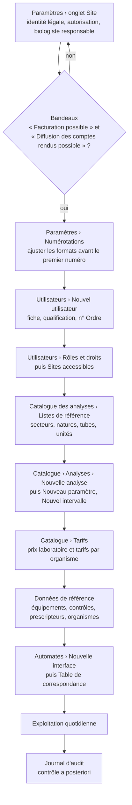
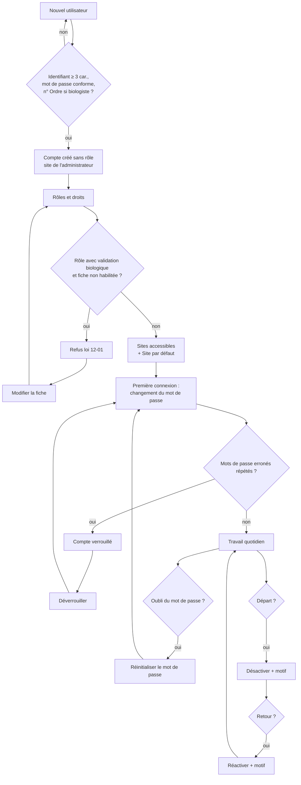
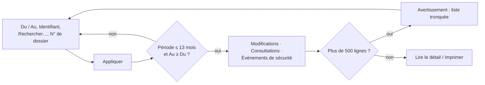
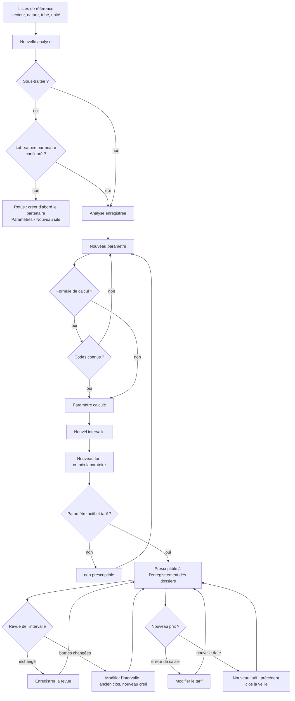
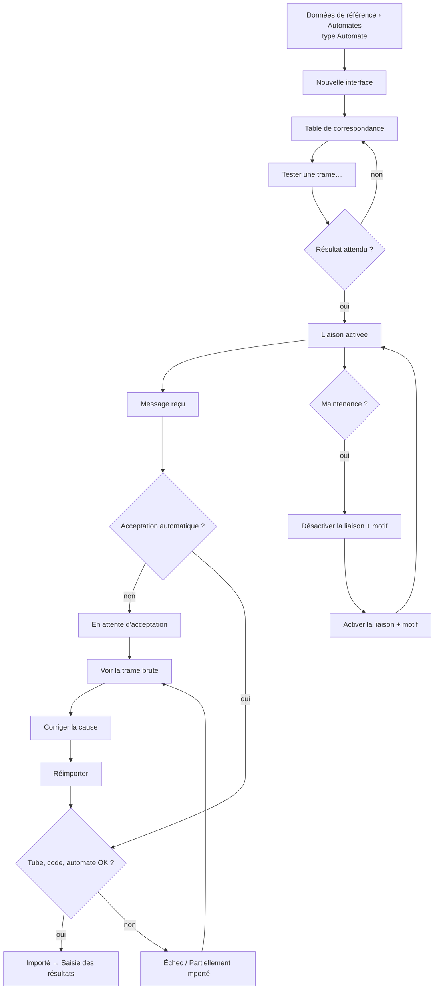
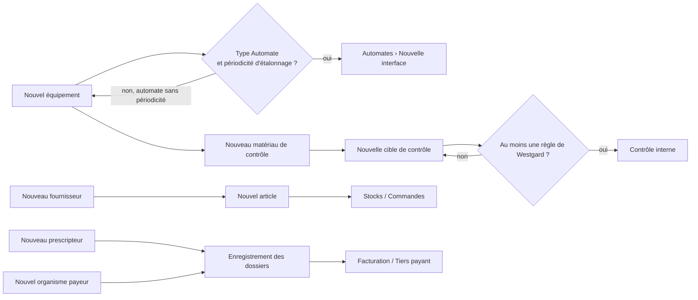
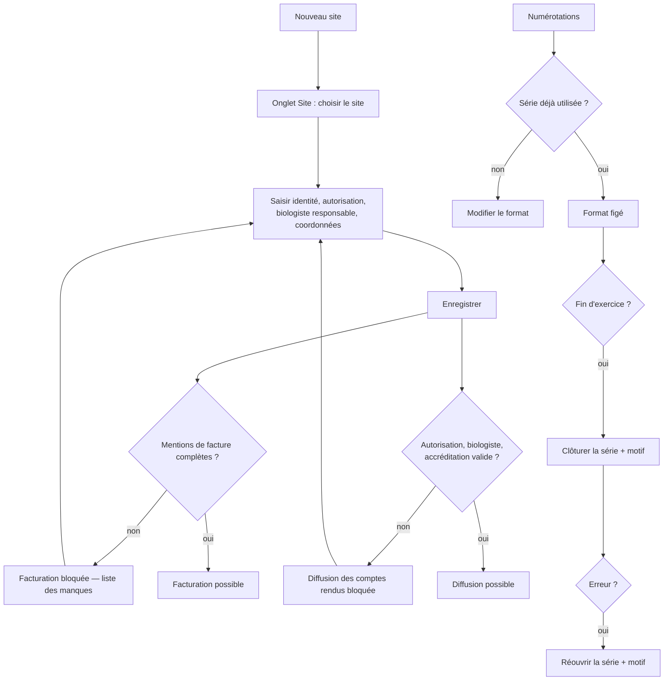

## Administration

Ce chapitre s'adresse à l'administrateur, au biologiste responsable, au responsable qualité et, pour les tarifs, au service comptable. Il couvre les comptes et leurs droits, le journal d'audit, le catalogue des analyses, les liaisons avec les automates, les données de référence (équipements, contrôles, articles, fournisseurs, prescripteurs, organismes payeurs) et les paramètres du laboratoire (identité du site, numérotations, imprimantes).

Écrans concernés, dans le groupe **ADMINISTRATION** du menu :

| Menu | Ce qu'on y fait | Raccourci par défaut |
|---|---|---|
| **Utilisateurs** | Comptes, rôles et droits, sites accessibles, journal de sécurité | aucun (on peut en définir un) |
| **Journal d'audit** | Qui a modifié quoi, qui a consulté quel dossier, connexions | aucun |
| **Catalogue des analyses** | Analyses, paramètres, valeurs usuelles, tarifs, profils, analyses en cascade, listes de référence | aucun |
| **Automates** | Liaisons avec les automates, table de correspondance, journal des messages | aucun |
| **Données de référence** | Équipements, contrôle interne, articles, fournisseurs, prescripteurs, organismes payeurs | aucun |
| **Paramètres** | Identité légale du site, numérotations, paramètres, imprimantes du poste | aucun |

Le groupe n'apparaît que si vous avez le droit d'ouvrir au moins un de ces écrans. Une entrée pour laquelle vous n'avez pas le droit n'est pas affichée du tout.

Raccourcis valables sur tous ces écrans : **F5** actualise l'écran, **Ctrl+F** place le curseur dans la zone de recherche, **Ctrl+P** (ou le bouton **Imprimer** en haut de la fenêtre) imprime la liste principale affichée, **Ctrl+S** déclenche le bouton **Enregistrer** visible, **F1** affiche la liste des raccourcis. Dans toutes les fenêtres de saisie de ce chapitre, **Entrée** vaut **Enregistrer** et **Échap** vaut **Annuler**.

### Vue d'ensemble : mettre en service une installation

L'ordre ci-dessous est celui qu'impose l'application : chaque étape a besoin de la précédente.

### Qui a accès à quoi (rôles livrés)

| Droit (tel qu'affiché dans l'arbre des droits) | Ce qu'il permet | Rôles livrés qui l'ont |
|---|---|---|
| `admin.users.view` | Ouvrir **Utilisateurs** (lecture) | Administrateur, Biologiste responsable, Responsable qualité |
| `admin.users.manage` | Créer, modifier, désactiver un compte, mot de passe, sites | Administrateur seul |
| `admin.roles.manage` | Attribuer des rôles, créer un rôle, modifier ses droits | Administrateur seul |
| `admin.audit.view` | Ouvrir **Journal d'audit** et l'onglet **Journal de sécurité** | Administrateur, Biologiste responsable, Responsable qualité |
| `catalog.view` | Ouvrir **Catalogue des analyses** | tous les rôles sauf Comptabilité et Prescripteur |
| `catalog.manage` | Analyses, paramètres, profils, cascades, listes de référence, prescripteurs | Administrateur, Biologiste responsable |
| `catalog.ranges.manage` | Valeurs usuelles (intervalles) et leur revue | Administrateur, Biologiste responsable, Responsable qualité |
| `billing.tariffs.manage` | Tarifs, organismes payeurs | Administrateur, Comptabilité |
| `instruments.view` | Ouvrir **Automates** | Administrateur, Biologiste responsable, Biologiste, Technicien, Responsable qualité |
| `instruments.configure` | Créer / modifier une interface et sa table de correspondance, tester une trame | Administrateur, Biologiste responsable |
| `instruments.control` | Activer / désactiver une liaison | Administrateur, Biologiste responsable, Technicien |
| `instruments.replay` | Réimporter une transmission | Administrateur, Biologiste responsable |
| `admin.maintenance.run` | Purger le journal des messages automates | Administrateur seul |
| `admin.sites.manage` | Onglet **Site** des **Paramètres** | Administrateur seul |
| `admin.settings.manage` | Numérotations et paramètres | Administrateur seul |

Attention (à vérifier avec votre organisation) : le rôle Comptabilité a le droit de gérer les tarifs mais pas celui d'ouvrir le Catalogue ; en pratique, seul l'administrateur peut saisir un tarif d'analyse avec les rôles livrés (voir la fiche de vérification).

---

### Utilisateurs

Gérer les comptes du personnel, leurs rôles, leurs sites, et surveiller les connexions.

**Qui y a accès** : ouverture avec `admin.users.view` (administrateur, biologiste responsable, responsable qualité). Les boutons de modification des comptes demandent `admin.users.manage`, ceux des rôles `admin.roles.manage` : les deux ne sont livrés qu'à l'administrateur. Pour les autres, les boutons sont grisés et l'arbre des droits est en lecture seule. L'onglet **Journal de sécurité** n'apparaît que si vous avez `admin.audit.view`.

**L'écran** : trois onglets.

- **Utilisateurs** : zone **Rechercher…** (valider par Entrée), case **Inclure les comptes désactivés**, compteur « N · M actif(s) ». Colonnes : **Identifiant**, **Nom complet**, **Qualification**, **N° Ordre des médecins / pharmaciens**, **Rôles et droits**, **Secteurs autorisés**, **Statut** (Actif, Actif (nombre d'échecs), Compte verrouillé, Désactivé), **Dernière connexion**, et une colonne de signes : ⚿ mot de passe à changer, ! mot de passe trop ancien, ⌛ habilitation expirée, ✓ biologiste habilité à valider. Une ligne rouge signale un compte verrouillé ou un biologiste qui ne remplit pas les conditions de la loi 12-01 ; une ligne orange un mot de passe ou une habilitation à revoir. Sous la liste, un message explique le défaut du compte sélectionné, puis les boutons **Nouvel utilisateur**, **Modifier**, **Rôles et droits**, **Sites accessibles**, **Réinitialiser le mot de passe**, **Déverrouiller**, **Désactiver** / **Réactiver**, et la phrase rappelant qu'un compte ne se supprime pas.
- **Rôles et droits** : à gauche la liste des rôles (**Code**, **Désignation**, **Utilisateurs** actifs, nombre de **Droits**, **Rôle livré**) avec **Nouveau rôle** et **Désactiver le rôle** / **Activer le rôle** ; à droite l'arbre des droits, groupés par module (Patients, Dossiers, Résultats…), avec des cases à cocher, et **Enregistrer les droits**.
- **Journal de sécurité** : les 300 derniers événements (**Date**, **Événement**, **Statut** Réussi/Échec, **Identifiant**, **Poste**, **Motif**). Case **N'afficher que l'utilisateur sélectionné** (celui sélectionné dans l'onglet Utilisateurs) et bouton **Actualiser**. Les échecs sont en rouge, les changements de privilèges en orange.

**Scénarios**

1. **Créer un compte**
   1. Cliquez **Nouvel utilisateur**.
   2. Saisissez **Identifiant** (3 caractères au moins, sans espace ; il sera mis en minuscules et ne pourra plus être changé), **Mot de passe initial** (10 caractères au moins, mêlant lettres, chiffres et caractères spéciaux), **Nom complet**, éventuellement **Nom complet (arabe)**, **Courriel**, **Téléphone**.
   3. Choisissez la **Qualification** (Médecin biologiste, Pharmacien biologiste, Technicien de laboratoire, Infirmier / préleveur, Personnel administratif, Médecin prescripteur, Non renseignée) et la **Langue de travail**.
   4. Pour un biologiste ou un médecin prescripteur, saisissez le **N° Ordre des médecins / pharmaciens** (obligatoire) et l'**INPE**. Si l'habilitation a une date de fin, cochez **Habilitation valable jusqu'au** et choisissez la date.
   5. **Secteurs autorisés** : codes des secteurs séparés par des virgules (ex. `BIOCH, HEMA`). Vide = tous les secteurs, à réserver au biologiste responsable.
   6. **Prescripteur associé** : uniquement pour un compte de médecin extérieur (rôle Prescripteur) ; le compte ne verra que les demandes de ce prescripteur.
   7. **Enregistrer**. Le message confirme la création et rappelle que le titulaire devra changer son mot de passe à la première connexion.
   8. Le compte est créé **sans rôle** et avec accès au seul site de l'administrateur : enchaînez avec les scénarios 3 et 4.

2. **Modifier une fiche** : sélectionnez le compte, **Modifier** (le double-clic n'ouvre rien sur cette liste), corrigez, **Enregistrer**. L'identifiant et le mot de passe ne sont pas modifiables ici.

3. **Attribuer ou retirer des rôles**
   1. Sélectionnez le compte, cliquez **Rôles et droits**.
   2. Cochez / décochez les rôles. Sous la liste, pour le rôle sélectionné, l'application indique le nombre de droits et avertit s'il accorde la validation biologique ou la gestion des utilisateurs.
   3. **Enregistrer**. Seuls les rôles actifs sont proposés.

4. **Définir les sites accessibles**
   1. Sélectionnez le compte, **Sites accessibles**.
   2. Cochez au moins un site, choisissez le **Site par défaut** (celui ouvert à la connexion) parmi les sites cochés.
   3. **Enregistrer**.

5. **Réinitialiser un mot de passe oublié**
   1. Sélectionnez le compte, **Réinitialiser le mot de passe**.
   2. Tapez un mot de passe provisoire et communiquez-le de vive voix (il n'est jamais affiché ni généré).
   3. Le titulaire devra le changer à la prochaine connexion ; sa session ouverte est fermée.

6. **Déverrouiller un compte** (après plusieurs mots de passe erronés) : sélectionnez-le, **Déverrouiller**. Le mot de passe n'est pas changé. Le bouton n'est actif que pour un compte actif verrouillé ou ayant des échecs.

7. **Désactiver un départ / réactiver un retour** : sélectionnez le compte, **Désactiver** (ou **Réactiver**), saisissez le motif obligatoire, validez.

8. **Créer un rôle** : onglet **Rôles et droits**, **Nouveau rôle**, tapez le code (majuscules, sans espace) puis la désignation française. Le rôle est créé **sans aucun droit** : cochez ses droits dans l'arbre puis **Enregistrer les droits**.

9. **Modifier les droits d'un rôle** : sélectionnez le rôle, cochez / décochez dans l'arbre, **Enregistrer les droits**. Une confirmation indique le nombre de droits ajoutés et retirés et le nombre d'utilisateurs actifs concernés. Les rôles livrés sont modifiables.

10. **Désactiver / réactiver un rôle créé par le laboratoire** : sélectionnez-le, **Désactiver le rôle** (confirmation si des utilisateurs actifs l'ont) ou **Activer le rôle**. Impossible pour un rôle livré (bouton grisé).

11. **Surveiller les connexions** : onglet **Journal de sécurité**, éventuellement **N'afficher que l'utilisateur sélectionné**, **Actualiser**.

12. **Créer le compte de service des automates** : l'hôte des automates fonctionne sous un compte nommé `interface`. S'il manque, l'écran **Automates** l'indique ; créez-le ici par **Nouvel utilisateur** avec l'identifiant `interface` (droits nécessaires : à vérifier).

**Règles et contrôles**

- Aucun compte ne se supprime : il signe le journal d'audit et les comptes rendus. On désactive.
- Un identifiant n'est jamais réattribué (« L'identifiant « … » est déjà attribué… »).
- Médecin biologiste, pharmacien biologiste et médecin prescripteur exigent le n° d'Ordre (« Cette qualification exige le numéro d'inscription à l'Ordre. »). Une date d'habilitation déjà passée est refusée (« … vérifiez l'année »).
- Un rôle qui donne la validation biologique ne peut être attribué qu'à un médecin ou pharmacien biologiste inscrit à l'Ordre (loi 12-01) ; ajouter ce droit à un rôle tenu par des personnes non habilitées est refusé et les noms sont cités.
- Vous ne pouvez pas modifier votre propre qualification, n° d'Ordre, date d'habilitation, secteurs ou prescripteur associé : demandez-le à un autre administrateur.
- Vous ne pouvez pas vous désactiver vous-même. L'application refuse toute opération qui laisserait l'installation sans aucun compte actif capable de gérer les utilisateurs.
- On ne déverrouille pas un compte désactivé : il faut le réactiver, avec un motif.
- On ne peut réinitialiser le mot de passe que d'un compte qui n'a pas plus de droits que soi.
- Un rôle livré ne peut être ni renommé ni désactivé.
- Création, rôles, droits, réinitialisations, désactivations, déverrouillages sont tracés dans le journal de sécurité.

**Flux** : création du compte → rôles → sites accessibles → première connexion du titulaire avec changement obligatoire du mot de passe. Pour un biologiste, la fiche (qualification, n° d'Ordre, date) conditionne la validation biologique et le choix comme biologiste responsable du site dans **Paramètres**.

---

### Journal d'audit

Retrouver après coup qui a créé, modifié ou supprimé un enregistrement, qui a consulté quel dossier patient, et les événements de sécurité.

**Qui y a accès** : `admin.audit.view` (administrateur, biologiste responsable, responsable qualité). L'écran est en lecture seule : rien ne peut y être modifié ni effacé.

**L'écran** : une barre de filtres **Du** / **Au** (ouvert par défaut sur les 30 derniers jours), **Identifiant**, **Rechercher…**, **N° de dossier**, bouton **Appliquer** et compteur de lignes ; trois onglets ; en bas, un cadre de détail de la ligne sélectionnée.

- **Modifications** : **Date**, **Identifiant**, **Enregistrement**, **Opération** (Création, Modification, Suppression logique, Suppression définitive), **N° de dossier**, **Champs modifiés**, **Motif**, **Poste**. Le détail montre les valeurs avant/après et le motif. Suppressions en rouge, modifications motivées en orange.
- **Consultations** : **Date**, **Identifiant**, **Nature de l'accès** (Consultation du dossier patient, de la demande, du compte rendu, Impression, Export, Transmission hors du laboratoire, Recherche de patients, Réponse à une demande d'accès (CNDP)), **N° de dossier**, **Enregistrements**, **Recherche effectuée**, **Écran**, **Accès dérogatoire**, **Poste**. Accès dérogatoires en rouge ; exports et transmissions en orange.
- **Événements de sécurité** : **Date**, **Identifiant**, **Événement**, **Statut** (Oui / refusé), **Motif**, **Observations**, **Poste**.

**Scénarios**

1. **Chercher qui a modifié un enregistrement** : réglez **Du** / **Au**, tapez éventuellement l'**Identifiant** ou un mot dans **Rechercher…**, **Appliquer** (ou Entrée dans une zone). Onglet **Modifications**, sélectionnez la ligne et lisez le détail en bas.
2. **Répondre à une demande d'accès d'un patient (loi 09-08, CNDP)** : tapez le **N° de dossier** du patient, réglez la période, **Appliquer**. L'onglet **Consultations** liste alors toutes les consultations de ce dossier, sans limite de 500 lignes. Imprimez la liste avec **Imprimer** / Ctrl+P (la liste imprimée est la grille affichée ; à vérifier).
3. **Contrôler les connexions et refus** : onglet **Événements de sécurité**, filtrez par **Identifiant** si besoin.
4. **Vérifier les accès dérogatoires** : onglet **Consultations**, repérez les lignes rouges ; la justification saisie s'affiche dans le détail.

**Règles et contrôles**

- Période de 13 mois au plus (« La période ne peut excéder treize mois : affinez la recherche. ») ; la date de fin ne peut précéder la date de début.
- Au-delà de 500 lignes par onglet, la liste est tronquée et un avertissement orange le dit : affinez avant de conclure.
- Le filtre **N° de dossier** ne s'applique qu'à l'onglet **Consultations** (pas aux modifications).
- Consulter le journal est lui-même tracé comme une consultation (et comme « Réponse à une demande d'accès » quand un n° de dossier est saisi).

**Flux** : écran de contrôle a posteriori, alimenté par tous les autres ; il ne transmet rien à un autre écran.

---

### Catalogue des analyses

Décrire ce que le laboratoire sait faire : analyses, paramètres, valeurs usuelles, prix, profils, analyses en cascade et listes de base.

**Qui y a accès** : ouverture avec `catalog.view` (tous les rôles du personnel sauf Comptabilité). Création et modification des analyses, paramètres, profils, cascades et listes : `catalog.manage` (administrateur, biologiste responsable). Valeurs usuelles : `catalog.ranges.manage` (administrateur, biologiste responsable, responsable qualité). Tarifs et prix laboratoire : `billing.tariffs.manage` (administrateur ; la Comptabilité a ce droit mais n'ouvre pas cet écran). Les boutons non autorisés sont grisés.

**L'écran** : sept onglets et une ligne d'état en bas.

- **Analyses** : barre avec **Code, nom ou synonyme de l'analyse** (Entrée), filtre de secteur (**Tous les secteurs**), case **Inclure les entrées désactivées** (cochée par défaut). Trois zones : à gauche les analyses (**Code**, **Désignation**, **Secteur**, **Nature du prélèvement**, **Paramètres**, **Prix**, **Délai de rendu**, **Statut** avec mentions « non prescriptible », « Sous-traitée », « Consentement requis avant enregistrement »…), boutons **Nouvelle analyse**, **Modifier l'analyse** ; en haut à droite les paramètres de l'analyse sélectionnée (**Type de résultat**, **Unité**, **Domaine de mesure**, **Seuils critiques**, **Delta-check (%)**, mentions « interne », « inexploitable »), boutons **Nouveau paramètre**, **Modifier le paramètre** ; en bas à droite les intervalles du paramètre sélectionné (**Population concernée**, **Valeurs usuelles**, **Validité**, **Dernière revue**, **Source de l'intervalle**, mentions « remplacé », « revue à faire », « Seuil décisionnel », « unité d'âge à confirmer »), boutons **Nouvel intervalle**, **Modifier l'intervalle**, **Enregistrer la revue**.
- **Tarifs** : les tarifs de l'analyse sélectionnée dans l'onglet Analyses (**Organisme payeur**, **Validité**, **Lettre-clé**, **Coefficient**, **Tarif national de référence**, **Prix**, **Dépassement du tarif de référence**, **TVA**), boutons **Nouveau tarif**, **Modifier le tarif**.
- **Profils** : les profils (bilans) avec **Somme du détail** et **Prix forfaitaire**, à droite leur composition ; boutons **Nouveau profil**, **Modifier le profil**.
- **Analyses en cascade** : **Déclencheur**, **Condition**, **Analyse ajoutée**, **Description**, **Ajout** (Automatique / À confirmer), mentions « règle inopérante », « non facturée » ; boutons **Nouvelle règle en cascade**, **Modifier la règle**.
- **Listes de référence** : choix de la liste (**Secteurs techniques**, **Natures de prélèvement**, **Types de tube**, **Unités de mesure**), colonne **Utilisé par** ; boutons **Ajouter**, **Modifier**.
- **Nomenclature des actes** : la nomenclature officielle des actes de biologie médicale (NABM, arrêtés de 2005, 2012 et 2016), en lecture seule : **Code NABM**, **Libellé de l'acte**, **Coefficient**, **Chapitre**, **Arrêté**, **Utilisé par** (nombre d'analyses du catalogue qui citent l'acte). Recherche par code (« B118 » ou « 118 ») ou par libellé, sans tenir compte des accents ; pastilles **Tous**, **2005**, **2012**, **2016**.
- **Écarts avec la nomenclature** : les analyses actives **sans code d'acte**, avec un **code inconnu** de la nomenclature, ou dont un tarif en vigueur n'a pas le **coefficient officiel** (**Code interne**, **Désignation**, **Code NABM**, **Libellé de l'acte**, **Coef. officiel**, **Coef. actuel**, **Écart**) ; pastilles par type d'écart ; boutons **Modifier l'analyse** et **Appliquer le coefficient officiel** (droit des tarifs).

Un double-clic sur une ligne fait la même chose que le bouton **Modifier** correspondant, quand il est actif.

**Scénarios**

1. **Créer une analyse**
   1. Onglet **Analyses**, **Nouvelle analyse**.
   2. **Code** (saisi une seule fois, mis en majuscules, jamais modifiable), **Désignation (français)** obligatoire, arabe et anglais facultatifs, **Libellé court**, **Synonymes de recherche**.
   3. **Secteur** et **Nature du prélèvement** (obligatoires), **Type de tube**, **Volume requis (mL)**, **Code LOINC**, **Code de l'acte** (code NABM : bouton **…** à côté de la case, ou F4, pour le choisir dans la nomenclature), **Consentement spécifique requis** (général, génétique écrit, VIH et conseil, dépistage prénatal).
   4. **Technique analytique**, **Réactif / coffret**, cases **Sous accréditation**, **Sous-traitée**, **Maladie à déclaration obligatoire**.
   5. **Délai routine (h)**, **Délai urgent (min)**, **Réalisable en urgence** ; **Jeûne (h, dérogation)**, **Stabilité 20 °C (h)**, **Stabilité 4 °C (h)**, **Ordre d'affichage**, **Renseignement clinique exigé**.
   6. Bloc **Prix du laboratoire** (si vous avez le droit des tarifs) : **Lettre-clé** (B par défaut), **Coefficient**, **Valeur de la lettre-clé** (préremplie avec la dernière valeur connue), **Prix laboratoire**. La base de remboursement et le dépassement à la charge du patient se calculent en direct.
   7. **Actif**, puis **Enregistrer**. La ligne d'état confirme « … enregistrée ; prix du laboratoire appliqué à partir du … ».
   8. Ajoutez au moins un paramètre et un tarif : sans eux l'analyse reste « non prescriptible ».

2. **Marquer une analyse comme sous-traitée** : dans la fiche, cochez **Sous-traitée** puis choisissez le **Laboratoire partenaire**. La liste ne propose que les sites de type « Laboratoire partenaire (sous-traitance) » ; s'il n'y en a aucun, l'enregistrement est refusé (« Aucun laboratoire partenaire n'est configuré… »). Créez-le d'abord dans **Paramètres** › **Nouveau site**.

3. **Modifier une analyse** : sélectionnez-la, **Modifier l'analyse**. La fenêtre s'ouvre sur toute la fiche enregistrée ; le **Code** reste celui créé par le laboratoire (il ne change jamais).
4. **Lier une analyse à un acte de la nomenclature** : dans la fiche, bouton **…** à côté de **Code NABM** (ou F4 dans la case) ; cherchez l'acte par code ou par libellé, flèches haut / bas, **Sélectionner** (ou double-clic). Le code de l'acte est rempli et, si vous avez le droit des tarifs, la lettre-clé B et le coefficient officiel sont proposés ; un prix qui suivait la base de remboursement la suit. Un code tapé qui ne figure pas dans la nomenclature est signalé en rouge et demande une confirmation à l'enregistrement. Plusieurs analyses peuvent citer le même acte ; une analyse hors nomenclature n'en cite aucun.
5. **Aligner un tarif sur le coefficient officiel** : onglet **Écarts avec la nomenclature**, sélectionnez une ligne « Coefficient différent », **Appliquer le coefficient officiel**, confirmez. Chaque tarif en vigueur concerné reçoit une nouvelle version à compter du jour ; les demandes déjà tarifées et les factures émises gardent leur prix. Un tarif dont une révision est déjà programmée après aujourd'hui est laissé à l'onglet **Tarifs**. La ligne suivante devient la ligne courante.

4. **Ajouter un paramètre**
   1. Sélectionnez l'analyse, **Nouveau paramètre**.
   2. **Code**, **Type de résultat** (Numérique, Numérique avec opérateur, Texte libre, Liste de choix, Semi-quantitatif, Titre, Intitulé de section), **Unité**, **Décimales**, désignations, **Libellé court**, **Code LOINC**, **CV analytique (%)**, **Ordre d'affichage**, **Retrait sur le compte rendu**.
   3. Limites : **Domaine de mesure**, **Limites techniques**, **Seuils critiques** (bas / haut). Les limites techniques doivent englober le domaine de mesure.
   4. **Delta-check (%)** et **Fenêtre delta (j)** (la fenêtre est obligatoire dès qu'un delta est saisi).
   5. Pour une liste de choix ou un semi-quantitatif : remplissez **Réponses autorisées** (code, libellé, Normale, Anormal, Critique) ou cliquez **Ajouter Négatif / Positif** ; **Retirer** enlève la ligne sélectionnée.
   6. Cases **interne** (non imprimé), **Toujours porter au compte rendu**, **Actif** ; **Enregistrer**.

5. **Créer un paramètre calculé** : dans le paramètre (type numérique), remplissez **Formule de calcul** en citant les autres paramètres de la même analyse entre crochets, par ex. `[CHOL] - [HDL] - [TG]/5`. Un code inconnu est signalé avant l'enregistrement.

6. **Modifier un paramètre** : **Modifier le paramètre**. Le type est figé dès qu'un résultat existe (le nombre de résultats est affiché). La fenêtre s'ouvre sur tout le paramètre enregistré, réponses autorisées comprises.

7. **Saisir des valeurs usuelles**
   1. Sélectionnez le paramètre, **Nouvel intervalle**.
   2. Population : **Sexe**, **Tranche d'âge (de / à)** avec l'unité (j, mois, ans), **Grossesse** (Sans distinction, Grossesse en cours, Hors grossesse) et **Trimestre**, éventuellement **Automate** (intervalle propre à une technique).
   3. **Valeurs usuelles** (bornes), ou **Réponse attendue** pour un paramètre codé ; **Seuil décisionnel** ; **Intervalle imprimé** si les bornes ne suffisent pas ; **Source de l'intervalle**, **Dernière revue**, **À compter du**, **Jusqu'au**.
   4. **Enregistrer**. En cas d'intervalles concurrents, le plus spécifique l'emporte (indice affiché).

8. **Réviser un intervalle** : **Modifier l'intervalle**, changez les bornes, **Enregistrer**. Si l'intervalle est en vigueur, l'ancien est clos la veille et un nouveau est créé (« Intervalle révisé : le précédent a été clos et reste consultable. »).

9. **Enregistrer une revue périodique sans changement (ISO 15189)** : sélectionnez l'intervalle, **Enregistrer la revue**, complétez la source si besoin, confirmez avec **Enregistrer la revue**. La revue est datée du jour. Les intervalles jamais revus ou revus il y a plus de 3 ans sont marqués « revue à faire ».

10. **Réviser un prix (nouvelle valeur du B, nouveau tarif d'organisme)**
    1. Sélectionnez l'analyse dans l'onglet **Analyses**, puis onglet **Tarifs**, **Nouveau tarif**.
    2. **Organisme payeur** (« Tarif du laboratoire » pour les patients payants), **À compter du** (date postérieure au tarif en vigueur, proposée automatiquement), **Lettre-clé**, **Coefficient**, **Valeur de la lettre-clé**, **Prix**, **Exonéré de TVA** (coché par défaut) ou taux de **TVA**.
    3. **Enregistrer**. Le tarif précédent est clos la veille ; les factures déjà émises gardent leur prix.
    4. La valeur de la lettre-clé B est nationale mais se saisit **analyse par analyse** : il n'existe pas de bouton de révision globale du B.

11. **Corriger une faute de frappe sur un tarif** : onglet **Tarifs**, sélectionnez le tarif, **Modifier le tarif**. Seuls prix, coefficient, lettre-clé, valeur et TVA changent ; organisme et dates restent. Les dossiers déjà facturés gardent leur prix.

12. **Créer ou modifier un profil (bilan)** : onglet **Profils**, **Nouveau profil** / **Modifier le profil** ; **Code**, désignations, **Synonymes de recherche**, **Prix forfaitaire** (facultatif), cases **Détailler sur la facture** (à garder pour le tiers payant), **Regrouper sur le compte rendu**, **Actif** ; cochez les analyses et, si besoin, **facultative** ; **Enregistrer**. Le total du détail et le forfait s'affichent. (Les synonymes s'ouvrent vides en modification : à ressaisir.)

13. **Créer une analyse en cascade (réflexe)** : onglet **Analyses en cascade**, **Nouvelle règle en cascade** ; **Analyse du déclencheur**, **Paramètre déclencheur**, **Condition** (Supérieur à, Inférieur à, Dans l'intervalle, Hors intervalle, Réponse codée égale à) avec **Seuil** / **Seuil supérieur** / **Réponse déclenchante** ; **Analyse ajoutée** ; **Description (français)** obligatoire ; **Ajouter sans confirmation** (sinon le biologiste valide la proposition), **Acte facturable**, **Actif** ; **Enregistrer**.

14. **Gérer les listes de référence** : onglet **Listes de référence**, choisissez la liste, **Ajouter** ou **Modifier**. Secteur : ordre, **Dans le périmètre d'accréditation**. Nature de prélèvement : **Jeûne requis (h)**, **Consignes de prélèvement**, **Consignes remises au patient**. Type de tube : **Couleur du bouchon** (#RRGGBB), **Additif / anticoagulant**, **Ordre de prélèvement** (obligatoire), volumes, « à l'abri de la lumière », « transport sous glace ». Unité : **Symbole**, **Symbole (arabe)**, **Code UCUM**, **Facteur vers l'unité SI** et **Unité SI** (l'un ne va pas sans l'autre).

15. **Désactiver une analyse, un paramètre, une entrée de liste** : décochez **Actif** et enregistrez (rien ne se supprime).

**Règles et contrôles**

- Les codes (analyse, paramètre, profil, entrées de liste) ne se modifient jamais après création.
- Le type de résultat d'un paramètre est figé dès qu'un résultat existe.
- Une analyse qui a des analyses en cours sans résultat ne peut pas être désactivée (« N analyse(s) en cours attendent encore un résultat… ») ; une entrée de liste utilisée non plus.
- Le délai urgent ne peut dépasser le délai de routine ; la stabilité à 20 °C ne peut dépasser celle à 4 °C.
- Un tarif ne s'écrase pas : chaque nouveau prix est une nouvelle version, sans chevauchement (« Une révision doit prendre effet après le … »). Un acte qui porte un code de nomenclature exige coefficient et valeur de lettre-clé.
- Les actes de biologie médicale sont exonérés de TVA ; un taux n'est exigé que si la case est décochée.
- Un intervalle en vigueur n'est pas réécrit : il est remplacé. Un intervalle hors du domaine de mesure est refusé.
- Un profil doit contenir au moins une analyse non facultative, sans analyse désactivée.
- Une règle en cascade doit pouvoir se déclencher (seuils cohérents, réponse codée existante) et ne peut ajouter l'analyse du déclencheur lui-même.
- Une analyse est « non prescriptible » tant qu'elle n'a pas de paramètre actif ou de tarif.

**Flux** : catalogue → enregistrement des dossiers (choix des analyses et des profils, prix) → saisie des résultats (paramètres, limites, formules, cascades) → validation et compte rendu (valeurs usuelles, mention d'accréditation) → facturation (tarifs). Une analyse sous-traitée part vers l'écran **Sous-traitance**.

---

### Automates

Relier les automates au LIS : configurer la liaison, traduire les codes de l'automate en paramètres, surveiller les messages reçus et réimporter ceux qui ont échoué.

**Qui y a accès** : ouverture avec `instruments.view` (administrateur, biologistes, technicien, responsable qualité). Création / modification / table de correspondance / test de trame : `instruments.configure` (administrateur, biologiste responsable ; le test demande aussi le droit de voir les résultats). Activer / désactiver une liaison : `instruments.control` (administrateur, biologiste responsable, technicien). **Réimporter** : `instruments.replay` (administrateur, biologiste responsable). **Voir la trame brute** : droit de voir les résultats. **Purger le journal** : `admin.maintenance.run` (administrateur).

**L'écran** : en haut l'état de l'hôte des automates (actif avec le nombre de liaisons en service et en défaut, en défaut, ou « Ce poste ne pilote pas les automates… ») et **Actualiser** ; l'état se met à jour seul. Trois zones :

- **Liaisons** : **Automate**, **Protocole**, **Point de connexion**, **Sens**, **État en direct**, nombre de correspondances, **Messages (jour)**, **Dernier message**, **Statut** (désactivée, aucune correspondance active, acceptation automatique, erreur de liaison, non piloté ici…). Boutons **Nouvelle interface**, **Modifier l'interface**, **Désactiver la liaison** / **Activer la liaison**.
- **Correspondances** de la liaison sélectionnée : **Code automate**, **Paramètre**, **Désignation**, **Unité**, **Conversion**, alertes (« unités différentes sans conversion », « aucune traduction des réponses »). Boutons **Table de correspondance**, **Tester une trame…**.
- **Journal des messages** (200 derniers) : **Date et heure**, **Sens**, **Échantillons**, **Résultats** (reçus/importés), **Statut** (Reçu, Importé, Partiellement importé, Échec, Ignoré, En attente d'acceptation), **Anomalies**. Boutons **Voir la trame brute** (ou double-clic), **Réimporter**, **Purger le journal**.

**Scénarios**

1. **Déclarer une nouvelle liaison**
   1. Prérequis : l'automate existe dans **Données de référence › Automates** avec le type « Automate ».
   2. **Nouvelle interface**, choisissez l'automate (seuls ceux sans liaison sont proposés).
   3. **Protocole** (ASTM E1394, HL7 v2, POCT1-A, CSV, texte délimité, fichier à largeur fixe), **Liaison physique** (Série RS-232, TCP/IP, Dépôt de fichiers), **Sens** (Unidirectionnel, Bidirectionnel, Envoi de la liste de travail).
   4. Selon la liaison : **Port série**, **Débit**, **Bits de données**, **Parité**, **Bits d'arrêt**, **Contrôle de flux** ; ou **Hôte**, **Port TCP**, **Le LIS écoute (l'automate se connecte)** ; ou **Dossier entrant**, **Motif de fichier**, **Dossier des fichiers traités**, **Dossier sortant**.
   5. **Encodage** (ISO-8859-1 par défaut), **Délai d'acquittement (s)**, **Tentatives**, **Signaler les codes inconnus**, **Router les contrôles vers le CIQ**.
   6. **Format des messages** : **Profil fabricant** (Standard, Roche cobas, Abbott Architect / Alinity, Personnalisé) et réglages fins seulement si le manuel de l'automate le demande.
   7. Laissez **acceptation automatique** décochée au départ ; cochez **Liaison activée** si vous voulez qu'elle tourne ; **Enregistrer**. La prise en compte par l'hôte se fait en quelques secondes.

2. **Remplir la table de correspondance** : sélectionnez la liaison, **Table de correspondance**, **Ajouter des paramètres…**, tapez un code d'analyse (ex. NFS) ou de paramètre, cochez (ou **Tout cocher**), **Ajouter à la correspondance** ; pour chaque ligne saisissez le **Code automate**, éventuellement **Unité automate**, **Facteur** et **Décalage** de conversion, **Réponses codées** ; **Retirer la ligne** si besoin ; **Enregistrer**. Une ligne retirée qui a déjà servi est conservée, désactivée.

3. **Tester une trame** : **Tester une trame…**, collez une trame ou **Charger la dernière trame reçue**, **Analyser la trame**. L'écran montre, pour chaque résultat, le tube, le dossier et patient, le code lu, le paramètre, la valeur reçue et la valeur LIS, et **Ce que ferait le LIS**. Rien n'est enregistré. Aussi accessible depuis la fenêtre de modification de l'interface (après le premier enregistrement).

4. **Activer l'acceptation automatique** : **Modifier l'interface**, cochez **acceptation automatique**, confirmez. Refusé tant que la table de correspondance est vide.

5. **Couper une liaison (automate en maintenance)** : sélectionnez-la, **Désactiver la liaison**, motif obligatoire. **Activer la liaison** pour la remettre, avec motif.

6. **Traiter une transmission retenue ou en échec** : dans le **Journal des messages**, lisez **Anomalies** ; **Voir la trame brute** pour le texte exact ; corrigez la cause (tube pas encore réceptionné, code inconnu à ajouter, automate remis en service, étalonnage enregistré…) ; puis **Réimporter**, confirmez. Le nombre de valeurs enregistrées est affiché. Seules les lignes Échec, Partiellement importé ou En attente d'acceptation se réimportent.

7. **Purger le journal des messages** : **Purger le journal** ; l'application annonce combien de trames seront supprimées et combien sont gardées parce que encore réimportables ; confirmez, saisissez le motif.

**Règles et contrôles**

- Une seule liaison par automate. L'automate doit être de type « Automate ».
- Une liaison bidirectionnelle exige au moins une correspondance ; l'acceptation automatique exige une table renseignée.
- Deux codes ne peuvent viser le même paramètre ; un code ne peut servir deux fois ; un facteur nul est refusé.
- Sans acceptation automatique, chaque transmission reste « En attente d'acceptation » jusqu'à **Réimporter** (droit livré au seul biologiste responsable et à l'administrateur).
- Les résultats d'un automate hors service, en maintenance, réformé ou à l'étalonnage échu sont retenus.
- Un résultat déjà validé biologiquement n'est pas écrasé par l'automate (compte rendu rectifié nécessaire).
- La purge ne supprime jamais une trame encore réimportable ; elle est tracée avec votre nom et le motif.
- Seul le poste désigné comme hôte pilote réellement les automates.

**Flux** : Données de référence (automate) → Automates (liaison, correspondances) → messages reçus → résultats dans **Saisie des résultats** (ou contrôles dans le **Contrôle interne**) → validation.

---

### Données de référence

Tenir à jour les fichiers de base des autres modules : équipements, contrôle interne, articles de stock, fournisseurs, prescripteurs, organismes payeurs.

**Qui y a accès** : l'entrée apparaît si vous avez au moins un de ces droits : gestion des équipements (administrateur, biologiste responsable, responsable qualité), règles de contrôle qualité (mêmes rôles), gestion des commandes (administrateur, comptabilité), `catalog.manage` (administrateur, biologiste responsable), gestion des tarifs (administrateur, comptabilité). Chaque onglet n'est modifiable qu'avec son droit ; les boutons sont grisés sinon.

**L'écran** : case **Inclure les comptes désactivés** (inclut les entrées désactivées), ligne d'état « Données de référence complètes… » ou « Écrans encore inexploitables faute de données de référence — … ». Six onglets :

| Onglet | Boutons | Droit pour modifier |
|---|---|---|
| **Automates** (tous les équipements) | **Nouvel équipement**, **Modifier** | gestion des équipements |
| **Contrôle interne** (matériaux, puis cibles du matériau sélectionné) | **Nouveau matériau de contrôle**, **Nouvelle cible de contrôle**, **Modifier** | règles de contrôle qualité |
| **Articles** | **Nouvel article**, **Modifier** | gestion des commandes |
| **Fournisseurs** | **Nouveau fournisseur**, **Modifier** | gestion des commandes |
| **Prescripteurs** (zone **Rechercher…**) | **Nouveau prescripteur**, **Modifier** | `catalog.manage` |
| **Organismes payeurs** | **Nouvel organisme payeur**, **Modifier** (ou double-clic) | gestion des tarifs |

**Scénarios**

1. **Déclarer un équipement / automate** : **Nouvel équipement** ; **Code**, désignations, **Type d'équipement**, **Emplacement**, **N° de série**, **Fabricant**, **Modèle**, **Version logicielle**, **Fournisseur**, **Contrat de maintenance**, **Assistance technique**, **Contrat valable jusqu'au**, **Mise en service** ; **Périodicités** (maintenance, étalonnage, vérification, en jours) ; dates de **Dernière maintenance**, **Dernier étalonnage**, **Dernière vérification** (reprise du classeur papier) ; **Enregistrer**. Pour un automate, la périodicité d'étalonnage est obligatoire.
2. **Modifier un équipement** : **Modifier**. La fenêtre s'ouvre sur toute la fiche enregistrée.
3. **Déclarer un matériau de contrôle** : onglet **Contrôle interne**, **Nouveau matériau de contrôle** ; **Lot de contrôle**, désignation, **Niveau**, **Péremption**, **Référence catalogue**, **Ouvert le**, **Stabilité après ouverture (jours)**, **Actif** ; **Enregistrer**.
4. **Définir une cible de contrôle** : sélectionnez le matériau, **Nouvelle cible de contrôle** ; **Matériau de contrôle**, **Automate**, **Paramètre**, **Moyenne assignée**, **Écart-type assigné**, **CV maximal (%)**, cochez les **Règles de Westgard actives** (au moins une) ; **Enregistrer**. Il faut d'abord un matériau, un équipement et un paramètre au catalogue.
5. **Créer un article de stock** : onglet **Articles**, **Nouvel article** ; code, désignation, **Unité**, **Tests par coffret**, **Lieu de conservation**, **Fournisseur**, **Analyses consommatrices**, **Stock de sécurité**, **Seuil de réapprovisionnement** (≥ stock de sécurité), **Quantité à commander**, **Stock maximal**, **Article critique**, **Produit dangereux** et **Classe de danger**, **GTIN (GS1)**, **Marquage CE (DM-DIV)**, paramètres de consommation ; en modification, **Appliquer** reprend le seuil calculé proposé.
6. **Créer un fournisseur** : **Nouveau fournisseur** ; code, dénomination, **ICE**, **Identifiant fiscal (IF)**, **Registre de commerce**, **Contact**, coordonnées, **Délai (j)**, **Délai de règlement (j)** (loi 69-21 : 60 jours, 120 au plus par accord), **Compte auxiliaire**, **Approuvé** (exige **Dernière évaluation** et **Note (0-100)**), **N° d'enregistrement AMMPS/DMP** et sa validité.
7. **Créer ou corriger un prescripteur** : onglet **Prescripteurs**, **Nouveau prescripteur** ; **Nom** (obligatoire), **Prénom**, nom arabe, type, **Spécialité**, **Établissement**, **N° Ordre des médecins / pharmaciens**, **INPE** (nécessaire au tiers payant), **ICE**, **Téléphone**, **Téléphone mobile**, **Fax**, **Courriel**, **Ville**, **Adresse**, **Téléphone résultats critiques**, **Remise** (mode de transmission des comptes rendus), **Envoyer les comptes rendus partiels**, **Remise** (%), **Observations**, **Actif**. En modification, la fenêtre s'ouvre sur toute la fiche enregistrée.
8. **Paramétrer un organisme payeur** : onglet **Organismes payeurs**, **Nouvel organisme payeur** / **Modifier** ; type, **Taux de remboursement (%)** (saisir 70 pour 70 %), **Délai de règlement (jours)**, **Tarification sur la TNR** (imposée pour un régime AMO), **Ordonnance obligatoire**, **INPE du biologiste exigé**, **Convention de tiers payant**, **N° de convention**, **Convention valable jusqu'au**, **Compte comptable** ; **Enregistrer**. Les taux livrés à l'installation sont à confirmer contre la convention.

**Règles et contrôles**

- Un automate sans périodicité d'étalonnage est refusé (sinon le blocage « étalonnage échu » ne pourrait jamais jouer).
- Une cible de contrôle sans règle de Westgard est refusée.
- Le seuil de réapprovisionnement ne peut être inférieur au stock de sécurité.
- Un fournisseur ne peut être approuvé sans évaluation (ISO 15189 § 4.6).
- Le mode de transmission d'un prescripteur exige l'adresse correspondante (courriel, mobile ou fax).
- Les données de cet écran ne se suppriment pas : on décoche **Actif**.

**Flux** : ces fichiers alimentent **Équipements** et **Automates**, le **Contrôle interne**, les **Stocks** et **Commandes**, l'enregistrement des dossiers (prescripteur, organisme) et la **Facturation** / **Tiers payant**.

---

### Paramètres

Renseigner l'identité légale du laboratoire, régler les numérotations, les paramètres généraux et les imprimantes du poste.

**Qui y a accès** : l'entrée apparaît avec `admin.sites.manage` ou `admin.settings.manage` (livrés à l'administrateur seul). Onglet **Site** modifiable avec `admin.sites.manage` ; onglets **Numérotations** et **Paramètres** modifiables avec `admin.settings.manage`. L'onglet **Imprimantes** concerne le poste sur lequel vous êtes.

**L'écran** : quatre onglets.

- **Site** : liste déroulante du site à afficher (code — raison sociale), deux bandeaux : « Facturation possible… » ou « Facturation bloquée — » suivi de ce qui manque, et « Diffusion des comptes rendus possible. » ou « Diffusion des comptes rendus bloquée — … ». Puis les champs : **Code**, **Désignation (français)**, **Désignation (arabe)**, **Type de site** (Laboratoire principal, Laboratoire satellite, Centre de prélèvement, Laboratoire correspondant) ; **Identité légale (mentions obligatoires sur facture)** : **Raison sociale**, **ICE**, **Identifiant fiscal (IF)**, **Taxe professionnelle**, **Registre de commerce**, **Tribunal**, **N° d'affiliation CNSS**, **INPE** ; **Autorisation et accréditation** : **N° d'autorisation du ministère de la Santé**, **Date de l'autorisation**, **Biologiste responsable**, **Site accrédité (ISO 15189)**, **N° d'accréditation**, **Accréditation valable jusqu'au** ; **Coordonnées** : **Adresse** (français et arabe), **Ville**, **Région**, **Code postal**, **Téléphone**, **Fax**, **Courriel**, **Site web** ; **Logo du laboratoire** avec **Choisir le logo…** et **Retirer le logo** ; boutons **Enregistrer** et **Actualiser**.
- **Numérotations** : **Série**, **Site**, année (colonne **Date**), **Format**, **Prochain numéro**, **Valeur suivante**, **Dernier attribué**, **Statut** (Modifiable, En service, Clôturée). Boutons **Modifier le format**, **Clôturer la série** / **Réouvrir la série**.
- **Paramètres** : **Clé**, **Valeur** (masquée si sensible), **Site**, **Description**, **Sensible**. Boutons **Modifier**, **Nouveau**.
- **Imprimantes** : imprimante **Comptes rendus, factures, fiches de paillasse (A4)**, case **Imprimer directement sur cette imprimante, sans aperçu à l'écran**, imprimante **Étiquettes des tubes**, boutons **Enregistrer**, **Imprimer une étiquette de test**, **Actualiser**.

**Scénarios**

1. **Compléter l'identité du site (premier jour)**
   1. Onglet **Site**, choisissez le site dans la liste.
   2. Renseignez au minimum **Raison sociale**, **ICE** (15 chiffres), **Identifiant fiscal (IF)**, **Adresse** et **Ville** (pour facturer), **N° d'autorisation du ministère de la Santé** et **Biologiste responsable** (pour diffuser les comptes rendus). Les espaces et barres dans ICE, IF et CNSS sont retirés automatiquement.
   3. **Enregistrer**. L'enregistrement est accepté même incomplet ; les bandeaux disent ce qui bloque encore. Quand tout est complet : « Configuration complète : la facturation et la diffusion des comptes rendus sont débloquées. »

2. **Désigner le biologiste responsable** : la liste ne propose que les comptes actifs habilités à valider (biologiste avec n° d'Ordre). Créez ou complétez d'abord la fiche dans **Utilisateurs**.

3. **Déclarer l'accréditation** : cochez **Site accrédité (ISO 15189)**, saisissez **N° d'accréditation** (obligatoire) et **Accréditation valable jusqu'au**, **Enregistrer**. Une accréditation expirée bloque la diffusion.

4. **Mettre le logo** : **Choisir le logo…** (PNG, JPG, BMP), puis **Enregistrer** ; **Retirer le logo** puis **Enregistrer** pour l'enlever. Le logo est imprimé en tête des comptes rendus et des factures.

5. **Créer un nouveau site** : cliquez **Nouveau site** à côté de la liste des sites, saisissez le **Code** (majuscules, chiffres, - et _ ; il ne pourra plus changer une fois des documents numérotés), le nom en français et en arabe, et le type : laboratoire principal, laboratoire satellite, centre de prélèvement ou « Laboratoire partenaire (sous-traitance) ». Le site créé est sélectionné : complétez sa fiche puis **Enregistrer**. Pour un site de travail, donnez ensuite l'accès aux utilisateurs dans **Utilisateurs**. Un partenaire n'est jamais proposé à la connexion ni dans les accès des utilisateurs.

6. **Ajuster le format d'une numérotation avant le premier numéro** : onglet **Numérotations**, sélectionnez une série au statut « Modifiable », **Modifier le format**, saisissez le format avec les jetons `{SITE}`, `{YEAR}`, `{YY}`, `{MM}`, `{SEQ:n}` (n = nombre de chiffres ; `{SEQ}` obligatoire), validez. Le **Prochain numéro** affiche le résultat.

7. **Clôturer une série en fin d'exercice** : sélectionnez la série, **Clôturer la série**, motif obligatoire. Plus aucun document ne peut y être numéroté. **Réouvrir la série** (motif obligatoire) en cas d'erreur.

8. **Modifier un paramètre** : onglet **Paramètres**, sélectionnez la ligne, **Modifier**, saisissez la valeur. **Nouveau** crée un paramètre (clé puis valeur), valable pour toute l'installation. Les messages aux patients et les coûts du pilotage se règlent sur leurs propres écrans.

9. **Choisir les imprimantes de ce poste** : onglet **Imprimantes**, choisissez l'imprimante A4 et l'imprimante d'étiquettes (ou « Aucune : étiquettes en PDF »), cochez au besoin l'impression directe, **Enregistrer** ; **Imprimer une étiquette de test** pour vérifier. **Actualiser** relit les imprimantes installées.

**Règles et contrôles**

- Facturation bloquée tant que raison sociale, ICE, IF, adresse et ville manquent ; diffusion des comptes rendus bloquée sans autorisation du ministère, sans biologiste responsable, ou avec une accréditation expirée.
- Le biologiste responsable doit être médecin ou pharmacien biologiste inscrit à l'Ordre (loi 12-01).
- Le code du site ne peut plus changer dès qu'un numéro de dossier ou de facture a été émis avec lui ; il doit être unique.
- **Numéros de dossier et numéros de bordereau de sous-traitance** : un seul compteur partagé par tous les sites. Le format ne change pas (par ex. `2610-000123` pour un dossier, `ST/2026/00012` pour un bordereau), mais deux sites ne peuvent plus produire le même numéro ; dans l'onglet **Numérotations**, ces séries apparaissent sans site (« — »). Les factures, avoirs, reçus et bordereaux de tiers payant restent numérotés par site.
- Le format d'une série est figé dès le premier numéro (série continue exigée par la DGI). Chaque nouvelle année, la série est créée automatiquement au premier document avec le format par défaut : un format personnalisé n'est pas reporté (à vérifier en début d'année).
- La valeur d'un paramètre sensible n'est jamais affichée ; sa modification est tracée au journal de sécurité.
- Les imprimantes sont propres à chaque poste ; les autres paramètres sont communs à tous les postes.

**Flux** : Paramètres (site complet) → débloque **Facturation** et la diffusion dans **Comptes rendus** ; numérotations → numéros de dossier à l'enregistrement, factures, bordereaux ; imprimantes → étiquettes au **Prélèvement** et documents A4.

